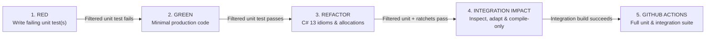

# C# Test-Driven Development (TDD) Skill — Hydrogen Junior Execution

This skill equips a **Phase 4 C# TDD Developer (`csharp-tdd-developer`)** running on **Gemini 4 Hydrogen** (`gemini-4-hydrogen-high` / `gemini-4-hydrogen-xhigh`) to work in a **Senior–Junior Developer pairing** with **Orchestrator (Argon)**.

---

## 1. Senior–Junior Pairing & Cost-Efficiency Model

- **Senior Orchestrator (`Orchestrator (Argon)`):** Pre-analyzes the implementation plan, decomposes work packages, and supplies a complete, bite-sized task brief containing target files, line ranges, signatures, binding `SEC-*` / `Q-SEC*` security conditions, ratchet rules, unit test `--filter` values, and integration test impact pointers.
- **Junior Execution Developer (`Gemini 4 Hydrogen`):** Consumes Argon's pre-digested context directly and executes strict Red-Green-Refactor TDD in its assigned worktree (`/work/wt/<name>`, `NUGET_PACKAGES=/work/nuget`).
- **Cost-Efficient, Not Token-Starved:**
  - Read the exact code and test line ranges needed to implement correctly on the **first pass**—avoid blind guesses or retry loops that waste turns and builds.
  - Keep CLI build and test outputs quiet (`-v q --nologo`, `--logger "console;verbosity=minimal"`).
  - Batch edits per Red/Green/Refactor phase rather than building after every trivial line edit.

---

## 2. Red-Green-Refactor Under Local CPU & RAM Constraints

> [!IMPORTANT]
> Local CPU and RAM are constrained. **NEVER run the full unfiltered unit suite, Testcontainers, Spark/Oracle/Databricks tests, or any integration/parity test execution locally.** Full suites and integration tests run on **GitHub Actions**.



### Step 1: RED (Failing Unit Test First)
- **Do not modify production code yet.**
- Verify code facts from the Senior Orchestrator's brief against the current worktree branch (G-PLAN-REBASE). Stop and report real design gaps instead of inventing a design.
- Write focused unit tests in `tests/Autheris.Tests.Unit` (or `tests/TrinoSqlEngine.Tests` / `tests/Autheris.Tests.Architecture`) using **xUnit**, **Shouldly** (or existing file convention), and **NSubstitute**.
- Tag mandatory Phase 3 security condition tests with `[Trait("Category", "Security")]` and reference the condition id in the test metadata/method name (never in `src/Autheris.Api` or `src/Autheris.Application` comments).
- Run **only** the targeted test class locally with capped parallelism:
  ```bash
  NUGET_PACKAGES=/work/nuget dotnet test tests/Autheris.Tests.Unit/Autheris.Tests.Unit.csproj \
    -c Release -p:AutherisIncludeTestAuth=true \
    --filter "FullyQualifiedName~<TargetTestClass>" \
    --logger "console;verbosity=minimal" -v q --nologo -m:2 -nodeReuse:false
  ```
- Confirm the test compiles and fails for the expected assertion/behavior.

### Step 2: GREEN (Minimal Working Implementation)
- Implement the minimal production code necessary to pass the test, respecting Clean Architecture layering:
  - `Autheris.Domain`: Pure domain models, value objects, invariants.
  - `Autheris.Application`: Business workflows, handlers, enforcers.
  - `Autheris.Infrastructure`: Persistence adapters, HTTP clients, connectors, storage.
  - `Autheris.Api` / `Autheris.GraphQL`: Endpoints, GraphQL resolvers, middleware.
- Re-run **only** the filtered unit test command above to confirm green.

### Step 3: REFACTOR (Clean Code & Performance)
- Eliminate duplication, apply modern **C# 13 / .NET 10** idioms:
  - Primary constructors: `public sealed class Service(IDependency dep) : IService`
  - Collection expressions: `IReadOnlyList<string> items = ["a", "b", "c"];`
  - Pattern matching: `value is SomeType { Property: > 0 }`
  - Zero-allocation hot paths (`ReadOnlySpan<T>`, `ArrayPool<T>.Shared`, `ArgumentNullException.ThrowIfNull`).
- Propagate `CancellationToken ct` across all async paths; enforce fail-closed security defaults.
- Re-run the filtered unit tests (and any touched architecture ratchet tests such as `DocsIntegrityTests` or `SecurityRegressionTraceabilityTests`):
  ```bash
  NUGET_PACKAGES=/work/nuget dotnet test tests/Autheris.Tests.Architecture/Autheris.Tests.Architecture.csproj \
    -c Release --filter "FullyQualifiedName~<TouchedRatchetTest>" \
    --logger "console;verbosity=minimal" -v q --nologo -m:2 -nodeReuse:false
  ```

### Step 4: Proactive Integration Test Inspection & Adaptation (Compile-Only Locally)
Because integration tests execute on GitHub Actions rather than locally, Hydrogen **must proactively prevent integration breakages before pushing**:
1. Inspect every integration/parity test file flagged in the Senior Orchestrator's brief.
2. Search for additional call sites across the test suite:
   ```bash
   git grep -n "<ModifiedClassOrMethod>" tests/
   ```
3. Check whether constructor signatures, DI registrations, options classes, HTTP/GraphQL routes, or expected authorization/fail-closed responses changed in `tests/Autheris.Tests.Integration` or `tests/Autheris.Tests.Parity`.
4. **Update affected integration tests immediately** (fixtures, assertions, mocks, DI setup) so they reflect the new behavior.
5. Verify that `Autheris.Tests.Integration` compiles cleanly **without executing any integration tests locally**:
   ```bash
   NUGET_PACKAGES=/work/nuget dotnet build tests/Autheris.Tests.Integration/Autheris.Tests.Integration.csproj \
     -c Release -p:AutherisIncludeTestAuth=true --no-dependencies -v q --nologo -m:2 -nodeReuse:false
   ```
   *(If a dependent production assembly was not yet built by the preceding unit test run, omit `--no-dependencies` once.)*

---

## 3. Test Architecture & Conventions

### AAA Pattern & Naming Standard
Format: `[UnitOfWork]_[StateUnderTest]_[ExpectedBehavior]`

```csharp
[Fact]
[Trait("Category", "Security")]
public async Task EvaluateRowFilterAsync_WhenUserHasNoConsent_ReturnsForbidden()
{
    // Arrange
    var evaluator = CreateEvaluator();
    var context = new QueryEvaluationContext(UserId: "user-123", Table: "finance.salaries");

    // Act
    var result = await evaluator.EvaluateAsync(context, CancellationToken.None);

    // Assert
    result.IsAllowed.ShouldBeFalse();
    result.DenialReason.ShouldBe("No active data-owner consent found.");
}
```
*(Match the existing assertion library in the file you edit: Shouldly or FluentAssertions.)*

### Negative & Edge-Case Coverage
Always cover:
- `null`, empty, and whitespace parameters (`ArgumentNullException.ThrowIfNull`, `ArgumentException.ThrowIfNullOrWhiteSpace`).
- Boundary values (`0`, `-1`, `int.MaxValue`, empty collections).
- Malformed inputs and injection payloads.
- Canceled tokens (`new CancellationToken(true)` throwing `OperationCanceledException`).

---

## 4. Mandatory Repository Ratchets & Rules

- **Worktree Isolation:** Work strictly in the `/work/wt/<name>` worktree and branch named in the brief, with `NUGET_PACKAGES=/work/nuget`. Never touch the main checkout or other lanes.
- **No Plan-ID Comments in Core Production Code:** Comments in `src/Autheris.Api` and `src/Autheris.Application` must **never** contain `WP-`, `SEC-`, or `OD-` identifiers (enforced by architecture ratchet tests).
- **Security Traceability:** New `SEC-<digits>` finding families require a row in `SecurityRegressionTraceabilityTests`.
- **Protected Files:** Never modify `.github/workflows/*`, `docs/features/`, `.trivyignore`, Dockerfiles, or the master plan (`docs/plans/00-master-plan-overview.md`) unless explicitly instructed in the brief.
- **English Only & LF Line Endings:** All code, test names, comments, and commit messages strictly in English with LF endings.
- **Commit Locally:** Use conventional commits with the lead's attribution trailer (`Co-Authored-By: ...`). Do not open PRs (`gh` is handled by the Senior Orchestrator / owner).
