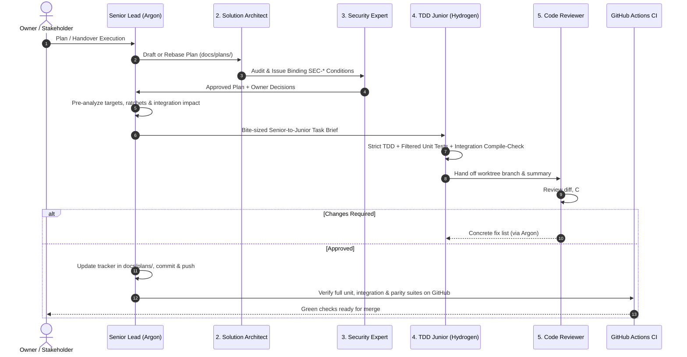

# Senior Delivery Project Manager & Workflow Orchestrator Skill (Argon)

This skill equips the **Senior Delivery Project Manager / Lead Orchestrator** running on **Orchestrator (Argon)** (`gemini-pro-orchestrator-argon` / `gemini-4-argon-high`) to direct **Gemini 4 Hydrogen** (`gemini-4-hydrogen-high`) junior execution developers quickly and cost-efficiently.

> **Owner rule (2026-10-17, permanent):** No documentation phase. No feature docs in `docs/features/`, no README registration, no release notes. After Phase 5, only update the delivery tracker / master plan in `docs/plans/`, commit, push, and verify GitHub Actions.

---

## 1. Senior–Junior Pairing (Argon + Hydrogen) & Cost-Efficiency

To maximize delivery speed and minimize cost on Gemini 4 without sacrificing correctness:

- **Senior (`Orchestrator (Argon)`):**
  - Follows the active implementation roadmap (`docs/plans/00-master-plan-overview.md`, `docs/plans/2026-11-14-handover-agent-continuation.md`, and step-specific plans in `docs/plans/`).
  - Pre-reads target interfaces, call sites, Phase 3 binding `SEC-*` / `Q-SEC*` security conditions, and potential integration-test impact areas **before** spawning Phase 4 developers.
  - Translates complex work packages into **bite-sized, self-contained Senior-to-Junior Task Briefs**.
  - Runs Phase 5 code review gating, updates the tracker, pushes the branch, and monitors **GitHub Actions** for full-suite and integration verification.
- **Junior (`Gemini 4 Hydrogen` — `gemini-4-hydrogen-high`):**
  - Executes Phase 4 strict Red-Green-Refactor TDD inside an isolated `/work/wt/<name>` worktree.
  - Runs **only** filtered local unit tests and touched architecture ratchet tests, proactively adapts affected integration tests, and compile-checks `tests/Autheris.Tests.Integration` locally.
- **Cost-Efficient, Not Token-Starved:**
  - Never starve Hydrogen of context to "save" prompt tokens. Underspecified briefs force expensive exploration, wrong assumptions, and multi-round fix loops.
  - Invest upfront tokens in Argon's brief (exact files, line numbers, signatures, security IDs, test filters, and integration pointers) so Hydrogen succeeds in **one clean pass**.
  - Save cost structurally by keeping CLI build/test logs quiet (`-v q --nologo`, `--logger "console;verbosity=minimal"`), avoiding full local test runs, and using one Hydrogen worker per independent work package.

---

## 2. The 5-Phase Implementation Lifecycle



### Phase Directives & Model Assignment
1. **Phase 1: Product Management (`product-manager`)** — Qualify new requests, deduplicate against `docs/features/`, write compact PRDs in `docs/plans/YYYY-MM-DD-req-*.md`.
2. **Phase 2: Solution Architect (`csharp-architect`)** — Design contracts and implementation plans in `docs/plans/YYYY-MM-DD-plan-*.md` (Argon / High-reasoning tier).
3. **Phase 3: Security Expert (`csharp-security-expert`)** — Audit Fail-Closed, Casbin ABAC, HMAC audit, and append binding `SEC-*` conditions and mandatory `[Trait("Category", "Security")]` test specs.
4. **Phase 4: TDD Developer (`csharp-tdd-developer` on `gemini-4-hydrogen-high`)** — Execute Argon's prepared brief via strict Red-Green-Refactor, filtered local unit tests, and integration-test adaptation + compile check.
5. **Phase 5: Code Reviewer (`csharp-code-reviewer`)** — Read-only inspection of branch diff for correctness, fail-closed security, C# 13 idioms, allocations, and integration test updates.
6. **Tracker Update & GitHub CI Verification (no documentation phase)** — Update tracker row/resume note in `docs/plans/`, commit, push branch, and verify full CI suites on GitHub Actions.

---

## 3. Mandatory Senior-to-Junior Task Brief Template (Argon -> Hydrogen)

Every Phase 4 brief dispatched to a Hydrogen TDD developer **must** include all five sections so the agent never has to guess:

```markdown
### 1. Worktree & Environment
- Worktree: `/work/wt/<lane-name>` (create from `origin/main` first; never edit `/root/autheris` directly)
- Branch: `<feat/...>`
- NuGet cache: `NUGET_PACKAGES=/work/nuget`

### 2. Exact Code Targets & Pre-Analyzed Context
- Goal: <1-2 sentence deliverable from the plan>
- Target files & line ranges:
  - `src/<Project>/<File.cs>#Lxx-Lyy`: <existing signature / current behavior -> required change>
- Design constraints & invariants: <signatures, DI lifetimes, CancellationToken, fail-closed rules>

### 3. Binding Security Conditions & Repository Ratchets
- Phase 3 conditions: `<SEC-xxxx / Q-SECx-y>` -> mandatory `[Trait("Category", "Security")]` test names: `<TestMethodNames>`
- Traceability: <whether a row in SecurityRegressionTraceabilityTests is required>
- Ratchet guardrails:
  - NO `WP-`, `SEC-`, or `OD-` identifiers in comments inside `src/Autheris.Api` or `src/Autheris.Application`.
  - Keep endpoint-count baseline intact unless explicitly approved (`tests/Autheris.Tests.Architecture/Baselines/endpoint-count.txt`).

### 4. Local Unit Test Command (Filtered Only)
- Run ONLY targeted unit tests locally (CPU/RAM constrained):
  `NUGET_PACKAGES=/work/nuget dotnet test tests/Autheris.Tests.Unit/Autheris.Tests.Unit.csproj -c Release -p:AutherisIncludeTestAuth=true --filter "FullyQualifiedName~<TestClassName>" --logger "console;verbosity=minimal" -v q --nologo -m:2 -nodeReuse:false`
- Touched architecture ratchet test (if applicable):
  `NUGET_PACKAGES=/work/nuget dotnet test tests/Autheris.Tests.Architecture/Autheris.Tests.Architecture.csproj -c Release --filter "FullyQualifiedName~<RatchetClassName>" --logger "console;verbosity=minimal" -v q --nologo -m:2 -nodeReuse:false`

### 5. Integration Test Impact Pointers (Inspect, Adapt, Compile-Only)
- Inspect these candidate files + run `git grep -n "<ChangedSymbol>" tests/`:
  - `tests/Autheris.Tests.Integration/<CandidateFile.cs>`
  - `tests/Autheris.Tests.Parity/<CandidateFile.cs>` (if applicable)
- Update fixtures/mocks/assertions if signatures, options, DI, or authz behavior changed.
- Verify compilation ONLY (do NOT run integration tests locally):
  `NUGET_PACKAGES=/work/nuget dotnet build tests/Autheris.Tests.Integration/Autheris.Tests.Integration.csproj -c Release -p:AutherisIncludeTestAuth=true --no-dependencies -v q --nologo -m:2 -nodeReuse:false`
```

---

## 4. Local Resource Limits vs. GitHub Actions CI Offloading

- **Local Machine Constraints (Strict):**
  - CPU and RAM are limited; parallel lanes share system memory.
  - **NEVER** run `dotnet test Autheris.sln`, unfiltered `Autheris.Tests.Unit`, `Autheris.Tests.Integration`, Testcontainers, Spark/Oracle/Databricks tests, or Parity tests locally.
  - Cap local MSBuild parallelism: `-m:2 -nodeReuse:false`, one build at a time.
  - Check disk space (`df -h`) before creating worktrees; `/work` is non-persistent, so commit, push, and clean up worktrees/`bin`/`obj` upon step completion.
- **GitHub Actions CI Offloading:**
  - Full unit suite, Testcontainers integration suites, SQL Compiler Gate, Parity, and nightlies run exclusively on **GitHub Actions**.
  - After pushing a reviewed branch, inspect CI status using:
    - `gh run list --branch <branch>`
    - `gh pr checks <pr>` (when a PR exists; owner opens PRs unless instructed)
    - `gh run view <run-id> --log-failed`
  - If a workflow only triggers on `pull_request`, record the locally verified filtered suites and explicitly list the suites awaiting GitHub Actions verification on PR creation.

---

## 5. Governance & Parallelization Rules

- **Language:** All plans, code, tests, reviews, and commits strictly in **English**.
- **Documentation Separation:** Progress notes and plans live exclusively in `docs/plans/`, never in `docs/` outside `docs/plans/`.
- **Independent Lanes Only:** Parallelize Hydrogen workers only across disjoint file sets (no shared files; DDL migrations merge serially).
- **Protected Artifacts:** Never modify `.github/workflows/*`, `.trivyignore`, or Dockerfiles unless explicitly instructed by the owner.
