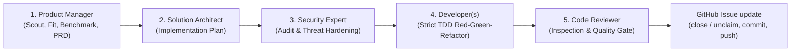

# Autheris Agent Governance & Engineering Instructions

This document governs all AI agents, assistant models (Antigravity, Claude, Copilot, Cursor, etc.), and human contributors working within the `Autheris` repository.

---

## 1. 🌐 Universal Language Requirement (Strict English Standard)

* **Universal Implementation Standard:** English is the **sole standard language** across the entire Autheris repository for:
  - All source code, unit/integration tests, docstrings, and inline code comments.
  - All documentation in `docs/`, GitHub Issues, implementation plans, and PR descriptions.
  - The root [`README.md`](README.md) and competitive comparisons in `docs/comparisons/`.
  - All git commit messages, PR descriptions, and inter-agent communication.
* **Alignment with Root README:** The canonical [README.md](README.md) is written in English. All supporting documentation and code must consistently adhere to English.
* **Multilingual User Interaction:** While user discussions or prompts in conversational chats may occur in other languages (such as German), all generated repository artifacts, planning documents, code, and architectural decisions must strictly be authored in English.

---

## 2. 🚫 Strict Ban on Development Progress in Documentation (`docs/`)

> [!CAUTION]
> **Documentation (`docs/`) is strictly for actual system reference and user/operator manuals.**
> **Development progress notes, WIP statuses, and implementation roadmaps DO NOT BELONG in `docs/`!**

* **What belongs in `docs/`:**
  - Technical architecture (arc42), configuration guides, operational runbooks, API specifications, and feature manuals.
  - Documentation **must describe the actual, working state of the software as it currently exists**.
* **What is STRICTLY FORBIDDEN in `docs/`:**
  - **No development progress or status tags:** Never write `Status: In Progress`, `Status: Done (Wave 1)`, `WIP`, `Stand: YYYY-MM-DD`, `80% completed`, or `In Arbeit` inside `docs/` files.
  - **No sprint or task checklists:** Checklists (`- [ ]`, `- [x]`) and task breakdowns do not belong in system documentation.
  - **No implementation plans or roadmaps:** Documents titled `*implementation-plan*`, `*roadmap*`, or `*backlog*` must NEVER be placed in `docs/` (e.g. not in `docs/architecture/` or `docs/features/`).
  - **No personal/agent work logs:** Discussion of what an agent did today, what needs to be fixed tomorrow, or internal handoff notes.
* **Where do development progress, plans, and work instructions belong?**
  - **EXCLUSIVELY in GitHub Issues (`gh issue`)!** Every requirement, implementation plan, task checklist, code-review instruction, and progress note must live on its GitHub Issue — **never** in `docs/` and **never** as new files in `docs/plans/` (which is retired).

---

## 3. 🎯 GitHub-Issue-First Planning & Multi-Agent Coordination Protocol

All new requirements, architectural designs, implementation details, and operational work instructions (including **code reviews**, audits, and follow-up tasks) **MUST be handled exclusively via GitHub Issues** (`gh issue`).

### Mandatory Rules:
1. **No New Files in `docs/plans/`:**
   - Do not create or update planning/PRD/roadmap files in `docs/plans/`.
   - Store requirements, architectural designs, security conditions, and implementation plans directly inside the corresponding **GitHub Issue** (in the issue body or as a structured `## Implementation Details` comment/attachment).
2. **Work Instructions as Issues:**
   - GitHub Issues are not limited to features or bugs; they may also be direct work instructions for an agent (for example, a **Code Review** of a PR/branch, a security check, or an operational task).
3. **Multi-Agent Claiming & Coordination Across Machines:**
   - Multiple agents may run on different machines in parallel. Every agent **MUST** coordinate through GitHub Issues before starting work:
     1. **Check availability:** Inspect `gh issue view <n> --json state,labels,comments` and confirm the issue does **not** already carry the `in-progress` label or an active claim comment.
     2. **Claim immediately:** Mark the issue as actively worked on before starting implementation or review:
        - Add the `in-progress` label: `gh issue edit <n> --add-label "in-progress"`
        - Post a claim comment naming the machine/host, agent role, branch (if any), and UTC timestamp.
     3. **Update / Handover:** Post meaningful blockers or handover notes as issue comments. If releasing an unfinished issue for another agent to pick up, remove `in-progress` (`gh issue edit <n> --remove-label "in-progress"`).
     4. **Complete & Close:** Once the PR is merged (or the work-instruction/code-review issue is completed and findings are posted on the issue), remove `in-progress` and close the issue (`gh issue close <n>`) referencing the PR/commit.

---

## 4. 📋 Issue Lifecycle Statuses

Track issue progress directly via GitHub Issue state, labels, and comments:
* Open (unclaimed) — ready to be picked up
* `in-progress` label + claim comment — actively worked on by an agent
* PR open / under review — linked PR awaiting CI & Phase 5 review
* Closed — merged & verified (or review/work instruction completed)

---

## 5. 🌟 Individual Feature Documentation Location (`docs/features/`)

> [!IMPORTANT]
> **Feature documentation is not part of the implementation lifecycle (no documentation phase, owner rule 2026-10-17).** Feature docs are written only when the owner explicitly asks for them; the rules below apply to those documents.

* **Mandatory File Location & Naming:**
  - Individual feature specifications and technical reference docs **must always reside in `docs/features/`**.
  - File naming standard: `docs/features/f-<category>-<number>-<slug>.md` (e.g., `f-gov-14-federated-virtual-filters.md`, `f-ai-15-doc-mcp-gateway.md`).
* **Catalog Index Registration:**
  - Whenever a new feature document is created or updated, register it in the master feature index: [`docs/features/README.md`](docs/features/README.md).
* **Required Content Structure:**
  1. **Executive Summary & Problem Statement**: What customer/architectural challenge is solved.
  2. **Architecture & Component Wiring**: Affected domain models, application services, DI extensions, and enforcers.
  3. **Configuration & Usage Examples**: Concrete `appsettings.json`, GraphQL queries/mutations, REST endpoints, or MCP tool invocations.
  4. **Security, Zero-Trust & Fail-Closed Behavior**: RLS pushdown, Casbin rules, and error handling.
* **Separation of Concerns Reminder:**
  - Feature documents in `docs/features/` describe **how the feature works and how to use it**.
  - Feature documents **MUST NOT contain development progress, WIP notes, sprint roadmaps, or task checklists** (those belong in GitHub Issues).

---

## 6. 🔄 The 5-Phase Standard Implementation Lifecycle

Every feature, requirement, or significant change must pass through the standard 5-phase quality-gated delivery pipeline. There is no documentation phase:

1. **Phase 1: Product Management (`product-manager`)**
   - Qualifies incoming requests, deduplicates against [`docs/features/`](docs/features/) and open GitHub Issues, benchmarks with web/industry best practices (OWASP, RFCs).
   - Gatekeeper role: Rejects/warns on anti-patterns with safe alternatives. Creates or enriches the **GitHub Issue** with structured requirements and acceptance criteria.
2. **Phase 2: Architectural Implementation Plan (`csharp-architect`)**
   - Designs architecture, interfaces, and concrete step-by-step implementation details directly in the **GitHub Issue** (body or `## Implementation Details` comment) — never in `docs/plans/`.
   - Splits into parallel developer streams if applicable.
3. **Phase 3: Security & Compliance Review (`csharp-security-expert`)**
   - Audits the plan against Zero-Trust, Fail-Closed, and HMAC audit requirements. Appends binding `SEC-*` conditions and security test criteria to the GitHub Issue.
4. **Phase 4: Test-Driven Development (`csharp-tdd-developer`, Junior Execution on Gemini 4 Hydrogen)**
   - Runs in a **Senior (`Orchestrator (Argon)`) + Junior (`Gemini 4 Hydrogen`)** pairing: the Senior Orchestrator/PM claims the GitHub Issue (`in-progress` label + claim comment), supplies a self-contained work package brief from the issue's implementation details (target files/lines, signatures, binding `SEC-*` conditions, unit `--filter`, and integration test pointers).
   - Strictly applies Red-Green-Refactor with xUnit, Shouldly/FluentAssertions, and NSubstitute inside an isolated worktree.
   - **Local CPU/RAM Constraint:** Runs **only** filtered local unit tests (`dotnet test tests/Autheris.Tests.Unit/Autheris.Tests.Unit.csproj --filter <TestClass> -m:2 -nodeReuse:false`) and touched architecture ratchet tests locally.
   - **Proactive Integration Test Adaptation (Compile-Only Locally):** Inspects and updates any affected tests in `tests/Autheris.Tests.Integration` or `tests/Autheris.Tests.Parity` and verifies `tests/Autheris.Tests.Integration/Autheris.Tests.Integration.csproj` compiles cleanly without executing integration tests locally.
5. **Phase 5: Code Review & Quality Gate (`csharp-code-reviewer`)**
   - Audits code quality, C# idioms, allocation efficiency, binding security test coverage, and proactive integration test updates. Loops back to Hydrogen developers if issues arise.
6. **After Phase 5: Issue Update, PR Merge & GitHub Actions Verification (no documentation phase)**
   - Commits and pushes the branch, cleans the worktree, verifies the full unit suite and all integration/parity suites on **GitHub Actions**, merges the PR, removes `in-progress`, and closes the GitHub Issue with the PR/commit reference. No feature documentation is written as part of the lifecycle.

---

## 7. 🥊 Competitive Comparisons & README Anti-Bloat (`docs/comparisons/`)

* **Strict Anti-Bloat Rule for `README.md`:**
  - The root [`README.md`](README.md) must stay punchy, scannable, and focused on the core "Why", "What", and "How to run".
  - **Never dump deep benchmark tables or exhaustive battle cards directly into `README.md`!**
* **Dedicated Comparison Hub (`docs/comparisons/`):**
  - All detailed competitive head-to-head comparisons must reside in [`docs/comparisons/`](docs/comparisons/):
    - [`autheris-vs-apollo.md`](docs/comparisons/autheris-vs-apollo.md): AST pushdown & in-gateway RLS vs. delegated auth in subgraphs.
    - [`autheris-vs-hasura.md`](docs/comparisons/autheris-vs-hasura.md): Open standards & low TCO vs. proprietary DDN lock-in.
    - [`autheris-vs-wundergraph-cosmo.md`](docs/comparisons/autheris-vs-wundergraph-cosmo.md): Enterprise WORM compliance vs. pure BFFs.
    - [`autheris-vs-immuta.md`](docs/comparisons/autheris-vs-immuta.md): Unified L7 API access vs. DB-specific storage plugins.
  - The root `README.md` includes only high-level summary tables linking directly to these battle cards.

---

## 8. 🏗️ Architectural & Security Principles

* **Zero-Trust & Fail-Closed:** Everything is denied by default unless covered by an explicit Casbin ABAC rule or approved Data-Owner Consent.
* **AST Pushdown First:** Row-level security and column masking must be rewritten directly into SQL/AST trees whenever possible, minimizing post-retrieval in-memory filtering.
* **High Performance .NET 10:** Zero-allocation patterns, memory pooling, and `ReadOnlySpan<T>` usage in hot paths.
* **Testing & Verification (Local Filtered Unit + Compile-Only Integration; Full & Integration on GitHub Actions):** Every functional addition must include corresponding unit tests (and integration test updates where affected) under `tests/`. Because local CPU and RAM are constrained, local verification runs **only** filtered relevant unit tests (`dotnet test tests/Autheris.Tests.Unit/Autheris.Tests.Unit.csproj --filter <TestClass> -m:2 -nodeReuse:false`), touched architecture ratchet tests, and a compile-only build check of `tests/Autheris.Tests.Integration/Autheris.Tests.Integration.csproj`. Full unit test suites and all Testcontainers/Spark/Oracle/Parity integration suites execute on **GitHub Actions**.
