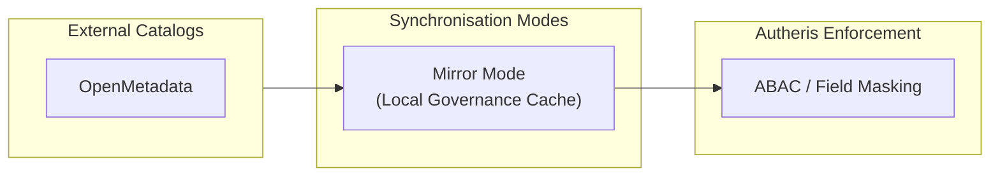

# Enterprise Data Catalog Integration Guide

This guide describes how to connect OpenMetadata to **Autheris** via the `openmetadata` runtime module (`Autheris.Modules.OpenMetadata`).

---

## 1. Overview & Operating Mode

The core `DataCatalog` orchestrator and the `openmetadata` runtime module (`Gateway:Modules:Enabled`) synchronize metadata, owners, glossary terms, and sensitivity classifications from OpenMetadata into the local governance store (`Mirror Mode` via `DataCatalogSyncBackgroundService` / `OpenMetadataSyncBackgroundService` and `OpenMetadataSyncService`). Without the `openmetadata` module, configuring `Gateway:OpenMetadata` or `Gateway:Catalog:Enabled=true` fails startup, `/api/webhooks/openmetadata` returns `404`, and `syncOpenMetadata` / `syncDataCatalog` return `UNAVAILABLE`.



---

## 2. Supported Catalog & Configuration

Configuration is located in `appsettings.json` under `Gateway:Catalog` and `Gateway:OpenMetadata`:

```json
{
  "Gateway": {
    "Modules": {
      "Enabled": [ "openmetadata" ]
    },
    "Catalog": {
      "Enabled": true,
      "Provider": "OpenMetadata",
      "SyncIntervalMinutes": 30
    },
    "OpenMetadata": {
      "Enabled": true,
      "ServerUrl": "https://openmetadata.corp.internal/api/v1",
      "AuthToken": "${OPENMETADATA_JWT}",
      "WebhookSecret": "${OPENMETADATA_WEBHOOK_SECRET}"
    }
  }
}
```

### Webhook Subscription Configuration

Configure OpenMetadata webhook subscriptions to send `POST /api/webhooks/openmetadata` with `authType: bearer` and `secretKey` set to `Gateway:OpenMetadata:WebhookSecret`. OpenMetadata computes an HMAC-SHA256 signature and delivers it in `X-OpenMetadata-Signature` (or `X-OM-Signature`). Without the `openmetadata` module, the route answers `404` before reading headers or body; missing or invalid signatures (or a blank `WebhookSecret`) return `401`; malformed payloads after signature verification return `400`.

---

## 3. Automatic GDPR Art. 9 Tag Mapping

Catalogs mark sensitive columns with standardized or custom tags. The extension maps these tags deterministically to protection policies:

| Catalog Tag / Classification | Gateway Sensitivity | Masking Action | Additional Policy |
| :--- | :--- | :--- | :--- |
| `PII.Email`, `EmailAddress` | `MEDIUM` | `MASK_EMAIL` (`u***@domain.com`) | ABAC Policy Check |
| `PII.IBAN`, `Financial.AccountNumber` | `HIGH` | `MASK_LAST_FOUR` (`**** **** **** 1234`) | Audit-Log Mandatory |
| `GDPR.Art9.Health`, `HealthRecord` | `CRITICAL` | `REDACT` (`[REDACTED-GDPR-ART9]`) | **RequiresFourEyes = true** |
| `GDPR.Art9.Biometric`, `Fingerprint` | `CRITICAL` | `REDACT` (`[REDACTED-GDPR-ART9]`) | **RequiresFourEyes = true** |
| `GDPR.Art9.Religion`, `PoliticalBelief` | `CRITICAL` | `REDACT` (`[REDACTED-GDPR-ART9]`) | **RequiresFourEyes = true** |
| `Security.PasswordHash`, `Secret` | `CRITICAL` | `DROP_COLUMN` | Blocks Query / Schema Exclusion |
