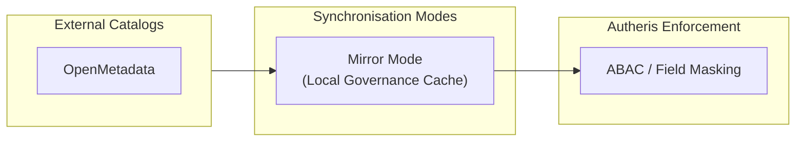

# Enterprise Data Catalog Integration Guide

This guide describes how to connect external data catalog systems to **Autheris** via `Autheris.Extensions`.

---

## 1. Overview & Operating Mode

The `DataCatalog` and `OpenMetadata` modules synchronize metadata, owners, glossary terms, and sensitivity classifications from OpenMetadata into the local governance store (`Mirror Mode` via `DataCatalogSyncBackgroundService` / `OpenMetadataSyncService`).



---

## 2. Supported Catalog & Configuration

Configuration is located in `appsettings.json` under `Gateway:Catalog` and `Gateway:OpenMetadata`:

```json
{
  "Gateway": {
    "Catalog": {
      "Enabled": true,
      "Provider": "OpenMetadata",
      "SyncIntervalMinutes": 30
    },
    "OpenMetadata": {
      "Enabled": true,
      "ServerUrl": "https://openmetadata.corp.internal/api/v1",
      "AuthToken": "${OPENMETADATA_JWT}"
    }
  }
}
```

---

## 3. Automatic GDPR Art. 9 Tag Mapping

Catalogs mark sensitive columns with standardized or custom tags. The extension maps these tags deterministically to protection policies:

| Catalog Tag / Classification | Gateway Sensitivity | Masking Action | Additional Policy |
| :--- | :--- | :--- | :--- |
| `PII.Email`, `EmailAddress` | `MEDIUM` | `MASK_EMAIL` (`u***@domain.com`) | ABAC Policy Check |
| `PII.IBAN`, `Financial.AccountNumber` | `HIGH` | `MASK_LAST_FOUR` (`**** **** **** 1234`) | Audit-Log Mandatory |
| `GDPR.Art9.Health`, `HealthRecord` | `CRITICAL` | `REDACT` (`[REDACTED-GDPR-ART9]`) | **RequiresFourEyes = true** |
| `GDPR.Art9.Biometric`, `Fingerprint` | `CRITICAL` | `REDACT` (`[REDACTED-GDPR-ART9]`) | **RequiresFourEyes = true** |
| `GDPR.Art9.Religion`, `PoliticalBelief` | `CRITICAL` | `REDACT` (`[REDACTED-GDPR-ART9]`) | **RequiresFourEyes = true** |
| `Security.PasswordHash`, `Secret` | `CRITICAL` | `DROP_COLUMN` | Blocks Query / Schema Exclusion |
