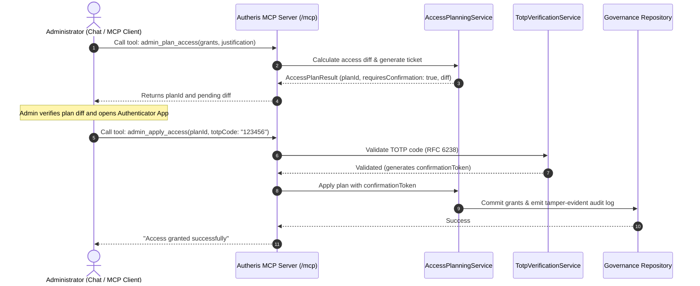

# F-AI-13: Admin MCP Tools & Two-Phase Access Planning (HitL)

## 1. Overview & Business Value

The **Admin MCP Tools** empower privileged administrators and AI agents to manage data sources, register APIs, and grant access permissions through natural language in chat clients (such as Claude Desktop or Talos Citizen Dev) — while strictly preventing accidental or unverified privilege escalations through a **Two-Phase Confirmation Protocol (HitL)**.

### Architectural Workflow:

### Available Admin Tools:
- **`admin_plan_access`:** Pre-flights an access change request, resolves usernames to SIDs, computes permissions diff, and issues an ephemeral `planId`.
- **`admin_apply_access`:** Requires the `planId` and a valid 6-digit TOTP code. Validates the code, consumes the ticket, and applies the changes.
- **`admin_register_datasource`:** Onboards Swagger/OpenAPI specifications via chat.
- **`admin_set_dataset_state`:** Activates or disables datasets.
- **`admin_resolve_principal`:** Resolves human-readable identities to enterprise SIDs.

### Plan binding and bounded state

- **Confirmer binding:** `admin_apply_access` only succeeds for the administrator who created and confirmed the plan. The confirmation token is an HMAC-signed value (`v1.<planId>.<adminSid>.<expiry>.<signature>`, with base64url-encoded identifiers) that embeds the administrator SID; apply rejects a token presented by any other administrator. If both the planning and the applying request carry a tenant, they must match.
- **Bounded state:** pending plans are limited per administrator and expire automatically. Expired plans and their consumed-token records are removed opportunistically (at most once per sweep interval).
- **Principal resolution:** `admin_resolve_principal` returns demo directory entries only on a Development host. Elsewhere it returns no matches until a real directory integration is configured.

Configuration section `Gateway:Governance:AccessPlanning`:

| Key | Default | Meaning |
|---|---|---|
| `MaxPendingPlansPerAdmin` | 20 | Maximum unexpired plans per administrator; further plans are rejected |
| `PlanTtlMinutes` | 10 | Lifetime of a plan |
| `ConfirmationTokenTtlMinutes` | 10 | Lifetime of a confirmation token |
| `SweepIntervalSeconds` | 60 | Minimum interval between expired-state sweeps |

Plan state is kept in process memory; plans and tokens do not survive a restart and are not shared across nodes.

## 2. Implementation Details

- **Service:** `AccessPlanningService` in `src/Autheris.Application/AccessPlanning/AccessPlanningService.cs`.
- **Admin Tools:** `AdminMcpTools` in `src/Autheris.Application/Mcp/Tools/AdminMcpTools.cs`.
- **Audit Verification:** All plan executions are sealed in `AuditLogEntry` with HMAC-SHA256 chaining.
