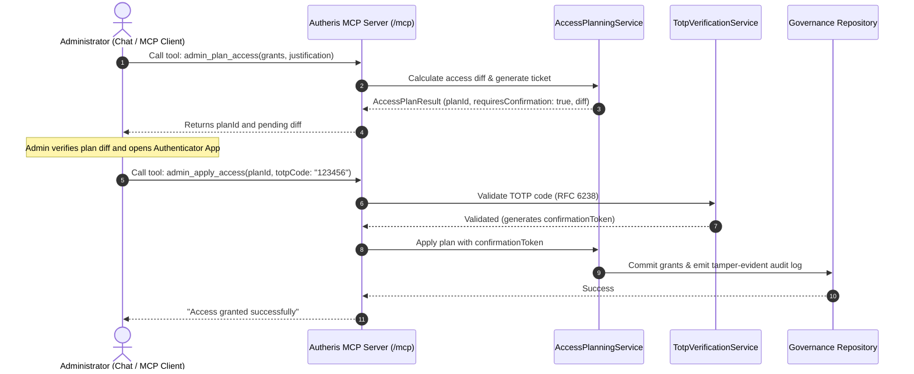

# F-AI-13: Admin MCP Tools & Two-Phase Access Planning (HitL)

## 1. Overview & Business Value

The **Admin MCP Tools** empower privileged administrators and AI agents to manage data sources, register APIs, and grant access permissions through natural language in chat clients (such as Claude Desktop or Talos Citizen Dev) — while strictly preventing accidental or unverified privilege escalations through a **Two-Phase Confirmation Protocol (HitL)**.

### Architectural Workflow:

### Available Admin Tools:
- **`admin_plan_access`:** Pre-flights an access change request, resolves usernames to SIDs, computes permissions diff, and issues an ephemeral `planId`.
- **`admin_apply_access`:** Requires the `planId` and a valid 6-digit TOTP code. Validates the code, consumes the ticket, and applies the changes.
- **`admin_register_datasource`:** Onboards Swagger/OpenAPI specifications via chat.
- **`admin_set_dataset_state`:** Activates or disables datasets.
- **`admin_resolve_principal`:** Resolves human-readable identities to enterprise SIDs.

### Plan binding and bounded state

- **Confirmer binding:** `admin_apply_access` only succeeds for the administrator who created and confirmed the plan. The confirmation token is an HMAC-signed value (`v1.<planId>.<adminSid>.<expiry>.<signature>`, with base64url-encoded identifiers) that embeds the administrator SID; apply rejects a token presented by any other administrator. If both the planning and the applying request carry a tenant, they must match.
- **Bounded state:** pending plans are limited per administrator and expire automatically. Expired plans and their consumed-token records are removed opportunistically (at most once per sweep interval).
- **Principal resolution:** `admin_resolve_principal` returns demo directory entries only on a Development host. Elsewhere it returns no matches until a real directory integration is configured.

Configuration section `Gateway:Governance:AccessPlanning`:

| Key | Default | Meaning |
|---|---|---|
| `MaxPendingPlansPerAdmin` | 20 | Maximum unexpired plans per administrator; further plans are rejected |
| `PlanTtlMinutes` | 10 | Lifetime of a plan |
| `ConfirmationTokenTtlMinutes` | 10 | Lifetime of a confirmation token |
| `SweepIntervalSeconds` | 60 | Minimum interval between expired-state sweeps (process-local store) |
| `SigningKeyRef` | unset | Secret reference (resolved through `IKeyVaultSecretProvider`) from which the confirmation-token HMAC key is derived with HKDF-SHA256. Required when the cluster state is external (shared by all replicas); unset means a per-process random key (single node only) |

### Plan state storage

Plans, confirmation-token hashes and consumed-token markers live behind the `IAccessPlanStore` port:

- **External cluster state (multi-replica):** `ClusterAccessPlanStore` keeps plans under `accessplan:plan:{planId}` with a TTL equal to the plan lifetime. A plan can be created on one node, confirmed on a second and applied on a third. Confirmation tokens are single-use cluster-wide (atomic first-wins counter `accessplan:token:{sha256(token)}`). Only SHA-256 hashes of tokens are stored. The per-administrator cap is a shared counter (approximate window). If the shared store is unreachable, plan, confirm and apply fail (fail closed); the state is never treated as absent.
- **In-memory or embedded state (single node):** `InMemoryAccessPlanStore` is bounded and evicts expired entries through `TimeProvider`. Plans do not survive a restart.

Startup validation fails when the cluster state is external and `SigningKeyRef` is not configured.

### Datasource secrets

`admin_register_datasource` writes inline secrets to the configured `IKeyVaultSecretProvider` under `datasource:{domain}:{name}:auth_secret` and returns that reference. No plaintext copy is kept in process memory. If the provider is missing or read-only the request is rejected; supply `Auth.SecretRef` instead.

## 2. Implementation Details

- **Service:** `AccessPlanningService` in `src/Autheris.Application/AccessPlanning/AccessPlanningService.cs`.
- **Admin Tools:** `AdminMcpTools` in `src/Autheris.Application/Mcp/Tools/AdminMcpTools.cs`.
- **Audit Verification:** All plan executions are sealed in `AuditLogEntry` with HMAC-SHA256 chaining.
