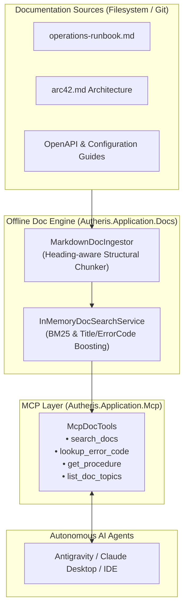

# F-AI-15: Offline Doc- & Runbook-MCP Gateway

## Executive Summary & Problem Statement

Autonomous AI coding agents, incident response bots, and operational tooling in regulated enterprise environments frequently operate under strict constraints:
1. **100% Offline / Air-Gapped Environments:** Agents cannot access public search engines or cloud vector databases (e.g. OpenAI Embeddings, Pinecone) due to confidentiality and network isolation policies.
2. **Context Window Explosion:** Dumping entire documentation repositories, arc42 architecture documents, OpenAPI specifications, or markdown runbooks into an LLM prompt exhausts token budgets and causes hallucinations.
3. **Emergency Troubleshooting Latency:** Operators and AI agents diagnosing errors need immediate, reliable resolution steps, exact runbook procedures (e.g., break-glass access, consent revocation), and root-cause analysis without manually searching through dozens of wiki pages.

**F-AI-15** resolves these challenges by introducing an embedded, zero-cloud **Offline Doc- & Runbook-MCP Gateway**:
- **Multi-Format Ingestion:** Structural parsing and chunking of markdown documentation along heading boundaries (`#`, `##`, `###`), preserving atomic code blocks, cURL scripts, and SQL statements.
- **Local Hybrid BM25 Ranking:** In-memory keyword and BM25 full-text search with heavy boosting for exact error codes ($3.0\times$) and section titles ($2.0\times$).
- **Structured Error Catalog & Runbook Lookup:** Instant resolution of error codes to symptoms, root causes, and executable runbook procedures.
- **Native MCP Discovery Tools:** Four core MCP tools (`search_docs`, `lookup_error_code`, `get_procedure`, `list_doc_topics`) enabling AI agents to autonomously troubleshoot incidents and explain architecture.

---

## Architecture & Component Wiring



### Component Overview
- **`DocChunk` & `DocChunkIdentifier` (`Autheris.Domain.Model`):** Canonical representation of an indexed documentation section with Title, Content, Summary, Keywords, ErrorCodes, SourceFile, and AnchorId.
- **`MarkdownDocIngestor` (`Autheris.Application.Docs.Services`):** Streamlined markdown chunker that preserves code blocks while segmenting on markdown headers.
- **`InMemoryDocSearchService` (`Autheris.Application.Docs.Services`):** High-performance, concurrent, in-memory search index providing ranked search results, error code lookups, and topic navigation.
- **`McpDocTools` (`Autheris.Application.Mcp.Services`):** Model Context Protocol tool implementations providing JSON-RPC interfaces for AI agents.
- **`GatewayMcpServiceExtensions` (`Autheris.Api.Extensions`):** Dependency injection wiring registering `IDocSearchService` and `IDocIngestor` as singletons.

---

## Configuration & Usage Examples

### 1. Searching Documentation via MCP

AI agents search the offline documentation base using keywords or concepts:

```json
{
  "tool": "search_docs",
  "arguments": {
    "query": "break glass emergency access",
    "category": "Runbook",
    "limit": 3
  }
}
```

Response:
```json
{
  "total": 1,
  "results": [
    {
      "id": "autheris::Runbook::operations-runbook#break-glass-access-procedure",
      "appId": "autheris",
      "category": "Runbook",
      "title": "Break-Glass Access Procedure",
      "summary": "In emergency incidents, operators can activate break-glass mode...",
      "relevanceScore": 5.0,
      "matchedTerms": ["break", "glass", "access"],
      "sourceFile": "docs/operations-runbook.md"
    }
  ]
}
```

### 2. Looking Up an Error Code

When encountering an unexpected HTTP status or error code in gateway logs:

```json
{
  "tool": "lookup_error_code",
  "arguments": {
    "errorCode": "ERR_CASBIN_DENIED"
  }
}
```

Response:
```json
{
  "errorCode": "ERR_CASBIN_DENIED",
  "symptom": "Caller received 403 Forbidden with policy deny.",
  "rootCause": "Referenced in documentation section 'RBAC & ABAC Policy Enforcement'.",
  "resolution": "Verify subject roles in JWT claims. Ensure an active consent or ABAC rule covers the requested dataset and action.",
  "runbookRef": "autheris::Runbook::operations-runbook#policy-denial-troubleshooting",
  "sourceFile": "docs/operations-runbook.md"
}
```

### 3. Retrieving Exact Procedure Instructions

AI agents fetch full procedure instructions without polluting the context window with unrelated chapters:

```json
{
  "tool": "get_procedure",
  "arguments": {
    "identifier": "autheris::Runbook::operations-runbook#consent-revocation"
  }
}
```

---

## Security, Zero-Trust & Fail-Closed Behavior

1. **Air-Gapped & Zero Cloud Egress:** All indexing and search operations occur entirely in-memory within the .NET process. No network packets leave the gateway.
2. **Path Traversal Defense:** All documentation paths are resolved against validated local repositories; arbitrary external file reads are prohibited.
3. **Read-Only Safe Operations:** Doc-MCP tools are strictly idempotent and read-only, preventing any accidental state modification during diagnostic sessions.
