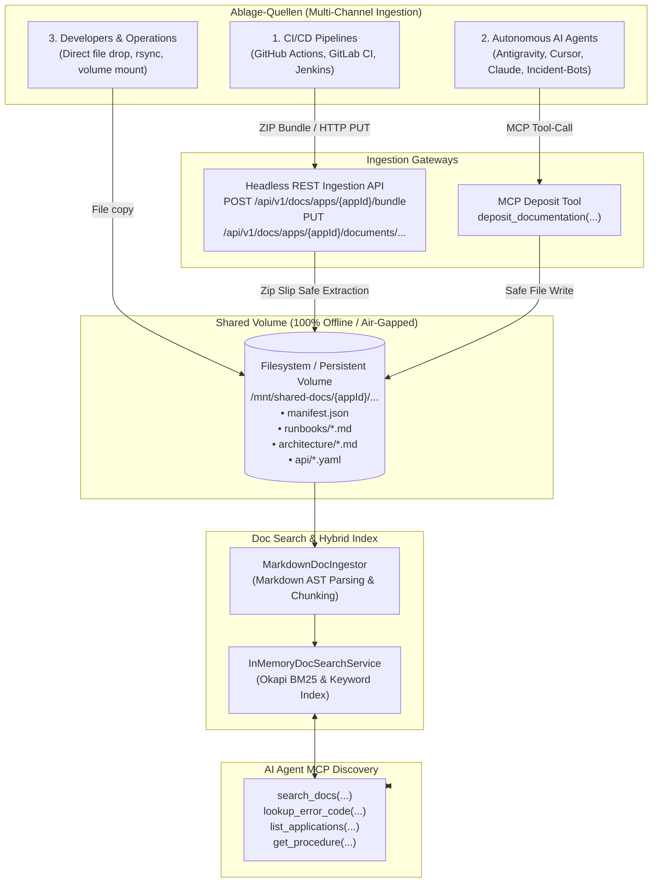

# F-AI-16: Universal Multi-App Document Store & Headless Ingestion Gateway

**Feature-ID:** F-AI-16  
**Authors:** Principal .NET & AI Infrastructure Architect  
**Components:**
- Domain: [`DocAppModels.cs`](file:///root/autheris/src/Autheris.Domain/Model/DocAppModels.cs), [`DocChunkModels.cs`](file:///root/autheris/src/Autheris.Domain/Model/DocChunkModels.cs)
- Application: [`IUniversalDocStore.cs`](file:///root/autheris/src/Autheris.Application/Docs/Interfaces/IUniversalDocStore.cs), [`FileSystemUniversalDocStore.cs`](file:///root/autheris/src/Autheris.Application/Docs/Services/FileSystemUniversalDocStore.cs), [`McpDocTools.cs`](file:///root/autheris/src/Autheris.Application/Mcp/Services/McpDocTools.cs)
- API: [`DocIngestionEndpoints.cs`](file:///root/autheris/src/Autheris.Api/Endpoints/DocIngestionEndpoints.cs)
- Search & Indexing: [`IDocSearchService.cs`](file:///root/autheris/src/Autheris.Application/Docs/Interfaces/IDocSearchService.cs), [`MarkdownDocIngestor.cs`](file:///root/autheris/src/Autheris.Application/Docs/Services/MarkdownDocIngestor.cs)

---

## 1. Executive Summary & Problem Statement

Modern software architectures fragment knowledge across silos: Service A documents APIs via OpenAPI, Service B writes Markdown in Git repositories, Service C stores runbooks in incident wikis, and Service D maintains structured error code YAMLs.
When AI agents (Claude, Cursor, Antigravity, or automated incident triage bots) need to diagnose outages or guide developers in **air-gapped, offline environments**, they cannot reach external cloud search engines or fragmented wikis.

**F-AI-16** establishes a centralized, air-gapped **Doc-Lake** supporting multi-application documentation ingestion and discovery:
- **Shared Volume Storage Foundation:** Transparent directory layout on standard persistent storage (Kubernetes RWX PVC, NFS, local disk).
- **Headless Ingestion REST API:** Automated documentation publishing for CI/CD pipelines (GitHub Actions, GitLab CI, Jenkins) supporting ZIP bundles and individual markdown/spec assets.
- **Agent-as-a-Documenter (MCP Deposit):** AI agents can persist newly created runbooks or error remediations directly via MCP tools (`deposit_documentation`).
- **Sub-100ms In-Memory Discovery:** Ingested documentation is immediately chunked and indexed into the local Okapi BM25 and keyword search engine without server restarts.

---

## 2. Architecture & Ingestion Channels



---

## 3. Configuration & Application Manifest (`manifest.json`)

Each registered application in the doc lake defines metadata and entry points via `manifest.json`:

```json
{
  "appId": "billing-service",
  "name": "Enterprise Billing & Invoicing Service",
  "version": "2.4.1",
  "domain": "finance",
  "owner": "finance-billing-team@corp.local",
  "governanceTier": "Tier-1",
  "entryPoints": {
    "architecture": "architecture/arc42.md",
    "runbooks": "runbooks/",
    "apiSpec": "api/openapi.yaml",
    "errorCatalog": "errors/error_catalog.yaml"
  },
  "tags": ["PCI-DSS", "CoreBanking", "Invoicing"]
}
```

---

## 4. REST Ingestion API Endpoints

### 4.1 Upload Documentation Bundle (ZIP)
- **Route:** `POST /api/v1/docs/apps/{appId}/bundle`
- **Content-Type:** `multipart/form-data` or `application/zip`
- **Security:** Requires authorization. Enforces strict OWASP Zip Slip validation: any archive entry attempting directory traversal (`..`) is aborted and rejected with `ZIP_SLIP_ATTEMPT`.
- **Response:**
  ```json
  {
    "success": true,
    "chunkId": { "appId": "billing-service", "category": "runbook", "docId": "payment-timeout", "sectionId": "root" },
    "filePath": "/mnt/shared-docs/billing-service",
    "message": "Bundle applied successfully: 12 files unpacked, 28 sections indexed."
  }
  ```

### 4.2 Deposit Individual Document
- **Route:** `PUT /api/v1/docs/apps/{appId}/documents/{category}/{docId}`
- **Payload:**
  ```json
  {
    "title": "Payment Gateway Timeout",
    "content": "# Payment Gateway Timeout\n\n## Remediation\nRestart gateway pods...",
    "errorCode": "PAY_ERR_504",
    "tags": ["payment", "timeout"]
  }
  ```

### 4.3 List Applications & Query Manifests
- **Route:** `GET /api/v1/docs/apps?domain=finance`
- **Route:** `GET /api/v1/docs/apps/{appId}/manifest`

---

## 5. MCP Tools for AI Agents

| Tool Name | Purpose | Parameters |
|---|---|---|
| `list_applications` | Lists all registered services, versions, and governance tiers. | `domain` (optional), `tag` (optional) |
| `deposit_documentation` | Allows agents to deposit runbooks, error resolutions, or architecture notes. | `appId`, `category`, `title`, `content`, `docId` (optional), `errorCode` (optional), `tags` (optional) |
| `search_docs` | Hybrid search across all multi-app documentation. | `query`, `category` (optional), `limit` (optional) |
| `lookup_error_code` | Instant lookup for specific error codes. | `errorCode` |
| `get_procedure` | Retrieves full markdown procedure for a chunk identifier. | `identifier` |

---

## 6. Security, Zero-Trust & Fail-Closed Guardrails

1. **Zip Slip Vulnerability Defense:**
   - Validates that every extracted entry path starts with the application target directory. Traversals outside the destination directory throw a security violation without extracting any files.
2. **Path Sanitization:**
   - Identifiers (`appId`, `category`, `docId`) are validated against `^[a-zA-Z0-9_\-\.]+$` and reject traversal characters (`..`, `/`, `\`).
3. **Payload Size Guardrails:**
   - Bundles are limited to 50 MB; individual document uploads are limited to 5 MB.
4. **WORM / KMS Audit Chain:**
   - Every bundle and document deposit logs an immutable audit entry (`DOC_INGESTION_BUNDLE_APPLIED`, `DOC_INGESTION_DOCUMENT_APPLIED`).
