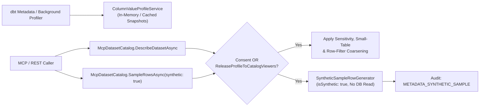

# F-AI-17: Privacy-Coarsened Column Value Profiles & Synthetic Sample Rows

**Feature-ID:** F-AI-17  
**Category:** AI Agent Grounding & Privacy-Preserving Data Discovery  
**Components:**
- Domain: [`McpDatasetModels.cs`](../../src/Autheris.Domain/Model/McpDatasetModels.cs) (`ColumnValueProfile`, `McpDatasetSample.IsSynthetic`), [`TableModels.cs`](../../src/Autheris.Domain/Model/TableModels.cs) (`ReleaseProfileToCatalogViewers`, `DatasetProfilePublicationPolicy`)
- Application: [`IColumnValueProfileService.cs`](../../src/Autheris.Application/Catalog/Profiling/IColumnValueProfileService.cs), [`ColumnValueProfileService.cs`](../../src/Autheris.Application/Catalog/Profiling/ColumnValueProfileService.cs), [`SyntheticSampleRowGenerator.cs`](../../src/Autheris.Application/Catalog/Profiling/SyntheticSampleRowGenerator.cs), [`McpDatasetCatalog.cs`](../../src/Autheris.Application/Mcp/Services/McpDatasetCatalog.cs), [`McpDatasetTools.cs`](../../src/Autheris.Application/Mcp/Services/McpDatasetTools.cs)
- API: [`QueryAnalysisAndProfilingEndpoints.cs`](../../src/Autheris.Api/Endpoints/QueryAnalysisAndProfilingEndpoints.cs)

---

## 1. Executive Summary & Problem Statement

### 1.1 The Challenge
When AI agents or developers build queries against a governed dataset, knowing only column names and SQL types (`varchar`, `numeric`) is often insufficient: they need to know whether a date string uses `ISO-8601-Date`, whether an order number follows `AA-000000`, what the approximate value range is, or how often a column is `NULL`. However:
1. Querying the live database during `describe_dataset` adds latency and load.
2. Exposing exact min/max endpoints on small tables, masked columns, or RLS-filtered tables leaks sensitive records.
3. Prospective consumers who can see a dataset in the catalog (`Summary` visibility) but do not yet hold an `ALLOW` consent cannot inspect realistic example rows to evaluate whether the dataset fits their use case.

### 1.2 The Solution
Autheris enriches `describe_dataset` with **Zero-Query Coarsened Column Value Profiles** (`IColumnValueProfileService`) and extends `sample_rows` with **Deterministic Synthetic Sample Row Generation** (`sample_rows(synthetic: true)`):
- **Zero Source Reads at Catalog Time:** Value profiles are assembled strictly from declared dbt/catalog metadata (`format`, `accepted_range`, `accepted_values`) and precomputed background profile snapshots—never querying the live database during `describe_dataset`.
- **Strict Privacy & Coarsening Rules:**
  - `EmptyShare` is always coarsened to `0.05` (5%) increments.
  - Sensitive (`IsSensitive`, PII) or masked (`ColumnAccessLevel.Mask`) columns expose **only** their data type and coarsened `EmptyShare`—suppressing `FormatPattern`, `MinValue`, `MaxValue`, `ApproximateDistinctCount`, and `AllowedValues`.
  - `AllowedValues` are published only when explicitly released by the Data Owner (`release_value_list = true`).
  - Small tables ($< 20$ rows) coarsen numeric ranges to order-of-magnitude/10-step buckets, coarsen dates to whole-year boundaries, suppress free-text min/max endpoints, and round distinct counts to 10-buckets.
  - Tables with active row filters default to `DatasetProfilePublicationPolicy.FormatAndEmptyShareOnly` unless the Data Owner opts into `FullCoarsenedProfile`.
- **Same Column Level as the Data Path:** The access level that decides a column's profile and synthetic values is resolved by the data-path consent resolver for the calling token: token scopes are read from the claims (`scp`, the Microsoft mapped scope claim and a plain `scope` claim), only consents of the caller's tenant count, and base rules, scope-specific rules and Deny-effect consents combine exactly as for queries. A column that is `Clear` for one scope and `Mask` for another therefore shows a full profile only to tokens without the masking scope. `Deny` columns are not listed and carry no profile. Callers without a table consent (catalog viewers) receive the catalog baseline, lowered by their Deny-effect consents (a table-level Deny leaves no profile at all). Any resolution failure denies every column, and the failure log names only the dataset and the exception type. No level or profile is cached across callers.
- **Column Meta Follows the Profile:** The raw column meta in `describe_dataset` (`semantics.rawMeta`) can carry data values such as `accepted_values`. It is returned in full only for a `Clear`, non-sensitive column of a caller who may view profiles and only when the value profile publishes values (row-filter policy and small-table coarsening apply). In every other case (`Mask`, `Deny`, unknown level, sensitive column, coarsened profile) only these descriptive keys remain: `role`, `unit`, `business_name`, `dbt_model`, `openmetadata_urn`, `long_description`, `specification`, `deprecated_since`, `sunset_date`, `replacement_field`, `deprecation_reason`, `reason`, `pii`, `is_pii`, `sensitivity`, `foreign_key_table`, `foreign_key_column`. The MCP column documentation resources publish the same descriptive keys only.
- **Catalog-Viewer Release Gate (`ReleaseProfileToCatalogViewers`):** Data Owners can allow catalog viewers without an active table consent to inspect coarsened value profiles and request `sample_rows(synthetic: true)`, while `sample_rows(synthetic: false)` (real data) remains strictly blocked without an active `ALLOW` consent.

---

## 2. Architecture & Request Lifecycle



---

## 3. Configuration & Column Metadata

Data Owners can configure profile publication on `TableMetadata` and declare column constraints in dbt `meta`:

```json
{
  "ReleaseProfileToCatalogViewers": true,
  "ProfilePublicationPolicy": "FormatAndEmptyShareOnly",
  "EstimatedRowCount": 5000,
  "Columns": [
    {
      "ColumnName": "order_code",
      "DataType": "varchar",
      "Meta": {
        "format": "AA-000000",
        "typical_length": "9",
        "empty_share": "0.02"
      }
    },
    {
      "ColumnName": "status",
      "DataType": "varchar",
      "Meta": {
        "accepted_values": "[\"open\",\"shipped\",\"cancelled\"]",
        "release_value_list": "true"
      }
    }
  ]
}
```

---

## 4. Usage Examples & Endpoints

### 4.1 MCP `describe_dataset` with Column Value Profile

```json
{
  "name": "order_code",
  "type": "varchar",
  "sensitive": false,
  "primaryKey": false,
  "valueProfile": {
    "formatPattern": "AA-000000",
    "emptyShare": 0.0,
    "typicalLength": 9
  }
}
```

### 4.2 MCP `sample_rows` with `synthetic: true`

```json
{
  "name": "sample_rows",
  "arguments": {
    "dataset": "sales.public.orders",
    "count": 3,
    "synthetic": true
  }
}
```

**Response:**

```json
{
  "id": "sales.public.orders",
  "rowCount": 3,
  "isSynthetic": true,
  "rows": [
    { "__synthetic": true, "id": 1, "order_code": "AA-000001", "status": "open", "customer_email": "synthetic.redacted.1@example.invalid" },
    { "__synthetic": true, "id": 2, "order_code": "BC-000002", "status": "shipped", "customer_email": "synthetic.redacted.2@example.invalid" },
    { "__synthetic": true, "id": 3, "order_code": "CD-000003", "status": "cancelled", "customer_email": "synthetic.redacted.3@example.invalid" }
  ]
}
```

---

## 5. Security, Zero-Trust & Fail-Closed Behavior

- **Sensitive Column Redaction in Synthetic Rows:** Synthetic values for sensitive or masked columns are generated purely from safe static placeholders (`SYNTHETIC_REDACTED_0001`, `synthetic.redacted.1@example.invalid`) and never draw from stored snapshots or real values.
- **Dedicated Metadata Audit Trail:** Calling `sample_rows(synthetic: true)` records an audit event with type `METADATA_SYNTHETIC_SAMPLE`, clearly distinguishing synthetic schema exploration from real data access.
- **Fail-Closed Real Data Gate:** Enabling `ReleaseProfileToCatalogViewers` never grants access to real rows; calling `sample_rows(synthetic: false)` without an active `ALLOW` consent throws `GatewayForbiddenException`.
