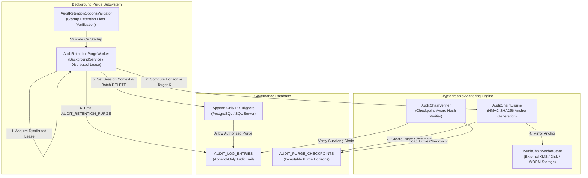

# F-AUDIT-02: Cryptographic Audit Retention Purge & Checkpoint Anchors

## 1. Executive Summary & Problem Statement

The Autheris governance database maintains an append-only audit trail in `AUDIT_LOG_ENTRIES` secured by database-level triggers and continuous cryptographic HMAC-SHA256 hash chains ([F-AUDIT-01](f-audit-01-hardened-cryptographic-audit.md)). Every data read, administrative mutation, consent request, and security denial writes an immutable audit record linking to the hash of the preceding entry.

While enterprise compliance regulations (such as GDPR Art. 5(1)(e) Storage Limitation) require purging historical audit records beyond configured retention horizons (e.g., 90 or 400 days), naively deleting expired rows introduces three critical failure modes:
1. **Cryptographic Verification Breakdown:** Traditional verification algorithms walk the hash chain sequentially from the genesis sequence (position 1). Deleting historical prefix records `[1..K]` causes chain verification to fail with a missing sequence error, triggering a system-wide audit violation latch that denies all subsequent data queries (`AuditChainViolationPolicy.DenyDataAccess`).
2. **Trigger-Level Abort:** Database-level append-only triggers in PostgreSQL (`autheris_audit_append_only`, error code `42501`) and SQL Server (`trg_audit_append_only`, error code `50042`) unconditionally block all `DELETE` and `TRUNCATE` commands.
3. **Transaction Log Saturation & Lock Contention:** Deleting millions of historical records in a single monolithic transaction causes table lock escalation, blocking concurrent incoming audit writes and exhausting database transaction logs.

`F-AUDIT-02` resolves these challenges through a bounded, cryptographic retention purge architecture:
- **Cryptographic Purge Checkpoint Anchors:** Prior to purging rows `[1..K]`, the system computes and signs a purge checkpoint anchor (`AuditPurgeCheckpoint`) capturing the first surviving sequence ($K+1$), the previous hash of row $K+1$, the purged record count, and the purge horizon timestamp. The checkpoint is stored in `AUDIT_PURGE_CHECKPOINTS` and mirrored to external storage via [`IAuditChainAnchorStore`](file:///root/autheris/src/Autheris.Application/Interfaces/IAuditChainAnchorStore.cs).
- **Continuous Chain Verification Across Horizons:** The hash chain verifier ([`VerifyAuditHashChainAsync`](file:///root/autheris/src/Autheris.Infrastructure/Persistence/SqliteGovernanceRepository.Audit.cs)) loads the active purge checkpoint anchor and validates the surviving sequence forward to the current tail anchor, mathematically preserving non-repudiation and tamper-evidence without retaining raw historical rows.
- **Session-Fenced Trigger Bypass:** The background worker securely bypasses append-only triggers using transaction-scoped session context (`autheris.audit_purge_authorized = 'true'` in PostgreSQL; `SESSION_CONTEXT(N'audit_purge_authorized') = 1` in SQL Server). Unauthorized or ad-hoc SQL deletes without this context remain strictly blocked.
- **Bounded Batch Processing:** Purges records in bounded transactions ($\le 5,000$ rows) with configurable inter-batch delays, eliminating lock escalation and preventing transaction log saturation.
- **Self-Audit Logging:** Emits a Tier A fail-closed audit event (`AUDIT_RETENTION_PURGE`) recording purge metrics under the Zero-Payload Rule (strictly zero actor SIDs or payload data).

---

## 2. Architecture & Component Wiring



### 2.1 Component Responsibilities

| Component | Responsibility |
|---|---|
| [`AuditRetentionPurgeWorker`](file:///root/autheris/src/Autheris.Application/Audit/AuditRetentionPurgeWorker.cs) | Hosted background service executing periodic purge sweeps under distributed cluster leasing; coordinates checkpoint creation and batch deletions. |
| [`AuditRetentionOptionsValidator`](file:///root/autheris/src/Autheris.Application/Audit/AuditRetentionOptionsValidator.cs) | Enforces fail-closed configuration validation at startup: requires retention $\ge 7$ days in production and validates categorical retention floors. |
| [`AuditChainEngine`](file:///root/autheris/src/Autheris.Domain/Audit/AuditChainEngine.cs) | Manages cryptographic hashing and anchor construction for audit chains and purge checkpoints. |
| [`IAuditChainAnchorStore`](file:///root/autheris/src/Autheris.Application/Interfaces/IAuditChainAnchorStore.cs) | Abstraction for persisting purge checkpoints and tail anchors to disk, memory, or cloud KMS storage. |
| [`AuditPurgeCheckpoint`](file:///root/autheris/src/Autheris.Domain/Audit/AuditPurgeCheckpoint.cs) | Immutable domain record containing `FirstSurvivingSequence`, `SurvivingPrevHash`, `PurgedCount`, `PurgedThroughUtc`, and cryptographic signature. |
| Schema Triggers (`autheris_audit_append_only`) | Database-level triggers enforcing append-only immutability; permits deletions only when session variable `audit_purge_authorized` is set within an active transaction. |

---

## 3. Technical Deep-Dive

### 3.1 Checkpoint Anchor Protocol

Before deleting any historical audit records up to sequence $K$:
1. **Target Identification:** The worker queries for candidate records older than the retention cutoff ($T_{\text{cutoff}} = \text{UtcNow} - \text{RetentionDays}$).
2. **Surviving Boundary Resolution:** The worker identifies the first surviving entry at sequence $K+1$ and extracts its `prev_hash` (which cryptographically seals record $K$).
3. **Anchor Computation:** An `AuditPurgeCheckpoint` record is constructed:
   $$\text{AnchorHash} = \text{HMAC-SHA256}_{K_{\text{audit}}}(\text{TenantId} \parallel \text{FirstSurvivingSequence} \parallel \text{SurvivingPrevHash} \parallel \text{PurgedCount} \parallel \text{PurgedThroughUtc})$$
4. **Atomic Checkpoint Insertion:** The checkpoint is inserted into `AUDIT_PURGE_CHECKPOINTS` and mirrored to external anchor storage via `IAuditChainAnchorStore`.
5. **Chain Verification Transition:** Any subsequent verification sweep checks `AUDIT_PURGE_CHECKPOINTS` first. If an active checkpoint exists, verification begins at `FirstSurvivingSequence` using `SurvivingPrevHash` as the expected initial hash, successfully verifying the remaining records without requiring deleted entries.

### 3.2 Dialect-Specific Session Bypass

Direct execution of `DELETE FROM AUDIT_LOG_ENTRIES` triggers database aborts:
- **PostgreSQL:**
  ```sql
  -- Inside bounded transaction:
  SET LOCAL autheris.audit_purge_authorized = 'true';
  DELETE FROM autheris_audit_log_entries
  WHERE sequence_number IN (
      SELECT sequence_number FROM autheris_audit_log_entries
      WHERE timestamp < @cutoff AND sequence_number < @firstSurviving
      ORDER BY sequence_number ASC
      LIMIT 5000
  );
  ```
  The PostgreSQL trigger function checks:
  ```plpgsql
  IF current_setting('autheris.audit_purge_authorized', true) = 'true' THEN
      RETURN OLD;
  END IF;
  RAISE EXCEPTION 'autheris_audit_log_entries is append-only' USING ERRCODE = '42501';
  ```
- **SQL Server:**
  ```sql
  -- Inside bounded transaction:
  EXEC sp_set_session_context 'audit_purge_authorized', 1;
  DELETE TOP (5000) FROM AUDIT_LOG_ENTRIES
  WHERE timestamp < @cutoff AND sequence_number < @firstSurviving;
  ```
  The SQL Server trigger checks `SESSION_CONTEXT(N'audit_purge_authorized') = 1` before allowing the delete.

### 3.3 Bounded Batching & Resource Protection

To avoid lock escalation and write-ahead log saturation:
- Bounded batch size: Purges at most `BatchSize` rows (default: 5,000) per transaction.
- Inter-batch delay: Waits `InterBatchDelayMs` (default: 200ms) between batches to allow concurrent incoming audit writes to proceed without contention.
- Transaction lock timeout: Enforces `LockTimeoutSeconds` (default: 10s) to prevent blocking if external queries hold locks.

---

## 4. Configuration & Options

Configure audit retention under `Gateway:Audit:Retention` in `appsettings.json`:

```json
{
  "Gateway": {
    "Audit": {
      "Retention": {
        "Enabled": true,
        "RetentionDays": 90,
        "SecurityDays": 365,
        "DataAccessDays": 90,
        "OperationsDays": 30,
        "BatchSize": 5000,
        "PurgeIntervalHours": 24,
        "InterBatchDelayMs": 200,
        "LockTimeoutSeconds": 10
      }
    }
  }
}
```

### Configuration Parameters

| Parameter | Type | Default | Description |
|---|---|---|---|
| `Enabled` | `bool` | `true` | Enables or disables the background purge worker. |
| `RetentionDays` | `int` | `90` | General audit record retention horizon in days. |
| `SecurityDays` | `int` | `365` | Minimum retention horizon for security-critical audit events. |
| `DataAccessDays` | `int` | `90` | Retention horizon for table queries and data access events. |
| `OperationsDays` | `int` | `30` | Retention horizon for operational and health events. |
| `BatchSize` | `int` | `5000` | Maximum rows deleted per single transaction. |
| `PurgeIntervalHours` | `int` | `24` | Frequency of background purge execution. |
| `InterBatchDelayMs` | `int` | `200` | Throttle delay between consecutive purge batches. |

---

## 5. Usage & Verification

### 5.1 Verification Query

Administrators can inspect active purge checkpoints in the governance database:

```sql
SELECT 
    checkpoint_id,
    first_surviving_sequence,
    surviving_prev_hash,
    purged_count,
    purged_through_utc,
    created_at
FROM AUDIT_PURGE_CHECKPOINTS
ORDER BY first_surviving_sequence DESC;
```

### 5.2 Purge Self-Audit Entry

Upon completing a purge run, the worker records an audit event:
```json
{
  "event_type": "AUDIT_RETENTION_PURGE",
  "action": "PURGE",
  "result": "SUCCESS",
  "metadata": {
    "purged_count": 15420,
    "first_surviving_sequence": 15421,
    "purged_through_utc": "2026-07-21T00:00:00Z",
    "duration_ms": 3420
  }
}
```

---

## 6. Security, Zero-Trust & Fail-Closed Behavior

1. **Mandatory Production Retention Floors:** Outside of the `Development` environment, configuring `RetentionDays < 7` causes immediate application startup failure via `AuditRetentionOptionsValidator` (`SEC-AUD161-01`), preventing accidental or malicious elimination of audit trails.
2. **Immutable Trigger Protection:** The append-only trigger remains active at all times. A malicious user or compromised service account running raw `DELETE FROM AUDIT_LOG_ENTRIES` is denied with database error code `42501` / `50042`, because session authorization is set exclusively inside ephemeral gateway transactions.
3. **Cryptographic Chain Invariance:** Chain verification failure triggers a system-wide read latch (`AuditChainViolationPolicy.DenyDataAccess`). Purge checkpoint anchors guarantee that valid purges preserve verification continuity, while unauthorized row deletions are immediately detected and blocked.
4. **Distributed Lease Fencing:** Multi-node cluster deployments coordinate purge sweeps through distributed leases, preventing competing workers from creating interleaving checkpoint records.
5. **Zero-Payload Rule:** Purge self-audit records record execution metadata only, with zero personal actor information or sensitive business payloads.
