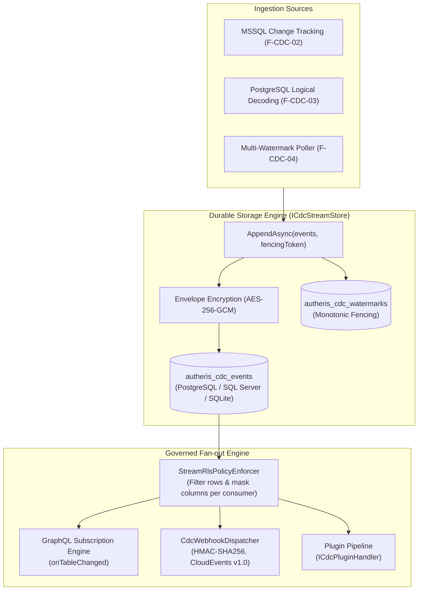

# F-CDC-01: Durable CDC Event Streaming & Multi-Protocol Fanout

**Components:** [`ICdcStreamStore.cs`](file:///root/autheris/src/Autheris.Application/Streaming/Interfaces/ICdcStreamStore.cs), [`SqliteCdcStreamStore.cs`](file:///root/autheris/src/Autheris.Infrastructure/Streaming/SqliteCdcStreamStore.cs), [`PostgreSqlCdcStreamStore.cs`](file:///root/autheris/src/Autheris.Infrastructure/Streaming/PostgreSqlCdcStreamStore.cs), [`SqlServerCdcStreamStore.cs`](file:///root/autheris/src/Autheris.Infrastructure/Streaming/SqlServerCdcStreamStore.cs), [`CdcChangeEventBuilder.cs`](file:///root/autheris/src/Autheris.Extensions/Cdc/CdcChangeEventBuilder.cs), [`CdcWebhookDispatcher.cs`](file:///root/autheris/src/Autheris.Extensions/Cdc/CdcWebhookDispatcher.cs), [`ICdcPluginHandler.cs`](file:///root/autheris/src/Autheris.Application/Streaming/Interfaces/ICdcPluginHandler.cs)

---

## 1. Executive Summary & Problem Statement

Modern data architectures require real-time database mutations to feed diverse downstream consumers: microservices reacting via Webhooks, front-end dashboards receiving GraphQL subscriptions, and analytics pipelines ingesting change events. In enterprise environments, transient in-memory channels create catastrophic risks of event loss during service restarts, network partitions, or consumer downtime. Furthermore, sensitive change payloads must remain encrypted at rest and obey strict Row-Level Security (RLS) policies.

**F-CDC-01** provides an enterprise durable Change Data Capture (CDC) streaming store with zero Kafka dependency. Change events ingested from database pollers (such as MSSQL Change Tracking or custom multi-watermark pollers) are durably committed into a partitioned event ledger (`autheris_cdc_events`) with AES-256-GCM envelope encryption, monotonic fencing tokens, and automatic fan-out across three delivery protocols: GraphQL Subscriptions, HMAC-SHA256 Signed Webhooks, and In-Process C# Plugins.

---

## 2. Architecture & Component Wiring



### 2.1 Multi-Engine Durable Storage (`ICdcStreamStore`)

Autheris supports three native database backends for the CDC event ledger without requiring Kafka or external message brokers:
- **PostgreSQL:** Backed by native `autheris_cdc_events` using `BYTEA` encrypted payloads and JSONB metadata.
- **Microsoft SQL Server:** Backed by `VARBINARY(MAX)` encrypted payloads with table partitions.
- **SQLite:** Lightweight single-node embedded storage for edge and testing environments.

Every append operation requires:
- `streamName`: Logical stream identifier.
- `fencingToken`: Cluster epoch token to prevent split-brain dual writers.
- `events`: Ordered list of `CdcEventRecord` instances.

### 2.2 Envelope Encryption & Privacy

Payloads are secured at rest using envelope encryption:
1. Each event payload is encrypted using AES-256-GCM with a unique 96-bit initialization vector (IV) and a 128-bit authentication tag.
2. Cryptographic keys are managed via `ICdcStreamCrypto` with support for AWS KMS, Azure Key Vault, or HashiCorp Vault.
3. Payloads cannot be inspected directly by unprivileged database administrators querying the storage engine.

### 2.3 Multi-Protocol Egress Fan-out

Events committed to `ICdcStreamStore` are dispatched through three channels:
1. **GraphQL Subscriptions (`onTableChanged`):** Real-time WebSocket subscriptions with in-flight AST RLS filtering and dynamic column masking applied to each recipient's authorization context.
2. **Durable Webhooks (`CdcWebhookDispatcher`):** Pushes events to external HTTP endpoints adhering to the CNCF CloudEvents v1.0 specification, signed with `X-Autheris-Signature` (HMAC-SHA256).
3. **In-Process Plugins (`ICdcPluginHandler`):** Low-latency C# DLL extensions executing custom transformation or export logic directly within the host process.

---

## 3. Configuration & Usage Examples

### 3.1 Configuring the Durable Stream Store (`appsettings.json`)

```json
{
  "Cdc": {
    "StreamStore": {
      "Provider": "PostgreSql",
      "ConnectionString": "Host=db.internal;Database=autheris_gov;Username=cdc_writer;Password=***",
      "RetentionHours": 72,
      "MaxBatchSize": 1000
    },
    "Encryption": {
      "KeyProvider": "Kms",
      "KeyId": "arn:aws:kms:eu-central-1:123456789012:key/cdc-stream-key"
    }
  }
}
```

### 3.2 Subscribing via CloudEvents Webhook

External consumers register webhook endpoints via governance API or configuration:

```json
{
  "Subscriptions": [
    {
      "Id": "sub_billing_sync",
      "Stream": "dbo.orders",
      "EndpointUrl": "https://billing.internal/api/v1/cdc/orders",
      "SecretToken": "env:BILLING_WEBHOOK_SECRET",
      "BatchWindowMs": 500,
      "MaxBatchSize": 100
    }
  ]
}
```

Sample delivered CloudEvent:

```http
POST /api/v1/cdc/orders HTTP/1.1
Host: billing.internal
Content-Type: application/cloudevents+json
X-Autheris-Signature: sha256=9b7f58a3a0e10b147d3d29a...

{
  "specversion": "1.0",
  "id": "cdc-9b7f58a3a0e10b14",
  "source": "autheris://gateway/dbo.orders",
  "type": "com.autheris.cdc.tableChanged",
  "time": "2026-10-19T03:30:15.120Z",
  "datacontenttype": "application/json",
  "data": {
    "operation": "INSERT",
    "table": "dbo.orders",
    "key": { "order_id": 5001 },
    "payload": {
      "order_id": 5001,
      "customer_id": 1042,
      "amount": 199.95,
      "created_at": "2026-10-19T03:30:14.000Z"
    }
  }
}
```

---

## 4. Security, Zero-Trust & Fail-Closed Behavior

- **Split-Brain Fencing:** If an active writer is demoted or partitioned and another instance acquires the cluster lease, stale append attempts fail immediately with `FencingTokenRejectedException`.
- **In-Stream Row & Column Governance:** Consumer subscriptions receive only rows permitted by their active Casbin ABAC rules and data-owner consents. Sensitive columns (e.g. PII, SSN, IBAN) are masked before network serialization.
- **Immutable Watermark Tracking:** Stream progress is persisted in `autheris_cdc_watermarks` and cannot move backward without explicit administrative reset.
