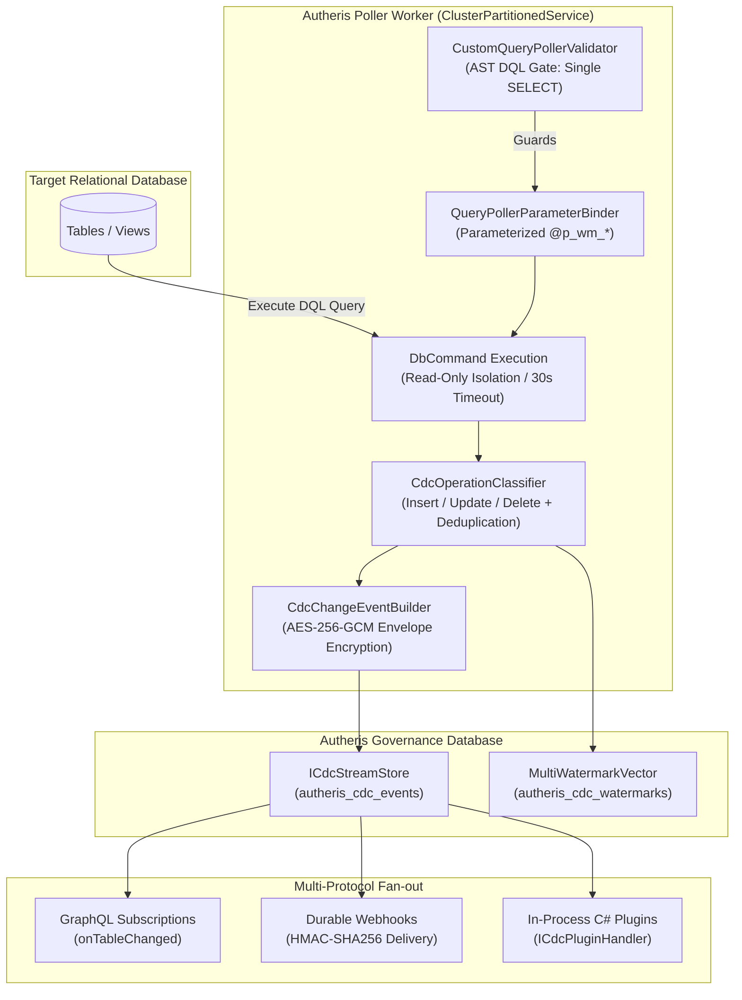

# F-CDC-04: Governed Multi-Watermark Query Poller

**Components:** [`CustomQueryPollerOptions.cs`](file:///root/autheris/src/Autheris.Domain/Options/Protocols/CustomQueryPollerOptions.cs), [`MultiWatermarkVector.cs`](file:///root/autheris/src/Autheris.Domain/Model/MultiWatermarkVector.cs), [`CustomQueryPollerValidator.cs`](file:///root/autheris/src/Autheris.Application/Streaming/Validation/CustomQueryPollerValidator.cs), [`CdcOperationClassifier.cs`](file:///root/autheris/src/Autheris.Extensions/Cdc/CustomQuery/CdcOperationClassifier.cs), [`CustomQueryPollerService.cs`](file:///root/autheris/src/Autheris.Extensions/Cdc/CustomQuery/CustomQueryPollerService.cs), [`QueryPollerParameterBinder.cs`](file:///root/autheris/src/Autheris.Extensions/Cdc/CustomQuery/QueryPollerParameterBinder.cs), [`ICdcStreamStore.cs`](file:///root/autheris/src/Autheris.Application/Streaming/Interfaces/ICdcStreamStore.cs)

---

## 1. Executive Summary & Problem Statement

Organizations operating legacy systems, cloud data warehouses, or custom relational database schemas often lack native, low-level transaction log CDC mechanisms (such as PostgreSQL logical decoding or Microsoft SQL Server Change Tracking). In these environments, capturing changes requires polling application tables directly.

However, realistic enterprise business domains do not advance along a single monotonic cursor:
- New entities advance a `created_at` timestamp or an auto-incrementing `id`.
- Business mutations advance an `updated_at` timestamp.
- Soft deletes advance a `deleted_at` timestamp or toggle an `is_deleted` flag.
- Batch ledger events advance an independent `sequence_number`.

Single-column polling inevitably misses concurrent events or produces unbounded duplicate records. 

**F-CDC-04** delivers an administrative, read-only multi-watermark query poller that coordinates multidimensional cursor vectors using an disjunctive (`OR`) evaluation model. It guarantees monotonic advancement across all dimensions, classifies operations into inserts, updates, and deletes, deduplicates identical payloads, and feeds events directly into the zero-trust durable CDC stream pipeline (`ICdcStreamStore`) with AES-256-GCM envelope encryption.

---

## 2. Architecture & Component Wiring



### 2.1 Multidimensional Watermark Vector Tracking

The poller maintains state via `MultiWatermarkVector`. Each declared dimension tracks:
- `Dimension`: Column identifier (e.g. `updated_at`, `created_at`, `id`, `deleted_at`).
- `Kind`: Data type (`DateTimeUtc`, `Integer`, `String`, `Timestamp`).
- `CurrentValue`: Current cursor position.
- `InitialValue`: Fallback cursor used on stream inception.

When polling, the SQL query binds each dimension as a strongly-typed parameter (`@p_wm_<name>`). Rows matching any advanced dimension (`col1 > @p_wm_col1 OR col2 > @p_wm_col2 ...`) are evaluated. As rows are ingested, the vector advances monotonically using element-wise maximums:
$$\text{Vector}_{t+1}[d] = \max\left(\text{Vector}_t[d], \max_{r \in \text{Batch}}(r[d])\right)$$

### 2.2 AST DQL Safety Gate

Because query templates are administrative inputs, `CustomQueryPollerValidator` parses the template at startup using `ISqlEngine`:
- **Single SELECT Assertion:** Must parse strictly as a single `SelectStatementNode`.
- **DML/DDL Defense:** Rejects any `INSERT`, `UPDATE`, `DELETE`, `DROP`, `ALTER`, `CREATE`, `TRUNCATE`, or `EXEC`.
- **Side-Effect Defense:** Rejects `SELECT ... INTO`, temporary table creation, or dynamic SQL execution.
- **Identifier Validation:** Enforces alphanumeric identifiers (`^[a-zA-Z0-9_]+$`) for all watermark column names.

### 2.3 Operations Classification & Soft-Delete Mapper

Incoming rows are mapped into standard CDC operations by `CdcOperationClassifier`:
1. **Delete Detection:** If a configured `SoftDeleteDefinition` matches (e.g. `is_deleted = true` or `deleted_at IS NOT NULL`), the row is emitted as `CdcOperation.Delete`.
2. **Insert vs. Update:** If the primary key is novel or `created_at == updated_at`, the row is emitted as `CdcOperation.Insert`; otherwise, it is emitted as `CdcOperation.Update`.
3. **Zero-Noise Deduplication:** If an update row's cryptographic payload hash matches the prior row image stored in `autheris_cdc_row_images`, the duplicate is dropped to prevent noisy event amplification.

---

## 3. Configuration & Usage Examples

### 3.1 Declarative Configuration (`appsettings.json`)

Configure poller streams under the `Cdc:CustomQueryPollers` section:

```json
{
  "Cdc": {
    "CustomQueryPollers": [
      {
        "StreamName": "legacy_erp_customers",
        "DataSource": "sqlserver_erp",
        "Table": "dbo.customers",
        "KeyColumns": ["customer_id"],
        "Watermarks": [
          {
            "Name": "updated_at",
            "Kind": "DateTimeUtc",
            "InitialValue": "1970-01-01T00:00:00Z"
          },
          {
            "Name": "created_at",
            "Kind": "DateTimeUtc",
            "InitialValue": "1970-01-01T00:00:00Z"
          },
          {
            "Name": "customer_id",
            "Kind": "Integer",
            "InitialValue": "0"
          },
          {
            "Name": "deleted_at",
            "Kind": "DateTimeUtc",
            "InitialValue": "1970-01-01T00:00:00Z"
          }
        ],
        "SoftDelete": {
          "ColumnName": "deleted_at",
          "MatchCondition": "IsNotNull"
        },
        "QueryTemplate": "SELECT TOP (@p_batch_size) customer_id, company_name, email, created_at, updated_at, deleted_at FROM dbo.customers WHERE updated_at > @p_wm_updated_at OR created_at > @p_wm_created_at OR (customer_id > @p_wm_customer_id AND created_at >= @p_wm_created_at) OR deleted_at > @p_wm_deleted_at ORDER BY updated_at ASC, created_at ASC, customer_id ASC",
        "PollingIntervalMs": 2000,
        "BatchSize": 250,
        "CommandTimeoutSeconds": 15
      }
    ]
  }
}
```

### 3.2 Consuming Governed CDC Events via GraphQL Subscription

Authorized clients subscribe to real-time table mutations using GraphQL:

```graphql
subscription OnCustomerChanged {
  onTableChanged(table: "dbo.customers") {
    eventId
    operation
    timestamp
    key
    payload
  }
}
```

Sample event delivery payload (with column masking and RLS applied):

```json
{
  "data": {
    "onTableChanged": {
      "eventId": "cdc_evt_01JAX7K89M4B11R0V3C0DE77",
      "operation": "UPDATE",
      "timestamp": "2026-10-19T03:30:15.120Z",
      "key": "{\"customer_id\": 1042}",
      "payload": {
        "customer_id": 1042,
        "company_name": "Contoso Global",
        "email": "c***@contoso.com",
        "updated_at": "2026-10-19T03:30:14.000Z"
      }
    }
  }
}
```

### 3.3 Administrative Watermark Reset via REST API

Stream offsets can be rewound or fast-forwarded by governance administrators:

```http
POST /api/v1/cdc/streams/legacy_erp_customers/reset-watermark
Host: gateway.autheris.internal
Authorization: Bearer <governance_admin_token>
Content-Type: application/json

{
  "fencingToken": 42,
  "watermarks": {
    "updated_at": "2026-10-18T00:00:00Z",
    "created_at": "2026-10-18T00:00:00Z",
    "customer_id": "0",
    "deleted_at": "2026-10-18T00:00:00Z"
  },
  "reason": "Re-ingesting transactions following ERP migration batch"
}
```

---

## 4. Security, Zero-Trust & Fail-Closed Behavior

- **Least Privilege & Read-Only Isolation:** Query execution enforces database-level read-only guarantees (`PRAGMA query_only = ON` for SQLite; `SET TRANSACTION READ ONLY` for PostgreSQL).
- **Cluster Lease Fencing:** Polling instances run as singletons via `ClusterPartitionedService`. All watermark state writes enforce fencing token monotonic incrementing; stale workers encountering a higher token fail closed with `FencingTokenRejectedException`.
- **Envelope Encryption at Rest:** Event payloads staged into `autheris_cdc_events` are encrypted with AES-256-GCM via `ICdcStreamCrypto`.
- **Audit Logging:** Watermark resets emit Tier A immutable audit logs capturing administrator identity, reason, fencing tokens, and dimension offsets. Database credentials and parameter values are never logged.
