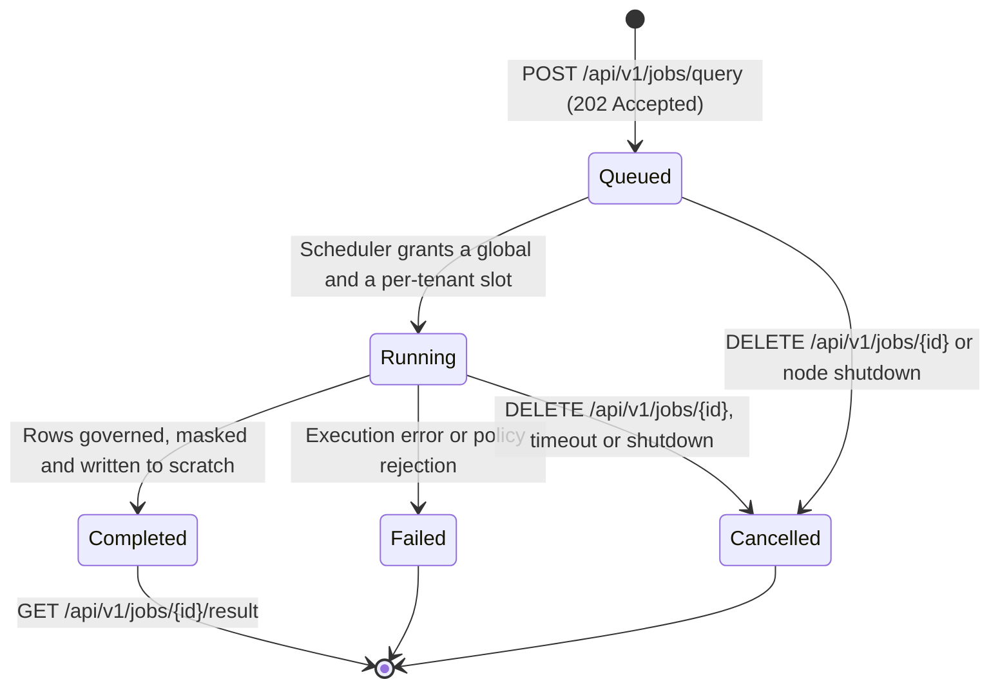

# F-DATA-07: Asynchronous Query Job Engine & Sandbox Storage

**Components:** [`AsyncJobEndpoints.cs`](file:///root/autheris/src/Autheris.Api/Endpoints/AsyncJobEndpoints.cs), [`AsyncQueryJobManager.cs`](file:///root/autheris/src/Autheris.Application/Jobs/Services/AsyncQueryJobManager.cs), [`AsyncQueryJobBackgroundWorker.cs`](file:///root/autheris/src/Autheris.Application/Jobs/Services/AsyncQueryJobBackgroundWorker.cs), [`AsyncJobScheduler.cs`](file:///root/autheris/src/Autheris.Application/Jobs/Services/AsyncJobScheduler.cs), [`IAsyncQueryJobManager.cs`](file:///root/autheris/src/Autheris.Application/Jobs/Interfaces/IAsyncQueryJobManager.cs), [`IAsyncJobQueue.cs`](file:///root/autheris/src/Autheris.Application/Jobs/Interfaces/IAsyncJobQueue.cs), [`AsyncJobOptionsValidator.cs`](file:///root/autheris/src/Autheris.Api/Extensions/DependencyInjection/AsyncJobOptionsValidator.cs)

---

## 1. Overview & Problem Statement

Heavy analytical queries, federated multi-source aggregations, and large dataset extracts can take minutes to process. Executing these queries synchronously over standard HTTP connections causes client-side connection drops, reverse-proxy timeouts (e.g. NGINX 504 Gateway Timeout), and thread pool starvation under high concurrent traffic.

**F-DATA-07** provides an **Asynchronous Query Job Engine** based on a bounded .NET `System.Threading.Channels` queue and a fair, parallel scheduler. Long-running queries are accepted immediately with HTTP `202 Accepted`, executed in the background through the governed SQL pipeline (transport `AsyncJob`), and their governed results are staged in a tenant-partitioned scratch directory for later retrieval. In multi-replica deployments the job state is shared through the cluster state store, so status, cancel and (with a shared volume) result download work on any replica.

---

## 2. Business Value

- **No HTTP gateway timeouts**: clients submit queries and immediately receive a `jobId` without keeping long-lived TCP connections open.
- **Pre-storage governance (Zero-IDOR security)**: Row-Level Security (RLS) predicates and Dynamic Data Masking (DDM) are applied by the governed SQL pipeline **before** results are written to disk. Result files contain only masked, authorized data.
- **Tenant and user isolation**: jobs and result files are bound to the submitting caller's tenant and user identity. Access by any other tenant or user returns HTTP `404 Not Found` (no information leakage) and is audited as `ASYNC_JOB_ACCESS_DENIED`.
- **Fair parallel execution**: a node runs several jobs at once, caps the share of each tenant and serves waiting tenants round-robin, so one tenant cannot starve the others.
- **Automated lifecycle and storage cleanup**: finished jobs and their result files expire after a configurable retention window (default 24 h); crash leftovers are removed by a startup sweeper.

---

## 3. Architecture & Lifecycle



### 3.1 Building Blocks

| Component | Responsibility |
| :--- | :--- |
| `IAsyncQueryJobManager` | API-facing contract: submit, status, result stream, cancel, purge. |
| `IAsyncJobQueue` | Work-queue contract consumed by the background worker: `Reader` (pending execution items), `ScratchDirectory`, `TryTransitionAsync` (state change that never leaves a terminal state), `SweepOrphanedScratchFilesAsync`, `ApplyCancelSignalAsync` (cancel published by another node) and `Complete` (stop accepting jobs). Implemented by `AsyncQueryJobManager`, registered as a singleton. |
| `AsyncQueryJobBackgroundWorker` | Hosted service: subscribes to remote cancel signals, runs the startup sweeper, the periodic purge loop and the scheduler. |
| `AsyncJobScheduler` | Parallel, per-tenant fair dispatch of queued jobs (section 4). |

### 3.2 Sticky Terminal States

`Completed`, `Failed` and `Cancelled` are terminal. Every state change is a compare-and-swap that refuses to leave a terminal state:

- A cancel that arrives after the worker finished is a no-op (`DELETE` returns `404`).
- A worker that finishes after a cancel loses the race: its result file is deleted and the job stays `Cancelled`.
- A job cancelled while still queued is never executed.

### 3.3 API Endpoints

All routes require an authenticated principal with a resolvable user identity; a principal without one is rejected with `ASYNC_JOB_OWNER_UNRESOLVABLE`.

| Method | Endpoint | Success | Description |
| :--- | :--- | :--- | :--- |
| `POST` | `/api/v1/jobs/query` | `202` + `Location: /api/v1/jobs/{jobId}/status` | Submits an asynchronous query job. |
| `GET` | `/api/v1/jobs/{jobId}/status` | `200` | Returns `jobId`, `state` (`Queued`, `Running`, `Completed`, `Failed`, `Cancelled`), timestamps, `rowsProduced`, `bytesProduced`, `errorMessage` and, once completed, `resultDownloadUrl`. |
| `GET` | `/api/v1/jobs/{jobId}/result` | `200` | Streams the staged result file (`application/json` or `text/csv`, file name `query-result-{jobId}.{format}`). |
| `DELETE` | `/api/v1/jobs/{jobId}` | `204` | Cancels a queued or running job and deletes its staged file. `404` when the job is unknown, not owned by the caller or already terminal. |

Error responses (RFC 7807 problem details):

| Status | `Retry-After` | Cause |
| :--- | :--- | :--- |
| `404` | – | Unknown job, other tenant or other owner (Zero-IDOR), or result not available (job not `Completed`, file purged). |
| `429` | `30` | The tenant has `MaxQueuedJobsPerTenant` queued or running jobs on this node, or the node queue (1,000 items) is full. |
| `503` | `5` | Shutdown: the job queue no longer accepts jobs (worker stopped). |
| `503` | `5` | The cluster state store is unavailable (cluster-wide topology): every submit, and requests for jobs this node does not hold locally. "Unknown" is never reported as "not found". |
| `503` | `5` | `GET .../result` for a job owned by another node while the scratch directory is not shared; the problem body carries `code: ASYNC_JOB_RESULT_NODE_LOCAL`. |

### 3.4 Request Limits

The request body is `{ "query": "...", "format": "json" | "csv", "maxRows": 100000, "timeout": "00:05:00" }`. Client values only narrow the server bounds (SR-H-05): `maxRows` is clamped to `[1, Gateway:RowLimits:AsyncJob:MaxAllowedRows]` (falling back to the WebSQL limits), and the timeout defaults to `DefaultTimeoutSeconds` and is clamped to `MaxTimeoutSeconds`. The worker re-derives both bounds before execution; the queued request is never trusted.

### 3.5 Audit Events

`ASYNC_JOB_SUBMITTED`, `ASYNC_JOB_COMPLETED`, `ASYNC_JOB_DOWNLOADED`, `ASYNC_JOB_CANCELLED`, `ASYNC_JOB_STATUS_READ` and `ASYNC_JOB_ACCESS_DENIED`. `ALLOW` records for submit and download are written fail-closed: when the audit write fails, the job is not accepted or the result is not served.

---

## 4. Parallel Scheduler & Tenant Fairness

Each node runs one `AsyncJobScheduler`:

- At most `MaxConcurrentJobs` jobs execute in parallel on the node (default 4).
- At most `MaxConcurrentJobsPerTenant` of them belong to the same tenant (default 2, never more than `MaxConcurrentJobs`).
- Jobs of a tenant at its cap wait in a per-tenant queue. Whenever a slot is free, the scheduler first files every readable channel item under its tenant and then serves the tenants **round-robin**, skipping tenants at their cap. No tenant waits longer than one rotation, regardless of the backlog of others.
- A finished job releases its per-tenant count and its global slot.
- **Admission cap:** a submit is rejected with `429` when the tenant already has `MaxQueuedJobsPerTenant` (default 50) queued or running jobs **on this node**. The count and the reservation happen under one lock, so concurrent submits cannot overshoot it. Independently, the node queue holds at most 1,000 items; a full queue also answers `429`.
- **Shutdown:** when the worker stops, the queue is completed (later submits get `503`). Running jobs are cancelled through the host stopping token and end `Cancelled`. Jobs still waiting are transitioned to `Cancelled` with the message `Job cancelled because the gateway is shutting down.` and counted in `autheris.asyncjobs.discarded`; the in-memory queue does not survive the process.

---

## 5. Scratch Directory & Cleanup

Result files are written to `{ScratchDirectory}/{tenantId}/{jobId}.json` or `.csv`.

- `ScratchDirectory` must be an absolute path. When unset, `{ContentRoot}/scratch/jobs` is used.
- The Helm chart runs with a read-only root filesystem and sets `Gateway__AsyncJobs__ScratchDirectory=/tmp/autheris-jobs` on the writable `/tmp` `emptyDir`. `tmpVolume.sizeLimit` (for example `"2Gi"`) bounds that volume; empty means unbounded.
- Result retrieval verifies that the resolved path lies inside the scratch directory (separator-terminated prefix check); a violation is audited and rejected with `JOB_RESULT_PATH_FORBIDDEN`.
- **Purge loop:** every `PurgeIntervalMinutes` (default 15), finished jobs older than `RetentionHours` (default 24) are removed together with their files.
- **Startup sweeper:** when the worker starts, files in the scratch directory whose names are `{guid}.json` or `{guid}.csv` are deleted when they are older than `RetentionHours`, or when they are older than `MaxTimeoutSeconds` and no job (local entry or cluster record) refers to them. If the cluster state cannot be read, the file is kept and only the retention age can delete it. Other files and reparse points (symbolic links) are never touched.

---

## 6. Multi-Replica Behaviour

When the cluster state is cluster-wide (external Redis/Garnet, see [F-OPS-02](f-ops-02-high-availability-kubernetes-helm.md)), the job manager requires an `IDistributedClusterStateProvider` (startup fails without one) and shares job state across replicas. In a single-node or local topology the job state is in memory only.

### 6.1 Job Records

- Every state change writes the record `asyncjob:{tenant}:{jobId}` (`AsyncJobClusterRecord`): job id, tenant, owner, format, state, timestamps, row and byte counts, the sanitized error message, the result **file name** and the owner node id (a random id per process). The record deliberately holds **neither the SQL text nor an absolute file path**.
- The record TTL is `MaxTimeoutSeconds + RetentionHours` and is reset on every write.
- The submit is fail-closed: if the record cannot be written, the job is rejected with `503`. Later writes that fail are logged and counted (`autheris.asyncjobs.cluster_write_failures`); the local state is kept.
- Status, result and cancel resolve the local entry first and otherwise read the record under the requester's tenant key. Tenant and owner are verified in both cases (mismatch = `404`).

### 6.2 Cross-Node Cancel

1. The receiving node re-reads the record; a finished job is not cancelled (`404`).
2. It writes the authoritative cancel tombstone `asyncjob:{tenant}:{jobId}:cancel` (fail-closed: an unavailable store answers `503`), then publishes a best-effort signal on the channel `asyncjob:cancel`.
3. The owner node applies the signal only if tenant and requester match its local job and a matching tombstone exists; a forged or misrouted signal changes nothing.
4. Independently, the owner checks the tombstone before every state transition (three attempts for `Completed`/`Failed`), so a lost signal still stops the job at its next state write. A status read of a queued or running job with a tombstone already reports `Cancelled`.

If the tombstone read stays unavailable, the transition proceeds and is counted in `autheris.asyncjobs.tombstone_check_failures`; the remaining window is a cancel issued while the shared state is down, which the owner then only honours through the signal.

### 6.3 Result Download Across Nodes

A result file exists only on the node that executed the job, unless all replicas share the scratch directory:

| Deployment | Behaviour |
| :--- | :--- |
| Node-local scratch (default, Helm `/tmp` `emptyDir`) | Result download of another node's job answers `503` with `ASYNC_JOB_RESULT_NODE_LOCAL`. Route a client's job requests to the same replica (sticky routing, for example ingress cookie affinity). Status and cancel work on every replica. |
| Shared scratch (`SharedScratchDirectory: true`) | All replicas mount the same ReadWriteMany volume at `ScratchDirectory`. A node serves another node's result by resolving the file name from the record against its own scratch directory. The name must be exactly `{jobId}.json` or `{jobId}.csv`; anything else is rejected with `JOB_RESULT_PATH_FORBIDDEN`. |

### 6.4 Node Loss

Jobs are **not resumed** after their owner node is lost; the in-memory queue and running queries die with the process. A record that is still `Queued` or `Running` after `CreatedAt + MaxTimeoutSeconds + 60 s` is reported as `Failed` with the message `job owner node lost` (computed on read, never persisted). Clients resubmit such jobs.

---

## 7. Configuration

Options are bound standalone from `Gateway:AsyncJobs` (`AsyncJobOptions`) and validated at startup (`AsyncJobOptionsValidator`, `ValidateOnStart`).

| Key | Default | Validation | Description |
| :--- | :--- | :--- | :--- |
| `MaxConcurrentJobs` | `4` | 1..64 | Jobs executed in parallel on this node. |
| `MaxConcurrentJobsPerTenant` | `2` | 1..`MaxConcurrentJobs` | Jobs of one tenant executed in parallel on this node. |
| `MaxQueuedJobsPerTenant` | `50` | ≥ 1 | Queued plus running jobs of one tenant on this node; further submits get `429`. |
| `DefaultTimeoutSeconds` | `300` | ≥ 1, ≤ `MaxTimeoutSeconds` | Timeout when the client supplies none. |
| `MaxTimeoutSeconds` | `900` | ≥ 1 | Upper bound of a client timeout; also the orphan age of the sweeper and part of the record TTL and owner-lost deadline. |
| `RetentionHours` | `24` | ≥ 1 | How long finished jobs and their files are kept. |
| `PurgeIntervalMinutes` | `15` | ≥ 1 | Purge loop interval. |
| `ScratchDirectory` | `null` (`{ContentRoot}/scratch/jobs`) | absolute path when set | Directory of result files. |
| `SharedScratchDirectory` | `false` | requires `ScratchDirectory` | `true` when `ScratchDirectory` is a volume shared by all replicas. |

```json
{
  "Gateway": {
    "AsyncJobs": {
      "MaxConcurrentJobs": 8,
      "MaxConcurrentJobsPerTenant": 2,
      "MaxQueuedJobsPerTenant": 50,
      "DefaultTimeoutSeconds": 300,
      "MaxTimeoutSeconds": 900,
      "RetentionHours": 24,
      "PurgeIntervalMinutes": 15,
      "ScratchDirectory": "/mnt/autheris-jobs",
      "SharedScratchDirectory": true
    }
  }
}
```

### Federated Query Transport Opt-In (`WebSql:CrossSource:AllowedTransports`)

Federated queries that span several data sources are only available when `Gateway:WebSql:CrossSource:Enabled` is true, and only for transports that are explicitly listed in `Gateway:WebSql:CrossSource:AllowedTransports`. Valid names are the constants of `SqlTransports`: `WebSql`, `Trino`, `Rest`, `Mcp`, `ArrowExport`, `FlightSql`, `SqlEndpoints` and `AsyncJob`. When nothing is configured, only `WebSql` and `Trino` are allowed. Every other channel, including this one, is rejected on federated queries (generic "not supported" response) unless its name is listed. Asynchronous jobs run federated aggregations under the transport name `AsyncJob`, which is deliberately not part of the default list; add `AsyncJob` to enable federated queries in async jobs. An explicitly empty list allows no transport at all (fail-closed). A configured list replaces the default; it is not merged with it.

```json
{
  "Gateway": {
    "WebSql": {
      "CrossSource": {
        "Enabled": true,
        "AllowedTransports": [ "WebSql", "Trino", "AsyncJob" ]
      }
    }
  }
}
```

---

## 8. Metrics

Instruments of the meter `Autheris.AsyncJobs` (OpenTelemetry instrument names; the prometheus-net meter adapter on `/metrics` replaces the dots with underscores):

| Instrument | Type | Description |
| :--- | :--- | :--- |
| `autheris.asyncjobs.running` | UpDownCounter | Jobs currently executing on this node. |
| `autheris.asyncjobs.pending` | UpDownCounter | Jobs waiting for a per-tenant slot on this node. |
| `autheris.asyncjobs.discarded` | Counter | Jobs cancelled before start because the node shut down. |
| `autheris.asyncjobs.cluster_write_failures` | Counter | Job record writes to the cluster state that failed (after submit). |
| `autheris.asyncjobs.tombstone_check_failures` | Counter | Cancel tombstone reads that failed, so a transition proceeded without the check. |
| `autheris.asyncjobs.subscribe_failures` | Counter | Failed subscriptions to the `asyncjob:cancel` channel; remote cancels then apply at the owner's next state write. |

---

## 9. Usage Examples

### A. Submitting an Asynchronous Job

```bash
curl -X POST "http://localhost:8080/api/v1/jobs/query" \
  -H "Authorization: Bearer <jwt-token>" \
  -H "Content-Type: application/json" \
  -d '{
    "query": "SELECT customer_id, SUM(amount) AS total_spend FROM sales.orders GROUP BY customer_id",
    "format": "json",
    "maxRows": 50000,
    "timeout": "00:10:00"
  }'
```

**Response (HTTP 202 Accepted):**
```http
HTTP/1.1 202 Accepted
Location: /api/v1/jobs/3f2b8c1e-9d4a-4e57-8a61-0c2f5b7d9e10/status
```
```json
{
  "jobId": "3f2b8c1e-9d4a-4e57-8a61-0c2f5b7d9e10",
  "state": "Queued",
  "createdAt": "2026-10-10T03:30:00Z",
  "resultDownloadUrl": "/api/v1/jobs/3f2b8c1e-9d4a-4e57-8a61-0c2f5b7d9e10/result"
}
```

### B. Checking Status & Downloading Results

```bash
# Poll status
curl "http://localhost:8080/api/v1/jobs/3f2b8c1e-9d4a-4e57-8a61-0c2f5b7d9e10/status" \
  -H "Authorization: Bearer <jwt-token>"

# {
#   "jobId": "3f2b8c1e-9d4a-4e57-8a61-0c2f5b7d9e10",
#   "state": "Completed",
#   "rowsProduced": 45000,
#   "bytesProduced": 3410520,
#   "completedAt": "2026-10-10T03:30:14Z",
#   "resultDownloadUrl": "/api/v1/jobs/3f2b8c1e-9d4a-4e57-8a61-0c2f5b7d9e10/result"
# }

# Download the result
curl "http://localhost:8080/api/v1/jobs/3f2b8c1e-9d4a-4e57-8a61-0c2f5b7d9e10/result" \
  -H "Authorization: Bearer <jwt-token>" \
  -o result.json

# Cancel (204 No Content)
curl -X DELETE "http://localhost:8080/api/v1/jobs/3f2b8c1e-9d4a-4e57-8a61-0c2f5b7d9e10" \
  -H "Authorization: Bearer <jwt-token>"
```

Clients should honour `Retry-After` on `429` and `503`. On `503` with `ASYNC_JOB_RESULT_NODE_LOCAL`, retry through the replica that owns the job (sticky routing) or ask the operator to configure a shared scratch volume.
