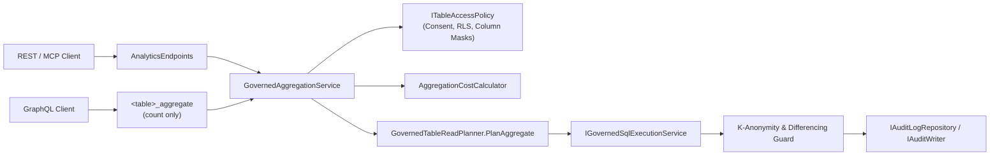

# F-DATA-08: Governed Aggregations & Minimum Group Size (k-Anonymity Guard)

**Feature-ID:** F-DATA-08  
**Category:** Data Access & Privacy Governance  
**Components:**
- Domain: [`AnalyticsOptions.cs`](../../src/Autheris.Domain/Options/AnalyticsOptions.cs), [`TableModels.cs`](../../src/Autheris.Domain/Model/TableModels.cs)
- Application: [`IGovernedAggregationService.cs`](../../src/Autheris.Application/Analytics/IGovernedAggregationService.cs), [`GovernedAggregationService.cs`](../../src/Autheris.Application/Analytics/GovernedAggregationService.cs), [`AggregationCostCalculator.cs`](../../src/Autheris.Application/Analytics/AggregationCostCalculator.cs), [`GovernedTableReadPlanner.cs`](../../src/Autheris.Application/Data/Services/GovernedTableReadPlanner.cs)
- API: [`AnalyticsEndpoints.cs`](../../src/Autheris.Api/Endpoints/AnalyticsEndpoints.cs)

---

## 1. Executive Summary & Problem Statement

### 1.1 The Challenge
Analytical consumers, dashboards, and AI agents frequently require summary metrics (`COUNT`, `SUM`, `AVG`, `MIN`, `MAX`) grouped by business dimensions rather than raw table rows. Without server-side governed aggregations:
1. Clients must page through thousands of raw rows and aggregate them client-side, increasing network egress and latency.
2. Aggregating over masked columns or small groups ($< k$ records) can leak sensitive values or allow an attacker to isolate a single individual's attribute through narrow filter predicates or differencing against grand totals.

### 1.2 The Solution
Autheris provides a transport-neutral **Governed Aggregation Engine** (`IGovernedAggregationService`) with built-in **$k$-Anonymity Minimum Group Size Protection**:
- **Row-Level Security Before Aggregation:** Caller RLS predicates and mandatory virtual filters are applied to the base rows *before* grouping and aggregation, ensuring only authorized rows contribute to aggregate results.
- **Fail-Closed Masked Column Rejection:** Any attempt to group by, filter on, order by, or aggregate (`SUM`, `AVG`, `MIN`, `MAX`) a column with `ColumnAccessLevel.Mask` is rejected fail-closed with stable error code `AGGREGATION_ON_MASKED_COLUMN`.
- **Minimum Group Size ($k$-Anonymity Guard):** Groups whose post-RLS row count falls below the effective minimum group size $k$ are either suppressed (`SmallGroupStrategy.Suppress`) or folded into an `"OTHER"` bucket (`SmallGroupStrategy.MergeIntoOther`).
- **Differencing-Safe Totals:** Whenever any group is suppressed, grand totals are computed strictly over the surviving non-suppressed groups so that $\text{Total} - \sum(\text{visible groups})$ never reveals suppressed values.

---

## 2. Architecture & Request Lifecycle



---

## 3. Configuration & Options

Configure aggregation limits and privacy thresholds under the `Analytics` configuration section in `appsettings.json`:

```json
{
  "Analytics": {
    "Aggregation": {
      "Enabled": true,
      "MaxGroupByColumns": 4,
      "MaxAggregates": 16,
      "MaxGroups": 1000,
      "AggregateFieldCostWeight": 25.0
    },
    "Privacy": {
      "DefaultMinGroupSize": 5,
      "AllowDisabled": false,
      "SuppressionMode": "Suppress",
      "RestrictNegatedFilters": true,
      "ExposeSuppressedGroupsCount": true,
      "Datasets": {
        "hr.public.employees": {
          "MinGroupSize": 10,
          "SuppressionMode": "MergeIntoOther"
        }
      }
    }
  }
}
```

---

## 4. Usage Examples & Endpoints

### 4.1 REST Governed Aggregation (`POST /api/v1/analytics/aggregate`)

```http
POST /api/v1/analytics/aggregate HTTP/1.1
Content-Type: application/json
Authorization: Bearer <token>

{
  "dataset": "sales.public.orders",
  "groupBy": ["region", "status"],
  "aggregates": [
    { "function": "Count", "alias": "order_count" },
    { "function": "Sum", "column": "amount", "alias": "total_amount" },
    { "function": "Avg", "column": "amount", "alias": "avg_amount" }
  ],
  "limit": 100
}
```

**Response:**

```json
{
  "table": { "domain": "sales", "schema": "public", "tableName": "orders" },
  "groups": [
    {
      "groupKey": { "region": "EU", "status": "open" },
      "count": 12,
      "aggregates": { "order_count": 12, "total_amount": 4820.50, "avg_amount": 401.71 },
      "isMergedOther": false
    }
  ],
  "totals": {
    "groupKey": {},
    "count": 12,
    "aggregates": { "order_count": 12, "total_amount": 4820.50, "avg_amount": 401.71 }
  },
  "metadata": {
    "minimumGroupSize": 5,
    "strategy": "Suppress",
    "suppressed": true,
    "suppressedGroupsCount": 1,
    "suppressedRowsCount": 3,
    "mergedIntoOther": false,
    "truncated": false
  }
}
```

### 4.2 GraphQL Aggregate Field (`<table>_aggregate`) - Scope

The catalog-based GraphQL schema exposes `<table>_aggregate` for every table. It uses the same `GovernedAggregationService`, so row-level security, masked column rejection, the k-anonymity guard and the privacy budget apply identically. Its capabilities are deliberately narrower than the REST endpoint:

- **Aggregate function:** only `COUNT`. `SUM`, `AVG`, `MIN`, `MAX` and `COUNT DISTINCT` are not available through GraphQL.
- **Arguments:** `groupBy` (list of column names), `where` (a SQL-style filter expression passed as a string, not the typed `<table>_filter` input) and `limit` (default 100).
- **Result type `AutherisAggregationResult`:** `count` (grand total), the guard metadata (`suppressed`, `suppressedGroupsCount`, `suppressedRowsCount`, `minimumGroupSize`, `mergedIntoOther`, `truncated`, `noiseApplied`) and `groupsJson`, a list of strings in which each group is serialized as a JSON document.

Full aggregation (multiple aggregate functions, ordering, typed filters, structured group rows) is available only through `POST /api/v1/analytics/aggregate` (section 4.1).

---

## 5. Security, Zero-Trust & Fail-Closed Behavior

- **Masked Column Protection (`AGGREGATION_ON_MASKED_COLUMN`):** Columns subject to dynamic masking cannot be aggregated or grouped on, preventing statistical reconstruction of masked PII or financial fields.
- **Post-Filter Cardinality Enforcement:** Group sizes are always evaluated after caller RLS filters, mandatory virtual filters, and user-supplied `where` clauses. Narrowing a query with a specific filter that reduces a bucket below $k$ rows suppresses the bucket.
- **Merge-Into-Other Secondary Floor:** Under `SmallGroupStrategy.MergeIntoOther`, if the combined `"OTHER"` bucket itself contains fewer than $k$ rows, the `"OTHER"` bucket is also suppressed so single-group remainders cannot be inferred.
