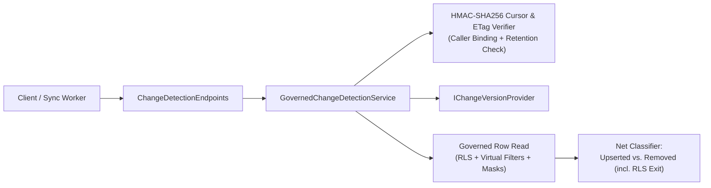

# F-DATA-09: Governed Change Detection (ETag) & Stateless changesSince Cursor

**Feature-ID:** F-DATA-09  
**Category:** Incremental Data Synchronization & CDC Polling  
**Components:**
- Domain: [`TableModels.cs`](../../src/Autheris.Domain/Model/TableModels.cs) (`DeletedKeyPolicy`)
- Application: [`ChangeDetectionModels.cs`](../../src/Autheris.Application/Data/Changes/ChangeDetectionModels.cs), [`IGovernedChangeDetectionService.cs`](../../src/Autheris.Application/Data/Changes/IGovernedChangeDetectionService.cs), [`GovernedChangeDetectionService.cs`](../../src/Autheris.Application/Data/Changes/GovernedChangeDetectionService.cs)
- API: [`ChangeDetectionEndpoints.cs`](../../src/Autheris.Api/Endpoints/ChangeDetectionEndpoints.cs)

---

## 1. Executive Summary & Problem Statement

### 1.1 The Challenge
Downstream caches, mobile clients, and analytical pipelines frequently poll governed tables for updates. Without change detection and incremental cursors:
1. Clients repeatedly re-read unchanged tables, wasting database CPU and gateway cost budgets.
2. Naive incremental sync (`WHERE updated_at > @last_sync`) misses physical deletions, misses rows that moved *out* of a caller's RLS scope after an attribute update, and risks leaking primary keys of deleted rows belonging to other tenants.

### 1.2 The Solution
Autheris provides a two-tier governed incremental synchronization mechanism via `IGovernedChangeDetectionService`:
1. **Lightweight Change Detection (`changeToken` / `ETag` & `If-None-Match`):** Returns an HMAC-SHA256-signed change token derived from the source table's version watermark. When a client sends `If-None-Match` and the table version has not advanced, the gateway returns `304 Not Modified` (`notModified: true`) with **zero table row reads** and **zero query cost**.
2. **Stateless Pull-Based `changesSince` Cursor:** Issues an HMAC-SHA256-signed, caller-bound cursor encoding `(TenantId, SubjectId, TableIdentifier, SyncVersion, IssuedAtUtc)`. Subsequent calls return net `upserted` rows (filtered by caller RLS and masked) and `removed` primary keys (covering both physical deletions and **RLS-exit updates**), governed by the table's `DeletedKeyPolicy`.

---

## 2. Architecture & Request Lifecycle



---

## 3. Configuration & Options

Configure cursor signing and retention behavior via `ChangeDetectionOptions` and per-table `DeletedKeyPolicy` (`KnownKeysOnly` by default, or `AllDeletedKeys` by Data Owner opt-in):

```json
{
  "ChangeDetection": {
    "CursorMaxAgeHours": 168,
    "DefaultDeletedKeyPolicy": "KnownKeysOnly"
  }
}
```

---

## 4. Usage Examples & Endpoints

### 4.1 Lightweight ETag Check (`GET /api/v1/data/{domain}/{schema}/{table}/change-token`)

```http
GET /api/v1/data/sales/public/orders/change-token HTTP/1.1
If-None-Match: "ct_v1_c2FsZXMucHVibGljLm9yZGVycw_42_..."
Authorization: Bearer <token>
```

Returns `304 Not Modified` when version `42` is still current, or `200 OK` with a new `ETag` header when changed.

### 4.2 Pull-Based Incremental Sync (`POST /api/v1/data/{domain}/{schema}/{table}/changes`)

```http
POST /api/v1/data/sales/public/orders/changes HTTP/1.1
Content-Type: application/json
Authorization: Bearer <token>

{
  "changesSinceCursor": "eyJ0ZW5hbnRJZCI6...",
  "knownKeys": [
    { "id": 101 },
    { "id": 102 },
    { "id": 103 }
  ]
}
```

**Response:**

```json
{
  "dataset": "sales.public.orders",
  "upserted": [
    { "id": 101, "status": "shipped", "customer_email": "j***@example.com" }
  ],
  "removed": [
    { "id": 102 }
  ],
  "nextCursor": "eyJ0ZW5hbnRJZCI6...",
  "changeToken": "ct_v1_...",
  "syncVersion": 45
}
```

---

## 5. Security, Zero-Trust & Fail-Closed Behavior

- **Strict Caller Binding (`CURSOR_CALLER_MISMATCH`):** Every cursor is cryptographically bound to the caller's `SubjectId` and `TenantId`. Presenting a cursor issued to another principal is rejected fail-closed.
- **Retention & Expiration Guard (`CURSOR_EXPIRED`):** If a cursor's `SyncVersion` is older than the data source's minimum retained change-tracking version (`MinValidVersion`), the gateway rejects the request with `CURSOR_EXPIRED` so clients know to perform a full reload rather than silently missing changes.
- **RLS-Exit Detection:** When an existing row is updated in the source such that it no longer satisfies the caller's RLS row filter (for example, an order reassigned to another region), its primary key is reported in `removed` so the client purges its local cache.
- **Deleted-Key Anti-Oracle (`KnownKeysOnly`):** Because physically deleted rows no longer have row attributes in the source to test against RLS predicates, the default `DeletedKeyPolicy.KnownKeysOnly` policy reports a deleted key in `removed` only if the caller included that key in `knownKeys` (or if `DeletedKeyPolicy.AllDeletedKeys` is explicitly enabled by the Data Owner and the primary key column is `Clear`).
