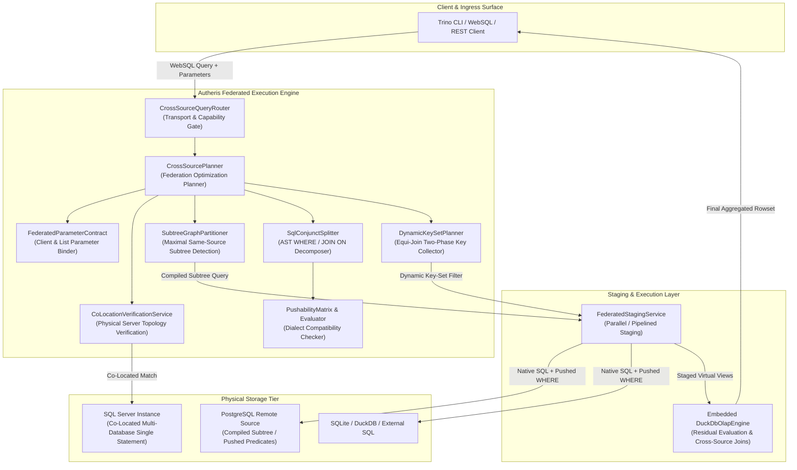

# F-DATA-10: Cross-Source WebSQL Optimizations & Federated Query Acceleration

## 1. Executive Summary & Problem Statement

Cross-source federated WebSQL enables enterprise analysts and AI agents to query and join disparate data sources (PostgreSQL, SQL Server, SQLite, DuckDB, HTTP Web-APIs) via a unified Trino-compatible SQL interface. Historically, cross-source federation relied on full-table staging: every referenced table was loaded in its entirety into an embedded DuckDB instance up to static row limits, with all filter predicates, joins, and aggregations evaluated exclusively in gateway memory.

On enterprise-scale operational databases, naive full-table staging exhibits critical performance and security limitations:
1. **Unselective Memory Saturation:** Selective queries (e.g., `WHERE customer_id = 42 AND created_date >= '2026-01-01'`) failed catastrophically with `ROW_LIMIT_EXCEEDED` whenever the base table exceeded `MaxStagedRowsPerTable` (default: 50,000 rows), even when the query matched only a single record.
2. **Network Egress Bottlenecks on Sibling Tables:** When multiple joined tables resided in the exact same relational source, the gateway staged each table independently over separate connections and performed the join in DuckDB, discarding the remote database's native join indexes and query optimizer.
3. **Quadratic Cross-Source Equi-Joins:** Cross-source joins between large tables across different physical systems required staging both entire datasets, generating massive network transfers and memory pressure.
4. **Co-Located Database Isolation:** Multiple enterprise databases hosted on the same physical Microsoft SQL Server instance (e.g., `SalesDB` and `FinanceDB` on `sql01.corp`) were treated as disconnected endpoints, preventing single-statement cross-database joins via three-part naming.
5. **Parameter Binding Inefficiencies:** Client-named parameters and list parameters lacked a unified federated binding contract, leading to unnecessary query re-compilation or improper type coercions.

`F-DATA-10` resolves these challenges through a suite of native AST optimizations and pushdown mechanisms:
- **AST Predicate Pushdown:** Decomposes top-level `WHERE` and `INNER`/`LEFT JOIN` `ON` conjuncts, pushes dialect-safe single-table predicates directly to source SQL engines, and evaluates residual expressions in DuckDB.
- **Same-Source Subtree Pushdown:** Partitions the query AST into maximal contiguous subgraphs belonging to the same native source, compiles them via [`ISqlEngine.Compile`](file:///root/autheris/src/TrinoSqlEngine/Ast/Compile/ISqlEngine.cs) with embedded Row-Level Security (RLS) and column masks, and stages only the filtered join results.
- **Dynamic Key-Set Filters in Cross-Source Equi-Joins:** Executes asymmetric joins in two phases by extracting distinct join keys from the smaller/selective side and injecting bounded `IN (...)` key-set filters into the larger probe table's source query.
- **Unified Federated Parameter Binding:** Binds client-named parameters (`ParameterOrigin.ClientNamed`) and expands list parameters (`IN (:list)`) across both remote source statements and DuckDB staging queries under parameter bind budgets.
- **Co-Located SQL Server Execution:** Groups co-located SQL Server databases into administrative `CoLocationGroup` clusters, executing multi-database queries in a single native statement using three-part naming (`[Database].[Schema].[Table]`) without DuckDB staging.

---

## 2. Architecture & Component Wiring



### 2.1 Component Responsibilities

| Component | Responsibility |
|---|---|
| [`CrossSourcePlanner`](file:///root/autheris/src/Autheris.Application/Sql/Services/CrossSourcePlanner.cs) | Central planner orchestrating table discovery, co-location verification, subtree partitioning, predicate pushdown analysis, and key-set planning. |
| [`SqlConjunctSplitter`](file:///root/autheris/src/Autheris.Application/Sql/Federation/Conjuncts/SqlConjunctSplitter.cs) | Decomposes boolean `AND` trees from `WHERE` and `JOIN ON` clauses into discrete AST conjuncts and attributes columns to source tables. |
| [`PushabilityEvaluator`](file:///root/autheris/src/Autheris.Application/Sql/Federation/Pushdown/PushabilityEvaluator.cs) & [`PushabilityMatrix`](file:///root/autheris/src/Autheris.Application/Sql/Federation/Pushdown/PushabilityMatrix.cs) | Evaluates whether a conjunct is pushable to the target SQL dialect (PostgreSQL, SQL Server, SQLite, DuckDB), verifying operator support, nullability semantics, and column clearance. |
| [`PushedClauseBuilder`](file:///root/autheris/src/Autheris.Application/Sql/Federation/Pushdown/PushedClauseBuilder.cs) | Generates parameterized `TableFilterClause` AST representations with isolated parameter names (`@p_pd_<n>`) for safe remote query binding. |
| [`SubtreeGraphPartitioner`](file:///root/autheris/src/Autheris.Application/Sql/Federation/Subtrees/SubtreeGraphPartitioner.cs) & [`SubtreeCompiler`](file:///root/autheris/src/Autheris.Application/Sql/Federation/Subtrees/SubtreeCompiler.cs) | Identifies maximal subtrees of tables from the same data source, compiles them via native [`ISqlEngine`](file:///root/autheris/src/TrinoSqlEngine/Ast/Compile/ISqlEngine.cs), and emits synthetic staging aliases (`__subtree_<n>`). |
| [`DynamicKeySetPlanner`](file:///root/autheris/src/Autheris.Application/Sql/Federation/KeySet/DynamicKeySetPlanner.cs) & [`KeyBatcher`](file:///root/autheris/src/Autheris.Application/Sql/Federation/KeySet/KeyBatcher.cs) | Plans two-phase cross-source equi-join execution, extracts distinct key values from the primary relation, and bounds batch chunks to dialect parameter limits. |
| [`KeySetGovernanceGuard`](file:///root/autheris/src/Autheris.Application/Sql/Federation/KeySet/KeySetGovernanceGuard.cs) | Enforces fail-closed security for dynamic key-set pushdown: requires cleartext keys (`ColumnAccessLevel.Clear`) and prohibits masked or HMAC columns from participating in pushdown. |
| [`FederatedParameterContract`](file:///root/autheris/src/Autheris.Application/Sql/Federation/Parameters/FederatedParameterContract.cs) | Manages parameter validation, authorization precedence, positional `$n` DuckDB binding, and remote `DbParameter` propagation. |
| [`CoLocationVerificationService`](file:///root/autheris/src/Autheris.Application/Sql/Federation/CoLocation/CoLocationVerificationService.cs) | Validates physical server identity (`@@SERVERNAME`) and topology across configured co-located data sources before allowing single-statement execution. |
| [`PostCompileTableTargetAssertionVisitor`](file:///root/autheris/src/TrinoSqlEngine/Ast/Visitors/PostCompileTableTargetAssertionVisitor.cs) | AST security validator asserting that every table reference in compiled co-located SQL maps strictly to an authorized catalog target. |

---

## 3. Technical Deep-Dive

### 3.1 AST Predicate Pushdown (Issue #122)

When a federated query includes filter predicates, `SqlConjunctSplitter` flattens top-level `WHERE` clauses and inner `JOIN ON` expressions into boolean `AND` conjuncts:
1. **Single-Table Attribution:** Each conjunct is inspected to ensure all referenced identifiers originate from a single table. Multi-table expressions remain in DuckDB.
2. **Pushability Verification:** The expression is validated against `PushabilityMatrix` for the source dialect:
   - Arithmetic, comparison (`=`, `<>`, `<`, `<=`, `>`, `>=`), `BETWEEN`, `IN`, `IS NULL`, and `IS NOT NULL` are supported.
   - String functions, pattern matching (`LIKE`), and date functions are checked for dialect compatibility and collation equivalence.
3. **RLS & Masking Conjunction:** Pushed conjuncts are conjoined via boolean `AND` with active Row-Level Security (RLS) policies (`CombinedRowFilterSql`). Pushed filters strictly narrow the candidate rowset and cannot widen permissions.
4. **Filter Oracle Protection:** Any conjunct referencing a column marked `ColumnAccessLevel.Mask` or `ColumnAccessLevel.Hmac` is strictly prohibited from pushdown. Pushing masked column predicates to an unmasked source would evaluate against raw cleartext, leaking secret information through row count differences.
5. **Superset Execution Safety:** Residual filters are retained and re-evaluated in DuckDB post-staging, guaranteeing that collation discrepancies or dialect nuances never yield false positives.

### 3.2 Same-Source Subtrees (Issue #123)

When a query joins multiple tables that belong to the same data source (or co-located group):
1. `SubtreeGraphPartitioner` traverses the query join tree and identifies maximal connected subgraphs of tables residing in the same physical database engine.
2. `SubtreeCompiler` compiles each subgraph into a single native SQL statement using [`ISqlEngine.Compile`](file:///root/autheris/src/TrinoSqlEngine/Ast/Compile/ISqlEngine.cs), embedding all table-specific RLS predicates, column masking transforms, and mandatory virtual filters.
3. The compiled statement is executed on the source engine, and the resulting rowset is staged into DuckDB as a virtual staging view under a synthetic alias (`__subtree_0`).
4. Joins and filters across disparate sources are evaluated by DuckDB over the staged subtree results.

### 3.3 Dynamic Key-Set Filters in Cross-Source Equi-Joins (Issue #124)

When a query performs an equi-join across two disparate data sources (e.g. `pg.orders o JOIN mssql.customers c ON o.customer_id = c.id`):
1. **Asymmetric Planning:** The planner identifies the selective (build) side and the probe side. The build side (e.g., filtered customers) is read and staged first.
2. **Key Collection & Clamping:** Distinct non-null key values are extracted in memory. If the distinct key count is below `MaxKeySetPushdownKeys` (default: 500) and the target source allows key-set import (`allow_key_set_import: true`), key-set pushdown activates.
3. **Batch Splitting:** `KeyBatcher` slices key sets into chunks respecting the target dialect's parameter bind limit (e.g., 999 for SQLite, 2000 for SQL Server).
4. **Parameterized Clause Injection:** The probe query is rewritten with `WHERE join_key IN (@k0, @k1, ...)` before execution on the probe source.
5. **Cleartext Requirement:** Join keys subject to masking, hashing, or HMAC transforms fail closed and cannot be pushed as dynamic key sets.

### 3.4 Bound Parameters in Federated Queries (Issue #131)

Client-named parameters (`ParameterOrigin.ClientNamed`) and list parameters (`IN (:ids)`) are managed through a unified `FederatedParameterContract`:
- Parameter names and types are normalized before query analysis.
- Pushed predicate parameters are assigned isolated namespace prefixes (`@p_pd_<n>`) to eliminate collisions with client parameters or RLS parameters.
- DuckDB query text compiles with positional `$1, $2, ...` parameter placeholders via [`DuckDbCompiledSqlBinder`](file:///root/autheris/src/TrinoSqlEngine/Ast/Emit/ICompiledSqlBinder.cs).
- Client list parameters are expanded into discrete positional bindings up to dialect limits, preserving SQL injection immutability.
- Parameter values are excluded from audit logs and exception messages to prevent credential and PII leakage.

### 3.5 Co-Located SQL Server Execution (Issue #132)

Enterprise organizations often host multiple domain databases on a single Microsoft SQL Server cluster:
- **Administrative Grouping:** Data sources are assigned a common `CoLocationGroup` identifier in configuration.
- **Symmetric Startup Validation:** At startup, `CoLocationOptionsValidator` validates that all members of a co-location group share identical server hosts, instance names, authentication credentials, and compatibility levels.
- **Connect-Time Server Verification:** On connection acquisition, `CoLocationVerificationService` executes `SELECT @@SERVERNAME` to verify that the physical host matches expectations. If topology validation fails, the query gracefully falls back to DuckDB staging.
- **Three-Part Qualification:** When a query joins tables across different databases in the same verified co-location group, `SubtreeCompiler` formats table references using physical three-part names (`[Database].[Schema].[Table]`). The entire join executes directly in SQL Server in a single statement, with zero staging overhead.

---

## 4. Configuration & Options

Configure federated WebSQL optimizations under `Gateway:WebSql` and `Gateway:Databases` in `appsettings.json`:

```json
{
  "Gateway": {
    "WebSql": {
      "CrossSource": {
        "Enabled": true,
        "AllowedTransports": [ "WebSql", "Trino", "Rest", "Mcp", "ArrowExport" ],
        "MaxTableCount": 5,
        "MaxStagedRowsPerTable": 50000,
        "MaxTotalStagedRows": 200000,
        "MaxStagedBytesPerTable": 33554432,
        "MaxTotalStagedBytes": 134217728,
        "PredicatePushdown": {
          "Enabled": true,
          "AllowFunctions": false
        },
        "Subtrees": {
          "Enabled": true,
          "MaxSubtreeCount": 4
        },
        "DynamicKeySet": {
          "Enabled": true,
          "MaxKeys": 500,
          "MaxBatchSize": 200
        }
      }
    },
    "Databases": {
      "sales_db": {
        "Provider": "SqlServer",
        "ConnectionString": "Server=sql01.corp;Database=SalesDB;User Id=autheris_svc;Password=***;Encrypt=True;",
        "CoLocationGroup": "corp_cluster_01"
      },
      "finance_db": {
        "Provider": "SqlServer",
        "ConnectionString": "Server=sql01.corp;Database=FinanceDB;User Id=autheris_svc;Password=***;Encrypt=True;",
        "CoLocationGroup": "corp_cluster_01"
      },
      "crm_pg": {
        "Provider": "PostgreSql",
        "ConnectionString": "Host=pg01.corp;Database=crm;Username=autheris_svc;Password=***;",
        "AllowKeySetImport": true
      }
    }
  }
}
```

---

## 5. Usage Examples

### 5.1 Pushdown & Subtree Acceleration via Trino REST Protocol

```http
POST /v1/statement HTTP/1.1
Host: autheris.corp:443
Authorization: Bearer <token>
X-Trino-Catalog: crm
X-Trino-Wait-Timeout: 5s
Content-Type: application/json

{
  "query": "SELECT o.order_id, o.amount, c.company_name FROM sales.dbo.orders o JOIN sales.dbo.customers c ON o.customer_id = c.id JOIN crm.public.accounts a ON c.account_code = a.code WHERE o.created_date >= '2026-01-01' AND a.status = 'ACTIVE'"
}
```

**Optimization Execution Trace:**
1. `sales.dbo.orders` and `sales.dbo.customers` belong to the same source (`sales`). `SubtreeGraphPartitioner` compiles their join and the predicate `o.created_date >= '2026-01-01'` into a single native SQL Server query.
2. `crm.public.accounts` receives pushed predicate `a.status = 'ACTIVE'`, executed natively on PostgreSQL.
3. The compiled results from `sales` and `crm` are staged into DuckDB as synthetic views `__subtree_0` and `__staged_accounts_1`.
4. DuckDB performs the cross-source equi-join on `c.account_code = a.code`.

### 5.2 Co-Located Cross-Database Query (Single Statement)

```http
POST /v1/statement HTTP/1.1
Host: autheris.corp:443
Authorization: Bearer <token>
X-Trino-Catalog: sales_db
Content-Type: application/json

{
  "query": "SELECT s.order_number, f.invoice_total FROM sales_db.dbo.orders s JOIN finance_db.dbo.invoices f ON s.order_id = f.order_id WHERE s.status = 'SHIPPED'"
}
```

**Optimization Execution Trace:**
- `sales_db` and `finance_db` belong to `CoLocationGroup = "corp_cluster_01"`.
- Application validates physical connection to `sql01.corp`.
- Query compiles into a single SQL Server statement:
  ```sql
  SELECT s.[order_number], f.[invoice_total]
  FROM [SalesDB].[dbo].[orders] AS s
  INNER JOIN [FinanceDB].[dbo].[invoices] AS f ON s.[order_id] = f.[order_id]
  WHERE s.[status] = @p0 AND s.[tenant_id] = @p1 AND f.[tenant_id] = @p2
  ```
- Executed directly on SQL Server without DuckDB staging.

---

## 6. Security, Zero-Trust & Fail-Closed Behavior

1. **Fail-Closed Pushdown Gate:** If any conjunct fails syntax, dialect, or security evaluation, pushdown is aborted for that conjunct, and the filter is evaluated safely in DuckDB. Queries never execute with missing filters.
2. **Filter Oracle & Information Leak Prevention:** Columns subject to masking (`ColumnAccessLevel.Mask`) or HMAC transformations (`ColumnAccessLevel.Hmac`) are strictly disqualified from predicate pushdown and dynamic key-set pushdown. Pushing them to cleartext source databases would create inference side channels via query timing or row counts.
3. **Immutability of Row-Level Security:** Pushed predicates are always combined with active RLS row filters using boolean `AND`. A pushed client filter can only narrow the rowset returned by the source; it can never bypass or widen RLS restrictions.
4. **Co-Location Injection Defense:** Client queries are forbidden from specifying raw three-part or four-part database names. All physical database qualification is injected exclusively by `SubtreeCompiler` based on verified catalog metadata. Post-compile validation asserts that every emitted table matches an authorized catalog identifier.
5. **Strict Dialect Parameter Clamping:** Key-set pushdown enforces strict batch size clamping below target database bind parameter limits, preventing buffer overflow or query parsing exceptions on remote databases.
6. **Zero-Payload Audit Integrity:** Pushdown operations and key-set bindings emit structural telemetry (referenced columns, operator kinds, row counts) without logging sensitive literal parameter values to audit chains.
