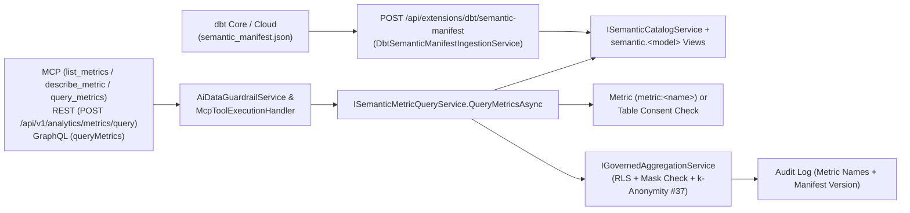

# F-DBT-07: dbt Semantic Layer Metric Catalog & Governed Metric Execution

**Feature-ID:** F-DBT-07  
**Category:** dbt Integration & Semantic Analytics  
**Components:**
- Domain: [`DbtSemanticModels.cs`](file:///root/autheris/src/Autheris.Domain/Model/DbtSemanticModels.cs)
- Application: [`ISemanticMetricQueryService.cs`](file:///root/autheris/src/Autheris.Application/Analytics/ISemanticMetricQueryService.cs), [`SemanticMetricQueryService.cs`](file:///root/autheris/src/Autheris.Application/Analytics/SemanticMetricQueryService.cs), [`DbtSemanticManifestIngestionService.cs`](file:///root/autheris/src/Autheris.Application/Dbt/Services/DbtSemanticManifestIngestionService.cs), [`McpSemanticTools.cs`](file:///root/autheris/src/Autheris.Application/Mcp/Services/McpSemanticTools.cs), [`McpToolRegistry.cs`](file:///root/autheris/src/Autheris.Application/Mcp/Services/McpToolRegistry.cs), [`AiDataGuardrailService.cs`](file:///root/autheris/src/Autheris.Application/Mcp/Services/AiDataGuardrailService.cs), [`McpToolExecutionHandler.cs`](file:///root/autheris/src/Autheris.Application/Mcp/Services/McpToolExecutionHandler.cs)
- GraphQL & API: [`QueryTypes.cs`](file:///root/autheris/src/Autheris.GraphQL/Types/QueryTypes.cs), [`AnalyticsEndpoints.cs`](file:///root/autheris/src/Autheris.Api/Endpoints/AnalyticsEndpoints.cs), [`DbtWebhookEndpoints.cs`](file:///root/autheris/src/Autheris.Api/Endpoints/DbtWebhookEndpoints.cs)

---

## 1. Executive Summary & Problem Statement

### 1.1 The Challenge
Organizations define canonical business KPIs (such as `net_revenue`, `order_conversion_rate`, or `active_customers`) in dbt's Semantic Layer (`semantic_manifest.json`). When AI agents or BI clients write ad-hoc SQL or GraphQL queries against raw tables, metric formulas drift across teams and require granting broad raw-table access.

### 1.2 The Solution
Autheris ingests dbt's `semantic_manifest.json` and exposes a governed **Semantic Metric Catalog and Execution Pipeline** across MCP (`list_metrics`, `describe_metric`, `query_metrics`), REST (`POST /api/v1/analytics/metrics/query`), GraphQL (`queryMetrics`), and virtual catalog views (`semantic.<model>`):
- **Single Source of Metric Truth:** Supports `simple`, `derived`, `ratio`, and `cumulative` dbt metrics with declared `measures`, `dimensions`, `allowed_time_granularities`, `min_group_size`, units, formats, and manifest `version` tracking.
- **Automatic Semantic Catalog Views (`semantic.<model>`):** Ingesting a semantic manifest via `POST /api/extensions/dbt/semantic-manifest` automatically registers governed virtual views (`semantic.<model>`) in the governance catalog so headless BI tools can query semantic models through the governed SQL pipeline.
- **Metric-Scoped Consents (`metric:<name>`):** Data Owners can grant access to a specific metric (`metric:<metric_name>`) without granting raw row-level access to the underlying base table.
- **Full Governance Inheritance:** Executing `query_metrics` automatically applies the caller's RLS row filters on the underlying semantic model table, rejects metrics whose measure columns are masked for the caller (`AGGREGATION_ON_MASKED_COLUMN`), enforces the $k$-anonymity minimum group size guard (`#37`), and records the queried metric names and manifest version in the tamper-evident audit log.

---

## 2. Architecture & Component Wiring



### 2.1 Manifest Ingestion & Virtual View Registration
- `POST /api/extensions/dbt/semantic-manifest` parses `semantic_manifest.json` via `DbtSemanticManifestIngestionService`, extracting `version` (`manifest_version`), `semantic_models` (with `measures`, `dimensions`, and `node_relation`), and `metrics` (with `min_group_size` and `allowed_time_granularities`).
- Each ingested `DbtSemanticModel` is also registered in `IGovernanceRepository` as a virtual table under schema `semantic` (`semantic.<model_name>`), exposing its dimensions and measure columns with governance metadata linked to the underlying physical relation.

### 2.2 MCP Tooling (`McpToolRegistry` + `AiDataGuardrailService` + `McpToolExecutionHandler`)
- `McpToolRegistry` registers the semantic tools defined in `McpSemanticTools`:
  - `list_metrics`: Lists governed dbt metrics visible to the caller.
  - `describe_metric`: Returns the full metric specification (type, measures, dimensions, allowed time granularities, unit, format, `minGroupSize`, and `manifestVersion`).
  - `query_metrics`: Executes governed metric aggregations with `metrics`, `groupBy`, `where`, `timeGranularity`, and `limit`.
- Calls routed through `McpToolExecutionHandler` pass through `AiDataGuardrailService` before invoking `McpSemanticTools` and `ISemanticMetricQueryService`.

### 2.3 REST & GraphQL Execution Surfaces
- **REST Endpoint:** `POST /api/v1/analytics/metrics/query` (mapped in `AnalyticsEndpoints.cs`) accepts `SemanticMetricQueryRequest` and returns `SemanticMetricQueryResult` (including `manifestVersion`, `rows`, `suppressedGroupsCount`, and `suppressionApplied`).
- **GraphQL Root Field:** `queryMetrics(input: SemanticMetricQueryInput!)` (in `QueryTypes.cs`) resolves governed metric queries through `ISemanticMetricQueryService` and returns `SemanticMetricQueryResult`.

---

## 3. Configuration & Manifest Metadata

Metrics and measures in `semantic_manifest.json` can declare governance metadata under `meta.autheris`:

```json
{
  "manifest_version": "2026.10.15-run-42",
  "semantic_models": [
    {
      "name": "orders_model",
      "node_relation": { "schema_name": "public", "alias": "orders" },
      "measures": [
        { "name": "order_total", "agg": "sum", "expr": "amount", "unit": "EUR", "min_group_size": 5 }
      ],
      "dimensions": [
        { "name": "region", "type": "categorical" },
        { "name": "order_date", "type": "time", "type_params": { "time_granularity": "day" } }
      ]
    }
  ],
  "metrics": [
    {
      "name": "total_revenue",
      "type": "simple",
      "label": "Total Revenue (EUR)",
      "type_params": { "measure": "order_total" },
      "meta": {
        "unit": "EUR",
        "format": "currency",
        "autheris": {
          "min_group_size": 5,
          "allowed_time_granularities": ["day", "month", "quarter", "year"]
        }
      }
    }
  ]
}
```

---

## 4. Usage Examples & Endpoints

### 4.1 MCP Tools (`list_metrics`, `describe_metric`, `query_metrics`)

```json
{
  "name": "query_metrics",
  "arguments": {
    "metrics": ["total_revenue"],
    "groupBy": ["region"],
    "timeGranularity": "month",
    "limit": 50
  }
}
```

### 4.2 REST Endpoint (`POST /api/v1/analytics/metrics/query`)

```http
POST /api/v1/analytics/metrics/query HTTP/1.1
Content-Type: application/json
Authorization: Bearer <token>

{
  "metrics": ["total_revenue"],
  "groupBy": ["region"],
  "timeGranularity": "month",
  "limit": 50
}
```

### 4.3 GraphQL Root Field (`queryMetrics`)

```graphql
query {
  queryMetrics(
    input: {
      metrics: ["total_revenue"]
      groupBy: ["region"]
      timeGranularity: "month"
      limit: 50
    }
  ) {
    manifestVersion
    suppressionApplied
    suppressedGroupsCount
    rows
  }
}
```

---

## 5. Security, Zero-Trust & Fail-Closed Behavior

- **Metric-Level Consent (`metric:<name>`) & Anti-Oracle Visibility:** Callers are authorized if they hold either full table access on the underlying semantic model relation or an explicit metric-scoped consent (`metric:<metric_name>`). Unauthorized metrics are filtered out of `list_metrics` and rejected as not found.
- **Caller RLS Pushdown:** `SemanticMetricQueryService` delegates execution to `IGovernedAggregationService`, pushing the caller's row-level security (RLS) filters and tenant isolation down into the database query before grouping.
- **Masked Measure Rejection (`AGGREGATION_ON_MASKED_COLUMN`):** Even when a caller holds a metric-scoped consent (`metric:<name>`), if a column mask applies to any underlying measure column or group-by dimension for that caller, the query fails closed with `AGGREGATION_ON_MASKED_COLUMN`.
- **Fail-Closed Dimension & Time-Grain Validation:** Requesting a dimension not declared on the metric's semantic model or a `timeGranularity` not permitted by `allowed_time_granularities` is rejected before execution.
- **$k$-Anonymity Minimum Group Size Enforcement (`#37`):** The effective minimum group size threshold is the maximum of the metric's `min_group_size`, the measure's `min_group_size`, the base table's `MinGroupSize`, and the gateway default. Groups with fewer than $k$ underlying rows are suppressed (or merged into `Other`) before results leave the gateway.
- **Tenant-Scoped Catalog:** `SemanticMetricQueryService` and the metric listing endpoints (`GET /api/extensions/dbt/metrics`, `GET /api/v1/analytics/metrics`) resolve metrics and semantic models in the caller's tenant partition. `POST /api/extensions/dbt/semantic-manifest` imports into the tenant of the authenticated caller. With `Gateway:Tenancy:Mode = Multi` (default) a tenant that has no partition of its own sees no metric and no model; the legacy partition (principals without tenant claim) is never a fallback for other tenants. Only with `Gateway:Tenancy:Mode = Single` a tenant without its own partition falls back to the legacy partition.
- **Reduced Catalog Projection:** `GET /api/extensions/dbt/metrics` and `GET /api/v1/analytics/metrics` return `name`, `type`, `label`, `description` and `unit` to ordinary callers. The `Filter` template, `TypeParams`, `Dimensions`, `Measures`, `Meta` and the remaining definition fields are returned only to callers that hold `GovernanceAdmin` or `DbtAdmin`.
- **No Denied-vs-Missing Oracle:** A metric query whose backing table is denied for the caller and one whose backing table does not exist fail identically: `GatewayForbiddenException`, code `FORBIDDEN`, the fixed message `Access denied.` (no metric, table or reason text), REST `403`. The true reason is written to the audit entry only.
- **Combined Filter Check:** When a metric has a `Filter` template and the request carries a `where`, the combined clause is the union of both predicates, all parameters and the referenced columns of both; the request `where` is checked (its Trino text is always composed through `GetTrinoPredicate`, a clause without a Trino builder fails closed; a lone metric filter is never dropped) against deny and mask rules like any other aggregation `where` (`AGGREGATION_COLUMN_UNAVAILABLE`, `AGGREGATION_ON_MASKED_COLUMN`).
- **Minimum Group Size Can Only Be Raised:** A metric or measure `min_group_size` of `1` does not lower the operator floor (`Analytics:Privacy:DefaultMinGroupSize`, `TableMinimumGroupSizes`, dataset override); a higher value raises it. The MCP tools `list_metrics` and `describe_metric` read the legacy partition only.
