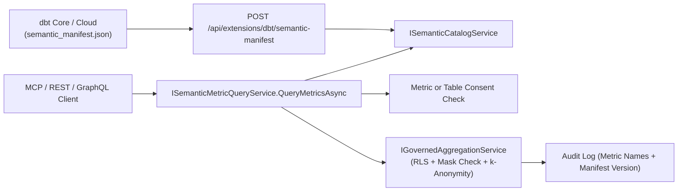

# F-DBT-07: dbt Semantic Layer Metric Catalog & Governed Metric Execution

**Feature-ID:** F-DBT-07  
**Category:** dbt Integration & Semantic Analytics  
**Components:**
- Domain: [`DbtSemanticModels.cs`](../../src/Autheris.Domain/Model/DbtSemanticModels.cs)
- Application: [`ISemanticMetricQueryService.cs`](../../src/Autheris.Application/Analytics/ISemanticMetricQueryService.cs), [`SemanticMetricQueryService.cs`](../../src/Autheris.Application/Analytics/SemanticMetricQueryService.cs), [`DbtSemanticManifestIngestionService.cs`](../../src/Autheris.Application/Dbt/Services/DbtSemanticManifestIngestionService.cs), [`McpSemanticTools.cs`](../../src/Autheris.Application/Mcp/Services/McpSemanticTools.cs)
- API: [`AnalyticsEndpoints.cs`](../../src/Autheris.Api/Endpoints/AnalyticsEndpoints.cs), [`DbtWebhookEndpoints.cs`](../../src/Autheris.Api/Endpoints/DbtWebhookEndpoints.cs)

---

## 1. Executive Summary & Problem Statement

### 1.1 The Challenge
Organizations define canonical business KPIs (such as `net_revenue`, `order_conversion_rate`, or `active_customers`) in dbt's Semantic Layer (`semantic_manifest.json`). When AI agents or BI clients write ad-hoc SQL or GraphQL queries against raw tables, metric formulas drift across teams and require granting broad raw-table access.

### 1.2 The Solution
Autheris ingests dbt's `semantic_manifest.json` and exposes a governed **Semantic Metric Catalog and Execution Pipeline** (`list_metrics`, `describe_metric`, and `query_metrics`):
- **Single Source of Metric Truth:** Supports `simple`, `derived`, `ratio`, and `cumulative` dbt metrics with declared dimensions, allowed time granularities, units, formats, and manifest versions.
- **Metric-Scoped Consents:** Data Owners can grant access to a specific metric (`metric:<metric_name>`) without granting raw row-level access to the underlying base table.
- **Full Governance Inheritance:** Executing `query_metrics` automatically applies the caller's RLS row filters on the underlying semantic model table, rejects metrics whose measure columns are masked for the caller (`AGGREGATION_ON_MASKED_COLUMN`), enforces the $k$-anonymity minimum group size guard, and records the queried metric names and manifest version in the tamper-evident audit log.

---

## 2. Architecture & Request Lifecycle



---

## 3. Configuration & Manifest Metadata

Metrics and measures in `semantic_manifest.json` can declare governance metadata under `meta.autheris`:

```json
{
  "manifest_version": "2026.10.15-run-42",
  "semantic_models": [
    {
      "name": "orders_model",
      "node_relation": { "schema_name": "public", "alias": "orders" },
      "measures": [
        { "name": "order_total", "agg": "sum", "expr": "amount", "unit": "EUR", "min_group_size": 5 }
      ],
      "dimensions": [
        { "name": "region", "type": "categorical" },
        { "name": "order_date", "type": "time", "type_params": { "time_granularity": "day" } }
      ]
    }
  ],
  "metrics": [
    {
      "name": "total_revenue",
      "type": "simple",
      "label": "Total Revenue (EUR)",
      "type_params": { "measure": "order_total" },
      "meta": {
        "unit": "EUR",
        "format": "currency",
        "autheris": {
          "min_group_size": 5,
          "allowed_time_granularities": ["day", "month", "quarter", "year"]
        }
      }
    }
  ]
}
```

---

## 4. Usage Examples & Endpoints

### 4.1 MCP Tool `query_metrics`

```json
{
  "name": "query_metrics",
  "arguments": {
    "metrics": ["total_revenue"],
    "groupBy": ["region"],
    "timeGranularity": "month",
    "limit": 50
  }
}
```

### 4.2 REST Endpoint (`POST /api/v1/analytics/metrics/query`)

```http
POST /api/v1/analytics/metrics/query HTTP/1.1
Content-Type: application/json
Authorization: Bearer <token>

{
  "metrics": ["total_revenue"],
  "groupBy": ["region"],
  "timeGranularity": "month",
  "limit": 50
}
```

---

## 5. Security, Zero-Trust & Fail-Closed Behavior

- **Fail-Closed Dimension & Time-Grain Validation:** Requesting a dimension not declared on the metric's semantic model or a `timeGranularity` not permitted by `allowedTimeGranularities` is rejected before execution.
- **Masked Measure Protection:** Even when a caller holds a metric-scoped consent (`metric:<name>`), if a column mask applies to the underlying measure column for that caller, the query is rejected with `AGGREGATION_ON_MASKED_COLUMN`.
- **Effective Minimum Group Size:** The effective $k$-anonymity threshold is the maximum of the metric's `MinGroupSize`, the measure's `MinGroupSize`, the base table's `MinGroupSize`, and the gateway default.
