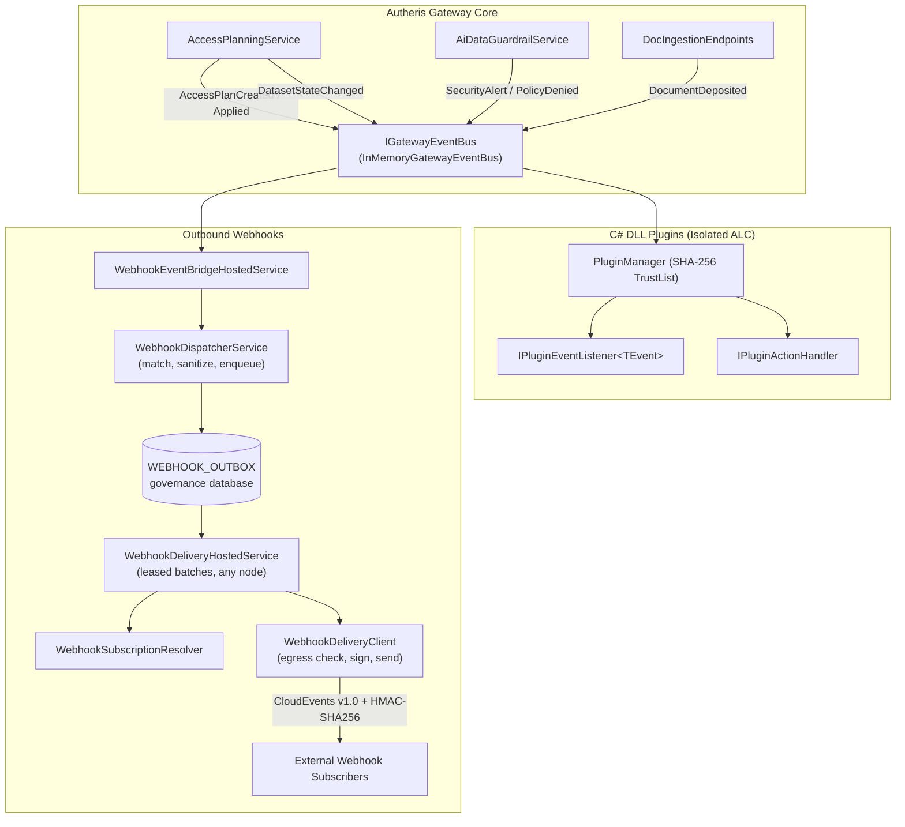

# F-EXT-01: Generic C# DLL Plugin & Event/Webhook Subsystem

## 1. Executive Summary & Problem Statement

Modern enterprise data gateways require seamless extensibility to integrate with external systems, audit lakes, and specialized downstream workflows. Historically, integrations either required polling REST endpoints or writing tight gateway core modifications. 

F-EXT-01 introduces a unified, bidirectional extensibility subsystem providing:
1. **Generic In-Process Event Bus (`IGatewayEventBus`):** Emits strongly typed domain events across governance, security, data catalog, and documentation operations with subscriber fault isolation.
2. **Extensible C# DLL Plugins:** Isolated, SHA-256 verified plugin assemblies running in dedicated `PluginAssemblyLoadContext` environments can listen to domain events via `IPluginEventListener<TEvent>` and register callable actions via `IPluginActionHandler`.
3. **Durable Outbound CloudEvents v1.0 Webhooks:** Matching events are written to a durable outbox in the governance database and delivered at least once over HTTPS with HMAC-SHA256 signatures (`X-Autheris-Signature-256`), replay protection, tenant isolation, classified retries with full-jitter backoff, dead letters and a per-subscription circuit pause.

---

## 2. Architecture & Component Wiring



### Component Breakdown
- **`IGatewayEvent` & Domain Events (`Autheris.Domain.Events`):**
  - `AccessPlanCreatedEvent`: Emitted when an access plan is generated.
  - `AccessPlanAppliedEvent`: Emitted when an access plan is confirmed and applied to REBAC policies.
  - `DatasetStateChangedEvent`: Emitted when a dataset is activated, quarantined, or deprecated.
  - `PolicyDeniedEvent`: Emitted when Casbin ABAC or REBAC rejects an access request. Carries a stable `ReasonCode` (`POLICY_DENIED`) and never the verbatim denial text (`Reason` holds the same code); full reasons are only written to the audit log.
  - `SecurityAlertEvent`: Emitted when prompt injections, jailbreaks, or brute force attempts are intercepted.
  - `DocumentDepositedEvent`: Emitted when a document is deposited into the Universal Doc Store. Carries `RelativePath` (`{appId}/{category}/{docId}`), never an absolute filesystem path. There is no `SourceFilePath` property; plugins and webhook consumers read `RelativePath` (the serialized payload carries `relativePath` only).
- **`IGatewayEventBus` (`Autheris.Application.Events`):**
  - Thread-safe pub/sub dispatching events asynchronously to typed subscribers and general listeners.
  - Fault-isolated execution: Subscriber exceptions are caught and logged, preventing any failing plugin from affecting core operations or aborting other subscribers.
  - Bounded asynchronous delivery (default `Queued` mode): every subscription owns a bounded queue and a single reader task, so `PublishAsync` only enqueues and returns immediately. A slow or hung handler is cut off after the per-handler timeout (10 s) and never delays the publisher or other subscribers. Semantics: in-process, at-most-once, ordered per subscriber, lossy under overload (the oldest queued event is dropped when a queue is full). Security decisions and audit records must never depend on the bus; events are notifications only.
  - Metrics: `autheris_event_bus_dropped_total{event_type}` and `autheris_event_bus_handler_timeout_total{event_type}`.
- **Redis event bus (`RedisEventBus`, `Autheris.Infrastructure.Messaging`):** the cross-node bus used for policy-epoch and cache invalidation messages. A failed publish is logged, counted in `autheris_event_bus_publish_failed_total{message_type}` and rethrown; a failing subscriber handler (or message deserialization) is logged and counted in `autheris_event_bus_handler_failed_total{message_type}`. The tag is the message type name only, never the channel name (channels can carry tenant ids).
- **Plugin Contracts (`Autheris.Application.Plugins`):**
  - `IPluginEventListener<TEvent>`: Strongly typed event listener implemented in plugin DLLs. `PluginManager` builds a typed dispatch delegate once per listener interface when the listener is bound to the bus; the per-event call is a plain delegate invocation (no reflection), and handler exceptions are logged unwrapped.
  - `IPluginActionHandler`: Custom action handler callable by name via `IPluginManager.ExecuteActionAsync(...)`.
- **Webhook pipeline (`Autheris.Application.Webhooks`):**
  - `WebhookEventBridgeHostedService` subscribes to `IGatewayEventBus` and awaits only the enqueue, never an outbound HTTP call; the bus queue and handler timeout bound it.
  - `WebhookDispatcherService` matches the event against `Gateway:Webhooks:Subscriptions`, serializes the CloudEvent once (passed through `EventRedaction.Sanitize`) and writes one outbox row per matching subscription. `DispatchEventAsync` completes after the enqueue.
  - `WebhookDeliveryHostedService` drains the outbox on every node with leased batches and records the result of every attempt.
  - `WebhookSubscriptionResolver` resolves target URL, secret and custom headers from the subscription at delivery time.
  - `WebhookDeliveryClient` is the single outbound path for configured and CloudEvent (CDC) subscriptions: egress revalidation, fresh timestamp, signature, send, response disposal.
  - `WebhookRetryPolicy` classifies each attempt and computes the backoff.

---

## 3. Webhook Outbox & Delivery

### 3.1 Durable Outbox

The outbox is the table `WEBHOOK_OUTBOX`, created by governance migration `0002` (`webhook_outbox`) on PostgreSQL, SQL Server and SQLite (see [F-GOV-12](f-gov-12-multi-engine-governance-storage.md)). All times are stored as Unix milliseconds.

- A row holds the sanitized CloudEvent JSON, the subscription id and source (`Configured` for `Gateway:Webhooks:Subscriptions`, `CloudEvent` for CDC subscriptions), owner and event tenant, event id, type, source and time, the attempt counter, `max_attempts`, state, next attempt time, lease, the last HTTP status and a stable error code.
- A row never holds the target URL, the signing secret or custom headers. They are resolved from the subscription at delivery time, so URLs carrying query tokens are not persisted and a changed URL applies to pending retries.
- The unique index `(source, subscription_id, event_id)` deduplicates: the same event is queued at most once per subscription.
- States: `Pending`, `InFlight`, `Delivered`, `Dead`.
- Events whose serialized CloudEvent exceeds `MaxPayloadBytes` are not enqueued (logged with `payload_too_large`). CDC events over the limit are dropped with reason `bounds` (section 4.4.2).

### 3.2 Delivery Semantics

- **At least once.** A worker claims a batch atomically: due `Pending` rows and `InFlight` rows whose lease expired. The claim increments the attempt counter, so a crash during delivery still counts as an attempt. Receivers deduplicate on `ce-id` / `X-Autheris-Event-Id`.
- **Workers and leases.** Each node runs `DeliveryWorkers` loops (clamped 1..32) that poll every `PollIntervalSeconds` (clamped 1..300) and claim up to `DeliveryBatchSize` rows (clamped 1..100). The lease of a claimed batch is `DeliveryBatchSize * (DefaultTimeoutSeconds + 2) + 30` seconds. Completion, reschedule and dead-letter writes are fenced by the lease owner, so a stale worker cannot overwrite a row that another worker reclaimed.
- **Clock.** Outbox times come from the node clock (`TimeProvider`), never from the database clock. Multi-node deployments require NTP-synchronised nodes.
- **Shutdown.** A delivery interrupted by host shutdown is neither retried nor counted as a failure; its lease expires and the row is reclaimed.
- **Subscription checks per attempt.** A row whose subscription no longer exists is dead-lettered with `subscription_not_found`, an inactive subscription with `subscription_inactive`. A configured subscription that was re-bound to another tenant or no longer matches the event type is treated as not found (a retry never leaves the tenant or filter it was queued under). CloudEvent subscriptions are looked up only within the owning tenant.

### 3.3 Retry Classification (`WebhookRetryPolicy`)

| Result | Outcome | Error code |
| :--- | :--- | :--- |
| HTTP 2xx | Success | – |
| HTTP 3xx | Permanent (redirects are never followed) | `http_redirect` |
| HTTP 408, 429, 5xx | Retry; a `Retry-After` header (seconds or HTTP date) is honoured up to `MaxRetryAfterSeconds` | `http_status` |
| Any other HTTP 4xx | Permanent | `http_status` |
| Egress check: host does not resolve | Retry | `dns_unresolved` |
| Egress check: address denied | Permanent | `egress_denied` |
| Timeout (`DefaultTimeoutSeconds`, covers the egress check and the send) | Retry | `timeout` |
| TLS failure | Retry | `tls` |
| Other network failure | Retry | `network` |
| Malformed target URL | Permanent | `invalid_url` |
| Secret required but missing | Permanent | `secret_missing` |

- **Backoff (full jitter):** the delay before attempt `n + 1` is uniformly distributed in `[0, min(RetryMaxDelaySeconds, RetryBaseSeconds * 2^(n-1))]`. A server-requested `Retry-After` (capped) wins when it is larger.
- **Attempt budget:** a retryable failure on the last attempt (`attempt >= MaxAttempts`) dead-letters the row with `max_attempts_exceeded`; a claimed row that already exceeds its budget (lease expired repeatedly) is dead-lettered the same way.
- Error codes are stable identifiers; exception messages and resolved IP addresses are never stored or logged.

### 3.4 Dead Letters & Retention

- Permanent failures and exhausted budgets set the row to `Dead` with the last status and error code.
- `IWebhookOutbox.ListDeadLettersAsync` lists the dead letters of exactly one owner scope (one tenant, or the cluster-wide subscriptions) without payloads. There is no all-tenants listing.
- Housekeeping (first worker of each node) purges at most once per hour: delivered rows after `DeliveredRetentionHours` (default 24 h, also the deduplication window) and dead rows after `DeadLetterRetentionDays` (default 14 days), measured from the row's last update.

### 3.5 Circuit Pause

Each node counts consecutive failures per subscription (retryable and permanent failures; a missing secret does not count; a success resets the counter). When the count reaches `AutoDisableAfterConsecutiveFailures` (default 20), all `Pending` rows of that subscription are deferred by `CircuitCooldownSeconds` (default 300). The pause is stored in the outbox, so it applies to every node, and it consumes no attempt. It is a pause, not a deactivation: the subscription stays active and new events are still queued.

### 3.6 Outbound Request

Each attempt sends `POST` with `Content-Type: application/cloudevents+json` and:

| Header | Value |
| :--- | :--- |
| `ce-specversion`, `ce-id`, `ce-type`, `ce-source`, `ce-time` | CloudEvents v1.0 attributes; `ce-tenantid` when the event has a tenant |
| `X-Autheris-Timestamp` | ISO-8601 round-trip timestamp, taken fresh for every attempt |
| `X-Autheris-Signature-256` | `sha256=<hex>` HMAC-SHA256 over `"{timestamp}.{body}"` (only when the subscription has a secret) |
| `X-Autheris-Event-Id`, `X-Autheris-Event-Type` | Informational; id and type are also part of the signed body |

The former body-only header `X-Autheris-Signature` and the option `EmitLegacySignature` no longer exist. Custom headers (CloudEvent subscriptions only) cannot set `Host`, `Forwarded`, `Via`, `X-Real-IP`, hop-by-hop or framing headers, `Proxy-*`, `X-Forwarded-*`, `ce-*`, or any `X-Autheris-*` signature, timestamp or event header (including the removed legacy name); values containing CR or LF are dropped.

### 3.7 CloudEvent (CDC) Subscriptions

CDC CloudEvent subscriptions (`Gateway:CdcWebhooks`) share the outbox, `WebhookSubscriptionResolver`, `WebhookDeliveryClient` and `WebhookRetryPolicy`. `CloudEventOutboxMessageFactory` builds their rows (source `CloudEvent`, attempts clamped to 1..20); the resolver reads URL, secret (unprotected with the KEK), custom headers and the enabled flag through `ICloudEventSubscriptionStore.GetSubscriptionAsync(tenantId, subscriptionId)`. There is no separate CloudEvents dispatcher.

### 3.8 Metrics

| Metric | Type | Labels |
| :--- | :--- | :--- |
| `autheris_webhook_deliveries_total` | Counter | `outcome` (`success`, `retry`, `dead`) |
| `autheris_webhook_dead_letters_total` | Counter | `code` (error code) |
| `autheris_webhook_outbox_pending` | Gauge | – (undelivered rows: `Pending` and `InFlight`; refreshed at most every 30 s per node) |

---

## 4. Configuration & Usage Examples

### 4.1 Webhook Subscriptions (`Gateway:Webhooks`)

```json
{
  "Gateway": {
    "Webhooks": {
      "Enabled": true,
      "DefaultTimeoutSeconds": 5,
      "DeliveryWorkers": 4,
      "DeliveryBatchSize": 8,
      "PollIntervalSeconds": 2,
      "RetryBaseSeconds": 5,
      "RetryMaxDelaySeconds": 3600,
      "MaxRetryAfterSeconds": 3600,
      "AutoDisableAfterConsecutiveFailures": 20,
      "CircuitCooldownSeconds": 300,
      "MaxPayloadBytes": 262144,
      "DeliveredRetentionHours": 24,
      "DeadLetterRetentionDays": 14,
      "Subscriptions": [
        {
          "Id": "security-siem",
          "TargetUrl": "https://siem.corp.internal/events",
          "EventFilters": [
            "security.*",
            "governance.access_plan.applied"
          ],
          "Secret": "<set via Gateway__Webhooks__Subscriptions__0__Secret>",
          "IsClusterWide": true,
          "MaxAttempts": 8,
          "IsActive": true
        },
        {
          "Id": "catalog-indexer",
          "TargetUrl": "https://catalog.corp.internal/sync",
          "EventFilters": [
            "catalog.*",
            "docs.*"
          ],
          "Secret": "<set via Gateway__Webhooks__Subscriptions__1__Secret>",
          "TenantId": "tenant-finance",
          "MaxAttempts": 5,
          "IsActive": true
        }
      ]
    }
  }
}
```

| Option | Default | Description |
| :--- | :--- | :--- |
| `Enabled` | `true` | Registers the bridge, the dispatcher and the delivery service. |
| `DefaultTimeoutSeconds` | `5` | Timeout of one attempt (egress check and send). |
| `RequireSecret` | unset (`true` outside Development) | A subscription without a secret is not queued and, if already queued, dead-lettered with `secret_missing`; nothing is sent unsigned. |
| `DeliveryWorkers` | `4` | Delivery loops per node (1..32). |
| `DeliveryBatchSize` | `8` | Rows claimed per poll by one worker (1..100). |
| `PollIntervalSeconds` | `2` | Outbox poll interval (1..300). |
| `RetryBaseSeconds` | `5` | Base of the exponential backoff (minimum 1). |
| `RetryMaxDelaySeconds` | `3600` | Upper bound of one backoff delay. |
| `MaxRetryAfterSeconds` | `3600` | Upper bound honoured for `Retry-After`. |
| `AutoDisableAfterConsecutiveFailures` | `20` | Consecutive failures (per node and subscription) that open the circuit pause. |
| `CircuitCooldownSeconds` | `300` | Duration of the pause. |
| `MaxPayloadBytes` | `262144` | Maximum serialized CloudEvent size accepted into the outbox (minimum 1024). |
| `DeliveredRetentionHours` | `24` | Retention of delivered rows (deduplication window). |
| `DeadLetterRetentionDays` | `14` | Retention of dead-lettered rows. |

Subscription fields:

- `Id` (required): stable, unique id of at most 128 characters. Outbox rows reference it, so it must survive restarts and be identical on every node; there is no generated default. Startup fails (`ValidationException`) when an id is missing, too long or duplicated while `Enabled` is `true`.
- `TargetUrl`, `EventFilters` (exact type, `prefix.*`, or empty / `*` for all), `Secret` (used literally; supply it through configuration from a secret store or environment variable, never in a committed file).
- `TenantId` / `IsClusterWide`: a tenant-scoped subscription receives only that tenant's events; a subscription without `TenantId` receives events only when `IsClusterWide` is `true` (then of every tenant and tenant-less events).
- `MaxAttempts` (default `8`, clamped to 1..20): delivery attempts per event. It replaces the former `MaxRetries`.
- `IsActive` (default `true`).

### 4.2 Receiver Verification

Parse `X-Autheris-Timestamp`, reject it if it differs from the receiver clock by more than 5 minutes, recompute HMAC-SHA256 over `timestamp + "." + rawBody` with the subscription secret and compare it with the hex part of `X-Autheris-Signature-256` in constant time. `WebhookSignature.TryVerify` is the reference implementation. Deduplicate on the event id: a delivery can arrive more than once.

### 4.3 Event Bus Options (`Gateway:Events`)

```json
{
  "Gateway": {
    "Events": {
      "SubscriberQueueCapacity": 1024,
      "DeliveryMode": "Queued"
    }
  }
}
```

- `SubscriberQueueCapacity` (default `1024`, minimum `1`): capacity of each subscriber queue; overflow drops the oldest event.
- `DeliveryMode` (`Queued` default, or `Inline`): `Inline` awaits all handlers inside `PublishAsync` and exists for tests only; it is rejected at startup outside Development.
- Tests that assert handler side effects after `PublishAsync` resolve `IGatewayEventBusDrain` and `await DrainAsync()`.

### 4.4 CDC Webhook Subscription Endpoints (`Gateway:CdcWebhooks`)

The endpoints `GET/POST /api/v1/cdc/subscriptions` and `DELETE /api/v1/cdc/subscriptions/{id}` require the `PlatformAdmin`, `GovernanceAdmin` or `TenantAdmin` role. CDC webhook delivery is enabled by default. The flag `Gateway:CdcWebhooks:Enabled` is read once at service registration and decides whether the subscription store and the delivery service (`CdcWebhookDeliveryService`) exist; changing it requires a restart. While it is `false` the endpoints answer `501 Not Implemented` (problem details), no store is registered and no delivery service runs. The delivery service is registered even when `Gateway:Webhooks:Enabled` is `false`.

`CdcWebhooksOptions` (section `Gateway:CdcWebhooks`, validated at startup):

| Option | Default | Valid range | Meaning |
| :--- | :--- | :--- | :--- |
| `Enabled` | `true` | - | Enables the endpoints and the delivery service (restart required). |
| `MaxSubscriptionsPerTenant` | `100` | 1..10000 | Hard per-tenant quota; exceeding it answers `429 CDC_SUBSCRIPTION_QUOTA_EXCEEDED`. |
| `SubscriptionCacheSeconds` | `5` | 0..3600 | How long the delivery service caches the subscriptions of one tenant (at most 1024 tenants cached). A deleted subscription stops matching after this interval. |
| `CreatorSnapshotMaxAgeDays` | `90` | 0..3650 | Maximum age of the creator snapshot; `0` disables the expiry. |
| `MaxSnapshotGroups` | `256` | 1..4096 | Maximum number of group SIDs captured; more is rejected, never truncated. |
| `AuditBatchSeconds` | `30` | 1..3600 | Flush interval of the aggregated audit batch events. |

#### Create (`POST /api/v1/cdc/subscriptions`)

Request fields: `targetUrl`, `filterTable`, `filterOperations`, `hmacSecret`, `customHeaders`. The `id`, tenant, enabled flag and creator snapshot are always set server-side; client-supplied values are ignored. Validation errors and their codes:

| Status | Code | Cause |
| :--- | :--- | :--- |
| 400 | `CDC_TARGET_URL_NOT_ALLOWED` | The target is not an absolute URL or is denied by `EgressUrlPolicy` (resolved-address check; the Development environment relaxes it, a missing host environment is treated as production). |
| 400 | `CDC_FILTER_INVALID` | Target URL longer than 2048 characters, `filterTable` empty, longer than 512 characters or not `*` or `name[.name[.name]]` (characters `\w $ # -`), or an undefined operation. |
| 400 | `CDC_CUSTOM_HEADER_NOT_ALLOWED` | More than 20 headers, a name over 128 or a value over 2048 characters, a forbidden header name (see 3.6), or CR/LF in a name or value. |
| 400 | `CDC_SECRET_REQUIRED` | `hmacSecret` missing outside Development, shorter than 32 characters outside Development, or longer than 512 characters. |
| 503 | `CDC_SECRET_STORE_UNAVAILABLE` | A secret or custom headers were supplied but the KEK is not provisioned or protecting failed (fail closed; nothing is stored in plaintext). |
| 403 | - | The caller has no SID, so no creator snapshot can be captured. |
| 400 | `CDC_SNAPSHOT_TOO_LARGE` | The caller has more than `MaxSnapshotGroups` distinct group SIDs. |
| 429 | `CDC_SUBSCRIPTION_QUOTA_EXCEEDED` | `MaxSubscriptionsPerTenant` reached. |
| 503 | `CDC_STORE_BUSY` | The SQL Server store hit a deadlock during the serialisable quota check; retry. |

Success answers `201 Created` with a `CdcSubscriptionView`.

#### Read (`GET`) and redaction

`GET` and the `201` body return `CdcSubscriptionView`: `id`, `tenantId`, `targetUrl`, `filterTable`, `filterOperations`, `hmacSecret` (the literal `[REDACTED]` when a secret is set, otherwise empty; never the ciphertext), `isEnabled`, `hasCustomHeaders` (a flag, no names or values), `createdBySid`, `createdByRoleCount` and `createdAt`. The creator's group list and roles are never returned.

#### Matching

A subscription matches an event of its own tenant when it is enabled, `filterTable` is `*` or equals (case-insensitive) the table name, the schema-qualified name or the full identifier, and `filterOperations` is empty or contains the event operation.

### 4.4.1 Creator Snapshot and Authorisation

At creation the server captures the creating admin's SID, distinct group SIDs and roles from the authenticated principal and persists them with the subscription. A snapshot in the request body is ignored. For every event the delivery service rebuilds a minimal principal from the snapshot (the tenant claim always comes from the subscription) and authorises the event through `IStreamRlsPolicyEnforcer` against the policies in force at event time: tenant, consent, Casbin, ReBAC, row filter and column masking.

- Revoking the creator's access, or changing policies, stops new deliveries at the next event. Outbox rows that were already enqueued are still delivered until the subscription is deleted. The roles and groups themselves stay frozen, so after a change of the creator's group membership delete and re-create the subscription.
- A snapshot older than `CreatorSnapshotMaxAgeDays` (measured from `createdAt`) denies delivery (`snapshot_expired`). The remedy is to delete and re-create the subscription as a current admin.
- A subscription without a complete snapshot (SID, groups, roles, creation time) delivers nothing (`no_snapshot`).
- A subscription only receives changes whose event timestamp is not before its creation (`before_subscription`), so initial syncs and snapshot re-reads are not replayed into new subscriptions.

### 4.4.2 Delivery Pipeline

`CdcWebhookDeliveryService` subscribes to the CDC event channel (topic `cdc_all`; re-subscribes with jittered exponential backoff up to 30 s on channel failure) and, per event and matching subscription:

1. Drops events without a tenant (`no_tenant`) and rows whose tenant differs from the event (`tenant_mismatch`).
2. Applies the snapshot checks above, then authorises and masks the event. Only the masked payload is used: the raw event never reaches the outbox, the receiver or the logs, so the outbox row persists the masked CloudEvent JSON only. A denial drops the event (`denied`).
3. Builds the CloudEvent with an opaque id `cdc-<first 40 hex characters of SHA-256(tenantId + "\n" + cdcEventId)>`. Native event ids (for example SQL Server change tracking ids with primary key values) never reach the outbox or the receiver, and equal ids of two tenants do not collide.
4. Enqueues one `CloudEvent` outbox row per subscription. The unique index `(source, subscription_id, event_id)` deduplicates redelivered CDC events: a duplicate insert is counted as `deduped`, not delivered twice.

Debezium events get a deterministic id `dbz-<first 32 hex characters of SHA-256(tenant + position key)>` from `DebeziumCdcParser`. The key is built from the source coordinates present (`lsn`, `txId`, `pos`, `change_lsn`, `commit_lsn`, `event_serial_no`, `file`, `sequence`, `ts_ms`), operation, server, schema, table and the whitespace-normalised `before`/`after` images; without any position the canonical whole event is hashed. The same event ingested twice therefore dedupes, and no row value appears in the id.

Bounds: a candidate that violates an outbox column bound or the payload limit is dropped (`bounds`) instead of truncated or failing the insert: subscription id 128, event id 128, event type 256, event source 512 characters, serialized payload `Gateway:Webhooks:MaxPayloadBytes` (effective value; the factory default is 262144 bytes). Failures while enqueueing drop the event (`enqueue_failed`; the channel is at-most-once) and any other per-event failure is counted as `error`; neither stops the stream. Network delivery, retries and dead letters are handled by the shared webhook delivery worker (sections 3.2 to 3.5).

Metrics (meter of the gateway):

| Metric | Type | Labels |
| :--- | :--- | :--- |
| `autheris_cdc_webhook_enqueued_total` | Counter | - |
| `autheris_cdc_webhook_dropped_total` | Counter | `reason`: `no_tenant`, `tenant_mismatch`, `before_subscription`, `no_snapshot`, `snapshot_expired`, `denied`, `bounds`, `enqueue_failed`, `error` |

Drop reasons are reason codes only; the enforcer's reason text and event content are never logged above Debug level.

#### Audit (Tier B)

Per (tenant, subscription) with activity since the last flush the service writes one batched audit event `CDC_WEBHOOK_DELIVERY_BATCH` every `AuditBatchSeconds` and on shutdown, best effort, with the creator SID as actor. `details` holds `subscriptionId`, `enqueued`, `deduped`, `droppedDenied`, `droppedBounds`, `from` and `to`, never event content. The decision is `DENY` when nothing was enqueued or deduped and at least one candidate was dropped for denial or bounds, otherwise `ALLOW`. The subscription endpoints themselves are audited as `AUDIT_CONFIG_CHANGED`.

### 4.4.3 Secrets and Durable Storage

- **Secret protection:** the signing secret and the custom headers are stored only in protected form by `KeyVaultWebhookSecretProtector` (`IWebhookSecretProtector`): AES-256-GCM, value format `enc:v1:base64(nonce[12] | tag[16] | ciphertext)`, associated data `"{tenant}|{subscriptionId}"` (a value cannot be moved to another subscription). Custom headers are serialised to JSON and stored as a single entry `{"enc:v1": "<protected JSON>"}`; the GET view only exposes `hasCustomHeaders`.
- **KEK:** the key is derived once per process (SHA-256) from the secret `cdc-webhook-kek` (environment variable `CDC_WEBHOOK_KEK`, a mounted `file:` secret or the vault), which must be at least 32 bytes. Without it subscriptions carrying a secret or headers cannot be created (`503 CDC_SECRET_STORE_UNAVAILABLE`); outside Development `CdcWebhookStartupCheck` logs a warning at startup.
- **Rotation:** provision a new KEK and restart. `v1` values carry no key id, so existing subscriptions can no longer be unprotected and must be re-created. Delivery to a subscription whose secret cannot be unprotected fails closed (never signed with the ciphertext); the row's lease expires and the poison-attempt budget bounds retries. A non-empty secret without the `enc:v1:` prefix is accepted only from the in-memory (test) store.
- **Table:** subscriptions are persisted in `CLOUDEVENT_SUBSCRIPTIONS` (governance migration `0004`, PostgreSQL, SQL Server, SQLite) with the columns `id`, `tenant_id`, `target_url`, `filter_table`, `filter_operations`, `hmac_secret_protected`, `is_enabled`, `custom_headers_json`, `created_by_sid`, `created_by_groups_json`, `created_by_roles_json`, `created_ms` (Unix milliseconds) and the index `ix_cloudevent_subs_tenant (tenant_id, is_enabled)`. Subscriptions therefore survive restarts and are shared by all nodes.

### 4.5 Authoring a C# DLL Plugin Event Listener

A plugin DLL can implement `IPluginEventListener<TEvent>`:

```csharp
using System.Threading;
using System.Threading.Tasks;
using Autheris.Application.Plugins;
using Autheris.Domain.Events;

public sealed class ComplianceAuditPlugin : IPluginEventListener<AccessPlanAppliedEvent>
{
    public Task HandleEventAsync(AccessPlanAppliedEvent @event, CancellationToken ct = default)
    {
        // React to access plan approvals (e.g., sync to third-party IAM or ITSM)
        System.Console.WriteLine($"Access plan {@event.PlanId} applied for dataset {@event.DatasetId}");
        return Task.CompletedTask;
    }
}
```

### 4.6 Authoring a C# DLL Plugin Action Handler

```csharp
using System.Threading;
using System.Threading.Tasks;
using Autheris.Application.Plugins;

public sealed class CustomSyncActionHandler : IPluginActionHandler
{
    public string ActionName => "sync.external_directory";

    public Task<PluginActionResult> ExecuteActionAsync(PluginActionContext context, CancellationToken ct = default)
    {
        // Custom business logic execution
        return Task.FromResult(PluginActionResult.Succeeded(new { status = "synced" }));
    }
}
```

---

## 5. Security, Zero-Trust & Fail-Closed Behavior

1. **HMAC-SHA256 Webhook Signatures:**
   - Every attempt is signed with a fresh timestamp (`X-Autheris-Timestamp`) over `"{timestamp}.{body}"` (`X-Autheris-Signature-256: sha256=<hex>`), so a captured delivery cannot be replayed outside the receiver's tolerance window.
   - With `Gateway:Webhooks:RequireSecret` (default: `true` outside Development) a subscription without a secret never produces an unsigned delivery: configured events are not queued, and queued rows are dead-lettered with `secret_missing`.
2. **SSRF Defense:**
   - `WebhookDeliveryClient` runs with `AddSecureOutboundHandlers(EgressIntegrations.Webhooks)`. Redirects are not followed, the system proxy is bypassed unless the egress allowlist explicitly permits it (`AllowSystemProxy`), and the connect callback validates every new connection.
   - The target is re-validated with `EgressUrlPolicy` before every attempt, because DNS may have changed since the previous one; pooled connections are recycled after 2 minutes so DNS changes are picked up.
   - Loopback addresses, link-local IPs, cloud metadata endpoints (e.g. AWS IMDS `169.254.169.254`), and unauthorized internal networks are denied. A denied address is a permanent failure; an unresolvable host is retried.
   - Logs and stored error codes never contain URL userinfo, path, query, resolved IP addresses or exception messages: destinations are logged as `scheme://host[:port]/` (`UrlRedactor`), failures as stable error codes plus the exception type name.
   - As defence in depth, every event passes through `EventRedaction.Sanitize`, which replaces any string value that looks like an absolute filesystem path (`/...`, `C:\...`, `\\host\...`) with `[redacted-path]` before it is serialised into the webhook payload.
3. **Tenant Isolation:** subscriptions are matched fail-closed (tenant-scoped, or explicitly cluster-wide), the binding is re-checked on every attempt, and dead-letter listings are limited to one owner scope.
4. **Isolated Assembly Loading & Integrity Check:**
   - Plugin DLLs are loaded into isolated `PluginAssemblyLoadContext` instances.
   - In production environments, SHA-256 hash checks against `Gateway:Plugins:TrustedPluginHashes` prevent unauthorized code execution.
5. **CDC Webhook Authorisation:** every CDC delivery is authorised as the creator's server-captured principal snapshot against the current policies, is masked before it is enqueued, carries an opaque event id and fails closed on missing snapshot, expired snapshot, unavailable KEK or unprotectable secret (section 4.4).
6. **Subscriber Fault Isolation:**
   - Unhandled exceptions within plugin event listeners are caught, structured error logs are recorded, and other listeners continue unaffected.
