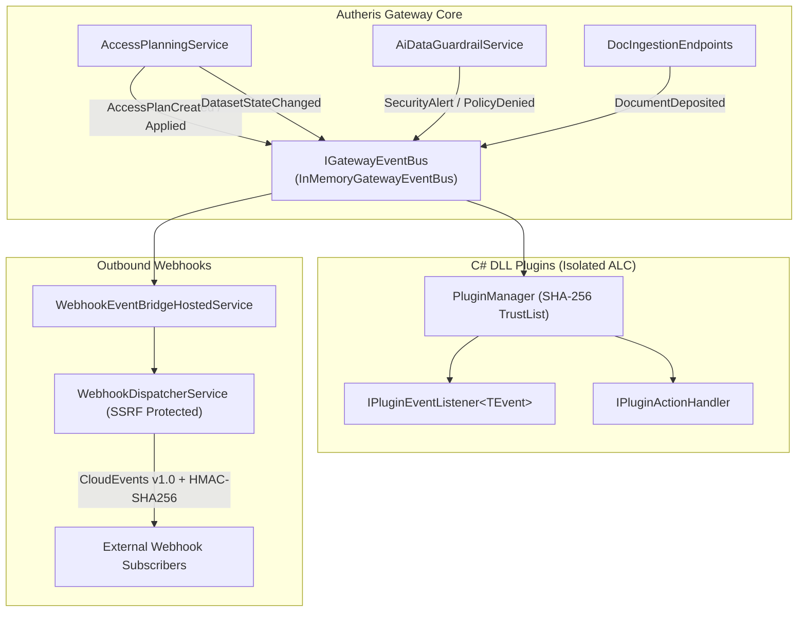

# F-EXT-01: Generic C# DLL Plugin & Event/Webhook Subsystem

## 1. Executive Summary & Problem Statement

Modern enterprise data gateways require seamless extensibility to integrate with external systems, audit lakes, and specialized downstream workflows. Historically, integrations either required polling REST endpoints or writing tight gateway core modifications. 

F-EXT-01 introduces a unified, bidirectional extensibility subsystem providing:
1. **Generic In-Process Event Bus (`IGatewayEventBus`):** Emits strongly typed domain events across governance, security, data catalog, and documentation operations with subscriber fault isolation.
2. **Extensible C# DLL Plugins:** Isolated, SHA-256 verified plugin assemblies running in dedicated `PluginAssemblyLoadContext` environments can listen to domain events via `IPluginEventListener<TEvent>` and register callable actions via `IPluginActionHandler`.
3. **Outbound CloudEvents v1.0 Webhooks (`IWebhookDispatcherService`):** Emits signed CloudEvents over HTTPS with HMAC-SHA256 signatures (`X-Autheris-Signature-256`), replay protection headers, tenant isolation, and exponential backoff retry.

---

## 2. Architecture & Component Wiring



### Component Breakdown
- **`IGatewayEvent` & Domain Events (`Autheris.Domain.Events`):**
  - `AccessPlanCreatedEvent`: Emitted when an access plan is generated.
  - `AccessPlanAppliedEvent`: Emitted when an access plan is confirmed and applied to REBAC policies.
  - `DatasetStateChangedEvent`: Emitted when a dataset is activated, quarantined, or deprecated.
  - `PolicyDeniedEvent`: Emitted when Casbin ABAC or REBAC rejects an access request.
  - `SecurityAlertEvent`: Emitted when prompt injections, jailbreaks, or brute force attempts are intercepted.
  - `DocumentDepositedEvent`: Emitted when a document is deposited into the Universal Doc Store.
- **`IGatewayEventBus` (`Autheris.Application.Events`):**
  - Thread-safe pub/sub dispatching events asynchronously to typed subscribers and general listeners.
  - Fault-isolated execution: Subscriber exceptions are caught and logged, preventing any failing plugin from affecting core operations or aborting other subscribers.
  - Bounded asynchronous delivery (default `Queued` mode): every subscription owns a bounded queue and a single reader task, so `PublishAsync` only enqueues and returns immediately. A slow or hung handler is cut off after the per-handler timeout (10 s) and never delays the publisher or other subscribers. Semantics: in-process, at-most-once, ordered per subscriber, lossy under overload (the oldest queued event is dropped when a queue is full). Security decisions and audit records must never depend on the bus; events are notifications only.
  - Metrics: `autheris_event_bus_dropped_total{event_type}` and `autheris_event_bus_handler_timeout_total{event_type}`.
- **Plugin Contracts (`Autheris.Application.Plugins`):**
  - `IPluginEventListener<TEvent>`: Strongly typed event listener implemented in plugin DLLs.
  - `IPluginActionHandler`: Custom action handler callable by name via `IPluginManager.ExecuteActionAsync(...)`.
- **`WebhookDispatcherService` (`Autheris.Application.Webhooks`):**
  - Converts domain events into CloudEvents v1.0 JSON payloads.
  - Signs payloads with HMAC-SHA256 (`sha256=<hex>`) using per-subscription secrets.
  - Adds replay protection timestamp (`X-Autheris-Timestamp`) and CloudEvents HTTP headers.
  - Enforces SSRF defense via `EgressIntegrations.Webhooks` and `AddSecureOutboundHandlers`.

---

## 3. Configuration & Usage Examples

### 3.1 Webhook Subscriptions (`appsettings.json`)

Webhook endpoints and filtering rules are configured under `Gateway:Webhooks`:

```json
{
  "Gateway": {
    "Webhooks": {
      "Enabled": true,
      "DefaultTimeoutSeconds": 5,
      "Subscriptions": [
        {
          "Id": "security-siem",
          "TargetUrl": "https://siem.corp.internal/events",
          "EventFilters": [
            "security.*",
            "governance.access_plan.applied"
          ],
          "Secret": "env:SIEM_WEBHOOK_SECRET",
          "MaxRetries": 3,
          "IsActive": true
        },
        {
          "Id": "catalog-indexer",
          "TargetUrl": "https://catalog.corp.internal/sync",
          "EventFilters": [
            "catalog.*",
            "docs.*"
          ],
          "Secret": "env:CATALOG_WEBHOOK_SECRET",
          "TenantId": "tenant-finance",
          "MaxRetries": 2,
          "IsActive": true
        }
      ]
    }
  }
}
```

### 3.1.1 Event Bus Options (`Gateway:Events`)

```json
{
  "Gateway": {
    "Events": {
      "SubscriberQueueCapacity": 1024,
      "DeliveryMode": "Queued"
    }
  }
}
```

- `SubscriberQueueCapacity` (default `1024`, minimum `1`): capacity of each subscriber queue; overflow drops the oldest event.
- `DeliveryMode` (`Queued` default, or `Inline`): `Inline` awaits all handlers inside `PublishAsync` and exists for tests only; it is rejected at startup outside Development.
- Tests that assert handler side effects after `PublishAsync` resolve `IGatewayEventBusDrain` and `await DrainAsync()`.

### 3.1.2 CDC Webhook Subscription Endpoints (`Gateway:CdcWebhooks`)

The endpoints `GET/POST /api/v1/cdc/subscriptions` and `DELETE /api/v1/cdc/subscriptions/{id}` are disabled by default and answer `501 Not Implemented` (problem details). While disabled, no subscription store and no CloudEvents dispatcher HTTP client are registered. Setting `Gateway:CdcWebhooks:Enabled` to `true` activates them; callers still need the `GovernanceAdmin` or `TenantAdmin` role.

### 3.2 Authoring a C# DLL Plugin Event Listener

A plugin DLL can implement `IPluginEventListener<TEvent>`:

```csharp
using System.Threading;
using System.Threading.Tasks;
using Autheris.Application.Plugins;
using Autheris.Domain.Events;

public sealed class ComplianceAuditPlugin : IPluginEventListener<AccessPlanAppliedEvent>
{
    public Task HandleEventAsync(AccessPlanAppliedEvent @event, CancellationToken ct = default)
    {
        // React to access plan approvals (e.g., sync to third-party IAM or ITSM)
        System.Console.WriteLine($"Access plan {@event.PlanId} applied for dataset {@event.DatasetId}");
        return Task.CompletedTask;
    }
}
```

### 3.3 Authoring a C# DLL Plugin Action Handler

```csharp
using System.Threading;
using System.Threading.Tasks;
using Autheris.Application.Plugins;

public sealed class CustomSyncActionHandler : IPluginActionHandler
{
    public string ActionName => "sync.external_directory";

    public Task<PluginActionResult> ExecuteActionAsync(PluginActionContext context, CancellationToken ct = default)
    {
        // Custom business logic execution
        return Task.FromResult(PluginActionResult.Succeeded(new { status = "synced" }));
    }
}
```

---

## 4. Security, Zero-Trust & Fail-Closed Behavior

1. **HMAC-SHA256 Webhook Verification:**
   - Every outbound webhook request contains:
     - `X-Autheris-Signature-256`: `sha256=${hexSignature}`
     - `X-Autheris-Timestamp`: ISO 8601 UTC timestamp
   - The signature is calculated across `${timestamp}.${jsonPayload}` to defend against tampering and replay attacks.
   - Both dispatchers (`WebhookDispatcherService` and the CDC `CloudEventWebhookDispatcher`) use the shared `WebhookSignature` helper, so receivers use one verification recipe: parse `X-Autheris-Timestamp`, reject it if it differs from the receiver clock by more than 5 minutes, recompute HMAC-SHA256 over `timestamp + "." + rawBody` with the subscription secret, and compare in constant time (`WebhookSignature.TryVerify` is the reference implementation). The CloudEvents dispatcher additionally sends `X-Autheris-Event-Id` and `X-Autheris-Event-Type` (informational; id and type are part of the signed body).
   - Deprecated: the CloudEvents dispatcher also emits `X-Autheris-Signature` (HMAC over the body only, no timestamp) while `Gateway:Webhooks:EmitLegacySignature` is `true` (default). It will be removed in the next release; set the option to `false` to stop sending it now.
   - A subscription without a secret never produces a signature header. With `Gateway:Webhooks:RequireSecret` (default: `true` outside Development) such a delivery is dropped with a warning instead of being sent unsigned.
2. **SSRF Defense:**
   - Outbound HTTP requests from `WebhookDispatcherService` run with `AddSecureOutboundHandlers(EgressIntegrations.Webhooks)`.
   - Loopback addresses, link-local IPs, cloud metadata endpoints (e.g. AWS IMDS `169.254.169.254`), and unauthorized internal networks are denied by default.
   - Logs and client-visible errors never contain URL userinfo, path, query or resolved IP addresses: destinations are logged as `scheme://host[:port]/` (`UrlRedactor`), and `EgressUrlPolicy` exceptions carry no IP in the message (the address is available in `Exception.Data["ResolvedIp"]` for operator logs).
3. **Isolated Assembly Loading & Integrity Check:**
   - Plugin DLLs are loaded into isolated `PluginAssemblyLoadContext` instances.
   - In production environments, SHA-256 hash checks against `Gateway:Plugins:TrustedPluginHashes` prevent unauthorized code execution.
4. **Subscriber Fault Isolation:**
   - Unhandled exceptions within plugin event listeners are caught, structured error logs are recorded, and other listeners continue unaffected.
