# F-GOV-15: Declarative Consent GitOps, Effective Access Introspection & Scope Governance

## 1. Executive Summary & Problem Statement

Modern enterprise data architectures require governance systems that integrate seamlessly with automated GitOps CI/CD workflows, provide real-time self-service access introspection for AI agents and human analysts, and enforce strict, monotonic security boundaries based on token authorization scopes:

1. **Imperative vs. Declarative Governance Barrier:** Managing column release rules and row-level security through manual UI forms or multi-step approval tickets does not scale for GitOps pipelines. Platform teams require a declarative JSON/YAML manifest apply endpoint supporting dry-run plan validation, idempotency, and automated WORM audit trails.
2. **Access Introspection Blindspots for AI Agents:** Autonomous agents invoking MCP tools or issuing GraphQL queries cannot predict whether a query will fail due to column denies or row filters. Providing a self-service introspection mechanism (`describe_my_access` in MCP, `myAccess` in GraphQL) allows agents to proactively construct compliant queries without trial-and-error failures.
3. **Approver & Requester Visibility Gaps:** Requesters lack self-service visibility into their active and pending consent requests, and data stewards need a dedicated inbox query (`pendingApprovalsForMe`) to inspect pending approvals assigned directly or via data owner delegations.
4. **Scope Privilege Bleed & Monotonic Hardening:** When an end user possesses broad permissions (e.g., clear access to sensitive columns in a web application), an AI agent acting on their behalf with an `Agent.Read` or `App.Read` scope must not inherit full unmasked access. Security rules must apply monotonic hardening: permissions can only be tightened when delegated scopes are present.

`F-GOV-15` provides an integrated suite addressing these challenges, delivering declarative GitOps synchronization, introspection endpoints, requester/approver inboxes, and monotonic scope-based access hardening in .NET 10.

---

## 2. Architecture & Component Wiring

```mermaid
flowchart TD
    subgraph GitOps["Declarative GitOps Pipeline"]
        Manifest["consent-policies.json (Manifest)"] --> ApplyApi["POST /api/v1/governance/consents/apply?dryRun=true/false"]
        ApplyApi --> ApplySvc["DeclarativeConsentApplyService"]
        ApplySvc --> GovRepo["Sqlite / PostgreSql Governance Repositories"]
        ApplySvc --> WormAudit["Immutable WORM Audit Trail (GITOPS_CONSENT_APPLY)"]
    end

    subgraph Introspection["Self-Service Access Introspection"]
        McpClient["AI Agent (MCP)"] --> ToolDesc["describe_my_access(table)"]
        GqlClient["Frontend / GraphQL Client"] --> QueryMyAccess["query { myAccess(table) }"]
        ToolDesc --> ExplSvc["EffectiveAccessExplanationService"]
        QueryMyAccess --> ExplSvc
        ExplSvc --> ConsRes["ConsentResolutionService (F-CONS-07 Monotonic Hardening)"]
    end

    subgraph ApproverInbox["Requester & Approver Workflows"]
        User["Requester / Data Owner"] --> GqlReq["myAccessRequests / pendingApprovalsForMe / myActiveConsents"]
        GqlReq --> ApprRepo["IConsentApprovalRepository.GetRequestsByRequesterSidAsync"]
    end
```



### Component Details

- **`IDeclarativeConsentApplyService` & `DeclarativeConsentApplyService`:** Ingests declarative `DeclarativeConsentManifest` payloads. In `dryRun: true` mode, calculates exact proposed additions, updates, and unaffected rules without mutating state or polluting audit logs. In execution mode (`dryRun: false`), creates active consents for tables registered in the catalog (a policy for an unknown table is skipped with a detail line), configures scope-specific column rules, and records a structured `GITOPS_CONSENT_APPLY` event in the WORM audit log. Only `GovernanceAdmin` and `ClusterAdmin` may apply a manifest.
- **`IEffectiveAccessExplanationService` & `EffectiveAccessExplanationService`:** Computes real-time access decisions (`ALLOWED` vs. `DENIED`), returns lists of allowed, masked, and denied columns, and inspects active row filters for the caller's active security context.
- **`IMcpDatasetCatalog.DescribeMyAccessAsync` & Tool `describe_my_access`:** Exposes the effective access introspection capability to MCP agents as a first-class tool, providing guidance on available columns and row constraints before queries are submitted.
- **GraphQL Introspection & Inbox Queries (`QueryTypes`):**
  - `myAccess(table: String!)`: Evaluates and returns effective access details for the caller.
  - `myAccessRequests(status: String)`: Lists access requests initiated by the caller, with optional status filtering.
  - `pendingApprovalsForMe`: Lists requests awaiting action by the caller as a table owner or active delegate.
  - `myActiveConsents`: Lists currently valid, active consents granting data access to the caller.
- **Monotonic Scope Hardening (`ConsentResolutionService`):**
  - `ConsentColumnRule.ApplicableScopes`: Associates masking or denial rules with specific delegated scopes.
  - Resolves permissions by evaluating base rules first, then applying scope-specific rules as monotonic tightenings (i.e. permissions can only decrease from `Clear` -> `Mask` -> `Deny`, never escalate).
- **Read-Only Scope Defaults (`GatewayOptions`):**
  - `GatewayOptions.Authentication.EntraId.ReadOnlyScopes`: Defaults to `["Agent.Read", "App.Read"]`.

---

## 3. Configuration & Usage Examples

### Declarative Policy Manifest Example (`consent-policies.json`)

A manifest grants to **groups** (standing access for everyone in the group) and, time-bound, to individual **users** or **service principals**. Every policy carries an absolute `validUntil`. The example below is accepted as written as long as:

- `default.sales.orders` is registered in the catalog;
- each `validUntil` lies in the future and within the configured maximum, and for the `User` policy within its class limit (see [Apply Semantics](#apply-semantics));
- the applying principal is neither the example user nor a member of the example group, and its group memberships are completely resolved (group resolution not degraded);
- for the `User` policy, the table is not sensitive (see [Four-Eyes Rule for Individual Grantees](#four-eyes-rule-for-individual-grantees)).

```json
{
  "version": "1.0",
  "policies": [
    {
      "domain": "default",
      "schema": "sales",
      "tableName": "orders",
      "granteeType": "Group",
      "granteeRef": "S-1-5-21-1004336348-1177238915-682003330-5120",
      "effect": "Allow",
      "validUntil": "2027-06-30T00:00:00Z",
      "description": "Data science team: clear notes, masked for agents",
      "columnRules": [
        { "columnName": "notes", "accessLevel": "Clear" },
        { "columnName": "notes", "accessLevel": "Mask", "applicableScopes": ["Agent.Read"] }
      ],
      "rowFilters": [
        {
          "columnName": "tenant_id",
          "operator": "EQ",
          "valueType": "string",
          "valueJson": "[\"tenant_100\"]",
          "valueSource": "LITERAL"
        }
      ]
    },
    {
      "domain": "default",
      "schema": "sales",
      "tableName": "orders",
      "granteeType": "User",
      "granteeRef": "S-1-5-21-1004336348-1177238915-682003330-1107",
      "effect": "Allow",
      "validUntil": "2027-01-31T00:00:00Z",
      "description": "Year-end analysis, masked notes",
      "columnRules": [
        { "columnName": "notes", "accessLevel": "Mask" }
      ]
    }
  ]
}
```

`granteeType` is `Group`, `User` or `ServicePrincipal`; `granteeRef` is the SID of the grantee. `Role` grantees are not accepted (see below). `effect` is `Allow` or `Deny` and must be given explicitly.

### GitOps Apply API Endpoint

Dry-run validation:
```bash
curl -X POST "https://gateway.internal/api/v1/governance/consents/apply?dryRun=true" \
  -H "Authorization: Bearer <gitops-admin-token>" \
  -H "Content-Type: application/json" \
  -d @consent-policies.json
```

Response:
```json
{
  "totalEvaluated": 2,
  "applied": 2,
  "unchanged": 0,
  "revoked": 0,
  "dryRun": true,
  "details": [
    "[DryRun] Would apply policy for 'default.sales.orders' -> 'S-1-5-21-1004336348-1177238915-682003330-5120'.",
    "[DryRun] Would apply policy for 'default.sales.orders' -> 'S-1-5-21-1004336348-1177238915-682003330-1107'."
  ],
  "updated": 0,
  "prunedCount": 0,
  "pruned": null
}
```

### Apply Semantics

- **Atomic apply:** all revocations and creations of one manifest are written by `IConsentRepository.ReplaceConsentsAsync` in **one transaction with one epoch bump**, together with the `GITOPS_CONSENT_APPLY` audit entries. A fault leaves nothing changed and writes no audit record.
- **All or nothing on validation:** the checks below run for all policies of tables registered in the catalog before anything is written, also in dry-run. The first refused policy rejects the whole manifest with `400`; nothing is applied.
- **Authenticated caller SID required:** the apply needs a principal that carries a user SID; that SID is the actor of every audit record. A principal without one is rejected (`403`) before any read or write, and no stand-in actor exists.
- **Ambiguous manifests are refused:** a manifest with more than one policy for the same table and grantee is rejected as a whole before anything is written.
- **Unknown tables are skipped:** a policy for a table that is not registered in the catalog is skipped with a detail line (`Table '...' not found in catalog; skipped policy.`). No further check runs for a skipped policy: the grantee type, effect and `validUntil` rules below apply only to policies of registered tables.
- **No role grantees:** a policy of a registered table with `granteeType: "Role"` (for any effect) is refused with `400 BAD_REQUEST` ("The manifest contains a policy that is not supported."). Grant to a group or a user instead. The same answer is given for a missing or unknown `effect`.
- **Mandatory `validUntil` for every policy:** `Group`, `User` and `ServicePrincipal` policies, `Allow` and `Deny` alike, need an absolute `validUntil` that lies in the future and is at most `now + Gateway:Governance:Grants:DeclarativeMaxDuration` (when unset, `Gateway:Governance:Grants:MaxDuration` applies). A missing, past or too long `validUntil` answers `400` with `INDIVIDUAL_GRANT_REQUIRES_EXPIRY`, `INDIVIDUAL_GRANT_EXPIRY_IN_PAST` or `INDIVIDUAL_GRANT_EXCEEDS_MAXIMUM` (with the latest allowed `maxValidTo`); the codes carry the `INDIVIDUAL_GRANT_` prefix for group policies too. There is no relative validity field: `validityDays` has no effect.
- **Individual grantees (`User`, `ServicePrincipal`)** are also evaluated by the [time-bound individual grant policy (F-GOV-22)](f-gov-22-time-bound-individual-grants.md) (`GrantKind.ManifestPolicy`): an `Allow` must stay within the class limit configured under `Gateway:Governance:IndividualGrants` (for example `RegularMaxDays`), bounded by `DeclarativeMaxDuration`. An `Allow` that needs four-eyes approval is refused, see the next section. An individual policy for the applying actor itself is refused for any effect (`INDIVIDUAL_GRANT_REQUIRES_FOUR_EYES`, self-grant).
- **Group grantees** take no class limit and no four-eyes check. An `Allow` for a group the applying actor belongs to is refused (`INDIVIDUAL_GRANT_REQUIRES_FOUR_EYES`, self-grant), and so is any group `Allow` while the actor's group memberships could not be resolved completely (group resolution degraded). A `Deny` for an own group is accepted.
- **Re-applying:** a policy that matches an active consent of the same grantee and table (same effect, column rules and row filters) is reported as `unchanged` and nothing is written; a difference in `description` only updates the description in place (`updated`); any other difference revokes the active consent and creates a new one (`revoked`, `applied`).
  - Column rules and row filters are compared as multisets, independent of their order: a column rule by column name, access level and set of scopes (so a base rule and a scope rule on the same column are matched individually), a row filter by all of its fields. Names, scopes and operators are compared exactly as written; a change in letter case counts as a change.
  - An active consent that also carries write rules or row scopes (for example one created through the request workflow) never counts as `unchanged`.
  - For every grantee type, an **earlier** `validUntil` than the stored one is a change (the grant is shortened); a later one is not, so a manifest never extends a grant. A longer validity for an individual grant needs a renewal (see F-GOV-22).
  - For GitOps pipelines this means that re-applying a manifest never extends a group grant or a `Deny` policy: the stored expiry is kept, the consent lapses at its `validUntil`, and only the next apply after that creates it again. A `Deny` is therefore not in force between its expiry and the next apply; schedule applies and choose `validUntil` accordingly.

### Four-Eyes Rule for Individual Grantees

A manifest activates its consents immediately and carries no approvals. An individual grant that the grant policy marks as four-eyes therefore can never be applied through a manifest. An `Allow` policy for a `User` or `ServicePrincipal` grantee that passes the self-grant check and the expiry checks (`validUntil` and the class limit of [F-GOV-22](f-gov-22-time-bound-individual-grants.md), which run first and answer with their own codes, for example `INDIVIDUAL_GRANT_EXCEEDS_MAXIMUM` for a `validUntil` beyond `UnmaskedMaxDays` or `SensitiveMaxDays`) is refused with `400 INDIVIDUAL_GRANT_REQUIRES_FOUR_EYES` (also in dry-run, the whole manifest is rejected) when **any** of these holds:

1. A column rule of the policy has `accessLevel: "Clear"` (with or without `applicableScopes`).
2. The table is sensitive according to `GrantClassifier`, that is, any of:
   - the dataset sensitivity is `CONFIDENTIAL` or higher (`CONFIDENTIAL`, `HIGH`, `RESTRICTED`, `SECRET`, `STRICTLY_CONFIDENTIAL`, or a value that is not recognised) or the table requires four-eyes approval;
   - a table tag contains `pii` or `gdpr`;
   - a column carries a classification other than `PUBLIC`, is marked sensitive, carries `meta.pii = true`, or has a column masking rule.

What is still accepted for individual grantees:

- An `Allow` with only `Mask` and `Deny` column rules (or no column rules) on a table that is not sensitive, for example a dataset classified `INTERNAL` without classified or masked columns.
- A `Deny` policy on any table.

The same `Allow` policies for a `Group` grantee are accepted, `Clear` rules and sensitive tables included: the four-eyes rule applies to individual grantees only.

#### Seeding Test and Demo Environments

To give individual test or demo users clear-text or sensitive access declaratively:

- **One group per test user (recommended for declarative seeding):** create a directory group per test user (for example `autheris-test-alice`), make the user its only member, and grant the policies to that group (`granteeType: "Group"`, `granteeRef` = group SID). The test user's token or group resolution must list the group, and the applying principal must not be a member of it (self-grant rule). The policies are applied unchanged, including `Clear` rules and sensitive tables. Use this for test and demo data only: a group grant is standing access and is not subject to the individual class limits, four-eyes approval or individual recertification, so it must not stand in for individual access to real data.
- **Consent request and approval workflow:** the test user requests access with `POST /api/v1/consent/requests` and an approver decides with `POST /api/v1/consent/requests/{id}/decision` (a second independent approver for tables that require four-eyes approval). The workflow records the approvals that a manifest cannot carry.
- **Individual manifest policies** remain suitable for `Mask`-only access on non-sensitive tables and for `Deny` policies.

### MCP Tool `describe_my_access`

An AI agent queries its effective permissions before constructing a data extraction request:

```json
{
  "name": "describe_my_access",
  "arguments": {
    "table": "sales.orders"
  }
}
```

Response:
```json
{
  "table": "default.sales.orders",
  "decision": "ALLOWED",
  "allowedColumns": ["id", "order_date", "total_amount"],
  "maskedColumns": ["notes"],
  "deniedColumns": ["customer_credit_card"],
  "activeRowFilters": ["tenant_id = 'tenant_100'"],
  "validTo": "2026-12-31T23:59:59Z"
}
```

For a token that carries a restricted scope (for example `Agent.Read`, see `Gateway:Governance:RestrictedScopes`) the answer also contains `restrictedScope: true` and `scopeClearRequiredColumns`. A column in `scopeClearRequiredColumns` is masked only for the restricted scope of this token: the same person reads it as the base rule says (for example in an app that runs with the person's own scope), so no access request is needed for it, and `describe_dataset` offers no `clearRequestable` hint for it. The tool description and the agent query guide (`autheris://api/docs/query-guide`) explain both fields to the agent.

### GraphQL Self-Service Queries

```graphql
query CheckGovernanceStatus {
  # Introspect effective access
  myAccess(table: "sales.orders") {
    table
    decision
    allowedColumns
    maskedColumns
    deniedColumns
    activeRowFilters
  }

  # Check active consents
  myActiveConsents {
    id
    tableIdentifier
    effect
    validTo
  }

  # Requester inbox
  myAccessRequests(status: "PENDING_APPROVAL") {
    id
    tableIdentifier
    businessJustification
    status
    requestedAt
  }

  # Approver inbox
  pendingApprovalsForMe {
    id
    requesterSid
    tableIdentifier
    businessJustification
    requestedAt
  }
}
```

---

## 4. Security, Zero-Trust & Fail-Closed Behavior

1. **Fail-Closed on Unrecognized Tables:**
   - Calling `describe_my_access` or `myAccess` on a dataset not registered in the catalog fails closed and returns `DENIED` with empty column lists, preventing existence oracle probing.
2. **Monotonic Hardening (Non-Escalation Guarantee):**
   - Scope-specific rules (`ApplicableScopes`) can only restrict access (e.g. `Clear` -> `Mask` or `Mask` -> `Deny`). A scope rule cannot elevate a base `Deny` to `Clear`, preventing malicious or compromised clients from escalating privileges via arbitrary delegated scopes.
3. **Immutable Audit Verification:**
   - Applying declarative policies via `/api/v1/governance/consents/apply` records a WORM audit event sealed into the SHA-256 HMAC chain, attributing the action to the calling actor's SID, tenant, and timestamp.
4. **All-or-Nothing Apply:**
   - A manifest is applied in one transaction with one epoch bump; a failure or a refused individual grant leaves the consent store unchanged.
5. **Tenant Isolation:**
   - Both SQLite and PostgreSQL governance repositories strictly scope request lookups, consents, and declarative policies by `TenantId`. Requesters cannot view requests or consents belonging to other tenants.
