# F-GOV-15: Declarative Consent GitOps, Effective Access Introspection & Scope Governance

## 1. Executive Summary & Problem Statement

Modern enterprise data architectures require governance systems that integrate seamlessly with automated GitOps CI/CD workflows, provide real-time self-service access introspection for AI agents and human analysts, and enforce strict, monotonic security boundaries based on token authorization scopes:

1. **Imperative vs. Declarative Governance Barrier:** Managing column release rules and row-level security through manual UI forms or multi-step approval tickets does not scale for GitOps pipelines. Platform teams require a declarative JSON/YAML manifest apply endpoint supporting dry-run plan validation, idempotency, and automated WORM audit trails.
2. **Access Introspection Blindspots for AI Agents:** Autonomous agents invoking MCP tools or issuing GraphQL queries cannot predict whether a query will fail due to column denies or row filters. Providing a self-service introspection mechanism (`describe_my_access` in MCP, `myAccess` in GraphQL) allows agents to proactively construct compliant queries without trial-and-error failures.
3. **Approver & Requester Visibility Gaps:** Requesters lack self-service visibility into their active and pending consent requests, and data stewards need a dedicated inbox query (`pendingApprovalsForMe`) to inspect pending approvals assigned directly or via data owner delegations.
4. **Scope Privilege Bleed & Monotonic Hardening:** When an end user possesses broad permissions (e.g., clear access to sensitive columns in a web application), an AI agent acting on their behalf with an `Agent.Read` or `App.Read` scope must not inherit full unmasked access. Security rules must apply monotonic hardening: permissions can only be tightened when delegated scopes are present.
5. **FinOps Per-Scope Quotas:** Organizations need to budget and enforce monthly spend limits partitioned not only by tenant, but specifically by OAuth scope (e.g., limiting monthly token spend for `Agent.Read`).

`F-GOV-15` provides an integrated suite addressing these challenges, delivering declarative GitOps synchronization, introspection endpoints, requester/approver inboxes, and monotonic scope-based access hardening in .NET 10.

---

## 2. Architecture & Component Wiring

```mermaid
flowchart TD
    subgraph GitOps["Declarative GitOps Pipeline"]
        Manifest["consent-policies.json (Manifest)"] --> ApplyApi["POST /api/v1/governance/consents/apply?dryRun=true/false"]
        ApplyApi --> ApplySvc["DeclarativeConsentApplyService"]
        ApplySvc --> GovRepo["Sqlite / PostgreSql Governance Repositories"]
        ApplySvc --> WormAudit["Immutable WORM Audit Trail (GITOPS_CONSENT_APPLY)"]
    end

    subgraph Introspection["Self-Service Access Introspection"]
        McpClient["AI Agent (MCP)"] --> ToolDesc["describe_my_access(table)"]
        GqlClient["Frontend / GraphQL Client"] --> QueryMyAccess["query { myAccess(table) }"]
        ToolDesc --> ExplSvc["EffectiveAccessExplanationService"]
        QueryMyAccess --> ExplSvc
        ExplSvc --> ConsRes["ConsentResolutionService (F-CONS-07 Monotonic Hardening)"]
    end

    subgraph ApproverInbox["Requester & Approver Workflows"]
        User["Requester / Data Owner"] --> GqlReq["myAccessRequests / pendingApprovalsForMe / myActiveConsents"]
        GqlReq --> ApprRepo["IConsentApprovalRepository.GetRequestsByRequesterSidAsync"]
    end
```



### Component Details

- **`IDeclarativeConsentApplyService` & `DeclarativeConsentApplyService`:** Ingests declarative `DeclarativeConsentManifest` payloads. In `dryRun: true` mode, calculates exact proposed additions, updates, and unaffected rules without mutating state or polluting audit logs. In execution mode (`dryRun: false`), idempotently provisions table metadata, creates active consents, configures scope-specific column rules, and records a structured `GITOPS_CONSENT_APPLY` event in the WORM audit log.
- **`IEffectiveAccessExplanationService` & `EffectiveAccessExplanationService`:** Computes real-time access decisions (`ALLOWED` vs. `DENIED`), returns lists of allowed, masked, and denied columns, and inspects active row filters for the caller's active security context.
- **`IMcpDatasetCatalog.DescribeMyAccessAsync` & Tool `describe_my_access`:** Exposes the effective access introspection capability to MCP agents as a first-class tool, providing guidance on available columns and row constraints before queries are submitted.
- **GraphQL Introspection & Inbox Queries (`QueryTypes`):**
  - `myAccess(table: String!)`: Evaluates and returns effective access details for the caller.
  - `myAccessRequests(status: String)`: Lists access requests initiated by the caller, with optional status filtering.
  - `pendingApprovalsForMe`: Lists requests awaiting action by the caller as a table owner or active delegate.
  - `myActiveConsents`: Lists currently valid, active consents granting data access to the caller.
- **Monotonic Scope Hardening (`ConsentResolutionService`):**
  - `ConsentColumnRule.ApplicableScopes`: Associates masking or denial rules with specific delegated scopes.
  - Resolves permissions by evaluating base rules first, then applying scope-specific rules as monotonic tightenings (i.e. permissions can only decrease from `Clear` -> `Mask` -> `Deny`, never escalate).
- **FinOps Scope Quotas & Read-Only Defaults (`GatewayOptions`):**
  - `GatewayOptions.Authentication.EntraId.ReadOnlyScopes`: Defaults to `["Agent.Read", "App.Read"]`.
  - `FinOpsOptions.ScopeMonthlyBudgets`: Enables setting monthly compute and token expenditure limits per OAuth scope.

---

## 3. Configuration & Usage Examples

### Declarative Policy Manifest Example (`consent-policies.json`)

```json
{
  "version": "1.0",
  "policies": [
    {
      "domain": "default",
      "schema": "sales",
      "tableName": "orders",
      "granteeType": "Role",
      "granteeRef": "DataScientist",
      "effect": "Allow",
      "description": "Standard data science access with agent masking on sensitive notes",
      "columnRules": [
        {
          "columnName": "notes",
          "accessLevel": "Mask",
          "applicableScopes": ["Agent.Read"]
        }
      ],
      "rowFilters": [
        {
          "columnName": "tenant_id",
          "operator": "EQ",
          "valueType": "string",
          "valueJson": "[\"tenant_100\"]",
          "valueSource": "LITERAL"
        }
      ]
    }
  ]
}
```

### GitOps Apply API Endpoint

Dry-run validation:
```bash
curl -X POST "https://gateway.internal/api/v1/governance/consents/apply?dryRun=true" \
  -H "Authorization: Bearer <gitops-admin-token>" \
  -H "Content-Type: application/json" \
  -d @consent-policies.json
```

Response:
```json
{
  "totalEvaluated": 1,
  "applied": 1,
  "unchanged": 0,
  "revoked": 0,
  "dryRun": true,
  "details": [
    "[DryRun] Policy 1: sales.orders (Role:DataScientist) -> Would CREATE new consent with 1 column rules and 1 row filters"
  ]
}
```

### Apply Semantics

- **Atomic apply:** all revocations and creations of one manifest are written by `IConsentRepository.ReplaceConsentsAsync` in **one transaction with one epoch bump**. A fault leaves nothing changed and writes no audit record; the `GITOPS_CONSENT_APPLY` audit events are written after the commit.
- **Idempotent role grants:** role consents carry no subject SID, so existing role grants are looked up by role name (`GetActiveRoleConsentsAsync`). Applying the same role manifest twice reports `unchanged` and never creates a duplicate role consent.
- **Ambiguous manifests are refused:** a manifest with more than one policy for the same table and grantee is rejected as a whole before anything is written.
- **Grantee types and expiry:**
  - `Role` and `Group` grantees are standing grants. `validityDays` sets their expiry (default 365 days).
  - `User` and `ServicePrincipal` grantees are **individual grants** and need an absolute `validUntil` within the class maximum of the [time-bound individual grant policy (F-GOV-22)](f-gov-22-time-bound-individual-grants.md) (for example 180 days for regular tables, 90 days for sensitive/PII tables). `validityDays` is ignored for them. The check also runs in dry-run.
  - A missing, past or too long `validUntil` answers `400` with `INDIVIDUAL_GRANT_REQUIRES_EXPIRY`, `INDIVIDUAL_GRANT_EXPIRY_IN_PAST` or `INDIVIDUAL_GRANT_EXCEEDS_MAXIMUM` and the latest allowed `maxValidTo`; nothing is applied.
  - Re-applying an unchanged manifest never extends an existing identical grant. A longer validity needs a renewal.

Individual grant example:

```json
{
  "domain": "default",
  "schema": "sales",
  "tableName": "orders",
  "granteeType": "User",
  "granteeRef": "S-1-5-21-ANALYST-7",
  "effect": "Allow",
  "validUntil": "2026-12-31T00:00:00Z",
  "description": "Year-end analysis"
}
```

### MCP Tool `describe_my_access`

An AI agent queries its effective permissions before constructing a data extraction request:

```json
{
  "name": "describe_my_access",
  "arguments": {
    "table": "sales.orders"
  }
}
```

Response:
```json
{
  "table": "default.sales.orders",
  "decision": "ALLOWED",
  "allowedColumns": ["id", "order_date", "total_amount"],
  "maskedColumns": ["notes"],
  "deniedColumns": ["customer_credit_card"],
  "activeRowFilters": ["tenant_id = 'tenant_100'"],
  "validTo": "2026-12-31T23:59:59Z"
}
```

### GraphQL Self-Service Queries

```graphql
query CheckGovernanceStatus {
  # Introspect effective access
  myAccess(table: "sales.orders") {
    table
    decision
    allowedColumns
    maskedColumns
    deniedColumns
    activeRowFilters
  }

  # Check active consents
  myActiveConsents {
    id
    tableIdentifier
    effect
    validTo
  }

  # Requester inbox
  myAccessRequests(status: "PENDING_APPROVAL") {
    id
    tableIdentifier
    businessJustification
    status
    requestedAt
  }

  # Approver inbox
  pendingApprovalsForMe {
    id
    requesterSid
    tableIdentifier
    businessJustification
    requestedAt
  }
}
```

---

## 4. Security, Zero-Trust & Fail-Closed Behavior

1. **Fail-Closed on Unrecognized Tables:**
   - Calling `describe_my_access` or `myAccess` on a dataset not registered in the catalog fails closed and returns `DENIED` with empty column lists, preventing existence oracle probing.
2. **Monotonic Hardening (Non-Escalation Guarantee):**
   - Scope-specific rules (`ApplicableScopes`) can only restrict access (e.g. `Clear` -> `Mask` or `Mask` -> `Deny`). A scope rule cannot elevate a base `Deny` to `Clear`, preventing malicious or compromised clients from escalating privileges via arbitrary delegated scopes.
3. **Immutable Audit Verification:**
   - Applying declarative policies via `/api/v1/governance/consents/apply` records a WORM audit event sealed into the SHA-256 HMAC chain, attributing the action to the calling actor's SID, tenant, and timestamp.
4. **All-or-Nothing Apply:**
   - A manifest is applied in one transaction with one epoch bump; a failure or a refused individual grant leaves the consent store unchanged.
5. **Tenant Isolation:**
   - Both SQLite and PostgreSQL governance repositories strictly scope request lookups, consents, and declarative policies by `TenantId`. Requesters cannot view requests or consents belonging to other tenants.
