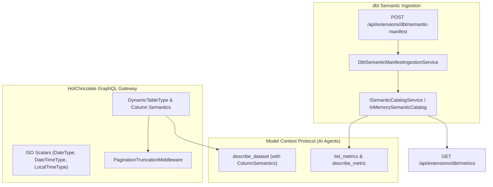

# F-GOV-17: GraphQL Cursor Pagination, Temporal Types & dbt Column Semantics

## Executive Summary & Problem Statement

Modern enterprise data architectures rely on unified API gateways to expose tabular data to frontend web applications, business intelligence tools, and autonomous AI agents. Prior to this feature, clients faced three major challenges:
1. **Timezone Shifts & Missing Column Semantics:** SQL dates mapped to generic strings, leading to ambiguous date parsing and timezone conversion anomalies in clients. Crucial semantic attributes authored in dbt (e.g. `role: "measure"`, `unit: "EUR"`) were stripped during schema ingestion.
2. **Result Set Exhaustion Without Stable Paging:** Large GraphQL queries either hit hard row limits or consumed excessive memory. Clients required Relay-style cursor-based pagination with machine-readable truncation signals.
3. **Disconnected Metric Catalogs:** Business metric definitions in dbt `semantic_manifest.json` were not discoverable via API or Model Context Protocol (MCP) tools.

**F-GOV-17** resolves these challenges by introducing:
- Native ISO temporal HotChocolate scalars (`Date`, `DateTime`, `LocalTime`).
- Rich column semantics passthrough from dbt `meta` to GraphQL schema descriptions and MCP tools.
- High-performance Relay cursor-based pagination helper with opaque Base64 cursors and `extensions.pagination` truncation indicators.
- Embedded dbt Semantic Layer ingestion and MCP discovery tools (`list_metrics`, `describe_metric`).

---

## Architecture & Component Wiring



### Affected Domain Models & Components
- **`ColumnSemantics` (`Autheris.Domain.Model`):** Strongly-typed representation of column roles (`measure`, `dimension`, `time_dimension`), units (`EUR`, `USD`, `pct`), and business glossaries derived from column metadata.
- **`TableColumn.Semantics` (`Autheris.Domain.Model`):** Automatic projection of dbt column `meta` into typed semantics.
- **`DbtSemanticModels` (`Autheris.Domain.Model`):** Domain entities for `DbtSemanticManifest`, `DbtSemanticModel`, `DbtMetric`, `DbtMeasure`, and `DbtDimension`.
- **`CursorPaginationHelper` (`Autheris.Application.Common.Paging`):** Zero-allocation Base64 opaque cursor slicing, Relay `PageInfo` computation, and limit truncation enforcement.
- **`PaginationTruncationMiddleware` (`Autheris.GraphQL.Interceptors`):** Injects `extensions.pagination { isTruncated: true, maxRowsReached: true }` when query results hit limit boundaries.
- **`McpSemanticTools` (`Autheris.Application.Mcp.Services`):** AI Agent discovery tools for listing and inspecting business metrics.

---

## Configuration & Usage Examples

### 1. Ingesting dbt Semantic Manifest

Authorized governance administrators or the `DbtAdmin` role can ingest `semantic_manifest.json`:

```http
POST /api/extensions/dbt/semantic-manifest
Authorization: Bearer <token>
Content-Type: application/json

{
  "semantic_models": [
    {
      "name": "orders_source",
      "description": "Core orders dataset",
      "node_relation": { "relation_name": "analytics.public.orders" },
      "entities": [{ "name": "order_id", "type": "primary" }],
      "measures": [
        { "name": "order_total", "agg": "sum", "expr": "amount", "description": "Sum of order gross value" }
      ],
      "dimensions": [
        { "name": "ordered_at", "type": "time", "is_partition": true, "description": "Transaction date" }
      ]
    }
  ],
  "metrics": [
    {
      "name": "gross_revenue",
      "type": "simple",
      "description": "Total gross revenue generated by orders",
      "label": "Gross Revenue",
      "type_params": { "measure": "order_total" },
      "dimensions": ["ordered_at"],
      "meta": { "unit": "EUR", "tier": "tier-1" }
    }
  ]
}
```

### 2. Discovering Metrics via MCP for AI Agents

AI agents invoke `list_metrics` and `describe_metric`:

```json
{
  "tool": "list_metrics",
  "arguments": {
    "dataset": "orders_source"
  }
}
```

Response:
```json
{
  "total": 1,
  "metrics": [
    {
      "name": "gross_revenue",
      "type": "simple",
      "description": "Total gross revenue generated by orders",
      "label": "Gross Revenue",
      "dimensions": ["ordered_at"],
      "measures": ["order_total"],
      "meta": { "unit": "EUR", "tier": "tier-1" }
    }
  ]
}
```

### 3. Relay Cursor Pagination with Truncation Signal

Query with Relay cursor parameters:

```graphql
query GetOrders($first: Int, $after: String) {
  sales_orders(first: $first, after: $after) {
    edges {
      node {
        orderId
        orderDate # Emitted as Date (YYYY-MM-DD)
        grossAmount # Annotated with Role: measure, Unit: EUR
      }
      cursor
    }
    pageInfo {
      hasNextPage
      hasPreviousPage
      startCursor
      endCursor
    }
  }
}
```

If query cost or client tier row quotas truncate the result set, HotChocolate appends the machine-readable pagination extension:

```json
{
  "data": { ... },
  "extensions": {
    "pagination": {
      "isTruncated": true,
      "maxRowsReached": true
    }
  }
}
```

---

## Security, Zero-Trust & Fail-Closed Behavior

1. **Anti-Oracle Protection:** Querying metrics or columns for datasets that the caller does not have read access to returns an empty list or `not found` response without disclosing table or metric existence.
2. **Fail-Closed Paging Parameters:** Malformed Base64 cursors, invalid prefixes, or negative `first` arguments fail cleanly with structured validation errors, preventing 500 crashes.
3. **KMS & WORM Audit Trail:** Ingestion of semantic manifests is recorded in the immutable WORM audit log under `AUDIT_CONFIG_CHANGED`.
