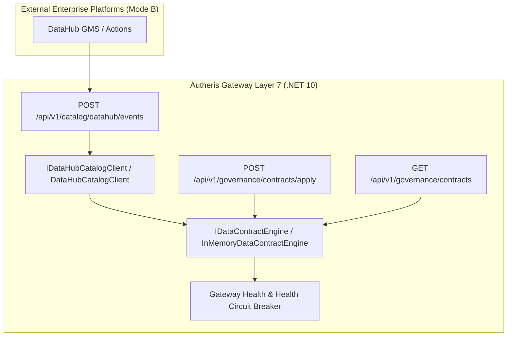

# F-GOV-18: Enterprise Data Contracts & DataHub Governance Integration

## Executive Summary & Problem Statement

Modern enterprise data architectures require clear operational boundaries, verifiable schemas, and active quality enforcement between data producers and downstream consumers:
1. **Passive vs. Active Governance Dilemma:** Traditional data catalogs (e.g. DataHub, Collibra) passively observe and display broken freshness or schema mismatch alerts on a dashboard, while corrupt or stale data continues to flow to downstream consumers and AI agents.
2. **Heavyweight Infrastructure Barriers:** Operating a full multi-container data catalog stack (Kafka, Elasticsearch, GMS, Neo4j) is often prohibited in edge, air-gapped, or lean enterprise environments.
3. **Audit & Circuit-Breaking Gap:** When a data contract or SLA is breached, organizations need an automated in-gateway circuit breaker that fails closed or flags degradation at the API gateway layer before queries reach production backends.

**F-GOV-18** addresses these challenges through a **Dual-Mode Enterprise Data Governance Suite**:
- **Mode A (Embedded Standalone):** Self-sufficient in-gateway data contract engine managing schema expectations, assertions (`Freshness`, `RowCount`, `SqlExpression`, `Completeness`, `SchemaCompliance`), and SLAs in local governance storage without external dependencies.
- **Mode B (Federated Enterprise):** Seamless integration with external DataHub deployments, consuming Metadata Change Log (MCL) webhook events, synchronizing tags, and updating contract statuses.
- **Active Governance Enforcement:** Direct integration with gateway health checks to fail closed when assertions fail.

---

## Architecture & Component Wiring



### Affected Domain Models & Components
- **`DataContract` & `DataContractAssertion` (`Autheris.Domain.Model`):** Strongly-typed representation of table contracts, versions, schema column requirements, SLAs, and evaluation results.
- **`IDataContractEngine` (`Autheris.Application.Governance.Interfaces`):** Service interface for contract registration, retrieval, assertion status updates, and dataset health checks.
- **`IDataHubCatalogClient` (`Autheris.Application.Governance.Interfaces`):** Ingests DataHub Metadata Change Log (MCL) events and resolves external platform tags.
- **`DataContractEndpoints` (`Autheris.Api.Endpoints`):** Exposes declarative apply API (`/api/v1/governance/contracts/apply`), contract query endpoint (`/api/v1/governance/contracts`), and webhook receiver (`/api/v1/catalog/datahub/events`).

---

## Configuration & Usage Examples

### 1. Applying a Declarative Data Contract

Governance administrators apply a declarative data contract using the apply API:

```http
POST /api/v1/governance/contracts/apply
Authorization: Bearer <admin-token>
Content-Type: application/json

{
  "id": "contract-orders-v1",
  "table": {
    "domain": "sales",
    "schema": "crm",
    "tableName": "orders"
  },
  "version": "1.0.0",
  "status": "Active",
  "schemaColumns": ["id", "customer_id", "amount", "created_at"],
  "assertions": [
    {
      "id": "freshness-daily",
      "type": "Freshness",
      "description": "Orders must be updated at least once every 24 hours",
      "column": "created_at",
      "threshold": "24h",
      "isPassing": true
    }
  ],
  "sla": {
    "freshnessHours": 24,
    "maxAllowedErrorRatePct": 0.01
  },
  "ownerTeam": "SalesPlatform"
}
```

Response:
```json
{
  "success": true,
  "contractId": "contract-orders-v1",
  "table": "sales.crm.orders",
  "assertionsCount": 1,
  "isHealthy": true
}
```

### 2. Ingesting DataHub Assertion MCL Webhook Events

External DataHub Actions emit assertion results to Autheris:

```http
POST /api/v1/catalog/datahub/events
Authorization: Bearer <token>
Content-Type: application/json

{
  "entityType": "assertion",
  "entityUrn": "urn:li:assertion:orders_freshness_check",
  "aspect": {
    "type": "SUCCESS"
  }
}
```

Response:
```json
{
  "received": true
}
```

---

## Security, Zero-Trust & Fail-Closed Behavior

1. **Role-Based Modification Protection:** Applying or updating data contracts requires global governance administrator permissions (`GlobalGovernanceAdmin` or `DbtAdmin`).
2. **Fail-Closed Dataset Protection:** When a contract's assertions fail or are marked as broken, the table's health check returns `false`, enabling downstream circuit breakers to restrict access or reject queries with clear error diagnostics.
3. **KMS & WORM Audit Trail:** Every contract application and assertion modification is recorded with full audit trails under `AUDIT_CONFIG_CHANGED`.
