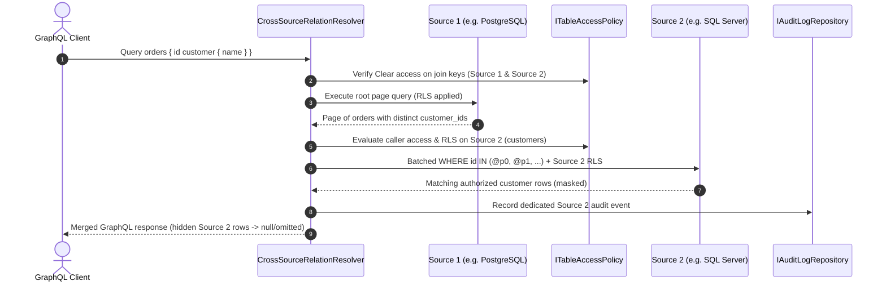

# F-GOV-19: Governed Cross-Source GraphQL Relations & Batched Key Lookup

**Feature-ID:** F-GOV-19  
**Category:** Federated Data Access & GraphQL Governance  
**Components:**
- Domain: [`TableModels.cs`](../../src/Autheris.Domain/Model/TableModels.cs) (`TableRelation.AllowCrossDataSource`)
- Application: [`CrossSourceRelationModels.cs`](../../src/Autheris.Application/Data/Relations/CrossSourceRelationModels.cs), [`ICrossSourceRelationResolver.cs`](../../src/Autheris.Application/Data/Relations/ICrossSourceRelationResolver.cs), [`CrossSourceRelationResolver.cs`](../../src/Autheris.Application/Data/Relations/CrossSourceRelationResolver.cs)

---

## 1. Executive Summary & Problem Statement

### 1.1 The Challenge
In enterprise architectures, related business entities often reside in separate data sources (for example, `orders` in PostgreSQL and `customers` in SQL Server or an HTTP microservice). Naive cross-source joins either pull entire tables into gateway memory or bypass target-source row-level security and column masking.

### 1.2 The Solution
Autheris supports **Declared Cross-Source Relations** (`AllowCrossDataSource = true`) in GraphQL and the governed relation resolver via **Batched Key Lookup**:
- **No Full-Table Staging:** The gateway executes the root query on Source 1, extracts the distinct non-null join keys from the current page, and queries Source 2 using parameter-bounded `WHERE key IN (@p0, @p1, ...)` batches in both **many-to-one** and **one-to-many** directions.
- **Clear-Key Requirement:** Join keys on both the parent table and the referenced child table must have `ColumnAccessLevel.Clear` for the caller; masked or denied join keys fail closed with `CROSS_SOURCE_RELATION_KEY_NOT_CLEAR`.
- **Full Governance on Source 2:** Source 2 is queried under the caller's identity, enforcing table consent, RLS row filters, mandatory virtual filters, column masking, cost/row budgets, and dedicated audit logging.
- **Bounded Filter Pushdown & Sort Guard:** Filtering the root table by a cross-source related field resolves matching keys on Source 2 first up to `MaxCrossSourceFilterKeys` (failing closed with `CROSS_SOURCE_FILTER_KEY_SET_EXCEEDED` when exceeded). Sorting the root query by a cross-source relation field fails closed with `CROSS_SOURCE_SORT_NOT_SUPPORTED`.

---

## 2. Architecture & Request Lifecycle



---

## 3. Configuration & Options

Enable cross-source traversal on a declared `TableRelation` (`AllowCrossDataSource: true`) and configure bounds via `CrossSourceRelationOptions`:

```json
{
  "CrossSourceRelations": {
    "MaxBatchSize": 500,
    "MaxNestedRowBudget": 5000,
    "MaxCrossSourceFilterKeys": 1000
  }
}
```

---

## 4. Usage Examples

### 4.1 GraphQL Query Traversing Cross-Source Relation

```graphql
query GetOrdersWithCrossSourceCustomer {
  sales_public_orders(first: 25, where: { customer: { country: { eq: "DE" } } }) {
    id
    amount
    customer {
      id
      companyName
      country
    }
  }
}
```

---

## 5. Security, Zero-Trust & Fail-Closed Behavior

| Condition | Error Code | Behavior |
| :--- | :--- | :--- |
| `AllowCrossDataSource` is `false` across distinct sources | `CROSS_SOURCE_RELATION_NOT_ENABLED` | Request is rejected before querying Source 2. |
| Source or target join key is `Mask` or `Deny` | `CROSS_SOURCE_RELATION_KEY_NOT_CLEAR` | Request is rejected fail-closed so masked keys are never joined in cleartext. |
| Cross-source filter matches $> \text{MaxCrossSourceFilterKeys}$ | `CROSS_SOURCE_FILTER_KEY_SET_EXCEEDED` | Request is rejected fail-closed rather than silently truncating filter keys. |
| Root `orderBy` references a cross-source relation field | `CROSS_SOURCE_SORT_NOT_SUPPORTED` | Request is rejected because sorting across sources would require full-table materialization. |
| Target row in Source 2 is excluded by Source 2 RLS | *(No error — anti-oracle)* | Resolves to `null` (many-to-one) or is omitted from the list (one-to-many), indistinguishable from a missing key. |
