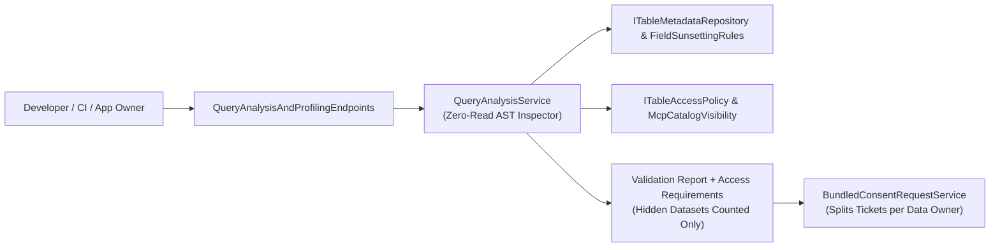

# F-GOV-20: Zero-Read Static Query Analysis, Bundled Consents & Field Deprecation

**Feature-ID:** F-GOV-20  
**Category:** Governance Pre-Flight, Consent Workflows & Lifecycle Management  
**Components:**
- Domain: [`McpDatasetModels.cs`](../../src/Autheris.Domain/Model/McpDatasetModels.cs) (`FieldDeprecationInfo`), [`FieldSunsettingOptions.cs`](../../src/Autheris.Domain/Options/Security/FieldSunsettingOptions.cs)
- Application: [`QueryAnalysisModels.cs`](../../src/Autheris.Application/Governance/Analysis/QueryAnalysisModels.cs), [`IQueryAnalysisService.cs`](../../src/Autheris.Application/Governance/Analysis/IQueryAnalysisService.cs), [`QueryAnalysisService.cs`](../../src/Autheris.Application/Governance/Analysis/QueryAnalysisService.cs), [`BundledConsentRequestService.cs`](../../src/Autheris.Application/Governance/Analysis/BundledConsentRequestService.cs), [`McpDatasetCatalog.cs`](../../src/Autheris.Application/Mcp/Services/McpDatasetCatalog.cs)
- API: [`QueryAnalysisAndProfilingEndpoints.cs`](../../src/Autheris.Api/Endpoints/QueryAnalysisAndProfilingEndpoints.cs)

---

## 1. Executive Summary & Problem Statement

### 1.1 The Challenge
Before deploying a new client application, dashboard, or AI agent workflow, developers and application owners need to know:
1. Whether a set of GraphQL queries, SQL statements, or declared SQL endpoints/stored procedures is syntactically valid, within cost limits, and free of deprecated fields—**without executing the queries against production data sources**.
2. Which table consents or cleartext column exceptions are missing for a target user or user group, and how to request all required permissions across multiple tables in a single workflow without leaking the names of hidden datasets.

### 1.2 The Solution
Autheris provides **Zero-Read Static Query Analysis** (`IQueryAnalysisService`), **Bundled Multi-Table Consent Requests** (`BundledConsentRequestService`), and **Structured Field Deprecation Metadata**:
- **Zero Source Execution:** Parses GraphQL (`Utf8GraphQLParser`) and SQL (`TrinoSqlParser`) ASTs and cross-checks declared SQL endpoints/stored procedures against catalog metadata, Casbin ABAC, consents, masking rules, virtual filters, and `FieldSunsettingRule` definitions without opening any database connection.
- **Scope-Aware Access Levels:** The `Clear`/`Mask`/`Deny` level of each output column is resolved once per table by the data-path consent resolver, using the token scopes of the caller (claims overload, including a plain `scope` claim) and only consents of the principal's tenant, so the report never promises more than execution delivers. When a principal with `governance:simulate` analyses on behalf of another principal, the target's token scopes are unknown: the predicted level is the minimum of the evaluation without scopes and the evaluation with every scope named by a column rule of the table, and the report carries the informational diagnostic `TARGET_SCOPES_UNKNOWN` (no scope names or values).
- **Validation & Deprecation Report:** Reports syntax/schema errors, output columns with `Clear`/`Mask`/`Deny` access levels, boolean `hasRowFilters` and `hasMandatoryVirtualFilters` indicators (never exposing predicate text), cost estimates, and active field deprecation notices (`deprecatedSince`, `sunsetDate`, `replacementField`, `reason`).
- **Access Requirements with Hidden-Dataset Anti-Oracle:** Produces ready-to-submit `RequestableConsentItem` descriptors for missing consents. Referenced datasets whose visibility for the target principal is `Hidden` are **never named**—only counted in `hiddenMissingDatasetsCount`. Valid consents whose RLS predicate matches zero rows are never falsely flagged as missing grants.
- **Bundled Consent Routing & Owner Group View:** Splits a multi-table consent request carrying a `consumerReference` into per-Data-Owner approval tickets, and lets application owners inspect aggregate missing-grant counts across a user group without exposing individual user identities.

---

## 2. Architecture & Request Lifecycle



---

## 3. Configuration & Options

Field deprecation rules are configured under `Gateway:FieldSunsetting` in `appsettings.json` or via column metadata (`deprecated_since`, `sunset_date`, `replacement_field`, `deprecation_reason`):

```json
{
  "Gateway": {
    "FieldSunsetting": {
      "Enabled": true,
      "BlockAfterSunset": true,
      "Rules": [
        {
          "TableName": "sales.public.orders",
          "FieldName": "legacy_tax_code",
          "DeprecatedSince": "2026-06-01T00:00:00Z",
          "SunsetDate": "2026-12-31T23:59:59Z",
          "WarningWindowDays": 90,
          "ReplacementField": "tax_jurisdiction_code",
          "Reason": "Replaced by ISO tax jurisdiction code"
        }
      ]
    }
  }
}
```

---

## 4. Usage Examples & Endpoints

### 4.1 Analyze Queries Without Execution (`POST /api/v1/governance/queries/analyze`)

```http
POST /api/v1/governance/queries/analyze HTTP/1.1
Content-Type: application/json
Authorization: Bearer <token>

{
  "queries": [
    {
      "id": "orders-query",
      "kind": "Sql",
      "queryText": "SELECT id, amount, customer_email, legacy_tax_code FROM sales.public.orders"
    }
  ]
}
```

### 4.2 Submit a Bundled Multi-Table Consent Request (`POST /api/v1/governance/consents/bundle`)

```http
POST /api/v1/governance/consents/bundle HTTP/1.1
Content-Type: application/json
Authorization: Bearer <token>

{
  "consumerReference": "OrderPortal v2.4",
  "purpose": "Monthly order fulfillment reconciliation",
  "items": [
    { "dataset": "sales.public.orders", "requestedLevel": "READ" },
    { "dataset": "crm.public.customers", "column": "email", "requestedLevel": "CLEAR" }
  ]
}
```

---

## 5. Security, Zero-Trust & Fail-Closed Behavior

- **Hidden Table Anti-Oracle:** If a query references a table for which the target principal has `DatasetVisibility.Hidden`, the table identifier is omitted from all validation diagnostics and missing-grant items. Only `hiddenMissingDatasetsCount` is incremented with the generic hint: `"N further dataset(s) require access; contact the owner of the consuming application."`
- **No Predicate Leakage:** The validation report exposes only boolean flags (`hasRowFilters`, `hasMandatoryVirtualFilters`) and never reveals the underlying RLS SQL expression or virtual filter parameters.
- **Privacy-Preserving Group Evaluation:** The owner group analysis endpoint (`POST /api/v1/governance/queries/analyze-group`) returns only aggregate counts (`membersMissingGrantCount`, `totalMembersEvaluated`) per dataset and never lists individual user names or SIDs.
