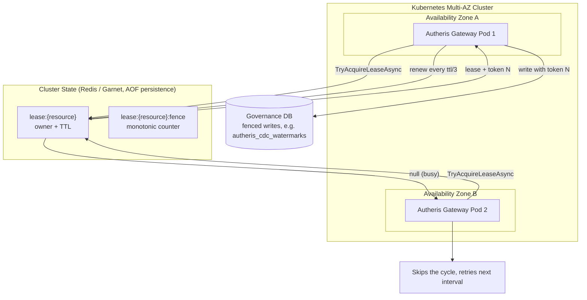

# F-OPS-02: Enterprise High Availability, Kubernetes Helm & Distributed Concurrency

**Components:** [`deploy/helm/autheris/`](file:///root/autheris/deploy/helm/autheris), [`IDistributedClusterStateProvider.cs`](file:///root/autheris/src/Autheris.Application/State/IDistributedClusterStateProvider.cs), [`IDistributedLease.cs`](file:///root/autheris/src/Autheris.Application/State/IDistributedLease.cs), [`DistributedLeaseBase.cs`](file:///root/autheris/src/Autheris.Application/State/DistributedLeaseBase.cs), [`RedisClusterStateProvider.cs`](file:///root/autheris/src/Autheris.Infrastructure/State/RedisClusterStateProvider.cs), [`ClusterScheduledService.cs`](file:///root/autheris/src/Autheris.Application/Hosting/ClusterScheduledService.cs), [`HitLStepUpApprovalService.cs`](file:///root/autheris/src/Autheris.Application/Mcp/Services/HitLStepUpApprovalService.cs), [`prometheusrule.yaml`](file:///root/autheris/deploy/helm/autheris/templates/prometheusrule.yaml), [`verify-hardening.sh`](file:///root/autheris/deploy/scripts/verify-hardening.sh)

---

## 1. Overview & Problem Statement

Running enterprise data governance gateways across multi-node Kubernetes clusters introduces complex distributed systems challenges:
1. **Split-Brain & Duplicate Execution**: Background synchronization services (e.g. Change Data Capture polling, catalog re-indexing, consent recertification) executed across multiple replicas can corrupt state or trigger duplicate side-effects.
2. **Cluster Partition Vulnerabilities**: Distributed approval workflows (such as Human-in-the-Loop step-up token generation) may become inconsistent during network splits.
3. **Rolling Update Downtime**: Pod evictions during cluster autoscaling or node maintenance can terminate active in-flight queries prematurely.

**F-OPS-02** provides the **High Availability (HA) & Operational Excellence** architecture: renewed, fenced leases for background singletons, partition-tolerant approval synchronization, a Kubernetes Helm chart with production render guards, and Prometheus SLO alerting rules.

---

## 2. Business Value

- **Zero-Downtime Rolling Upgrades**: Kubernetes `PodDisruptionBudget` (`minAvailable: 1`) combined with a `preStop` drain of `gateway.drainDelaySeconds` (5 s by default, 10 s in `values.production.yaml`).
- **Multi-AZ Disaster Resilience**: `topologySpreadConstraints` across `topology.kubernetes.io/zone` keep gateway pods spread over availability zones.
- **Fail-Closed Security on Partition**: When the cluster-state store is unreachable, critical Human-in-the-Loop (HitL) approvals fail closed rather than allowing unconfirmed privilege step-ups, and background singletons skip their cycle instead of running unguarded.
- **Automated SRE Observability**: Pre-configured PrometheusRule alerts detect 5xx error rate spikes ($> 0.5\%$), P99 latency regressions ($> 250\text{ms}$), and audit log dead-letter queue backlogs.

---

## 3. Architecture



---

## 4. Cluster Leases & Scheduled Singletons

### 4.1 `IDistributedLease`

`IDistributedClusterStateProvider.TryAcquireLeaseAsync(resourceKey, ttl)` returns a renewed, fenced lease, or `null` only when another owner holds it. An unreachable store throws `ClusterStateUnavailableException`. `TryAcquireLockAsync` remains for short critical sections (HitL approval locks, ITSM outbox dispatch, consent recertification scans).

| Member | Meaning |
| :--- | :--- |
| `ResourceKey` | The protected resource. Keys must not contain `{` or `}` (on Redis they delimit the hash tag that keeps lease and fence key in one slot). |
| `Token` | Fencing token, strictly increasing per resource across all acquisitions. Pass it to every downstream write. |
| `LeaseLost` | Cancelled when ownership can no longer be guaranteed; the holder must stop all work immediately. |
| `LastConfirmedAt` | Last time the store confirmed ownership (acquisition or successful renewal). |

- **Renewal:** a heartbeat extends the lease every `ttl / 3` with an owner-checked compare-and-extend. Ticks never overlap; one extend call is bounded by `ttl / 3`.
- **Fail closed at 2/3 TTL:** `LeaseLost` fires when the store rejects an extension (`extend_rejected`), or when ownership has not been confirmed for two thirds of the TTL (`renew_unconfirmed`), even while an extend call still hangs. Confirmation counts from the moment an extend was sent, not when its answer arrived.
- **Release:** `DisposeAsync` stops the heartbeat and deletes the lease only if it is still held by this owner; it never throws (a failed release expires on its own).
- **Fencing tokens:** the Redis implementation increments a separate fence key without TTL in the same Lua script that sets the lease. When the fence key does not exist, it is seeded with `unix milliseconds x 1000` of the acquiring node, so tokens stay above those of a previous generation even after the counter was lost. Stores that receive fenced writes accept a token greater than or equal to the last one they saw and reject older tokens (`FencingTokenRejectedException`).
- `InMemoryClusterStateProvider` implements the same semantics for single-node and development use.

### 4.2 `ClusterScheduledService<TJob>`

Base class (`Autheris.Application.Hosting`) for periodic cluster singletons. Every cycle:

1. Reads the schedule from live options (`Enabled`, `Interval`, `InitialDelay`, `LeaseTtl`, `MaxJitter`); interval and enablement changes apply without a restart. A disabled job keeps idling and re-checks at least every minute.
2. Acquires the lease. A busy lease skips the cycle (`reason="busy"`); an unreachable store skips it (`reason="state_unavailable"`) and never runs the job unguarded or stops the host.
3. Resolves `TJob` (`IClusterScheduledJob`) from a fresh DI scope and runs it with `ClusterJobContext(FencingToken, Lease)` and a cancellation token linked to host shutdown and `LeaseLost`.
4. Records success, failure, lease loss (`LeaseLost` cancellation or `FencingTokenRejectedException`) and duration, then waits `Interval + random(0, MaxJitter)`.

| Service | Lease key | Interval | Lease TTL | Fenced writes |
| :--- | :--- | :--- | :--- | :--- |
| `DataCatalogSyncBackgroundService` (job `DataCatalogSyncJob`) | `catalog:datacatalog:sync` | `Catalog:SyncIntervalMinutes` (1..1440), 15 s initial delay, jitter up to 10 % | 2 min | none (idempotent sync, stops through cancellation) |
| `OpenMetadataSyncBackgroundService` (job `OpenMetadataSyncJob`) | `catalog:openmetadata:sync` | `OpenMetadata:SyncIntervalMinutes` (1..1440), jitter up to 10 % | 2 min | none |
| `MssqlChangeTrackingHostedService` (job `MssqlChangeTrackingPollJob`) | `cdc:mssql:poll` | `MssqlChangeTracking:PollingIntervalMilliseconds` (minimum 250 ms) | `max(15 s, 3 x interval)` | CDC watermark ([F-CDC-02](f-cdc-02-mssql-change-tracking.md#31-durable-fenced-watermark)) |

`ConsentRecertificationHostedService` and `ItsmOutboxDispatcherHostedService` use short-lived `TryAcquireLockAsync` locks per scan or dispatch run.

### 4.3 Cluster-State Persistence Requirement

Multi-replica deployments need an external Redis or Garnet with persistence enabled (append-only file, AOF). Without persistence, a restart of the store drops live lease keys (a second replica can acquire a lease while the first one still runs until its own heartbeat detects the loss) and the fence counters (re-seeded from the wall clock). Fenced writes still reject a stale owner, but duplicate work and `autheris_cdc_watermark_fenced_total` increments become possible. The embedded Garnet server is process-local and is rejected at startup for multi-replica topologies.

The lease, extend, release and budget operations run as Lua scripts. The embedded Garnet server is started with `--lua`; an external Garnet must also have scripting enabled.

### 4.4 Clock Requirements

Lease TTLs are enforced by the store. Fencing seeds and the webhook outbox ([F-EXT-01](f-ext-01-generic-plugin-events-and-webhooks.md#32-delivery-semantics)) use the node clock, so nodes must be NTP-synchronised.

### 4.5 Replica-Aware Request Features

Two request-path features share state through the cluster state store when the topology is cluster-wide:

| Feature | Shared state | Replica behaviour |
| :--- | :--- | :--- |
| Async query jobs ([F-DATA-07](f-data-07-async-query-jobs.md#6-multi-replica-behaviour)) | Job records `asyncjob:{tenant}:{jobId}` (no SQL text, no absolute paths), cancel tombstones `asyncjob:{tenant}:{jobId}:cancel`, channel `asyncjob:cancel` | Status and cancel work on every replica. Result download of another replica's job needs a shared ReadWriteMany scratch volume (`Gateway:AsyncJobs:SharedScratchDirectory`); otherwise it answers `503` with `ASYNC_JOB_RESULT_NODE_LOCAL` and clients need sticky routing. Concurrency and queue caps apply per node. Jobs are not resumed after node loss; they are reported `Failed` (`job owner node lost`). While the store is unavailable, submits and requests for jobs owned by another replica answer `503`. |
| Casbin decision cache ([F-SEC-06](f-sec-06-casbin-decision-cache-policy-epoch.md)) | Counters `policy:epoch:{tenant}` and `policy:epoch:*`, hint channel `policy:epoch:changed` | A policy change on one replica makes every replica re-read its own policy file and discard cached decisions within `min(TtlSeconds, EpochCheckSeconds + reload time)`. All replicas must load the same policy file; programmatic rules stay node-local. While the store is unavailable the decision cache is bypassed. |

The Helm chart writes async job results to `/tmp/autheris-jobs` on the pod's `/tmp` `emptyDir` (`Gateway__AsyncJobs__ScratchDirectory`); `tmpVolume.sizeLimit` bounds that volume. The chart does not provision a shared volume.

### 4.6 Metrics

| Metric | Type | Labels | Description |
| :--- | :--- | :--- | :--- |
| `autheris_scheduled_job_last_success_timestamp_seconds` | Gauge | `job` | Unix time of the last successful run. Alert when it is older than a few intervals. |
| `autheris_scheduled_job_duration_seconds` | Histogram | `job` | Duration of runs that held the lease. |
| `autheris_scheduled_job_lease_lost_total` | Counter | `job` | Runs aborted because the lease was lost or fenced out. |
| `autheris_scheduled_job_failures_total` | Counter | `job` | Runs (or lease acquisitions) that failed with an exception. |
| `autheris_scheduled_job_skipped_total` | Counter | `job`, `reason` (`busy`, `state_unavailable`) | Cycles skipped before the job started. `busy` is normal on standby replicas. |
| `autheris_cluster_lease_lost_total` | Counter | `reason` (`extend_rejected`, `renew_unconfirmed`) | Redis leases declared lost by their holder. |
| `autheris_cluster_lease_renew_failure_total` | Counter | – | Failed Redis lease renewal attempts. |

The `job` label is the job type name (`DataCatalogSyncJob`, `OpenMetadataSyncJob`, `MssqlChangeTrackingPollJob`).

---

## 5. Kubernetes Deployment via Helm

### 5.1 Deploying the Production Chart

```bash
helm upgrade --install autheris ./deploy/helm/autheris \
  --namespace autheris \
  --create-namespace \
  -f ./deploy/helm/autheris/values.production.yaml \
  --set image.digest=sha256:<digest> \
  --set gateway.authentication.entraId.enabled=true \
  --set gateway.authentication.entraId.tenantId=<tenant-id> \
  --set gateway.authentication.entraId.clientId=<client-id> \
  --set gateway.authentication.entraId.audience=api://autheris
```

### 5.2 Helm Configuration Highlights (`values.yaml`)

```yaml
replicaCount: 2

autoscaling:
  enabled: true
  minReplicas: 2
  maxReplicas: 10
  targetCPUUtilizationPercentage: 70
  targetMemoryUtilizationPercentage: 80

podDisruptionBudget:
  enabled: true
  minAvailable: 1

topologySpreadConstraints:
  enabled: true
  maxSkew: 1
  topologyKey: topology.kubernetes.io/zone
  whenUnsatisfiable: DoNotSchedule

gateway:
  drainDelaySeconds: 5          # preStop sleep and Gateway__DrainDelaySeconds
  shutdownTimeoutSeconds: 30
  production:
    enforceRequiredSettings: false   # true in values.production.yaml
  authentication:
    entraId:     { enabled: false, tenantId: "", clientId: "", audience: "" }
    adfs:        { enabled: false, authority: "", audience: "" }
    forwardAuth:
      enabled: false
      trustedProxies: []
      trustedNetworks: []
      sharedSecret: { existingSecret: "", key: "sharedSecret", keyVaultRef: "" }
    kerberos:    { enabled: false }
  dataSources:
    requireTenantColumn: false       # true in values.production.yaml
    requireTenantColumnExemption: false

monitoring:
  serviceMonitor:
    enabled: true
    requireAuth: false       # true in values.production.yaml: render fails if auth.type is "none"
    scheme: http             # or https together with tlsConfig
    auth:
      type: bearer           # bearer | mtls | none
      tokenSecret:
        name: autheris-metrics-scrape
        key: token
    tlsConfig: {}
  prometheusRule:
    enabled: true
```

`values.production.yaml` additionally sets `replicaCount: 3`, `image.requireDigest: true`, `gateway.drainDelaySeconds: 10`, `gateway.shutdownTimeoutSeconds: 45` and `terminationGracePeriodSeconds: 75`.

### 5.3 Production Render Guards

With `gateway.production.enforceRequiredSettings: true` (set in `values.production.yaml`), `helm template` / `helm install` fails unless:

| Guard | Requirement |
| :--- | :--- |
| Authentication provider | Exactly one of `gateway.authentication.entraId`, `adfs`, `forwardAuth`, `kerberos` is enabled. EntraId requires `tenantId`, `clientId` and `audience`; ADFS requires `authority` and `audience` (these field checks apply whenever the provider is enabled). |
| ForwardAuth trusted proxies | `forwardAuth.trustedProxies` lists the proxy addresses (required whenever ForwardAuth is enabled). |
| ForwardAuth trusted networks | `forwardAuth.trustedNetworks` is set explicitly; the generic `gateway.security.trustedNetworks` fallback is accepted only without enforcement. |
| ForwardAuth shared secret | `forwardAuth.sharedSecret.existingSecret` (mounted as `Gateway__Authentication__ForwardAuth__SharedSecret`) or `sharedSecret.keyVaultRef`. |
| Tenant column | `gateway.dataSources.requireTenantColumn: true`, or the explicit opt-out `requireTenantColumnExemption: true` for shared, tenant-less tables. |
| Metrics scrape | `monitoring.serviceMonitor.auth.type` is `bearer` or `mtls` (`requireAuth: true`). |

The settings render into the gateway ConfigMap as `Gateway__Authentication__*` and `Gateway__DataSources__RequireTenantColumn`. The CI job `helm-render` runs `deploy/scripts/verify-hardening.sh`, which renders the chart with positive and negative value sets and checks that each guard fails for its expected reason.

### 5.4 Authenticated Metrics Scraping

`/metrics` requires the `MetricsScrape` authorization policy: the principal must carry the role `MetricsScraper` or `ClusterAdmin`. Other authenticated callers get `403`, anonymous callers `401`; no configuration switch relaxes this. The ServiceMonitor sends `Authorization: Bearer <token>` from the referenced Kubernetes Secret; the token must be accepted by the gateway's JWT bearer authentication and carry the `MetricsScraper` role. `mtls` renders the supplied `tlsConfig` verbatim.

ForwardAuth-only deployments cannot be scraped by default: `ClusterAdmin` is never accepted from proxy headers and the default `ForwardAuth.AllowedRoles` does not include `MetricsScraper`. Either add `MetricsScraper` to `ForwardAuth.AllowedRoles` for a trusted scrape proxy, or scrape through a JWT-capable path. Annotation-based scraping (`prometheus.io/*`) is not configured, because it cannot carry credentials; the NetworkPolicy additionally restricts scrape peers.

### 5.5 Image Pinning & Build Supply Chain

- Every `Dockerfile*` and `Containerfile*` base image is pinned to a full patch tag plus digest (`<image>:<major>.<minor>.<patch>@sha256:<digest>`, e.g. `mcr.microsoft.com/dotnet/aspnet:10.0.13@sha256:...`). `verify-hardening.sh` fails on any other `FROM` line.
- Helm production renders require an image digest (`image.requireDigest: true`).
- NuGet auditing reports vulnerabilities of every severity (`NuGetAuditLevel=low`, `NuGetAuditMode=all`); `NU1901`-`NU1904` are errors.
- Release and Docker publish workflows scan the compiled Release `Autheris.Api.dll` metadata (all name heaps, user strings and attribute blobs) for the `TestAuth` scheme and `TestAuthHandler` (architecture test `ReleaseBuildExcludesTestAuthTests`, assembly path in `AUTHERIS_RELEASE_API_ASSEMBLY`). A finding fails the release.

---

## 6. Pre-Configured SRE Alerting Rules

The chart deploys CoreOS `PrometheusRule` resources:

| Alert Name | Severity | Condition | Description |
| :--- | :--- | :--- | :--- |
| **`AutherisHigh5xxRate`** | `critical` | 5xx error rate $> 0.5\%$ for 1m | Alerts when gateway HTTP 5xx responses spike. |
| **`AutherisHighP99Latency`** | `warning` | P99 latency $> 250\text{ms}$ for 3m | Warns when query execution times exceed SLA threshold. |
| **`AutherisAuditDeadLetterQueueGrowing`** | `critical` | Increase in DLQ $> 0$ for 1m | Fails loudly if audit logs fail to commit to primary store. |
| **`AutherisRedisClusterDisconnected`** | `critical` | Redis state connected $= 0$ for 30s | Pods operating in degraded in-memory fallback mode. |
