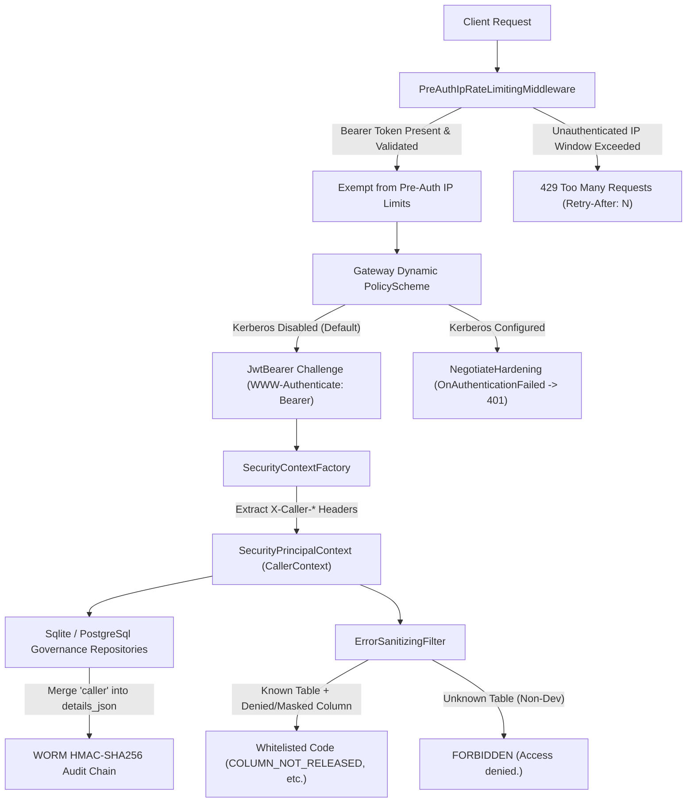

# F-SEC-05: Gateway Hardening & Adaptive Defense Suite

## 1. Executive Summary & Problem Statement

High-throughput enterprise API gateways operating in multi-tenant environments encounter targeted denial-of-service, protocol surface sprawl, authentication scheme misconfiguration, audit attribution gaps, and enumeration side-channels:

1. **Pre-Authentication Rate Limiter Starvation:** When unauthenticated IP rate limiting indiscriminately limits high-volume API consumers (such as batch analytical workers or internal microservices sharing an egress NAT IP), legitimate authenticated clients with valid Bearer credentials are unintentionally throttled.
2. **Protocol Attack Surface Sprawl:** Enterprise environments that do not require legacy OData, bulk Arrow IPC export, Arrow Flight SQL, or Iceberg REST Catalog endpoints require zero-overhead protocol kill-switches that fail closed (HTTP 404) and hide disabled protocols from agentic MCP catalogs.
3. **Kerberos/Negotiate Challenge Leakage:** When Kerberos is not configured on Linux/container environments, unauthenticated 401 challenges should cleanly default to JWT Bearer authentication rather than emitting SPNEGO `Negotiate` headers, and malformed SPNEGO tokens must fail with clean 401 Unauthorized status codes rather than 500 exceptions.
4. **Caller Application Attribution in WORM Audit Logs:** Services operating on behalf of end users need to record upstream application identity, version, and curated query operations within the tamper-evident HMAC audit log.
5. **Machine-Readable Error Codes Without an Existence Oracle:** Clients require distinguishable GraphQL/REST error codes (`COLUMN_NOT_RELEASED`, `FILTER_ON_MASKED_COLUMN`, `COST_LIMIT`, `ROW_LIMIT`, `RATE_LIMIT`), while queries against unknown datasets must remain indistinguishable from unauthorized ones (`FORBIDDEN` / `Access denied.`).

`F-SEC-05` delivers an integrated gateway hardening suite resolving these challenges with zero allocation overhead in .NET 10.

---

## 2. Architecture & Component Wiring



### Component Details

- **`PreAuthIpRateLimitingMiddleware`:** Inspects incoming `Authorization: Bearer <token>` headers. When `ExemptAuthenticatedRequests = true`, authenticated requests skip the crude IP-based pre-auth bucket while remaining strictly constrained by downstream identity-based SID and cost limiters. Dynamic `Retry-After: <seconds>` headers inform throttled clients of the remaining window duration.
- **Protocol Kill-Switches (`GatewayOptions`):** Independent toggle switches for `OData.Enabled`, `Arrow.Enabled`, `Arrow.EnableFlightSql`, `Lakehouse.Enabled`, and `DuckDbOlap.Enabled`. Disabled protocols are not mapped in Kestrel and are filtered out of `McpDatasetCatalog`.
- **`NegotiateHardening` & Authentication Schemes:** `AddNegotiate(...)` is only registered when `gatewayOptions.Authentication.IsKerberosConfigured = true`. Fallback challenges return `Bearer`. `OnAuthenticationFailed` intercepts malformed SPNEGO payloads and cleanly fails with 401.
- **`ICallerContextProvider` & `CallerContext`:** Extracts sanitized client headers (`X-Caller-Application`, `X-Caller-Version`, `X-Caller-Query-Name`), attaching them to `SecurityPrincipalContext` and automatically embedding `"caller": { "app", "ver", "query" }` into `AuditLogEntry.DetailsJson` and the immutable HMAC-SHA256 hash chain.
- **`ErrorSanitizingFilter`:** Whitelists machine-readable codes (`COLUMN_NOT_RELEASED`, `FILTER_ON_MASKED_COLUMN`, `COST_LIMIT`, `ROW_LIMIT`, `RATE_LIMIT`) while enforcing anti-oracle masking for `TableNotFoundException` in staging and production environments.

---

## 3. Configuration & Usage Examples

### `appsettings.json` Configuration

```json
{
  "Gateway": {
    "RateLimiting": {
      "PreAuthIpRateLimit": {
        "PermitLimit": 100,
        "WindowSeconds": 60,
        "ExemptAuthenticatedRequests": true
      }
    },
    "Authentication": {
      "EnableKerberos": false,
      "RequireKerberosOnly": true,
      "EntraId": {
        "Enabled": true,
        "TenantId": "your-azure-tenant-id",
        "Audience": "api://autheris-gateway"
      }
    },
    "OData": {
      "Enabled": false
    },
    "Arrow": {
      "Enabled": true,
      "EnableFlightSql": false
    },
    "Lakehouse": {
      "Enabled": false
    }
  }
}
```

### Caller Provenance Headers

Upstream microservices specify caller provenance using standard headers:

```http
POST /graphql HTTP/1.1
Host: gateway.internal.corp
Authorization: Bearer eyJhbGciOi...
X-Caller-Application: BillingBatchWorker
X-Caller-Version: v3.2.0
X-Caller-Query-Name: MonthlyInvoiceAggregation
Content-Type: application/json

{"query": "{ invoices(first: 50) { id amount status } }"}
```

The resulting WORM audit record in `AUDIT_LOG_ENTRIES` automatically reflects the caller context in `details_json`:

```json
{
  "is_allowed": true,
  "row_count": 50,
  "caller": {
    "app": "BillingBatchWorker",
    "ver": "v3.2.0",
    "query": "MonthlyInvoiceAggregation"
  }
}
```

---

## 4. Security, Zero-Trust & Fail-Closed Behavior

1. **Defense-in-Depth Rate Limiting:** Exempting valid Bearer tokens from pre-auth IP counts never bypasses authentication or resource control. Downstream, each authenticated user is governed by per-SID limits (`PostAuthSidRateLimitingMiddleware`), hierarchical FinOps budgets, and resource group concurrency gates.
2. **Anti-Enumeration Oracle Invariant:** If an unauthorized or hostile client attempts to discover tables by inspecting error messages, `ErrorSanitizingFilter` normalizes missing tables and forbidden tables into an identical error payload outside development:
   ```json
   {
     "errors": [
       {
         "message": "Access denied.",
         "extensions": {
           "code": "FORBIDDEN"
         }
       }
     ]
   }
   ```
3. **WORM Hash Chain Integrity:** The `caller` metadata object is merged into `entry.DetailsJson` before `entry.EntryHash` is computed via HMAC-SHA256. Any post-hoc modification of caller information invalidates the cryptographic verification chain.
4. **Clean 401 Error Handling:** Malformed SPNEGO/Negotiate tokens fail closed with HTTP 401 Unauthorized without triggering unhandled 500 Internal Server Errors or leaking server-side Kerberos state.
