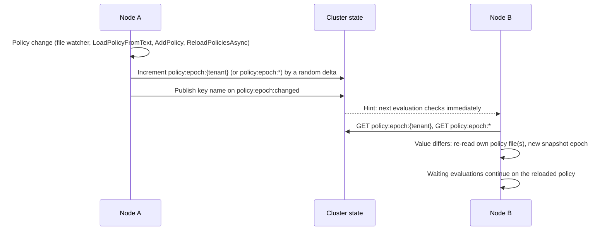

# F-SEC-06: Casbin Decision Cache & Cluster Policy Epoch

**Components:** [`CasbinEnforcementService.cs`](file:///root/autheris/src/Autheris.Application/Governance/CasbinEnforcementService.cs), [`CasbinDecisionCache.cs`](file:///root/autheris/src/Autheris.Application/Governance/Caching/CasbinDecisionCache.cs), [`DecisionKey.cs`](file:///root/autheris/src/Autheris.Application/Governance/Caching/DecisionKey.cs), [`PolicyEpochGuard.cs`](file:///root/autheris/src/Autheris.Application/Governance/Caching/PolicyEpochGuard.cs), [`CasbinDecisionCacheOptions.cs`](file:///root/autheris/src/Autheris.Domain/Options/CasbinDecisionCacheOptions.cs), [`CasbinDecisionCacheOptionsValidator.cs`](file:///root/autheris/src/Autheris.Api/Extensions/DependencyInjection/CasbinDecisionCacheOptionsValidator.cs)

---

## 1. Overview & Problem Statement

The Casbin ABAC/RBAC engine (`Gateway:Casbin`, see the configuration guide) evaluates a table access decision for every governed request. Evaluation over role closures, deny rules and `sub_rule` expressions is cheap but not free, so decisions are cached per node. A cache creates two risks:

1. **Unbounded or flushing caches**: a cache that is cleared wholesale when full causes latency spikes; one without a bound exhausts memory.
2. **Stale allows across replicas**: a policy change on one replica must stop the other replicas from serving cached decisions of the old policy.

**F-SEC-06** provides a bounded LRU decision cache keyed by every decision input, and a cluster-wide **policy epoch** that makes all replicas reload their policy and discard cached decisions after a change on any node, with a documented maximum staleness.

---

## 2. Decision Cache

### 2.1 Eviction

`CasbinDecisionCache` is a bounded LRU cache with O(1) operations under a single lock:

- At `Capacity`, only the **least recently used entry** is evicted. There is no global flush.
- An entry older than `TtlSeconds` is dropped when it is accessed.
- A local policy change publishes a new policy snapshot with a new local epoch. The epoch is part of the key, so entries of the previous snapshot are never hit again and age out through LRU or TTL.
- A decision is not stored when the snapshot epoch changed while it was being evaluated.

### 2.2 Decision Key

`DecisionKey` is a value key with one field per input (no string joining, so separator characters inside values cannot make two contexts collide):

| Field | Source |
| :--- | :--- |
| Epoch | Local policy snapshot epoch. |
| Tenant, user SID | Request principal. |
| Table, action | Target table and resolved action. |
| Purpose id | `PurposeId` of the evaluation context. |
| Client IP | `ClientIp`. |
| Target dialect | `TargetDialect` (decisions can differ per SQL dialect). |
| Groups | Group SIDs, sorted ordinally. |
| Attributes | ABAC attributes, sorted; every value carries a type tag (string, collection, or the CLR type name with invariant and, where different, current-culture text). |
| Requested columns | Sorted ordinally. |
| Table columns | The table's column list when supplied (distinguished from "not supplied"). |

Collections are normalised, so permutations of groups, attributes or columns hit the same entry.

### 2.3 Decisions That Are Never Cached

- **Time-dependent rules**: when any rule of the tenant references a time token in its `sub_rule` (`Timestamp`, `DateTime`, `Now`, `Hour`, `DayOfWeek`, `Date`), decisions of that tenant are evaluated on every request. The request timestamp is therefore not part of the key.
- **Case-colliding attribute keys**: when two attribute keys differ only by case (for example `region` and `Region`), the evaluation result depends on the dictionary comparer, so the decision is not cached.
- **Unknown cluster epoch**: see section 3.4.

---

## 3. Cluster Policy Epoch

The epoch is active only when the cluster state topology is cluster-wide (external Redis/Garnet, see [F-OPS-02](f-ops-02-high-availability-kubernetes-helm.md)); in a cluster-wide topology without an `IDistributedClusterStateProvider`, creating the enforcement service fails (fail-closed). Single-node deployments rely on the local snapshot epoch alone.



### 3.1 Keys and Increments

| Key | Changed by |
| :--- | :--- |
| `policy:epoch:{tenant}` | A change of tenant policy (tenant name lower-cased; tenant names are case-insensitive). |
| `policy:epoch:*` | A change of global (wildcard) policy. |

- Each change increments the key by a **random positive delta** (1 to 2^20) instead of 1, so a counter that was reset to an equal value cannot hide a change. Any difference from the last observed value counts as a change, including a decrease.
- After the increment, the key name is published on the hint channel `policy:epoch:changed`. A hint only makes the next evaluation for that key read the counter immediately; it never changes the observed value. A lost hint costs latency only.
- **Registering a policy file at startup does not increment the epoch**, so rolling restarts do not make every node reload and clear its cache.
- A reload triggered by a cluster change does not increment the epoch again (no ping-pong between nodes).

### 3.2 Epoch Checks

For every evaluation the node looks up the tenant's epoch state:

| Status | Behaviour |
| :--- | :--- |
| Fresh (checked within `EpochCheckSeconds`) | Cached decisions are served. |
| Due | The tenant and wildcard counters are read. One read per tenant is in flight at a time; concurrent evaluations wait for it. On a change, the reload runs **before** any waiting evaluation is released, so no caller proceeds on the pre-reload policy. |
| Degraded (a read failed within `UnavailableBackoffMilliseconds`) | The cache is bypassed. |

The node tracks up to 10,000 tenants. Tenants idle for longer than `TtlSeconds` are evicted when room is needed; while the table is full of recently used tenants, evaluations for an untracked tenant are not cached.

### 3.3 Reload on a Cluster Change

A detected change re-reads the **node's own** file-backed policy sources: the tenant policy file registered for that tenant (tenant key changed) and the global policy file (wildcard key changed). The file content becomes active; no rules are transferred between nodes.

- If a policy file is missing or the reload fails, the last-known-good policy set stays active and the change is retried at the next check.
- If the node has no file-backed source for the change, it still publishes a new snapshot epoch, which discards its cached decisions.
- Programmatic rules (`AddPolicy`, `AddRlsPolicy`, `AddWildcardPolicy`, `LoadPolicyFromText`) are **node-local**. They increment the cluster epoch, so the other nodes drop their cached decisions, but those nodes only re-read their own files and never receive the programmatic rules.

Consequently every node must load the **same policy file** (identical content, or one shared read-only file such as a ConfigMap or mounted volume). Divergent files mean divergent decisions per replica.

### 3.4 Cluster State Unavailable

When the epoch cannot be read (unreachable store, corrupted value), the epoch is unknown: the decision cache is neither read nor written for that tenant. The node retries the read after `UnavailableBackoffMilliseconds`. Policy evaluation itself continues uncached; the outage costs latency, not correctness.

When the publishing node cannot increment the epoch, the failure is logged and counted in `autheris_policy_epoch_propagation_failed_total`; the other nodes then pick up the change only when their cached decisions expire.

### 3.5 Maximum Staleness

A cached allow on another node outlives a policy change by at most:

| Situation | Bound |
| :--- | :--- |
| Epoch incremented successfully | `min(TtlSeconds, EpochCheckSeconds + reload time)`; with a delivered hint usually just the reload time. |
| Publishing node could not increment the epoch | `TtlSeconds`. |
| Cluster state unavailable on the reading node | The cache is bypassed once a check is due, so no cached allow outlives `EpochCheckSeconds`. |

The bound assumes that the other nodes' policy files already contain the change (section 3.3); distributing the file itself is an operational task.

---

## 4. Configuration

Bound standalone from `Gateway:Casbin:DecisionCache` (`CasbinDecisionCacheOptions`) and validated at startup (`CasbinDecisionCacheOptionsValidator`, `ValidateOnStart`).

| Key | Default | Validation | Description |
| :--- | :--- | :--- | :--- |
| `Capacity` | `10000` | 100..1,000,000 | Maximum number of cached decisions per node (LRU eviction). |
| `TtlSeconds` | `60` | 1..3600 | Maximum age of a cached decision; also the idle eviction age of tracked tenants. |
| `EpochCheckSeconds` | `5` | 1..`TtlSeconds` | How often a node reads the cluster epoch per tenant (cluster-wide topology only). |
| `UnavailableBackoffMilliseconds` | `1000` | 100..10,000 | After a failed epoch read, the cache stays bypassed for this long before the next attempt. |

```json
{
  "Gateway": {
    "Casbin": {
      "Enabled": true,
      "PolicyPath": "/etc/autheris/casbin-policy.csv",
      "WatchPolicyFile": true,
      "DecisionCache": {
        "Capacity": 10000,
        "TtlSeconds": 60,
        "EpochCheckSeconds": 5,
        "UnavailableBackoffMilliseconds": 1000
      }
    }
  }
}
```

Lower `EpochCheckSeconds` to shorten the staleness bound at the cost of more cluster state reads (two `GET`s per tenant and interval per node).

---

## 5. Metrics

| Metric | Type | Description |
| :--- | :--- | :--- |
| `autheris_policy_epoch_propagation_failed_total` | Counter (meter `Autheris.Metrics`) | Policy epoch increments that failed or found the cluster state unavailable. Other nodes then converge only through the cache TTL. |

Failed epoch reads are logged as warnings (`Casbin policy epoch could not be read; decision cache bypassed.`); failures of the cluster state store itself are counted in `autheris_cluster_state_failure_total{operation}`.
