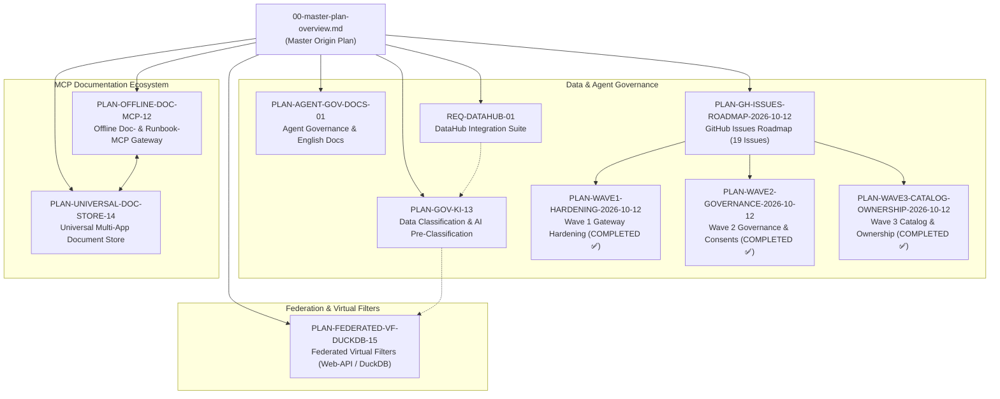

# Master Architecture & Implementation Backlog

**Last Updated:** October 10, 2026 · **Branch:** `feat/ast-target-dialect-generator`  
**Role:** Solution Architect & Agent Coordinator  
**Location:** `doc/plan/00-master-plan-overview.md` (or `docs/plans/00-master-plan-overview.md`)  
**Purpose:** Canonical origin plan, dependency graph, and active track status for all AI agents and engineers working on the Autheris ecosystem.

---

## 🧭 Origin Plan Protocol for AI Agents

> [!IMPORTANT]
> **Directive for all AI agents and contributors:**
> 1. **Language:** All plans, requirements, and documentation must be written in **English** (aligned with [README.md](file:///root/autheris/README.md)).
> 2. **Repository of Requirements:** All new requirements, design documents, and feature requests must be stored in [`doc/plan/`](file:///root/autheris/doc/plan/).
> 3. **Refinement on the Origin Plan:** When refining an existing feature or adding a new requirement, agents must:
>    - Create or update the detailed plan in `doc/plan/` (e.g., `YYYY-MM-DD-plan-<topic>.md`).
>    - Update the execution matrix and status below in this Origin Plan.
>    - Maintain traceable bidirectional links between parent and child documents.

---

## 1. 🚀 Active Execution Tracks & Plan Matrix

| Plan / Document ID | Topic & Scope | Addressed Requirements & Components | Status | Next Milestone |
|---|---|---|---|---|
| [`2026-10-12-plan-wave4-graphql-dbt-semantics.md`](file:///root/autheris/doc/plan/2026-10-12-plan-wave4-graphql-dbt-semantics.md) `PLAN-WAVE4-GRAPHQL-DBT-SEMANTICS-2026-10-12` | **Wave 4 GraphQL Cursor Pagination, Temporal Types & dbt Semantics** | Delivers Non-AST items of Wave 4 (#36, #39, #38 Stage 1): ISO Temporal scalars (`Date`, `DateTime`, `LocalTime`), dbt `meta` Column Semantics passthrough, Relay Cursor Paging with truncation signal, and dbt Semantic Manifest ingestion + MCP metrics discovery. | **COMPLETED & VERIFIED ✅** | Documented in `docs/features/f-gov-17-graphql-temporal-dbt-semantics.md` & verified with unit/integration test suites |
| [`2026-10-12-plan-catalog-ownership-wave3.md`](file:///root/autheris/doc/plan/2026-10-12-plan-catalog-ownership-wave3.md) `PLAN-WAVE3-CATALOG-OWNERSHIP-2026-10-12` | **Wave 3 Catalog Transparency, Data Ownership & Response Enhancements** | Delivers 4 GitHub issues (#43, #33, #32, #27): Return Catalog Tags in `list_datasets`/`describe_dataset`, Data Owners in catalog & Backstage, Catalog Discovery with Access Status (`GRANTED/PENDING/NONE`), and Mark Masked Values in GraphQL responses (`extensions.maskedFields`). | **COMPLETED & VERIFIED ✅** | Documented in `docs/features/f-gov-16-catalog-ownership-transparency.md` & verified with unit/integration test suite |
| [`2026-10-12-plan-governance-consents-wave2.md`](file:///root/autheris/doc/plan/2026-10-12-plan-governance-consents-wave2.md) `PLAN-WAVE2-GOVERNANCE-2026-10-12` | **Wave 2 Governance, Consents & Scope-Specific Enforcement** | Delivers 5 GitHub issues (#40, #35, #34, #26, #29): GitOps declarative policy apply API, self-service `describe_my_access` / `myAccess`, access request & approver inboxes, scope-specific monotonic masking (`Agent.Read`), and application scope (`App.Read`). | **COMPLETED & VERIFIED ✅** | Documented in `docs/features/f-gov-15-declarative-consents-scopes.md` & verified with unit & integration tests |
| [`2026-10-12-plan-gateway-hardening-wave1.md`](file:///root/autheris/doc/plan/2026-10-12-plan-gateway-hardening-wave1.md) `PLAN-WAVE1-HARDENING-2026-10-12` | **Wave 1 Gateway Hardening & Protocol Hygiene** | Delivers 5 GitHub issues (#44, #42, #41, #31, #30): Auth-exempt pre-auth rate limits, protocol kill switches (OData, Arrow, Iceberg, DuckDB), Kerberos cleanup, Caller context in WORM audit chain, distinguishable error codes. | **COMPLETED & VERIFIED ✅** | Documented in `docs/features/f-sec-05-gateway-hardening-defense.md` & verified with 3,500+ unit tests |
| [`2026-10-12-plan-github-issues-roadmap.md`](file:///root/autheris/doc/plan/2026-10-12-plan-github-issues-roadmap.md) `PLAN-GH-ISSUES-ROADMAP-2026-10-12` | **GitHub Issues Master Roadmap & Execution Plan** | Comprehensive qualification and 4-wave delivery plan for 19 open GitHub issues (#26-#44): (1) Gateway Hardening [DONE], (2) Governance & Consents [DONE], (3) Catalog & Ownership [DONE], (4) Aggregations & Headless BI | **ACTIVE & IN EXECUTION 🚀** | Waves 1, 2 & 3 Completed; ready for Wave 4 (Aggregations & Headless BI) |
| [`2026-10-12-req-datahub-integration-suite.md`](file:///root/autheris/doc/plan/2026-10-12-req-datahub-integration-suite.md) `REQ-DATAHUB-01` | **Dual-Mode Enterprise Data Governance Suite** | Dual-Mode: (1) Embedded Standalone Mode (AST lineage graph, declarative data contracts & assertions in SQLite/DuckDB) and (2) Federated Enterprise Mode (DataHub GMS client, MCL webhooks, lineage egress, and contract circuit breaker) | **COMPLETED & VERIFIED ✅** | Documented in `docs/features/f-gov-18-datahub-integration-contracts.md` & verified with unit tests |
| [`2026-10-10-konzept-federated-virtual-filter-web-api-duckdb.md`](file:///root/autheris/doc/plan/2026-10-10-konzept-federated-virtual-filter-web-api-duckdb.md) `PLAN-FEDERATED-VF-DUCKDB-15` | **Federated Virtual Filters on Web-APIs via DuckDB** | 3-stage adaptive federation (Short-circuit, Key-set pushdown, DuckDB staging); dynamic regex matching; composite key joins in `VirtualFilterStore` | **COMPLETED & VERIFIED ✅** | Documented in `docs/features/f-gov-14-federated-virtual-filters.md` & verified with unit/integration test suite |
| [`2026-10-10-konzept-datenklassifizierung-ki-vorklassifizierung.md`](file:///root/autheris/doc/plan/2026-10-10-konzept-datenklassifizierung-ki-vorklassifizierung.md) `PLAN-GOV-KI-13` | **Data Object Classification & AI Pre-Classification** | Fail-Closed `UNCLASSIFIED` initial state; optional AI pre-classification with 150ms timeout guard; auto-preclassify at confidence $\ge 95\%$; dual-sign-off workflows | **IMPLEMENTED / IN REVIEW 🛡️** | Finalize UI workflow endpoints and telemetry hooks |
| [`2026-10-10-implementierungsplan-offline-doc-mcp-gateway.md`](file:///root/autheris/doc/plan/2026-10-10-implementierungsplan-offline-doc-mcp-gateway.md) `PLAN-OFFLINE-DOC-MCP-12` | **Offline Doc- & Runbook-MCP Gateway** | Ingestion pipeline for Markdown, arc42, Runbooks, OpenAPI, Error Catalogs; local BM25/SIMD hybrid search; `GatewayMcpServer` stdio/SSE bridge | **COMPLETED & VERIFIED ✅** | Documented in `docs/features/f-ai-15-offline-doc-runbook-mcp-gateway.md` & verified with unit tests |
| [`2026-10-10-konzept-universelle-dokumentenablage-mcp.md`](file:///root/autheris/doc/plan/2026-10-10-konzept-universelle-dokumentenablage-mcp.md) `PLAN-UNIVERSAL-DOC-STORE-14` | **Universal Document Store for Multi-App MCP** | 4 deposit options (GitOps, S3/MinIO, Ingestion API/MCP-Deposit, Shared Volume); 100% Air-Gapped/Offline support; Multi-App catalog & search | **CONCEPT COMPLETE 📚** | Draft concrete storage abstraction interfaces in `Autheris.Application` |
| [`README.md`](file:///root/autheris/doc/plan/README.md) `PLAN-AGENT-GOV-DOCS-01` | **Agent Governance & English Documentation Standards** | Project-wide English documentation policy; central `doc/plan/` repository; agent refinement lifecycle rules; root `AGENTS.md` & `CLAUDE.md` | **ACTIVE & ADOPTED ✅** | Ongoing enforcement across all sub-agent and tool invocations |

---

## 2. 🗺️ Dependency & Refinement Graph

---

## 3. 📋 Historical Completed Tracks (Archive)

> [!NOTE]
> All prior foundation tracks (Plans 1 through 11, SQL-AST Hardening, and Tracks A through E) were 100% completed, verified through 5,600+ automated unit & integration tests, and archived in accordance with repository clean-up guidelines.
