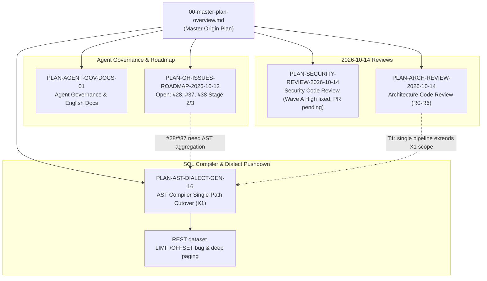

# Master Architecture & Implementation Backlog

**Last Updated:** October 14, 2026 · **Branch:** `feat/ast-x1-cutover`  
**Role:** Solution Architect & Agent Coordinator  
**Location:** `doc/plan/00-master-plan-overview.md` (or `docs/plans/00-master-plan-overview.md`)  
**Purpose:** Canonical origin plan, dependency graph, and active track status for all AI agents and engineers working on the Autheris ecosystem.

---

## 🧭 Origin Plan Protocol for AI Agents

> [!IMPORTANT]
> **Directive for all AI agents and contributors:**
> 1. **Language:** All plans, requirements, and documentation must be written in **English** (aligned with [README.md](file:///root/autheris/README.md)).
> 2. **Repository of Requirements:** All new requirements, design documents, and feature requests must be stored in [`doc/plan/`](file:///root/autheris/doc/plan/).
> 3. **Refinement on the Origin Plan:** When refining an existing feature or adding a new requirement, agents must:
>    - Create or update the detailed plan in `doc/plan/` (e.g., `YYYY-MM-DD-plan-<topic>.md`).
>    - Update the execution matrix and status below in this Origin Plan.
>    - Maintain traceable bidirectional links between parent and child documents.

---

## 1. 🚀 Active Execution Tracks & Plan Matrix

| Plan / Document ID | Topic & Scope | Addressed Requirements & Components | Status | Next Milestone |
|---|---|---|---|---|
| [`2026-10-14-plan-security-code-review.md`](2026-10-14-plan-security-code-review.md) `PLAN-SECURITY-REVIEW-2026-10-14` | **Full Security Code Review (follow-up to the 2026-10-13 AppSec audit)** | Re-review of all 7 production projects + deployment at `4cb0ae4a`/`main`: 0 Critical, 6 High, 26 Medium, 24 Low new/incomplete findings (`SR-*`), 9 deployment findings (`SR-D-*`); verification of 69 prior items (15 fixed, 28 partial, 25 open, 1 N/R). Detailed area reports in `2026-10-14-security-code-review/`. | **WAVE A HIGH FIXED 🔧 – PR PENDING** | High findings SR-H-01..06 + SR-D-01 fixed on `fix/security-review-2026-10-14-high-b` (plan §8; competing fix set on `fix/security-review-2026-10-14-high`, merge only one); next: remaining Wave A Medium (TOTP, rate limiting, OData fail-open), regression tests for `6ad16519` fixes |
| [`2026-10-14-architecture-code-review.md`](file:///root/autheris/doc/plan/2026-10-14-architecture-code-review.md) `PLAN-ARCH-REVIEW-2026-10-14` | **Full-Solution Architecture Code Review** | Read-only Solution Architect review of all 7 projects plus tests at `88f7df1c`: 121 findings (0 Critical, 26 High, 62 Medium, 33 Low) in 10 themes - single governed query pipeline (extends X1 scope), audit contract, fat Application layer / dialect port, versioned governance migrations, HA/cluster semantics, eventing/webhooks/plugin contract, config & god-class decomposition, API consistency, hot-path performance, test & doc hygiene. Detail reports in `2026-10-14-architecture-code-review/`. | **REVIEW DELIVERED 📋** | Stakeholder decisions (§6), then child plans per remediation wave R0-R6 (R0: ARC-F-01, ARC-I-03, ARC-C-05, ARC-C-04, ARC-F-02, ARC-S-06) |
| [`2026-10-12-plan-github-issues-roadmap.md`](file:///root/autheris/doc/plan/2026-10-12-plan-github-issues-roadmap.md) `PLAN-GH-ISSUES-ROADMAP-2026-10-12` | **GitHub Issues Master Roadmap & Execution Plan** | Remaining open issues of the 19-issue roadmap (#26-#44): #28 governed GraphQL aggregations, #37 minimum group size / k-anonymity, #38 dbt Semantic Layer Stage 2/3 | **ACTIVE & IN EXECUTION 🚀** | #28 after the AST X1 cutover, then #37 and #38 Stage 2/3 |
| *Follow-up of* `PLAN-FEDERATED-VF-DUCKDB-15` | **REST dataset `LIMIT`/`OFFSET` cross-source parser bug** | The REST dataset channel (`GET /api/v1/data/{source}/{schema}/{table}`) builds `LIMIT .. OFFSET ..` SQL that the cross-source parser rejects, so it answers 500 instead of 403 on web-API tables. Pre-existing, independent of Virtual Filters, fails closed (no rows); found in the F-GOV-14 Phase 5 review (CR-11) | **IN PROGRESS 🚀** | Being fixed on branch `fix/rest-dataset-limit-offset`; the F-GOV-14 end-to-end test asserts "no rows and zero upstream requests" until then |
| [`2026-10-10-plan-ast-dialect-generator.md`](2026-10-10-plan-ast-dialect-generator.md) PRD: [`2026-10-10-req-ast-dialect-generator.md`](2026-10-10-req-ast-dialect-generator.md) `PLAN-AST-DIALECT-GEN-16` | **AST Target Dialect Generator: Single-Path Compiler Cutover** | One AST compiler path for every governed SQL statement (legacy `RlsListener`, `SqlRewriterEngine`, `ShadowDualRun`, `TrustedSqlExpression` and the application plan cache deleted; no runtime flag, rollback by revert), every value bound, typed policy/mask IR, dialect capability table with derived admission ({PostgreSQL, SQL Server, SQLite, Oracle}; Databricks Experimental; Snowflake fail-closed), DML + `MERGE` through the checked executor, stable error codes (§28.4.3), keyed audit digest, tenant registry, pre-merge CI gate `sql-compiler-gate` (G1-G10, frozen legacy golden results); supersedes the German draft `2026-10-06-implementation-plan-ast-dialect-generator.md` *(archived, see git history)*; amends [ADR-017 §2](../adr/ADR-017-distributed-state-ast-generator-and-rbac.md); history: DQL/DML Phase 5 approved (§19, §20), X1 execution plan §28, Phase 3 review §29, X0 packages and X1 implementation logs at the end of the plan | **X1 cutover IMPLEMENTED on `feat/ast-x1-cutover`** (Phase 2-5 done: X1 part A and part B, Phase 3 review of part A and re-check of the cutover, Phase 5 review with fixes); **Phase 6 docs done** on `feat/ast-x1-docs`: [F-DIALECT-02](../features/f-dialect-02-ast-sql-compiler.md) (single-path reference incl. upgrade notes), F-DIALECT-01 and the F-PERF-11 plan cache superseded, ADR-017 amendment 2026-10-13 | **Before the X1 squash:** Stryker M-12 on the cutover head; G8 re-check; M-11 revert re-rehearsal on the final squash commit; Phase 3 approval of the pending entries in `accepted-differences.json`; `sql-compiler-gate` as a required check (branch protection). **Next:** X1-DBX (Databricks to Production after a G9 run), WP-X2 post-cutover hardening. Handover: `2026-10-13-handover-ast-x1-cutover.md` (branch `docs/ast-x1-handover`) |
| [`README.md`](file:///root/autheris/doc/plan/README.md) `PLAN-AGENT-GOV-DOCS-01` | **Agent Governance & English Documentation Standards** | Project-wide English documentation policy; central `doc/plan/` repository; agent refinement lifecycle rules; root `AGENTS.md` & `CLAUDE.md` | **ACTIVE & ADOPTED ✅** | Ongoing enforcement across all sub-agent and tool invocations |
| `PLAN-AST-DIALECT-GEN-16` (follow-up) | **REST dataset deep paging** | REST dataset deep paging: emit OFFSET per dialect via the AST target-dialect compiler (PLAN-AST-DIALECT-GEN-16) instead of an in-memory skip. | **PLANNED 📋** | Lift the pagination-window cap once per-dialect OFFSET generation is available |

---

## 2. 🗺️ Dependency & Refinement Graph

---

## 3. 📋 Historical Completed Tracks (Archive)

> [!NOTE]
> Completed tracks are not listed here. Delivered features are documented in [`docs/features/`](../features/README.md); the completed plan and requirement documents are available in git history.
