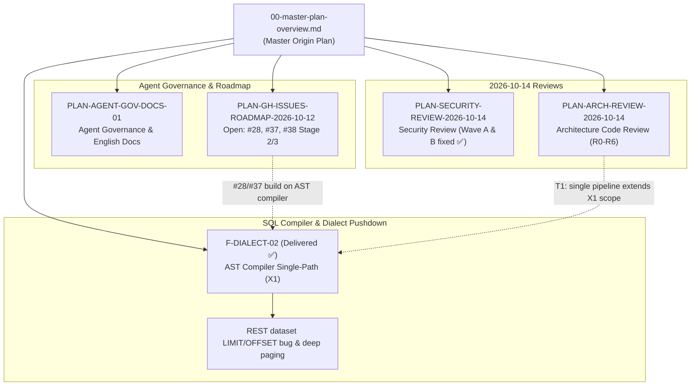

# Master Architecture & Implementation Backlog

**Last Updated:** October 14, 2026 · **Branch:** `feat/ast-x1-security-consolidation`  
**Role:** Solution Architect & Agent Coordinator  
**Location:** `doc/plan/00-master-plan-overview.md` (or `docs/plans/00-master-plan-overview.md`)  
**Purpose:** Canonical origin plan, dependency graph, and active track status for all AI agents and engineers working on the Autheris ecosystem.

---

## 🧭 Origin Plan Protocol for AI Agents

> [!IMPORTANT]
> **Directive for all AI agents and contributors:**
> 1. **Language:** All plans, requirements, and documentation must be written in **English** (aligned with [README.md](file:///root/autheris/README.md)).
> 2. **Repository of Requirements:** All new requirements, design documents, and feature requests must be stored in [`doc/plan/`](file:///root/autheris/doc/plan/).
> 3. **Refinement on the Origin Plan:** When refining an existing feature or adding a new requirement, agents must:
>    - Create or update the detailed plan in `doc/plan/` (e.g., `YYYY-MM-DD-plan-<topic>.md`).
>    - Update the execution matrix and status below in this Origin Plan.
>    - Maintain traceable bidirectional links between parent and child documents.

---

## 1. 🚀 Active Execution Tracks & Plan Matrix

| Plan / Document ID | Topic & Scope | Addressed Requirements & Components | Status | Next Milestone |
|---|---|---|---|---|
| [`2026-10-14-plan-security-code-review.md`](2026-10-14-plan-security-code-review.md) `PLAN-SECURITY-REVIEW-2026-10-14` | **Full Security Code Review (follow-up to 2026-10-13 audit)** | Re-review of all 7 production projects + deployment: Wave A High (`SR-H-01`..`06`, `SR-D-01`) and Wave B Medium (`SR-M-01`..`26`, `SR-D-02`..`05`) remediated and verified with regression tests. Consolidated on `feat/ast-x1-security-consolidation`. Detailed area reports in `2026-10-14-security-code-review/`. | **WAVES A & B FIXED & CONSOLIDATED ✅** | Merge consolidated branch to `main`. Next: Wave C Low findings (`SR-L-01`..`24`, `SR-D-06`..`09`). |
| [`2026-10-14-architecture-code-review.md`](2026-10-14-architecture-code-review.md) `PLAN-ARCH-REVIEW-2026-10-14` | **Full-Solution Architecture Code Review** | Read-only Solution Architect review of all 7 projects plus tests at `88f7df1c`: 121 findings (0 Critical, 26 High, 62 Medium, 33 Low) in 10 themes - single governed query pipeline (extends X1 scope), audit contract, fat Application layer / dialect port, versioned governance migrations, HA/cluster semantics, eventing/webhooks/plugin contract, config & god-class decomposition, API consistency, hot-path performance, test & doc hygiene. Detail reports in `2026-10-14-architecture-code-review/`. | **REVIEW DELIVERED 📋** | Stakeholder decisions (§6), then child plans per remediation wave R0-R6 (R0: ARC-F-01, ARC-I-03, ARC-C-05, ARC-C-04, ARC-F-02, ARC-S-06) |
| [`2026-10-12-plan-github-issues-roadmap.md`](2026-10-12-plan-github-issues-roadmap.md) `PLAN-GH-ISSUES-ROADMAP-2026-10-12` | **GitHub Issues Master Roadmap & Execution Plan** | Remaining open issues of the 19-issue roadmap (#26-#44): #28 governed GraphQL aggregations, #37 minimum group size / k-anonymity, #38 dbt Semantic Layer Stage 2/3 | **ACTIVE & IN EXECUTION 🚀** | #28 after merging consolidation branch to main, then #37 and #38 Stage 2/3 |
| *Follow-up of* `PLAN-FEDERATED-VF-DUCKDB-15` | **REST dataset `LIMIT`/`OFFSET` cross-source parser bug** | The REST dataset channel (`GET /api/v1/data/{source}/{schema}/{table}`) builds `LIMIT .. OFFSET ..` SQL that the cross-source parser rejects, answering 500 instead of 403 on web-API tables. Pre-existing, independent of Virtual Filters, fails closed (no rows); found in F-GOV-14 Phase 5 review (CR-11). | **IN PROGRESS 🚀** | Being fixed on branch `fix/rest-dataset-limit-offset`; the F-GOV-14 end-to-end test asserts "no rows and zero upstream requests" until then |
| *Follow-up of* `PLAN-AST-DIALECT-GEN-16` | **REST dataset deep paging** | REST dataset deep paging: emit OFFSET per dialect via the AST target-dialect compiler instead of an in-memory skip. | **PLANNED 📋** | Lift the pagination-window cap once per-dialect OFFSET generation is available |
| [`README.md`](README.md) `PLAN-AGENT-GOV-DOCS-01` | **Agent Governance & English Documentation Standards** | Project-wide English documentation policy; central `doc/plan/` repository; agent refinement lifecycle rules; root `AGENTS.md` & `CLAUDE.md` | **ACTIVE & ADOPTED ✅** | Ongoing enforcement across all sub-agent and tool invocations |

---

## 2. 🗺️ Dependency & Refinement Graph

---

## 3. 📋 Historical Completed Tracks (Archive)

> [!NOTE]
> Completed and delivered tracks are documented in [`docs/features/`](../features/README.md); completed plan and requirement documents are preserved in git history.

| Track ID / Feature ID | Topic & Delivered Scope | Documented Reference | Delivered Date |
|---|---|---|---|
| `PLAN-AST-DIALECT-GEN-16` `F-DIALECT-02` | **AST Target Dialect Generator: Single-Path Compiler Cutover (X1)** Unified AST compiler pipeline (`FastSqlEngine.Compile`), complete removal of legacy string rewriter (`RlsListener`, `SqlRewriterEngine`, `ShadowDualRun`, `TrustedSqlExpression`), checked DML executor, dialect capability tables, tenant registry, and CI gate `sql-compiler-gate`. | [`docs/features/f-dialect-02-ast-sql-compiler.md`](../features/f-dialect-02-ast-sql-compiler.md) | 2026-10-14 |
| `PLAN-ADMIN-DATASOURCES-MCP` `F-AI-16` / `F-GOV-16` | **OpenAPI/Swagger Datasource Ingestion & MCP Admin Tools (R-54..R-62)** One-step Swagger/OpenAPI datasource onboarding, secure credential vaulting, MCP admin governance planning, dataset lifecycle state management, and TOTP step-up. | [`docs/features/f-ai-16-admin-datasources-mcp.md`](../features/f-ai-16-admin-datasources-mcp.md) [`docs/features/f-gov-16-admin-access-planning-mcp.md`](../features/f-gov-16-admin-access-planning-mcp.md) | 2026-10-12 |
| `PLAN-EXT-EVENTS-WEBHOOKS-01` `F-EXT-01` | **Generic Extensibility, CloudEvents & Webhook Subsystem** | [`docs/features/f-ext-01-plugin-events-webhooks.md`](../features/f-ext-01-plugin-events-webhooks.md) | 2026-10-13 |
| `PLAN-FEDERATED-VF-DUCKDB-15` `F-GOV-14` | **Federated Virtual Filters & Web API Pushdown (DuckDB)** | [`docs/features/f-gov-14-federated-virtual-filters.md`](../features/f-gov-14-federated-virtual-filters.md) | 2026-10-11 |
| `PLAN-OFFLINE-DOC-MCP-14` `F-AI-15` | **Offline Document Vault & MCP Ingestion Gateway** | [`docs/features/f-ai-15-doc-mcp-gateway.md`](../features/f-ai-15-doc-mcp-gateway.md) | 2026-10-10 |
| `F-GOV-11`..`18`, `F-SEC-05` | **Governance, Access Profiles, Zero-Trust Hardening & WORM Compliance** | [`docs/features/README.md`](../features/README.md) | 2026-10-12 |
