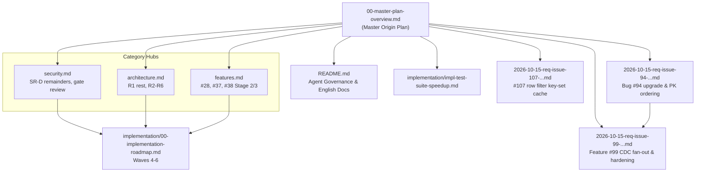

# Master Architecture & Implementation Backlog

**Last Updated:** October 15, 2026 · **Branch:** `feat/impl-wave-5-6`  
**Role:** Solution Architect & Agent Coordinator  
**Location:** `docs/plans/00-master-plan-overview.md`  
**Purpose:** Canonical origin plan, dependency graph, and active track status for all AI agents and engineers working on the Autheris ecosystem.

---

## 🧭 Origin Plan Protocol for AI Agents

> [!IMPORTANT]
> **Directive for all AI agents and contributors:**
> 1. **Language:** All plans, requirements, and documentation must be written in **English** (aligned with [README.md](file:///root/autheris/README.md)).
> 2. **Repository of Requirements:** All new requirements, design documents, and feature requests must be stored in [`docs/plans/`](./).
> 3. **Consolidated Category Structure:** Active work is consolidated under three core categories:
>    - [`security.md`](security.md): Threat modeling, AppSec findings, hardening, and WORM compliance.
>    - [`architecture.md`](architecture.md): Full-solution architecture reviews, layering, component decoupling, and strategic waves (R0–R6).
>    - [`features.md`](features.md): Functional roadmap (aggregations #28, privacy #37, dbt semantic layer #38).
> 4. **Refinement on the Origin Plan:** When refining an existing feature or adding a new requirement, agents must:
>    - Update the corresponding category document (`security.md`, `architecture.md`, or `features.md`).
>    - Update the execution matrix and status below in this Origin Plan.
>    - Maintain traceable bidirectional links between parent and child documents.

---

## 1. 🚀 Active Execution Tracks & Plan Matrix

| Plan / Category Document | Topic & Scope | Open Requirements & Components | Status | Next Milestone |
|---|---|---|:---:|---|
| [`implementation/00-implementation-roadmap.md`](implementation/00-implementation-roadmap.md) `IMPL-ROADMAP-2026-10-14` | **Cross-Scope Implementation Roadmap** | Architecture Waves 1–6 (`WP-ARC-A`, `WP-ARC-B`, `WP-ARC-C`), Analytics/Governance feature tracks (`WP-FEAT-01..07b`: #28, #37, #38, #75, #77, #79, #80), documentation alignment (`WP-DOC-01`: `f-data-04-arrow-flight-sql.md`, `f-dbt-07-dbt-semantic-layer-metrics.md`), and test suite speed-up (`WP-TS-00..06`) delivered and verified. Optional freeze-window test project split (`WP-ARC-C-19`). | **COMPLETED & VERIFIED ✅** | Optional freeze-window physical unit-test project split (`WP-ARC-C-19`). |
| [`security.md`](security.md) `PLAN-SECURITY-REVIEW` | **Security Review, Hardening & Compliance** | Waves A, B, C (`SR-H`, `SR-M`, `SR-L`), SEC2-08/09 remainders, and all 18 `accepted-differences.json` entries reviewed & approved. | **COMPLETED & VERIFIED ✅** | Maintain security regression & mutation gates. |
| [`architecture.md`](architecture.md) `PLAN-ARCH-REVIEW` | **Solution Architecture Remediation (R0–R6)** | R0–R6 architecture waves implemented: cluster-wide CDC fan-out (`A-13`), WORM audit group commit & `AuditChainEngine` (`A-07`, `B-14`), `ISqlDialectProvider` & `ISqlDialectRegistry` (`B-09`), Application package diet (`B-10`), `GatewayOptions` split & `IValidateOptions<T>` (`C-01`, `C-02`), API middleware/ProblemDetails/policies/endpoints (`C-04..C-08`), god-class decomposition (`C-09`), lock-free template cache & non-reflection AST walk (`C-10`, `C-12`), true streaming core & egress (`C-13`, `C-14`), `ICatalogVersionProvider` & `ICatalogLookup` (`C-15`), `IRedisConnectionProvider` & unified `GatewayDiagnostics` (`C-16`), and test/build hygiene (`C-17`, `C-18`, `C-20..C-22`). | **COMPLETED & VERIFIED ✅** | Optional freeze-window test project split (`WP-ARC-C-19`). |
| [`features.md`](features.md) `PLAN-FEATURES-ROADMAP` | **Analytics & Governance Feature Roadmap** | #28 governed aggregations (`GovernedAggregationService`, `F-DATA-08`), #37 minimum group size & DP noise/caching (`IDifferentialPrivacyEngine`, `F-DATA-08`), #38 dbt Semantic Layer Stage 2/3 (`SemanticMetricQueryService`, MCP `list_metrics`/`describe_metric`/`query_metrics`, GraphQL `queryMetrics`, `semantic.<model>` views, `TrinoMetadataQueryHandler` for `/v1/statement`, `F-DBT-07`), #75 cross-source GraphQL relations (`CrossSourceRelationResolver`, `F-GOV-19`), #77 change detection `ETag` & `changesSince` cursor (`GovernedChangeDetectionService`, `F-DATA-09`), #79 static query analysis & bundled consents (`QueryAnalysisService`, `F-GOV-20`), #80 column value profiles & synthetic sample rows (`ColumnValueProfileService`, `SyntheticSampleRowGenerator`, `F-AI-17`). | **COMPLETED & VERIFIED ✅** | Documented in `docs/features/` (`F-DATA-04`, `F-DATA-08`, `F-DATA-09`, `F-DBT-07`, `F-GOV-19`, `F-GOV-20`, `F-AI-17`). |
| [`implementation/impl-test-suite-speedup.md`](implementation/impl-test-suite-speedup.md) `IMPL-TEST-SPEEDUP-2026-10-14` | **Test Suite Speed-Up** | `WP-TS-00` (TRX artifacts), `WP-TS-01` (shared DB servers), `WP-TS-02` (CI shards), `WP-TS-03` (parallel Spark job), `WP-TS-04` (Cecil module & call-graph cache), `WP-TS-05` (`SerialIntegrationCollection` isolating `ItsmIntegrationTests`), and `WP-TS-06` (parallel SQL compiler gate) delivered and verified. | **COMPLETED & VERIFIED ✅** | Refresh CI shard weights periodically. |
| [`2026-10-15-req-issue-94-upgrade-migration-and-pk-ordering.md`](2026-10-15-req-issue-94-upgrade-migration-and-pk-ordering.md) `REQ-GOV-94` Plan: [`2026-10-15-plan-issue-94-upgrade-migration-and-pk-ordering.md`](2026-10-15-plan-issue-94-upgrade-migration-and-pk-ordering.md) | **Bug #94 & #102: Schema Shape Verification, Declared Keys/Indexes & Key-Based Read Ordering** | Regression v1.1.8 → v1.1.9/v1.1.10. Owner decisions 2026-10-15: no upgrade/repair migrations; read-only, fail-closed shape verification before the version is recorded; declared composite primary keys and indexes persisted in the extended baseline (`0001` checksum unchanged), validated fail-closed; no source catalog queries for keys (least privilege); ordering PK → unique index → clear-text composite → 400; WebSQL 504 by design (problem details). | **COMPLETED ✅ – merged (PR #105)** | Phases 1–6 done on `fix/issue-94-upgrade-migration-pk`: streams A (DDL + shape verifier + least-privilege tests), B (definition + persistence + keys endpoint + ingestion entry points), C (ordering + consumers incl. GraphQL tree compiler, WebSQL 504 problem details). Feature docs: [F-GOV-21](../features/f-gov-21-declared-table-keys-and-read-ordering.md), [F-GOV-12 schema shape verification](../features/f-gov-12-multi-engine-governance-storage.md#schema-shape-verification). PR #105. SQL Server Windows Auth (#102) delivered separately (`F-AUTH-04`). |
| [`2026-10-15-req-issue-99-cdc-fanout-and-hardening.md`](2026-10-15-req-issue-99-cdc-fanout-and-hardening.md) `REQ-CDC-99` Plan: [`2026-10-15-plan-issue-99-cdc-fanout-and-hardening.md`](2026-10-15-plan-issue-99-cdc-fanout-and-hardening.md) | **Feature #99: Governed CDC Fan-Out & Change-Tracking Hardening (F-CDC-02, F-EXT-01)** | One fenced producer per tracked table writing a durable, encrypted, versioned stream in the governance DB (stream + watermark in one transaction); per-consumer offsets, start positions, bounded retention with explicit gap events; receivers GraphQL / CloudEvents webhook / C# DLL plugin, each bound to an identity and authorised, row-filtered (move-in/out) and masked per event at delivery, fail closed, audited without payload; expired watermark -> control event + automatic restart; declared PK checked at activation (no `sys.indexes`), snapshot isolation, per-table interval/batch/timeout. Increments I1 (producer + stream), I2 (durable consumers, webhooks, GraphQL), I3 (plugins). | **PLAN READY 📝** | Phase 2 done (`PLAN-CDC-99`: contracts, DDL, work packages I1-0/A/B/C/E, I2-0/A/B/C, I3-A/B). Phase 3 done: approved with conditions `SEC-CDC99-01..22` (tenant moves, no historical replay, byte-exact tenant match, fail-closed identity, key separation). Next: Phase 4 increment I1 (WP-I1-0, then WP-I1-A/B/C in parallel). |
| [`2026-10-15-req-issue-107-row-filter-key-set-cache.md`](2026-10-15-req-issue-107-row-filter-key-set-cache.md) `REQ-GOV-107` Plan: [`2026-10-15-plan-issue-107-row-filter-key-set-cache.md`](2026-10-15-plan-issue-107-row-filter-key-set-cache.md) | **Issue #107: Key-Set Cache Strategy for Correlated Row Filters** | Opt-in `KeySetCache` evaluation strategy for `SubqueryCorrelated` row filters: governed key query run once, keys cached per data source/tenant/filter hash/policy epochs, injected as `fk IN (@p...)`; settings per rule (`CONSENT_ROW_FILTERS`) and per object (`TABLE_ROW_FILTER_STRATEGIES`), global default and caps; precedence rule > object > global; default `Exists`; fallback to `EXISTS` (max keys, parameter budget, DENY, temporal); fail closed on key-query failure; baseline `0001` DDL extended in place. | **SECURITY REVIEWED 🔍** | Phase 2 plan `PLAN-GOV-107` done (substitution in `GovernancePolicyFactory` after admission on the compiler input only; key query derived from the registered EXISTS via new engine entry point `IPolicyKeyQueryCompiler` reusing `PolicySubqueryTenantRewriter`, `AstSecurityVisitor` untouched; cache key = SHA-256 over compiled key query + binds + tenant + authoritative epochs; work packages WP-A settings/persistence/admin, WP-B engine/substitution, WP-C runtime/cache/integration). Phase 3 done: approved with binding conditions `SEC-RF107-01..16` (principal independence + per-source `KeySetCacheAllowed` default false, authoritative epochs, polarity, lossless typing, READ COMMITTED key reads, concurrency limit). Next: Phase 4 TDD (`csharp-tdd-developer`, Sonnet). |
| [`2026-10-15-plan-sqlgate-cutover-and-accepted-differences.md`](2026-10-15-plan-sqlgate-cutover-and-accepted-differences.md) `PLAN-SQLGATE-CUTOVER-03` | **SqlGate Differences Sign-Off & Cutover** | All 18 triage entries (57 unique statements) in `accepted-differences.json` audited, documented with concrete security justifications, and signed off (`approved`). Cutover precondition verified. | **COMPLETED & VERIFIED ✅** | Maintain G4 differential gate regression protection. |
| [`README.md`](README.md) `PLAN-AGENT-GOV-DOCS-01` | **Agent Governance & English Documentation Standards** | Project-wide English documentation policy; `docs/plans/` as the plan repository; agent refinement lifecycle rules; root `AGENTS.md` & `CLAUDE.md`. | **COMPLETED & VERIFIED ✅** | Ongoing enforcement. |

---

## 2. 🗺️ Dependency & Refinement Graph

---

## 3. 📋 Historical Completed Tracks (Archive)

> [!NOTE]
> Completed and delivered tracks are documented in [`docs/features/`](../features/README.md); completed plan and requirement documents are preserved in git history.

| Track ID / Feature ID | Topic & Delivered Scope | Documented Reference | Delivered Date |
|---|---|---|---|
| `IMPL-ROADMAP` Waves 1–3 | **Implementation Waves 1–3:** Security Wave C, R0 trust foundation, R1 table-read pipeline, versioned migrations, parser pool. | [`docs/features/README.md`](../features/README.md) | 2026-10-14 (PRs #78, #81, #82) |
| `PLAN-AST-DIALECT-GEN-16` `F-DIALECT-02` | **AST Target Dialect Compiler: Single-Path Cutover (X1)** | [`docs/features/f-dialect-02-ast-sql-compiler.md`](../features/f-dialect-02-ast-sql-compiler.md) | 2026-10-14 |
| `PLAN-ADMIN-DATASOURCES-MCP` `F-AI-16` / `F-GOV-16` | **OpenAPI Datasource Ingestion & MCP Admin Tools** | [`docs/features/f-api-08-catalog-discovery-swagger-ingestion.md`](../features/f-api-08-catalog-discovery-swagger-ingestion.md) [`docs/features/f-ai-13-admin-mcp-tools-two-phase-hitl.md`](../features/f-ai-13-admin-mcp-tools-two-phase-hitl.md) | 2026-10-12 |
| `PLAN-EXT-EVENTS-WEBHOOKS-01` `F-EXT-01` | **Generic Extensibility, CloudEvents & Webhook Subsystem** | [`docs/features/f-ext-01-generic-plugin-events-and-webhooks.md`](../features/f-ext-01-generic-plugin-events-and-webhooks.md) | 2026-10-13 |
| `PLAN-FEDERATED-VF-DUCKDB-15` `F-GOV-14` | **Federated Virtual Filters & Web API Pushdown (DuckDB)** | [`docs/features/f-gov-14-federated-virtual-filters.md`](../features/f-gov-14-federated-virtual-filters.md) | 2026-10-11 |
| `PLAN-OFFLINE-DOC-MCP-14` `F-AI-15` | **Offline Document Vault & MCP Ingestion Gateway** | [`docs/features/f-ai-15-offline-doc-runbook-mcp-gateway.md`](../features/f-ai-15-offline-doc-runbook-mcp-gateway.md) | 2026-10-10 |
| `F-GOV-11`..`18`, `F-SEC-05` | **Governance, Access Profiles, Zero-Trust Hardening & WORM Compliance** | [`docs/features/README.md`](../features/README.md) | 2026-10-12 |
