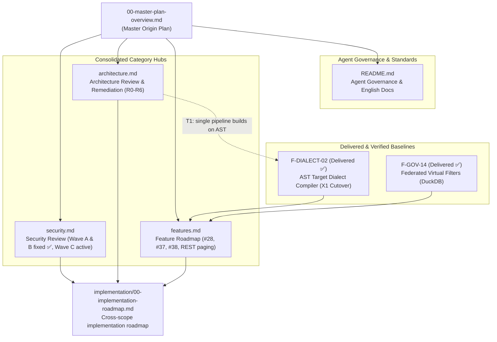

# Master Architecture & Implementation Backlog

**Last Updated:** October 14, 2026 · **Branch:** `docs/implementation-plans-2026-10-14`  
**Role:** Solution Architect & Agent Coordinator  
**Location:** `doc/plan/00-master-plan-overview.md` (or `docs/plans/00-master-plan-overview.md`)  
**Purpose:** Canonical origin plan, dependency graph, and active track status for all AI agents and engineers working on the Autheris ecosystem.

---

## 🧭 Origin Plan Protocol for AI Agents

> [!IMPORTANT]
> **Directive for all AI agents and contributors:**
> 1. **Language:** All plans, requirements, and documentation must be written in **English** (aligned with [README.md](file:///root/autheris/README.md)).
> 2. **Repository of Requirements:** All new requirements, design documents, and feature requests must be stored in [`doc/plan/`](file:///root/autheris/doc/plan/).
> 3. **Consolidated Category Structure:** Active work is consolidated under three core categories:
>    - [`security.md`](security.md): Threat modeling, AppSec code review findings (Waves A–C), hardening, and WORM compliance.
>    - [`architecture.md`](architecture.md): Full-solution architecture reviews, layering, component decoupling, and strategic waves (R0–R6).
>    - [`features.md`](features.md): Functional roadmap (aggregations #28, privacy #37, dbt semantic layer #38, REST deep paging).
> 4. **Refinement on the Origin Plan:** When refining an existing feature or adding a new requirement, agents must:
>    - Update the corresponding category document (`security.md`, `architecture.md`, or `features.md`).
>    - Update the execution matrix and status below in this Origin Plan.
>    - Maintain traceable bidirectional links between parent and child documents.

---

## 1. 🚀 Active Execution Tracks & Plan Matrix

| Plan / Category Document | Topic & Scope | Addressed Requirements & Components | Status | Next Milestone |
|---|---|---|:---:|---|
| [`security.md`](security.md) `PLAN-SECURITY-REVIEW` | **Security Review, Hardening & Compliance** | Wave A High (`SR-H-01`..`06`, `SR-D-01`) and Wave B Medium (`SR-M-01`..`26`, `SR-D-02`..`05`) remediated and verified with regression tests. Consolidated on `feat/ast-x1-security-consolidation`. | **WAVES A & B FIXED ✅** | Merge consolidated branch to `main`. Next: Wave C Low findings (`SR-L-01`..`24`, `SR-D-06`..`09`). |
| [`architecture.md`](architecture.md) `PLAN-ARCH-REVIEW` | **Solution Architecture Review & Waves (R0–R6)** | 121 findings across 6 slices synthesized into 10 architectural themes: single query pipeline, audit contract, thinning Application layer, versioned schema migrations, HA readiness, outbox, options split, ProblemDetails, ANTLR pooling. | **REVIEW DELIVERED 📋** | Stakeholder decisions (§6), then execute Wave R0 (correctness/trust) and Wave R1 (unified query pipeline). |
| [`features.md`](features.md) `PLAN-FEATURES-ROADMAP` | **Feature Roadmap & Analytics Execution** | Analytics and headless BI: #28 governed GraphQL aggregations, #37 minimum group size & k-anonymity guard, #38 dbt Semantic Layer (Stage 2/3), REST dataset LIMIT/OFFSET fix and deep paging. | **ACTIVE & IN EXECUTION 🚀** | Issue #28 after merging consolidation branch to main, then #37 and #38 Stage 2/3. |
| [`implementation/00-implementation-roadmap.md`](implementation/00-implementation-roadmap.md) `IMPL-ROADMAP-2026-10-14` | **Cross-Scope Implementation Roadmap** | 77 work packages from six architect plans (Security Wave C ×2, Architecture R0/R2, R1/R3, R4–R6, Analytics features), verified against `main` 317e65b8, ordered into Gate 0 + Waves 1–6 with serialized hot-file lanes. | **PLANNED 📋** | Resolve Gate 0 decisions (G-1..G-14), then start Wave 1 (FEAT-02 masked-aggregate guard first). |
| [`README.md`](README.md) `PLAN-AGENT-GOV-DOCS-01` | **Agent Governance & English Documentation Standards** | Project-wide English documentation policy; central `doc/plan/` repository; agent refinement lifecycle rules; root `AGENTS.md` & `CLAUDE.md`. | **ACTIVE & ADOPTED ✅** | Ongoing enforcement across all sub-agent and tool invocations. |

---

## 2. 🗺️ Dependency & Refinement Graph

---

## 3. 📋 Historical Completed Tracks (Archive)

> [!NOTE]
> Completed and delivered tracks are documented in [`docs/features/`](../features/README.md); completed plan and requirement documents are preserved in git history.

| Track ID / Feature ID | Topic & Delivered Scope | Documented Reference | Delivered Date |
|---|---|---|---|
| `PLAN-AST-DIALECT-GEN-16` `F-DIALECT-02` | **AST Target Dialect Generator: Single-Path Compiler Cutover (X1)** Unified AST compiler pipeline (`FastSqlEngine.Compile`), complete removal of legacy string rewriter (`RlsListener`, `SqlRewriterEngine`, `ShadowDualRun`, `TrustedSqlExpression`), checked DML executor, dialect capability tables, tenant registry, and CI gate `sql-compiler-gate`. | [`docs/features/f-dialect-02-ast-sql-compiler.md`](../features/f-dialect-02-ast-sql-compiler.md) | 2026-10-14 |
| `PLAN-ADMIN-DATASOURCES-MCP` `F-AI-16` / `F-GOV-16` | **OpenAPI/Swagger Datasource Ingestion & MCP Admin Tools (R-54..R-62)** One-step Swagger/OpenAPI datasource onboarding, secure credential vaulting, MCP admin governance planning, dataset lifecycle state management, and TOTP step-up. | [`docs/features/f-ai-16-admin-datasources-mcp.md`](../features/f-ai-16-admin-datasources-mcp.md) [`docs/features/f-gov-16-admin-access-planning-mcp.md`](../features/f-gov-16-admin-access-planning-mcp.md) | 2026-10-12 |
| `PLAN-EXT-EVENTS-WEBHOOKS-01` `F-EXT-01` | **Generic Extensibility, CloudEvents & Webhook Subsystem** | [`docs/features/f-ext-01-plugin-events-webhooks.md`](../features/f-ext-01-plugin-events-webhooks.md) | 2026-10-13 |
| `PLAN-FEDERATED-VF-DUCKDB-15` `F-GOV-14` | **Federated Virtual Filters & Web API Pushdown (DuckDB)** | [`docs/features/f-gov-14-federated-virtual-filters.md`](../features/f-gov-14-federated-virtual-filters.md) | 2026-10-11 |
| `PLAN-OFFLINE-DOC-MCP-14` `F-AI-15` | **Offline Document Vault & MCP Ingestion Gateway** | [`docs/features/f-ai-15-doc-mcp-gateway.md`](../features/f-ai-15-doc-mcp-gateway.md) | 2026-10-10 |
| `F-GOV-11`..`18`, `F-SEC-05` | **Governance, Access Profiles, Zero-Trust Hardening & WORM Compliance** | [`docs/features/README.md`](../features/README.md) | 2026-10-12 |
