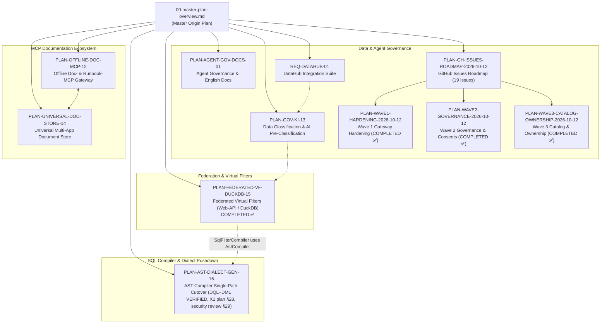

# Master Architecture & Implementation Backlog

**Last Updated:** October 10, 2026 · **Branch:** `feat/ast-target-dialect-generator`  
**Role:** Solution Architect & Agent Coordinator  
**Location:** `doc/plan/00-master-plan-overview.md` (or `docs/plans/00-master-plan-overview.md`)  
**Purpose:** Canonical origin plan, dependency graph, and active track status for all AI agents and engineers working on the Autheris ecosystem.

---

## 🧭 Origin Plan Protocol for AI Agents

> [!IMPORTANT]
> **Directive for all AI agents and contributors:**
> 1. **Language:** All plans, requirements, and documentation must be written in **English** (aligned with [README.md](file:///root/autheris/README.md)).
> 2. **Repository of Requirements:** All new requirements, design documents, and feature requests must be stored in [`doc/plan/`](file:///root/autheris/doc/plan/).
> 3. **Refinement on the Origin Plan:** When refining an existing feature or adding a new requirement, agents must:
>    - Create or update the detailed plan in `doc/plan/` (e.g., `YYYY-MM-DD-plan-<topic>.md`).
>    - Update the execution matrix and status below in this Origin Plan.
>    - Maintain traceable bidirectional links between parent and child documents.

---

## 1. 🚀 Active Execution Tracks & Plan Matrix

| Plan / Document ID | Topic & Scope | Addressed Requirements & Components | Status | Next Milestone |
|---|---|---|---|---|
| [`2026-10-12-plan-wave4-graphql-dbt-semantics.md`](file:///root/autheris/doc/plan/2026-10-12-plan-wave4-graphql-dbt-semantics.md) `PLAN-WAVE4-GRAPHQL-DBT-SEMANTICS-2026-10-12` | **Wave 4 GraphQL Cursor Pagination, Temporal Types & dbt Semantics** | Delivers Non-AST items of Wave 4 (#36, #39, #38 Stage 1): ISO Temporal scalars (`Date`, `DateTime`, `LocalTime`), dbt `meta` Column Semantics passthrough, Relay Cursor Paging with truncation signal, and dbt Semantic Manifest ingestion + MCP metrics discovery. | **COMPLETED & VERIFIED ✅** | Documented in `docs/features/f-gov-17-graphql-temporal-dbt-semantics.md` & verified with unit/integration test suites |
| [`2026-10-12-plan-catalog-ownership-wave3.md`](file:///root/autheris/doc/plan/2026-10-12-plan-catalog-ownership-wave3.md) `PLAN-WAVE3-CATALOG-OWNERSHIP-2026-10-12` | **Wave 3 Catalog Transparency, Data Ownership & Response Enhancements** | Delivers 4 GitHub issues (#43, #33, #32, #27): Return Catalog Tags in `list_datasets`/`describe_dataset`, Data Owners in catalog & Backstage, Catalog Discovery with Access Status (`GRANTED/PENDING/NONE`), and Mark Masked Values in GraphQL responses (`extensions.maskedFields`). | **COMPLETED & VERIFIED ✅** | Documented in `docs/features/f-gov-16-catalog-ownership-transparency.md` & verified with unit/integration test suite |
| [`2026-10-12-plan-governance-consents-wave2.md`](file:///root/autheris/doc/plan/2026-10-12-plan-governance-consents-wave2.md) `PLAN-WAVE2-GOVERNANCE-2026-10-12` | **Wave 2 Governance, Consents & Scope-Specific Enforcement** | Delivers 5 GitHub issues (#40, #35, #34, #26, #29): GitOps declarative policy apply API, self-service `describe_my_access` / `myAccess`, access request & approver inboxes, scope-specific monotonic masking (`Agent.Read`), and application scope (`App.Read`). | **COMPLETED & VERIFIED ✅** | Documented in `docs/features/f-gov-15-declarative-consents-scopes.md` & verified with unit & integration tests |
| [`2026-10-12-plan-gateway-hardening-wave1.md`](file:///root/autheris/doc/plan/2026-10-12-plan-gateway-hardening-wave1.md) `PLAN-WAVE1-HARDENING-2026-10-12` | **Wave 1 Gateway Hardening & Protocol Hygiene** | Delivers 5 GitHub issues (#44, #42, #41, #31, #30): Auth-exempt pre-auth rate limits, protocol kill switches (OData, Arrow, Iceberg, DuckDB), Kerberos cleanup, Caller context in WORM audit chain, distinguishable error codes. | **COMPLETED & VERIFIED ✅** | Documented in `docs/features/f-sec-05-gateway-hardening-defense.md` & verified with 3,500+ unit tests |
| [`2026-10-12-plan-github-issues-roadmap.md`](file:///root/autheris/doc/plan/2026-10-12-plan-github-issues-roadmap.md) `PLAN-GH-ISSUES-ROADMAP-2026-10-12` | **GitHub Issues Master Roadmap & Execution Plan** | Comprehensive qualification and 4-wave delivery plan for 19 open GitHub issues (#26-#44): (1) Gateway Hardening [DONE], (2) Governance & Consents [DONE], (3) Catalog & Ownership [DONE], (4) Aggregations & Headless BI | **ACTIVE & IN EXECUTION 🚀** | Waves 1, 2 & 3 Completed; ready for Wave 4 (Aggregations & Headless BI) |
| [`2026-10-12-req-datahub-integration-suite.md`](file:///root/autheris/doc/plan/2026-10-12-req-datahub-integration-suite.md) `REQ-DATAHUB-01` | **Dual-Mode Enterprise Data Governance Suite** | Dual-Mode: (1) Embedded Standalone Mode (AST lineage graph, declarative data contracts & assertions in SQLite/DuckDB) and (2) Federated Enterprise Mode (DataHub GMS client, MCL webhooks, lineage egress, and contract circuit breaker) | **COMPLETED & VERIFIED ✅** | Documented in `docs/features/f-gov-18-datahub-integration-contracts.md` & verified with unit tests |
| [`2026-10-10-konzept-federated-virtual-filter-web-api-duckdb.md`](file:///root/autheris/doc/plan/2026-10-10-konzept-federated-virtual-filter-web-api-duckdb.md) `PLAN-FEDERATED-VF-DUCKDB-15` | **Federated Virtual Filters on Web-APIs via DuckDB** | Gateway hash semi-join enforcement at staging for Web-API tables; Tier 0/1/2/3 federation planner (empty key set, point lookup, endpoint-capability pushdown, full fetch); tenant-isolated single-flight key set cache; path-lookup reader; fail-closed `VF_*` denial codes. Feature reference: [`f-gov-14-federated-virtual-filters.md`](file:///root/autheris/docs/features/f-gov-14-federated-virtual-filters.md) | **COMPLETED & VERIFIED ✅** | Merge `feat/vf-federation-hardening`. Phase 5 APPROVED at `6abac9a` (re-review loop 1) plus review loop 2 (CR-17..CR-19); Phase 6 documentation done (see the plan's Implementation Log)
| *Follow-up of* `PLAN-FEDERATED-VF-DUCKDB-15` | **REST dataset `LIMIT`/`OFFSET` cross-source parser bug** | The REST dataset channel (`GET /api/v1/data/{source}/{schema}/{table}`) builds `LIMIT .. OFFSET ..` SQL that the cross-source parser rejects, so it answers 500 instead of 403 on web-API tables. Pre-existing, independent of Virtual Filters, fails closed (no rows); found in the F-GOV-14 Phase 5 review (CR-11) | **IN PROGRESS 🚀** | Being fixed on branch `fix/rest-dataset-limit-offset`; the F-GOV-14 end-to-end test asserts "no rows and zero upstream requests" until then |
| [`2026-10-10-konzept-datenklassifizierung-ki-vorklassifizierung.md`](file:///root/autheris/doc/plan/2026-10-10-konzept-datenklassifizierung-ki-vorklassifizierung.md) `PLAN-GOV-KI-13` | **Data Object Classification & AI Pre-Classification** | Fail-Closed `UNCLASSIFIED` initial state; optional AI pre-classification with 150ms timeout guard; auto-preclassify at confidence $\ge 95\%$; dual-sign-off workflows | **COMPLETED & VERIFIED ✅** | Documented in `docs/features/f-gov-13-data-classification-and-pii-governance.md` & verified with unit tests |
| [`2026-10-10-implementierungsplan-offline-doc-mcp-gateway.md`](file:///root/autheris/doc/plan/2026-10-10-implementierungsplan-offline-doc-mcp-gateway.md) `PLAN-OFFLINE-DOC-MCP-12` | **Offline Doc- & Runbook-MCP Gateway** | Ingestion pipeline for Markdown, arc42, Runbooks, OpenAPI, Error Catalogs; local BM25/SIMD hybrid search; `GatewayMcpServer` stdio/SSE bridge | **COMPLETED & VERIFIED ✅** | Documented in `docs/features/f-ai-15-offline-doc-runbook-mcp-gateway.md` & verified with unit tests |
| [`2026-10-10-konzept-universelle-dokumentenablage-mcp.md`](file:///root/autheris/doc/plan/2026-10-10-konzept-universelle-dokumentenablage-mcp.md) `PLAN-UNIVERSAL-DOC-STORE-14` | **Universal Document Store for Multi-App MCP** | Headless Ingestion REST API (ZIP bundles, markdown assets), MCP deposit (`deposit_documentation`, `list_applications`), and Zip-Slip safe shared-volume storage | **COMPLETED & VERIFIED ✅** | Documented in `docs/features/f-ai-16-universal-doc-store-mcp.md` & verified with unit tests |
| [`2026-10-10-plan-ast-dialect-generator.md`](file:///root/autheris/doc/plan/2026-10-10-plan-ast-dialect-generator.md) PRD: [`2026-10-10-req-ast-dialect-generator.md`](file:///root/autheris/doc/plan/2026-10-10-req-ast-dialect-generator.md) `PLAN-AST-DIALECT-GEN-16` | **AST Target Dialect Generator: Single-Path Compiler Cutover** | Phase 2 plan: one AST compiler path (legacy `RlsListener`, `SqlRewriterEngine` and `ShadowDualRun` removed in one revertable cutover commit), every value bound, typed policy/mask IR replacing `TrustedSqlExpression`, dialect capability table, DML + `MERGE`, Databricks as production dialect (Snowflake experimental), pre-merge CI evidence gate `sql-compiler-gate` (differential vs legacy, property/fuzz, Testcontainers + SQLite/DuckDB + Spark/Delta execution, security regression, BenchmarkDotNet); work packages in streams A-E; supersedes German draft [`2026-10-06-implementation-plan-ast-dialect-generator.md`](file:///root/autheris/doc/plan/2026-10-06-implementation-plan-ast-dialect-generator.md); amends [ADR-017 §2](file:///root/autheris/docs/adr/ADR-017-distributed-state-ast-generator-and-rbac.md); Phase 3 security review delivered (plan §16): findings SEC-ADG-01..29 (Critical: plan-cache value reuse, consumer rendering parity, Oracle positional binding), invariants INV-11..INV-17, CI gate additions M-1..M-12 plus gate G10, Oracle runtime as production dialect (SD-8, Stream F); Phase 5 code review of the DQL branches (plan §19): changes requested, Blockers CR-ADG-01 (CTE name resolution, cross-tenant read on Oracle) and CR-ADG-02 (unmapped functions pass through); integrate on `feat/ast-dql`; Oracle driver license review is a release gate; Phase 4 loop-back (plan §20): CR-ADG-01..24 fixed on `feat/ast-dql` (blocked: `trustedSigners` for `Oracle.*`; X1 preconditions listed in §20.3), Databricks Experimental, Oracle Production (compiler tier) | **DQL and DML COMPLETED & VERIFIED ✅** (Phase 5 approved at `fd5179d`, plus the pre-Phase-6 fixes at `a4ce0e4`; documented in `docs/features/f-dialect-02-ast-sql-compiler.md`) | **X1 cutover — execution plan in plan §28, Phase 3 security review in plan §29** (Phase 2 and Phase 3 done; next Phase 4 Wave 1 with the binding amendments; 4 High findings SEC-X1-01..04 fixed in the WP definitions: error surfaces outside the mapper, SEC-ADG-12 producers added to X0d, Oracle admission gated on new WP-X0z (WP-F5), revert set {X1, X0y, X0l, X0g, X0f, X0e, X0d-2, X0d}; S-1..S-5 decided as the fail-closed defaults; WP-X1 blocked until all X0 packages and the revert rehearsal are green): preconditions verified (provider binders and the Oracle `BindByName` wrapper are already production code; Stream D typed policy producers, the gate infrastructure, Compile/binder/checked-executor wiring, error codes, catalog metadata, tenant registry, literal bind types and session pinning are open); SQLite gets AST support, Snowflake fails closed; work packages X0a..X0y in four waves on `feat/ast-x1-*` branches, then the single squash commit X1; Databricks becomes Production only after a G9 run (X1-DBX); stakeholder items S-1..S-5 (Oracle license, Databricks DML without rollback, client-visible status codes, G9 workspace, Snowflake); OQ-GQL / OQ-4 out of scope
| [`README.md`](file:///root/autheris/doc/plan/README.md) `PLAN-AGENT-GOV-DOCS-01` | **Agent Governance & English Documentation Standards** | Project-wide English documentation policy; central `doc/plan/` repository; agent refinement lifecycle rules; root `AGENTS.md` & `CLAUDE.md` | **ACTIVE & ADOPTED ✅** | Ongoing enforcement across all sub-agent and tool invocations |
| `PLAN-AST-DIALECT-GEN-16` (follow-up) | **REST dataset deep paging** | REST dataset deep paging: emit OFFSET per dialect via the AST target-dialect compiler (PLAN-AST-DIALECT-GEN-16) instead of an in-memory skip. | **PLANNED 📋** | Lift the pagination-window cap once per-dialect OFFSET generation is available |

---

## 2. 🗺️ Dependency & Refinement Graph

---

## 3. 📋 Historical Completed Tracks (Archive)

> [!NOTE]
> All prior foundation tracks (Plans 1 through 11, SQL-AST Hardening, and Tracks A through E) were 100% completed, verified through 5,600+ automated unit & integration tests, and archived in accordance with repository clean-up guidelines.
