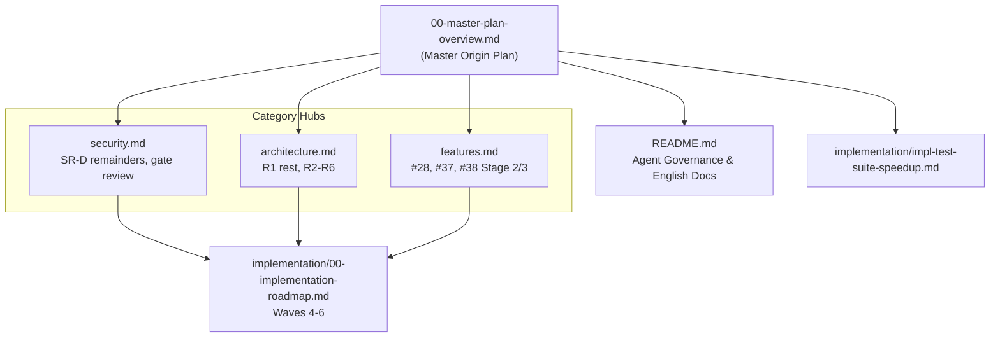

# Master Architecture & Implementation Backlog

**Last Updated:** October 14, 2026 · **Branch:** `main` (`a4137626`)  
**Role:** Solution Architect & Agent Coordinator  
**Location:** `docs/plans/00-master-plan-overview.md`  
**Purpose:** Canonical origin plan, dependency graph, and active track status for all AI agents and engineers working on the Autheris ecosystem.

---

## 🧭 Origin Plan Protocol for AI Agents

> [!IMPORTANT]
> **Directive for all AI agents and contributors:**
> 1. **Language:** All plans, requirements, and documentation must be written in **English** (aligned with [README.md](file:///root/autheris/README.md)).
> 2. **Repository of Requirements:** All new requirements, design documents, and feature requests must be stored in [`docs/plans/`](./).
> 3. **Consolidated Category Structure:** Active work is consolidated under three core categories:
>    - [`security.md`](security.md): Threat modeling, AppSec findings, hardening, and WORM compliance.
>    - [`architecture.md`](architecture.md): Full-solution architecture reviews, layering, component decoupling, and strategic waves (R0–R6).
>    - [`features.md`](features.md): Functional roadmap (aggregations #28, privacy #37, dbt semantic layer #38).
> 4. **Refinement on the Origin Plan:** When refining an existing feature or adding a new requirement, agents must:
>    - Update the corresponding category document (`security.md`, `architecture.md`, or `features.md`).
>    - Update the execution matrix and status below in this Origin Plan.
>    - Maintain traceable bidirectional links between parent and child documents.

---

## 1. 🚀 Active Execution Tracks & Plan Matrix

| Plan / Category Document | Topic & Scope | Open Requirements & Components | Status | Next Milestone |
|---|---|---|:---:|---|
| [`implementation/00-implementation-roadmap.md`](implementation/00-implementation-roadmap.md) `IMPL-ROADMAP-2026-10-14` | **Cross-Scope Implementation Roadmap** | Waves 1–3 merged (PRs #78, #81, #82). Open: Waves 4–6 plus carry-overs (B-07, B-13, B-12 remainder, R-1..R-4, SEC2-08/09 remainders), serialized hot-file lanes, Gate 0 decision record. | **WAVE 4 NEXT 📋** | Resolve G-14 (owner review of FEAT plans vs issues #28/#37/#38), then start Wave 4. |
| [`security.md`](security.md) `PLAN-SECURITY-REVIEW` | **Security Review, Hardening & Compliance** | Waves A, B and C (`SR-H`, `SR-M`, `SR-L`) fixed. Open: deployment remainders `SR-D-06`..`09`, deprecation follow-ups, 18 `pending` entries in `accepted-differences.json` awaiting security review. | **REMAINDERS OPEN 📋** | Security review of the pending SQL compiler gate differences; SEC2-08/09 remainders. |
| [`architecture.md`](architecture.md) `PLAN-ARCH-REVIEW` | **Solution Architecture Remediation (R0–R6)** | R0 done, R1 nearly done (B-07 open). Open: R2 HA and outbox (A-02, A-03, A-11..A-14), R3 dialect ports and persistence (B-09..B-14), R4–R6 (C-01..C-22). | **R2–R6 PLANNED 📋** | Wave 4: A-02 outbox and A-11 leases; carry-overs B-07, B-13. |
| [`features.md`](features.md) `PLAN-FEATURES-ROADMAP` | **Analytics Feature Roadmap** | #28 governed GraphQL aggregations, #37 minimum group size, #38 dbt Semantic Layer Stage 2/3. | **BLOCKED (G-14) ⏸️** | Owner review vs issue bodies, then FEAT-03 (#28) with FEAT-04 (#37). |
| [`implementation/impl-test-suite-speedup.md`](implementation/impl-test-suite-speedup.md) `IMPL-TEST-SPEEDUP-2026-10-14` | **Test Suite Speed-Up** | WP-TS-01 merged (shared database servers). CI effect not confirmed (GitHub `Build & Test` 23:14 vs 20:18 before). Open: WP-TS-02..05. | **IN PROGRESS 🚀** | Investigate the CI duration, then WP-TS-02 CI shards and WP-TS-03 Spark job. |
| [`README.md`](README.md) `PLAN-AGENT-GOV-DOCS-01` | **Agent Governance & English Documentation Standards** | Project-wide English documentation policy; `docs/plans/` as the plan repository; agent refinement lifecycle rules; root `AGENTS.md` & `CLAUDE.md`. | **ADOPTED ✅** | Ongoing enforcement. |

---

## 2. 🗺️ Dependency & Refinement Graph

---

## 3. 📋 Historical Completed Tracks (Archive)

> [!NOTE]
> Completed and delivered tracks are documented in [`docs/features/`](../features/README.md); completed plan and requirement documents are preserved in git history.

| Track ID / Feature ID | Topic & Delivered Scope | Documented Reference | Delivered Date |
|---|---|---|---|
| `IMPL-ROADMAP` Waves 1–3 | **Implementation Waves 1–3:** Security Wave C, R0 trust foundation, R1 table-read pipeline, versioned migrations, parser pool. | [`docs/features/README.md`](../features/README.md) | 2026-10-14 (PRs #78, #81, #82) |
| `PLAN-AST-DIALECT-GEN-16` `F-DIALECT-02` | **AST Target Dialect Compiler: Single-Path Cutover (X1)** | [`docs/features/f-dialect-02-ast-sql-compiler.md`](../features/f-dialect-02-ast-sql-compiler.md) | 2026-10-14 |
| `PLAN-ADMIN-DATASOURCES-MCP` `F-AI-16` / `F-GOV-16` | **OpenAPI Datasource Ingestion & MCP Admin Tools** | [`docs/features/f-api-08-catalog-discovery-swagger-ingestion.md`](../features/f-api-08-catalog-discovery-swagger-ingestion.md) [`docs/features/f-ai-13-admin-mcp-tools-two-phase-hitl.md`](../features/f-ai-13-admin-mcp-tools-two-phase-hitl.md) | 2026-10-12 |
| `PLAN-EXT-EVENTS-WEBHOOKS-01` `F-EXT-01` | **Generic Extensibility, CloudEvents & Webhook Subsystem** | [`docs/features/f-ext-01-generic-plugin-events-and-webhooks.md`](../features/f-ext-01-generic-plugin-events-and-webhooks.md) | 2026-10-13 |
| `PLAN-FEDERATED-VF-DUCKDB-15` `F-GOV-14` | **Federated Virtual Filters & Web API Pushdown (DuckDB)** | [`docs/features/f-gov-14-federated-virtual-filters.md`](../features/f-gov-14-federated-virtual-filters.md) | 2026-10-11 |
| `PLAN-OFFLINE-DOC-MCP-14` `F-AI-15` | **Offline Document Vault & MCP Ingestion Gateway** | [`docs/features/f-ai-15-offline-doc-runbook-mcp-gateway.md`](../features/f-ai-15-offline-doc-runbook-mcp-gateway.md) | 2026-10-10 |
| `F-GOV-11`..`18`, `F-SEC-05` | **Governance, Access Profiles, Zero-Trust Hardening & WORM Compliance** | [`docs/features/README.md`](../features/README.md) | 2026-10-12 |
