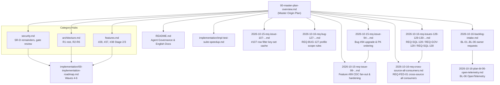

# Master Architecture & Implementation Backlog

**Last Updated:** October 16, 2026 · **Branch:** `main` (v1.1.16)  
**Role:** Solution Architect & Agent Coordinator  
**Location:** `docs/plans/00-master-plan-overview.md`  
**Purpose:** Canonical origin plan, dependency graph, and active track status for all AI agents and engineers working on the Autheris ecosystem.

---

## 🧭 Origin Plan Protocol for AI Agents

> [!IMPORTANT]
> **Directive for all AI agents and contributors:**
> 1. **Language:** All plans, requirements, and documentation must be written in **English** (aligned with [README.md](file:///root/autheris/README.md)).
> 2. **Repository of Requirements:** All new requirements, design documents, and feature requests must be stored in [`docs/plans/`](./).
> 3. **Consolidated Category Structure:** Active work is consolidated under three core categories:
>    - [`security.md`](security.md): Threat modeling, AppSec findings, hardening, and WORM compliance.
>    - [`architecture.md`](architecture.md): Full-solution architecture reviews, layering, component decoupling, and strategic waves (R0–R6).
>    - [`features.md`](features.md): Functional roadmap (aggregations #28, privacy #37, dbt semantic layer #38).
> 4. **Refinement on the Origin Plan:** When refining an existing feature or adding a new requirement, agents must:
>    - Update the corresponding category document (`security.md`, `architecture.md`, or `features.md`).
>    - Update the execution matrix and status below in this Origin Plan.
>    - Maintain traceable bidirectional links between parent and child documents.

---

## 0. 🎯 Prioritized Backlog (owner rule 2026-10-16)

**Rule (owner):** security-critical items and bugs first, then urgently missing features, only then larger add-ons. Work is pulled strictly top-down; an item may start early only if it has no shared files with a higher item in progress. Every item still passes the 6-phase lifecycle; the column "Next phase" names the gate it waits for. The matrix in section 1 is sorted in the same order.

### Priority Wave 1: security and bugs

| Rank | Item | Why this rank | Size | Phase 1 (PM) | Next phase |
|---:|---|---|:---:|:---:|---|
| 1.1 | **#127** value profiles and synthetic samples in `describe_dataset` ignore scope-specific column rules (`REQ-BUG-127`) | Data disclosure: a masked column can show clear values | S | ✅ | Phase 3 done (approved with conditions BC-1..12). Phases 4-6 done, **PR #141** ([`PLAN-BUG-127`](2026-10-16-plan-bug-127-value-profile-scope-rules.md)) |
| 1.2 | **OLAP cross-source bypass:** `POST /api/v1/olap/query` joins sources without federation gate, transport gate, masked-column join/filter guardrails or AST analysis; `CrossSourceOptions.MaxMemory`/`MaxTempDirectorySize`/`MaxParallelSourceReads` not enforced, `AllowedTransports` not validated (`REQ-FED-01` finding 4/5, `WP-FED-01` + `WP-FED-05`) | Governance gap on a live endpoint; pulled out of `REQ-FED-01` as a standalone security fix | M | ✅ (REQ-FED-01) | Phase 2 done: [`PLAN-SEC-OLAP-01`](2026-10-16-plan-sec-olap-federation-gate.md) (minimal gate now, WP-FED-05 facade later). Phase 3 done (approved with conditions BC-OLAP-01..18; engine blocklist bypass also affects single-source OLAP). Phases 4-6 done, **PR #140** (follow-ups T3-19, T3-27..30, truncation indicator listed in the PR) |
| 1.3 | **GraphQL advertises cross-source relations that always fail** (#75 reopened; schema-gating part of `WP-FED-08`) | Bug: schema promises fields that cannot run; stop advertising until INC-3 delivers them | S | ✅ (REQ-FED-01) | Phase 3 done (approved with conditions). Phases 4-6 done, **PR #139** ([`PLAN-BUG-75-GATING`](2026-10-16-plan-bug-75-graphql-relation-schema-gating.md)) |
| 1.4 | **Nightly SQL compiler gate G8 failing** (allocation ratio 1.27x, limit 1.25x, on `70b75e27`) | Regression in a release gate | S | n/a (bug) | Phase 2 done: [`PLAN-BUG-G8-01`](2026-10-16-plan-bug-g8-allocation-regression.md) (top hypothesis: mask-guard passes allocate on every query; PRs #108-#110 ruled out). Phase 3 done (approved with conditions SEC-G8-01/02: skip condition via `HasMaskingForTable`, no shared stack). Phases 4-5 done, **PR #142** (G8 green at 127.3 KB; code review closed two fail-open cases of the guard skip) |
| 1.5 | SQL Server Windows auth follow-ups (`REQ-BUG-NTLM-01` OPEN-1 18452 on the GSS path, OPEN-2 managed NTLM against a real server) | Waits for the reporter's probe with v1.1.16; becomes a bug item only if the probe fails | – | ✅ | Reporter feedback |

**Delivery tracker for Waves 2 and 3:** [`PLAN-DELIVERY-W23`](2026-10-16-plan-waves-2-3-delivery.md) holds the gate status per item, the strictly sequential planning order (all Phase 2 and Phase 3 first) and the single-developer implementation order.

### Owner decisions 2026-10-16 (recorded in the PRDs)

| Question | Decision | Recorded in |
|---|---|---|
| Q-130-1 argument order | `convert_timezone(from_zone, to_zone, ts)` (final) | `REQ-SQL-130` §4.6 |
| Q-130-2 result type | local wall-clock timestamp without offset; offset variant later as a separate function | `REQ-SQL-130` §4.6 |
| Q-111-1 who may set `Full` | governance admins only; owners only `Hidden`/`Summary` | `REQ-GOV-111` §2.9, §8 |
| Q-112-1 typed aggregation shape | typed group fields + list of typed aggregate values | `REQ-DATA-112` §3.8, §8 |
| Q-112-2 `where: String` | removed immediately (Phase 2 checks for other GraphQL callers) | `REQ-DATA-112` §3.8, §8 |
| Q-113-2 self-service scopes | `data.access.request` (request) and `data.access.review` (decide), separate | `REQ-GOV-113` §4.8, §8 |
| Q-1 `CrossSource:Enabled` default | stays off | `REQ-FED-01` §12 |
| Q-6 `AllowCrossDataSource` | both table owners approve (four-eyes); same rule for co-location groups (Q-16) | `REQ-FED-01` §12 |
| Q-8 key values from source A to B | per-source opt-in `allow_key_set_import`, default off | `REQ-FED-01` §7.1.8, §12 |
| Q-128-1 list maximum | 1000 per parameter, configurable | `REQ-SQL-128` §2.7 |
| Q-129-1 #129 replaces `WP-SC-04` | yes | `REQ-GOV-129` §3.7, `PLAN-SCALE-5000` row 22 |
| O-7 tenancy mode (`PLAN-GOV-111` rev. 3) | new option `Gateway:Tenancy:Mode`, default `Multi` (fail closed for claim-less tokens); single-tenant deployments set `Single` — the consuming platform (Talos) runs single-tenant and sets `Single` on upgrade | `PLAN-GOV-111` (WP-0) |

Guiding rule (owner): rights are checked by the backend, not by the calling agent; an agent must never widen its own reach. All other open questions default to the PRD recommendation.

**Consumer urgency (owner, 2026-10-16):** (1) SQL Server NTLM login via the managed `SspiContextProvider` (`REQ-BUG-NTLM-01` OPEN-2; delivered in v1.1.16, awaiting the probe against the real server); (2) a configurable row-filter strategy for WebSQL so `ORDER BY` with row filters does not time out → #107 moved to rank 2.1; (3) the catalog-build failure reason in the log — delivered in v1.1.16 (#133).

### Priority Wave 2: urgently missing features (small and medium)

| Rank | Item | Size | Phase 1 (PM) | Next phase |
|---:|---|:---:|:---:|---|
| 2.1 | **#107** row filter key-set cache: implementation of WP-A/B/C (contracts merged) — the real answer to `RowFilters:SubqueryStrategy` (#136); **consumer-urgent:** WebSQL `ORDER BY` with row filters runs into timeouts without it | M | ✅ | Phase 4 (steps I-1..I-3): WP-A delivered on `feat/issue-107-wp-a` (I-1 done), WP-B delivered on `feat/issue-107-wp-b` (I-2 done; feature doc [F-GOV-23](../features/f-gov-23-row-filter-key-set-cache.md)); next I-3 WP-C |
| 2.2 | **#115** switches for the remaining read paths (REST data endpoint, MCP tool groups) — closes uncontrollable read paths | S | ✅ | Phase 4 (step I-4) |
| 2.3 | **#128** list parameters (`IN`/`NOT IN`) — prerequisite of #129 and #131 | M | ✅ | Phase 4 (step I-5) |
| 2.4 | **#130** governed time zone conversion | S-M | ✅ | Phase 4 (step I-6) |
| 2.5 | **#111** persisted dataset tags and catalog visibility | M | ✅ | Phase 4 (steps B-1 security fix, then I-7) |
| 2.6 | **#112** typed aggregations in GraphQL for read-only tokens | M | ✅ | Phase 4 (steps B-2 security fix, then I-8) |

### Priority Wave 3: feature completion (medium and large)

| Rank | Item | Size | Phase 1 (PM) | Next phase |
|---:|---|:---:|:---:|---|
| 3.1 | `REQ-FED-01` INC-6: #122 predicate pushdown, #124 key-set filters, #123 same-source subtrees (cross-source usable at volume) | L | ✅ | Phase 4 (steps I-14..I-17) |
| 3.2 | `REQ-FED-01` INC-1..INC-5: federation contract, GraphQL cross-source relations, HTTP sources | L | ✅ | Phase 4 (steps B-0 security fix, I-9..I-13, I-18..I-21) |
| 3.3 | **#113** access requests with read-only tokens (increment A, then B) | M | ✅ | Phase 4 (steps B-3 security fix, I-22, I-24) |
| 3.4 | **#114** consumers per calling application | M | ✅ | Phase 4 (step I-23) |
| 3.5 | **#129** row filters on caller attributes (replaces `WP-SC-04`, after #128) | L | ✅ | Phase 4 (step I-25) |
| 3.6 | **#131** bound parameters in federated queries (`WP-FED-15`) | S-M | ✅ | Phase 4 (step I-26) |
| 3.7 | **BL-06** OpenTelemetry tracing, metrics and logging | L | ✅ | Phase 4 (steps I-27..I-30) |

### Priority Wave 4: larger add-ons

| Rank | Item | Size | Phase 1 (PM) | Next phase |
|---:|---|:---:|:---:|---|
| 4.1 | **#99** governed CDC fan-out (I1 rest, I2, I3; I1-0 contracts merged) | XL | ✅ | Phase 4 |
| 4.2 | **BL-03 Wave 2** scale to 5,000 users (identity realms, SCIM, delegation, Access Policies, …) | XL | ✅ | Owner re-evaluation, re-reviews |
| 4.3 | **#132** co-located data sources as one statement (`WP-FED-16`, spike first) | L | ✅ | Phase 3 |
| 4.4 | **BL-05** per-data-source configuration | ? | ❌ intake only | Phase 1 |
| 4.5 | **BL-08** C# DLL extension points for authentication and authorization | ? | ❌ intake only | Phase 1 |
| 4.6 | **BL-04** table cache (after BL-01, BL-05) | XL | ❌ intake only | Phase 1 |
| 4.7 | **BL-07** PostgreSQL wire protocol endpoint | L | ✅ (conditional go) | Owner decision |
| 4.8 | `WP-ARC-C-19` optional unit-test project split | S | n/a | Freeze window |

### Issue intake 2026-10-17 (placement confirmed by the owner 2026-10-17)

Assessment: [`INTAKE-2026-10-17`](2026-10-17-issue-intake-assessment.md). All eight issues are sensible with changes; none is rejected or merged. Ranks below are confirmed (owner accepted all recommended defaults OQ-1..15 on 2026-10-17); wave 2/3 items join `PLAN-DELIVERY-W23` only when that run reaches them, so its gate G-PLAN is not reopened.

| Rank | Item | Size | Phase 1 (PM) | Next phase |
|---:|---|:---:|:---:|---|
| 1.6 | **#152-#154 INC-1** procedure security slice: identical 404 for unknown and denied, consent before parameter validation, generic 422 instead of procedure error text, concurrency cap, `cleared_columns` no longer lifts explicit `Mask` ([`REQ-PROC-152..154`](2026-10-17-req-issues-152-154-governed-procedures.md)) | M | ✅ | Phase 2 ✅ [`PLAN-PROC-152-INC1`](2026-10-17-plan-issue-152-154-inc1-procedure-security.md) (6 WPs, M); Phase 3 ✅ APPROVED WITH CONDITIONS (`SEC-PROC152-01..11`, tests `T-PROC152-01..14`); next Phase 4 as standalone step after I-3, before I-5/I-9/I-23/I-25 |
| 1.7 | **#138 INC-1** one catalog visibility service; ReBAC also in MCP `list_datasets`/`describe_dataset` ([`REQ-CAT-138`](2026-10-17-req-issue-138-catalog-at-scale.md)); starts after I-7 (same files) | S-M | ✅ | Phase 2 ✅ [`PLAN-CAT-138-INC1`](2026-10-17-plan-issue-138-inc1-catalog-visibility-service.md) (3 WPs, S-M; adds GraphQL `catalog` and `/datasources`); Phase 3 ✅ APPROVED WITH CONDITIONS (`SEC-CAT138-01..12`, tests `T-CAT138-01..15`); next Phase 4 as step I-7a, only after I-7 is merged and re-verified |
| 1.8 | **#151** composite-key relations: dbt import keeps all key pairs, `TABLE_RELATION_KEYS` in baseline DDL ([`REQ-REL-151`](2026-10-17-req-issue-151-composite-key-relations.md)); before I-18 and #138 INC-4 | M | ✅ | Phase 2 ✅ [`PLAN-REL-151`](2026-10-17-plan-issue-151-composite-key-relations.md) (WP-151-1..5, WP-151-6 deferred, M); Phase 3 ✅ APPROVED WITH CONDITIONS (`SEC-REL151-01..12`, tests `T-REL151-01..14`); next Phase 4 in the first free DDL slot after I-7, before I-8 (never in parallel with another DDL step) |
| 2.7 | **#143** sensitive columns for restricted scopes only with a scope-specific `Clear` ([`REQ-GOV-143`](2026-10-17-req-issue-143-restricted-scope-sensitive-columns.md)) | M | ✅ | Phase 2 |
| 2.8 | **#150** startup warm-up before `/health/ready`, measurement first ([`REQ-OPS-150`](2026-10-17-req-issue-150-startup-warmup-readiness.md)) | M | ✅ | Phase 2 |
| 2.9 | **#152-#154 INC-2** procedure `limit` after row scoping, `MaxScanRows`, read-only `POST`, error map, `ddl_hash` warning | M | ✅ | Phase 2 |
| 2.10 | **#146 step A** `displayName` in MCP catalog tools ([`REQ-CAT-146`](2026-10-17-req-issue-146-multilingual-catalog-texts.md)) | S | ✅ | Phase 2 |
| 3.8 | **#138 INC-2..4** catalog version counter and snapshot, ranking within the visible set, bulk relations and indexes | L | ✅ | Phase 2 |
| 3.9 | **#152-#154 INC-3/INC-4** scope-aware computed columns, masking metadata, caller-aware describe, procedures as catalog entries | M-L | ✅ | Phase 2 |
| 3.10 | **#146 steps B/C** per-language texts, language negotiation, multilingual search | M | ✅ | Phase 2 |
| 4.9 | **#138 INC-5** opt-in embedding providers (no model in the default image) | L | ✅ | Phase 2 |
| 4.10 | **#153 INC-5** MCP tool to call procedures (own PRD) | M | ❌ | Phase 1 |

---

## 1. 🚀 Active Execution Tracks & Plan Matrix

| Plan / Category Document | Topic & Scope | Open Requirements & Components | Status | Next Milestone |
|---|---|---|:---:|---|
| [`2026-10-16-plan-waves-2-3-delivery.md`](2026-10-16-plan-waves-2-3-delivery.md) `PLAN-DELIVERY-W23` | **Delivery tracker for Priority Waves 2 and 3** | Owner rule: plan everything first (Phase 2 plans P-1..P-10, then Phase 3 reviews S-1..S-10, one agent at a time), then one developer implements steps I-1..I-30 sequentially, each with Phase 5 and Phase 6 before the next. Per-item gate status for #107, #115, #128, #130, #111, #112, `REQ-FED-01` INC-1..6, #113, #114, #129, #131, BL-06; `PLAN-FED-01` delta plan done. Gate G-PLAN passed 2026-10-16 (all plans and reviews APPROVED WITH CONDITIONS); final sequence: security bugfixes B-0..B-3 first, then I-1..I-30. | **IN DELIVERY: security bugfixes B-0..B-3 done ✅ (stacked branches, PRs #145, #147, #148 and B-3); chunk 1 in progress: I-1 (#107 WP-A) done ✅ on `feat/issue-107-wp-a`, I-2 (#107 WP-B) done ✅ on `feat/issue-107-wp-b`** | Next: step I-3 (#107 WP-C). |
| [`2026-10-17-issue-intake-assessment.md`](2026-10-17-issue-intake-assessment.md) `INTAKE-2026-10-17` | **Issue intake #138, #143, #146, #150, #151, #152-#154** | Claims verified against `main` `b5c1b5dd`; verdicts, sizes, waves and owner questions OQ-1..15. PRDs: `REQ-CAT-138`, `REQ-GOV-143`, `REQ-CAT-146`, `REQ-OPS-150`, `REQ-REL-151`, `REQ-PROC-152..154`. Security findings: procedure existence/parameter oracle and error-text leak, `cleared_columns` lifting scope `Mask`, missing ReBAC in MCP list/describe. | **PHASE 1 DONE (owner decisions OQ-1..15: all defaults); wave 1 items 1.6-1.8 PHASE 2+3 DONE** | Phase 4 for 1.6 (after I-3), 1.8 (DDL slot after I-7), 1.7 (I-7a after I-7); Phase 2 for wave 2 items |
| [`2026-10-16-plan-bug-127-value-profile-scope-rules.md`](2026-10-16-plan-bug-127-value-profile-scope-rules.md) `PLAN-BUG-127` | **Priority 1.1 – Bug #127 fix plan** | Delete the two scope-blind column-level computations (`McpDatasetCatalog`, `QueryAnalysisService`) and use `IConsentResolutionService.ResolveAccess(..., callerScopes)` + `TableAccessDecision.GetEffectiveColumnAccess`; catalog baseline kept for denied decisions; fail closed to `Mask`; parity matrix test. One work package, S. | **IN REVIEW 🔍 – PR #141** | Merge; follow-up: none blocking. |
| [`2026-10-16-plan-sec-olap-federation-gate.md`](2026-10-16-plan-sec-olap-federation-gate.md) `PLAN-SEC-OLAP-01` | **Priority 1.2 – OLAP cross-source security fix** | Confirmed by code reading: `POST /api/v1/olap/query` joins sources with `CrossSource` disabled and no analysis of client SQL (rows are masked before staging, so no plaintext oracle). Minimal fix: `FederationGate` with transport `Olap` (fail closed, cross-source requests only), masked-column guardrails on client SQL, `MaskedColumns` passed to the engine, dead `CrossSourceOptions` removed, `AllowedTransports` validated at startup; takes over parts of `WP-FED-01`; full facade stays `WP-FED-05`. 3 WPs, ~310 prod / ~510 test LOC. Breaking: cross-source OLAP needs `Olap` in `AllowedTransports`. | **IN REVIEW 🔍 – PR #140** | Merge; follow-ups: tests T3-19, T3-27 (Virtual Filters through OLAP, required before `Olap` is recommended), T3-28..30, truncation indicator (owner), allowlist widening, `OlapStagingService` refactor. |
| [`2026-10-16-plan-bug-75-graphql-relation-schema-gating.md`](2026-10-16-plan-bug-75-graphql-relation-schema-gating.md) `PLAN-BUG-75-GATING` | **Priority 1.3 – Stop advertising unusable cross-source GraphQL relations** | Confirmed: `CatalogSchemaModel` emits every relation; runtime rejects cross-source ones with `INVALID_QUERY_OPTION`. Fix: `RelationExecutability.IsSameExecutionSource` (source type + `SourceName`) guards before field-name allocation; resolver stub kept for `WP-FED-06`; F-GOV-19 doc correction. ~130 prod / ~330 test LOC. | **IN REVIEW 🔍 – PR #139** | Merge. |
| [`2026-10-16-plan-bug-g8-allocation-regression.md`](2026-10-16-plan-bug-g8-allocation-regression.md) `PLAN-BUG-G8-01` | **Priority 1.4 – Nightly gate G8 allocation regression** | 0.5 KB bucket 1.27x legacy (limit 1.25x); all buckets +4.5..5.4 % over the frozen AST baseline; PRs #108-#110 ruled out; top hypothesis: mask-guard passes in `AstSecurityVisitor` allocate on every query; bisect over `72c767bc..70b75e27`. No limit raise. S. | **IN REVIEW 🔍 – PR #142** | Merge, then a manual nightly run on `main`; follow-ups: Stryker (SEC-G8-T8), verifier coverage (SEC-G8-T7). |
| [`2026-10-16-req-bug-127-value-profile-scope-rules.md`](2026-10-16-req-bug-127-value-profile-scope-rules.md) `REQ-BUG-127` | **Bug #127 (security): `describe_dataset` value profiles ignore scope-specific column rules** | Verified: `McpDatasetCatalog.ComputeTableColumnAccessAndFilters` is scope-blind (base `Clear` + scope-A `Mask` yields `Clear`), feeding value profiles and synthetic samples; same defect class in `QueryAnalysisService` (wrong prediction, no leak) and `CatalogVisibility` (fail closed, accuracy only). Fix: thread token scopes, reuse `ConsentResolutionService` (no fourth copy), parity test catalog level versus data path. Size S. | **PRD READY ✅, SECURITY REVIEW pending (short)** | **Implement next (P1, security):** Phase 4 TDD fix on its own branch, then Phase 5. |
| [`2026-10-16-req-cross-source-all-consumers.md`](2026-10-16-req-cross-source-all-consumers.md) `REQ-FED-01` Plan: [`2026-10-16-plan-cross-source-all-consumers.md`](2026-10-16-plan-cross-source-all-consumers.md) `PLAN-FED-01` | **Cross-Source Access for All Consumers (issue #75 reopened)** | Owner requirement: cross-source must work cleanly for every consumer. Verified: federation works only on SQL-text channels (WebSQL, Trino, Arrow, Flight, MCP SQL, async jobs, SQL endpoints), opt-in; GraphQL relations across sources are advertised but rejected, `CrossSourceRelationResolver` is unwired (in-memory stub reader), OLAP bypasses compiler guardrails. Design: one federation contract (gate, errors, provenance, audit), GraphQL tree splitting with batched governed key lookup, OLAP facade over the governed SQL pipeline, `AllowCrossDataSource` persisted, `AllowedTransports` default widened (master switch stays off). Work packages `WP-FED-01..10`, security conditions `SEC-FED-01..18`. **Extended 2026-10-16 with #122-#125 (federated query performance):** predicate pushdown per source (#122), same-source subtrees run in the source (#123), dynamic key-set filters (#124), doc correction for `f-data-02`/`f-data-03` (#125, Phase 6); PRD section 7.1 (`FR-20..34`, `AC-15..22`, `Q-8..13`), plan section 4.11, `WP-FED-11..14` (increment INC-6), `SEC-FED-19..34`, security reviewed with conditions. **Extended 2026-10-16 with #131 (bound parameters in federated queries) and #132 (co-located data sources):** PRD section 7.2 (`FR-35..45`, `AC-23..31`, `Q-14..20`, `R-14..18`), plan section 4.12, `WP-FED-15` (S-M, needs `REQ-SQL-128` for lists) and `WP-FED-16` (L, after `WP-FED-13`, SQL Server only, qualification spike first), increment INC-7, security placeholders `SEC-FED-35..42` (Phase 3 pending); #131 is mostly D-10/FR-5/FR-25 completed, #132 never lets one service account bypass per-table consents, row filters or masks. | **SECURITY REVIEWED 🔍** (#122-#124); **#131/#132 PRD READY, SECURITY REVIEW pending** | Phase 4: TDD implementation in waves A-I (see plan section 6.1); waves J-K after Phase 3 of 12.7 and after `REQ-SQL-128`; open owner questions Q-1..Q-20 in the PRD. |
| [`2026-10-16-req-issues-111-115-catalog-access-analytics.md`](2026-10-16-req-issues-111-115-catalog-access-analytics.md) `REQ-GOV-111` / `REQ-DATA-112` / `REQ-GOV-113` / `REQ-OBS-114` / `REQ-SEC-115` | **Issues #111-#115: Catalog Discovery, Read-Only Analytics, Self-Service Access, Caller Reporting, Read-Path Switches (PRD, Phase 1)** | #111 persisted dataset tags and `Hidden`/`Summary`/`Full` visibility (Summary never exposes columns); #112 typed `<table>_aggregate` and `queryMetrics` for read-only tokens plus persisted semantic manifest; #113 `SelfServiceScopes` allowlist (request/withdraw) and approver-chosen row filters on approval (two increments); #114 per-application consumer report with normalized, capped, untrusted caller labels (per-person view stays owner/delegate/admin only); #115 switches for the REST data endpoint and MCP tool groups. Dependencies on bugfix issues #117 and #118. | **PRD READY** | Phase 2 (`csharp-architect`): suggested order #115, #111 and #112, #113 A, #114, #113 B. |
| [`2026-10-16-req-issues-128-129-130-websql-parameters-user-attributes-timezones.md`](2026-10-16-req-issues-128-129-130-websql-parameters-user-attributes-timezones.md) `REQ-SQL-128` / `REQ-GOV-129` / `REQ-SQL-130` | **Issues #128-#130: List Parameters, Caller-Attribute Row Filters, Governed Time Zone Conversion (PRD, Phase 1)** | #128 list parameters (`string[]`, JSON array) only for `IN`/`NOT IN`, expanded to typed bound parameters, bounded by the bind budget, strict header types (M; prerequisite of #131 and #129 lists). #129 `{{caller.<name>}}`/`USER_ATTRIBUTE` row filters, **realises and replaces `WP-SC-04`** (one `ICallerAttributeProvider`: token claims, SCIM store, governed attribute table; fail closed, one generic outcome; L; dedicated Phase 3). #130 `convert_timezone(from, to, ts)` with a closed IANA zone set and per-dialect mapping; result type and argument order are owner decisions; `AT TIME ZONE` operator stays rejected (S-M). | **PRD READY ✅, SECURITY REVIEW pending** | Phase 2 plans: #128 first, #130 in parallel, #129 after #128 (lane B of the scale plan); owner questions Q-128-1..5, Q-129-1..7, Q-130-1..5. |
| [`2026-10-15-req-issue-107-row-filter-key-set-cache.md`](2026-10-15-req-issue-107-row-filter-key-set-cache.md) `REQ-GOV-107` Plan: [`2026-10-15-plan-issue-107-row-filter-key-set-cache.md`](2026-10-15-plan-issue-107-row-filter-key-set-cache.md) | **Issue #107: Key-Set Cache Strategy for Correlated Row Filters** | Opt-in `KeySetCache` evaluation strategy for `SubqueryCorrelated` row filters: governed key query run once, keys cached per data source/tenant/filter hash/policy epochs, injected as `fk IN (@p...)`; settings per rule (`CONSENT_ROW_FILTERS`) and per object (`TABLE_ROW_FILTER_STRATEGIES`), global default and caps; precedence rule > object > global; default `Exists`; fallback to `EXISTS` (max keys, parameter budget, DENY, temporal); fail closed on key-query failure; baseline `0001` DDL extended in place. | **PHASE 4 IN PROGRESS 🛠️ – contracts merged (PR #108); WP-A delivered on `feat/issue-107-wp-a`, WP-B (I-2) delivered on `feat/issue-107-wp-b`** | Phase 2 plan `PLAN-GOV-107` done (substitution in `GovernancePolicyFactory` after admission on the compiler input only; key query derived from the registered EXISTS via new engine entry point `IPolicyKeyQueryCompiler` reusing `PolicySubqueryTenantRewriter`, `AstSecurityVisitor` untouched; cache key = SHA-256 over compiled key query + binds + tenant + authoritative epochs; work packages WP-A settings/persistence/admin, WP-B engine/substitution, WP-C runtime/cache/integration). Phase 3 done: approved with binding conditions `SEC-RF107-01..16` (principal independence + per-source `KeySetCacheAllowed` default false, authoritative epochs, polarity, lossless typing, READ COMMITTED key reads, concurrency limit). Contracts, settings and baseline DDL merged (PR #108, stubs only). Next: I-3 (WP-C: runtime, cache, integration). |
| [`2026-10-16-req-bl-06-open-telemetry.md`](2026-10-16-req-bl-06-open-telemetry.md) `REQ-OPS-BL06` Plan: [`2026-10-16-plan-bl-06-open-telemetry.md`](2026-10-16-plan-bl-06-open-telemetry.md) | **BL-06: Tracing, Metrics and Logging via OpenTelemetry** | OTLP for traces/metrics/logs, W3C Trace Context (baggage dropped, trust-aware sampler), Serilog replaced by the OpenTelemetry logging provider with one redaction point, fail-closed span/metric allow-lists, scrubbed SQL text/hash, W3C trace id in audit/problem details, gateway-owned `db` spans per source command, metric catalog (prometheus-net instrumentation removed), async span links, per-data-source policy hook for BL-05, Helm/collector example. Security review: approved with conditions `SEC-OT06-01..21`. | **PHASE 3 DONE 🔐** | Phase 4: WP-0 contracts (Dev B), then streams A (composition root, logs, deploy), B (policy hook, spans), C (metrics, async propagation); CDC links after BL-01 merge. |
| [`2026-10-15-req-issue-99-cdc-fanout-and-hardening.md`](2026-10-15-req-issue-99-cdc-fanout-and-hardening.md) `REQ-CDC-99` Plan: [`2026-10-15-plan-issue-99-cdc-fanout-and-hardening.md`](2026-10-15-plan-issue-99-cdc-fanout-and-hardening.md) | **Feature #99: Governed CDC Fan-Out & Change-Tracking Hardening (F-CDC-02, F-EXT-01)** | One fenced producer per tracked table writing a durable, encrypted, versioned stream in the governance DB (stream + watermark in one transaction); per-consumer offsets, start positions, bounded retention with explicit gap events; receivers GraphQL / CloudEvents webhook / C# DLL plugin, each bound to an identity and authorised, row-filtered (move-in/out) and masked per event at delivery, fail closed, audited without payload; expired watermark -> control event + automatic restart; declared PK checked at activation (no `sys.indexes`), snapshot isolation, per-table interval/batch/timeout. Increments I1 (producer + stream), I2 (durable consumers, webhooks, GraphQL), I3 (plugins). | **PHASE 4 STARTED 🛠️ – I1-0 contracts merged (PR #109)** | Phase 2 done (`PLAN-CDC-99`: contracts, DDL, work packages I1-0/A/B/C/E, I2-0/A/B/C, I3-A/B). Phase 3 done: approved with conditions `SEC-CDC99-01..22` (tenant moves, no historical replay, byte-exact tenant match, fail-closed identity, key separation). I1-0 contracts and baseline DDL merged (PR #109, stubs only). Next: WP-I1-A/B/C (branches `feat/issue-99-i1-{a,b,c}` not merged). |
| [`2026-10-16-plan-scale-5000-users.md`](2026-10-16-plan-scale-5000-users.md) `PLAN-SCALE-5000` | **Scale to 5,000 Users: Consolidated Implementation Plan (Phase 2 + Phase 3, rev. 3)** | Owner decisions 2026-10-16 (Entra ID identity-only tokens, SCIM per mode, 3-layer attributes with LDAPS/Entra App Roles, recertification 90/365 days + SCIM lock, OBO delegation) incl. corrections: **Q4 individual grants allowed but only time-bound** (`WP-SC-16` time-bound grant policy: mandatory expiry on all grant paths, class maxima e.g. 180 d regular / 90 d PII / 30 d unmasked / 7 d privileged / 72 h break-glass, renewal rules, read-time clamp of legacy permanent grants) and **delegation connector-agnostic** (Databricks first `WP-SC-15`, SQL Server second `WP-SC-17`: Entra OBO token / read-only `SESSION_CONTEXT` asserted identity / optional KCD spike, per-user pool partitions, connection lifetime ≤ token). Multi-issuer realms (workforce + customer OAuth). Conflicts C1–C8 resolved. Security `SEC-SC-01..25`. LOC: Wave 1 ≈ 3.9k prod / 5.0k test; Wave 2 ≈ 20.3k prod / 24.2k test. | **WAVE 1 MERGED ✅ (PR #110); Wave 2 awaiting owner re-evaluation (re-review needed for SC-13, SC-15/SC-17, SC-06, PF-13)** | Wave 1 delivered: consent indexes + indexed consent query (`WP-SC-01`), persisted access profiles with user/group/role assignments and `Unmasked` rules (`WP-SC-03`), time-bound individual grant policy on all grant paths with read-time clamp (`WP-SC-16`), atomic manifest apply without duplicate role consents (`WP-SC-02`), audit group commit with Tier-A ack after anchor (`WP-PF-04`), Cluster-safe epoch reads + 150 ms staleness budget (`WP-PF-01/-07`), compiled `sub_rule` delegates (`WP-PF-03`), bounded caches on BitFaster.Caching (`WP-PF-06`), shape-shared sharded decision cache with kill switch `ShareAcrossUsers` (`WP-PF-09`), Basic-auth cluster marker + post-auth IP limiting (`WP-PF-08`), paged `GET /api/v1/governance/grants` and `/audit` (`WP-SC-10`). Docs: [F-GOV-22](../features/f-gov-22-time-bound-individual-grants.md), F-GOV-11/12/15, F-AUDIT-01, F-SEC-06, F-OPS-02, F-AUTH-DX, configuration guide 2.21, runbook 4.ai–4.ak/9.4. Rev. 4 (2026-10-16, owner): on-prem AD groups are **pushed via SCIM** (Entra provisioning or optional on-prem push agent `WP-SC-18`) instead of an LDAPS pull; group provisioning on in Hybrid mode; LDAPS provider optional; `SEC-SC-14` extended (privileged SCIM credential, mass-change hold) — see plan §1.7. Next: owner re-evaluates Wave 2. |
| [`2026-10-16-backlog-intake.md`](2026-10-16-backlog-intake.md) `BACKLOG-2026-10-16` | **Owner Backlog Intake 2026-10-16** | BL-01 CDC fan-out (#99), BL-02 row filter key-set cache (#107), BL-03 scale to 5,000 users (analysis), BL-04 table cache (CT/CDC/periodic/TTL refresh, transparent joins, disk persistence), BL-05 per-data-source configuration (cost, logging, …), BL-06 tracing and logging via open standards (PRD [`2026-10-16-req-bl-06-open-telemetry.md`](2026-10-16-req-bl-06-open-telemetry.md), `REQ-OPS-BL06`). | **INTAKE 📥** | BL-06 Phases 1–3 done on `feat/bl-06-open-telemetry` (see BL-06 row), next Phase 4; then BL-05 → BL-04 refined sequentially by the product manager. |
| [`2026-10-16-req-postgres-wire-protocol-endpoint.md`](2026-10-16-req-postgres-wire-protocol-endpoint.md) `REQ-PROTO-PGWIRE` | **PostgreSQL Wire Protocol Endpoint (PRD, Phase 1)** | Product-manager evaluation of pure C# simple-query server vs. Rust `pgwire` sidecar vs. native C# Extended Query implementation vs. existing Trino/Flight protocols; open-source alternatives and license (BSL 1.1) constraints; governed execution only, TLS + strong auth mandatory. | **PROPOSED** | Phase 0: validate BI clients on the existing Trino protocol; owner decision on PG-only clients. |
| [`2026-10-16-req-bug-sqlserver-ntlm-diagnostics.md`](2026-10-16-req-bug-sqlserver-ntlm-diagnostics.md) `REQ-BUG-NTLM-01` | **Bug: SQL Server Windows Authentication (NTLM) failures not diagnosable (v1.1.14)** | Root causes RC-1..RC-6 (managed NTLM forced, swallowed provider failures, misclassification as Kerberos, silent catalog denials, managed-only environment variables, fake SQL probe). Fix: nullable `UseManagedNtlm` + `ManagedNtlmPolicy`, classified `SqlServerWindowsAuthException`, provider failure recording, catalog logging, native `setenv`, real SQL probe with login name; owner requirements R-3/R-4 (probe retry lock, per-credential login circuit breaker `LoginFailureCooldownSeconds`), R-5 (docs). Security `SEC-NTLM-01..09` (GSS identity guard, pool-key identity, `0600` file creation). Features: [F-AUTH-04](../features/f-auth-04-sqlserver-windows-auth-ntlm-kerberos.md), [F-API-09](../features/f-api-09-datasource-connectivity-testing.md). | **COMPLETED ✅ – merged (PR #134), released in v1.1.16** | One probe with the new image against the reporter's server (OPEN-2); open: 18452 on the GSS path (OPEN-1); owner questions Q-1..Q-3; optional real-server integration test (PRD 1.6). |
| [`2026-10-15-req-issue-94-upgrade-migration-and-pk-ordering.md`](2026-10-15-req-issue-94-upgrade-migration-and-pk-ordering.md) `REQ-GOV-94` Plan: [`2026-10-15-plan-issue-94-upgrade-migration-and-pk-ordering.md`](2026-10-15-plan-issue-94-upgrade-migration-and-pk-ordering.md) | **Bug #94 & #102: Schema Shape Verification, Declared Keys/Indexes & Key-Based Read Ordering** | Regression v1.1.8 → v1.1.9/v1.1.10. Owner decisions 2026-10-15: no upgrade/repair migrations; read-only, fail-closed shape verification before the version is recorded; declared composite primary keys and indexes persisted in the extended baseline (`0001` checksum unchanged), validated fail-closed; no source catalog queries for keys (least privilege); ordering PK → unique index → clear-text composite → 400; WebSQL 504 by design (problem details). | **COMPLETED ✅ – merged (PR #105)** | Phases 1–6 done on `fix/issue-94-upgrade-migration-pk`: streams A (DDL + shape verifier + least-privilege tests), B (definition + persistence + keys endpoint + ingestion entry points), C (ordering + consumers incl. GraphQL tree compiler, WebSQL 504 problem details). Feature docs: [F-GOV-21](../features/f-gov-21-declared-table-keys-and-read-ordering.md), [F-GOV-12 schema shape verification](../features/f-gov-12-multi-engine-governance-storage.md#schema-shape-verification). PR #105. SQL Server Windows Auth (#102) delivered separately (`F-AUTH-04`). |
| [`implementation/00-implementation-roadmap.md`](implementation/00-implementation-roadmap.md) `IMPL-ROADMAP-2026-10-14` | **Cross-Scope Implementation Roadmap** | Architecture Waves 1–6 (`WP-ARC-A`, `WP-ARC-B`, `WP-ARC-C`), Analytics/Governance feature tracks (`WP-FEAT-01..07b`: #28, #37, #38, #77, #79, #80; #75 reopened as `REQ-FED-01`), documentation alignment (`WP-DOC-01`: `f-data-04-arrow-flight-sql.md`, `f-dbt-07-dbt-semantic-layer-metrics.md`), and test suite speed-up (`WP-TS-00..06`) delivered and verified. Optional freeze-window test project split (`WP-ARC-C-19`). | **COMPLETED & VERIFIED ✅** | Optional freeze-window physical unit-test project split (`WP-ARC-C-19`). |
| [`security.md`](security.md) `PLAN-SECURITY-REVIEW` | **Security Review, Hardening & Compliance** | Waves A, B, C (`SR-H`, `SR-M`, `SR-L`), SEC2-08/09 remainders, and all 18 `accepted-differences.json` entries reviewed & approved. | **COMPLETED & VERIFIED ✅** | Maintain security regression & mutation gates. |
| [`architecture.md`](architecture.md) `PLAN-ARCH-REVIEW` | **Solution Architecture Remediation (R0–R6)** | R0–R6 architecture waves implemented: cluster-wide CDC fan-out (`A-13`), WORM audit group commit & `AuditChainEngine` (`A-07`, `B-14`), `ISqlDialectProvider` & `ISqlDialectRegistry` (`B-09`), Application package diet (`B-10`), `GatewayOptions` split & `IValidateOptions<T>` (`C-01`, `C-02`), API middleware/ProblemDetails/policies/endpoints (`C-04..C-08`), god-class decomposition (`C-09`), lock-free template cache & non-reflection AST walk (`C-10`, `C-12`), true streaming core & egress (`C-13`, `C-14`), `ICatalogVersionProvider` & `ICatalogLookup` (`C-15`), `IRedisConnectionProvider` & unified `GatewayDiagnostics` (`C-16`), and test/build hygiene (`C-17`, `C-18`, `C-20..C-22`). | **COMPLETED & VERIFIED ✅** | Optional freeze-window test project split (`WP-ARC-C-19`). |
| [`features.md`](features.md) `PLAN-FEATURES-ROADMAP` | **Analytics & Governance Feature Roadmap** | #28 governed aggregations (`GovernedAggregationService`, `F-DATA-08`), #37 minimum group size & DP noise/caching (`IDifferentialPrivacyEngine`, `F-DATA-08`), #38 dbt Semantic Layer Stage 2/3 (`SemanticMetricQueryService`, MCP `list_metrics`/`describe_metric`/`query_metrics`, GraphQL `queryMetrics`, `semantic.<model>` views, `TrinoMetadataQueryHandler` for `/v1/statement`, `F-DBT-07`), #75 cross-source GraphQL relations (`CrossSourceRelationResolver`, `F-GOV-19`; **REOPENED 2026-10-16, not delivered, see `REQ-FED-01`**), #77 change detection `ETag` & `changesSince` cursor (`GovernedChangeDetectionService`, `F-DATA-09`), #79 static query analysis & bundled consents (`QueryAnalysisService`, `F-GOV-20`), #80 column value profiles & synthetic sample rows (`ColumnValueProfileService`, `SyntheticSampleRowGenerator`, `F-AI-17`). | **COMPLETED & VERIFIED ✅** | Documented in `docs/features/` (`F-DATA-04`, `F-DATA-08`, `F-DATA-09`, `F-DBT-07`, `F-GOV-19`, `F-GOV-20`, `F-AI-17`). |
| [`implementation/impl-test-suite-speedup.md`](implementation/impl-test-suite-speedup.md) `IMPL-TEST-SPEEDUP-2026-10-14` | **Test Suite Speed-Up** | `WP-TS-00` (TRX artifacts), `WP-TS-01` (shared DB servers), `WP-TS-02` (CI shards), `WP-TS-03` (parallel Spark job), `WP-TS-04` (Cecil module & call-graph cache), `WP-TS-05` (`SerialIntegrationCollection` isolating `ItsmIntegrationTests`), and `WP-TS-06` (parallel SQL compiler gate) delivered and verified. | **COMPLETED & VERIFIED ✅** | Refresh CI shard weights periodically. |
| [`2026-10-15-plan-sqlgate-cutover-and-accepted-differences.md`](2026-10-15-plan-sqlgate-cutover-and-accepted-differences.md) `PLAN-SQLGATE-CUTOVER-03` | **SqlGate Differences Sign-Off & Cutover** | All 18 triage entries (57 unique statements) in `accepted-differences.json` audited, documented with concrete security justifications, and signed off (`approved`). Cutover precondition verified. | **COMPLETED & VERIFIED ✅** | Maintain G4 differential gate regression protection. |
| [`2026-10-16-analysis-scale-5000-users-governance.md`](2026-10-16-analysis-scale-5000-users-governance.md) `ANALYSIS-SCALE-5000-GOV` | **Scale to 5,000 Users: Governability of the Access Model** | Architect analysis: per-table consents are the only grant (no scope/tag inheritance), `USER_ATTRIBUTE` row filters fail closed, access profiles in-memory on PostgreSQL/SQL Server, missing consent indexes, no JML/directory integration, per-consent recertification, no paged admin/entitlement queries. Proposed target model (scoped Access Policies, RBAC+ABAC, tag-based column policy) and work packages `WP-SC-01..12`; open-source assessment §6 (adopt Microsoft.Graph/S.DS.Protocols when unblocked; borrow Ranger/Unity Catalog model and MIT SCIM schemas; reject OPA/Cedar as runtime PDP, AGPL Permify). | **ANALYSED → see `PLAN-SCALE-5000`** | Consolidated in [`2026-10-16-plan-scale-5000-users.md`](2026-10-16-plan-scale-5000-users.md). |
| [`2026-10-16-analysis-scale-5000-users-performance.md`](2026-10-16-analysis-scale-5000-users-performance.md) `ANALYSIS-SCALE-5000-PERF` | **Scale to 5,000 Users: Runtime Performance & Scaling** | Performance analysis: cluster-wide serialized audit writes (B-1), epoch MGET CROSSSLOT on Redis Cluster (B-2), CDC cluster cap keyed per tenant (B-3), uncached DynamicExpresso `sub_rule` evaluation (~547 µs/op measured) and per-user Casbin decision keys (H-1), full-table consent misses (H-2), unbounded memos (H-3), ReBAC `HGETALL` (H-4), `GetAllTablesAsync` on request paths (H-5), Basic-auth PBKDF2/IP limiter (H-6); capacity estimate (~600 rps peak), k6 load-test plan, open-source alternatives (BitFaster.Caching, HybridCache/FusionCache, OpenFGA conditional). | **ANALYSED → see `PLAN-SCALE-5000`** | Consolidated in [`2026-10-16-plan-scale-5000-users.md`](2026-10-16-plan-scale-5000-users.md). |
| [`README.md`](README.md) `PLAN-AGENT-GOV-DOCS-01` | **Agent Governance & English Documentation Standards** | Project-wide English documentation policy; `docs/plans/` as the plan repository; agent refinement lifecycle rules; root `AGENTS.md` & `CLAUDE.md`. | **COMPLETED & VERIFIED ✅** | Ongoing enforcement. |

---

## 2. 🗺️ Dependency & Refinement Graph

---

## 3. 📋 Historical Completed Tracks (Archive)

> [!NOTE]
> Completed and delivered tracks are documented in [`docs/features/`](../features/README.md); completed plan and requirement documents are preserved in git history.

| Track ID / Feature ID | Topic & Delivered Scope | Documented Reference | Delivered Date |
|---|---|---|---|
| `IMPL-ROADMAP` Waves 1–3 | **Implementation Waves 1–3:** Security Wave C, R0 trust foundation, R1 table-read pipeline, versioned migrations, parser pool. | [`docs/features/README.md`](../features/README.md) | 2026-10-14 (PRs #78, #81, #82) |
| `PLAN-AST-DIALECT-GEN-16` `F-DIALECT-02` | **AST Target Dialect Compiler: Single-Path Cutover (X1)** | [`docs/features/f-dialect-02-ast-sql-compiler.md`](../features/f-dialect-02-ast-sql-compiler.md) | 2026-10-14 |
| `PLAN-ADMIN-DATASOURCES-MCP` `F-AI-16` / `F-GOV-16` | **OpenAPI Datasource Ingestion & MCP Admin Tools** | [`docs/features/f-api-08-catalog-discovery-swagger-ingestion.md`](../features/f-api-08-catalog-discovery-swagger-ingestion.md) [`docs/features/f-ai-13-admin-mcp-tools-two-phase-hitl.md`](../features/f-ai-13-admin-mcp-tools-two-phase-hitl.md) | 2026-10-12 |
| `PLAN-EXT-EVENTS-WEBHOOKS-01` `F-EXT-01` | **Generic Extensibility, CloudEvents & Webhook Subsystem** | [`docs/features/f-ext-01-generic-plugin-events-and-webhooks.md`](../features/f-ext-01-generic-plugin-events-and-webhooks.md) | 2026-10-13 |
| `PLAN-FEDERATED-VF-DUCKDB-15` `F-GOV-14` | **Federated Virtual Filters & Web API Pushdown (DuckDB)** | [`docs/features/f-gov-14-federated-virtual-filters.md`](../features/f-gov-14-federated-virtual-filters.md) | 2026-10-11 |
| `PLAN-OFFLINE-DOC-MCP-14` `F-AI-15` | **Offline Document Vault & MCP Ingestion Gateway** | [`docs/features/f-ai-15-offline-doc-runbook-mcp-gateway.md`](../features/f-ai-15-offline-doc-runbook-mcp-gateway.md) | 2026-10-10 |
| `F-GOV-11`..`18`, `F-SEC-05` | **Governance, Access Profiles, Zero-Trust Hardening & WORM Compliance** | [`docs/features/README.md`](../features/README.md) | 2026-10-12 |
