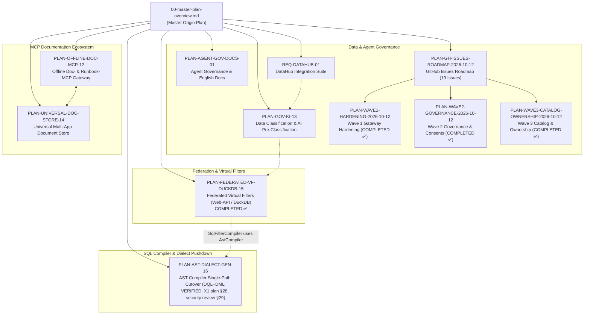

# Master Architecture & Implementation Backlog

**Last Updated:** October 14, 2026 · **Branch:** `feat/ast-x1-cutover`  
**Role:** Solution Architect & Agent Coordinator  
**Location:** `doc/plan/00-master-plan-overview.md` (or `docs/plans/00-master-plan-overview.md`)  
**Purpose:** Canonical origin plan, dependency graph, and active track status for all AI agents and engineers working on the Autheris ecosystem.

---

## 🧭 Origin Plan Protocol for AI Agents

> [!IMPORTANT]
> **Directive for all AI agents and contributors:**
> 1. **Language:** All plans, requirements, and documentation must be written in **English** (aligned with [README.md](file:///root/autheris/README.md)).
> 2. **Repository of Requirements:** All new requirements, design documents, and feature requests must be stored in [`doc/plan/`](file:///root/autheris/doc/plan/).
> 3. **Refinement on the Origin Plan:** When refining an existing feature or adding a new requirement, agents must:
>    - Create or update the detailed plan in `doc/plan/` (e.g., `YYYY-MM-DD-plan-<topic>.md`).
>    - Update the execution matrix and status below in this Origin Plan.
>    - Maintain traceable bidirectional links between parent and child documents.

---

## 1. 🚀 Active Execution Tracks & Plan Matrix

| Plan / Document ID | Topic & Scope | Addressed Requirements & Components | Status | Next Milestone |
|---|---|---|---|---|
| [`2026-10-14-plan-security-code-review.md`](2026-10-14-plan-security-code-review.md) `PLAN-SECURITY-REVIEW-2026-10-14` | **Full Security Code Review (follow-up to the 2026-10-13 AppSec audit)** | Re-review of all 7 production projects + deployment at `4cb0ae4a`/`main`: 0 Critical, 6 High, 26 Medium, 24 Low new/incomplete findings (`SR-*`), 9 deployment findings (`SR-D-*`); verification of 69 prior items (15 fixed, 28 partial, 25 open, 1 N/R). Detailed area reports in `2026-10-14-security-code-review/`. | **REVIEWED 🔍 – REMEDIATION PENDING** | Wave A (P0): SR-H-01..06, TOTP, rate limiting, OData fail-open; add regression tests for `6ad16519` fixes |
| [`2026-10-14-architecture-code-review.md`](file:///root/autheris/doc/plan/2026-10-14-architecture-code-review.md) `PLAN-ARCH-REVIEW-2026-10-14` | **Full-Solution Architecture Code Review** | Read-only Solution Architect review of all 7 projects plus tests at `88f7df1c`: 121 findings (0 Critical, 26 High, 62 Medium, 33 Low) in 10 themes - single governed query pipeline (extends X1 scope), audit contract, fat Application layer / dialect port, versioned governance migrations, HA/cluster semantics, eventing/webhooks/plugin contract, config & god-class decomposition, API consistency, hot-path performance, test & doc hygiene. Detail reports in `2026-10-14-architecture-code-review/`. | **REVIEW DELIVERED 📋** | Stakeholder decisions (§6), then child plans per remediation wave R0-R6 (R0: ARC-F-01, ARC-I-03, ARC-C-05, ARC-C-04, ARC-F-02, ARC-S-06) |
| [`2026-10-13-plan-security-audit-and-remediation.md`](file:///root/autheris/doc/plan/2026-10-13-plan-security-audit-and-remediation.md) `PLAN-SECURITY-AUDIT-2026-10-13` | **Comprehensive Application Security (AppSec) Code Review & Remediation Plan** | Full security audit across all 7 projects (`Autheris.Api`, `Autheris.Application`, `TrinoSqlEngine`, `Autheris.Infrastructure`, `Autheris.Extensions`, `Autheris.GraphQL`, `Autheris.Domain`): 6 Critical, 20 High, 25 Medium, 9 Low findings, PoC `B-10`–`B-18` verification, and completed C# remediations across API, Governance, SQL AST, Audit & SSRF. | **COMPLETED & VERIFIED ✅** | Verified: 4,002 unit tests, 241 extension tests, 1,421 Trino tests, and 13 architecture tests passing green (0 build warnings/errors) |
| [`2026-10-13-plan-odata-metadata-latency-optimization.md`](file:///root/autheris/doc/plan/2026-10-13-plan-odata-metadata-latency-optimization.md) `PLAN-ODATA-METADATA-LATENCY-2026-10-13` | **OData Metadata ($metadata) & Service Document Latency Optimization** | Eliminates 150+ sequential synchronous Tier-A audit writes and redundant catalog SQL queries by adding fast-path `CheckTableAccessAsync` with preloaded `TableMetadata` and `recordAudit: false`, plus 60s in-memory CSDL and Service Document caching via `IMemoryCache`. | **COMPLETED & VERIFIED ✅** | Verified with unit test suites in `Autheris.Extensions.Tests` & `Autheris.Tests.Unit` |
| `2026-10-13-plan-generic-plugin-events-and-webhooks.md` *(archived, see git history)* `PLAN-GENERIC-PLUGIN-EVENTS-2026-10-13` | **Generic C# DLL Plugin & Event/Webhook Callback Subsystem** | Unifies in-process C# DLL plugin event listeners (`IPluginEventListener<TEvent>`, `IPluginActionHandler`) and out-of-process webhooks (`IWebhookDispatcherService`) on top of `IGatewayEventBus` with CloudEvents v1.0 and HMAC-SHA256 signatures. | **COMPLETED & VERIFIED ✅** | Documented in `docs/features/f-ext-01-generic-plugin-events-and-webhooks.md` & verified with unit/integration test suites |
| `2026-10-13-plan-odata-excel-and-openapi-fixes.md` *(archived, see git history)* `PLAN-ODATA-EXCEL-OPENAPI-2026-10-13` | **OData Excel Metadata Compatibility & Complete OpenAPI Query Options** | Fixes GitHub #66 (Advertise and document `$filter`, `$orderby`, `$count`, `$format` in dynamic OpenAPI 3.1) and GitHub #67 (Entity-escape newlines/tabs in CSDL XML attributes to enable Microsoft Excel OData feed loading). | **COMPLETED & VERIFIED ✅** | Documented in `docs/features/f-api-03-odata-openapi.md` & verified with unit test suites |
| `2026-10-12-plan-wave4-graphql-dbt-semantics.md` *(archived, see git history)* `PLAN-WAVE4-GRAPHQL-DBT-SEMANTICS-2026-10-12` | **Wave 4 GraphQL Cursor Pagination, Temporal Types & dbt Semantics** | Delivers Non-AST items of Wave 4 (#36, #39, #38 Stage 1): ISO Temporal scalars (`Date`, `DateTime`, `LocalTime`), dbt `meta` Column Semantics passthrough, Relay Cursor Paging with truncation signal, and dbt Semantic Manifest ingestion + MCP metrics discovery. | **COMPLETED & VERIFIED ✅** | Documented in `docs/features/f-gov-17-graphql-temporal-dbt-semantics.md` & verified with unit/integration test suites |
| `2026-10-12-plan-catalog-ownership-wave3.md` *(archived, see git history)* `PLAN-WAVE3-CATALOG-OWNERSHIP-2026-10-12` | **Wave 3 Catalog Transparency, Data Ownership & Response Enhancements** | Delivers 4 GitHub issues (#43, #33, #32, #27): Return Catalog Tags in `list_datasets`/`describe_dataset`, Data Owners in catalog & Backstage, Catalog Discovery with Access Status (`GRANTED/PENDING/NONE`), and Mark Masked Values in GraphQL responses (`extensions.maskedFields`). | **COMPLETED & VERIFIED ✅** | Documented in `docs/features/f-gov-16-catalog-ownership-transparency.md` & verified with unit/integration test suite |
| `2026-10-12-plan-governance-consents-wave2.md` *(archived, see git history)* `PLAN-WAVE2-GOVERNANCE-2026-10-12` | **Wave 2 Governance, Consents & Scope-Specific Enforcement** | Delivers 5 GitHub issues (#40, #35, #34, #26, #29): GitOps declarative policy apply API, self-service `describe_my_access` / `myAccess`, access request & approver inboxes, scope-specific monotonic masking (`Agent.Read`), and application scope (`App.Read`). | **COMPLETED & VERIFIED ✅** | Documented in `docs/features/f-gov-15-declarative-consents-scopes.md` & verified with unit & integration tests |
| `2026-10-12-plan-gateway-hardening-wave1.md` *(archived, see git history)* `PLAN-WAVE1-HARDENING-2026-10-12` | **Wave 1 Gateway Hardening & Protocol Hygiene** | Delivers 5 GitHub issues (#44, #42, #41, #31, #30): Auth-exempt pre-auth rate limits, protocol kill switches (OData, Arrow, Iceberg, DuckDB), Kerberos cleanup, Caller context in WORM audit chain, distinguishable error codes. | **COMPLETED & VERIFIED ✅** | Documented in `docs/features/f-sec-05-gateway-hardening-defense.md` & verified with 3,500+ unit tests |
| [`2026-10-12-plan-github-issues-roadmap.md`](file:///root/autheris/doc/plan/2026-10-12-plan-github-issues-roadmap.md) `PLAN-GH-ISSUES-ROADMAP-2026-10-12` | **GitHub Issues Master Roadmap & Execution Plan** | Comprehensive qualification and 4-wave delivery plan for 19 open GitHub issues (#26-#44): (1) Gateway Hardening [DONE], (2) Governance & Consents [DONE], (3) Catalog & Ownership [DONE], (4) Aggregations & Headless BI | **ACTIVE & IN EXECUTION 🚀** | Waves 1, 2 & 3 Completed; ready for Wave 4 (Aggregations & Headless BI) |
| `2026-10-12-req-datahub-integration-suite.md` *(archived, see git history)* `REQ-DATAHUB-01` | **Dual-Mode Enterprise Data Governance Suite** | Dual-Mode: (1) Embedded Standalone Mode (AST lineage graph, declarative data contracts & assertions in SQLite/DuckDB) and (2) Federated Enterprise Mode (DataHub GMS client, MCL webhooks, lineage egress, and contract circuit breaker) | **COMPLETED & VERIFIED ✅** | Documented in `docs/features/f-gov-18-datahub-integration-contracts.md` & verified with unit tests |
| `2026-10-10-konzept-federated-virtual-filter-web-api-duckdb.md` *(archived, see git history)* `PLAN-FEDERATED-VF-DUCKDB-15` | **Federated Virtual Filters on Web-APIs via DuckDB** | Gateway hash semi-join enforcement at staging for Web-API tables; Tier 0/1/2/3 federation planner (empty key set, point lookup, endpoint-capability pushdown, full fetch); tenant-isolated single-flight key set cache; path-lookup reader; fail-closed `VF_*` denial codes. Feature reference: [`f-gov-14-federated-virtual-filters.md`](file:///root/autheris/docs/features/f-gov-14-federated-virtual-filters.md) | **COMPLETED & VERIFIED ✅** | Merge `feat/vf-federation-hardening`. Phase 5 APPROVED at `6abac9a` (re-review loop 1) plus review loop 2 (CR-17..CR-19); Phase 6 documentation done (see the plan's Implementation Log)
| *Follow-up of* `PLAN-FEDERATED-VF-DUCKDB-15` | **REST dataset `LIMIT`/`OFFSET` cross-source parser bug** | The REST dataset channel (`GET /api/v1/data/{source}/{schema}/{table}`) builds `LIMIT .. OFFSET ..` SQL that the cross-source parser rejects, so it answers 500 instead of 403 on web-API tables. Pre-existing, independent of Virtual Filters, fails closed (no rows); found in the F-GOV-14 Phase 5 review (CR-11) | **IN PROGRESS 🚀** | Being fixed on branch `fix/rest-dataset-limit-offset`; the F-GOV-14 end-to-end test asserts "no rows and zero upstream requests" until then |
| `2026-10-10-konzept-datenklassifizierung-ki-vorklassifizierung.md` *(archived, see git history)* `PLAN-GOV-KI-13` | **Data Object Classification & AI Pre-Classification** | Fail-Closed `UNCLASSIFIED` initial state; optional AI pre-classification with 150ms timeout guard; auto-preclassify at confidence $\ge 95\%$; dual-sign-off workflows | **COMPLETED & VERIFIED ✅** | Documented in `docs/features/f-gov-13-data-classification-and-pii-governance.md` & verified with unit tests |
| `2026-10-10-implementierungsplan-offline-doc-mcp-gateway.md` *(archived, see git history)* `PLAN-OFFLINE-DOC-MCP-12` | **Offline Doc- & Runbook-MCP Gateway** | Ingestion pipeline for Markdown, arc42, Runbooks, OpenAPI, Error Catalogs; local BM25/SIMD hybrid search; `GatewayMcpServer` stdio/SSE bridge | **COMPLETED & VERIFIED ✅** | Documented in `docs/features/f-ai-15-offline-doc-runbook-mcp-gateway.md` & verified with unit tests |
| `2026-10-10-konzept-universelle-dokumentenablage-mcp.md` *(archived, see git history)* `PLAN-UNIVERSAL-DOC-STORE-14` | **Universal Document Store for Multi-App MCP** | Headless Ingestion REST API (ZIP bundles, markdown assets), MCP deposit (`deposit_documentation`, `list_applications`), and Zip-Slip safe shared-volume storage | **COMPLETED & VERIFIED ✅** | Documented in `docs/features/f-ai-16-universal-doc-store-mcp.md` & verified with unit tests |
| [`2026-10-10-plan-ast-dialect-generator.md`](2026-10-10-plan-ast-dialect-generator.md) PRD: [`2026-10-10-req-ast-dialect-generator.md`](2026-10-10-req-ast-dialect-generator.md) `PLAN-AST-DIALECT-GEN-16` | **AST Target Dialect Generator: Single-Path Compiler Cutover** | One AST compiler path for every governed SQL statement (legacy `RlsListener`, `SqlRewriterEngine`, `ShadowDualRun`, `TrustedSqlExpression` and the application plan cache deleted; no runtime flag, rollback by revert), every value bound, typed policy/mask IR, dialect capability table with derived admission ({PostgreSQL, SQL Server, SQLite, Oracle}; Databricks Experimental; Snowflake fail-closed), DML + `MERGE` through the checked executor, stable error codes (§28.4.3), keyed audit digest, tenant registry, pre-merge CI gate `sql-compiler-gate` (G1-G10, frozen legacy golden results); supersedes the German draft `2026-10-06-implementation-plan-ast-dialect-generator.md` *(archived, see git history)*; amends [ADR-017 §2](../adr/ADR-017-distributed-state-ast-generator-and-rbac.md); history: DQL/DML Phase 5 approved (§19, §20), X1 execution plan §28, Phase 3 review §29, X0 packages and X1 implementation logs at the end of the plan | **X1 cutover IMPLEMENTED on `feat/ast-x1-cutover`** (Phase 2-5 done: X1 part A and part B, Phase 3 review of part A and re-check of the cutover, Phase 5 review with fixes); **Phase 6 docs done** on `feat/ast-x1-docs`: [F-DIALECT-02](../features/f-dialect-02-ast-sql-compiler.md) (single-path reference incl. upgrade notes), F-DIALECT-01 and the F-PERF-11 plan cache superseded, ADR-017 amendment 2026-10-13 | **Before the X1 squash:** Stryker M-12 on the cutover head; G8 re-check; M-11 revert re-rehearsal on the final squash commit; Phase 3 approval of the pending entries in `accepted-differences.json`; `sql-compiler-gate` as a required check (branch protection). **Next:** X1-DBX (Databricks to Production after a G9 run), WP-X2 post-cutover hardening. Handover: `2026-10-13-handover-ast-x1-cutover.md` (branch `docs/ast-x1-handover`) |
| [`README.md`](file:///root/autheris/doc/plan/README.md) `PLAN-AGENT-GOV-DOCS-01` | **Agent Governance & English Documentation Standards** | Project-wide English documentation policy; central `doc/plan/` repository; agent refinement lifecycle rules; root `AGENTS.md` & `CLAUDE.md` | **ACTIVE & ADOPTED ✅** | Ongoing enforcement across all sub-agent and tool invocations |
| `PLAN-AST-DIALECT-GEN-16` (follow-up) | **REST dataset deep paging** | REST dataset deep paging: emit OFFSET per dialect via the AST target-dialect compiler (PLAN-AST-DIALECT-GEN-16) instead of an in-memory skip. | **PLANNED 📋** | Lift the pagination-window cap once per-dialect OFFSET generation is available |

---

## 2. 🗺️ Dependency & Refinement Graph

---

## 3. 📋 Historical Completed Tracks (Archive)

> [!NOTE]
> All prior foundation tracks (Plans 1 through 11, SQL-AST Hardening, and Tracks A through E) were 100% completed, verified through 5,600+ automated unit & integration tests, and archived in accordance with repository clean-up guidelines.
