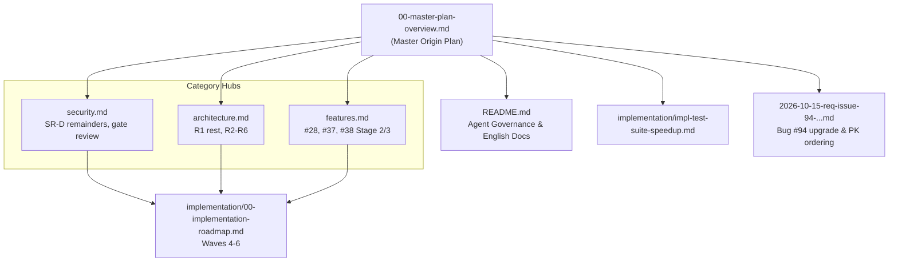

# Master Architecture & Implementation Backlog

**Last Updated:** October 15, 2026 · **Branch:** `feat/impl-wave-5-6`  
**Role:** Solution Architect & Agent Coordinator  
**Location:** `docs/plans/00-master-plan-overview.md`  
**Purpose:** Canonical origin plan, dependency graph, and active track status for all AI agents and engineers working on the Autheris ecosystem.

---

## 🧭 Origin Plan Protocol for AI Agents

> [!IMPORTANT]
> **Directive for all AI agents and contributors:**
> 1. **Language:** All plans, requirements, and documentation must be written in **English** (aligned with [README.md](file:///root/autheris/README.md)).
> 2. **Repository of Requirements:** All new requirements, design documents, and feature requests must be stored in [`docs/plans/`](./).
> 3. **Consolidated Category Structure:** Active work is consolidated under three core categories:
>    - [`security.md`](security.md): Threat modeling, AppSec findings, hardening, and WORM compliance.
>    - [`architecture.md`](architecture.md): Full-solution architecture reviews, layering, component decoupling, and strategic waves (R0–R6).
>    - [`features.md`](features.md): Functional roadmap (aggregations #28, privacy #37, dbt semantic layer #38).
> 4. **Refinement on the Origin Plan:** When refining an existing feature or adding a new requirement, agents must:
>    - Update the corresponding category document (`security.md`, `architecture.md`, or `features.md`).
>    - Update the execution matrix and status below in this Origin Plan.
>    - Maintain traceable bidirectional links between parent and child documents.

---

## 1. 🚀 Active Execution Tracks & Plan Matrix

| Plan / Category Document | Topic & Scope | Open Requirements & Components | Status | Next Milestone |
|---|---|---|:---:|---|
| [`implementation/00-implementation-roadmap.md`](implementation/00-implementation-roadmap.md) `IMPL-ROADMAP-2026-10-14` | **Cross-Scope Implementation Roadmap** | Architecture Waves 1–6 delivered (including R2/R3/R4/R5/R6 work packages: `A-02`, `A-03`, `A-07`, `A-11..A-14`, `B-07`, `B-09`, `B-10`, `B-12..B-14`, `C-01..C-18`, `C-20..C-22`). Open: Analytics feature track (`FEAT-03`, `FEAT-04`, `FEAT-06a/b`) and freeze-window physical unit-test project split (`WP-ARC-C-19`). | **IN PROGRESS 🚀** | Execute unblocked FEAT-03 (#28), FEAT-04 (#37), and FEAT-06a/b (#38 Stage 2). |
| [`security.md`](security.md) `PLAN-SECURITY-REVIEW` | **Security Review, Hardening & Compliance** | Waves A, B, C (`SR-H`, `SR-M`, `SR-L`), SEC2-08/09 remainders, and all 18 `accepted-differences.json` entries reviewed & approved. Open: deprecation follow-ups. | **COMPLETED ✅** | Maintain security regression & mutation gates. |
| [`architecture.md`](architecture.md) `PLAN-ARCH-REVIEW` | **Solution Architecture Remediation (R0–R6)** | R0–R6 architecture waves implemented: cluster-wide CDC fan-out (`A-13`), WORM audit group commit & `AuditChainEngine` (`A-07`, `B-14`), `ISqlDialectProvider` & `ISqlDialectRegistry` (`B-09`), Application package diet (`B-10`), `GatewayOptions` split & `IValidateOptions<T>` (`C-01`, `C-02`), API middleware/ProblemDetails/policies/endpoints (`C-04..C-08`), god-class decomposition (`C-09`), lock-free template cache & non-reflection AST walk (`C-10`, `C-12`), true streaming core & egress (`C-13`, `C-14`), `ICatalogVersionProvider` & `ICatalogLookup` (`C-15`), `IRedisConnectionProvider` & unified `GatewayDiagnostics` (`C-16`), and test/build hygiene (`C-17`, `C-18`, `C-20..C-22`). | **COMPLETED ✅** | Optional freeze-window test project split (`WP-ARC-C-19`). |
| [`features.md`](features.md) `PLAN-FEATURES-ROADMAP` | **Analytics Feature Roadmap** | #28 governed GraphQL aggregations, #37 minimum group size, #38 dbt Semantic Layer Stage 2/3. G-14 resolved (`decision-g14-feat-scope.md`). | **READY FOR EXEC 📋** | Execute FEAT-03 (#28) paired with FEAT-04 (#37), and FEAT-06a/b (#38 Stage 2). |
| [`implementation/impl-test-suite-speedup.md`](implementation/impl-test-suite-speedup.md) `IMPL-TEST-SPEEDUP-2026-10-14` | **Test Suite Speed-Up** | WP-TS-00 (TRX artifacts), WP-TS-01 (shared DB servers), WP-TS-02 (CI shards), WP-TS-03 (parallel Spark job), and WP-TS-04 (Cecil module & call-graph cache) implemented. Open: WP-TS-05. | **IN PROGRESS 🚀** | WP-TS-05 selective integration parallelization. |
| [`2026-10-15-req-issue-94-upgrade-migration-and-pk-ordering.md`](2026-10-15-req-issue-94-upgrade-migration-and-pk-ordering.md) `REQ-GOV-94` Plan: [`2026-10-15-plan-issue-94-upgrade-migration-and-pk-ordering.md`](2026-10-15-plan-issue-94-upgrade-migration-and-pk-ordering.md) | **Bug #94: Schema Shape Verification, Declared Keys/Indexes & Key-Based Read Ordering** | Regression v1.1.8 → v1.1.9/v1.1.10. Owner decisions 2026-10-15: no upgrade/repair migrations; read-only, fail-closed shape verification before the version is recorded; declared composite primary keys and indexes persisted in the extended baseline (`0001` checksum unchanged), validated fail-closed; no source catalog queries for keys (least privilege); ordering PK → unique index → clear-text composite → 400; WebSQL 504 by design (problem details). | **Security approved – Phase 4 (TDD) next** | Phase 3 approved with conditions (plan section 13: SEC-94-01 to SEC-94-16, mandatory security tests). Phase 4 streams A (DDL + verifier), B (definition + persistence + entry points), C (ordering + consumers incl. GraphQL tree compiler). |
| [`2026-10-15-plan-sqlgate-cutover-and-accepted-differences.md`](2026-10-15-plan-sqlgate-cutover-and-accepted-differences.md) `PLAN-SQLGATE-CUTOVER-03` | **SqlGate Differences Sign-Off & Cutover** | All 18 triage entries (57 unique statements) in `accepted-differences.json` audited, documented with concrete security justifications, and signed off (`approved`). Cutover precondition verified. | **COMPLETED ✅** | Maintain G4 differential gate regression protection. |
| [`README.md`](README.md) `PLAN-AGENT-GOV-DOCS-01` | **Agent Governance & English Documentation Standards** | Project-wide English documentation policy; `docs/plans/` as the plan repository; agent refinement lifecycle rules; root `AGENTS.md` & `CLAUDE.md`. | **ADOPTED ✅** | Ongoing enforcement. |

---

## 2. 🗺️ Dependency & Refinement Graph

---

## 3. 📋 Historical Completed Tracks (Archive)

> [!NOTE]
> Completed and delivered tracks are documented in [`docs/features/`](../features/README.md); completed plan and requirement documents are preserved in git history.

| Track ID / Feature ID | Topic & Delivered Scope | Documented Reference | Delivered Date |
|---|---|---|---|
| `IMPL-ROADMAP` Waves 1–3 | **Implementation Waves 1–3:** Security Wave C, R0 trust foundation, R1 table-read pipeline, versioned migrations, parser pool. | [`docs/features/README.md`](../features/README.md) | 2026-10-14 (PRs #78, #81, #82) |
| `PLAN-AST-DIALECT-GEN-16` `F-DIALECT-02` | **AST Target Dialect Compiler: Single-Path Cutover (X1)** | [`docs/features/f-dialect-02-ast-sql-compiler.md`](../features/f-dialect-02-ast-sql-compiler.md) | 2026-10-14 |
| `PLAN-ADMIN-DATASOURCES-MCP` `F-AI-16` / `F-GOV-16` | **OpenAPI Datasource Ingestion & MCP Admin Tools** | [`docs/features/f-api-08-catalog-discovery-swagger-ingestion.md`](../features/f-api-08-catalog-discovery-swagger-ingestion.md) [`docs/features/f-ai-13-admin-mcp-tools-two-phase-hitl.md`](../features/f-ai-13-admin-mcp-tools-two-phase-hitl.md) | 2026-10-12 |
| `PLAN-EXT-EVENTS-WEBHOOKS-01` `F-EXT-01` | **Generic Extensibility, CloudEvents & Webhook Subsystem** | [`docs/features/f-ext-01-generic-plugin-events-and-webhooks.md`](../features/f-ext-01-generic-plugin-events-and-webhooks.md) | 2026-10-13 |
| `PLAN-FEDERATED-VF-DUCKDB-15` `F-GOV-14` | **Federated Virtual Filters & Web API Pushdown (DuckDB)** | [`docs/features/f-gov-14-federated-virtual-filters.md`](../features/f-gov-14-federated-virtual-filters.md) | 2026-10-11 |
| `PLAN-OFFLINE-DOC-MCP-14` `F-AI-15` | **Offline Document Vault & MCP Ingestion Gateway** | [`docs/features/f-ai-15-offline-doc-runbook-mcp-gateway.md`](../features/f-ai-15-offline-doc-runbook-mcp-gateway.md) | 2026-10-10 |
| `F-GOV-11`..`18`, `F-SEC-05` | **Governance, Access Profiles, Zero-Trust Hardening & WORM Compliance** | [`docs/features/README.md`](../features/README.md) | 2026-10-12 |
