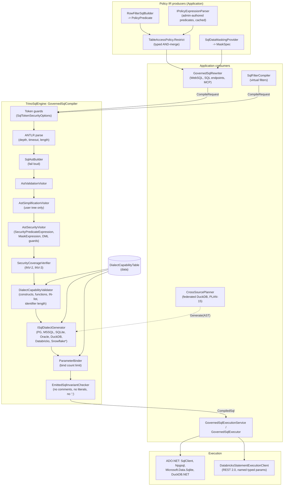
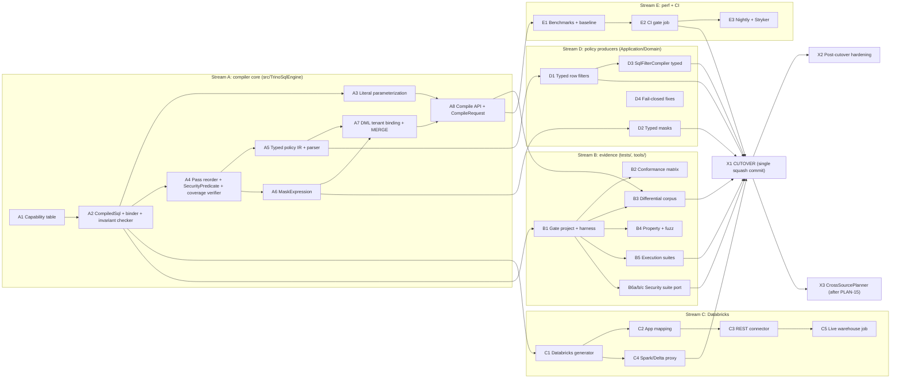

# Implementation Plan: AST Target Dialect Generator - Single-Path Compiler Cutover

**Document ID:** `PLAN-AST-DIALECT-GEN-16` (implementation plan, Phase 2 of the 6-phase lifecycle)
**Date:** 2026-10-10
**Status:** IN PROGRESS - DQL and DML approved (§19.9, §19.12) and documented (Phase 6, §27); X1 cutover execution plan written (Phase 2, §28) and security-reviewed (Phase 3, §29: 4 High, 9 Medium, 5 Low findings, all with binding amendments inline in §28; S-1..S-5 decided); next: Phase 4 Wave 1 (X0a..X0z with amendments); WP-X1 blocked until every X0 package, X0z (WP-F5) and the amended revert-set rehearsal are green
**Author:** Solution Architect (`csharp-architect`); Phase 3 reviews (§16, §29) by Security Expert (`csharp-security-expert`)
**Parent plan:** [00-master-plan-overview.md](00-master-plan-overview.md)
**Requirements baseline:** [2026-10-10-req-ast-dialect-generator.md](2026-10-10-req-ast-dialect-generator.md) (PRD, Phase 1)
**Supersedes:** [2026-10-06-implementation-plan-ast-dialect-generator.md](2026-10-06-implementation-plan-ast-dialect-generator.md) (German draft, kept for history only)
**Amends:** [ADR-017 §2](../adr/ADR-017-distributed-state-ast-generator-and-rbac.md) (amendment text in §13; Phase 6 writes it)
**Branch base:** `feat/ast-target-dialect-generator` (commit `6985be1`)

**Index:** DQL review loop 3 (CR-ADG-30..32 fixes, CR-ADG-31 X1 precondition, OQ-GQL) is in [§22](#22-implementation-log--dql-review-loop-3); open question OQ-GQL is in §15. The X1 cutover execution plan (verified preconditions, entry points, SQLite/Snowflake decision, work packages, error mapping, rollback) is in [§28](#28-x1-cutover-execution-plan-phase-2); it supersedes the open-item lists of §20.3, §24.3, §25.4, §26 and §27.3. The Phase 3 security review of §28 (findings SEC-X1-01..18, decided stakeholder items S-1..S-5, sign-off) is in [§29](#29-phase-3-security-review-of-28-csharp-security-expert); its binding amendments are inline in §28, marked "Phase 3 amendment".

---

## 0. Summary

The end state is **one** governed SQL compiler. Every SQL text produced by WebSQL, SQL endpoints, MCP dataset tools and virtual filters goes through:

```
Trino SQL -> token guards -> ANTLR parse -> typed AST -> simplify (user tree only)
         -> security injection (typed policy nodes) -> coverage verification
         -> dialect capability validation -> dialect emitter -> CompiledSql(text, bound parameters)
```

The legacy `RlsListener` / `TokenStreamRewriter` path, the `SqlRewriterEngine` switch, `ShadowDualRun` and `TrustedSqlExpression` are deleted in this track. There is no runtime engine flag, no shadow mode and no production observation window. Confidence comes from a **pre-merge, CI-enforced evidence gate** (§9) that runs while legacy still exists. When it is green, a single squash-merged cutover commit switches all consumers and deletes legacy. The rollback is `git revert` of that commit.

Scope additions over the PRD (stakeholder decisions, §1):

- Every value reaches the database as a bind parameter. This covers user literals, tenant values, policy values and mask arguments.
- Policy row filters and column masks become typed AST nodes. `TrustedSqlExpression` and raw-fragment splicing are removed.
- DML (`INSERT`, `UPDATE`, `DELETE`, `MERGE`) runs through the AST path in the first cut.
- **Databricks** becomes a new production dialect with a generator, a capability entry, a runtime connector and DML/`MERGE` semantics.
- **Snowflake** stays an experimental dialect: generator only, never executable in production.

---

## 1. Stakeholder Decisions and How They Override the PRD

| ID | Decision (binding) | PRD items overridden or resolved |
|---|---|---|
| SD-1 | **One code path.** AST compiler only. `RlsListener`, `TokenStreamRewriter` rewriting, `SqlRewriterEngine`, `RlsOptions.RewriterEngine` and `ShadowDualRun` are removed within this track. | Replaces increments 0-5, FR-1 (typed engine selector), FR-3 (kill switch), INV-8 (engine transparency, reduced to compiler version and dialect in audit), INV-9 (shadow isolation, obsolete), AP-8 (selector removed instead of typed). Answers Q-1 with option (a). |
| SD-2 | **No production observation window.** The evidence comes from a CI gate before merge: a classified differential corpus against legacy (zero `ast-looser`), property-based and differential fuzzing, real execution on SQL Server, PostgreSQL and Oracle (Testcontainers), SQLite and DuckDB (in process) and Spark/Delta (Databricks proxy), plus the carried-over SEC-xx/SQ-xx security suites. | Replaces FR-2, NFR-5, AP-5, the staging and production shadow ACs (AC-1.5, AC-1.6, AC-5.1) and Q-2. AP-2 (big-bang risk) is mitigated by the gate (§9) and accepted by the stakeholder. |
| SD-3 | **Best practice throughout.** sqlglot/Calcite/jOOQ-style design. All values are bound. `TrustedSqlExpression` policy and mask fragments become typed AST nodes: they are parsed once, cached and fail closed. A per-dialect capability table enforces correct limits (SQLite 32,766; Oracle's 1,000-item IN-list limit kept separate from its bind limit), and queries over a limit are rejected. Input token guards are kept. RLS predicates provably survive the simplifier. A BenchmarkDotNet gate measures against legacy with the PRD budgets. | Resolves G-3, G-4, G-5, G-6, G-7, AP-3, AP-7, AP-9. Answers Q-4 (reject), Q-7 (in scope) and Q-8 (PRD budgets accepted). |
| SD-4 | **DML from the start.** `INSERT`/`UPDATE`/`DELETE`, and `MERGE` (the grammar supports it, see §6.4), go through the AST path in the first cut. This includes WITH CHECK OPTION semantics, the unfiltered-DML guard and masked-column write protection. | Folds increment 3 into the single cutover. Answers Q-5. |
| SD-5 | **Snowflake is experimental.** It has a generator only, is clearly marked and is not in the production capability list. | Answers Q-3. Matches PRD §6.3 for Snowflake. |
| SD-6 | **ADR-017 is amended** to reflect SD-1..SD-7 (exact text in §13). | Answers Q-6. |
| SD-7 | **Databricks is a fully supported production dialect**, not experimental. It gets a generator (backtick quoting, `:name` markers, `LIMIT`/`OFFSET`, Unity Catalog three-part names, function and type mapping), a capability entry, DML on Delta (`UPDATE`, `DELETE`, `MERGE`), a Spark/Delta CI proxy, golden tests and an optional live SQL Warehouse job. | New scope beyond the PRD. Adds stream C (§11). |
| SD-8 | **Oracle is a supported production dialect with a runtime driver** (decided during Phase 3). | Resolves OQ-1. Adds Stream F (§16.6). |

PRD content that stays binding: invariants INV-1..INV-7 (§8.1), the anti-pattern rulings AP-1, AP-3, AP-4, AP-6, AP-7, AP-9 and AP-10 (plus the new AP-11 from §3.6: no Trino-style domain compaction of security predicates), the NFR-2/NFR-3 performance budgets, the NFR-4 limit sourcing, NFR-6 observability (minus shadow metrics), NFR-7 compatibility and NFR-8 language.

---

## 2. Additional Findings from Phase 2 (Beyond PRD G-1..G-8)

These were found while reading the code at `6985be1`. Each finding is handled by a work package.

| ID | Finding | Location | Handled by |
|---|---|---|---|
| F-1 | The mask dialect mapping falls back to PostgreSQL for any unmapped dialect (`_ => TargetSqlDialect.PostgreSql`). A Databricks or DuckDB table would silently get PostgreSQL mask SQL. This is a fail-open default. | `src/Autheris.Application/Services/SqlDataSourceExecutor.cs:568-588` | WP-D4 |
| F-2 | `RlsOptions.TargetDialect` defaults to `Ansi`. ANSI has `MaxParameterBudget => int.MaxValue` and no executable backend. | `src/TrinoSqlEngine/IRlsPolicyProvider.cs:283`, `AnalyticalDialectGenerators.cs:15` | WP-A8 |
| F-3 | The tenant predicate is a string-escaped **literal** spliced into the filter text (`$"{tenantColumn} = '{tenantId.Value.Replace("'", "''")}'"`). | `src/Autheris.Application/Sql/Services/GovernedSqlRewriter.cs:541` | WP-D1 |
| F-4 | `SqlFilterCompiler.Compile` post-processes the generated SQL with `string.Replace` on a quoted alias. This is a raw-text operation inside the "typed" pipeline. | `src/Autheris.Application/VirtualFilters/SqlFilterCompiler.cs:366-370` | WP-D3 |
| F-5 | Named client parameters are emitted as `__param_name` / `@name` and later restored by a regular expression over the secured SQL text (`RestoreClientParameters`). | `GovernedSqlExecutionService.cs:417-429`, `SqlDialectGeneratorBase.cs:607-641` | WP-A2, cutover WP-X1 |
| F-6 | There are two divergent limit tables: `DatabaseParameterBudgetProvider` (SQLite 999, Oracle 1,000, PostgreSQL 10,000, Databricks 10,000) and the generator `MaxParameterBudget` values (SQLite 999, Oracle 1,000, PostgreSQL 65,535). | `src/Autheris.Infrastructure/Persistence/DatabaseParameterBudgetProvider.cs`, `Ast/Generators/*` | WP-A1 |
| F-7 | Databricks exists as `DatabaseDialect.Databricks` (provider aliases `databricks`, `spark`, `sparksql`). It has quoting and normalization helpers, but no `TargetSqlDialect`, no generator, no driver (`SqlConnectionFactory`: "Oracle and Databricks are dialects without a driver here") and no mapping in `SqlDialectMapper`. | `src/Autheris.Domain/Common/DatabaseDialect.cs`, `SqlConnectionFactory.cs:31`, `SqlDialectMapper.cs` | Stream C |
| F-8 | The grammar supports `MERGE INTO ... USING ... WHEN [NOT] MATCHED` (`SqlBase.g4:229-231, 874-882`). The AST builder and legacy path reject it, and there is no `MergeStatement` node. `WHEN NOT MATCHED BY SOURCE` is not in the grammar. | `SqlBase.g4`, `SqlAstBuilder.cs:151` | WP-A7 |
| F-9 | `CrossSourcePlanner` (federated DuckDB, track PLAN-FEDERATED-VF-DUCKDB-15) calls the DuckDB generator directly and executes the returned string. | `src/Autheris.Application/Sql/Services/CrossSourcePlanner.cs:278` | WP-X3 (coordinated) |
| F-10 | `SqlDialectMapper.IsExecutable` covers only SQL Server, PostgreSQL and SQLite. Oracle has a generator and container tests, but no runtime driver in the gateway. | `SqlDialectMapper.cs:40` | Open question OQ-1 |
| F-11 | The simplifier runs **after** security injection and folds `WHERE` trees. The injected deny-all filter `1 = 0` and contradiction folding can interact with injected predicates (PRD G-6). | `FastSqlEngine.cs:815-816` | WP-A4 |
| F-12 | `AstSecurityVisitor.BuildDialectMaskExpression` returns dialect SQL strings and is also called from the GraphQL/data-source executor. | `SqlDataSourceExecutor.cs:574-595` | WP-A6, WP-D2 |

---

## 3. Target Architecture

### 3.1 Component diagram



`*` Snowflake: generator only, `DialectSupportTier.Experimental`. `CompileRequest` rejects it unless `AllowExperimentalDialect` is set, which only test code may set (enforced by an architecture test).

### 3.2 Pass ordering decision (INV-3)

**Decision:** simplification moves **before** security injection and only ever sees the user's tree. Two independent mechanisms then protect injected predicates:

1. **Opaque marker node.** Every injected RLS predicate is wrapped in `SecurityPredicateExpression` (sealed record, §4.3). The base `SqlAstRewriter` does not descend into it, and every visitor that runs after `AstSecurityVisitor` is forbidden to construct, remove or rewrite it. An architecture test checks this with reflection over all `SqlAstRewriter` subclasses.
2. **Structural post-condition.** After injection, `SecurityCoverageVerifier` walks the final AST and checks that every `NamedTableSource` that resolves to a physical table is wrapped in a secured subquery whose `WHERE` contains the expected `SecurityPredicateId` as a top-level conjunct, in every scope listed in INV-2. Masked columns must be `MaskExpression` nodes. Failure throws `SecurityCoverageException` (fail closed). The verifier runs in production on every compile, not only in tests. Its cost is linear in the node count (budget in NFR-2).

Why not keep the simplifier after injection and add an oracle? With the simplifier before injection, the invariant holds by construction. The oracle (property test G5-c) then checks it continuously instead of carrying it alone. Optimizing the injected predicates themselves has no measurable value.

### 3.3 Source semantics decision

WebSQL users write SQL in Trino syntax, and legacy forwards their text, so they get **backend semantics** today (null ordering, integer division, collation). The AST emitter keeps **backend semantics with Trino syntax**: it translates syntax and functions, but it does not inject semantic shims (for example forced `NULLS LAST` or integer-division rewrites). If it did, results would change compared with legacy, and the differential gate would turn that change into noise. Every intentional deviation is listed in the conformance matrix as `semantic-note`. This needs stakeholder confirmation (OQ-5).

### 3.4 Literal parameterization rules (INV-4, SD-3)

The emitter turns every value into a bind parameter.

- **Bound:** every `LiteralExpression` (string, numeric, boolean value in a comparison, date/time typed literal values, `IntervalLiteralExpression` values), every tenant value, every policy value and every mask argument (mask character, prefix/suffix lengths, HMAC key, jitter decimals).
- **Deduplicated:** identical `(type, value)` pairs within one statement reuse one marker. Every production dialect supports marker reuse (`$n`, `@pN`, `?NNN`, `:pN`). Without reuse, `SELECT a + 1 ... GROUP BY a + 1` fails on PostgreSQL.
- **Emitted inline, closed allow-list** (validated `long` in invariant culture, never text from the input):
  - `LIMIT`/`OFFSET`/`FETCH`/`TOP` row counts (the value is clamped by the gateway anyway);
  - `ORDER BY` and `GROUP BY` ordinals (a bound ordinal would sort by a constant);
  - window frame offsets;
  - `CAST` type parameters (`DECIMAL(p,s)`, `VARCHAR(n)`);
  - `EXTRACT`/`date_trunc`/interval **unit keywords**;
  - `NULL`, `TRUE`, `FALSE` keywords;
  - the canonical `1 = 0` deny-all.
- **Proof:** `EmittedSqlInvariantChecker` scans the emitted text with a dialect-aware lexer. It skips quoted identifiers and rejects any `'`, `--`, `/*`, `;`, dollar quote or `E'` outside them. The only exception is the constant format literals of the dialect's registered `BindExpressionTemplates` (§3.6), which the emitter registers by position. Numeric tokens may appear only at positions the emitter registered in an allow-list position set during emission.

### 3.5 Policy IR (SD-3, INV-5)

Policies are compiled to typed nodes **once**, at the point where they are produced:

- **Structured producers build the AST directly.** These are consent row filters (`ConsentRowFilter`: column, operator, JSON value), the tenant predicate, virtual filters and correlated row-filter subqueries. No text is involved.
- **Admin-authored predicates** (access-profile `RowFilterPredicate`, Casbin row-filter strings) are parsed by `IPolicyExpressionParser`:
  - the canonical policy syntax is Trino SQL (identical to user SQL);
  - strict token guards apply;
  - columns are resolved against the table's catalog columns (allow-list);
  - functions are checked against the function allow-list;
  - named markers `:name` become `PolicyParameterExpression`.
  
  Parse results are cached by `(SHA-256 of text, table identity, catalog version)` in a bounded `MemoryCache`. A parse failure denies the table (fail closed) and produces an operator-visible validation error at configuration load (`GatewayStartupValidator` and options reload).
- `TableAccessDecision` gains a typed `RowFilter` (`PolicyPredicate?`). `CombinedRowFilterSql` remains for the non-AST consumers outside this track (§7.3), but it is **rendered from the typed IR** by the same dialect generator (`PolicyPredicateRenderer`). Text and AST therefore cannot drift.

### 3.6 Reference design: Trino's own JDBC pushdown generator

Trino generates target-dialect SQL itself when it pushes work down to JDBC connectors (`plugin/trino-base-jdbc`, with one `JdbcClient` subclass per database). Its source is the closest production reference for this track. What we adopt and what we reject:

| Trino mechanism (source) | What it does | Decision for Autheris |
|---|---|---|
| `DefaultQueryBuilder` returns `PreparedQuery(String query, List<QueryParameter> parameters)`; an IN list is `nCopies(n, writeFunction.getBindExpression())` | Every value is a `QueryParameter` and is never inlined. Typed setters (`LongWriteFunction`, `SliceWriteFunction`, ...) bind at execution; null values use `setNull`. | **Adopt.** This is the model for `CompiledSql` + `BoundParameter` and typed binders (§4.2). |
| `WriteFunction.getBindExpression()`, e.g. Oracle `TO_DATE(?, 'SYYYY-MM-DD')`, `TO_TIMESTAMP(?, ...)` | A per-type, per-dialect **bind wrapper** around the placeholder, so the remote type is exact. | **Adopt** as `BindExpressionTemplate` per `(dialect, SqlParameterType)` in the capability table (§4.5). Templates are fixed constants reviewed in Phase 3, never data. This also mitigates R-2 (PostgreSQL parameter type inference). |
| Only constants inlined: `ALWAYS_TRUE = "1=1"`, `ALWAYS_FALSE = "1=0"` ("not all databases support booleans") | The only text constants are tautology and contradiction. | **Adopt.** Matches the §3.4 inline allow-list. |
| `BaseJdbcClient.quoted(name)` doubles the quote character; `quoted(catalog, schema, table)` skips empty parts | Identifier delimiting with escaping of the closing delimiter. | **Adopt.** The existing generators already do this; Databricks uses the same rule with backticks (§6.1). |
| `JdbcConnectorExpressionRewriterBuilder`: `withTypeClass("numeric_type", ...)`, `.map("$equal(left: numeric_type, right: numeric_type)").to("left = right")`, `.add(new RewriteStringComparison())` | Declarative, typed, per-dialect expression and function mapping rules. If no rule matches, the expression is simply not pushed down. | **Adopt the declarative style** for per-dialect function mapping (`DialectFunctionMap` data in the capability table instead of `switch` code). **Adapt the fallback:** Trino can evaluate an unpushed expression itself; the gateway cannot, so no matching rule means **reject** (INV-1). |
| `limitFunction()` + `isLimitGuaranteed()`; `topNFunction()` + `supportsTopN()`; `supportsMerge()` defaults to `false` | Capability flags decide what is pushed down. A connector that implements a function without its guarantee flag throws. | **Adopt** as capability flags `LimitGuaranteed`, `SupportsMerge`, ... (§4.5). The gateway's `EnforcedMaxRows` relies on `LimitGuaranteed = true` for every production dialect; a dialect without it is rejected. |
| `SqlServerClient`: `OFFSET/FETCH` with `ORDER BY (SELECT NULL)` instead of `TOP`; `NULLS FIRST/LAST` emulated with a `CASE WHEN col IS NULL THEN 1 ELSE 0 END` helper key; `supportsTopN` is false for char/varchar keys ("remote database can be case insensitive") | Dialect-specific pagination and null-ordering emulation; collation awareness. | The existing SQL Server generator already matches the pagination and null-ordering emulation. The collation note becomes a `semantic-note` in the conformance matrix (backend semantics, §3.3). Trino quotes SQL Server identifiers with `"`, which assumes `QUOTED_IDENTIFIER ON`; we keep brackets, because they do not depend on that session setting. |
| `SQL_SERVER_MAX_LIST_EXPRESSIONS = 500` ("SqlServer supports 2100 parameters ... space for about 4 big IN predicates"); `ORACLE_MAX_LIST_EXPRESSIONS = 1000` | IN-list limits are tracked separately from the bind limit. | **Adopt** the separation (`MaxInListItems` next to `MaxBindParameters`, §5). We keep Oracle at 1,000 (ORA-01795) and SQL Server unbounded except by the bind limit, because the gateway rejects instead of re-planning. |
| **Domain compaction** (`domain-compaction-threshold`, default 256 in the Trino Oracle connector docs): large IN lists are pushed down as a simpler **range** predicate | This widens the remote filter, which is safe in Trino only because Trino re-applies the exact filter on the returned rows. | **Reject (new anti-pattern AP-11).** The gateway does not re-filter, so widening a security predicate would make RLS looser. Over-limit IN lists are rejected (Q-4), never compacted. |
| `varcharLiteral(value)` (quote doubling) is used only for `COMMENT` statements, because Oracle cannot bind them | Literal emission is limited to statements without bind support. | **Not needed.** The compiler emits no DDL, so no literal path exists (INV-4). |
| `SqlFormatter` (Trino AST to Trino SQL text) | Canonical printer of the source dialect. | **Model** for the test-only `TrinoSourceRenderer` used by the round-trip identity gate G3. |

Trino OSS has no Databricks/Spark JDBC client, so there is no upstream reference for §6. Its Delta Lake connector reads table files directly and does not generate SQL.

Sources (Trino master, read 2026-10-10):

- https://github.com/trinodb/trino/blob/master/plugin/trino-base-jdbc/src/main/java/io/trino/plugin/jdbc/DefaultQueryBuilder.java
- https://github.com/trinodb/trino/blob/master/plugin/trino-base-jdbc/src/main/java/io/trino/plugin/jdbc/BaseJdbcClient.java
- https://github.com/trinodb/trino/blob/master/plugin/trino-base-jdbc/src/main/java/io/trino/plugin/jdbc/expression/JdbcConnectorExpressionRewriterBuilder.java
- https://github.com/trinodb/trino/blob/master/plugin/trino-oracle/src/main/java/io/trino/plugin/oracle/OracleClient.java
- https://github.com/trinodb/trino/blob/master/plugin/trino-sqlserver/src/main/java/io/trino/plugin/sqlserver/SqlServerClient.java
- https://trino.io/docs/current/connector/oracle.html (domain compaction threshold)

---

## 4. Interfaces and Types

Namespaces are relative to `TrinoSqlEngine` unless stated otherwise. All new types are `sealed`, records are immutable, collections are `ImmutableArray`/`FrozenDictionary`, and nullable is enabled.

### 4.1 Compile API (replaces `RewriteRls` and `GenerateGovernedSql`)

```csharp
namespace TrinoSqlEngine;

public interface ISqlEngine
{
    CompiledSql Compile(ReadOnlyMemory<char> sql, CompileRequest request, CancellationToken cancellationToken);

    // Unchanged:
    (SqlBaseParser.SingleStatementContext Tree, CommonTokenStream Tokens) Parse(ReadOnlyMemory<char> sql, SqlTokenSecurityOptions? tokenOptions = null, CancellationToken cancellationToken = default);
    (SqlBaseParser.StandaloneExpressionContext Tree, CommonTokenStream Tokens) ParseExpression(ReadOnlyMemory<char> sql, SqlTokenSecurityOptions? tokenOptions = null, CancellationToken cancellationToken = default);
    SqlQueryMetadata Analyze(ReadOnlyMemory<char> sql);
    SqlQueryMetadata Analyze(ReadOnlyMemory<char> sql, SqlTokenSecurityOptions? tokenOptions, CancellationToken cancellationToken = default);
}

/// <summary>Immutable compile input. Replaces the mutable RlsOptions bag on the governed path.</summary>
public sealed record CompileRequest
{
    public required TargetSqlDialect TargetDialect { get; init; }            // no default (F-2)
    public required GovernancePolicy Policy { get; init; }
    public required SqlTokenSecurityOptions TokenGuards { get; init; }       // kept, defense in depth (AP-3)
    public StatementPermissions Statements { get; init; } = StatementPermissions.ReadOnly;
    public long EnforcedMaxRows { get; init; }
    public bool TranslateTrinoDateFunctions { get; init; }
    public bool EnforceCatalogProjection { get; init; }
    public IReadOnlySet<string>? AllowedFunctions { get; init; }
    public IReadOnlySet<string>? AllowedTableFunctions { get; init; }
    public bool AllowExperimentalDialect { get; init; }                      // test-only; architecture test enforces
}

[Flags]
public enum StatementPermissions { ReadOnly = 0, Insert = 1, Update = 2, Delete = 4, Merge = 8 }

/// <summary>Typed governance input (replaces string providers and PolicyFiltersAreTargetDialectSql).</summary>
public sealed record GovernancePolicy
{
    public required IPolicyPredicateProvider RowFilters { get; init; }
    public required IColumnMaskProvider Masks { get; init; }
    public required ITableCatalog Catalog { get; init; }                     // columns, data types, tenant column
    public required TenantBinding Tenant { get; init; }
    public DmlGuardOptions Dml { get; init; } = DmlGuardOptions.Strict;
    public IReadOnlySet<string> TablesWithConsentRowFilter { get; init; } = FrozenSet<string>.Empty;
    public IReadOnlySet<string> TablesWithMaskedColumns { get; init; } = FrozenSet<string>.Empty;
    public RowFilterSubqueryStrategy SubqueryStrategy { get; init; }
}

public sealed record TenantBinding(string ParameterName, object Value, SqlParameterType Type);

public sealed record DmlGuardOptions(
    bool EnforceWithCheckOption,
    bool RequireTenantColumnInInsert,
    bool DisallowTenantColumnModificationInUpdate,
    bool RejectUnfilteredDml,
    bool RejectMaskedColumnsInDml,
    bool RejectMaskedColumnsInPredicates,
    bool RejectConsentFilteredInsert,
    bool RejectWholeRowReferencesInDml)
{
    public static DmlGuardOptions Strict { get; } = new(true, true, true, true, true, true, true, true);
}
```

### 4.2 Output types

```csharp
namespace TrinoSqlEngine.Ast.Emit;

public sealed record CompiledSql(
    string Sql,
    ImmutableArray<BoundParameter> Parameters,
    TargetSqlDialect Dialect,
    SqlStatementClass StatementClass,
    ImmutableArray<SecurityPredicateId> AppliedPredicates,
    string CompilerVersion);

public enum SqlStatementClass { Select, Insert, Update, Delete, Merge }

/// <param name="Marker">Exact marker text in Sql (e.g. "$3", "@p2", ":p4", "?5").</param>
/// <param name="Name">Provider binding name (SqlClient "@p2", Npgsql positional "", Oracle "p4", Databricks "p4").</param>
public readonly record struct BoundParameter(
    string Marker,
    string Name,
    int Ordinal,
    object? Value,
    SqlParameterType Type,
    ParameterOrigin Origin);

public enum ParameterOrigin { ClientNamed, ClientPositional, QueryLiteral, Tenant, Policy, Mask }

public enum SqlParameterType
{
    String, Int32, Int64, Decimal, Double, Boolean, Date, Timestamp, TimestampTz, Time, Binary, Null
}

/// <summary>Binds CompiledSql to a provider command. One implementation per ADO.NET provider family.</summary>
public interface ICompiledSqlBinder
{
    bool CanBind(TargetSqlDialect dialect);
    void Bind(DbCommand command, CompiledSql compiled, IReadOnlyDictionary<string, object?> clientParameterValues);
}
```

Client named parameters (`@name`, `:name`) appear in the AST as `ParameterReference` with `ParameterOrigin.ClientNamed`. The binder resolves their values from `clientParameterValues`, so no SQL text is rewritten (F-5).

### 4.3 New and changed AST nodes

```csharp
namespace TrinoSqlEngine.Ast.Nodes;

/// <summary>Injected RLS predicate. Opaque to every rewriter after AstSecurityVisitor (INV-3).</summary>
public sealed record SecurityPredicateExpression(
    Expression Predicate,
    SecurityPredicateId Id,
    SecurityScope Scope) : Expression;

public readonly record struct SecurityPredicateId(string TableIdentity, int Ordinal);

public enum SecurityScope { Root, Subquery, CteBody, SetOperationBranch, Lateral, ScalarSubquery, ExistsSubquery, InSubquery, DmlTarget, DmlSource, MergeSource, MergeTarget }

/// <summary>A value bound by the gateway (tenant, policy, mask argument). Never originates from request text.</summary>
public sealed record PolicyParameterExpression(string Name, SqlParameterType Type) : Expression;

/// <summary>Semantic column mask. The generator renders it per dialect (replaces mask TrustedSqlExpression).</summary>
public sealed record MaskExpression(MaskKind Kind, ColumnReference Column, MaskArguments Arguments) : Expression;

public enum MaskKind { Nullify, Redact, PartialMask, Hmac, GeoJitter, Constant }

public sealed record MaskArguments(
    PolicyParameterExpression? Constant = null,
    PolicyParameterExpression? KeepPrefix = null,
    PolicyParameterExpression? KeepSuffix = null,
    PolicyParameterExpression? MaskChar = null,
    PolicyParameterExpression? HmacKey = null,
    int? Decimals = null);                                    // structural, inline-allowed

/// <summary>MERGE (grammar: SqlBase.g4 #merge / mergeCase). WHEN NOT MATCHED BY SOURCE is not supported by the grammar.</summary>
public sealed record MergeStatement(
    NamedTableSource Target,
    TableSource Source,
    Expression On,
    ImmutableArray<MergeClause> Clauses) : SqlStatement;

public abstract record MergeClause(Expression? Condition) : SqlNode;
public sealed record MergeUpdateClause(Expression? Condition, ImmutableArray<UpdateAssignment> Assignments) : MergeClause(Condition);
public sealed record MergeDeleteClause(Expression? Condition) : MergeClause(Condition);
public sealed record MergeInsertClause(Expression? Condition, ImmutableArray<SqlIdentifier>? Columns, ImmutableArray<Expression> Values) : MergeClause(Condition);

// REMOVED at cutover: public sealed record TrustedSqlExpression(string Sql) : Expression;
```

### 4.4 Policy providers (typed)

```csharp
namespace TrinoSqlEngine.Governance;

public interface IPolicyPredicateProvider
{
    bool ShouldApplyPolicy(TableIdentity table);
    PolicyPredicate GetPredicate(TableIdentity table);        // deny-all is PolicyPredicate.DenyAll, never null
}

public interface IColumnMaskProvider
{
    bool HasMask(TableIdentity table, string column);
    MaskSpec GetMask(TableIdentity table, string column);
}

public sealed record PolicyPredicate(
    Expression Expression,                                    // contains PolicyParameterExpression, never values
    FrozenDictionary<string, PolicyValue> Parameters,
    string Fingerprint)                                       // stable hash for plan cache
{
    public static PolicyPredicate DenyAll { get; } = /* 1 = 0 */;
    public PolicyPredicate And(PolicyPredicate other);        // typed AND-merge; conflicting parameter -> PolicyConflictException
}

public readonly record struct PolicyValue(object? Value, SqlParameterType Type);

public sealed record MaskSpec(MaskKind Kind, MaskArguments Arguments, FrozenDictionary<string, PolicyValue> Parameters);

public interface IPolicyExpressionParser
{
    /// <summary>Parses canonical (Trino) policy text once; cached; throws PolicyParseException (fail closed).</summary>
    PolicyPredicate Parse(string policySql, PolicyParseContext context);
}

public sealed record PolicyParseContext(
    TableIdentity Table,
    IReadOnlyList<string> AllowedColumns,
    IReadOnlySet<string> AllowedFunctions,
    IReadOnlyDictionary<string, PolicyValue> Parameters,
    long CatalogVersion);

/// <summary>Renders typed IR to dialect text for the non-AST string consumers (single source of truth).</summary>
public interface IPolicyPredicateRenderer
{
    (string Sql, IReadOnlyDictionary<string, object?> Parameters) Render(PolicyPredicate predicate, TargetSqlDialect dialect, string parameterPrefix = "@__gql_");
}
```

### 4.5 Dialect capability table

```csharp
namespace TrinoSqlEngine.Ast.Capabilities;

public enum DialectSupportTier { Production, Experimental, Internal }   // Internal = ANSI (tests and audit rendering only)

public sealed record DialectCapabilities(
    TargetSqlDialect Dialect,
    DialectSupportTier Tier,
    int MaxBindParameters,
    int? MaxInListItems,
    int MaxIdentifierLength,                // characters; Oracle and PostgreSQL measured in bytes, see IdentifierLengthUnit
    IdentifierLengthUnit IdentifierLengthUnit,
    char IdentifierOpenQuote,
    char IdentifierCloseQuote,
    ParameterMarkerStyle MarkerStyle,
    bool SupportsMarkerReuse,
    PaginationStyle Pagination,
    bool SupportsWithTies,
    bool SupportsNullsFirstLast,
    BooleanRepresentation Booleans,
    bool SupportsMerge,
    bool SupportsLateral,
    bool SupportsGroupingSets,
    bool SupportsFilterClause,
    bool SupportsTryCast,
    bool LimitGuaranteed,                   // Trino isLimitGuaranteed(); required for production dialects
    FrozenDictionary<SqlParameterType, string> BindExpressionTemplates,   // Trino WriteFunction.getBindExpression(), e.g. "CAST({0} AS bigint)"
    DialectFunctionMap Functions,           // declarative Trino-function -> dialect rules (Trino rewriter DSL style); no match = reject
    string LimitSource);                    // citation key into §5 table

/// <summary>Declarative function mapping, analogous to Trino's JdbcConnectorExpressionRewriterBuilder.map(...).to(...).</summary>
public sealed record DialectFunctionMap(FrozenDictionary<string, FunctionRewriteRule> Rules);
public sealed record FunctionRewriteRule(string TrinoName, ImmutableArray<string> ArgumentTypeClasses, string TargetTemplate);

public enum ParameterMarkerStyle { AtNamedOrdinal /* @p0 */, DollarOrdinal /* $1 */, QuestionOrdinal /* ?1 */, ColonNamedOrdinal /* :p1 */, ColonOrdinal /* :1 */ }
public enum PaginationStyle { LimitOffset, OffsetFetch, TopOrOffsetFetch }
public enum BooleanRepresentation { Native, Integer01, Number1 }
public enum IdentifierLengthUnit { Characters, Bytes }

public interface IDialectCapabilityProvider
{
    DialectCapabilities Get(TargetSqlDialect dialect);       // unknown dialect -> ArgumentOutOfRangeException
}

/// <summary>Typed, auditable limit rejection (INV-7). Replaces DialectLimitExceededException.</summary>
public sealed class SqlLimitExceededException : SecurityException
{
    public SqlLimitKind Kind { get; }
    public TargetSqlDialect Dialect { get; }
    public long Requested { get; }
    public long Maximum { get; }
}

public enum SqlLimitKind { BindParameters, InListItems, IdentifierLength, QueryLength, NestingDepth }
```

`Autheris.Infrastructure.Persistence.DatabaseParameterBudgetProvider` delegates to `IDialectCapabilityProvider` for the dialects that have a `TargetSqlDialect` mapping (F-6). The chunked executor keeps its own safety buffer.

### 4.6 Generator contract

```csharp
namespace TrinoSqlEngine.Ast.Generators;

public interface ISqlDialectGenerator
{
    TargetSqlDialect TargetDialect { get; }
    DialectCapabilities Capabilities { get; }
    CompiledSql Generate(SqlStatement statement, ParameterSource values, CancellationToken cancellationToken = default);
    void GenerateExpression(Expression expression, ref ValueStringBuilder builder, SqlEmitterContext context);
}

/// <summary>Supplies gateway-bound values for PolicyParameterExpression nodes; query literals come from the AST.</summary>
public sealed record ParameterSource(
    FrozenDictionary<string, PolicyValue> PolicyValues,
    IReadOnlyDictionary<string, object?> ClientNamedValues);

public sealed class SqlEmitterContext
{
    public TargetSqlDialect Dialect { get; }
    public DialectCapabilities Capabilities { get; }
    public string BindValue(object? value, SqlParameterType type, ParameterOrigin origin);   // dedup + marker
    public string BindPolicy(PolicyParameterExpression parameter);
    public void RegisterInlineNumericPosition(int start, int length);                     // for EmittedSqlInvariantChecker
    public ImmutableArray<BoundParameter> Parameters { get; }
}
```

The emitter buffer stays a pooled `ValueStringBuilder` (AP-7: "zero allocation" applies to the buffer only).

### 4.7 Compiler pipeline (internal)

```csharp
namespace TrinoSqlEngine;

internal sealed class GovernedSqlCompiler(
    FastSqlEngine parser,
    IDialectCapabilityProvider capabilities,
    TimeProvider timeProvider)
{
    public CompiledSql Compile(ReadOnlyMemory<char> sql, CompileRequest request, CancellationToken ct)
    {
        // 1 dialect tier gate  2 token guards + parse  3 build  4 validate  5 simplify (user tree)
        // 6 secure  7 coverage verify  8 capability validate  9 emit  10 bind-count check  11 emitted-text invariant check
    }
}
```

`FastSqlEngine.Compile` delegates to it. Telemetry: span `sql.compile` with attributes `sql.target_dialect`, `sql.statement_class`, `sql.compiler_version` and `sql.bind_count`. Counters: `autheris.sql.compile.rejected{dialect,reason}` and `autheris.sql.limit_rejected{dialect,kind}`. No literals and no tenant values (NFR-6).

---

## 5. Dialect Capability Table (Data, With Sources)

Values marked **(verify)** are not confirmed by vendor documentation and must be confirmed by the named execution test before cutover. Until then the conservative value applies (fail closed).

| Dialect | Tier | Bind limit | IN-list limit | Identifier max | Markers | Pagination | Notes and sources |
|---|---|---|---|---|---|---|---|
| PostgreSQL | Production | 65,535 | none (bounded by bind limit) | 63 bytes | `$n` | `LIMIT/OFFSET`, `FETCH ... WITH TIES` | Bind: Int16 count in the Bind message [PG-PROTO]. Identifier: `NAMEDATALEN-1`, silently truncated, so the gateway **rejects** names longer than 63 bytes [PG-LEX]. |
| SQL Server | Production | 2,100 | none (bounded by bind limit) | 128 chars | `@pN` | `TOP` / `OFFSET ... FETCH` (synthetic `ORDER BY (SELECT NULL)`) | 2,100 parameters per RPC [MSSQL-CAP]. No `NULLS FIRST/LAST` syntax (emulated with `CASE`, already built). |
| SQLite | Production | 32,766 | none | unbounded | `?NNN` | `LIMIT/OFFSET` | `SQLITE_MAX_VARIABLE_NUMBER` default 32,766 since 3.32.0 [SQLITE-LIM]. The value is checked at startup with `sqlite3_limit(SQLITE_LIMIT_VARIABLE_NUMBER, -1)` against the bundled engine; the effective limit is the minimum of table and runtime **(verify, WP-A1 test)**. |
| Oracle | Production (compiler); `Production` after WP-F5 (SD-8, §16.6) | 32,767 **(verify)** | **1,000** | 128 bytes (12.2+) | `:pN` | `OFFSET ... FETCH` | IN-list: ORA-01795 [ORA-01795]. The bind limit is not in the Oracle logical-limits reference [ORA-LIM]. 32,767 follows jOOQ [JOOQ]; a binary-search probe against the Oracle Free container confirms it. Identifier: 128 bytes since 12.2 [ORA-NAMES]. The gateway does not split IN-lists (Q-4: reject). |
| DuckDB | Production | 65,535 **(verify)** | none | unbounded | `$n` | `LIMIT/OFFSET` | No published limit [DUCK-PREP]. The conservative value is checked by an in-process probe. |
| Databricks | Production | 1,000 **(verify, provisional)** | none known | 255 chars | `:pN` (named) | `LIMIT/OFFSET` | Named markers need DBR 12.1+, unnamed `?` DBR 13.3+, and the two styles cannot be mixed [DBX-PARAM]. No documented parameter count limit for the Statement Execution API [DBX-SEA]. 1,000 is a provisional fail-closed budget; the live warehouse probe (WP-C5) raises it to the measured value minus 10%. Unity Catalog object names have at most 255 characters and are stored lower-case [DBX-UC]. |
| Snowflake | **Experimental** | 1,000 **(unverified)** | 16,384 **(unverified)** | 255 chars | `:N` | `LIMIT/OFFSET` | No execution target (SD-5). Never selectable in production (`DialectSupportTier.Experimental`). |
| ANSI | Internal | n/a | n/a | n/a | `?n` | `OFFSET ... FETCH` | Used only for audit rendering and tests. `CompileRequest` rejects it. |

The existing `QueryLength` limit (65,536 chars), nesting depth (100) and parse-tree depth (3,000) stay engine-wide limits in `FastSqlEngine` (INV-7).

Sources:

- [PG-PROTO] https://www.postgresql.org/docs/current/protocol-message-formats.html
- [PG-LEX] https://www.postgresql.org/docs/current/sql-syntax-lexical.html
- [MSSQL-CAP] https://learn.microsoft.com/en-us/sql/sql-server/maximum-capacity-specifications-for-sql-server
- [SQLITE-LIM] https://www.sqlite.org/limits.html
- [ORA-01795] https://docs.oracle.com/error-help/db/ora-01795/
- [ORA-LIM] https://docs.oracle.com/en/database/oracle/oracle-database/19/refrn/logical-database-limits.html
- [ORA-NAMES] https://docs.oracle.com/en/database/oracle/oracle-database/19/sqlrf/Database-Object-Names-and-Qualifiers.html
- [JOOQ] https://www.jooq.org/doc/latest/manual/sql-building/dsl-context/custom-settings/settings-inline-threshold/
- [DUCK-PREP] https://duckdb.org/docs/current/sql/query_syntax/prepared_statements.html
- [DBX-PARAM] https://docs.databricks.com/aws/en/sql/language-manual/sql-ref-parameter-marker
- [DBX-SEA] https://docs.databricks.com/api/workspace/statementexecution
- [DBX-UC] https://docs.databricks.com/aws/en/data-governance/unity-catalog/requirements and https://docs.databricks.com/sql/language-manual/sql-ref-names.html
- [DBX-MERGE] https://docs.databricks.com/aws/en/delta/merge

---

## 6. Databricks Dialect Design (SD-7)

### 6.1 Generator (`DatabricksDialectGenerator`)

| Concern | Emission rule |
|---|---|
| Identifiers | Always delimited with backticks. An embedded `` ` `` is doubled to ` `` `. Names are emitted as written, without folding. Unity Catalog lower-cases object names and column lookups are case-insensitive. Names longer than 255 characters are rejected. |
| Qualified names | `catalog.schema.table` (Unity Catalog three-part name). Each part is delimited separately. Four or more parts are rejected. The gateway's `TableIdentifier` decides whether a default catalog is prepended from data-source options (`Databricks:Catalog`). |
| Parameters | Named `:p1..:pN` only (DBR 12.1+). Named and positional markers are never mixed. The `BoundParameter.Name` is `p1..pN`. |
| String literals | **Never emitted.** Spark/Databricks interprets backslash escapes inside `'...'` literals (see `DatabaseDialect.cs:145`). All values are bound (§3.4). The generator throws `InvalidOperationException` if a string `LiteralExpression` reaches it, which is a defense-in-depth assertion. |
| Booleans | Native `TRUE`/`FALSE`. |
| Pagination | `LIMIT n` / `LIMIT n OFFSET m` (`OFFSET` support **(verify)** on the Spark proxy and the live warehouse). `FETCH FIRST ... WITH TIES` is rejected (`SupportsWithTies = false`). |
| Null ordering | `NULLS FIRST/LAST` are passed through when written. Defaults are backend semantics (§3.3; Spark sorts ascending with nulls first). Listed as `semantic-note`. |
| Types (`CAST`/`TRY_CAST`) | `varchar(n)`/`char(n)`/`varchar` -> `STRING`; `double` -> `DOUBLE`; `real` -> `FLOAT`; `decimal(p,s)` -> `DECIMAL(p,s)`; `timestamp` -> `TIMESTAMP_NTZ` **(verify DBR 13.3+)**; `timestamp with time zone` -> `TIMESTAMP`; `varbinary` -> `BINARY`; `json` is rejected. `TRY_CAST` is native. |
| Date functions (`TranslateTrinoDateFunctions`) | `date_add(unit, n, x)` -> `timestampadd(UNIT, n, x)`; `date_diff(unit, a, b)` -> `timestampdiff(UNIT, a, b)`; `date_trunc('unit', x)` -> `date_trunc('UNIT', x)` with a bound unit keyword from a closed set; `now()` -> `current_timestamp()`; `x +/- INTERVAL` -> `x +/- INTERVAL n UNIT` with an inline structural unit and a bound amount. |
| Functions | `strpos(s, t)` -> `instr(s, t)`; `regexp_like` -> `rlike` (only if allow-listed); `approx_distinct` -> `approx_count_distinct`; `arbitrary` -> `any_value`; `IS DISTINCT FROM` is native; `||` is native. Anything not in `SupportedFunctions` is rejected (INV-1). |
| Unsupported, rejected | `UNNEST` (would need `LATERAL VIEW explode`), `GROUPS` frames, `MATCH_RECOGNIZE`, `TABLESAMPLE`, Trino time travel (already rejected by token guards). `LATERAL` subqueries are accepted only after the Spark proxy confirms them **(verify)**. |
| Set operations | `UNION [ALL]`, `INTERSECT [ALL]`, `EXCEPT [ALL]` are native. |
| Grouping | `GROUPING SETS`, `ROLLUP`, `CUBE` and the aggregate `FILTER (WHERE ...)` clause are native. |

### 6.2 DML on Delta

Databricks has no `WITH CHECK OPTION`, and Delta `CHECK` constraints are static per table, so they cannot carry a per-request tenant. Check-option semantics are therefore enforced **by the compiler for every dialect, Databricks included**, without relying on any database feature:

| Statement | Enforcement (compile time, fail closed) |
|---|---|
| `INSERT ... VALUES` | The tenant column must be in the column list. Each row's tenant value must be a literal equal to the expected tenant. The verified literal is then **replaced** by the gateway-bound `PolicyParameterExpression(tenant)`, so the executed value never comes from the request. |
| `INSERT ... SELECT` / set operations | The tenant projection position must be a literal equal to the expected tenant (existing `VerifyInsertSource`). It is replaced by the bound tenant parameter. The source query gets full RLS (INV-2, `SecurityScope.DmlSource`). Wildcard projections are rejected. |
| `UPDATE` | RLS is AND-ed into `WHERE` as a `SecurityPredicateExpression`. The unfiltered-DML and tautology guard runs on the user's `WHERE` before injection. Assignments to the tenant column and to masked columns are rejected. Delta tables only; a non-Delta target is a backend error that is surfaced as a typed error. |
| `DELETE` | As for `UPDATE`, without assignments. |
| `MERGE` | Target RLS is AND-ed into `ON` as a `SecurityPredicateExpression(Scope = MergeTarget)`. Rows of another tenant can therefore never be `MATCHED`, which means they can never be updated or deleted. The source table or subquery gets full RLS (`MergeSource`). `WHEN MATCHED ... UPDATE` must not assign the tenant column or masked columns. `WHEN NOT MATCHED ... INSERT` must list the tenant column with a literal equal to the expected tenant; the literal is replaced by the bound parameter. A trivially true `ON` (after simplification) or an `ON` without a column reference is rejected as unfiltered DML. `WHEN NOT MATCHED BY SOURCE` is not in the grammar, so it fails at parse time. Tables with consent row filters reject `MERGE` that contains an `INSERT` clause (as SQ-07 does for `INSERT`). |

Databricks executes one statement per Statement Execution API call and has no multi-statement transaction. The executor never sends `BEGIN`/`COMMIT` for Databricks. Delta guarantees ACID per statement. The `MERGE` multiple-match error (`DELTA_MULTIPLE_SOURCE_ROW_MATCHING_TARGET_ROW_IN_MERGE`) [DBX-MERGE] is surfaced as a typed DML error.

### 6.3 Runtime connector

- **Choice:** the Databricks SQL **Statement Execution API 2.0** (REST) over `HttpClient`, using `SecureOutboundHttp.CreatePrimaryHandler` and `SsrfProtectionHandler` with a host allow-list. It needs no native driver, supports named and typed parameters, and uses one statement per call. Rejected alternatives: the Simba ODBC driver (native install and license acceptance in CI) and the ADBC C# Databricks driver (younger; can be re-evaluated later).
- **Contract:** `DatabricksSqlConnection : DbConnection` and `DatabricksSqlCommand : DbCommand` adapters (minimal: `ExecuteReaderAsync` and `ExecuteNonQueryAsync`). `SqlConnectionFactory` returns them for `DatabaseDialect.Databricks`, so `GovernedSqlExecutor` and the binder work unchanged. Results use `INLINE` + `JSON_ARRAY` with `byte_limit`, and a typed reader maps the result manifest schema. `EXTERNAL_LINKS` is out of scope; results over the byte limit raise a typed "result too large" error.
- **Options:** `DataSources:<name>:Provider = databricks` plus:

  ```json
  "Databricks": {
    "Host": "adb-123.azuredatabricks.net",
    "WarehouseId": "abc123",
    "Catalog": "main",
    "Schema": "default",
    "Auth": { "Mode": "OAuthM2M", "ClientId": "...", "ClientSecretRef": "kv://databricks-sp-secret" },
    "WaitTimeoutSeconds": 30,
    "ByteLimit": 26214400
  }
  ```

  `Auth.Mode` is `OAuthM2M` (default) or `Pat`. Secrets come only through `IKeyVaultSecretProvider`. `GatewayStartupValidator` fails startup when the host is missing or not on the allow-list, the auth mode is unknown, or a plaintext secret is used outside Development.

---

## 7. Consumer Migration

### 7.1 Engine and options

| Item | Change |
|---|---|
| `ISqlEngine` | Add `Compile` (WP-A8). At cutover, remove `RewriteRls` (2 overloads) and `GenerateGovernedSql` (3 overloads). |
| `FastSqlEngine` | Remove `SqlRewriterEngine` (line 232), the `RewriteRls` dispatch (748-776), `RunLegacyRewrite` (778-787) and the `ShadowDualRun` branch. `GenerateGovernedSql` becomes `GovernedSqlCompiler`. |
| `RlsOptions` | Removed from the governed path at cutover. Its token-guard properties move to `SqlTokenSecurityOptions` (already exists) and its DML switches to `DmlGuardOptions`. `RewriterEngine` and `PolicyFiltersAreTargetDialectSql` are deleted. `RlsOptions` stays only if `SqlQueryAnalyzer` still needs it; otherwise it is deleted. |
| `GatewayOptions.WebSql.SqlRewriterEngine` | Deleted. `GatewayStartupValidator` **fails startup** if `WebSql:SqlRewriterEngine` is still present in configuration. The message says the key was removed and that no engine switch exists. Without this, operators could believe they still have a kill switch. |
| `appsettings*.json`, Helm, compose | No current file sets the key (verified). Phase 6 checks deployment samples under `deploy/` and `charts/` again. |
| DI (`GatewaySqlEngineServiceExtensions`) | Register `IDialectCapabilityProvider` (singleton), `IPolicyExpressionParser` (singleton, bounded cache), `IPolicyPredicateRenderer`, `ICompiledSqlBinder` implementations (one per provider) and `DatabricksStatementExecutionClient` (typed `HttpClient`). `ISqlEngine` stays `FastSqlEngine`. |

### 7.2 Application consumers

| Consumer | Migration |
|---|---|
| `GovernedSqlRewriter` (`src/Autheris.Application/Sql/Services/GovernedSqlRewriter.cs`) | Stage 3 collects `PolicyPredicate` per table (typed tenant predicate with a bound `__autheris_tenant` parameter, F-3) and `MaskSpec` per column. Stage 4 builds a `CompileRequest` instead of `RlsOptions` (lines 666-704). Stage 5 calls `_sqlEngine.Compile`, and the plan cache stores `CompiledSql`. The `engine:` fingerprint segment (714) and the engine argument to `ComputePolicyHash` (725) are removed. `IsExecutable` gains Databricks (WP-C2). `GovernedRewrite.Sql` becomes `GovernedRewrite.Compiled` (`CompiledSql`); `InternalParameters` are merged into `CompiledSql.Parameters`. |
| `GovernedSqlExecutionService` / `GovernedSqlExecutor` | Binding goes through `ICompiledSqlBinder`. `RestoreClientParameters` and `ClientParameterPlaceholderPrefix` handling are deleted (F-5). Audit records store `sql.compiler_version`, dialect and bind count, plus the redacted SQL via `AnonymizeSqlForAudit`, which is kept. |
| `ICompiledSqlQueryPlanCache` / `CompiledSqlQueryPlanCache` | The value type changes from `string` to `CompiledSql`, and the engine string disappears from `ComputePolicyHash`. The key is unchanged otherwise: query hash, dialect, tenant, policy hash, data source. Values in `CompiledSql` derived from policy are covered by the policy hash; client named values are bound per request and never cached. |
| `SqlFilterCompiler.Compile` | Returns `PolicyPredicate` (a typed `ExistsExpression` correlated to `autheris_target`) instead of a string. The `string.Replace` alias rewrite becomes an AST rewrite of the alias binding (F-4). A string-returning facade used by non-AST consumers renders through `IPolicyPredicateRenderer`. `RewriterEngine = "AstCompiler"` is deleted. |
| `RowFilterSqlBuilder` / `ConsentResolutionService` | `BuildCombinedRowFilterParameterized` builds `PolicyPredicate` directly from `ConsentRowFilter` (column, operator, JSON value). Every value becomes a `PolicyParameterExpression`; `IN` gets one parameter per item and is subject to the dialect IN-list limit. The string API renders from the IR. |
| `TableAccessDecision` (`Autheris.Domain`) | Adds `PolicyPredicate? RowFilter`. `WithMandatoryPredicate` and `TableAccessPolicy.Restrict` merge with `PolicyPredicate.And`, where a conflicting parameter causes a deny (existing rule). `CombinedRowFilterSql` and `MandatoryRowPredicateSql` are rendered from the IR. Domain must not reference `TrinoSqlEngine` (architecture rule), so the typed predicate is carried as an opaque `IRowPolicy` abstraction in Domain and implemented in Application. Phase 3 should confirm the layering. |
| `TableAccessPolicy` (`profile.RowFilterPredicate`, line 538) | Parsed through `IPolicyExpressionParser` at profile load. A parse failure denies the table and is reported by startup/reload validation. |
| `SqlDataMaskingProvider.GetMaskExpressionForRule` | Returns `MaskSpec`. The HMAC key name joins `MaskSpec.Parameters`. The string variant is kept for non-AST consumers and renders through the generator. |
| `SqlDataSourceExecutor` (568-595) | Uses `SqlDialectMapper.ToTargetDialect` (explicit; throws for unmapped dialects) instead of `_ => PostgreSql` (F-1). |
| `SqlDialectMapper` | Adds `DatabaseDialect.Databricks <-> TargetSqlDialect.Databricks` and `DuckDb` where a `DatabaseDialect` exists. `IsExecutable` adds Databricks. |
| `DatabaseParameterBudgetProvider` | Delegates to the capability table (F-6). |
| `CrossSourcePlanner` (PLAN-15 owned file) | After PLAN-15 merges, it switches to `Generate(...)` returning `CompiledSql` and binds DuckDB `$n` parameters (WP-X3). Until then, a transitional `ISqlDialectGenerator.GenerateInlineForInternalPlan` method keeps it compiling. That method is internal and allowed only for in-process DuckDB staging plans (an architecture test pins the single caller), and it is deleted in WP-X3. |

### 7.3 Out of scope (string consumers kept, rendered from IR)

`CombinedRowFilterSql` is also read by: `GovernedDataQueryService`, `GatewayExecutionService.FilterRows`, `GovernedConnectorReader`, the lakehouse executors (`DeltaLakeDataSourceExecutor`, `LakehouseDataSourceExecutor`, `IcebergRestCatalogFederationService`), `StreamRlsPolicyEnforcer`, `GovernedProcedureExecutionService`, `SqlProcedureRowScopeResolver`, `TreeSqlCompiler` (GraphQL, ADR-004), `DuckDbOlapEndpoints`, `FederatedStagingService`, `ConsentCacheService` and `CachedConsentEnvelope`. These pipelines are not the WebSQL compiler. After WP-D1 they consume text rendered from the typed IR, so there is one source and no drift. Moving them onto typed IR is a follow-up track (OQ-4).

### 7.4 Documentation references (Phase 6 checklist input)

- `docs/features/f-dialect-01-ast-target-dialect-pushdown.md`: single engine, dialect tiers, Databricks, the bind-everything rule, the capability table, `MERGE`. Remove "proven/impossible" wording (AP-1).
- `docs/features/f-data-02-governed-websql.md`: remove engine selection, add the Databricks data-source configuration and typed limit errors.
- `docs/features/f-gov-09-virtual-filters.md`, `f-gov-14-federated-virtual-filters.md`: typed predicate output.
- `src/TrinoSqlEngine/README.md` (lines 22-23, 65, 96, 394 describe `RlsListener`): rewrite in the cutover commit, because it is code-adjacent.
- `docs/adr/ADR-017-*.md`: amendment §13.
- `docs/features/README.md`: register any new feature doc (none is required; F-DIALECT-01 is updated).

---

## 8. Security Invariants (Carried From the PRD, Adapted)

### 8.1 Invariant-to-evidence mapping (Phase 3 refines)

| ID | Invariant | Example tests | Property/generated | Fuzz/differential/execution |
|---|---|---|---|---|
| INV-1 | Fail closed on unknown rules, nodes, functions, dialects and capabilities | `AstBuilderFailLoudTests`, new `DialectCapabilityValidatorTests` | G5-a: generated ASTs with unsupported nodes always throw | Grammar fuzz: no unhandled exception type other than the typed rejections |
| INV-2 | Complete policy coverage in all scopes, including DML and `MERGE` source/target | `AstSecurityVisitor{Rls,Cte,Dml}Tests`, new `MergeSecurityTests` | G5-c: `SecurityCoverageVerifier` on every generated query | G6 row visibility oracle on every engine |
| INV-3 | Predicate preservation | `SecurityPredicateOpacityTests` (architecture) | G5-c: injected IDs present at the expected scope after the full pipeline | Stryker mutants on the simplifier and visitor are killed |
| INV-4 | Values bound, identifiers quoted and resolved | `LiteralParameterizationTests`, `IdentifierQuotingTests` per dialect | G5-d: emitted text has zero literal tokens outside allow-listed positions | Hostile identifier corpus executed on all engines |
| INV-5 | No trusted raw fragments (strengthened: `TrustedSqlExpression` deleted) | `PolicyExpressionParserTests` with hostile values | G5-e: generated hostile policy values round-trip as parameters | Execution with hostile values: exact match, no injection |
| INV-6 | No source comments or whitespace in output | `SafeTokenEmissionSql3Tests` | G5-d | `EmittedSqlInvariantChecker` in production |
| INV-7 | Bounded resources, typed limit errors | `DialectLimitTests` per dialect (bind, IN-list, identifier) | G5-f: generated near-limit queries | Container probes for the verify-marked limits |
| INV-8' | Compiler transparency: compiler version and dialect in audit and span | `AuditRecordTests` | n/a | n/a |
| INV-10 (new) | DML check option: no write can produce or modify a row outside the caller's tenant, and masked columns are not writable | `AstSecurityDmlPrecedenceTests`, `MergeSecurityTests`, carried SQ-07 | G5-g: generated DML | G6-DML: execute and assert that the other tenant's row multiset is unchanged |

---

## 9. Test Strategy and CI Gate

### 9.1 Test projects

| Project | Content | Runs |
|---|---|---|
| `tests/TrinoSqlEngine.Tests` (existing) | Unit tests, conformance matrix (G2), round-trip and property tests on in-memory ASTs (G3, G5 in-memory part), ported security suites (G7). | Every PR |
| `tests/Autheris.Tests.SqlCompilerGate` (**new**) | Differential corpus (G4), execution suites on every engine (G6), property tests with execution oracles (G5 execution part). Testcontainers (MsSql, PostgreSql, Oracle), Microsoft.Data.Sqlite, DuckDB.NET, Spark/Delta container, optional live Databricks. FsCheck.Xunit 3.4. | `sql-compiler-gate` CI job |
| `tests/Autheris.Tests.Unit`, `Autheris.Tests.Integration` (existing) | Application-level suites (`AstCompilerWebSqlTests`, `AstCompilerHmacSql4Tests`, `GovernedSqlPlanCacheTests`, `SecurityReviewRemediationCoverageTests`, `CorrelatedRowFilterAliasTests`), migrated to `Compile`. | Every PR |
| `tests/Autheris.Tests.Architecture` (existing) | Opacity of `SecurityPredicateExpression`; no `TrustedSqlExpression`; no reference to `RlsListener`/`TokenStreamRewriter`; `AllowExperimentalDialect` only under `tests/`; single caller of `GenerateInlineForInternalPlan`. | Every PR |
| `benchmarks/Autheris.Benchmarks` (existing) | `SqlCompilerBenchmarks` (G8). | `sql-compiler-gate` job (short run) and nightly (full run) |

### 9.2 Corpora

- **Seed corpus** (committed under `tests/Autheris.Tests.SqlCompilerGate/Corpus/`): every SQL string from the existing legacy and AST test files is extracted once by a script into `*.sql` fixtures with metadata (`statement_class`, `expected`), plus `ComplexTrinoBenchmarkQueriesTests`. Target: at least 1,000 read-only and 200 DML statements.
- **Fixture schema:** two or three tables per scenario. Each has a tenant column, rows for tenants A and B, distinct per-tenant **marker values** in every column (for example `A-17`, `B-17`), masked columns with known clear values, NULL-heavy columns and duplicate keys. The same schema DDL is generated per dialect from one C# model.
- **Hostile corpus:** identifiers and values containing `'`, `"`, `` ` ``, `]`, `\`, `--`, `/*`, `$$`, `E'`, Unicode homoglyphs, NUL and 10,000-character values. Used as user values, policy values and mask arguments.

### 9.3 Gate components

| Gate | Definition | Threshold |
|---|---|---|
| **G1 Build and tests** | `dotnet build Autheris.sln`, `dotnet test Autheris.sln` | All green |
| **G2 Conformance matrix** | sqlglot-style `validate_all` fixtures: Trino input -> expected SQL text and expected parameter list per dialect, plus `semantic-note` entries. A reflection test fails if a concrete `Expression` or `SqlStatement` record type has neither a fixture nor an explicit `rejected-for-dialect` entry, per dialect. | At least 300 cases per production dialect (PostgreSQL, SQL Server, SQLite, Oracle, DuckDB, Databricks) and 100 for Snowflake; 100% node coverage |
| **G3 Round-trip identity** | FsCheck generates typed ASTs; `TrinoSourceRenderer` (test-only) prints Trino SQL; `SqlAstBuilder` parses it back; the result must be structurally equal (sqlglot `validate_identity`). | 10,000 cases per PR run (fixed seed set plus one random seed that is logged); 200,000 nightly |
| **G4 Differential corpus vs legacy** (exists only until cutover) | Each corpus statement is compiled by legacy (`RewriteRls`, `LegacyTokenStream`) and AST (`Compile`), executed on SQLite, PostgreSQL, SQL Server and Oracle with the same fixture, and classified by multiset hash of typed, normalized rows: `identical`, `equivalent-result`, `ast-stricter` (AST rejects, legacy accepts), `ast-looser` (AST returns rows, or writes, that legacy did not, or legacy rejects and AST accepts), `ast-error`. DuckDB and Databricks have no legacy support, so they use a **cross-dialect differential** instead: AST-DuckDB and AST-Databricks results must equal AST-PostgreSQL results on the same fixture, except for `semantic-note` cases. | **0 `ast-looser`.** Every `ast-stricter`/`ast-error` entry is listed in `accepted-differences.json` with a justification; that file is owned by security reviewers through CODEOWNERS. At cutover the observed legacy result multisets are frozen into `golden-results/*.json`, so G4 continues as a regression suite without legacy. |
| **G5 Property and fuzz** | FsCheck generators over joins, set operations, CTEs (including recursive), subqueries in every position, window functions, grouping sets, pagination, DML and `MERGE`. Oracles: (a) fail-closed typing (INV-1); (b) TLP partition oracle (SQLancer): `Q` = `Q WHERE p` UNION ALL `Q WHERE NOT p` UNION ALL `Q WHERE p IS NULL`, as multisets; (c) `SecurityCoverageVerifier` plus the RLS visibility oracle: no result row contains a marker of tenant B; (d) no literal, comment or `;` in emitted text; (e) hostile policy values round-trip exactly; (f) limit boundary: `max` passes, `max + 1` throws the typed exception; (g) DML: the other tenant's row multiset is unchanged. Grammar-based fuzzing: random token sequences from `SqlBase.g4` lexer vocabulary must parse-reject or compile, and must never produce an unexpected exception type. | PR: 10,000 generated queries per in-process engine (SQLite, DuckDB), 1,000 per container engine. Nightly: 100,000 per in-process engine, 10,000 per container. Failing seeds are committed to `Corpus/regressions/`. |
| **G6 Real execution** | Testcontainers: SQL Server 2022, PostgreSQL 17, Oracle Free 23ai. In process: SQLite (bundled), DuckDB (DuckDB.NET 1.5.x). Spark 4.0 + Delta 4.0 container (Databricks proxy, §9.4). Suites: result equality (G4 and cross-dialect), RLS row visibility, masked values never in clear, DML check option (`INSERT VALUES`, `INSERT SELECT`, `UPDATE`, `DELETE`, `MERGE`), limit probes for every value marked **(verify)** in §5. | All green |
| **G7 Security regression** | Ported suites from `SecurityRemediationTests`, `SecurityReview20261002SqTests`, `Sql1BracketLexerDifferentialTests`, `DmlLimitAndAliasSql78Tests`, `AstSecurityDmlPrecedenceTests`, `TrinoParserComplianceTests`, `SecurityReviewRemediationCoverageTests`, `CorrelatedRowFilterAliasTests` and `AuditArchitectureHardeningAu01To19Tests`. Every legacy SEC/SQ/SQL/SR15 ID keeps at least one test asserting the **same or a stricter** outcome on the AST path. A traceability test checks the ID list against `SecurityRegressionCatalog.cs`. Stryker.NET mutation testing runs nightly on `Ast/Visitors/AstSecurityVisitor.cs`, `Ast/Visitors/AstSimplificationVisitor.cs`, `Ast/Security/*` and `Ast/Emit/*`. | 100% ID traceability; Stryker mutation score at least 85% (break threshold) |
| **G8 Performance** | BenchmarkDotNet `SqlCompilerBenchmarks` over a 200-query corpus (0.5 KB, 4 KB and 64 KB buckets) with `[MemoryDiagnoser]`; legacy and AST are measured in the **same job**. | AST/legacy at most 1.5x (P95, P99); allocated bytes at most 1.25x; 0 Gen2/LOH collections in the 0.5 KB and 4 KB buckets; at 64 KB the AST Gen2 count is compared with legacy (at most 1.25x; **orchestrator decision 2026-10-11**: a 64 KB query as UTF-16 is already about 128 KB, so the large object heap is used by both engines and a zero rule is not meaningful there); absolute P99 under 2 ms up to 4 KB. After cutover, compared with `benchmarks/baselines/sql-compiler-legacy.json` (frozen in the cutover PR); fail on more than 10% allocation regression. Time is compared by ratio on the same runner to avoid noise from shared CI hardware. |
| **G9 Live Databricks** (optional, secret-gated) | Same G6 suites against a Databricks SQL Warehouse in a per-run schema of a dedicated catalog, dropped afterwards. Runs nightly, on demand, and on a PR labeled `sql-cutover`. Skipped (not failed) when the `DATABRICKS_HOST` secret is absent. | Green before Databricks is listed as `Production` in the cutover PR (OQ-2) |
| **G10 Consumer parity** (added in Phase 3, §16.5 M-9) | For every §7.3 consumer, the legacy string producer and the IR renderer are evaluated on the same fixture (SQLite, PostgreSQL, SQL Server and the in-memory evaluators). | 0 `looser` |

### 9.4 Databricks evidence model

1. **Golden SQL (G2):** at least 300 conformance fixtures for Databricks syntax and parameter lists.
2. **Spark/Delta CI proxy (G6):** a pinned-digest container from the official `apache/spark` 4.0 image with `delta-spark` 4.0, ANSI mode on (`spark.sql.ansi.enabled=true`, matching Databricks SQL warehouses), `DeltaSparkSessionExtension` and `DeltaCatalog`.
   - A small Python runner (`tests/Autheris.Tests.SqlCompilerGate/Spark/runner.py`, run with `docker exec` through Testcontainers `ExecAsync`) reads `{sql, params:[{name,value,type}]}` JSON from stdin, runs `spark.sql(sql, args=...)` (Spark named parameter markers, the same `:name` syntax as Databricks) and returns typed JSON rows.
   - Three-part names are tested as `spark_catalog.<schema>.<table>`.
   - DML and `MERGE` run on Delta tables.
3. **Live warehouse (G9):** optional and secret-gated. It also runs the bind-limit probe that replaces the provisional 1,000 budget.
4. **Remaining semantic gap (risk R-7):** OSS Spark plus Delta is not Databricks SQL. It lacks Photon, Unity Catalog name resolution and privileges, runtime-specific functions (for example `TIMESTAMP_NTZ` details), DBR-specific error classes and the Statement Execution API surface (result manifest, byte limits). G6 on the proxy proves syntax and Delta DML semantics; only G9 proves the connector and Unity Catalog behavior.

### 9.5 CI workflow definition

`.github/workflows/ci.yml` gains a job `sql-compiler-gate` that is **required** on `main` through branch protection.

```yaml
sql-compiler-gate:
  needs: build-and-test
  runs-on: ubuntu-latest           # Docker available for Testcontainers
  timeout-minutes: 60
  steps:
    - checkout, setup .NET 10, restore --locked-mode
    - dotnet test tests/TrinoSqlEngine.Tests -c Release --filter "Category=SqlGate"                 # G2, G3, G5 in-memory, G7
    - dotnet test tests/Autheris.Tests.SqlCompilerGate -c Release                                   # G4, G5 exec, G6
      env: { FSCHECK_REPLAY_SEEDS: "Corpus/regressions", SQLGATE_PROFILE: "pr" }
    - dotnet test tests/Autheris.Tests.Architecture -c Release
    - dotnet run -c Release --project benchmarks/Autheris.Benchmarks -- --filter "*SqlCompiler*" --job short --exporters json
    - dotnet run --project tools/SqlGate.BenchCheck -- benchmarks/results benchmarks/baselines       # G8 thresholds
sql-compiler-gate-nightly:
  schedule: "0 2 * * *"
  - same as above with SQLGATE_PROFILE=nightly; Stryker.NET (G7 mutation); G9 if secrets are present
```

A path filter is deliberately **not** used: the gate runs on every PR, because policy producers live outside `src/TrinoSqlEngine`.

**Cutover precondition (superseded by §16.5, Phase 3):** G1-G8 are green on the cutover PR head; the nightly profile (G3/G5 extended and Stryker) is green on the cutover PR's base commit; G9 is green if Databricks is to be listed as Production (OQ-2); there is a Phase 3 sign-off and a Phase 5 approval.

---

## 10. Legacy Removal List (Cutover Commit WP-X1)

| # | Item | Location | Call sites to migrate |
|---|---|---|---|
| L-1 | `RlsListener` (980 lines, `TokenStreamRewriter`, `[Obsolete]`) | `src/TrinoSqlEngine/RlsListener.cs` | `FastSqlEngine.RunLegacyRewrite` (783); `tests/TrinoSqlEngine.Tests/TrinoParserComplianceTests.cs:136,151`; `tests/Autheris.Tests.Unit/Security/CorrelatedRowFilterAliasTests.cs:161,174`; `tests/Autheris.Tests.Unit/Security/SecurityReviewRemediationCoverageTests.cs:65,103` |
| L-2 | `FastSqlEngine.SqlRewriterEngine` property | `src/TrinoSqlEngine/FastSqlEngine.cs:229-232` | Tests that set it (`SecurityRemediationTests`, `AstSecurityDmlPrecedenceTests`, `DmlLimitAndAliasSql78Tests`, `LegacyVsAstDifferentialTests`) |
| L-3 | `RewriteRls` (2 overloads), `RunLegacyRewrite`, `ShadowDualRun` branch, `#pragma warning disable CS0618` | `FastSqlEngine.cs:743-787`; `ISqlEngine.cs:14-26` | `GovernedSqlRewriter.cs:740`; around 120 test call sites (`SecurityRemediationTests` 52, `TrinoParserComplianceTests` 24, `SecurityReview20261002SqTests` 17, others) through the test helper from WP-B1 |
| L-4 | `GenerateGovernedSql` (3 overloads) | `FastSqlEngine.cs:794-830`; `ISqlEngine.cs:28-41` | `SqlFilterCompiler.cs:365`; AST test files (`Ast/*EmissionTests`, `DialectGenerators/*Tests`, `AstSqliteExecutionTests`, integration tests in `MsSql/PostgreSql/OracleIntegrationTests.cs`) |
| L-5 | `FormatTableAlias` (2 overloads), `LastIdentifierPart`, `BuildTsqlLimitClause` (used only by legacy) | `src/TrinoSqlEngine/FastSqlEngine.Rewrite.cs` (whole file) | none outside `RlsListener` (verified) |
| L-6 | `RlsOptions.RewriterEngine`, `RlsOptions.PolicyFiltersAreTargetDialectSql` | `src/TrinoSqlEngine/IRlsPolicyProvider.cs:113-119, 149-155` | `GovernedSqlRewriter.cs:702-703`; `SqlFilterCompiler.cs:356`; tests in `TargetDialectRowFilterTests`, `AstCompilerHmacSql4Tests`, `AstCompilerWebSqlTests` |
| L-7 | String policy interfaces `IRlsPolicyProvider`, `DefaultRlsPolicyProvider`, `IColumnMaskingPolicyProvider`, `DefaultColumnMaskingPolicyProvider` | `IRlsPolicyProvider.cs:6-106` | `GovernedSqlRewriter.cs:655-670`; `SqlFilterCompiler.cs:358`; tests. Replaced by `IPolicyPredicateProvider`/`IColumnMaskProvider`. |
| L-8 | `TrustedSqlExpression` node and its handling | `Ast/Nodes/Expressions.cs:15`; `SqlDialectGeneratorBase.cs:574`; `SqlAstRewriter.cs:61`; `AstSecurityVisitor.cs:44-47, 209-210, 1264` | `AuditArchitectureHardeningAu01To19Tests.cs:471,488` (rewrite to `MaskExpression`) |
| L-9 | `AstSecurityVisitor.BuildDialectMaskExpression` (string) | `AstSecurityVisitor.cs` | `SqlDataSourceExecutor.cs:574,589` -> `IPolicyPredicateRenderer`/mask renderer |
| L-10 | `GatewayOptions.WebSql.SqlRewriterEngine` | `src/Autheris.Domain/Options/GatewayOptions.cs:1428-1435` | `GovernedSqlRewriter.cs:703,714,725`; `AstCompilerHmacSql4Tests.cs:67`; `AstCompilerWebSqlTests.cs:67`; `GovernedSqlPlanCacheTests`; `BoundedPlanCacheTests` |
| L-11 | Engine argument in `ComputePolicyHash` and the `engine:` fingerprint | `CompiledSqlQueryPlanCache.cs`; `GovernedSqlRewriter.cs:714,725` | `GovernedSqlPlanCacheTests`, `BoundedPlanCacheTests` |
| L-12 | `RestoreClientParameters`, the `__param_` placeholder emission and `IsSynthetic` name passthrough | `GovernedSqlExecutionService.cs:417-429`; `SqlDialectGeneratorBase.cs:607-641` | Replaced by `ICompiledSqlBinder` |
| L-13 | `DialectLimitExceededException`, `MaxParameterBudget` per generator | `Ast/Generators/DialectLimitExceededException.cs`; the 7 generator overrides | Replaced by `SqlLimitExceededException` and the capability table |
| L-14 | `LegacyVsAstDifferentialTests` (4 tests) | `tests/TrinoSqlEngine.Tests/Differential/` | Superseded by G4; deleted, with `golden-results/*.json` frozen |
| L-15 | Legacy description in `src/TrinoSqlEngine/README.md` | lines 22-23, 65, 96, 394 | Rewritten in the cutover commit |

**Kept (AP-3):** `SqlTokenSecurityOptions` and every input token guard; `SqlQueryAnalyzer`; `SqlParameterExtractor`; the ANTLR listener generation (the analyzer needs it); `RowFilterAliases`; `SqlFunctionPolicy` and `SqlFunctionAllowlists`; `AnonymizeSqlForAudit`; `UnfilteredDmlException`. Removing a guard requires a per-guard security sign-off (PRD AP-3).

---

## 11. Work Packages (TDD, Ordered, Committable)

Conventions:

- Each work package is one PR (or one commit on the cutover branch for WP-X1). Tests are written first, Red-Green-Refactor.
- "Files" lists the primary write set. Packages in **different streams with disjoint file sets** can run in parallel worktrees.
- A package is done when its acceptance criteria are met, `dotnet build Autheris.sln` is green, the full test suite is green and the gate components that exist so far are green.

### 11.1 Dependency and stream overview



**Phase 3 addition:** Stream F (Oracle runtime, WP-F1..F6) and its dependencies are defined in §16.6.

**Parallel streams after A2 lands:** A (A3..A8), B (B1..B6), C (C1, C4), D (D4 immediately; D1/D2 after A5/A6), E (E1 after A8). The file sets are disjoint except where §11.7 says otherwise.

### 11.2 Stream A: compiler core

**WP-A1 Dialect capability table** (Stream A; files `src/TrinoSqlEngine/Ast/Capabilities/*` (new), `Ast/Generators/*DialectGenerator*.cs` (budget getters only), `src/Autheris.Infrastructure/Persistence/DatabaseParameterBudgetProvider.cs`)

- Tests first:
  - `DialectCapabilitiesTests`: the exact values from §5 per dialect; Snowflake is `Experimental` and ANSI is `Internal`.
  - `UnknownDialect_Throws`.
  - `SqliteRuntimeLimitProbeTests`: `sqlite3_limit` value is at least the table value, and the effective limit is the minimum.
  - `DatabaseParameterBudgetProviderTests`: delegates to the table for mapped dialects; Databricks is 1,000 (provisional).
  - `OracleInList1001_ThrowsSqlLimitExceeded(Kind=InListItems)` and `OracleBind_IsNotInListLimit`.
  - `ProductionDialects_AreLimitGuaranteed`, `BindExpressionTemplates_AreConstantAndContainOnePlaceholder`, `FunctionMap_NoMatch_Rejects` (Trino rewriter-DSL style, §3.6).
  - `LargeInList_IsNeverCompactedToRange` (AP-11).
- Acceptance: G-4 fixed; one source for limits; `SqlLimitExceededException` has `Kind`, `Dialect`, `Requested` and `Maximum`.

**WP-A2 `CompiledSql`, emitter parameter accounting, binder, emitted-text checker** (Stream A; files `Ast/Emit/*` (new), `Ast/Buffer/SqlEmitterContext.cs`, `Ast/Generators/SqlDialectGeneratorBase.cs` (`FormatParameter` and the `Generate` entry), `ISqlDialectGenerator.cs`)

- Tests first:
  - `ParameterAccountingTests`: named, positional, synthetic and generated markers are all counted; mixed queries at `max` pass and at `max + 1` throw (all dialects, closes G-3).
  - `MarkerStyleTests` per dialect, including marker reuse.
  - `CompiledSqlBinderTests` for SqlClient, Npgsql (positional), Sqlite, Oracle (`BindByName`) and DuckDB.
  - `EmittedSqlInvariantCheckerTests`: it rejects `'`, `--`, `/*`, `;`, `$$`, `E'` outside quoted identifiers; it accepts them inside delimited identifiers with correct escaping; it accepts numeric tokens only at registered positions.
- Acceptance: the existing emission tests are green through an adapter (`GenerateSql(string)` temporarily wraps `Generate` and inlines nothing new); there is no behavior change for current consumers.

**WP-A3 Literal parameterization** (Stream A; files `SqlDialectGeneratorBase.cs` (literal and typed-literal formatting), dialect generators' literal overrides)

- Tests first:
  - `LiteralParameterizationTests`: string, numeric, date and interval values become parameters with the right `SqlParameterType`.
  - `Dedup_SameLiteral_SameMarker`.
  - `GroupByExpression_WithLiteral_ExecutesOnPostgres` (SQLite in-process; PostgreSQL in B5).
  - `AllowListedInlinePositions` (LIMIT, ordinals, frame offsets, cast params, unit keywords).
  - `NoLiteralTokensInOutput` property test (G5-d, in-memory).
- Acceptance: INV-4 holds for all generators. The existing emission tests are updated to the expected-parameter format (conformance style).
- Conflict note: touches the same generator files as A4 and C1. Run sequentially within Stream A, and land it before C1 starts generator-specific literal code.

**WP-A4 Pass reordering, `SecurityPredicateExpression`, `SecurityCoverageVerifier`** (Stream A; files `Ast/Nodes/Expressions.cs` (new node), `Ast/Visitors/SqlAstRewriter.cs`, `AstSecurityVisitor.cs` (wrap injected predicates), `Ast/Security/SecurityCoverageVerifier.cs` (new), `FastSqlEngine.cs` (`GenerateGovernedSql` ordering))

- Tests first:
  - `SimplifierRunsBeforeSecurity_InjectedDenyAllSurvives`.
  - `ContradictionFolding_DoesNotTouchInjectedPredicate`.
  - `CoverageVerifier_Throws_WhenScopeMissingPredicate` for each `SecurityScope` (a hand-built AST without injection).
  - Architecture test `NoRewriterDescendsIntoSecurityPredicate`.
  - G5-c property test (in-memory).
- Acceptance: INV-3 by construction plus a runtime post-condition; G-6 closed.

**WP-A5 Typed policy IR and `IPolicyExpressionParser`** (Stream A; files `src/TrinoSqlEngine/Governance/*` (new), `AstSecurityVisitor.cs` (consume `IPolicyPredicateProvider` alongside the legacy string provider))

- Tests first:
  - `PolicyExpressionParserTests`: canonical Trino predicates parse; unknown column -> `PolicyParseException`; disallowed function -> exception; `:name` -> `PolicyParameterExpression`; comment, semicolon or subquery to a non-catalog table -> reject.
  - `PolicyParseCache_HitsOnSameTextAndCatalogVersion`, `Cache_InvalidatesOnCatalogVersion`.
  - `PolicyPredicate_And_ConflictingParameter_Throws`.
  - `HostilePolicyValues_AreBound` (INV-5, all dialects).
- Acceptance: the AST path accepts typed policies. The string provider still works for legacy (it is additive; deletion comes at X1).

**WP-A6 `MaskExpression`** (Stream A; files `Ast/Nodes/Expressions.cs`, `Ast/Generators/*` (mask emission), `AstSecurityVisitor.cs` (projection masking))

- Tests first:
  - `MaskEmissionTests` per dialect and `MaskKind`, including HMAC per dialect (the SQLite UDF `gateway_hmac_sha256`, pgcrypto `hmac`, SQL Server and Oracle as built today).
  - `MaskArguments_AreBound`.
  - `MaskedColumn_NeverInClear` (SQLite execution).
- Acceptance: masks no longer require `TrustedSqlExpression` on the AST path.

**WP-A7 DML tenant binding and `MERGE`** (Stream A; files `Ast/Nodes/SqlStatement.cs` (`MergeStatement`), `Ast/Builder/SqlAstBuilder.cs` (`#merge`), `AstSecurityVisitor.cs` (`VisitMergeStatement`, tenant literal -> parameter), generators (`GenerateMerge`))

- Tests first:
  - `MergeBuilderTests`.
  - `MergeSecurityTests`: target RLS in `ON`; source RLS; tenant column assignment rejected; masked column assignment rejected; insert-clause tenant literal mismatch rejected; trivially true `ON` rejected; consent-filtered table with insert clause rejected.
  - `MergeEmission` per dialect: SQL Server, PostgreSQL 15+, Oracle, DuckDB 1.4+ **(verify)** and Databricks support `MERGE`. SQLite does not support `MERGE` and must reject it as `SupportsMerge = false`.
  - `InsertTenantLiteral_ReplacedByBoundTenantParameter`.
  - G5-g (in-memory part).
- Acceptance: INV-10 for all DML classes; capability-gated `MERGE`.

**WP-A8 `Compile` API and `CompileRequest`** (Stream A; files `ISqlEngine.cs`, `FastSqlEngine.cs`, `GovernedSqlCompiler.cs` (new), `IRlsPolicyProvider.cs` (`TargetDialect` default removed for the new request only))

- Tests first:
  - `Compile_RequiresTargetDialect` (compile-time `required`, plus a runtime guard for `default`).
  - `Compile_RejectsExperimentalDialect_UnlessAllowed`.
  - `Compile_RejectsAnsi`.
  - `Compile_SpanAttributes`.
  - Architecture test `AllowExperimentalDialect_OnlyInTests`.
- Acceptance: `Compile` is available next to the legacy API. F-2 is fixed for the new API.

### 11.3 Stream B: evidence

**WP-B1 Gate project and harness** (Stream B; files `tests/Autheris.Tests.SqlCompilerGate/**` (new), `Autheris.sln`)

- Tests first: harness self-tests: `FixtureSchema_IdenticalAcrossDialects` and `MultisetHash_StableUnderOrdering`.
- Acceptance:
  - A container fixture per engine is available (with the podman host override, see repository notes).
  - The `SqlRewriteHarness` helper `Rewrite(EngineKind, sql, policy)` runs legacy or AST while legacy exists. After X1 it supports AST only.

**WP-B2 Conformance matrix** (Stream B; files `tests/TrinoSqlEngine.Tests/Conformance/**` (new))

- Tests first: the fixtures themselves (Red until generators match), plus `NodeCoverageReflectionTest`.
- Acceptance: G2 thresholds; Databricks fixtures are added by C1.

**WP-B3 Differential corpus** (Stream B; files `tests/Autheris.Tests.SqlCompilerGate/Differential/**`, `Corpus/**`, `tools/SqlCorpusExtractor/` (new))

- Tests first: `Classifier_DetectsLooser` (a mutant AST visitor in test code that drops CTE RLS must be classified `ast-looser`); `Classifier_AcceptsListedStricter`.
- Acceptance: G4 is green with 0 `ast-looser`; `accepted-differences.json` is reviewed by Phase 3.

**WP-B4 Property-based and grammar fuzz** (Stream B; files `tests/TrinoSqlEngine.Tests/Properties/**`, `tests/Autheris.Tests.SqlCompilerGate/Properties/**`)

- Tests first: the generators with shrinking, and oracles (a)-(g) from G5.
- Acceptance: G3 and G5 thresholds; seed replay from `Corpus/regressions/`.

**WP-B5 Execution suites** (Stream B; files `tests/Autheris.Tests.SqlCompilerGate/Execution/**`)

- Tests first: per engine, RLS visibility, mask, DML check option, `MERGE`, limit probes, hostile corpus.
- Acceptance: G6 is green for SQL Server, PostgreSQL, Oracle, SQLite and DuckDB. Spark is added by C4.

**WP-B6a/b/c Security suite port** (Stream B; **parallel by file**)

- B6a: `tests/TrinoSqlEngine.Tests/SecurityRemediationTests.cs`.
- B6b: `SecurityReview20261002SqTests.cs`, `Sql1BracketLexerDifferentialTests.cs`, `DmlLimitAndAliasSql78Tests.cs`, `AstSecurityDmlPrecedenceTests.cs`, `TrinoParserComplianceTests.cs`.
- B6c: `tests/Autheris.Tests.Unit/Security/{SecurityReviewRemediationCoverageTests,CorrelatedRowFilterAliasTests,AuditArchitectureHardeningAu01To19Tests}.cs`.
- Tests first: `SecurityRegressionCatalog` traceability test (Red until every ID is mapped). Each test becomes `[Theory]` over `EngineKind` through the harness, asserting the same or a stricter outcome. Text assertions on legacy formatting become semantic assertions (exception type, AST shape or SQLite execution).
- Acceptance: G7 traceability is 100%.

### 11.4 Stream C: Databricks

**WP-C1 Databricks dialect and generator** (Stream C; files `IRlsPolicyProvider.cs` (`TargetSqlDialect.Databricks` enum value appended, never renumbered), `Ast/Generators/DatabricksDialectGenerator.cs` (new), `SqlDialectGeneratorFactory.cs`, `Ast/Capabilities/*` (Databricks entry), `SqlFunctionAllowlists.cs` (Databricks set), `tests/TrinoSqlEngine.Tests/Conformance/Databricks/**`)

- Tests first:
  - `DatabricksIdentifierQuotingTests` (backtick doubling, three-part names, more than 255 characters rejected, four parts rejected).
  - `DatabricksParameterMarkerTests` (named only, reuse, never mixed).
  - `DatabricksStringLiteral_NeverEmitted`.
  - `DatabricksPaginationTests` (`LIMIT`/`OFFSET`; `WITH TIES` rejected).
  - `DatabricksCastTypeTests`.
  - `DatabricksDateFunctionTests`.
  - `DatabricksFunctionMappingTests`.
  - `DatabricksRejectsUnnest`.
  - `DatabricksMergeEmissionTests`.
  - At least 300 conformance fixtures.
- Acceptance: G2 for Databricks.
- Conflict note: touches the factory, capability and allow-list files shared with Stream A, so it starts after A3 and coordinates with A7 for `GenerateMerge`.

**WP-C2 Application dialect mapping** (Stream C; files `src/Autheris.Application/Sql/SqlDialectMapper.cs`, `GovernedSqlRewriter.cs` (the `IsExecutable` message only), `Autheris.Application/Services/ChunkedQueryExecutor.cs`, `DatabaseParameterBudgetProvider.cs`)

- Tests first: `SqlDialectMapper_Databricks_RoundTrip`, `IsExecutable_IncludesDatabricks`, and a WebSQL rejection message test.
- Acceptance: Databricks data sources reach `Compile`.
- Conflict note: `GovernedSqlRewriter.cs` is also changed by X1. C2 changes only the single message line, and X1 rebases on it.

**WP-C3 Databricks REST connector** (Stream C; files `src/Autheris.Infrastructure/Databricks/**` (new), `SqlConnectionFactory.cs`, `GatewayOptions.cs` (`DatabricksDataSourceOptions` added), `GatewayStartupValidator.cs` (Databricks section), DI registration)

- Tests first:
  - `DatabricksStatementExecutionClientTests` with a `HttpMessageHandler` stub: request shape, named typed parameters, culture-invariant value serialization, null parameters, `PENDING` -> poll -> `SUCCEEDED`, `FAILED` -> typed error, byte-limit truncation -> typed error, cancellation -> `cancel` call.
  - `DatabricksDataReaderTests` (manifest type mapping).
  - `SsrfHandler_BlocksNonAllowListedHost`.
  - `StartupValidator_RejectsPlaintextSecretOutsideDevelopment`.
  - `NoMultiStatementTransactions`.
- Acceptance: WebSQL against a stubbed Databricks works end to end in unit tests.

**WP-C4 Spark/Delta CI proxy** (Stream C; files `tests/Autheris.Tests.SqlCompilerGate/Spark/**` (container builder, `runner.py`, fixture DDL as Delta tables))

- Tests first: `SparkProxy_ExecutesNamedParameters`, `SparkProxy_MergeOnDelta`, and the G6 suites parameterized with the Databricks dialect.
- Acceptance: G6 is green on the proxy; the §5/§6 **(verify)** items for `OFFSET`, `LATERAL` and `TIMESTAMP_NTZ` are resolved or turned into rejections.

**WP-C5 Live warehouse job** (Stream C/E; files `.github/workflows/ci.yml` (nightly job section), `tests/Autheris.Tests.SqlCompilerGate/Live/**`)

- Tests first: `LiveDatabricks_SkipsWithoutSecrets`, the G6 suites against the warehouse, and `BindLimitProbe` (binary search; writes the measured value into the run summary).
- Acceptance: G9 is runnable. The capability value is updated from the measured value in a follow-up commit.

### 11.5 Stream D: policy producers

**WP-D1 Typed row filters and tenant predicate** (Stream D; files `src/Autheris.Domain/Interfaces/TableAccessDecision.cs`, `Autheris.Application/Services/RowFilterSqlBuilder.cs`, `Autheris.Application/Policy/TableAccessPolicy.cs`, `Autheris.Application/Sql/Policy/PolicyPredicateRenderer.cs` (new))

- Tests first:
  - `RowFilterSqlBuilder_BuildsTypedPredicate_ForEveryOperator`.
  - `RenderedString_EqualsLegacyString_Semantically` (execution on SQLite).
  - `Restrict_TypedAnd_ConflictDenies`.
  - `AccessProfilePredicate_ParsedOnce_FailClosedOnInvalid`.
  - `TenantPredicate_IsBoundParameter`.
- Acceptance: one typed source; the string consumers in §7.3 are unchanged behaviorally (their existing suites stay green).

**WP-D2 Typed masks** (Stream D; files `Autheris.Application/Sql/Masking/SqlDataMaskingProvider.cs`, `SqlDataSourceExecutor.cs` (mask call sites))

- Tests first: `MaskSpec_ForEveryRuleType`, `HmacKey_IsParameter`, `RenderedMask_MatchesPreviousOutput` (execution).
- Acceptance: masks are typed; the string facade renders from `MaskSpec`.

**WP-D3 `SqlFilterCompiler` typed output** (Stream D; files `Autheris.Application/VirtualFilters/SqlFilterCompiler.cs`, `MandatoryRowFilterResolver` call sites)

- Tests first: `Compile_ReturnsTypedExists_CorrelatedToAutherisTarget`, `NoStringReplaceOnSql` (architecture), and the existing virtual-filter suites.
- Acceptance: F-4 fixed.
- Coordination: the virtual-filter files are also edited by PLAN-FEDERATED-VF-DUCKDB-15. Rebase after that track merges, or agree on the merge order (§11.7).

**WP-D4 Fail-closed fixes** (Stream D; **can start immediately**; files `SqlDataSourceExecutor.cs:568-588`, `GatewayStartupValidator.cs` (obsolete-key detection prepared but inactive until X1))

- Tests first: `MaskDialectMapping_UnmappedDialect_Throws` (F-1).
- Acceptance: no `_ => PostgreSql` fallback remains in the src tree (grep-based architecture test).

### 11.6 Stream E: performance and CI

**WP-E1 Benchmarks and baseline** (Stream E; files `benchmarks/Autheris.Benchmarks/SqlCompilerBenchmarks.cs` (new), `benchmarks/baselines/` (new), `tools/SqlGate.BenchCheck/` (new))

- Tests first: `BenchCheck` unit tests for the threshold evaluation.
- Acceptance: the first run's legacy and AST numbers are recorded in §15 of this plan; G8 thresholds are evaluated.

**WP-E2 CI gate job** (Stream E; files `.github/workflows/ci.yml`)

- Acceptance: the `sql-compiler-gate` job runs G1-G8 on PRs; branch protection is requested from the repository owner.

**WP-E3 Nightly profile and Stryker.NET** (Stream E; files `.github/workflows/ci.yml` (nightly), `stryker-config.json` (new))

- Acceptance: nightly G3/G5 extended and Stryker at least 85% on the listed files.

### 11.7 Cutover and follow-ups

**WP-X1 CUTOVER** (single squash-merged commit; prepared on branch `feat/ast-cutover` as reviewable commits)

1. `GovernedSqlRewriter` switches to typed policies and `Compile`; the plan cache stores `CompiledSql`; the executor and execution service bind through `ICompiledSqlBinder`.
2. Delete L-1..L-15.
3. Activate the startup check for the obsolete `WebSql:SqlRewriterEngine` key.
4. The harness drops `EngineKind.Legacy`; freeze the `golden-results/*.json` and `benchmarks/baselines/sql-compiler-legacy.json` produced on the pre-cutover head.
5. Rewrite `src/TrinoSqlEngine/README.md`.

- Tests first:
  - Architecture tests `NoLegacyRewriterTypes` and `NoTrustedSqlExpression`.
  - `StartupFails_WhenSqlRewriterEngineConfigured`.
  - `AstCompilerWebSqlTests` and `AstCompilerHmacSql4Tests` without the engine parameter.
  - `GovernedSqlPlanCacheTests` with `CompiledSql`.
- Acceptance: §9.5 cutover precondition. The commit message states the revert procedure (§12.2).

**WP-X2 Post-cutover hardening** (after X1; small PRs)

- Remove the temporary `GenerateSql(string)` adapter from A2.
- Raise the Databricks bind budget from the C5 measurement.
- Hand over to Phase 6 documentation.

**WP-X3 `CrossSourcePlanner` parameterization** (after PLAN-15 merges)

- Switch to `CompiledSql` with DuckDB `$n` binding.
- Delete `GenerateInlineForInternalPlan`.
- Tests: `FederatedPlan_BindsParameters` and the existing federated suites.

**File-conflict matrix (shared files):**

| File | Packages | Rule |
|---|---|---|
| `Ast/Generators/SqlDialectGeneratorBase.cs` | A2, A3, A4, A6, A7 | Sequential within Stream A |
| `AstSecurityVisitor.cs` | A4, A5, A6, A7 | Sequential within Stream A |
| `SqlDialectGeneratorFactory.cs`, `Ast/Capabilities/*`, `SqlFunctionAllowlists.cs` | A1, C1 | C1 after A3 |
| `GovernedSqlRewriter.cs` | C2 (one line), D1 (Stage 3 only), X1 | D1 and C2 before X1; X1 rebases |
| `SqlDataSourceExecutor.cs` | D2, D4 | D4 first (small), then D2 |
| `GatewayStartupValidator.cs`, `GatewayOptions.cs` | C3, D4, X1 | Different sections; X1 last |
| `SqlFilterCompiler.cs`, `CrossSourcePlanner.cs` | D3, X3, and the PLAN-15 track | Wait for PLAN-15 merge or agree on order |
| `.github/workflows/ci.yml` | E2, E3, C5 | Sequential within Stream E |

---

## 12. Risks and Rollback

### 12.1 Risk register

| ID | Risk | Likelihood | Impact | Mitigation |
|---|---|---|---|---|
| R-1 | The AST path is looser than legacy in an untested construct, causing a cross-tenant leak (big-bang exposure, SD-1/SD-2) | Medium | Critical | G4 zero `ast-looser`; G5-c visibility oracle on generated queries; `SecurityCoverageVerifier` in production; G7 traceability; Stryker; Phase 3 sign-off. Accepted residual risk per SD-2. |
| R-2 | Bind-everything changes backend behavior: plan reuse, implicit typing (for example `$1` typed `text` vs `integer` in PostgreSQL), and parameter-sniffing plans in SQL Server | High | Medium | Typed `SqlParameterType` from AST literal types; per-dialect `BindExpressionTemplates` (Trino `WriteFunction.getBindExpression` pattern, §3.6) for exact remote types; conformance fixtures; G4 equality on real engines; G8 benchmarks. |
| R-3 | Policy authoring breakage: existing admin-authored row-filter predicates written in target-dialect syntax fail to parse, so their tables are denied | Medium | High (availability) | Fail closed by design. A startup/reload validator lists every unparsable predicate; a migration note goes to Phase 6; a one-off validation tool (`tools/PolicyPredicateLint`) runs before deploy. Needs stakeholder confirmation (OQ-3). |
| R-4 | Simplifier semantics change, now on the user tree (three-valued logic) | Low | Medium | Runs before injection, so the security impact is removed. G5-b (TLP) catches result changes. |
| R-5 | Result-equivalence false positives (ordering, float formatting, collation) | High | Low | Multiset hashing, typed normalization, and `semantic-note` classification. |
| R-6 | CI cost and flakiness (Oracle and Spark containers, 60-minute job) | Medium | Medium | Container reuse per test collection; PR versus nightly profiles; seeds replayed deterministically; podman/Docker host override documented. |
| R-7 | **Semantic gap between the Spark/Delta proxy and Databricks SQL** (Photon, Unity Catalog resolution, DBR-specific functions and types, error classes, Statement Execution API behavior). Databricks has no Testcontainer. | High | High | G9 live job; Databricks held from the Production list until G9 is green (OQ-2); provisional fail-closed bind budget; anything not verified is rejected rather than emitted. |
| R-8 | The Databricks bind-parameter limit is undocumented | High | Medium | Provisional 1,000 (fail closed) until the live probe measures it. |
| R-9 | Merge conflicts with PLAN-FEDERATED-VF-DUCKDB-15 (`CrossSourcePlanner`, virtual filters) | High | Low | Transitional internal API; X3 after PLAN-15; D3 ordered with PLAN-15. |
| R-10 | Performance budget missed because of the coverage verifier, invariant checker and parameter dedup | Medium | Medium | G8 gate before cutover; the verifier and checker are linear scans over pooled buffers; the plan cache absorbs repeats. |
| R-11 | Domain/Application layering: `TableAccessDecision` (Domain) cannot reference `TrinoSqlEngine` AST types | Medium | Low | `IRowPolicy` abstraction in Domain; Phase 3 and the architecture tests confirm it. |
| R-12 | `MERGE` + `INSERT` side channel: a unique-key violation reveals that another tenant's key exists | Medium | Medium | The same exposure exists for plain `INSERT` today. Phase 3 decides: accept and document, or reject `MERGE ... INSERT` on tables with cross-tenant unique keys. |

### 12.2 Rollback

- **Phase 3 amendment (§16.2 SEC-ADG-02):** the revert set is `{X1, D3, D2, D1}`, rehearsed as one combined revert in the cutover PR.
- **Mechanism:** `git revert <cutover-sha>` of the single squash commit WP-X1, followed by a normal release. This restores legacy, the engine switch and the string policy path in one step. There is **no runtime flag** (SD-1).
- **Revertability:** every package before X1 is additive and keeps legacy working. Packages after X1 (X2, X3) must not depend on deleted legacy code in a way that blocks the revert. Rule: no package after X1 may modify a file that X1 deleted. CI enforces this with an architecture test listing the deleted paths.
- **Rehearsal:** in the cutover PR, CI checks out `HEAD~1` and runs G1. The PR description contains the exact revert command and the expected build.
- **Data:** the cutover changes no schema or configuration format, apart from the removed key. Reverting needs no data migration. If an operator set `WebSql:SqlRewriterEngine` after the cutover, they must remove it before deploying a revert, because the old default is legacy anyway.

---

## 13. ADR-017 Amendment (Exact Text for Phase 6)

Phase 6 appends the following section to `docs/adr/ADR-017-distributed-state-ast-generator-and-rbac.md`. The existing German body is left as is; whether to translate it is a separate documentation decision.

```markdown
## Amendment 2026-10-10: §2 AST Target Dialect Generator (supersedes the §2 "Garantie" paragraph)

### Decision
1. The governed SQL path has exactly one implementation: the AST compiler
   (parse -> typed AST -> simplify user tree -> inject typed security predicates -> verify coverage ->
   validate dialect capabilities -> emit -> bind). The token-stream rewriter (`RlsListener`), the
   `WebSql:SqlRewriterEngine` setting and the `ShadowDualRun` mode were removed. There is no runtime engine
   switch; rollback is a code revert of the cutover commit.
2. Every value reaches the database as a bind parameter (user literals, tenant, policy and mask values).
   Only validated structural integers (row limits, ordinals, frame offsets, type parameters) and keywords are
   emitted inline. Row filters and column masks are typed AST nodes; raw trusted SQL fragments are not used.
3. Dialect limits come from a capability table (bind-parameter count, IN-list size, identifier length).
   Statements over a limit are rejected with a typed error; they are never split or truncated.
4. Production dialects: PostgreSQL, SQL Server, SQLite, Oracle, DuckDB, Databricks. Snowflake is experimental
   (generator only, not executable). ANSI is internal.
5. INSERT, UPDATE, DELETE and MERGE are compiled on the same path. WITH CHECK OPTION semantics, the
   unfiltered-DML guard and masked-column write protection are enforced by the compiler for every dialect,
   independent of database features.
6. Input token guards (`SqlTokenSecurityOptions`) remain as defense in depth.

### Assurance wording
The former statement that token differentials, comment injection and dialect bypasses are "constructively
impossible" is withdrawn. The security properties are named invariants (INV-1..INV-10 in the implementation
plan) that are enforced in code and continuously tested by the CI gate `sql-compiler-gate` (conformance matrix,
differential corpus, property-based and grammar fuzzing, execution on real engines, mutation testing).

### Consequences
- Positive: one rewriter for WebSQL, SQL endpoints, MCP tools and virtual filters; no policy drift between
  engines; structural removal of raw-fragment splicing.
- Negative: big-bang cutover risk, mitigated by the pre-merge evidence gate; admin-authored row-filter
  predicates must be written in canonical (Trino) syntax; Databricks production evidence depends on a
  Spark/Delta proxy plus an optional live warehouse job.

References: docs/plans/2026-10-10-req-ast-dialect-generator.md, docs/plans/2026-10-10-plan-ast-dialect-generator.md
```

Phase 6 also corrects the ADR-017 status line for §2 once WP-X1 has merged.

---

## 14. Hand-Off Notes for Phase 3 (`csharp-security-expert`)

Please review and extend this plan with security test criteria. Specific decisions that need your sign-off or a counter-proposal:

1. **INV-3 design (§3.2):** simplifier before injection, plus the opaque `SecurityPredicateExpression` and the production `SecurityCoverageVerifier`. Is the scope list (`SecurityScope`) complete? Look in particular at lateral joins, `VALUES` sources, recursive CTE bodies and `MERGE` source/target.
2. **Literal allow-list (§3.4):** confirm that the inline structural integer positions are acceptable under "every value is bound", and that `EmittedSqlInvariantChecker` should run in production (proposed) rather than only in tests. Review the per-dialect `BindExpressionTemplates` (§3.6, Trino `getBindExpression` pattern): they are the only fixed text that wraps a placeholder, for example Oracle `TO_DATE(:p1, 'SYYYY-MM-DD')`, so the checker must allow-list their format literals.
3. **Policy IR boundary (§3.5, §4.4):** canonical Trino syntax for admin-authored predicates; the parser restrictions (subqueries only to catalog tables? correlated `EXISTS` allowed?); cache key and invalidation on catalog change; fail-closed deny plus operator reporting. Also the `IRowPolicy` layering in Domain (R-11).
4. **DML/MERGE (§6.2):** replacing the verified tenant literal with the bound tenant parameter; `MERGE` target RLS in `ON`; the unique-key existence side channel (R-12); whether `MERGE ... INSERT` on consent-filtered tables must be rejected (proposed: yes).
5. **Databricks:**
   - SSRF allow-list for the warehouse host;
   - OAuth M2M secret handling through Key Vault;
   - no string literals ever emitted (backslash escape semantics);
   - the provisional bind budget;
   - whether Databricks may be Production before a green G9 (OQ-2).
6. **Gate thresholds (§9.3):** 0 `ast-looser`; who signs `accepted-differences.json`; Stryker at least 85%; property test volumes. Please add security mutants that the gate must kill. Proposed minimum: drop CTE RLS, drop set-operation branch RLS, skip scalar subquery, unmask the wildcard expansion, allow the tenant column in `UPDATE SET`, accept a trivially true `MERGE ON`, emit a string literal unbound, bypass the IN-list limit.
7. **Token guards (AP-3):** confirm that all of `SqlTokenSecurityOptions` stays. Decide the Databricks-specific guard profile; proposed: `RejectBackslashInStrings = true` for Databricks input as well, even though no literal is emitted.
8. **Audit (INV-8'):** the compiler version, dialect and bind count in the audit record are enough; parameter values must never be logged.
9. **Removed key (§7.1):** fail-fast on the obsolete `WebSql:SqlRewriterEngine` key versus warn-and-ignore. Proposed: fail fast.
10. **Rollback (§12.2):** the git-revert-only model with no runtime flag (stakeholder decision SD-1). Please verify the revert rehearsal is sufficient from a security-operations perspective.

---

## 15. Open Questions and Conflicts Needing Stakeholder Input

| ID | Question | Default assumed in this plan |
|---|---|---|
| OQ-1 | **Resolved by SD-8 (Phase 3): the Oracle runtime is in scope, Stream F (§16.6).** Original question: **Oracle runtime.** The gateway has no Oracle driver (`SqlDialectMapper.IsExecutable` excludes Oracle, F-10). Does "production dialect" for Oracle include adding an ODP.NET runtime path to WebSQL in this track? | No. Oracle is production-grade at compiler level with container evidence; runtime wiring is a follow-up. |
| OQ-2 | **Databricks production status versus evidence.** SD-7 says "fully supported production", but real Databricks evidence needs a live warehouse (no Testcontainer). Who provides the workspace, warehouse and service principal for G9? Is a green G9 mandatory before Databricks is listed as Production? | Mandatory. Without G9, Databricks ships compiler- and connector-complete, but it is held from the Production list (configuration rejects it) until the first green G9 run. **This partly conflicts with SD-7 and needs a decision.** |
| OQ-3 | **Policy predicate syntax migration.** Admin-authored row-filter predicates must be canonical Trino syntax; existing target-dialect predicates are denied (fail closed) until rewritten. Acceptable? | Yes, with a lint tool and a migration note. |
| OQ-4 | **Non-AST string consumers (§7.3).** GraphQL tree compiler, lakehouse, streaming, procedures and data query service keep consuming `CombinedRowFilterSql`, rendered from typed IR. Moving them onto typed IR is a follow-up track. Agreed? | Yes, follow-up track. |
| OQ-5 | **Source semantics (§3.3).** Backend semantics with Trino syntax (no null-ordering or integer-division shims), matching today's legacy behavior. Agreed? | Yes. |
| OQ-6 | **Literal allow-list (§3.4).** Structural integers and keywords inline; all values bound. Agreed interpretation of "nothing reaches the database as raw text"? | Yes. |
| OQ-GQL | **GraphQL path does not use the typed policy IR (open question, no work started).** See §22.3. | Awaiting stakeholder decision. |
| OQ-7 | **Branch protection.** Making `sql-compiler-gate` a required check needs repository-admin action. | The repository owner enables it in WP-E2. |

**Benchmark results (filled by WP-E1):** legacy versus AST P95/P99 and allocated bytes per bucket: _pending WP-E1_.

---

## 16. Phase 3 Security Review (`csharp-security-expert`)

**Reviewer:** Security Expert (`csharp-security-expert`), Phase 3 of the 6-phase lifecycle
**Reviewed baseline:** this plan at commit `818ab14`, the PRD, the STRIDE threat model (`docs/threat-model/threat-model.md`), ADR-017, and the code at `818ab14`: `src/TrinoSqlEngine/**` (`FastSqlEngine.cs` token guards and limits, `RlsListener.cs`, `Ast/**`), `GovernedSqlRewriter.cs`, `CompiledSqlQueryPlanCache.cs`, `SqlFilterCompiler.cs`, `SqlDataSourceExecutor.cs`, `AdvancedRlsFilterGenerator.cs`, `SqlDataMaskingProvider.cs`, `DbSessionContextInitializer.cs`, `SqlConnectionFactory.cs`, `TenantId.cs`, and the existing SEC/SQ/SQL/RR/SR15 test suites (77 distinct IDs referenced under `tests/`).
**Verdict:** **Approved with mandatory changes.** The architecture (simplifier before injection, opaque security nodes, production coverage verifier, bind-everything, typed policy IR) is sound and stricter than legacy. The plan as written in §1-§15 is **not** yet sufficient for a big-bang deletion of legacy. It becomes sufficient once the findings below rated Critical and High are implemented, and the gate additions in §16.5 are in place. Everything in this section is binding for Phase 4. Where this section conflicts with §1-§15, this section wins.

### 16.1 Stakeholder decisions applied in this review

| ID | Decision (binding) | Effect on the plan |
|---|---|---|
| SD-1..SD-7 | As in §1. | Unchanged. |
| SD-8 (new) | **Oracle is a supported production dialect with a runtime driver.** | Resolves OQ-1 against the Phase 2 default. Adds Stream F (§16.6): ODP.NET driver in Infrastructure, connection factory, session initialization, binder, `SqlDataSourceExecutor` marker fix, and G6 execution on the real gateway path. Oracle is listed as `Production` only after WP-F5 is green. |
| OQ-2 | Databricks is required in production. Who provides the live workspace is still open. | The plan's rule stays: Databricks is **held** from the production list (configuration rejects it) until the first green G9 run. |
| OQ-3 | Confirmed: admin row filters must be written in Trino syntax. Others are denied until rewritten. | Fail closed. `tools/PolicyPredicateLint` is mandatory before the X1 deploy (SEC-ADG-26). |
| OQ-4 | Confirmed: §7.3 consumers migrate later and keep using text rendered from the typed IR. | The residual risk is assessed in §16.7. Gate G10 is added (SEC-ADG-02). |
| OQ-5 | Confirmed: backend null-ordering and division semantics are not rewritten. | Security-relevant semantic differences (collation, NLS, empty string, LIKE escape) are **not** covered by OQ-5. They are handled by SEC-ADG-04, -17 and -18. |
| OQ-6 | Confirmed: every value is a bind parameter; structural integers and keywords are inline. | The §3.4 allow-list is approved. `EmittedSqlInvariantChecker` runs in production (§16.8, item 2). |

### 16.2 Findings

Severity follows the repository convention. **Critical** means a cross-tenant read or write, or an RLS bypass, that is reachable by an authenticated caller. **High** means a cross-tenant information flow under realistic configuration, a process-level DoS, or a gate gap that would let a Critical defect reach `main`. **Medium** means defense-in-depth gaps, side channels with low bandwidth, or fail-closed availability regressions. **Low** means hardening.

| ID | Sev. | Component | Finding | Required mitigation | Owner WP |
|---|---|---|---|---|---|
| SEC-ADG-01 | **Critical** | `CompiledSqlQueryPlanCache`, `GovernedSqlRewriter` Stage 5, `CompileRequest` | After bind-everything, `CompiledSql.Parameters` carries tenant, policy and mask values (including the HKDF-derived per-tenant HMAC key). §7.2 caches `CompiledSql` and relies on the policy hash to "cover" those values. Today the policy hash is a hand-picked list of inputs (`ComputePolicyHash`, XxHash3 64-bit), the policy values live in `internalParameters` and are rebuilt on every request. Three consequences: (a) a principal of the same tenant whose consent filter has the same shape but different values (for example `region = :p` with EU versus US) would be served another principal's bound values; (b) `StatementPermissions` and other `CompileRequest` fields that are not in the hand-picked list let a cached compile skip a check that happens inside `Compile`; (c) a 64-bit non-cryptographic hash over admin- or consent-influenced input is not a safe identity for a security decision (the cache compares raw SQL text on hit, but it does not compare the policy). | 1. The cache stores a **value-free `CompiledSqlTemplate`**: SQL text plus slot descriptors (`Marker`, `Ordinal`, `Type`, `Origin`, policy parameter name). `Tenant`, `Policy` and `Mask` values are **rebound from the current request's `ParameterSource` on every hit**. Only `QueryLiteral` values (fully determined by the raw SQL, which is compared on hit) may be stored. 2. The cache key is derived from a **canonical serialization of the entire `CompileRequest`** (all properties, including `StatementPermissions`, token guards, function allow-lists, `EnforcedMaxRows`, `TranslateTrinoDateFunctions`, `SubqueryStrategy`), plus the policy **shape** fingerprint (predicate AST shape, parameter names and types, mask kinds), `CompilerVersion`, the capability-table version and the data source. 3. The policy fingerprint is SHA-256. The full fingerprint string is stored in the entry and compared with ordinal equality on hit. A 64-bit hash may remain the bucket key only. 4. The overloads of `TryGetCompiledSql` that pass an empty `rawSql` (and so skip the raw-text compare) are deleted on the governed path. 5. Only outputs that passed the coverage verifier and the emitted-text checker are inserted. A cancelled or failed compile never inserts. | WP-A8 (key), WP-X1 (cache value type), WP-B5 (tests) |
| SEC-ADG-02 | **Critical** | WP-D1/D2 renderers, §7.3 consumers, rollback | WP-D1 and WP-D2 change how `CombinedRowFilterSql`, `RowFilterParameters` and the mask strings are **produced** for every consumer, including GraphQL (`TreeSqlCompiler`, `SqlDataSourceExecutor`), lakehouse, streaming, procedures and `GatewayExecutionService.FilterRows`. The gate (G4-G7) only exercises the WebSQL compiler. The D1 acceptance criterion "existing suites stay green" is not a differential. In addition, D1-D3 land as separate PRs **before** X1, so `git revert` of X1 does not revert a D1 rendering defect. | 1. New gate **G10 Consumer parity** (§16.5): for every §7.3 consumer, the legacy string producer and the IR renderer run on the same fixture. Classification is the same as G4, and the threshold is 0 `looser`. 2. The renderer output is always fully parenthesized, uses a reserved parameter namespace per dialect (`@__ap_`, `:__ap_`, `$__ap_` as applicable), and consumers fail closed on duplicate parameter names. `SqlSecurityValidator.ValidateRowFilter` keeps running on the rendered text. 3. `CombinedRowFilterSql` becomes a read-only projection of the typed `IRowPolicy`. A decision that carries only a string and no typed policy is denied on the compiler path (no drift by construction). 4. Rollback (§12.2) is amended: the **revert set** is `{X1, D3, D2, D1}` in that order. The cutover PR rehearses the combined revert (build plus G1 plus G7). | WP-D1, WP-D2, WP-B5, WP-E2, WP-X1 |
| SEC-ADG-03 | **Critical** | Oracle binding (new runtime), `SqlDataSourceExecutor.cs:304-332` | ODP.NET binds **by position** by default (`OracleCommand.BindByName = false`). The emitter reuses markers (§3.4 dedup) and the binder orders parameters by ordinal, so positional binding would bind a value to the wrong slot. A tenant or policy value bound to a user slot (or the reverse) is an RLS bypass. The GraphQL/data-source path makes this concrete: verified at `SqlDataSourceExecutor.cs:304-312` and `:327-332`, it emits `@gql_offset`/`@gql_limit` for Oracle (Oracle needs `:` markers), adds the limit parameter **before** the offset parameter while the text uses offset first, and uses `@` markers for the tenant (`@p_tenant_N`, line 209), arguments (`@pN`), row-filter and `$filter` parameters. Today this is unreachable because `SqlConnectionFactory` throws for Oracle. It becomes reachable the moment an Oracle driver is registered. | 1. `OracleCompiledSqlBinder` sets `BindByName = true` and asserts it right before execution. Any `OracleCommand` that reaches `ExecuteReader`/`ExecuteNonQuery` with `BindByName = false` throws (decorator in the connection factory). 2. Every marker in `SqlDataSourceExecutor`, `SqlDataMaskingProvider` (HMAC key markers `@{paramBase}`) and the IR renderer comes from a dialect-aware `FormatParameterMarker(dialect, name)`. A grep-based architecture test forbids string literals that start with `@` followed by an identifier in these files. 3. **Ordering rule:** WP-F4 (the marker fix) merges **before or together with** WP-F1 (the driver registration). Until WP-F4 is merged, `SqlDataSourceExecutor` rejects Oracle explicitly. | WP-F1, WP-F3, WP-F4 |
| SEC-ADG-04 | **High** | Tenant predicate, all dialects; `TenantId` | `TenantId` allows mixed case (`^[a-zA-Z0-9_-]{1,64}\z`), so `Acme` and `acme` are different tenants. The tenant predicate `tenant_col = :t` is evaluated with the column's collation: SQL Server's default `*_CI_AS` collations, Oracle with `NLS_COMP=LINGUISTIC` and a `*_CI` `NLS_SORT`, Databricks columns with `UTF8_LCASE` collation and PostgreSQL non-deterministic ICU collations all compare case-insensitively. The result is a cross-tenant read and write. This is pre-existing for SQL Server, and Oracle and Databricks widen it. OQ-5 (backend semantics) does not cover it, because it is an isolation property and not a result-shape property. | 1. A per-dialect **`TenantPredicateTemplate`** in the capability table compares the tenant **binary-exact**: SQL Server `t.[tenant] = @t AND CAST(t.[tenant] AS varbinary(256)) = CAST(@t AS varbinary(256))` (the first conjunct keeps the index seek); Oracle relies on session `NLS_COMP=BINARY` (WP-F2) **and** emits `NLSSORT`-free equality; Databricks `tenant COLLATE UTF8_BINARY = :t` **(verify on proxy and G9; if the proxy lacks collation support, reject columns whose catalog collation is not `UTF8_BINARY`)**; PostgreSQL `tenant = $1 COLLATE "C"`; SQLite `= ?1` (default `BINARY` collation; reject a `NOCASE` tenant column at catalog load). 2. Startup and catalog reload read the tenant column's collation per data source and **fail closed** (table denied) when the binary template is not applicable. 3. The same binary rule applies to `ParameterOrigin.Policy` equality predicates whose column is flagged `IsolationKey` in the catalog. 4. G6 test `TenantCaseCollision_IsIsolated` on every engine with tenants `acme` and `ACME`, run with a deliberately case-insensitive column or session collation. 5. Stakeholder decision B-1 (§16.10). | WP-A1 (template), WP-D1, WP-F2, WP-C1, WP-B5 |
| SEC-ADG-05 | **High** | Compiler pipeline (DoS) | The AST passes (builder, validator, simplifier, security visitor, coverage verifier, generators, checker) are recursive. Parse-tree depth may reach 3,000 (`MaxParseTreeDepth`), because left-recursive `a OR b OR ...` chains are not limited by `MaxNestingDepth` (parentheses only). No AST pass calls `RuntimeHelpers.EnsureSufficientExecutionStack` or observes the cancellation token (0 `ThrowIfCancellationRequested` calls under `Ast/`). A `StackOverflowException` cannot be caught: it terminates the process for every tenant. `ParseTimeout` (5 s) covers the parse only. The output size is unbounded: N secured table references times the predicate size, plus masks. | 1. Every recursive visitor, the verifier, the generators and the checker call `RuntimeHelpers.EnsureSufficientExecutionStack()` on entry. `InsufficientExecutionStackException` becomes `SqlLimitExceededException(Kind = NestingDepth)`. 2. The whole `Compile` runs under one **compile budget** (`CompileTimeout`, default 2 s, linked with the request token). Each pass checks the token every 256 nodes. 3. New limits in `SqlLimitKind`: `AstDepth` (default 512, measured on the built AST), `SecuredTableReferences` (default 256), `EmittedSqlLength` (default 1 MiB) and `PolicyExpansionFactor` (emitted length divided by input length, default 64). 4. The policy-subquery recursion depth is 1 (SEC-ADG-11). 5. The emitter dedup dictionary uses the default randomized string comparer (no unseeded custom hash). | WP-A2, WP-A4, WP-A8 |
| SEC-ADG-06 | **High** | DML check option (§6.2, INV-10) | The check option is enforced for the **tenant column only**. `UPDATE` and `MERGE ... UPDATE` may still assign any column referenced by a consent row filter (for example `UPDATE t SET region = 'US' WHERE id = 7` under a filter `region = 'EU'`). This moves rows out of the caller's visible set, or into the visible set of another principal of the same tenant, which is the purpose of `WITH CHECK OPTION`. `INSERT` is safe only because SQ-07 rejects consent-filtered tables. | 1. `PolicyPredicate` exposes `ReferencedColumns`. `UPDATE`, `MERGE ... UPDATE` and `MERGE ... INSERT` reject any assignment to a column that is referenced by an applicable policy predicate of the target table (`DmlGuardOptions.RejectPolicyColumnAssignment`, part of `Strict`). 2. Correlated row filters on a DML or `MERGE` target are rejected, as legacy already does for `UPDATE`/`DELETE`. 3. INV-10 is reworded (§16.3). | WP-A7 |
| SEC-ADG-07 | **High** | Emitter, name resolution | The gateway resolves names with its own rules (`FoldIdentifierForScope`, CTE scope stack, case-insensitive catalog lookup). The database resolves the **emitted** text with different rules: PostgreSQL folds unquoted names to lower case, Oracle to upper case (the Oracle generator upper-cases unquoted names), SQL Server depends on collation, unqualified names go through `search_path`, the Oracle `CURRENT_SCHEMA` plus public synonyms, or the SQL Server default schema, and CTE names shadow unqualified physical names. If the gateway considers a reference to be a CTE while the database binds it to a physical table, that table is read without RLS. | New invariant **INV-11 Resolution equivalence** (§16.3): every physical table is emitted **schema-qualified with the catalog's canonical stored name** (exact case, always delimited), never from user spelling; every CTE reference is emitted from the resolved CTE symbol, identical to its definition; recursive CTE self-references are resolved as CTE only inside `WITH RECURSIVE`; an unresolved name is never emitted. The coverage verifier works on resolved symbols, not on text. Session initialization pins `search_path = pg_catalog, <schema>` (PostgreSQL) and `CURRENT_SCHEMA` (Oracle) as a second layer. A DML target is never a CTE: `IsCte(TargetTable)` on the DML path throws instead of skipping RLS (`AstSecurityVisitor.cs:306`, `:377`). | WP-A4, WP-A7, WP-F2 |
| SEC-ADG-08 | **High** | `MERGE` (WP-A7, §6.2) | (a) Target RLS in `ON` is safe only as long as `WHEN NOT MATCHED BY SOURCE` cannot be expressed. With target RLS in `ON`, every other-tenant row is "not matched by source", so `... BY SOURCE THEN DELETE` would delete all other tenants' rows. The grammar does not have it today, but nothing pins that. (b) `WHEN [NOT] MATCHED AND <cond>` and `ON` may reference masked columns, which gives an affected-row-count side channel. (c) SQL Server **requires** a terminating `;` after `MERGE`, which conflicts with the checker's `;` rule. Weakening the checker globally would be a regression. (d) Unique-key violations from `MERGE ... INSERT` and `INSERT` (R-12) return driver texts that contain the duplicate key value (SQL Server 2627/2601 "The duplicate key value is (...)", PostgreSQL "Key (id)=(42) already exists"). | (a) The architecture test `MergeClauseTypes_AreClosed` pins the `MergeClause` subtypes, and the grammar test `Grammar_HasNoNotMatchedBySource` fails if `SqlBase.g4` gains `BY SOURCE`/`BY TARGET`. Generators never emit `BY SOURCE`. (b) Masked columns and whole-row references are rejected in `ON`, in every `WHEN` condition and in `MERGE` assignment right-hand sides. (c) The SQL Server generator appends exactly one `;` as the **last** character of a `MERGE` and registers it as a structural position. The checker allows a `;` only at a registered final position for `SqlStatementClass.Merge` on SQL Server. (d) R-12 is **accepted** (parity with `INSERT`), on condition that constraint-violation errors are mapped to a typed `DmlConstraintViolationException` with no driver text, no key value and no constraint name in the response. DBA guidance (Phase 6): unique keys of multi-tenant tables should include the tenant column. | WP-A7, WP-A2 |
| SEC-ADG-09 | **High** | Databricks REST connector (WP-C3), CI secrets (WP-C5) | The REST client builds URLs from server-returned data (`statement_id`, `next_chunk_internal_link`, `external_links`) and holds a bearer token. A crafted `statement_id` (`../../`) or an absolute chunk link can send the token to another API path or host. Other points: redirects, unbounded response buffers, `Authorization` header logging by `IHttpClientFactory` logging at Trace level, long-lived PATs, and G9 running "on a PR labeled `sql-cutover`" with workspace secrets available to PR code. | 1. `statement_id` must match `^[0-9a-fA-F-]{36}$` (or the documented id format **(verify)**) and is path-encoded. Chunk links are followed only if they are **relative** and start with `/api/2.0/sql/statements/{same id}/result/chunks/`. `disposition` is always `INLINE`, and a response that contains `external_links` is rejected. 2. `AllowAutoRedirect = false`, HTTPS only, TLS 1.2 or later, no custom certificate validation callback, `MaxResponseContentBufferSize` equal to `ByteLimit` plus overhead, and `SsrfProtectionHandler` with the exact host from configuration (no wildcard). The DNS result is checked against private ranges unless the host is on an explicit private-link allow-list. 3. The OAuth token endpoint is derived from the host (`https://{host}/oidc/v1/token`) and is not configurable. Tokens are cached per `(host, clientId)` in memory only and are never logged or put into exception messages. `RedactLoggedHeaders("Authorization")` is set on the typed client. 4. `Auth.Mode = Pat` is allowed **only in Development** (`GatewayStartupValidator`). 5. G9 runs only from a protected GitHub Environment with required reviewers, never for fork PRs, using a dedicated service principal that is restricted to a sandbox catalog with no access to production data. The `sql-cutover` label alone does not release secrets. 6. Cancellation and timeout send `POST .../cancel`. `on_wait_timeout = CANCEL`, and `wait_timeout` is clamped to 5-50 s. | WP-C3, WP-C5 |
| SEC-ADG-10 | **Medium** | Databricks generator (WP-C1) | Spark and Databricks may perform `${...}` variable substitution on statement text before parsing (`spark.sql.variable.substitute`). User-controlled column aliases are emitted as backtick identifiers. An alias such as `` `${...}` `` could change the statement after the gateway checked it. | The Databricks generator rejects `$`, `{` and `}` in **any** emitted identifier (`SqlLimitKind`-style typed rejection). A new token guard `RejectVariableSubstitutionSequences` (`${` anywhere in a token) is on for the Databricks profile. The Spark proxy runs with `spark.sql.variable.substitute=true` so that the test covers the worst case. | WP-C1, WP-C4 |
| SEC-ADG-11 | **High** | `SqlFilterCompiler.Compile` (`:349-370`), correlated row-filter subqueries, policy parser | Tables referenced **inside** policy subqueries (virtual filters, correlated consent filters, Casbin correlated subqueries) are compiled with `PolicyProvider = new DefaultRlsPolicyProvider(predicate: _ => false)`, so they get **no tenant predicate**. An `EXISTS (SELECT 1 FROM entitlements e WHERE e.fk = autheris_target.id ...)` over a multi-tenant `entitlements` table lets tenant B's rows decide which of tenant A's rows are visible. That is a cross-tenant information flow. | New `SecurityScope.PolicySubquery`. Every physical table inside a policy subquery receives the **tenant predicate** (bound tenant parameter, binary template from SEC-ADG-04). It does not receive consent filters, to prevent recursion. The policy-subquery depth is limited to 1, and nested policy subqueries are rejected. The coverage verifier checks `PolicySubquery` scopes. Policy subqueries may reference catalog tables only (as §3.5 requires). | WP-A5, WP-D3 |
| SEC-ADG-12 | **High** | `AdvancedRlsFilterGenerator` (`BuildCrossSourceSetFilter`, `BuildCorrelatedSubquery`), `CasbinEnforcementService.cs:937`, `RowFilterSqlBuilder.cs:218-223,359` | These producers render consent values **inline** through `DatabaseDialect.FormatSafeLiteral`. §7.2 names `RowFilterSqlBuilder` but not these producers. If they stay string-based, INV-5 ("no trusted raw fragments") and the bind-everything decision are false on the compiler path. | WP-D1 includes `AdvancedRlsFilterGenerator`, `RlsFilterGenerator` and the Casbin correlated subquery: each builds `PolicyPredicate` directly, with one `PolicyParameterExpression` per value. The OR-chunked IN lists are replaced by one IN list subject to the dialect limits (or by array binding, B-3). The architecture test `NoInlineLiteralRendering_OnGovernedPath` forbids `FormatSafeLiteral`/`EscapeSqlLiteral` in every type reachable from `GovernedSqlRewriter`, `SqlFilterCompiler` and the IR renderer. | WP-D1 |
| SEC-ADG-13 | **High** | CI gate §9 (big-bang justification) | The gate is not sufficient to justify deleting legacy. The gaps are: (a) G4 classifies by multiset hash, which does not show the **direction** of a mask difference (a clear value where legacy masked shows up as "different", and `equivalent-result` is not defined); (b) the visibility oracle checks tenant-B markers only, not consent filters within a tenant; (c) the security mutants are only a proposal in §14, and Stryker runs nightly on the base commit, so a PR can remove a check without failing; (d) the gate runs on the PR head, not on the merge result; (e) there is no flake policy, so a retried security test can turn green; (f) `accepted-differences.json` has no schema that makes `ast-looser` impossible to accept; (g) there is no proof that every governed entry point (WebSQL, SQL endpoints, MCP dataset tools, virtual filters, GraphQL row filters) actually goes through `Compile` and the binder; (h) cache poisoning, the consumers (SEC-ADG-02) and Oracle on the real gateway path are not covered. | §16.5 lists the minimum additions. They are binding preconditions for WP-X1. | WP-B3, WP-B4, WP-B5, WP-E2, WP-E3, WP-X1 |
| SEC-ADG-14 | **High** | `DbSessionContextInitializer`, `SqlConnectionFactory`, Oracle session | (a) `DbSessionContextInitializer.ResolveDialect` falls back to **SQLite** for an unknown provider, and `InitializeSessionAsync` silently returns `null` (no session context, no transaction) for every dialect other than PostgreSQL and SQL Server. These are fail-open defaults for Oracle and Databricks. (b) An Oracle session has no pinned comparison or format semantics (`NLS_COMP`, `NLS_SORT`, `NLS_DATE_FORMAT`, `NLS_NUMERIC_CHARACTERS`, `TIME_ZONE`). ODP.NET connection pooling keeps `ALTER SESSION` and `DBMS_SESSION` state across rentals, so one tenant's session state can be reused for another. | 1. `ResolveDialect` throws for unknown providers. `InitializeSessionAsync` has an explicit branch per production dialect and throws `NotSupportedException` for any other. Databricks has an explicit "no session state" branch that is covered by a test. 2. WP-F2 defines Oracle session initialization (§16.6) and runs it on **every pool rental**, not only for new physical connections, with a reset in `finally`. 3. A startup probe reads `NLS_SESSION_PARAMETERS` and fails startup if the pinned values do not hold. | WP-F2, WP-D4 |
| SEC-ADG-15 | **Medium** | HMAC masks (`SqlDataMaskingProvider`, `MaskExpression`) | The per-tenant HKDF-derived HMAC key is a **bound parameter**. Parameter values are visible in database-side diagnostics: Databricks query history (visible to warehouse users with `CAN VIEW`), PostgreSQL `log_parameter_max_length`/`auto_explain`, SQL Server Extended Events and Query Store parameter capture. With the key, a reader can test guessed clear values against the pseudonyms. Oracle has no HMAC without an `EXECUTE` grant on `DBMS_CRYPTO`, and today it falls through to the SQLite UDF `gateway_hmac_sha256` (a runtime error, fail closed but broken). Databricks has no built-in keyed HMAC. | 1. A capability flag `InDbHmac` in the capability table: PostgreSQL (pgcrypto), SQL Server and SQLite (UDF) are `true`; Oracle is `true` only if a startup probe confirms `EXECUTE ON DBMS_CRYPTO` (then `DBMS_CRYPTO.MAC`), otherwise `false`; Databricks and DuckDB are `false`. 2. If `InDbHmac = false`, an HMAC rule degrades to `Redact` (fail closed), with an operator-visible startup warning. Gateway-side HMAC is **rejected** for WebSQL, because user SQL can aggregate, sort or deduplicate the raw value before the gateway sees it. 3. Phase 6 operator guidance: disable parameter-value capture on governed data sources, or set `DataMasking:PreventInDbHmacKeyExposure = true`. Stakeholder decision B-2. | WP-A6, WP-D2, WP-F6 |
| SEC-ADG-16 | **Medium** | All dialects (side channel, pre-existing) | User predicates of the outer query may be evaluated **before** the RLS predicate of the secured derived table, because optimizers push predicates down and flatten subqueries (PostgreSQL derived tables are not `security_barrier`). An error-raising expression (division by zero, a failing cast, Oracle `ORA-01722` from an implicit conversion) therefore reveals whether some row, possibly of another tenant, satisfies a condition. The bandwidth is one bit per query. | 1. Backend errors on the governed path map to typed, generic error codes. Driver message text, SQLSTATE detail, key values and object names are never returned to the caller (consistent with Threat 4.3). The full error is logged server-side, redacted. 2. A bind type is derived from the **catalog column type** of the compared column, not only from the literal type, so the binder never forces an implicit conversion of the column (this removes the `ORA-01722` class). 3. A capability `OptimizerFence` (PostgreSQL `OFFSET 0` in the secured subquery) is measured in G8 and is **off** by default. 4. Documented as a residual risk (§16.7). | WP-A3, WP-X1, WP-B5 |
| SEC-ADG-17 | **Medium** | Oracle semantics | In Oracle the empty string is `NULL`. A bound `''` tenant or policy value turns `col = :p` into `UNKNOWN`, which is stricter, but `NOT (col = :p)`, `CASE ... ELSE` and `COALESCE` forms in admin predicates can become looser. | The Oracle binder rejects an empty `String` value with `ParameterOrigin.Tenant` or `ParameterOrigin.Policy` (fail closed). The policy parser for an Oracle data source rejects `CASE`/`COALESCE`/`NOT` over a policy parameter whose value can be empty. For user literals, `''` is a `semantic-note` in the conformance matrix. | WP-F3, WP-A5 |
| SEC-ADG-18 | **Medium** | `LIKE` in policy predicates | `LIKE` semantics differ per dialect: SQL Server treats `[...]` as a character class, PostgreSQL and Databricks use `\` as the default escape, Oracle and Trino have no default escape. A policy value containing `[`, `\`, `%` or `_` can therefore match more rows on one dialect than on another. | For `LIKE` with a `ParameterOrigin.Policy` pattern, the emitter always emits an explicit `ESCAPE` from a constant template (`ESCAPE '\'`, registered like a `BindExpressionTemplate`), and the binder escapes `%`, `_`, `\` and, for SQL Server, `[` in the bound value unless the policy marks the value as an intentional pattern. Conformance fixtures cover each dialect. | WP-A3, WP-A5 |
| SEC-ADG-19 | **Medium** | Binder, client parameters (F-5) | Client named parameters (`@p1`, `:p1`, `@__autheris_tenant`, `@gql_limit`, `@__gql_x`) can collide with internal marker names. With legacy, `RestoreClientParameters` uses a regular expression over the secured SQL. A collision binds a client value to an internal slot or the reverse. | Internal markers are never derived from client names. Client named parameters become `ParameterReference(ClientNamed)` and get generated markers like any other value. Client names that start with a reserved prefix (`p` followed by digits, `__`, `gql_`, `autheris`) are rejected at parse time. New invariant INV-13 (§16.3). | WP-A2, WP-X1 |
| SEC-ADG-20 | **Medium** | `IPolicyExpressionParser` cache | The proposed parse-cache key `(SHA-256 of text, table identity, catalog version)` does not include the function allow-list, the parser/compiler version or the declared parameter types. A changed allow-list would keep serving a parse result that the new allow-list rejects. | Key = SHA-256 over `(policy text, table identity, catalog version, allowed-function-set hash, parameter name/type set, CompilerVersion)`. The cache is bounded (count and size) and has a per-tenant share so one tenant cannot evict the others. A parse failure is cached as a **negative** entry with a short TTL so that a broken predicate cannot be used to load the parser. | WP-A5 |
| SEC-ADG-21 | **Medium** | `CrossSourcePlanner` (PLAN-15), `GenerateInlineForInternalPlan` | Until WP-X3, the federated DuckDB plan is generated with inline literals from the user's AST, and the staging data comes from Web APIs (untrusted). | 1. The transitional method runs the `EmittedSqlInvariantChecker` in a DuckDB "inline literal" mode (literals allowed, escaped by DuckDB rules, no `--`, `/*`, `;`, `$$`), and the hostile corpus is executed through it in G6. 2. The DuckDB connection used for staging applies the lock-down already used by `DuckDbOlapEngine` (`enable_external_access = false`, `lock_configuration = true`, `autoinstall_known_extensions = false`, `autoload_known_extensions = false`). 3. WP-X3 deletes the method. Its due date is tracked in the master plan. | WP-A2 (transitional), WP-X3 |
| SEC-ADG-22 | **Medium** | Table functions, passthrough | The Trino `TABLE(system.query(query => '...'))` passthrough and backend table functions (DuckDB `read_csv`/`read_parquet`, SQL Server `OPENROWSET`/`OPENQUERY`, Oracle `TABLE(...)`, PostgreSQL `dblink`) bypass RLS by design. | `AllowedTableFunctions` is **empty by default** for every dialect. The builder rejects `system.query` and every table function that is not on the allow-list, and the coverage verifier treats a table function source as a violation unless it is allow-listed **and** declared side-effect-free and table-free in the capability table. | WP-A4, WP-A8 |
| SEC-ADG-23 | **Medium** | Audit, telemetry, exceptions (INV-8') | §8.1 puts the compiler version, dialect and bind count into the audit record. There is no tamper-evident link to the statement that actually executed, and exception messages (`SqlLimitExceededException`, `PolicyParseException`, `PolicyConflictException`) could echo policy text or values. | 1. The audit record gets `sql.compiled_digest = HMAC-SHA256(auditKey, CompilerVersion || Dialect || CompiledSql.Sql || parameter shape)`, where the parameter shape is `(ordinal, type, origin)` only. It never contains values or value hashes (a hash of a low-entropy value such as a tenant or an SSN can be brute-forced). The record is part of the existing HMAC chain. 2. Compiled SQL text is stored only when `Audit:StoreCompiledSql = true` (default `false`); it contains no values by construction. 3. Typed exceptions carry kinds, counts and identifiers only, never values or policy text. A test scans the messages of every typed rejection for the hostile-corpus markers. 4. Spans and counters keep the NFR-6 rule (no literals, no tenant values). | WP-A8, WP-X1 |
| SEC-ADG-24 | **Medium** | Supply chain | New or changed dependencies: `Oracle.ManagedDataAccess.Core` in Infrastructure (production, license "Oracle Free Use Terms and Conditions", not OSI); the Spark 4.0 + `delta-spark` container (Maven jars fetched at runtime if `--packages` is used); the Oracle Free container image; FsCheck.Xunit, Stryker.NET and BenchmarkDotNet tools. Databricks uses `HttpClient` only, with **no** new client package (approved). | 1. The Oracle driver uses the newest patched 23.x release at implementation time, not automatically the 23.7.0 pinned in the integration tests. The test and production versions are aligned. The NuGet author signature (Oracle) and the repository signature are verified (`trustedSigners` in `NuGet.config`), and `packageSourceMapping` maps `Oracle.*` to nuget.org. `packages.lock.json` is committed and restore uses `--locked-mode`. `dotnet list package --vulnerable --include-transitive` is a CI gate. The SBOM is updated. The license needs legal review before release. 2. Container images are pinned by digest. Delta jars are baked into a CI-built image with SHA-256-verified downloads (no runtime `--packages`). Python dependencies use `pip install --require-hashes`. 3. Tool versions are pinned in `.config/dotnet-tools.json`. 4. Trivy (already in CI) scans the Spark image. | WP-F1, WP-C4, WP-E2 |
| SEC-ADG-25 | **Medium** | `TableAccessDecision` layering (R-11) | Confirmed: an opaque `IRowPolicy` in Domain, implemented in Application, is acceptable. The risk is drift between a string and a typed policy on the same decision. | `IRowPolicy` has no public factory from text. `CombinedRowFilterSql` and `MandatoryRowPredicateSql` are computed from `IRowPolicy` (read-only). `WithMandatoryPredicate` and `Restrict` accept typed input only. Architecture test: Domain does not reference `TrinoSqlEngine`, and no setter for `CombinedRowFilterSql` exists. | WP-D1 |
| SEC-ADG-26 | **Medium** | Policy migration (OQ-3), availability | After X1, every admin predicate that is not in Trino syntax denies its table. That is fail closed, but a deny at scale is an outage. | `tools/PolicyPredicateLint` is a **blocking pre-deploy step** of the X1 release. It runs against the production policy store export and must report 0 unparsable predicates, or each one has a signed-off exception. `GatewayStartupValidator` lists every denied table at startup. | WP-D1, WP-X1 |
| SEC-ADG-27 | **Low** | Bind and IN-list limits (Q-4, AP-11) | Large consent value lists that are inline today hit the SQL Server bind limit (2,100) or the Oracle IN-list limit (1,000) once they are bound, and are denied. This is fail closed (security-neutral) but an availability regression. | Default: reject (as planned). Option for stakeholder decision B-3: one **array-bound** parameter per list through a constant `BindExpressionTemplate` (PostgreSQL `= ANY($n)`, SQL Server `IN (SELECT value FROM OPENJSON(@pN))` with a typed `WITH` schema, DuckDB list parameter, Oracle a SQL collection type). Never compaction (AP-11). | WP-A1 (if B-3 = array) |
| SEC-ADG-28 | **Low** | Obsolete key (§7.1), §14 item 9 | — | Confirmed: **fail fast** at startup on `WebSql:SqlRewriterEngine`. Warn-and-ignore would let operators believe in a kill switch that does not exist. | WP-X1 |
| SEC-ADG-29 | **Low** | Token guards (§14 item 7) | — | Confirmed: every `SqlTokenSecurityOptions` guard stays (AP-3). Databricks profile: `RejectComments`, `RejectBackslashInStrings`, `RejectEscapedStringLiterals`, `RejectDollarQuoting`, `RejectNonAsciiIdentifiers`, `RejectDotsInQuotedIdentifiers`, `RejectTimeTravelQueries` and the new `RejectVariableSubstitutionSequences` are all `true`. Oracle profile: like PostgreSQL, but with `RejectDollarQuoting = true`. The Oracle alternative quoting (`q'[...]'`, `nq'...'`) cannot be emitted, because no literal is emitted and identifiers are always delimited. The hostile corpus contains it to prove that. | WP-A8, WP-C1, WP-F3 |

### 16.3 Hardened invariants

INV-1..INV-7 stay as in §8.1, with the hardening below. INV-8 is replaced by INV-8' (§8.1). **INV-9 (shadow isolation) is retired** because SD-1 removed the shadow mode, and its number is not reused.

| ID | Invariant (hardened wording) | STRIDE |
|---|---|---|
| INV-1 | Fail closed on unknown rules, nodes, functions, table functions, dialects, capabilities, **providers and session initializers** (no `_ =>` default to a dialect anywhere on the governed path, including `DbSessionContextInitializer.ResolveDialect`). | T, E |
| INV-2 | Complete coverage in every scope of §4.3 **plus `PolicySubquery` and `MergeOn`**. The predicate sits in the `WHERE` of the secured derived table, never in a join `ON` or an outer `WHERE` (outer-join null extension cannot reveal filtered rows). | I, E |
| INV-3 | Predicate preservation (unchanged). | T, I |
| INV-4 | Values bound, identifiers delimited and **resolved to catalog canonical names**. Bind types follow the catalog column type for comparisons (SEC-ADG-16). | T, I |
| INV-5 | No raw fragments: no `TrustedSqlExpression`, no `FormatSafeLiteral` on the governed path (SEC-ADG-12). | T |
| INV-6 | No source comments or whitespace in the output. The checker runs in production. A `;` is allowed only at the registered final position of a SQL Server `MERGE`. | T |
| INV-7 | Bounded resources: query length, nesting depth, parse-tree depth, **AST depth, execution-stack guard, compile time budget, secured table references, emitted length, expansion factor**, bind count, IN-list size and identifier length, each with a typed `SqlLimitKind`. | D |
| INV-8' | Compiler transparency, plus the HMAC-chained `sql.compiled_digest` (SEC-ADG-23). | R |
| INV-10 | DML check option: no write can create, modify or delete a row outside the caller's tenant, **or move a row across any applicable row-policy boundary** (no assignment to policy-referenced columns). Masked columns are not writable and not usable in DML or `MERGE` predicates. | T, E |
| INV-11 (new) | **Resolution equivalence:** the database binds every emitted name to the same object that the gateway secured (schema-qualified canonical physical names, symbol-based CTE references, pinned `search_path` and `CURRENT_SCHEMA`). | E, I |
| INV-12 (new) | **Cache integrity:** a cached compile is reachable only by a request with an identical canonical `CompileRequest` and policy shape (SHA-256, full compare). Cached entries contain no tenant, policy or mask values. Only verified outputs are cached. | I, E |
| INV-13 (new) | **Binding integrity:** every marker in the text maps 1:1 to exactly one `BoundParameter` of the expected origin and type, binding is by name where the provider supports it (Oracle `BindByName = true`), and client names can never alias internal markers. | T, E |
| INV-14 (new) | **Session integrity:** every setting that changes comparison, escaping or name-resolution semantics (PostgreSQL `standard_conforming_strings` and `search_path`; Oracle NLS and `CURRENT_SCHEMA`; SQL Server isolation level; DuckDB lock-down) is pinned on **every connection rental** and verified at startup. Pooled state never crosses tenants. | T, I |
| INV-15 (new) | **Tenant equality is binary-exact** on every dialect, regardless of column collation or session settings (SEC-ADG-04). | I, E |
| INV-16 (new) | **Non-disclosure:** bound values never appear in logs, spans, metrics, audit records, cache keys or exception messages. Backend errors reach the caller only as typed generic codes. | I |
| INV-17 (new) | **Consumer parity:** text rendered from the typed IR for a §7.3 consumer is never looser than the legacy text for the same decision (G10). | I |

**STRIDE summary for this track**

| STRIDE | Threats in this track | Findings and invariants |
|---|---|---|
| Spoofing | Databricks token theft through a crafted host, link or redirect; PAT misuse | SEC-ADG-09 |
| Tampering | Injection through identifiers, markers, variable substitution and inline literals; misbinding; DML across a policy boundary; `MERGE BY SOURCE` | SEC-ADG-03, -06, -08, -10, -12, -19, -21; INV-4, -5, -6, -10, -13 |
| Repudiation | No proof of which statement executed | SEC-ADG-23; INV-8' |
| Information disclosure | Cache cross-principal reuse; collation and NLS tenant collisions; policy subqueries without the tenant predicate; consumer rendering drift; error side channels; HMAC key in DB logs; LIKE and empty-string semantics | SEC-ADG-01, -02, -04, -11, -15, -16, -17, -18; INV-2, -12, -15, -16, -17 |
| Denial of service | Stack overflow, compile time, output growth, cache eviction, parse cache load, large IN lists | SEC-ADG-05, -20, -27; INV-7 |
| Elevation of privilege | Name-resolution differential, table-function passthrough, permission check skipped through the cache, fail-open session defaults | SEC-ADG-01, -07, -14, -22; INV-1, -11, -14 |

### 16.4 Answers to the Phase 2 hand-off (§14)

1. **INV-3 design:** approved. Add `SecurityScope.PolicySubquery` and `SecurityScope.MergeOn`. `VALUES` sources contain no table and need no scope, but the verifier must recognize them explicitly (not by omission). Lateral and recursive CTE bodies are covered by the existing scopes as long as INV-11 holds (a recursive self-reference is a CTE only inside `WITH RECURSIVE`). Table functions are rejected (SEC-ADG-22).
2. **Literal allow-list and checker:** approved. The checker runs **in production** on every compile. `BindExpressionTemplates` are compile-time constants in code (never configuration), contain exactly one placeholder, use format literals from a closed reviewed set, and every change needs a CODEOWNERS security approval. The template table is a G2 fixture.
3. **Policy IR boundary:** canonical Trino syntax confirmed (OQ-3). Correlated `EXISTS`/`IN` subqueries are allowed only against catalog tables and receive the tenant predicate (SEC-ADG-11). Non-deterministic and session-dependent functions (`random`, `now`, `current_user`, `uuid`) and window functions are rejected in row policies. A predicate has at most 256 nodes. The cache key follows SEC-ADG-20. `IRowPolicy` layering is confirmed under SEC-ADG-25.
4. **DML/MERGE:** replacing the verified tenant literal with the bound tenant parameter is approved. Target RLS in `ON` is approved with the SEC-ADG-08 conditions. R-12 is accepted with error sanitization. `MERGE ... INSERT` on consent-filtered tables is rejected (yes), and assignments to policy-referenced columns are rejected (SEC-ADG-06).
5. **Databricks:** see SEC-ADG-09, -10 and -15. The provisional bind budget of 1,000 is approved. Databricks stays off the production list until the first green G9 (binding).
6. **Gate thresholds:** see §16.5. `accepted-differences.json` is signed by the security CODEOWNERS group (at least one reviewer who is not the PR author). The Stryker break threshold of 85% stays for the nightly run, and the named security mutants become a deterministic PR gate.
7. **Token guards:** see SEC-ADG-29.
8. **Audit:** see SEC-ADG-23. Parameter values are never logged.
9. **Removed key:** fail fast (SEC-ADG-28).
10. **Rollback:** the git-revert model is acceptable **only** with the SEC-ADG-02 revert set `{X1, D3, D2, D1}`, a rehearsed combined revert (build plus G1 plus G7 on the reverted tree), and a runbook (Phase 6) that names the revert triggers: any confirmed cross-tenant row, any `SecurityCoverageException` or `EmittedSqlInvariantViolation` rate above zero that is not explained by a hostile input, or a P99 compile latency above twice the budget. It also names the on-call owner and a time-to-revert target of 4 hours.

### 16.5 CI gate: sufficiency for the big-bang cutover

**Assessment:** G1-G9 as defined in §9.3 are **not sufficient** to justify deleting legacy without an observation window (SEC-ADG-13). The following additions are the **minimum**. With them, the gate gives evidence against regressions compared with legacy (G4, G10), and absolute evidence for isolation (G5-c', G6) that does not depend on legacy being correct.

| # | Addition | Gate | Threshold |
|---|---|---|---|
| M-1 | **Directional classification.** G4 compares per cell, not only by multiset hash. Classes: `ast-looser-rows` (a row that legacy did not return), `ast-looser-mask` (a clear value of a masked column where legacy returned a masked value), `ast-looser-write` (DML changed a row that legacy did not), `ast-accepts` (legacy rejects, AST accepts and returns or writes anything that the independent oracle of M-2 flags). `equivalent-result` is defined as "equal after typed normalization (numeric scale, timestamp precision, trailing-space-insensitive only for `CHAR`)". Nothing else counts as equivalent. | G4 | 0 in every `ast-looser-*` class |
| M-2 | **Independent policy oracle.** A C# reference evaluator applies the fixture's tenant, consent and mask policies to the fixture rows in memory. Every result row and cell of every engine (AST path) is checked against it: no row outside the policy, no clear masked value. This does not depend on legacy. | G5-c', G6 | 0 violations |
| M-3 | **Security mutant suite.** A deterministic, named mutant set (operators in test code, toggled by an internal test hook that is compiled out of Release builds) runs on **every PR**. Each mutant must be killed by at least one gate test. The minimum set is the eight from §14 item 6 plus: drop `PolicySubquery` tenant predicate; skip the coverage verifier; disable `BindByName`; drop the binary tenant template; allow a policy-column assignment in `UPDATE`; accept `WHEN NOT MATCHED BY SOURCE`; omit the policy values from the cache rebind; resolve a CTE case-insensitively against a quoted physical name; accept `${` in a Databricks identifier; skip the execution-stack guard. | G7 | 100% killed |
| M-4 | **Merge-result gating.** The gate runs on the merge-queue commit (or the `pull_request` merge ref), so the result of the merge is tested and not only the PR head. | G1-G10 | Required check |
| M-5 | **Flake policy.** Security-tagged tests (`Category=Security`) are never retried. A flaky security test fails the gate and can only be quarantined with a security CODEOWNERS approval and a linked issue. | all | 0 retries |
| M-6 | **`accepted-differences.json` schema.** The JSON schema allows only `ast-stricter` and `ast-error` with a justification, an issue link and a reviewer. An `ast-looser-*` entry fails schema validation. | G4 | Schema-valid |
| M-7 | **Entry-point coverage.** An architecture test proves that every governed entry point (WebSQL, SQL endpoints, MCP dataset tools, virtual filters, GraphQL table queries through the IR renderer) reaches `ISqlEngine.Compile` or `IPolicyPredicateRenderer`, and that no `DbCommand.CommandText` on these paths is assigned from anything other than `CompiledSql.Sql` or a renderer result. An end-to-end test per entry point and per production dialect runs through the real DI container. | G1, G6 | All green |
| M-8 | **Cache poisoning suite.** Two principals of the same tenant with different consent values, a writer followed by a reader with the same SQL, a tenant `acme` followed by `ACME`, a capability or compiler version change, and a cancelled compile. Each must result in a miss or a correct rebind, never a hit that serves the other request's values or decisions. | G6 | All green |
| M-9 | **G10 Consumer parity** (SEC-ADG-02): the legacy string producer and the IR renderer for every §7.3 consumer, on SQLite, PostgreSQL and SQL Server, plus the in-memory evaluators (`FilterRows`, `StreamingRowFilterAstEvaluator`) on the same fixture. | G10 (new) | 0 `looser` |
| M-10 | **Oracle on the real gateway path** (Stream F): G6 suites run through `SqlConnectionFactory`, `DbSessionContextInitializer` and the binder, including a hostile session (NLS set to linguistic and case-insensitive at the database level before the gateway connects) and pool reuse across tenants. | G6 | All green |
| M-11 | **Combined revert rehearsal** (SEC-ADG-02): `git revert` of `{X1, D3, D2, D1}` on a scratch branch builds and passes G1 and G7. | X1 PR | Green |
| M-12 | **Stryker on the cutover PR head**, not only on the base commit, for the files listed in G7. | G7 | At least 85% |

**Updated cutover precondition (replaces the paragraph after the §9.5 workflow):** G1-G10 are green on the merge-queue commit of the cutover PR; M-3, M-8 and M-11 are green; the nightly profile and Stryker (M-12) are green on the cutover PR head; G9 is green if Databricks is to be listed as Production; WP-F5 is green if Oracle is to be listed as Production; `tools/PolicyPredicateLint` reports 0 unparsable production predicates (SEC-ADG-26); there is a Phase 3 sign-off on the final `accepted-differences.json` and a Phase 5 approval.

### 16.6 Oracle runtime: Stream F (SD-8)

Phase 2 did not plan the Oracle runtime (OQ-1 default "no"). SD-8 reverses that. Stream F has these work packages. They run in parallel with Stream C and depend on A2 (binder contract) and A1 (capabilities).

**Verified current state:** `SqlConnectionFactory.cs:31-38` has no Oracle driver ("Oracle and Databricks are dialects without a driver here"). Only `tests/Autheris.Tests.Integration` references `Oracle.ManagedDataAccess.Core` 23.7.0 and `Testcontainers.Oracle` 4.15.0. `OracleIntegrationTests` builds `OracleCommand` directly from `GenerateGovernedSql` output (`OracleIntegrationTests.cs:153-171`), so it bypasses the factory, the session initializer and any binder. `DbSessionContextInitializer` has no Oracle branch. `SqlDataSourceExecutor.cs:304-332` emits `@gql_offset`/`@gql_limit` for Oracle (SEC-ADG-03).

**WP-F1 Oracle driver and connection factory** (files `src/Autheris.Infrastructure/Autheris.Infrastructure.csproj`, `SqlConnectionFactory.cs`, `GatewayStartupValidator.cs` (Oracle section), `NuGet.config`)

- Tests first:
  - `ConnectionFactory_Oracle_ReturnsOracleConnection`.
  - `OracleConnectionString_RejectsPrivilegedLogin` (`DBA Privilege=SYSDBA|SYSOPER|SYSASM`, `User Id=/` OS authentication, `Proxy User Id` without configuration).
  - `OracleConnectionString_RequiresTcpsOutsideDevelopment`.
  - `OracleConnectionString_SecretsOnlyFromKeyVault` (plaintext password outside Development fails startup).
  - `OracleCommand_BindByNameFalse_Throws` (decorator, SEC-ADG-03).
  - Supply chain: `Oracle.*` source mapping and signature verification, a locked restore, no vulnerable transitive packages (SEC-ADG-24).
- Acceptance: Oracle connections open only through the factory. **Merges with or after WP-F4.**

**WP-F2 Oracle session initialization** (files `DbSessionContextInitializer.cs`, `SqlConnectionFactory.cs`)

- One anonymous PL/SQL block runs on **every** pool rental, with bound values only:
  - `ALTER SESSION SET NLS_COMP = 'BINARY'`, `NLS_SORT = 'BINARY'`, `NLS_LANGUAGE = 'AMERICAN'`, `NLS_TERRITORY = 'AMERICA'`, `NLS_NUMERIC_CHARACTERS = '.,'`, `NLS_DATE_FORMAT = 'YYYY-MM-DD'`, `NLS_TIMESTAMP_FORMAT = 'YYYY-MM-DD"T"HH24:MI:SS.FF6'`, `NLS_TIMESTAMP_TZ_FORMAT = 'YYYY-MM-DD"T"HH24:MI:SS.FF6TZH:TZM'`, `TIME_ZONE = '+00:00'`, `CURRENT_SCHEMA = <configured schema>` (validated identifier).
  - `DBMS_SESSION.SET_IDENTIFIER(:corr)` with an opaque correlation id (never the tenant id in clear), and `DBMS_APPLICATION_INFO.SET_MODULE('autheris', NULL)`.
  - The connection is returned to the pool only after `DBMS_SESSION.CLEAR_IDENTIFIER` in `finally`. If clearing fails, the connection is disposed and removed from the pool (`OracleConnection.ClearPool` for that connection).
- Explicit Oracle branch in `InitializeSessionAsync`. DML runs in an explicit transaction. `ResolveDialect` and the unknown-dialect default throw (SEC-ADG-14).
- Tests first:
  - `OracleSession_NlsPinned_OnEveryRental` (pool size 1, two rentals, `NLS_SESSION_PARAMETERS` asserted each time).
  - `OracleSession_IdentifierCleared_OnReturn`.
  - `OracleSession_HostileDatabaseDefaults_AreOverridden` (container with `NLS_COMP=LINGUISTIC`, `NLS_SORT=BINARY_CI` set by a logon trigger).
  - `UnknownProvider_Throws`.
  - `StartupProbe_FailsWhenNlsNotPinned`.

**WP-F3 Oracle binder and executor wiring** (files `Autheris.Infrastructure/Persistence/OracleCompiledSqlBinder.cs` (new), `SqlDialectMapper.cs` (`IsExecutable` adds Oracle), `ChunkedQueryExecutor.cs`, `DatabaseParameterBudgetProvider.cs`)

- `:pN` markers; `BindByName = true` asserted; `OracleDbType` mapping from `SqlParameterType` and the catalog column type (SEC-ADG-16); an empty string is rejected for `Tenant`/`Policy` origins (SEC-ADG-17); bind variable names stay within 30 bytes.
- Tests first:
  - `OracleBinder_ReusedMarker_BindsSameValue`.
  - `OracleBinder_OutOfOrderMarkers_BindByName`.
  - `OracleBinder_EmptyTenantOrPolicyString_Throws`.
  - `OracleBinder_TypesFollowCatalogColumn`.
  - `OracleInList1001_Rejected`.
  - `OracleBindLimitProbe` (G6, replaces the **(verify)** 32,767).

**WP-F4 `SqlDataSourceExecutor` and masking marker fix** (files `SqlDataSourceExecutor.cs` (pagination, tenant, argument, `$filter` and row-filter markers; parameter order), `SqlDataMaskingProvider.cs` (HMAC key markers), `Autheris.Domain/Common/DatabaseDialect.cs` (`FormatParameterMarker`))

- Tests first:
  - `SqlDataSourceExecutor_Oracle_UsesColonMarkers` (verified bug at lines 306-332).
  - `SqlDataSourceExecutor_Oracle_OffsetAndLimitBoundToCorrectSlots` (offset 0 and limit 5 must return rows 1-5, not zero rows).
  - `SqlDataSourceExecutor_Oracle_CountQueryParameters`.
  - `NoHardcodedAtMarkers_OnGovernedPaths` (architecture test).
  - Oracle mask rendering never falls back to `gateway_hmac_sha256` (SEC-ADG-15).
- Acceptance: the GraphQL/data-source path executes on Oracle Free with the G6 visibility and mask oracles green.

**WP-F5 G6 Oracle on the real gateway path** (files `tests/Autheris.Tests.SqlCompilerGate/Execution/Oracle/**`, `tests/Autheris.Tests.Integration/OracleIntegrationTests.cs`)

- The existing `OracleIntegrationTests` are migrated to resolve `ISqlConnectionFactory`, `IDbSessionContextInitializer` and `ICompiledSqlBinder` from the real DI container. Direct `new OracleCommand(...)` usage in tests is limited to fixture setup (architecture test).
- The G6 suites (visibility, masks, DML check option, `MERGE`, limits, hostile corpus including `q'[...]'`, the empty-string cases and `TenantCaseCollision_IsIsolated`) run on Oracle Free 23ai (image pinned by digest).
- Acceptance: green. This is the precondition for listing Oracle as `Production` in the capability table.

**WP-F6 Oracle masks** (files `Ast/Generators/OracleDialectGenerator.cs` (mask emission), capability table `InDbHmac`)

- `DBMS_CRYPTO.MAC(..., DBMS_CRYPTO.HMAC_SH256, :key)` when the startup probe confirms the grant; otherwise HMAC rules degrade to `Redact` with a startup warning (SEC-ADG-15). Partial and redact masks follow the existing Oracle rendering.
- Tests first: `OracleHmac_WithGrant_MatchesReferenceHmac`, `OracleHmac_WithoutGrant_Redacts`.

**Dependency additions to §11.1:** `A1 --> F3`, `A2 --> F3`, `F4 --> F1` (F1 merges with or after F4), `F1 --> F2 --> F5`, `F3 --> F5`, `A6 --> F6`, and `F5 --> X1` (only if Oracle is to be Production at cutover; otherwise Oracle stays `Production (compiler)` and is not executable until F5 is green). **File conflicts:** `SqlDataSourceExecutor.cs` is also edited by D2 and D4 (order: D4, F4, D2). `SqlConnectionFactory.cs` and `GatewayStartupValidator.cs` are also edited by C3 (different sections; F1 and C3 must not run in parallel without a coordinated rebase).

### 16.7 Residual risk: text rendered from typed IR for out-of-scope consumers (OQ-4)

The §7.3 consumers (GraphQL `TreeSqlCompiler` and `SqlDataSourceExecutor`, lakehouse executors, `StreamRlsPolicyEnforcer`, procedures, `GatewayExecutionService.FilterRows`, `DuckDbOlapEndpoints`, `FederatedStagingService`, consent caches) keep consuming text after X1. Rendering from one typed source removes **drift between producers**. It does not remove these risks:

| Risk | Rating after mitigation | Mitigation in this track | Closed by |
|---|---|---|---|
| A renderer defect (precedence, parameter naming, dialect markers) widens the filter for every consumer at once | Low (G10 and M-3) | SEC-ADG-02: full parenthesization, reserved namespace, duplicate-name fail closed, G10 0 `looser`, revert set includes D1-D3 | Follow-up track |
| A consumer interprets the text differently from the database (the in-memory `FilterRows` and streaming evaluators use their own type coercion, see threat model E-5/E-6; the lakehouse executors evaluate tenant predicates themselves) | Medium | G10 includes the in-memory evaluators. Consumers that cannot evaluate a construct must reject the table (fail closed), never skip the predicate. | Follow-up track: typed IR evaluation per consumer |
| A consumer concatenates the rendered text with its own text and its own parameters (`SqlDataSourceExecutor` adds tenant, arguments, `$filter`, limit and offset) | Low | Reserved namespace plus the M-7 architecture test for duplicates. SEC-ADG-03 fixes the Oracle markers. | — |
| Correlated filters depend on the consumer's alias (`autheris_target`) | Low | The renderer takes the alias as a typed argument. A consumer that does not declare it fails closed (existing `RowFilterAliases.ReferencesTarget` check). | — |
| Masks rendered as text for GraphQL (`SqlDataSourceExecutor` mask call sites) | Low | WP-D2 renders from `MaskSpec`. The `InDbHmac` capability applies (SEC-ADG-15). | — |

**Accepted residual risks for this track (owner: stakeholder, revisit in the follow-up track):** the error-based side channel (SEC-ADG-16, one bit per query, pre-existing); the unique-key existence side channel (R-12, sanitized); the gap between the Spark proxy and Databricks SQL (R-7, Databricks held until G9); the consumer-interpretation differential (above, Medium until the follow-up track).

### 16.8 Security test criteria per work package (tests first, Phase 4)

These lists add to the "Tests first" lists in §11. A work package is not done until its list is green. Test names are binding where the finding requires them; others may be renamed with the same intent.

**WP-A1 Capability table**
- `CapabilityTable_TenantPredicateTemplate_IsBinaryExact_PerDialect` (SEC-ADG-04).
- `CapabilityTable_InDbHmac_PerDialect` (SEC-ADG-15).
- `CapabilityTable_AllowedTableFunctions_EmptyByDefault` (SEC-ADG-22).
- `BindExpressionTemplates_AreCompileTimeConstants_OnePlaceholder_ClosedFormatSet`.
- `UnknownDialect_Throws`; `Snowflake_NotProduction`; `Databricks_NotProduction_UntilG9Flag`; `Oracle_NotExecutable_UntilF5Flag`.

**WP-A2 Emit, binder, checker**
- `Checker_RejectsQuoteCommentSemicolonDollarQuote_OutsideDelimitedIdentifiers` per dialect, including Oracle `q'`/`nq'` and Databricks `${`.
- `Checker_AllowsSemicolon_OnlyAtRegisteredFinalPosition_SqlServerMerge` (SEC-ADG-08).
- `Binder_EveryMarkerMapsToExactlyOneParameter` (INV-13), as an FsCheck property over generated ASTs.
- `Binder_ClientNamedParameter_NeverAliasesInternalMarker` with the names `@p1`, `:p1`, `$1`, `?1`, `@__autheris_tenant`, `@gql_limit` and `@__gql_x` (SEC-ADG-19).
- `ClientParameterName_ReservedPrefix_Rejected`.
- `AllVisitors_GuardExecutionStack` (reflection plus a 3,000-deep `OR` chain: typed rejection, no crash) (SEC-ADG-05).
- `GenerateInlineForInternalPlan_HostileCorpus_NoInjection` and `GenerateInlineForInternalPlan_SingleCaller` (SEC-ADG-21).

**WP-A3 Literal parameterization**
- `BindType_FollowsCatalogColumnType_ForComparisons` (SEC-ADG-16).
- `PolicyLike_EmitsExplicitEscape_AndEscapesValue_PerDialect` (SEC-ADG-18).
- `NoLiteralTokensInOutput` (G5-d) over the hostile corpus.

**WP-A4 Pass order, opaque node, verifier**
- `CoverageVerifier_Throws_WhenPredicateInJoinOnInsteadOfDerivedWhere` (INV-2).
- `CoverageVerifier_PolicySubqueryWithoutTenantPredicate_Throws` (SEC-ADG-11).
- `CoverageVerifier_TableFunctionSource_Throws` (SEC-ADG-22).
- `Emitter_PhysicalTables_AreSchemaQualifiedCanonical` and `Emitter_CteReference_EqualsCteDefinitionSymbol` (INV-11).
- `QuotedCteVsUnquotedPhysical_CaseVariants_AlwaysSecured` on PostgreSQL, Oracle and SQL Server (SEC-ADG-07).
- `RecursiveCteSelfReference_OnlyInsideWithRecursive`.
- `DmlTarget_IsCteName_Throws` (SEC-ADG-07).
- `SystemQueryPassthrough_Rejected`.

**WP-A5 Policy IR and parser**
- `PolicyParser_RejectsNondeterministicAndSessionFunctions`, `PolicyParser_RejectsWindowFunctions`, `PolicyParser_MaxNodes256`.
- `PolicyParser_CorrelatedSubquery_GetsTenantPredicate_Depth1` and `PolicyParser_NestedPolicySubquery_Rejected` (SEC-ADG-11).
- `PolicyParseCache_KeyIncludesFunctionAllowListAndCompilerVersion` and `PolicyParseCache_NegativeEntryShortTtl` (SEC-ADG-20).
- `PolicyPredicate_ExposesReferencedColumns` (SEC-ADG-06).
- `HostilePolicyValues_AreBound_AllDialects` (INV-5), including `''` on Oracle (SEC-ADG-17).

**WP-A6 Masks**
- `MaskedColumn_NeverInClear_InWhereOrderGroupWindowJoinAggregate` (masked value only, or rejection; SQLite execution).
- `Hmac_DegradesToRedact_WhenInDbHmacFalse` (SEC-ADG-15).
- `HmacKey_NeverInLogsSpansAuditOrExceptions` (INV-16).

**WP-A7 DML and MERGE**
- `Update_AssignPolicyReferencedColumn_Rejected`, `MergeUpdate_AssignPolicyReferencedColumn_Rejected` and `MergeInsert_ConsentFilteredTable_Rejected` (SEC-ADG-06).
- `Merge_CorrelatedTargetRowFilter_Rejected`.
- `Merge_MaskedColumnInOnOrWhen_Rejected` and `Merge_MaskedColumnInAssignmentRhs_Rejected` (SEC-ADG-08).
- `Grammar_HasNoNotMatchedBySource` and `MergeClauseTypes_AreClosed` (architecture).
- `Merge_OtherTenantRowWithSameKey_IsNeverMatched_AndNeverDeleted` (execution on every `SupportsMerge` engine).
- `DmlConstraintViolation_ErrorHasNoKeyValueOrConstraintName` (R-12).
- `UpdateFrom_And_Returning_AreParseRejected` (the grammar has neither; this pins it).
- `InsertSelect_SourceMasked_InsertsMaskedValueOnly`.

**WP-A8 Compile API**
- `CompileRequest_EveryPropertyChangesCacheKey` (reflection over `CompileRequest` and `GovernancePolicy`, SEC-ADG-01).
- `CompiledSqlTemplate_HasNoTenantPolicyOrMaskValues` (SEC-ADG-01).
- `Compile_CancelledInEveryPass_NoCacheEntry_NoPartialSql`.
- `Compile_TimeBudget_TypedRejection`.
- `Compile_EmittedLengthAndExpansionFactorLimits`.
- `TypedRejections_MessagesContainNoHostileCorpusMarkers` (SEC-ADG-23).
- `AuditRecord_HasCompiledDigest_NoValues`.

**WP-B3 Differential corpus**
- `Classifier_DetectsLooserMask` (a mutant that unmasks the wildcard expansion is classified `ast-looser-mask`).
- `Classifier_DetectsLooserWrite`.
- `AcceptedDifferences_SchemaRejectsLooser` (M-1, M-6).

**WP-B4 Property and fuzz**
- The independent policy oracle (M-2) as the G5-c' oracle.
- Generators include tenants that differ only by case, `''` values, LIKE metacharacters, `${`, quoted CTE names that shadow physical names, 3,000-deep chains and 256 or more table references.

**WP-B5 Execution**
- The M-7 end-to-end tests per entry point and dialect.
- The M-8 cache-poisoning suite.
- `TenantCaseCollision_IsIsolated` on every engine (SEC-ADG-04).
- `ErrorSideChannel_ResponsesAreGeneric` (SEC-ADG-16).
- G10 consumer parity (M-9).

**WP-B6 Security suite port**
- `SecurityRegressionCatalog` does **not** exist yet (no file under `tests/` references it). B6 creates it, seeded by a script that extracts every `SEC-`, `SQ-`, `SQL-`, `RR-` and `SR15-` ID from `tests/**/*.cs` (77 distinct IDs at `818ab14`). New Phase 3 IDs `SEC-ADG-01..29` are added to the catalog with their test names.

**WP-C1 Databricks generator**
- `Databricks_IdentifierWithDollarOrBrace_Rejected` and `Databricks_TokenGuard_VariableSubstitution` (SEC-ADG-10).
- `Databricks_TenantPredicate_UsesBinaryCollation` (verify on the proxy).
- `Databricks_NeverEmitsStringLiteral` over the hostile corpus.

**WP-C3 Databricks REST connector**
- `StatementId_Invalid_Rejected`, `ChunkLink_Absolute_Rejected`, `ChunkLink_OtherStatement_Rejected`, `ExternalLinks_Rejected` and `Redirect_NotFollowed` (SEC-ADG-09).
- `ResponseBuffer_Bounded`, `TokenEndpoint_DerivedFromHost`, `AuthorizationHeader_Redacted_InLogs` and `Pat_RejectedOutsideDevelopment`.
- `Cancellation_SendsCancel`.
- `DatabricksSession_ExplicitNoSessionStateBranch` (SEC-ADG-14).

**WP-C4 Spark proxy**
- The proxy runs with `spark.sql.variable.substitute=true` and the image is pinned by digest (SEC-ADG-10, -24).

**WP-C5 Live job**
- `LiveJob_RunsOnlyInProtectedEnvironment` (a workflow lint in CI that asserts `environment:` with required reviewers and no `pull_request_target` from forks) (SEC-ADG-09).

**WP-D1 Typed row filters**
- `AdvancedRlsFilterGenerator_ProducesTypedPredicate_NoInlineLiterals` and `NoInlineLiteralRendering_OnGovernedPath` (architecture) (SEC-ADG-12).
- `Renderer_FullyParenthesized_ReservedNamespace_PerDialectMarkers` and `Consumer_DuplicateParameterName_FailsClosed` (SEC-ADG-02).
- `CombinedRowFilterSql_IsDerivedFromIRowPolicy_NoSetter` and `StringOnlyDecision_DeniedOnCompilerPath` (SEC-ADG-25).
- `PolicyPredicateLint_ReportsUnparsable` (SEC-ADG-26).

**WP-D2 Typed masks**
- `RenderedMask_UsesDialectMarkers`.
- `Hmac_InDbHmacFalse_Redacts`.

**WP-D3 SqlFilterCompiler**
- `VirtualFilterSubqueryTables_GetTenantPredicate` (SEC-ADG-11; this replaces `predicate: _ => false`).

**WP-D4 Fail-closed fixes**
- `DbSessionContextInitializer_UnknownProvider_Throws` and `DbSessionContextInitializer_UnknownDialect_Throws` (SEC-ADG-14).
- `NoDialectDefaultFallback_InSrc` (grep-based architecture test for `_ => DatabaseDialect.` and `_ => TargetSqlDialect.` on governed paths).

**WP-E2/E3 CI**
- The workflow implements M-3, M-4, M-5 and M-12.
- `dotnet list package --vulnerable --include-transitive` gate.
- The Trivy scan of the Spark image (SEC-ADG-24).

**WP-F1..F6 Oracle:** see §16.6.

**WP-X1 Cutover**
- The M-11 combined revert rehearsal.
- `StartupFails_WhenSqlRewriterEngineConfigured` (SEC-ADG-28).
- The M-8 suite against the `CompiledSqlTemplate` cache.
- `PlanCache_NoEmptyRawSqlOverloadOnGovernedPath`.

### 16.9 Changes to the work packages and gate (summary)

- §9.3: **G10 Consumer parity** (M-9) is added as a gate row; amend G4 (M-1, M-6), G5 (oracle M-2), G6 (M-7, M-8, M-10) and G7 (M-3, M-12). The cutover precondition is replaced by the one in §16.5.
- §11: add **Stream F** (WP-F1..F6). WP-D1 gains `AdvancedRlsFilterGenerator`, `RlsFilterGenerator` and the Casbin correlated subquery (SEC-ADG-12). WP-D3 gains the policy-subquery tenant predicate (SEC-ADG-11). WP-D4 gains the session-initializer fail-closed fixes (SEC-ADG-14). WP-A2 and WP-A8 gain the stack, budget and output limits (SEC-ADG-05) and the template cache (SEC-ADG-01).
- §12.2: the revert set is `{X1, D3, D2, D1}` (SEC-ADG-02). The runbook triggers are in §16.4 item 10.
- §5: Oracle is `Production (compiler)` until WP-F5 is green, then `Production`.
- §15: OQ-1 is resolved by SD-8. OQ-2 stays as decided (Databricks held until G9, provider of the workspace still open).

### 16.10 Decisions needed from the stakeholder

| ID | Decision | Blocks | Security recommendation |
|---|---|---|---|
| B-1 | **Tenant id case.** Either canonicalize tenant ids (for example lower case) and reject case-insensitive duplicates in the tenant registry, or keep mixed case and rely only on the binary tenant template (SEC-ADG-04). | WP-A1, WP-D1 (template design), WP-B5 | Do both: the binary template is mandatory regardless, and registry uniqueness is defense in depth. |
| B-2 | **HMAC on Databricks and on Oracle without a `DBMS_CRYPTO` grant:** degrade to `Redact` (recommended) or require the DBA grant (Oracle only). | WP-A6, WP-F6, WP-C1 | Redact by default; Oracle uses HMAC when the grant probe succeeds. |
| B-3 | **Large consent IN lists over the bind or IN-list limit:** deny (current plan) or array binding (SEC-ADG-27). | WP-A1, WP-D1 | Security-neutral. Array binding avoids an availability regression; deny is simpler. |
| B-4 | **Databricks live workspace provider** (OQ-2, still open). | G9, Databricks production listing | Unchanged: held until the first green G9. |
| B-5 | **Oracle production prerequisites** from the DBA side: TCPS, a non-privileged runtime account, schema-qualified catalog entries and, optionally, the `DBMS_CRYPTO` grant. | WP-F5 | Required before Oracle is listed as `Production`. |

### 16.11 Stakeholder decisions B-1, B-2, B-3 (resolved before Phase 4)

| ID | Decision (binding) | Effect |
|---|---|---|
| B-1 | **Tenant comparison is always exact (binary, per dialect).** New tenants whose ID collides case-insensitively with an existing tenant are rejected. Existing IDs are **not** rewritten. A startup check reports existing case-insensitive collisions and **fail-closes the colliding tenants** (all their requests are denied until an operator resolves the collision). | The binary `TenantPredicateTemplate` (SEC-ADG-04) is mandatory on every dialect (A1). Registry uniqueness is enforced on tenant creation (Stream D/application scope; not Stream A). Startup collision check and fail-close are tracked outside Stream A. Test criteria added below. |
| B-2 | **Where HMAC masking is unavailable (Databricks; Oracle without the `DBMS_CRYPTO` grant; DuckDB), the mask degrades to Redact.** Gateway-side HMAC stays rejected. | `DialectCapabilities.InDbHmac` (A1) drives `MaskExpression` emission (A6): `Hmac` with `InDbHmac = false` is emitted as `Redact`. No fallback to another dialect's HMAC function. |
| B-3 | **Consent IN lists that exceed the bind limit or the IN-list limit are denied** with a typed error (`SqlLimitExceededException`, Kind `BindParameters` or `InListItems`) and a metric (`autheris.sql.limit_rejected`). Array/TVP binding is a **deferred follow-up work package** (WP-A9, not scheduled in this track). | SEC-ADG-27 default (reject) applies. No array-bound `BindExpressionTemplate` is built. AP-11 stays: never compact. |

Affected work packages and test criteria (additions to §11 and §16.8):

- **WP-A1:** `CapabilityTable_TenantPredicateTemplate_IsBinaryExact_PerDialect` is mandatory (B-1). `CapabilityTable_InDbHmac_PerDialect` asserts PostgreSQL, SQL Server and SQLite `true`; Oracle `false` by default (becomes `true` only through the probe in WP-F6); Databricks and DuckDB `false` (B-2). `Limit_OverInList_DeniedWithTypedError_NoArrayBinding` (B-3).
- **WP-A2/A8:** the limit counter `autheris.sql.limit_rejected{dialect,kind}` is incremented for every IN-list and bind rejection (B-3).
- **WP-A6:** `Hmac_DegradesToRedact_WhenInDbHmacFalse` is required for Databricks, DuckDB and Oracle-without-grant (B-2).
- **WP-D1/D2, WP-F6, WP-B5 (other streams):** `TenantCaseCollision_IsIsolated` runs with tenants `acme` and `ACME`; registry rejects a new case-insensitive duplicate; startup check fail-closes existing collisions without rewriting IDs; consent IN-list over the limit is denied, not chunked, not compacted (B-1, B-3). Oracle HMAC without grant redacts (B-2).
- **§16.10:** B-1, B-2 and B-3 are resolved by this section. B-4 and B-5 remain open.

**Phase 3 sign-off:** granted for Phase 4 to start on Streams A-F, subject to the mandatory mitigations above. The final sign-off for WP-X1 is given on the cutover PR, against the §16.5 precondition and the final `accepted-differences.json`.

---

## 17. Changelog

- 2026-10-11: Added §28 "X1 Cutover Execution Plan (Phase 2)" (`csharp-architect`): the Phase 6 open items verified against `27ab54c` (two corrected: the provider binders and the Oracle `BindByName` wrapper are already production code; a generic but wrong 403/500 error mapping exists), eleven further gaps G-1..G-11 (Stream D not implemented, WebSQL dialect gate excludes Oracle/Databricks, checked executor cannot join the session transaction, Application string plan cache, REST dataset policy splice, string rewrite API, no gate infrastructure, no default schema, `RlsOptions` function policy, Databricks DML without transactions, synthetic fallback), the governed entry-point inventory, the decision SQLite = AST support and Snowflake = fail closed, the runtime design (static closed binder set, `ExecuteInTransactionAsync`, DI), the HTTP/gRPC error-code table, work packages X0a..X0y plus X1 and X1-DBX with branches, tests, dependencies and a file-conflict matrix, the refreshed removal list (L-16, L-17), the revert set {X1, X0g, X0f, X0e, X0d}, code-versus-ops preconditions and stakeholder items S-1..S-5.
- 2026-10-11: Added §27 "Phase 6 Documentation": feature doc F-DIALECT-02 (supersedes F-DIALECT-01), ADR-017 amendment, master plan row, and the list of plan-versus-code differences found while documenting.
- 2026-10-11: Added §19.12 "Re-review (DML loop 2)" (`csharp-code-reviewer`) of `feat/ast-dml` at `f90677c`: CR-ADG-42 closed on SQL Server, PostgreSQL, Oracle Free and DuckDB (coercion and string variants rejected), CR-ADG-43/44 verified; verdict approved; CR-ADG-45 (row-count flag forgeable through a `with` copy) and CR-ADG-47 (catalog types from metadata) added as X1 preconditions, CR-ADG-46/-48 Minor; DQL and DML ready for Phase 6.
- 2026-10-10: Added §25 "Implementation Log — DML review loop 2": CR-ADG-42 (Blocker: the INSERT check option now evaluates the policy on the stored value through native catalog casts and compares string columns byte-exact), CR-ADG-43 (binders refuse a row-count-checked statement; `CheckedDmlExecutor` is the only way to run it) and CR-ADG-44 (balanced row tree) fixed on `feat/ast-dml`; the §24.2 "known limit" text corrected; X1 preconditions updated.
- 2026-10-10: Added §19.11 "Re-review (DML loop 1)" (`csharp-code-reviewer`) of `feat/ast-dml` at `4f18436`: CR-ADG-33, -34, -36..41 closed; changes requested for CR-ADG-42 (Blocker: the CR-ADG-35 INSERT check option is bypassed by type coercion on four engines and by column collation); CR-ADG-43 (X1) and CR-ADG-44 (Minor) added.
- 2026-10-10: Added §24 "Implementation Log — DML review loop 1": CR-ADG-33..41 fixed on `feat/ast-dml` (one commit per finding); CR-ADG-35 decided by the orchestrator under stakeholder delegation (check-option INSERT for admin row policies, row-count contract in `CompiledSql`); CR-ADG-34 delivered as a total error mapper, runtime wiring stays at X1.
- 2026-10-10: Added §19.10 "Phase 5 Code Review — DML" (`csharp-code-reviewer`) of `feat/ast-dml` at `78a6c42`: verdict changes requested (narrow) for CR-ADG-33 (MERGE source/target alias collision; all engines refuse it today, the compiler must too); CR-ADG-34 (generic error mapping) and CR-ADG-35 (check option instead of rejecting INSERT into policy tables) added as X1 preconditions; Minor/Nit CR-ADG-36..41.
- 2026-10-10: Added §22 "Implementation Log — DQL review loop 3": CR-ADG-30 (`199d2a1`) and CR-ADG-32 (`5f98531`, test alignment `9f30f17`) fixed; CR-ADG-31 recorded as X1 precondition 6; open question OQ-GQL (GraphQL tree compiler) added.
- 2026-10-10: Added §19.9 "Re-review (loop 2)" (`csharp-code-reviewer`) of `feat/ast-dql` at `fe9d3f7`: CR-ADG-25..29 and the B-1 request-time denial verified (red-first for CR-ADG-28 and B-1 confirmed by behavioral mutants); new Minor/Nit findings CR-ADG-30..32; verdict approved.
- 2026-10-10: Added §19.8 "Re-review (loop 1)" (`csharp-code-reviewer`) of `feat/ast-dql` at `4e0be2d`: CR-ADG-01 and CR-ADG-02 closed, all loop-1 fixes verified, new findings CR-ADG-25 (Major: unrestricted CAST target types on PostgreSQL and DuckDB) and CR-ADG-26..29 (Minor); verdict changes requested (narrow); `feat/ast-dml` may branch from `feat/ast-dql`.
- 2026-10-10: Added §19 "Phase 5 Code Review — DQL" (`csharp-code-reviewer`): verdict changes requested on all five DQL branches; findings CR-ADG-01..24 (Blockers: CTE name resolution differs from Oracle and case-sensitive SQL Server, reproduced as a cross-tenant read on Oracle Free; unmapped functions pass through, `reflect` executed on the Spark proxy), mutation results, reviewer-observed build and test counts, judgement of the §18 deviations and the `feat/ast-dql` integration plan.
- 2026-10-10: Added §16.11 recording stakeholder decisions B-1 (exact tenant comparison, reject new case-colliding tenants, fail-close existing collisions, no ID rewrite), B-2 (HMAC unavailable degrades to Redact) and B-3 (over-limit consent IN lists denied, array binding deferred as WP-A9).
- 2026-10-10: Added §16 "Phase 3 Security Review" (`csharp-security-expert`): findings SEC-ADG-01..29, hardened invariants (INV-9 retired; INV-11..INV-17 added), STRIDE mapping, answers to the §14 hand-off, minimum CI gate additions M-1..M-12 and new gate G10, Stream F for the Oracle runtime (SD-8), security test criteria per work package, residual-risk assessment for the §7.3 string consumers, and stakeholder decisions B-1..B-5. Status set to Phase 3 delivered; next milestone Phase 4 TDD implementation.
- 2026-10-10: Added §3.6 "Reference design: Trino's own JDBC pushdown generator" (per user input): adopted `PreparedQuery`/`QueryParameter`, bind-expression templates, the declarative function-rewrite DSL and capability flags; rejected domain compaction (AP-11).
- 2026-10-10: Initial English implementation plan (Phase 2). Supersedes the German 2026-10-06 plan. Incorporates stakeholder decisions SD-1..SD-7 (single path, pre-merge evidence gate, bind-everything, typed policy IR, DML and `MERGE` in the first cut, Snowflake experimental, ADR-017 amendment, Databricks production dialect). Defines architecture, interfaces, capability table, removal list, consumer migration, gate G1-G9, work packages in streams A-E plus the cutover, risks, rollback and the Phase 3 hand-off.

---

## 18. Implementation Log - Stream A (compiler core, DQL first)

### 18.1 Re-scope and branch stack (stakeholder decisions during Phase 4)

All DQL (SELECT) for every dialect comes first. DML and MERGE (WP-A7) start only after all DQL branches are done (separate step, branch `feat/ast-dml`). Legacy stays the default; there is no cutover (WP-X1 is not part of this work). DML, MERGE, non-SELECT statements and every dialect without a capability entry fail closed through `ISqlEngine.Compile` with the typed `SqlCompileNotSupportedException`.

Priority order and stacked branches (each branch is based on the head of the previous one):

| # | Branch | Content | Status |
|---|---|---|---|
| 1 | `feat/ast-mssql-select` | Core (A1-A6, A8 for SELECT) plus SQL Server | see 18.2 |
| 2 | `feat/ast-duckdb-select` | DuckDB SELECT | see 18.3 |
| 3 | `feat/ast-postgres-select` | PostgreSQL SELECT | see 18.4 |
| 4 | `feat/ast-databricks-select` | Databricks SELECT | see 18.5 |
| 5 | `feat/ast-oracle-select` | Oracle SELECT, based on the PostgreSQL head plus `feat/ast-failclosed-fixes` (WP-D4), WP-F1..F4 | see 18.6 |
| later | `feat/ast-dml` | A7 (DML, MERGE) for all dialects | deferred; not started in this work |

### 18.2 Branch `feat/ast-mssql-select`

Work packages (one commit each): A1 capability table (SQL Server entry only), A2 `CompiledSql`, parameter accounting, `SqlServerCompiledSqlBinder`, `EmittedSqlInvariantChecker`, A3 literal parameterization, A4 opaque `SecurityPredicateExpression` plus `SecurityCoverageVerifier`, A5 typed policy IR, `PolicyExpressionParser` with cache, typed injection in `AstSecurityVisitor`, A6 `MaskExpression`, A8 `ISqlEngine.Compile`, `GovernedSqlCompiler`, value-free `CompiledSqlTemplateCache`, SQL Server Testcontainer execution tests.

SEC-ADG coverage on this branch: -01 (value-free template, canonical request key, full-material compare, per-table dependency revalidation and value rebinding), -04 (binary-exact tenant predicate incl. zero-padding fix found by the container test), -05 (stack guards in all rewriters, verifier and generators; compile budget; AstDepth, SecuredTableReferences, EmittedSqlLength, expansion factor limits), -06/-07/-08 only the SELECT-relevant parts (-07 canonical schema-qualified names and symbol-based CTE handling; -06 `ReferencedColumns` exposed, DML rejection is A7), -10/-12/-14/-17/-22 not applicable or covered elsewhere, -11 (tenant predicate in policy subqueries, depth 1), -15 (HMAC degrades to Redact when `InDbHmac = false`), -18 (explicit LIKE ESCAPE and escaped values), -19 (generated markers, reserved client-name prefixes, positional parameters rejected), -20 (parse cache key, negative entries, per-partition share), -22 (table functions rejected by the builder), -23 (typed exceptions without values, `CompiledSqlDigest`, bound values redacted from `ToString`), INV-11 (partial: schema-qualified canonical names; session `search_path` belongs to the runtime streams), INV-13, INV-15, INV-16.

Deviations from the plan text (all fail-closed or stricter):

- `GenerateGovernedSql` keeps its legacy pass order; the new order (simplify the user tree before injection) lives only in `GovernedSqlCompiler`, so legacy tests and consumers are untouched.
- `PolicyParameterExpression` has `Origin` and `IsLikePattern`; `MaskExpression` has `DataType`; `MaskArguments` has `HmacKeyOuter` (SQL Server HMAC uses two key pads); `BoundParameter` has `SourceName`; `PolicyValue`, `BoundParameter` and `TenantBinding` override `ToString` to hide values.
- `ITableCatalog`/`TableCatalogEntry` supply canonical names, columns, data types, tenant column and version. A table that is not in the catalog is rejected (INV-11).
- Admin policy literals and `:name` markers become policy parameters; every literal inside an injected predicate is rejected by the verifier (INV-5), except the canonical `1 = 0` / `1 = 1`.
- Positional `?` client parameters are rejected (only named parameters through `__param_<name>` are supported on the compiler path).
- Expansion factor is measured against `max(input length, 64)`; `CompileRequest` has the extra properties `CompileTimeout` and `MaxExpansionFactor`; the enum for the subquery strategy is `GovernedSubqueryStrategy` (the Domain already has `RowFilterSubqueryStrategy`).
- SEC-ADG-16 item 2 (bind types from catalog column types) is not implemented; literals use their literal type (partial, deferred).
- Function mapping is limited to `length`, `char_length`, `ceil` and `strpos` for SQL Server; other functions pass through unchanged.
- The architecture tests are placed in `tests/TrinoSqlEngine.Tests` (`NoRewriterDescendsIntoSecurityPredicate`, `AllowExperimentalDialect_OnlyInTests`).
- `GatewayStartupValidator` checks for existing tenant ID case collisions (decision B-1), the audit wiring of `CompiledSqlDigest`, and the Application consumers are cutover work and not part of this branch.

Deferred to separate branches: `feat/ast-dml` (A7, DML and MERGE), then X1 after all dialects.

### 18.3 Branch `feat/ast-duckdb-select` (on top of `feat/ast-mssql-select`)

Scope: capability entry (65,535 bind parameters, probed in process; `$n` markers; `"` quoting; `LIMIT/OFFSET`; no `WITH TIES`; `InDbHmac = false`), `DuckDbCompiledSqlBinder` (parameters named `1..n`, embedded NUL rejected because DuckDB.NET passes C strings), generator opt-in to bound mode (structural LIMIT/OFFSET, bound typed and interval literals, reviewed `DATE_TRUNC` unit fragment), typed masks (nullify, redact, constant, partial, geo jitter; HMAC degrades to Redact per B-2), exact tenant comparison `col = t AND encode(CAST(col AS varchar)) = encode(CAST(t AS varchar))` (BLOB comparison is byte-exact, tested against a `COLLATE NOCASE` column), in-process execution tests (RLS visibility, collision, policy subquery, masks, hostile values, cache rebinding, bind-limit probe).

Core changes that stay dialect-neutral: `EmittedSqlInvariantChecker` takes delimiter characters and marker style from the capability table (all five marker styles are lexed); the binder logic moved into `DbCommandCompiledSqlBinder` with per-provider hooks; the compile-budget mapping no longer treats ANTLR `ParseCanceledException` as a timeout.

Federation staging (`CrossSourcePlanner`) keeps the legacy string path (`GenerateSql`), which is unchanged; the full `Autheris.Tests.Unit` suite covers it.

### 18.4 Branch `feat/ast-postgres-select` (on top of `feat/ast-duckdb-select`)

Scope: capability entry (65,535 binds, 63-byte identifier limit measured in bytes so over-long names are rejected instead of silently truncated, `$n` markers, `InDbHmac = true` through pgcrypto, no `TRY_CAST`), `PostgreSqlCompiledSqlBinder` (positional unnamed Npgsql parameters in ordinal order, `timestamp` through `DbType.DateTime2`, NUL rejected), bound-literal emission (structural pagination including `WITH TIES`, reviewed constant fragments `INTERVAL '1 day'`, `DATE_TRUNC('unit', ...)`, `'sha256'`, `'hex'`), typed masks (HMAC through `ENCODE(HMAC(..., 'sha256'), 'hex')` with a bound key; partial masks clamp the counts with `GREATEST(n, 0)`, so a negative count cannot expose the value; the DuckDB partial mask received the same clamp), byte-exact tenant comparison `col = t AND textsend(CAST(col AS text)) = textsend(CAST(t AS text))` (SEC-ADG-04), schema-qualified canonical names (SEC-ADG-07).

Execution evidence on `postgres:16-alpine` (Testcontainers): tenant isolation on a `citext` column and on a non-deterministic ICU collation (a plain `=` returns both `acme` and `ACME`), consent filters, policy-subquery tenant predicate, a hostile `search_path` plus a `pg_temp` decoy table (the secured query still reads `public.orders`), plan-cache rebinding per tenant, hostile tenant and user values, redact/partial/HMAC (matches a reference HMAC-SHA256)/jitter masks, bind-limit probe at 65,535 parameters.

Semantic notes: PostgreSQL folds unquoted identifiers to lower case, catalog columns are emitted exactly as cataloged, so a mixed-case catalog column must be quoted by the user (Trino semantics differ); `standard_conforming_strings` has no effect because no string literal is emitted. The unqualified table alias keeps the user's folding (unquoted names stay unquoted). Session `search_path` pinning (INV-14) belongs to the runtime session initializer and is not part of this branch; the compiler does not depend on it.

## Implementation Log — D4 / Stream F

| Package | Status | Notes |
|---|---|---|
| WP-D4 | Done (branch `feat/ast-failclosed-fixes`) | `ToMaskTargetDialect` throws for unmapped dialects (F-1). `DbSessionContextInitializer.ResolveDialect` throws for unknown providers; `InitializeSessionAsync` has explicit PostgreSQL, SQL Server and no-session-state (SQLite, Databricks) branches and throws `NotSupportedException` for anything else, including Oracle until WP-F2 (SEC-ADG-14). Tests: `FailClosedDialectDefaultsTests` (incl. `NoDialectDefaultFallback_InSrc`). Known unrelated unit failure: `WormConfigurationAuditServiceTests.AuditConfigurationSnapshotAsync_MintsWormRecordOnStartup_AndSuppressesDuplicates`. |
| WP-F4 | Not started | Re-scoped by the stakeholder: SQL Server SELECT first; Oracle continues later on `feat/ast-oracle`. |
| WP-F1 | Not started | As above. |
| WP-F2 | Not started | As above. The Oracle branch of `InitializeSessionAsync` is currently fail-closed (throws). |

### 18.6 Branch `feat/ast-oracle-select` (based on `feat/ast-postgres-select`, plus `feat/ast-failclosed-fixes` merged)

The branch is based on the PostgreSQL head as instructed; it does not contain the Databricks branch, so merging both into one line needs a conflict resolution in the capability table and the generator factory (additive entries).

Compiler: capability entry (32,767 binds, confirmed on Oracle Free by `OracleBindLimitProbe`; separate 1,000-item IN limit, ORA-01795; 128-byte identifiers; `:pN`), bound-literal emission with reviewed constant fragments, `FROM DUAL`, structural pagination, typed masks (HMAC degrades to Redact, `InDbHmac = false`; the optional `DBMS_CRYPTO` grant probe of WP-F6 is not implemented), tenant comparison `col = t AND UTL_RAW.CAST_TO_RAW(col) = UTL_RAW.CAST_TO_RAW(t)` (exact under `NLS_COMP`/`NLS_SORT` and column collations), `OracleCompiledSqlBinder` in the engine (WP-F3: `BindByName = true` enforced, command without the property rejected, empty tenant or policy string rejected, timestamps through `OracleDbType.TimeStamp`).

Runtime: WP-F1 (`Oracle.ManagedDataAccess.Core` 23.26.301 in Infrastructure and the integration tests, lock files regenerated, NuGet audit clean; license is the Oracle Free Use Terms and Conditions and needs legal review before release; `OracleConnectionStringPolicy` rejects DBA privileges, OS authentication, proxy logins, SYS/SYSTEM and requires TCPS outside Development), WP-F2 (a constant PL/SQL block pins and verifies NLS and time zone on every pool rental inside the database and clears the client identifier; the session initializer sets an opaque client identifier and module with bound values), WP-F4 (`SqlDataSourceExecutor` uses dialect-aware markers, adds pagination parameters in text order, enables `BindByName`, rewrites known `@name` markers of producers to `:name` for Oracle; HMAC masks on Oracle redact instead of using the SQLite UDF; an architecture test forbids hard-coded `@` markers in both files).

Evidence on Oracle Free (`gvenzl/oracle-free:23-slim-faststart`, through `SqlConnectionFactory`, `DbSessionContextInitializer` and the binder): a logon trigger makes every session case-insensitive and linguistic, the pinned session still isolates tenants `acme` and `ACME`; the pool (size 1) never leaks NLS state or a client identifier across rentals; offset/limit are bound to the right slots by name; consent filters, policy subquery, CTE/union/join scopes, shapes, hostile values, masks, 1,000-item IN list accepted and 1,001 rejected, 32,767-bind probe.

Not done: the startup validator wiring (plaintext password outside Development, B-1 tenant-collision check), `CURRENT_SCHEMA` pinning (every emitted name is schema-qualified, INV-11), the hostile-session variants of the other consumers, Databricks/Oracle in the cutover. DBA prerequisite (B-5): the application account needs `CREATE SESSION` and `ALTER SESSION`.

---

## 19. Phase 5 Code Review — DQL (`csharp-code-reviewer`)

**Reviewer:** Code Reviewer (`csharp-code-reviewer`), Phase 5 of the 6-phase lifecycle.
**Scope:** the DQL (SELECT) work of Stream A and Stream F on top of the Phase 3 base `e8b7c40`: `feat/ast-mssql-select` (`c9774de`), `feat/ast-duckdb-select` (`acebb00`), `feat/ast-postgres-select` (`a4fe976`), `feat/ast-databricks-select` (`4bd012d`) and `feat/ast-oracle-select` (`777cf43`, contains `feat/ast-failclosed-fixes` through `7b7819d`). Read against §1, §3, §4, §16 (SEC-ADG-01..29, INV-1..17, §16.8 test criteria), §16.11 (B-1..B-3) and the §18 implementation log.
**Method:** code reading of every changed file, compile-level probes and container probes in scratch worktrees, a targeted security-mutant run (M-3 style) and an independent build and test run. No branch was modified; the probes were never committed.

### 19.1 Verdict

| Branch | Verdict | Blocking findings |
|---|---|---|
| `feat/ast-mssql-select` | **CHANGES REQUESTED** | CR-ADG-01 (SQL Server under a case-sensitive database collation), CR-ADG-02 |
| `feat/ast-duckdb-select` | **CHANGES REQUESTED** | CR-ADG-02 (inherited core) |
| `feat/ast-postgres-select` | **CHANGES REQUESTED** | CR-ADG-02 (inherited core) |
| `feat/ast-databricks-select` | **CHANGES REQUESTED** | CR-ADG-02 (executed `reflect` on the Spark proxy), CR-ADG-03 |
| `feat/ast-oracle-select` | **CHANGES REQUESTED** | CR-ADG-01 (cross-tenant read reproduced on Oracle Free), CR-ADG-02 |

The architecture is sound and the implementation is above average: the simplifier really runs before injection, the opaque `SecurityPredicateExpression` survives every rewriter, the template cache is value-free with a full-material compare, every value is bound and the emitted text is checked in production. The two blockers are both "INV-1 / INV-11 fail-open by default" defects that the plan named explicitly; both have small, local fixes.

### 19.2 Findings

Severity: **Blocker** = cross-tenant read, RLS bypass or a binding plan rule violated in a way that is exploitable; **Major** = must be fixed before the next merge to an integration branch or is a tracked X1 precondition; **Minor** = fix in the next iteration; **Nit** = optional. Line numbers refer to the branch named in the finding.

| ID | Sev. | Location | Finding | Fix |
|---|---|---|---|---|
| CR-ADG-01 | **Blocker** | `SqlIdentifierHelper.cs:101-105`, `AstSecurityVisitor.cs:222`, `SecurityCoverageVerifier.cs:87,195-196`, `OracleDialectGenerator.cs:350-355`, `SqlServerDialectGenerator.cs:218-223` (oracle, mssql) | **CTE shadowing differs between gateway and database (INV-11, SEC-ADG-07).** The injector and the verifier decide "CTE or physical table" with one fold rule (unquoted lower-cased, quoted exact). The emitter then prints the reference with the dialect's own rule: Oracle upper-cases unquoted names, SQL Server keeps the user spelling. `WITH "orders" AS (SELECT 1 AS id) SELECT id FROM orders` is a CTE for the gateway (no RLS, verifier agrees) and is emitted as `WITH "orders" AS (...) SELECT * FROM "ORDERS"`, which Oracle binds to the physical table in the current schema. **Reproduced on Oracle Free through the real gateway path:** tenant `other` received rows 1-6 of all tenants. SQL Server shows the same mechanism on a database with a case-sensitive or `BIN2` collation (`WITH orders AS (...) SELECT * FROM Orders` emits `[orders]` and `[Orders]`). PostgreSQL, DuckDB and Databricks are consistent today by luck of their folding rules. | Resolve CTE references to the CTE **symbol** and emit the reference from the definition identifier (same `SqlIdentifier`, always delimited), as INV-11 requires. The verifier must compare the emitted reference identifier with the definition identifier ordinally (quoted, exact) instead of re-folding. Add `QuotedCteVsUnquotedPhysical_CaseVariants_AlwaysSecured` (§16.8 WP-A4) on Oracle, SQL Server (CS database) and PostgreSQL execution. |
| CR-ADG-02 | **Blocker** | `GovernedSqlCompiler.cs:132`, `SqlFunctionPolicy.cs:156-162`, `DialectCapabilityTable.cs:42,70,98,126` (`Functions: DialectFunctionMap.Empty`), `SqlServerDialectGenerator.cs:270`, `OracleDialectGenerator.cs:37`, `DatabricksDialectGenerator.cs:202` (dbx) | **Unmapped functions pass through (deviation "function mapping is partial").** With `CompileRequest.AllowedFunctions = null` (the default) the builder only applies the denylist, and every generator prints unknown functions verbatim. This contradicts §3.6 ("no matching rule means reject"), §4.5 and INV-1 ("fail closed on unknown functions"), and is weaker than legacy WebSQL, which uses `SqlFunctionAllowlists.Build`. Probes: Databricks compiles `reflect(...)`, `java_method(...)` and `secret(...)`, and **`reflect('java.lang.System','getProperty','java.version')` executed on the Spark proxy** (returned `17.0.15`); SQL Server compiles `IS_ROLEMEMBER`, `DATABASE_PRINCIPAL_ID`; Oracle compiles `DBURITYPE`, `XMLTYPE`. A pass-through also silently changes semantics (Trino vs backend). **Decision: Blocker.** | Populate `DialectFunctionMap` per dialect (identity rules for the reviewed safe set, rewrite rules for the mapped ones) and reject every function without a rule with `SqlCompileNotSupportedException(Construct)`. A null `AllowedFunctions` means "the dialect map", never "everything not denied". Tests: `UnmappedFunction_IsRejected_PerDialect`, `Databricks_Reflect_JavaMethod_Secret_Rejected`. |
| CR-ADG-03 | Major | `DialectCapabilityTable.cs:104` (dbx) | Databricks is listed `Tier = Production`. OQ-2, §16.4 item 5 and §16.8 WP-A1 (`Databricks_NotProduction_UntilG9Flag`) hold Databricks off the production list until the first green G9; G9 and C3 do not exist yet. Not logged as a deviation. | `Tier = Experimental` (or a G9-gated flag) and the WP-A1 test. |
| CR-ADG-04 | Major | review run (§19.4) | **Security mutants survive (M-3).** `skip-verifier` (the production coverage verifier is not called) survives all 1,820 `TrinoSqlEngine.Tests`, the 80 SQL Server/PostgreSQL container tests and the 45 DuckDB tests; `skip-text-checker` (no `EmittedSqlInvariantChecker` call) survives the same set; `cache-insert-unverified` (a template inserted before verification) survives the same set. The verifier and checker are only unit-tested in isolation; nothing proves that the pipeline calls them. The DATALENGTH conjunct is protected only by a `Contains("DATALENGTH")` text assertion plus one container case (`acme\0`). | Add a test seam (internal, compiled out of Release, as M-3 prescribes) that lets a test inject a faulty injector or emitter into `GovernedSqlCompiler`, and assert `SecurityCoverageException` / `EmittedSqlInvariantViolationException` and an empty cache. Add `FailedVerification_NeverInsertsACacheEntry`. Replace the text assertion on the tenant template by a structural assertion (three conjuncts, `And` only, operands `Column`/`Param`). |
| CR-ADG-05 | Major | `SqlEmitterContext.cs:192-198` | **Literal dedup collision.** `ValueKey` uses `IFormattable.ToString(null, InvariantCulture)`, which drops fractional seconds for `DateTime`/`DateTimeOffset`. `ts = TIMESTAMP '...00.100' OR ts = TIMESTAMP '...00.200'` is emitted with **one** marker (`:p2` twice); the second literal is silently replaced (wrong results). | Key by `(type, value)` with type-aware equality, or format with the round-trip specifier (`"O"`) for date/time types. Property test: distinct literals never share a marker. |
| CR-ADG-06 | Major | `SecurityCoverageVerifier.cs:170-193,242-245,266-298` | The verifier accepts any `QuerySpecification` whose `FROM` is the physical table and whose `WHERE` has the required conjuncts. It does not prove the "pure secured derived table" shape the plan describes (§3.2): raw masked columns in that spec's `WHERE`, `GROUP BY`, `HAVING`, window or the enclosing `ORDER BY` are not checked, only projections. Today the injector always wraps, so this is a proof gap, not a leak. | Require: projections are exactly cataloged `ColumnReference`/`MaskExpression` items, `WHERE` consists only of `SecurityPredicateExpression` conjuncts, no `GROUP BY`/`HAVING`/`DISTINCT`, and the enclosing `SelectStatement` has no `WITH`/`ORDER BY`/pagination. |
| CR-ADG-07 | Major | `OracleBindByName.cs:12-26`, `SqlConnectionFactory.cs:63-82`, `MssqlProcedureInvoker.cs:114,314-321` (oracle) | SEC-ADG-03 item 1 asks for factory-level enforcement ("any `OracleCommand` that reaches `ExecuteReader`/`ExecuteNonQuery` with `BindByName = false` throws"). The branch makes it opt-in per call site (`OracleBindByName.Enable`). The factory now creates Oracle connections for every consumer; the procedure invoker only *tries* to set the flag. Not logged as a deviation. | Return an Oracle connection wrapper whose `CreateCommand` sets `BindByName = true` and whose execute methods assert it; architecture test: no `new OracleCommand` and no `OracleConnection.CreateCommand` outside Infrastructure. |
| CR-ADG-08 | Major | `OracleConnectionSupport.cs:38`, `AstCompilerOracleExecutionTests.cs:35`, `SqlConnectionFactory.cs:63-82` (oracle) | **Oracle runtime gaps (reported deviations, judged).** (a) No startup validator: plaintext password outside Development (WP-F1 `OracleConnectionString_SecretsOnlyFromKeyVault`) and the B-1 collision check are missing. (b) `User Id="SYSTEM"` (quoted) passes the administrative-account check. (c) `CURRENT_SCHEMA` is not pinned; acceptable **only after** CR-ADG-01, because unqualified names still reach Oracle today. (d) The Oracle Free image is pinned by tag, not digest (WP-F5, SEC-ADG-24). (e) Client identifier: cleared at the start of the next rental instead of in `finally` on return; acceptable (the state never reaches a statement of another rental) but record it as a deviation. (f) `Oracle` is listed `Production` although WP-F5 is not complete (§16.9: "Production (compiler)" until F5). | Implement (a) in `GatewayStartupValidator`; strip quotes before the account check; pin the image digest; keep Oracle at a compiler-only tier until (a), (d) and CR-ADG-01/-07 are done. |
| CR-ADG-09 | Major | `ICompiledSqlBinder.cs:163`, deviation "SEC-ADG-16 item 2" | Binds follow literal types. SQL Server binds every string as `nvarchar`; against a `varchar` tenant or policy column with a SQL collation this forces `CONVERT_IMPLICIT` on the column and turns the tenant seek into a scan. On Oracle a numeric literal against a `VARCHAR2` column gives the `ORA-01722` error side channel SEC-ADG-16 describes. **Deferral accepted only as a tracked X1 precondition**, not as an open-ended "partial". | At minimum bind tenant and policy parameters with the catalog type of the compared column (the catalog already carries `DataType`); then user literals compared with a column. Test `BindType_FollowsCatalogColumnType_ForComparisons`. |
| CR-ADG-10 | Major | `TenantPredicateFactory.cs:69-77` (dbx) | Databricks tenant predicate is `CAST(col AS BINARY) = CAST(:t AS BINARY)` only: exact and NULL-safe, but no data skipping, partition pruning or Z-order/liquid-clustering benefit on the tenant column, so every query scans all tenants' files. The reason (Spark constant propagation on `UTF8_LCASE`) is real and well documented. | Read the column collation at catalog load (SEC-ADG-04 item 2): for `UTF8_BINARY` columns emit `col = :t` alone (exact and sargable); for collated columns keep the binary form or deny the table. Measure on the proxy. |
| CR-ADG-11 | Major | `AstCompilerDatabricksSparkExecutionTests.cs:303,312,...` (dbx) | Every Spark test returns early (green) when the image or collation support is missing, so a CI runner without the image reports a vacuous pass (M-5 "never retried, never silently green"). | Use a skip with a reason, and fail when `CI=true` and the image is absent. |
| CR-ADG-12 | Minor | `CompiledSqlTemplate.cs:110-145,211-227`, `TypedPolicyContext.cs:132-149`, `DialectCapabilityValidator.cs:15`, `GovernedSqlCompiler.cs:110-120,159,224-225` | Hot-path cost: SHA-256 of the full key material is computed **inside** the global cache lock (on `Find` and `Add`); the key is built by reflection (`GetProperties` + `OrderBy` per call, uncached); every cache hit re-serializes each catalog entry and mask spec by reflection and hashes it; the capability validator is a reflection walk; a `FrozenDictionary` and two `HashSet`s are built per compile; `TypedPolicyContext` is constructed twice on a miss. | Hash outside the lock (or use a `ConcurrentDictionary` keyed by the hash with the material compare); cache `PropertyInfo[]`; memoize fingerprints per immutable `TableCatalogEntry`/`PolicyPredicate`/`MaskSpec` (`ConditionalWeakTable`); use a plain `Dictionary` for `ParameterSource`. Add the compile path to the BenchmarkDotNet gate (NFR-2). |
| CR-ADG-13 | Minor | `SqlDialectGeneratorBase.cs` (1,521 lines, +239), `AstSecurityVisitor.cs` (1,448, +133), `SqlDataSourceExecutor.cs` (929, +44), `FastSqlEngine.cs` (862, +13) | The 800-line budget was already exceeded and the branches grow these files further. | Move typed injection into `TypedSecurityInjector` (or a partial), and the bound-mode emitter helpers into a partial of the generator base. |
| CR-ADG-14 | Minor | `GovernedSqlCompiler.cs:45,75`; `CompileRequest.cs:65,68` | `CompileTimeout = TimeSpan.Zero` or `InfiniteTimeSpan` disables the compile budget, and `MaxExpansionFactor` is unbounded (deviation "extra `CompileRequest` properties"). The properties themselves are accepted and correctly part of the cache key. | Reject non-positive and infinite timeouts; clamp both to a configured maximum. |
| CR-ADG-15 | Minor | `GovernedSqlCompiler.cs:123`, `FastSqlEngine.cs:106` (dbx) | Token guards come only from the caller; the Databricks-mandatory `RejectVariableSubstitutionSequences` is set by `FromRlsOptions` but not forced by `Compile`. The generator check (`$ { }` in identifiers) and the checker (`$` outside identifiers) still hold, so this is defense in depth. | OR the dialect-mandatory guards into `request.TokenGuards` inside the compiler. |
| CR-ADG-16 | Minor | `PolicySubqueryTenantRewriter.cs:82` | The implicit alias of a policy-subquery table is always quoted with the user spelling, unlike `SecureTyped`, which keeps the user's quoting. On Oracle an unaliased, unquoted correlated reference then fails with `ORA-00904` (fail closed, availability). | Use `IsQuoted: node.Name.Parts[^1].IsQuoted`, as in `SecureTyped`. |
| CR-ADG-17 | Minor | `TableCatalog.cs:81-85` (dbx) | For three-part Unity Catalog names the catalog part is ignored on resolution: `dev.s.t` resolves to the entry `main.s.t` (emitted canonically, so it stays secured), and two catalogs with the same `schema.table` become ambiguous. | Key the in-memory catalog by `(catalog, schema, table)` when the entry has a catalog. |
| CR-ADG-18 | Minor | plan §16.3 SEC-ADG-17 item 2, SEC-ADG-24 item 1, `SqlDataMaskingProvider.cs:163,166` (oracle) | Not implemented and not logged: the Oracle policy-parser rule for `CASE`/`COALESCE`/`NOT` over empty-able policy parameters; `trustedSigners` for `Oracle.*` in `NuGet.config`. The legacy email/IBAN mask strings use `CAST(... AS TEXT)` and `POSITION`, which fail on the now-executable Oracle data-source path (fail closed). The Oracle driver license (Oracle Free Use Terms) is a **release** gate, not a merge gate; track it in the master plan. | Implement or log as deviations; add `trustedSigners`; render the legacy masks for Oracle or redact. |
| CR-ADG-19 | Minor | `CompileApiTests.cs:229-235` | `Compile_CancelledInEveryPass_NoCacheEntry_NoPartialSql` cancels before the first pass only. | Cancel from inside each pass through the M-3 test seam. |
| CR-ADG-20 | Nit | `CompileApiTests.cs:513-525`, `SecurityCoverageTests.cs:298` | Deviation "architecture tests in `TrinoSqlEngine.Tests`": accepted for now. `AllowExperimentalDialect_OnlyInTests` is a string search (`AllowExperimentalDialect: true` or a variable passes). | Move both to `Autheris.Tests.Architecture` before X1; use a Roslyn or IL scan. |
| CR-ADG-21 | Nit | `DialectCapabilityTable.cs:16` | Every dialect uses `SqlServerBindTemplates`. | Rename to `IdentityBindTemplates`. |
| CR-ADG-22 | Nit | `FastSqlEngine.cs:745-760` | The new members sit between the `RewriteRls` XML comment and its method, so the comment documents `_compiler`; `_compiler ??= new Lazy<...>` is racy (harmless). | Move the members; use a `readonly` field set in the constructor. |
| CR-ADG-23 | Nit | `TypedPolicyContext.cs:56-58,97-100`, `AstSecurityVisitor.cs` (`maskFingerprints`), `CompileRequest.cs:55-56` | Dead code: `TableUsage`/`RecordTable`/`Tables` and `AppliedPredicates` are written but never read (the mask fingerprints are hashed for nothing on every compile); `EnforceCatalogProjection` has no effect. | Delete, or document why they stay. |
| CR-ADG-24 | Nit | `TenantPredicateFactory.cs:72` (oracle) | `"UTL_RAW"."CAST_TO_RAW"` resolves through the current schema before the public synonym. | Emit `"SYS"."UTL_RAW"."CAST_TO_RAW"`. |

### 19.3 Security invariants: per-path assessment

| Area | Result |
|---|---|
| RLS coverage: CTE (incl. recursive), subqueries (correlated, lateral, `EXISTS`/`IN`/scalar/quantified), set operations, outer joins (predicate in the derived `WHERE`, never in `ON`), window functions, `VALUES` (explicit), table functions (rejected), policy subqueries (tenant predicate, depth 1) | Correct structure; **except CR-ADG-01** (CTE name resolution differs from Oracle and case-sensitive SQL Server). Views are ordinary catalog entries; they need a tenant column in the catalog to be scoped. |
| Opaque `SecurityPredicateExpression` survives the simplifier | Yes: the simplifier runs on the user tree only, and `NoRewriterDescendsIntoSecurityPredicate` covers every rewriter. |
| Production coverage verifier has no bypass | Runs on every miss, unknown nodes and sources fail closed; gaps: CR-ADG-01 (shared fold rule), CR-ADG-06 (shape not proven), CR-ADG-04 (no test proves it is called). A cache hit does not re-verify, which is correct because only verified output is inserted. |
| Every value bound; only structural integers inline | Yes on all five dialects (`BindLiterals = true`, numeric positions registered, constant fragments reviewed). Defect: CR-ADG-05 (dedup key). |
| Emitted-text checker | Correct lexer per capability entry (quotes, comments, `;`, `$`, backtick, control characters, unregistered numbers, marker/parameter 1:1). Not proven to run (CR-ADG-04). |
| Value-free plan cache (SEC-ADG-01) | SHA-256 bucket key, full key material compared ordinally on hit, the whole `CompileRequest` serialized by reflection (an unknown property type throws), policy shape fingerprints per table dependency, tenant/policy/mask values rebound and type-checked on every hit, nothing inserted on cancellation or failure. Mutants on the key, the fingerprint check and value storage are killed. Performance: CR-ADG-12. |
| Stack guard, compile budget, size limits (SEC-ADG-05) | Present (`EnsureSufficientExecutionStack` in verifier, generators, reflection walks; 2 s budget; AST depth 512; 256 secured references; 1 MiB output; expansion factor). Budget can be disabled by the caller (CR-ADG-14). |
| Schema-qualified canonical names (SEC-ADG-07) | Yes for physical tables (verifier enforces two delimited parts with the exact catalog spelling, three for Unity Catalog). CTE references: CR-ADG-01. |
| Byte-exact tenant comparison (B-1, SEC-ADG-04) | SQL Server `col = @t AND varbinary AND DATALENGTH` (seek kept by the first conjunct; NUL padding closed; `nvarchar` bind on `varchar` columns breaks the seek, CR-ADG-09). DuckDB `encode(CAST(... AS varchar))` (BLOB compare, zone maps kept by `col = $n`). PostgreSQL `textsend(CAST(... AS text))` (bytea compare; index on `col` usable, also for `citext` and nondeterministic ICU). Databricks binary cast only (exact, not sargable, CR-ADG-10). Oracle `UTL_RAW.CAST_TO_RAW(CAST(... AS VARCHAR2(4000)))` (exact under linguistic NLS; a `CHAR` tenant column would never match because of blank padding, which is fail closed). NULL tenant values never match on any dialect (comparison yields `UNKNOWN`). Container evidence for the `acme`/`ACME` collision exists on all five engines. |
| Masks, HMAC to Redact (B-2) | `InDbHmac = false` on DuckDB, Databricks and Oracle degrades to Redact and drops the key parameters before emission; partial masks clamp negative counts. |
| IN-list limit (B-3) | `DialectCapabilityValidator` rejects with `SqlLimitExceededException(InListItems)` and the `limit_rejected` counter; Oracle 1,000 accepted and 1,001 rejected on Oracle Free. |
| Oracle runtime | Connection-string policy rejects DBA privilege, OS authentication, proxy logins, `SYS`/`SYSTEM` (quoted bypass, CR-ADG-08) and non-TCPS outside Development (a TNS alias is rejected, which is strict but safe). The constant PL/SQL block pins and verifies NLS and the time zone on **every** rental and clears the client identifier; verified on a pool of size 1 with a hostile logon trigger. `BindByName` is set by the binder, the data-source executor and the session initializer (opt-in, CR-ADG-07). `SqlDataSourceExecutor` markers are dialect-aware and pagination parameters follow the text order; the `@name` to `:name` rewrite of producer text is lexer-based and only touches known names. Driver `Oracle.ManagedDataAccess.Core` 23.26.301 in Infrastructure and tests, lock files committed, `--locked-mode` restore in CI. The legacy WebSQL path stays closed for Oracle (`IsWebSqlSupportedDialect`). |
| Databricks | `$`, `{`, `}` rejected in every emitted identifier and mask column, `${` token guard in `Strict`, string literals never emitted; the checker forbids `$` outside identifiers. Spark proxy: valid for syntax, named markers, ANSI and the collation collision (runs with `spark.sql.variable.substitute=true`, image pinned by digest); it is not Databricks SQL (R-7) and passes vacuously without the image (CR-ADG-11). |

### 19.4 Mutation results (scratch worktree on `feat/ast-oracle-select`, reverted after each run)

| Mutant | `TrinoSqlEngine.Tests` (1,820) | Container / DuckDB tests | Result |
|---|---|---|---|
| Coverage verifier not called | 0 failed | SQL Server + PostgreSQL (80): 0 failed; DuckDB (45): 0 failed | **Survived** |
| Tenant predicate not injected (verifier on) | 30 failed | — | Killed (by the verifier) |
| Tenant predicate not injected **and** verifier skipped | 14 failed | SQL Server (35): 12 failed | Killed |
| DATALENGTH conjunct joined with `OR` | 0 failed | SQL Server (35): 11 failed | Killed (container only) |
| DATALENGTH compares the column with itself | 0 failed | SQL Server (35): 1 failed (`acme\0`) | Killed (container only, one case) |
| Emitted-text checker not called | 0 failed | SQL Server + PostgreSQL (80): 0; DuckDB (45): 0 | **Survived** |
| Cache key ignores `TokenGuards` | 2 failed | — | Killed |
| Cache key ignores the raw SQL | 3 failed | — | Killed |
| Cache hit skips the per-table fingerprint compare | 4 failed | — | Killed |
| Template stores and replays the tenant value | 2 failed | — | Killed |
| Template inserted before verification | 0 failed | SQL Server + PostgreSQL (80): 0; DuckDB (45): 0 | **Survived** |
| Oracle binder does not set `BindByName` | 1 failed | — | Killed |
| Oracle tenant comparison reduced to `col = :t` | 1 failed | — | Killed |

### 19.5 Build and test evidence (observed by the reviewer)

| Branch | `dotnet build Autheris.sln -warnaserror` | `TrinoSqlEngine.Tests` | `Autheris.Tests.Unit` | Container execution classes (`TESTCONTAINERS_HOST_OVERRIDE=host.docker.internal`) |
|---|---|---|---|---|
| `feat/ast-oracle-select` (`777cf43`) | 0 warnings, 0 errors | 1,820 / 1,820 passed | 3,983 / 3,984 passed (known `WormConfigurationAuditServiceTests` failure) | SQL Server + PostgreSQL + Oracle Free: 116 / 116 passed |
| `feat/ast-databricks-select` (`4bd012d`) | 0 warnings, 0 errors | 1,844 / 1,844 passed | 3,946 / 3,947 passed (same known failure) | SQL Server + PostgreSQL + Spark proxy: 114 / 114 passed |

Review probes (not committed): CR-ADG-01 on Oracle Free (tenant `other` read rows 1-6), CR-ADG-02 on the Spark proxy (`reflect` returned `17.0.15`), CR-ADG-05 and the pass-through compiles at compile level.

### 19.6 Reported deviations: judgement

| Deviation (§18) | Judgement |
|---|---|
| Function mapping partial; unmapped functions pass through | **Rejected, Blocker** (CR-ADG-02). |
| `GenerateGovernedSql` keeps the legacy pass order | Accepted. Legacy is deleted at X1 and changing it now would add noise to the G4 differential. The legacy path must not be used as evidence for INV-3. |
| Positional `?` parameters rejected | Accepted (fail closed, SEC-ADG-19). X1 needs a client-facing error code and a migration note. |
| Extra `CompileRequest` properties | Accepted; they are in the cache key. Clamp them (CR-ADG-14). The extra node properties (`Origin`, `IsLikePattern`, `DataType`, `HmacKeyOuter`, `SourceName`) and the value-hiding `ToString` overrides are accepted. |
| Architecture tests in `TrinoSqlEngine.Tests` | Accepted until X1 (CR-ADG-20). |
| SEC-ADG-16 item 2 not implemented | Accepted only as a tracked X1 precondition (CR-ADG-09). |
| Oracle: startup validator, `CURRENT_SCHEMA`, license | Startup validator: Major (CR-ADG-08). `CURRENT_SCHEMA`: acceptable once CR-ADG-01 is fixed. License: release gate, not a merge gate. |
| Databricks: C3, G9, 300-fixture matrix | C3 accepted as a separate work package (not needed to compile). G9 and the matrix are accepted as follow-ups **only** with Databricks off the production tier (CR-ADG-03); both are X1 preconditions. |
| Undeclared deviations found by the review | Databricks and Oracle `Production` tier (CR-ADG-03, CR-ADG-08 f), opt-in `BindByName` (CR-ADG-07), SEC-ADG-17 item 2 and SEC-ADG-24 item 1 (CR-ADG-18). |

### 19.7 Branch topology and integration

`feat/ast-oracle-select` and `feat/ast-databricks-select` both branch from `feat/ast-postgres-select`. A trial merge (`git merge-tree`) of the two heads conflicts in five files, all additive: this plan (§18 table and sections), `DialectCapabilities.cs` (`TenantComparisonStyle`), `DialectCapabilityTable.cs` (two entries), `ICompiledSqlBinder.cs` (two binders) and `TenantPredicateFactory.cs` (two cases). `TargetSqlDialect`, the generator factory, `TableIdentity.Catalog` and the policy-subquery canonical name merge cleanly.

Recommendation:

1. Create `feat/ast-dql` from `feat/ast-oracle-select` and **merge** `feat/ast-databricks-select` into it (no rebase, so the reviewed SHAs stay addressable). Resolve the five conflicts by keeping both sides; in `TenantPredicateFactory` keep the Databricks `CastBinary` case and the Oracle `RawCast` case.
2. Run the full verification of §19.5 on `feat/ast-dql` (all five container classes in one run).
3. Land the fixes for CR-ADG-01..11 on `feat/ast-dql` only (one commit per finding, TDD), not on the stacked branches. The stacked branches are frozen as review references.
4. `feat/ast-dml` (WP-A7) starts from `feat/ast-dql` after the Blockers are closed, and X1 later merges from there.
5. Phase 5 re-review covers the delta `feat/ast-dql` versus the merge commit of step 1.

### 18.5 Branch `feat/ast-databricks-select` (on top of `feat/ast-postgres-select`)

Scope: `TargetSqlDialect.Databricks` (appended), capability entry (provisional 1,000 bind budget, 255-character identifiers, `:pN` markers, `InDbHmac = false` so HMAC degrades to Redact, `SupportsLateral = false`), `DatabricksDialectGenerator` (backtick identifiers with doubling, `$ { }` in any identifier rejected (SEC-ADG-10), Unity Catalog three-part names through `TableIdentity.Catalog`, string literals never emitted (the generator throws if one reaches it), structural `LIMIT/OFFSET`, `WITH TIES`, TIME literals, arrays and subscripts rejected, type mapping, `timestampadd`, `DATE_TRUNC` with a reviewed unit fragment, `INSTR`/`APPROX_COUNT_DISTINCT`/`ANY_VALUE` mapping), typed masks, token guard `RejectVariableSubstitutionSequences` (part of `Strict`, on for Databricks targets), `DatabricksCompiledSqlBinder` (names `p1..pN`).

Exact tenant comparison: `CAST(col AS BINARY) = CAST(t AS BINARY)` only. The Spark proxy showed that a plain `col = t` conjunct on a `UTF8_LCASE` column lets Spark propagate the constant into the binary conjunct and makes the comparison case-insensitive again, so the plain conjunct is omitted for Databricks (no data skipping on the tenant column; documented trade-off).

Evidence: golden-SQL style generator tests, and execution on the Spark proxy (`apache/spark:4.0.0-python3`, pinned by digest, ANSI mode and variable substitution on, driven by `tests/Autheris.Tests.Integration/Spark/runner.py` over stdin because the Docker daemon cannot see bind mounts): RLS visibility, collation collision on a `UTF8_LCASE` column, policy subquery, shapes, hostile values including `${...}`, masks. Resolved `(verify)` items: `OFFSET` and `TIMESTAMP_NTZ` work on Spark; `LATERAL` is only probed informationally and stays rejected until Databricks SQL is probed (G9).

Not done on this branch (follow-ups): the REST connector (C3, not needed for SELECT compilation; the binder produces named typed parameters that map 1:1 to the Statement Execution API), the live secret-gated job (G9/C5; the provisional bind budget stays), the 300-fixture conformance matrix (about 60 generator cases exist), Delta DML (belongs to `feat/ast-dml`). OSS Spark is not Databricks SQL (risk R-7).

### 19.8 Re-review (loop 1)

**Scope:** the delta from the review commit `bed21ac` to `feat/ast-dql` at `4e0be2d`: the merge `92cbf9c` (`feat/ast-databricks-select`, five additive conflicts kept on both sides) and the 21 fix commits logged in §20. I re-read every fix, probed the two former blockers at compile level on all five dialects, re-ran the security mutants, and ran every suite myself in scratch worktrees (`-m:2`). An out-of-memory episode on the machine killed one integration run, so I repeated it; every count below comes from a complete run.

**Verdict: CHANGES REQUESTED (narrow).** Both blockers are closed and all 24 findings are fixed or deviate acceptably. One new Major remains, CR-ADG-25: an unrestricted `CAST` target type on PostgreSQL bypasses the `to_reg*` denylist. It is a small fix in one generator. `feat/ast-dml` may branch from `feat/ast-dql` now; land CR-ADG-25 on `feat/ast-dql` and merge it forward.

#### 19.8.1 Blockers

| ID | Result | Evidence |
|---|---|---|
| CR-ADG-01 | **Closed** | On the typed path the CTE definition is emitted as the delimited scope key, and every reference is rewritten to the same identifier; the user spelling is kept only as the alias. The verifier requires delimited definitions and compares references ordinally. Probes on all five dialects, each emitting the reference identical to its definition or securing the physical table: mixed quoting (`"orders"` versus `orders`/`Orders`/`ORDERS`); a nested `WITH "Orders"` inside a subquery under an outer `WITH orders`; CTE references inside `UNION ALL` branches and `EXISTS`; a CTE named like the schema (`WITH "dbo" ... FROM dbo.orders`, which is secured and schema-qualified); sibling CTEs; a CTE joined with the physical table. The Oracle Free and case-sensitive SQL Server execution tests are green. Residual (Minor, availability only): see CR-ADG-29. |
| CR-ADG-02 | **Closed for function calls; one gap for casts (CR-ADG-25)** | Without an explicit list, the allowlist is the dialect function map; a caller list can only narrow it. Rejected: `reflect`, `java_method`, `secret`, `IS_ROLEMEMBER`, `DATABASE_PRINCIPAL_ID`, `DBURITYPE`, `XMLTYPE`, `try`, `transform` (and arrays), `pg_catalog.lower`, `dbo.lower`, `system.query`, `UNNEST`; `current_user`/`current_schema`/`current_catalog`, `AT TIME ZONE`, binary literals and `LISTAGG ... WITHIN GROUP` are rejected by the builder. Window functions and aggregates go through the same name allowlist. The per-dialect maps contain no dangerous entries. Accepted risks: ReDoS through `regexp_replace` on Databricks (Java regex), and `FORMAT` (CLR) on SQL Server, which can cost CPU. Not covered: `CAST` target types (CR-ADG-25) and quoted function names (CR-ADG-26). |

#### 19.8.2 New findings

| ID | Sev. | Location | Finding | Fix |
|---|---|---|---|---|
| CR-ADG-25 | Major | `PostgreSqlDialectGenerator.cs:23-29` (`_ => type.Normalized`), `SqlDialectGeneratorBase.Functions.cs:47` (DuckDB inherits the pass-through) | `CAST` target types are not allowlisted on PostgreSQL and DuckDB. `CAST(x AS regclass)`, `xml`, `xmltype` and `json` compile and are emitted verbatim. On PostgreSQL, `CAST($1 AS regclass)` (also `regrole`, `regnamespace`, `regproc`) returns the object name or an error, which is exactly the catalog-probing oracle that SEC P-02 blocks by denylisting `to_regclass` and similar functions. SQL Server, Oracle and Databricks already reject unknown target types. | Use a closed per-dialect type map, as Oracle and Databricks do: reject any type outside the reviewed set and every `reg*` type. Add `Cast_ToUnlistedType_IsRejected_PerDialect`. |
| CR-ADG-26 | Minor | `SqlFunctionPolicy` (case-insensitive match) plus generator emission | A delimited function name (`"lower"(x)`) passes the case-insensitive allowlist and is emitted delimited. On PostgreSQL and Oracle a delimited name with a different case bypasses the built-in and resolves to a schema function of that exact name. Exploiting it needs a database object created by someone else, so it is a hardening issue. | Reject delimited function names, or emit the canonical unquoted name of the allowlist entry. |
| CR-ADG-27 | Minor | `SqlDialectGeneratorBase.Functions.cs:214` | The `FILTER` emulation for `COUNT(*)` on SQL Server and Oracle emits an unregistered inline `1`. The checker correctly rejects it (`unregistered-numeric-token`), so `COUNT(*) FILTER (WHERE ...)` always fails, with a misleading error class. | Register the constant as structural, or bind it. |
| CR-ADG-28 | Minor | `BindByNameOracleConnection.cs:54` | `BeginDbTransaction` returns the raw `OracleTransaction`; its `Connection` is the unwrapped `OracleConnection`, so `transaction.Connection.CreateCommand()` returns a command without `BindByName`. No consumer does this today. | Wrap the transaction (`Connection` returns the wrapper). Extend the architecture test to `DbTransaction.Connection`. |
| CR-ADG-29 | Minor | `AstSecurityVisitor.cs:118-133` | `WITH RECURSIVE`: the injector never puts the CTE name in scope for its own body. A recursive CTE whose name is not in the catalog is rejected; one named like a catalog table silently becomes a secured physical scan, which is secure but changes the query's meaning. Nested CTEs that differ only in case may bind a different CTE (never a physical table) on case-insensitive engines. | Add the name to the body scope for `WITH RECURSIVE` (the verifier already models this), and reject CTE names that differ only in case within one statement. |

#### 19.8.3 Reported deviations: judgement

| Deviation | Judgement |
|---|---|
| CR-ADG-08: B-1 enforced as a startup refusal outside Development, not as a per-tenant denial | Accepted on security grounds: it is stricter. It does not match decision B-1 as written, and one collision takes down every tenant, so the stakeholder must acknowledge it. The request-time guard stays an X1 precondition (§20.3 item 3). |
| CR-ADG-08: `CURRENT_SCHEMA` unpinned | Accepted. Since CR-ADG-01 no unqualified table or CTE name reaches Oracle, and `UTL_RAW` is `SYS`-qualified (CR-ADG-24). |
| CR-ADG-08: client identifier cleared at the next rental | Accepted. The identifier is an opaque GUID and is cleared before any statement of the next rental. |
| CR-ADG-09: only tenant and policy binds typed from the catalog | Accepted. User literals are an X1 precondition (§20.3 item 1). |
| CR-ADG-10: collation property without a loader | Accepted. The default keeps the exact binary comparison (fail safe), and Databricks is Experimental. |
| CR-ADG-18: `trustedSigners` not added | Accepted as deferred. Without an Oracle author signature, a nuget.org repository signer with an owner list is the only option, and `require` mode touches every package. Track it with the license review as a release gate. |
| CR-ADG-20: partially done | Accepted. The IL scan replaces the string search; `NoRewriterDescendsIntoSecurityPredicate` needs internal types. |
| CR-ADG-12: benchmark not run | Run by the reviewer (Release, `compile`): cache hit **20.4 µs** (limit 250 µs), cache miss **1.11 ms** (limit 10 ms). |
| Oracle at Production (compiler) tier while WP-F5 and the license review are open | Accepted for the integration branch. 41 Oracle Free tests run through the factory, the session pinning and the binder (image pinned by digest). Oracle must not ship in a release before the license review. |

#### 19.8.4 Mutation results (scratch worktree on `4e0be2d`, reverted after each run)

The three former survivors were rewritten as stealthy mutants: the verifier and the checker still run, but their exceptions are swallowed.

| Mutant | `TrinoSqlEngine.Tests` (2,074) | Other suites | Result |
|---|---|---|---|
| Coverage verifier exceptions swallowed | 10 failed | — | Killed (was a survivor) |
| Emitted-text checker exceptions swallowed | 15 failed | — | Killed (was a survivor) |
| Template cached before verification | 8 failed | — | Killed (was a survivor) |
| CTE reference keeps the user spelling | 22 failed | — | Killed |
| CTE reference keeps the user spelling and the verifier re-folds | 7 failed | — | Killed |
| Function allowlist falls back to the denylist (`null`) | 7 failed | — | Killed |
| SQL Server varbinary conjunct neutralized | 1 failed | — | Killed |
| PostgreSQL `textsend` conjunct neutralized | 2 failed | — | Killed |
| DuckDB `encode` conjunct neutralized | 2 failed | — | Killed |
| Oracle `UTL_RAW` conjunct neutralized | 2 failed | — | Killed |
| Databricks always plain `col = :t` | 7 failed | — | Killed |
| Wrapper does not set `BindByName` | 0 failed | Unit Oracle tests: 2 failed; Oracle Free: 40 of 41 failed (execution assertion) | Killed |
| Factory returns a raw `OracleConnection` | not run | Unit: 1 failed; Oracle Free: 3 failed (one `ORA-01722` from positional misbinding) | Killed |

The architecture suite (18) did not kill either wrapper mutant; the unit and container tests do.

#### 19.8.5 Build and test evidence (observed by the reviewer on `4e0be2d`)

| Check | Result |
|---|---|
| `dotnet build Autheris.sln -warnaserror -m:2` | 0 warnings, 0 errors |
| `tests/TrinoSqlEngine.Tests` | 2,074 / 2,074 passed |
| `tests/Autheris.Tests.Unit` | 4,012 / 4,013 passed (only the known `WormConfigurationAuditServiceTests` failure) |
| `tests/Autheris.Tests.Architecture` | 18 / 18 passed |
| `AstCompiler*` integration tests, `CI=true` (SQL Server 40, PostgreSQL 45, Oracle Free 41, Spark proxy 39, provider smoke tests 3) | 168 / 168 passed, none skipped |
| DuckDB in-process execution tests | inside the 4,012 unit passes |
| Compile-path benchmark (Release) | hit 20.4 µs, miss 1.11 ms (within NFR-2 limits) |

#### 19.8.6 Next steps

1. Fix CR-ADG-25 on `feat/ast-dql` (TDD); CR-ADG-26..29 may follow in the same loop.
2. `feat/ast-dml` may branch from `feat/ast-dql` now; merge the CR-ADG-25 fix forward.
3. Phase 5 re-review loop 2 covers only CR-ADG-25..29.

### 19.9 Re-review (loop 2)

**Scope:** `5b99bbd..fe9d3f7` on `feat/ast-dql` (§21): CR-ADG-25..29 and the B-1 request-time denial (CR-ADG-08). Method: code reading, compile probes on all five dialects, targeted mutants and reverts in a scratch worktree (behavioral mutants where a plain revert only breaks compilation), and a full reviewer-run of every suite (`-m:2`).

**Verdict: APPROVED.** CR-ADG-25..29 and B-1 are closed. The three new findings below are Minor or Nit and do not block. They are fixed on `feat/ast-dql` and merged forward into `feat/ast-dml`, which branches from `fe9d3f7`.

#### 19.9.1 Focus areas

| Area | Result |
|---|---|
| Recursive CTE RLS (CR-ADG-29) | Both the anchor and the recursive members are secured. For example, `WITH RECURSIVE r(n) AS (SELECT id FROM orders UNION ALL SELECT ... FROM r JOIN entitlements ...)` secures `orders` and `entitlements` on all five dialects; the self-reference is emitted exactly like the definition (`"r"`, `[r]`, `` `r` ``). A self-reference never resolves to a physical table: if the name is a catalog table it is rejected (`orders`, `"ORDERS"`, and a sibling named like a catalog table, all case-insensitive through catalog resolution); otherwise it is the CTE. A self-reference with a different case or quoting, or with a schema qualifier (`"R"` vs `r`, `dbo.r`), is treated as physical and rejected because it is not in the catalog. A forward reference between CTEs fails closed. CTE names that differ only in case in the visible scope are rejected (nested and sibling). Without `RECURSIVE`, a self-reference named like a catalog table is still a secured physical scan (secure; on SQL Server and Oracle it is no longer a recursion, see CR-ADG-32). |
| CAST allowlist (CR-ADG-25) | The type set is closed on every dialect. Rejected: `regclass`, `regrole`, `regproc`, `oid`, `xml`, `xmltype`, `json` (PostgreSQL/DuckDB), quoted types (`"regclass"`), qualified types (a parse error), `array(...)`, `row(...)`, intervals, non-numeric and oversized type parameters (`decimal(regclass)`, `varchar(regclass)`, `varchar(99999999999)`). `TRY_CAST` uses the same set (and is unsupported on PostgreSQL and Oracle). The `::` shorthand is not in the grammar (parse error). `decimal(38,10)`, `timestamp(3) with time zone` and `text` (PostgreSQL/DuckDB only) compile. SQL Server maps `json` to `nvarchar(max)` in its own closed map, which is acceptable. |
| Delimited function names (CR-ADG-26) | Rejected on every dialect, including `"count"(*)`. |
| FILTER emulation (CR-ADG-27) | `COUNT(CASE WHEN ... THEN 1 END)` now compiles on SQL Server and Oracle. |
| Oracle transaction wrapper (CR-ADG-28) | `transaction.Connection` is the wrapper. A command accepts only wrapper transactions. |
| B-1 guard | **Case-insensitive:** the denied set uses `OrdinalIgnoreCase`, so every spelling of a colliding group, including ones that are not configured, is denied. **Audit failure:** the exception is logged and the 403 is still returned; the request never reaches `next`. **Ordering:** after `UseAuthentication`, `TokenRevocation`, `ClaimsNormalization`, `ReadOnlyToken`, `UseAuthorization` and the post-auth rate limiter; before `ResourceGroup`, `FinOpsBudget`, the GraphQL and extensibility middleware and endpoint execution. The tenant is resolved from the authenticated principal in the same middleware before the check, and every earlier exit (403, 401, 400) is a denial. Limits: CR-ADG-30 and CR-ADG-31. |

#### 19.9.2 New findings

| ID | Sev. | Location | Finding | Fix |
|---|---|---|---|---|
| CR-ADG-30 | Minor | `SecurityContextResolutionMiddleware.cs` (`ResolveGuard`, `_guard`) | The guard is built once per middleware instance (a singleton) from `IOptions<GatewayOptions>`. A configuration reload that introduces a collision is not seen until restart. If the options cannot be resolved, the guard is `null` and the request is allowed (fail open, although the options are always registered in practice). | Use `IOptionsMonitor` and rebuild on change; deny (or 500) when the options are missing. **Fixed in `199d2a1`** (see §22). |
| CR-ADG-31 | Minor (recorded limit) | `TenantCollisionGuard.ConfiguredTenantIds` | Only configured tenant ids take part. A collision between two tenants that exist only in the identity provider (or between one configured id and a token-only id with no configured partner in the group) is not detected. Data isolation still holds through the binary tenant comparison (INV-15). | Keep the tenant-registry guard (Stream D) as an X1 precondition; §21.2 already records the limit. **Open, tracked as X1 precondition 6 (§20.3).** |
| CR-ADG-32 | Nit | `AstSecurityVisitor.cs` (non-recursive WITH) | On SQL Server and Oracle a CTE can recurse without `RECURSIVE`. In Trino syntax without `RECURSIVE`, a self-reference named like a catalog table becomes a secured scan of that table instead of a recursion. This is secure but silently changes the query. | Reject a non-recursive CTE whose body references its own name (`WITH RECURSIVE` required). **Fixed in `5f98531`**, test alignment in `9f30f17` (see §22). |

#### 19.9.3 Mutation and revert results (scratch worktree on `fe9d3f7`, reverted after each run)

| Mutant | Suite | Result |
|---|---|---|
| CAST type set open (`_ => type.Normalized`) | `TrinoSqlEngine.Tests` (2,131) | Killed (20) |
| Delimited function names allowed | `TrinoSqlEngine.Tests` | Killed (8) |
| Recursive CTE named like a catalog table allowed | `TrinoSqlEngine.Tests` | Killed (5) |
| Recursive CTE name not in scope for its own body | `TrinoSqlEngine.Tests` | Killed (10) |
| Case-only CTE ambiguity check off | `TrinoSqlEngine.Tests` | Killed (5) |
| FILTER constant unregistered | `TrinoSqlEngine.Tests` | Killed (2) |
| **B-1:** request-time check skipped (behavioral) | Unit, tenant collision tests | Killed (4) |
| **B-1:** guard case-sensitive | Unit | Killed (2) |
| **B-1:** audit failure propagates | Unit | Killed (1, `AuditFailure_StillDenies`) |
| **B-1:** commit `8b0320d` (src) reverted | Unit | Red (test project no longer compiles: missing `TenantCollisionGuard`) |
| **CR-ADG-28:** `transaction.Connection` returns the raw driver connection (behavioral) | Unit Oracle tests / Architecture (19) / Oracle Free (43) | Killed by unit (1, `Transaction_Connection_IsTheWrapper_AndItsCommandsBindByName`); Architecture and Oracle Free green |
| **CR-ADG-28:** commit `2d40603` (src) reverted | Unit / Architecture / Oracle Free | Red in unit (the test project no longer compiles); Architecture 19/19 and Oracle Free 43/43 green |

Red-first is therefore confirmed for CR-ADG-28 and B-1 by behavioral mutants, not only by compile breaks. The CR-ADG-28 transaction path is covered by unit tests only: no Oracle Free test goes through `tx.Connection` (Nit; add one in the DML loop, where transactions matter).

#### 19.9.4 Build and test evidence (observed by the reviewer on `fe9d3f7`)

| Check | Result |
|---|---|
| `dotnet build Autheris.sln -warnaserror -m:2` | 0 warnings, 0 errors |
| `tests/TrinoSqlEngine.Tests` | 2,131 / 2,131 |
| `tests/Autheris.Tests.Unit` | 4,021 / 4,022 (only the known `WormConfigurationAuditServiceTests` failure) |
| `tests/Autheris.Tests.Architecture` | 19 / 19 |
| `AstCompiler*` integration tests, `CI=true` (SQL Server, PostgreSQL, Oracle Free, Spark proxy, provider smoke tests) | 177 / 177, none skipped |

#### 19.9.5 Next steps

1. Fix CR-ADG-30..32 on `feat/ast-dql` and merge forward into `feat/ast-dml`. No further DQL review loop is needed; the fixes are checked in the DML review.
2. X1 preconditions are unchanged (§20.3), plus the tenant registry for IdP-only collisions (CR-ADG-31).

### 19.10 Phase 5 Code Review — DML (`feat/ast-dml`)

**Scope:** `fe9d3f7..78a6c42` (WP-A7, plan §23): INSERT, UPDATE, DELETE and MERGE on SQL Server, DuckDB, PostgreSQL, Databricks/Delta and Oracle, plus the DQL loop-3 fixes merged forward (`199d2a1` CR-ADG-30, `5f98531` CR-ADG-32, `9f30f17`). Method: code reading; compile probes on all five dialects (about 30 DML attack shapes); one execution probe class added to the shared DML contract and run on all five engines; 12 mutants; and a full reviewer-run of every suite (`-m:2`, `CI=true`). Probes and mutants were never committed.

**Verdict: CHANGES REQUESTED (narrow).** Tenant forcing, the check option, SEC-ADG-06, the masked-column rules, the closed MERGE clause set, the `;` rule and the unfiltered guard hold on every dialect. Every mutant is killed by the injector, by the verifier, or by both together. One compiler gap must be fixed on `feat/ast-dml`: CR-ADG-33 (MERGE alias collision). It is not exploitable today, because all five engines refuse such a statement, but isolation must not depend on a backend name-resolution error. CR-ADG-34 and CR-ADG-35 are X1 preconditions.

#### 19.10.1 Scrutiny results

| Area | Result |
|---|---|
| Tenant forcing, INSERT | VALUES and SELECT (including set operations): the tenant column must be listed (`RequireTenantColumnInInsert`); the value must be a literal equal to the caller's tenant (an ordinal compare, so `ACME` is rejected for `acme`, and `NULL` or a column is rejected); the literal is then replaced by the bound tenant parameter. The verifier independently requires the tenant parameter in every row and projection. Execution: `Insert_AlwaysWritesTheCallersTenant_Exactly` on all five engines. |
| MERGE | The tenant (and policy) predicates are `MergeOn` conjuncts of ON, qualified with the target alias; the user ON is parenthesized. The source is secured like DQL, including a CTE in the source subquery. INSERT branches carry the forced tenant; a foreign tenant literal is rejected. A same-key row of another tenant is never matched (execution, all engines). **Gap: CR-ADG-33.** |
| Cross-tenant write attempts | Correlated subquery in SET: the subquery tables are secured and target masked reads are rejected. CTE in the source: secured. NULL tenant: rejected. Case variants under case-insensitive collations: the binary tenant compare on UPDATE/DELETE/MERGE (contract test `Update_AffectsOnlyTheCallersTenant_NotTheCaseVariantNorTheOtherTenant`). SQL Server varbinary padding: `DATALENGTH` is in every DML tenant predicate. `UPDATE ... SET tenant = ...` is rejected even with the caller's own tenant. |
| SEC-ADG-06 | Assignments to policy-referenced columns are rejected in UPDATE and MERGE UPDATE, in both the injector and the verifier. Computed expressions that only *read* a policy column (`SET status = CASE WHEN region = ...`) are allowed, which is correct. Correlated target policies on DML are rejected. Residual risk (accepted, documented): writing a column that another table's policy subquery depends on (for example `entitlements.orderid`) is not a target-policy column and stays allowed. |
| Masked columns | Rejected when written; rejected when read in SET, WHERE, ON and WHEN conditions and in inserted values; whole-row references are rejected. INSERT ... SELECT copies only the masked projection of the secured source. Availability false positive: CR-ADG-36. |
| Unfiltered guard | Present on UPDATE, DELETE and MERGE ON on every dialect; the verifier also requires a WHERE. The tautology heuristic misses e.g. `id IS NOT NULL OR id IS NULL` (CR-ADG-37). This does not affect isolation, because the tenant predicate is always ANDed. |
| INSERT into a table with a row policy rejected | See CR-ADG-35 (recommendation). |
| `EnforceWithCheckOption = false` has no effect | Accepted as fail closed, but the knob is misleading (CR-ADG-38). |
| Builder change (INSERT source with WITH/ORDER BY/LIMIT rejected; also legacy) | Accepted. Before, the legacy path silently dropped them, so `INSERT ... SELECT ... LIMIT n` inserted more rows than asked; rejecting is the correct fix. The legacy unit suite is green (4,023/4,024). Record it as a behavior change in the release notes. |
| `DmlPermissions_AreRejected_NotHonored` replaced | Legitimate. The new tests cover a missing request permission, a class that the capability entry does not list, a dialect without MERGE, unknown permission bits, and one permission per class. |
| Delta | Subqueries in UPDATE/DELETE conditions and UPDATE on non-Delta tables are refused by Spark at analysis, before any write; Delta commits atomically, and the contract tests verify an unchanged snapshot after each rejection. The missing INSERT row count is acceptable for now but blocks a row-count based check option (CR-ADG-35). Prefer a compile-time capability rejection (CR-ADG-39). |
| `DmlErrorSanitizer` | Correct for the mapped constraint classes (fixed message, no inner exception). Coverage gap: CR-ADG-34. |
| Bind limits | Multi-row INSERT is counted against `MaxBindParameters` (typed `SqlLimitExceededException`); the IN-list limit applies to DML WHERE. Production `FastSqlEngine.MaxQueryLength` stays 65,536; only one test instance raises it (CR-ADG-41). |
| CR-ADG-30 | Fail closed: an unresolvable options monitor or guard denies with 403 and an audit entry (`MissingOptions_FailClosed_With403_AndAnAuditEntry`), and a reload is picked up (`Reload_ThatAddsACollision_IsDenied_WithoutRestart`). Nit: CR-ADG-40. |
| CR-ADG-32 | Holds on all dialects. A non-recursive self-reference is rejected. A self-reference that differs in case or quoting is treated as physical, and physical tables are always emitted schema-qualified, so it can never bind to the CTE. |

#### 19.10.2 Findings

| ID | Sev. | Location | Finding | Fix |
|---|---|---|---|---|
| CR-ADG-33 | Major | `AstSecurityVisitor.TypedDml.cs:30,67-70`, `SecurityCoverageVerifier.Dml.cs:276-289` | **MERGE source alias may equal the target alias.** `MERGE INTO orders t USING (SELECT 1 AS id, 'acme' AS tenantid) t ON t.id = 1 WHEN MATCHED THEN UPDATE ...` compiles on all dialects. A case variant (`t`/`T`) and an unaliased target whose name equals the source alias (`MERGE INTO orders USING (...) orders`) compile as well. The injected tenant predicate `t.TenantId = :tenant` then names an ambiguous alias. If an engine bound it to the source, the target would be unrestricted and `WHEN MATCHED` would update or delete every tenant's rows. Execution probe on all five engines: every engine refuses (SQL Server "source and target cannot have the same name or alias", PostgreSQL 42712, DuckDB binder error, Oracle ORA-00918, Spark AMBIGUOUS_REFERENCE), so there is **no live bypass**. Today, though, isolation depends on these backend errors, the verifier does not check alias uniqueness, and the Oracle error text echoes object names. | Reject, in the injector and the verifier, a MERGE whose source alias (or any top-level source alias) equals the target alias or target table name case-insensitively. Emit the target alias as a delimited identifier and require the injected predicates' qualifier to be exactly that identifier. Test on all dialects. |
| CR-ADG-34 | Major (X1 precondition) | `DmlConstraintViolationException.cs:59-117` | The sanitizer is a positive list of constraint codes; every other provider error keeps driver text with values or names. Examples: SQL Server 2628 (truncation, includes the table, column and *truncated value*), 245/8114 (conversion, includes the value); Oracle ORA-12899 (schema.table.column) and ORA-00918 (seen in the probe); PostgreSQL 22P02 (value); Delta `CAST_INVALID_INPUT` (value). SQL Server 547 is classified `ForeignKey` but also covers CHECK. | Before X1 wiring, map **every** `DbException` on the governed path to a generic typed error (SEC-ADG-16 item 1), with this sanitizer as the refinement for constraint classes; add per-provider tests for the non-constraint classes above; split 547 using the message class. |
| CR-ADG-35 | Major (decision before X1) | `AstSecurityVisitor.TypedDml.cs:188-198`, `SecurityCoverageVerifier.Dml.cs:147-150` | INSERT (and MERGE INSERT) into **any** table with a row policy is rejected. The plan required this only for consent-filtered tables (SQ-07, §16.4 item 4). The implementation applies it to every policy (`ShouldApplyPolicy`), so tables with an admin row filter are not insertable. Fail closed, but it blocks most real inserts. | Recommendation: keep the rejection for correlated policies and for consent filters. For non-correlated admin predicates, implement the check option on the inserted rows: `INSERT ... SELECT <cols> FROM (<VALUES or source>) v WHERE <policy over v>`, inside a transaction that compares the affected count with the source row count and rolls back on a difference (SQL Server, PostgreSQL, Oracle, DuckDB). Keep rejection on Delta until a row count is available. Needs stakeholder sign-off; until then the strict rejection stands. |
| CR-ADG-36 | Minor | `DmlMaskedReadGuard.cs:21-40` | False positive: the verifier rejects `UPDATE orders SET status = (SELECT max(o2.status) FROM orders o2 WHERE ...)` on a table with a masked column, because the guard walks into the injected secured derived table and sees the unqualified column inside its `MaskExpression`. Fail closed, availability only. | Do not descend into `MaskExpression` or secured derived tables (or only count references qualified with the target and unqualified references in the target's own scope). |
| CR-ADG-37 | Minor | `AstSecurityVisitor.Dml.cs:271-290` | The unfiltered-DML heuristic accepts tautologies such as `id IS NOT NULL OR id IS NULL`. This is a safety net only; tenant and policy predicates are always ANDed. | Document it as best effort, or require at least one comparison of a column with a bound value. |
| CR-ADG-38 | Minor | `CompileRequest.cs` (`DmlGuardOptions`), `GovernedSqlCompiler.cs` (`BuildOptions`) | `EnforceWithCheckOption = false` is ignored on the typed path (good), but the knob suggests otherwise. Other switches (`RejectMaskedColumnsInDml`, `RejectPolicyColumnAssignment`, `RejectConsentFilteredInsert`) can be relaxed per request, and the verifier then follows them. | Reject `EnforceWithCheckOption = false`. Add an architecture test that `src` passes only `DmlGuardOptions.Strict`. |
| CR-ADG-39 | Minor | Databricks capability entry | Subqueries in Delta UPDATE/DELETE conditions are left to the backend (nothing is written, as verified). | Add a capability flag and reject at compile time, so the error is typed and no backend text is involved. |
| CR-ADG-40 | Nit | `SecurityContextResolutionMiddleware.cs` (`_cached`) | The nullable value tuple `(Options, Guard)?` is read and written without atomicity, so a reload race can pair new options with an old guard for one request. | Store an immutable reference holder and swap it atomically. |
| CR-ADG-41 | Nit | `FastSqlEngine.MaxQueryLength` | A mutable engine limit that is not part of the cache key: a template compiled under a higher limit can be served after the limit is lowered. | Include the engine limits in the key material, or make them init-only. |

#### 19.10.3 Mutation results (scratch worktree on `78a6c42`, reverted after each run)

| Mutant | `TrinoSqlEngine.Tests` (2,471) | DML execution tests | Result |
|---|---|---|---|
| INSERT tenant literal not replaced by the bound tenant | 22 failed | — | Killed (the verifier rejects) |
| Same, verifier tenant check also off | 17 failed | DuckDB DML: 2 failed (`Merge_Insert_WritesTheCallersTenant_NeverTheSourceTenant`, ...) | Killed |
| Same, plus caller-tenant literal check off | 32 failed | DuckDB DML: 4 failed (`Insert_AlwaysWritesTheCallersTenant_Exactly`, ...) | Killed |
| UPDATE target predicates not injected, verifier off | 25 failed | DuckDB DML: 10 failed (case-variant leak, cache rebinding, other tenant's row) | Killed |
| Policy-column assignment check off (injector only) | 0 failed | — | Survives the injector alone; caught by the verifier (defense in depth) |
| Same, verifier also off | 10 failed | DuckDB DML: 2 failed | Killed |
| MERGE masked ON check off (injector only) | 0 failed | — | Survives the injector alone; caught by the verifier |
| MERGE masked ON and WHEN off, injector and verifier | 5 failed | DuckDB DML: 1 failed | Killed |
| Oracle MERGE DELETE clause allowed | 1 failed | Oracle Free DML: 1 failed | Killed |
| `;` accepted at any position | 1 failed | — | Killed |
| Unfiltered-DML guard off | 25 failed | — | Killed |
| Sanitizer: SQL Server unique (2627/2601) unmapped | 3 failed | SQL Server DML: 3 failed | Killed |

#### 19.10.4 Build and test evidence (observed by the reviewer on `78a6c42`)

| Check | Result |
|---|---|
| `dotnet build Autheris.sln -warnaserror -m:2` | 0 warnings, 0 errors |
| `tests/TrinoSqlEngine.Tests` | 2,471 / 2,471 |
| `tests/Autheris.Tests.Unit` | 4,023 / 4,024 (only the known `WormConfigurationAuditServiceTests` failure) |
| `tests/Autheris.Tests.Architecture` | 19 / 19 |
| All `AstCompiler*` integration tests, `CI=true` (DQL and DML classes on SQL Server, PostgreSQL, Oracle Free, Spark/Delta, DuckDB) | 345 / 345, none skipped |
| Review probe: MERGE alias collision (not committed) | All five engines refuse it at execution (see CR-ADG-33) |

#### 19.10.5 Next steps

1. Fix CR-ADG-33 on `feat/ast-dml` (injector, verifier, tests on all dialects). A delta re-review covers only CR-ADG-33.
2. CR-ADG-34 and CR-ADG-35 join the X1 preconditions (§20.3); CR-ADG-35 needs a stakeholder decision.
3. CR-ADG-36..41 may land in the same loop.

### 19.11 Re-review (DML loop 1)

**Scope:** `f18d492..4f18436` (plan §24): CR-ADG-33..41, and CR-ADG-35 as the new INSERT check option for admin-policy tables. Method: code reading, an execution probe added to the shared DML contract (not committed), CR-ADG-35 mutants, and a full reviewer-run of every suite (`-m:2`, `CI=true`).

**Verdict: CHANGES REQUESTED.** CR-ADG-33, -34, -36..41 are closed. The new CR-ADG-35 check option can be bypassed through type coercion on every engine (CR-ADG-42, Blocker). Fix it, or fall back to the previous rejection of INSERT into policy tables.

#### 19.11.1 Loop-1 findings

| ID | Result |
|---|---|
| CR-ADG-33 | Closed. `MergeAliasGuard` in the injector and in the verifier rejects a source qualifier (alias or table name, also of joined sources) that equals the target alias or table name, case-insensitively. An unknown source shape contributes no qualifier, but the verifier's `Source` rejects unknown shapes anyway. |
| CR-ADG-34 | Closed on the compile side. `Map` is total: constraint, data and provider errors all get fixed messages. Wiring is an X1 item (§24.3 item 1). |
| CR-ADG-36, -37, -39, -40, -41 | Closed. CR-ADG-41 was a real length-check bypass on a cache hit; the limit is now part of the key material. |
| CR-ADG-38 | Closed. Only `DmlGuardOptions.Strict` is accepted on the typed path (typed configuration error, never cached), and an IL architecture test enforces it. The three rewritten tests covered relaxed switches of the **typed** path only. The legacy `RlsOptions` path is untouched and its suite is green, so no legacy behavior lost coverage. |

#### 19.11.2 CR-ADG-35 (INSERT check option): assessment

| Question | Result |
|---|---|
| NULL in a policy column | Three-valued logic: `WHERE` drops the row, the count differs, the insert is rolled back. Consistent with read semantics (a read also hides NULL rows). Not a bypass. |
| Type coercion | **Bypass (CR-ADG-42).** The check evaluates the policy over the bound row values, but the database stores the values after conversion to the column type. With the policy `Amount < 100` on `decimal(18,2)` / `NUMBER(18,2)`, `INSERT ... VALUES (..., 99.999)` passes the check and stores `100.00`. Executed through the contract's transaction harness (with `DmlCheckOption.Enforce`) on SQL Server, PostgreSQL, Oracle Free and DuckDB: all four report `WRITTEN affected=1 storedAmount=100`. The row is outside the writer's policy and inside the caller's tenant. That is exactly the policy-boundary move that SEC-ADG-06 and INV-10 forbid. |
| Collation | The §24 "known limit" is incomplete. When the check is case-insensitive (database default) and the column is case-sensitive, `'eu'` passes a `Region = 'EU'` check and is stored as `'eu'`. The writer cannot see it, but **another principal of the same tenant whose policy is `Region = 'eu'` can**, so the row does cross a policy boundary. The statement "never exposes it to anyone else" is not correct. |
| Defaults, computed or identity columns | Every policy-referenced column must be supplied (otherwise a typed rejection). A computed column cannot be written (database error). Sound. |
| Triggers | A trigger that changes a policy column after the insert is not covered. Document it as a residual (DBA guidance: no triggers on policy columns of governed tables). Extra trigger rows on SQL Server change the affected count, so the insert fails closed. |
| Duplicate rows | `UNION ALL` keeps duplicates; the expected count is the number of rows. Sound. With `SET NOCOUNT ON` the count is -1, so the insert fails closed. |
| Row-count contract without wiring | §24.2 (executor contract) and §24.3 item 2 state that `DmlCheckOption.Enforce` must be wired at X1. Executing the compiled SQL alone does **not** roll back: a violating row is simply filtered out, and a row affected by coercion is written. Recommendation (CR-ADG-43): fail closed by construction. The binder or executor must refuse a `RequiresRowCountCheck` statement unless it runs through the checked-execution helper. |
| Verifier shape proof | Independent and complete for the intended shape. The projection must be exactly the listed `autheris_ins` columns; the `InsertCheck` predicate must be a top-level conjunct; rows must be a non-DISTINCT `UNION ALL` of FROM-less, WHERE-less row selects; every row must carry the bound tenant. It does not (and cannot today) prove that the row values carry the column types (CR-ADG-42). |
| Scale | Each VALUES row adds one level of nested `UNION ALL`, so large inserts reach the AST depth limit (512). This fails closed (availability; Minor, CR-ADG-44). |

#### 19.11.3 New findings

| ID | Sev. | Location | Finding | Fix |
|---|---|---|---|---|
| CR-ADG-42 | **Blocker** | `AstSecurityVisitor.TypedDml.cs:159-190` (`WrapInCheckOption`, `RowSelect`), `SecurityCoverageVerifier.Dml.cs` (`VerifyCheckOptionRows`) | The check option is evaluated on pre-conversion values (type coercion: execution evidence on four engines) and with the default collation (policy-boundary move within the tenant). | Make each row value `CAST(value AS <catalog column type>)` (the catalog already carries `DataType`). On dialects with `COLLATE`, emit the column's catalog collation (or reject policies on columns whose collation is not the database default). Let the verifier require the cast on every check-option row value. Add the coercion scenario (`Amount < 100`, value `99.999`) and a case-sensitive collation scenario to the contract. Alternatively, revert to rejecting INSERT into policy tables until this is done. Correct the §24 "known limit" text. |
| CR-ADG-43 | Major (X1) | `CompiledSql.RequiresRowCountCheck`, binders | Executing a check-option statement without `Enforce` writes partial or coerced rows silently. | Have the binders refuse `RequiresRowCountCheck` statements unless they run through the checked-execution path (fail closed by construction). |
| CR-ADG-44 | Minor | check-option row chain | The left-deep `UNION ALL` grows the AST depth by one per row; more than about 500 rows hits `AstDepth`. | Build a balanced tree, or document the row limit. |

#### 19.11.4 Mutation results (scratch worktree on `4f18436`, reverted after each run)

| Mutant | `TrinoSqlEngine.Tests` (2,540) | DuckDB + PostgreSQL DML (73) | Result |
|---|---|---|---|
| Check-option policy conjunct dropped (injector) | 9 failed | 6 failed | Killed |
| Same, with the verifier's check-predicate requirement off | 9 failed | 6 failed | Killed |
| Foreign tenant literal in the first check-option row (injector) | 5 failed | 6 failed | Killed |
| Same, with the verifier's per-row tenant check off | 8 failed | 2 failed | Killed |
| `ExpectedAffectedRows` off by one | 5 failed | 4 failed | Killed |
| `DmlCheckOption.Enforce` never throws | 1 failed | 4 failed | Killed |

All mutants are killed. CR-ADG-42 is a semantic gap that none of the tests model, not a missing guard.

#### 19.11.5 Build and test evidence (observed by the reviewer on `4f18436`)

| Check | Result |
|---|---|
| `dotnet build Autheris.sln -warnaserror -m:2` | 0 warnings, 0 errors (the first run hit out-of-memory file-copy errors only; the rebuild is clean) |
| `tests/TrinoSqlEngine.Tests` | 2,540 / 2,540 |
| `tests/Autheris.Tests.Unit` | 4,024 / 4,025 (only the known `WormConfigurationAuditServiceTests` failure) |
| `tests/Autheris.Tests.Architecture` | 21 / 21 |
| All `AstCompiler*` integration tests, `CI=true` | 365 / 365, none skipped |
| Review probe: check-option coercion (not committed) | Policy bypassed on SQL Server, PostgreSQL, Oracle Free, DuckDB |

#### 19.11.6 Phase 6 readiness

DQL: ready for Phase 6 (approved in §19.9; the loop-3 fixes are verified in §19.10). DML: ready once CR-ADG-42 is fixed and re-verified by the coercion and collation scenarios, or once the CR-ADG-35 check option is withdrawn in favor of the strict rejection. Phase 6 must document CR-ADG-43 and §24.3 as X1 preconditions.

### 19.12 Re-review (DML loop 2)

**Scope:** `4928b27..f90677c` (plan §25): CR-ADG-42 (casts to the catalog type, byte-exact string checks, balanced `UNION ALL`), CR-ADG-44 (1,000-row tests) and CR-ADG-43 (checked execution). Method: code reading; the coercion attack and variants re-run on four engines through the contract's checked-execution harness; a compile-level bypass probe for CR-ADG-43; six mutants; a full reviewer-run with per-class counts taken from a TRX log. Probes were never committed.

**Verdict: APPROVED.** The CR-ADG-42 blocker is closed on every engine. The remaining items are an X1 precondition (CR-ADG-45) and Minor test and residual items (CR-ADG-46..48). They do not block Phase 6.

#### 19.12.1 Coercion and comparison attacks

Executed with policy `Amount < 100` on `decimal(18,2)`/`NUMBER(18,2)`, and with policy `Region = 'EU'`. Each case ran through `ExecCheckedAsync` (transaction, `DmlCheckOption.Enforce`, rollback):

| Input | SQL Server | PostgreSQL | Oracle Free | DuckDB |
|---|---|---|---|---|
| `amount = 99.999` (was written as 100.00 before the fix) | rejected | rejected | rejected | rejected |
| `amount = 99.995` | rejected | rejected | rejected | rejected |
| `region = 'eu'` | rejected | rejected | rejected | rejected |
| `region = 'EU '` (trailing space) | rejected | rejected | rejected | rejected |
| `region = 'EU'` (control) | written | written | written | written |

Analysis of the remaining variants. The inserted values **are** the cast values of the derived table (`INSERT ... SELECT autheris_ins.col`), so the check and the storage see the same value whenever the catalog type equals the real column type.

| Variant | Assessment |
|---|---|
| float/real, money/smallmoney, Oracle `NUMBER` without scale | The cast rounds exactly as the storage does (same type). Closed. |
| DuckDB `HUGEINT`, decimal overflow | `HUGEINT` is not in `CatalogTypeMap`, so it is rejected (typed). An overflow raises in the cast and the transaction rolls back. |
| timestamp with and without time zone | PostgreSQL evaluates `CAST($n AS timestamp with time zone)` once with the session `TimeZone`, and that value is what is stored, so a shift is identical on both sides. DuckDB `timestamptz` and Oracle `WITH LOCAL TIME ZONE` are not mapped, so they are rejected. |
| varchar vs nvarchar, code-page conversion | The cast performs the conversion; the byte-exact compare runs on the converted value. A character that cannot be represented becomes `?` and fails the compare (false reject only). |
| SQL Server `CHAR(n)` padding | `CAST('EU' AS char(10))` is padded and never byte-equal to `'EU'`, so a policy on a `CHAR` column always rejects (fail closed, availability). See CR-ADG-48. |
| Oracle empty string | `CAST('' AS VARCHAR2(n))` is `NULL`, so the check is unknown and the insert is rejected. |
| Unicode normalization | Precomposed and decomposed forms differ in bytes, so only false rejects are possible. |
| Tenant (not cast) | The bound tenant is ASCII `[A-Za-z0-9_-]{1,64}` and is compared byte-exact on read (INV-15). It cannot become another valid tenant. Truncation raises on all four engines under default session settings. Residual: a SQL Server session with `ANSI_WARNINGS OFF` would truncate silently, so the gateway's SQL Server session must keep the default (document for X1). |
| Catalog type drift | If the catalog says `decimal(18,3)` but the column is `decimal(18,2)`, the coercion bypass returns. See CR-ADG-47. |

#### 19.12.2 CR-ADG-43 (checked execution)

| Check | Result |
|---|---|
| Binders | Every `DbCommandCompiledSqlBinder` refuses a `RequiresRowCountCheck` statement before touching the command; `BindForCheckedExecution` is internal and only `CheckedDmlExecutor` calls it (architecture tests). `InternalsVisibleTo` covers only the two test projects. |
| Cache | The template stores `ExpectedAffectedRows`, and `Rebind` carries it forward. Closed. |
| `CompiledSql` copies | **Bypass (CR-ADG-45).** `ExpectedAffectedRows` is a public positional record property, so `compiled with { ExpectedAffectedRows = null }` yields a statement that `Bind` accepts. Probe: the SQL Server binder bound the forged copy. This is a deliberate act, not an accident (other `with` copies keep the flag), but it contradicts the claim of "fail closed by construction". |
| Other `ICompiledSqlBinder` implementations | The interface documents the duty; today only `DbCommandCompiledSqlBinder` subclasses exist. A future REST binder (Databricks C3) must implement the refusal as well. |

#### 19.12.3 Findings

| ID | Sev. | Location | Finding | Fix |
|---|---|---|---|---|
| CR-ADG-45 | Major (X1 precondition) | `CompiledSql.cs` (positional `ExpectedAffectedRows`) | `with { ExpectedAffectedRows = null }` removes the row-count requirement, and the binder then binds the statement unchecked. | Make the property non-positional with an `internal init`, or let the binders derive the requirement independently (a check-option INSERT is recognizable by the reserved `autheris_ins` alias in the SQL text) and refuse whenever either says so. Add a test with the forged copy. |
| CR-ADG-46 | Minor | `AstCompilerDmlContract.cs` (check-option scenarios), `AstCompilerDatabricksSparkDmlExecutionTests.cs:84` | On Databricks, 8 of the check-option scenarios `return` because `ReportsInsertCount` is false. Only one asserts the typed rejection, so the rest pass vacuously. The DML Spark class uses `[Fact]` with `Available()`, so a missing image is a silent green locally (on CI it fails, so this is **not** a CR-ADG-11 regression for the gate). | Assert the typed `SqlCompileNotSupportedException(Construct)` in every check-option scenario on Databricks, and use `SparkFact`-style skips with a reason for the class. |
| CR-ADG-47 | Minor (X1 precondition) | `CatalogTypeMap`, catalog loader | The check is only as exact as the catalog's `DataType`; drift reopens the coercion bypass. | Load the column types from database metadata, and verify them at startup and catalog reload (deny the table on a mismatch). |
| CR-ADG-48 | Minor | `InsertCheckPolicy` / `TenantPredicateFactory.ExactEquals` on `CHAR`/`NCHAR` | A policy on a fixed-length string column always fails the byte-exact check because of padding (fail closed). | Document it, or compare `RTRIM`-normalized bytes for `CHAR` columns only. |

#### 19.12.4 Mutation results (scratch worktree on `f90677c`, reverted after each run)

| Mutant | `TrinoSqlEngine.Tests` (2,649) | DuckDB + PostgreSQL DML (87) | Result |
|---|---|---|---|
| Binder accepts a `RequiresRowCountCheck` statement | 5 failed | 2 failed | Killed |
| Row values not cast (injector) | 29 failed | 18 failed | Killed |
| Same, with the verifier's cast proof off | 8 failed | 4 failed | Killed |
| String check plain `=` instead of byte-exact (injector) | 17 failed | 12 failed | Killed |
| Same, with the verifier accepting a bare comparison | 8 failed | 0 failed | Killed (unit only: the execution fixtures have no case-insensitive policy column on DuckDB/PostgreSQL) |
| Range operators on string columns allowed, verifier relaxed | 8 failed | 0 failed | Killed (unit only) |

#### 19.12.5 Build and test evidence (observed by the reviewer on `f90677c`)

| Check | Result |
|---|---|
| `dotnet build Autheris.sln -warnaserror -m:2` | 0 warnings, 0 errors |
| `tests/TrinoSqlEngine.Tests` | 2,649 / 2,649 |
| `tests/Autheris.Tests.Unit` | 4,024 / 4,025 (only the known `WormConfigurationAuditServiceTests` failure) |
| `tests/Autheris.Tests.Architecture` | 23 / 23 |
| All `AstCompiler*` integration tests, `CI=true` | 400 / 400, none skipped |
| Per class (TRX, observed) | SQL Server DQL 42, DML 44; PostgreSQL DQL 50, DML 44; Oracle Free DQL 43, DML 47; Spark DQL 39, Delta DML 45; DuckDB DML 43; provider smoke tests 3 |

#### 19.12.6 Phase 6 readiness

**DQL and DML are ready for Phase 6 (documentation).** Phase 6 must list these X1 preconditions: §20.3, §24.3, CR-ADG-31 (tenant registry), CR-ADG-34 and CR-ADG-35/43 runtime wiring, CR-ADG-45 (unforgeable row-count requirement) and CR-ADG-47 (catalog types from metadata). It must also document the residuals: SEC-ADG-16 error side channel for user literals, `CHAR` columns in check-option policies, triggers on policy columns, SQL Server `ANSI_WARNINGS`, Databricks held at the Experimental tier, and the Oracle driver license as a release gate. CR-ADG-46 and -48 can be fixed during Phase 6 or X1 without another review loop.

## 20. Implementation Log — DQL review loop 1

Track `PLAN-AST-DIALECT-GEN-16`, Phase 4 loop-back after the Phase 5 review (§19). Integration branch `feat/ast-dql` = `feat/ast-oracle-select` + review commit `bed21ac` + merge of `feat/ast-databricks-select` (`92cbf9c`, `--no-ff`, no rebase). The five additive conflicts (plan §18 table and sections, `DialectCapabilities.cs`, `DialectCapabilityTable.cs`, `ICompiledSqlBinder.cs`, `TenantPredicateFactory.cs`) were resolved by keeping both sides (`RawCast` and `CastBinary`, both capability entries, both binders, both tenant-comparison cases). The merged tree built with 0 warnings and passed all suites before the first fix. Every finding was fixed test-first on `feat/ast-dql` (the stacked branches stay frozen). Evidence: see 20.4.

### 20.1 Status per finding

| ID | Status | Commit subject | Notes |
|---|---|---|---|
| CR-ADG-01 | Fixed | emit CTE references from the CTE definition identifier | The typed path emits the CTE definition as the delimited scope key and rewrites every reference to the same identifier (the user spelling survives as the alias, so qualified columns keep binding). The verifier requires delimited definitions and compares references ordinally. `QuotedCteVsUnquotedPhysical_CaseVariants_AlwaysSecured` on all five dialects; Oracle Free reproduction and a case-sensitive SQL Server database through the real gateway path (red before, green after). |
| CR-ADG-02 | Fixed | reject functions without a rule, per dialect allowlist | `DialectFunctionMap.ForDialect` is built from the legacy WebSQL allowlist plus the Trino functions the compiler rewrites; `AllowedFunctions = null` means the dialect map, a caller list can only narrow it. The default denylist gains `reflect`, `java_method`, `secret`, `IS_ROLEMEMBER`, `DATABASE_PRINCIPAL_ID`, `DBURITYPE`, `XMLTYPE` and related probes. Tests per dialect and a Spark-proxy test that `reflect` is rejected before Spark. Capability table version `cap-2`. |
| CR-ADG-03 | Fixed | Databricks is Experimental until the first green G9 run | `Databricks_NotProduction_UntilG9Flag`; compile needs `AllowExperimentalDialect` (tests only). |
| CR-ADG-04 | Fixed | prove the pipeline calls the verifier and checker via a Debug-only seam | `CompilerTestSeams` (type and call sites compiled out of Release). `FailedVerification_NeverInsertsACacheEntry`, faulty injector and emitter on every dialect, structural tenant predicate assertions. Verified by mutation: skip-verifier (10 tests fail), skip-text-checker (15), cache-insert-unverified (23), DATALENGTH joined with `OR` (3) and DATALENGTH compared with itself (1) are all killed by `TrinoSqlEngine.Tests`. |
| CR-ADG-05 | Fixed | key bound-literal deduplication by CLR type and round-trip value | `"O"` for date and time types, CLR type in the key. |
| CR-ADG-06 | Fixed | prove the shape of the secured derived table | Single body of its SELECT, no DISTINCT/GROUP BY/HAVING, WHERE of security predicates only, projections exactly cataloged columns or masks under their own name; masked columns in WHERE, GROUP BY and ORDER BY are rejected. |
| CR-ADG-07 | Fixed | enforce BindByName in the connection factory | `BindByNameOracleConnection`/`Command` wrapper; setting `BindByName = false` throws; every execute asserts. Architecture tests forbid the driver outside `Infrastructure.Persistence` and a raw `OracleCommand` outside the wrapper. |
| CR-ADG-08 | Fixed with deviations | startup validation, quoted admin accounts, B-1 collision check, image digest | See 20.2 for the tier decision and the logged deviations. |
| CR-ADG-09 | Fixed for tenant and policy binds | bind tenant and policy values with the catalog type of the compared column | SQL Server `varchar` columns get a `varchar` bind (plan check: no `CONVERT_IMPLICIT`), Oracle follows the column (NUMBER vs VARCHAR2). **User literals still follow the literal type: tracked X1 precondition (20.3).** |
| CR-ADG-10 | Fixed | plain sargable tenant equality on UTF8_BINARY columns | `CatalogColumn.Collation`; unknown or other collations keep the binary comparison. Verified on the Spark proxy. No catalog loader fills `Collation` yet (C3/G9). |
| CR-ADG-11 | Fixed | never silently green; skip with a reason or fail on CI | `SparkFact`/`SparkTheory`; the image is probed at discovery; `CI=true` makes absence a failure; a present image that does not start fails. |
| CR-ADG-12 | Fixed | hash outside the cache lock, memoize reflection and fingerprints | Plus `CompilePathBenchmark` (cache hit and miss, NFR-2 regression limits) in the benchmark runner (`dotnet run -c Release -- compile`). The capability validator walk and the per-miss `HashSet`s are unchanged (miss path only). |
| CR-ADG-13 | Fixed | split files over 800 lines | `SqlDialectGeneratorBase` 1,521 to 526 (+485, +546 partials), `AstSecurityVisitor` 1,448 to 222 (+215, +450, +381, +275), `SqlDataSourceExecutor` 929 to 658 (+194, +112), `FastSqlEngine` 862 to 745. No member changed. |
| CR-ADG-14 | Fixed | bound the compile budget knobs | `CompileLimits.Normalize`: non-positive or infinite timeout and non-positive factor rejected, clamped to 30 s and 256. |
| CR-ADG-15 | Fixed | force the Databricks token guard | Applied inside `Normalize`; a caller passing `None` still cannot compile `${...}`. |
| CR-ADG-16 | Fixed | keep the user's quoting for the implicit alias of a policy-subquery table | |
| CR-ADG-17 | Fixed | the Unity Catalog part takes part in table resolution | Three-part names select the catalog; one- and two-part names are ambiguous across catalogs. |
| CR-ADG-18 | Partly fixed, one item blocked | Oracle policy parser rule and Oracle legacy masks | Implemented: `CASE`/`COALESCE`/`NOT` over a string parameter rejected for Oracle (`PolicyParseContext.TargetDialect`); legacy email/IBAN masks rendered for Oracle. **Blocked: `trustedSigners` for `Oracle.*` in `NuGet.config`.** The package carries only the nuget.org repository signature (no Oracle author signature) and `signatureValidationMode=require` changes restore for every package and could not be validated offline. The driver license (Oracle Free Use Terms) stays a release gate. |
| CR-ADG-19 | Fixed | (with CR-ADG-04) | `Compile_CancelledInsideEveryPass_NoCacheEntry_NoPartialSql` cancels from inside each of the eight passes through the seam. |
| CR-ADG-20 | Partly fixed | scan IL for AllowExperimentalDialect setters | The string search is replaced by an IL scan (Mono.Cecil) with a positive control, in `Autheris.Tests.Architecture`. `NoRewriterDescendsIntoSecurityPredicate` stays in `TrinoSqlEngine.Tests` (it needs internal types). |
| CR-ADG-21 | Fixed | rename `SqlServerBindTemplates` | |
| CR-ADG-22 | Fixed | (with CR-ADG-13) | Members moved above the `RewriteRls` comment, readonly `_compiler`. |
| CR-ADG-23 | Fixed | (with CR-ADG-13) | `TableUsage`, `RecordTable`, `Tables`, `AppliedPredicates` and the mask fingerprints removed; `EnforceCatalogProjection` kept and documented. |
| CR-ADG-24 | Fixed | schema-qualify UTL_RAW | `"SYS"."UTL_RAW"."CAST_TO_RAW"`. |

### 20.2 Tier decision and deviations

| Dialect | Tier | Reason |
|---|---|---|
| SQL Server, PostgreSQL, DuckDB | Production | unchanged |
| Oracle | **Production** (compiler tier) | The condition of the loop-back holds: CR-ADG-01 (Oracle Free reproduction green), CR-ADG-07 and CR-ADG-08 (a, b, d) are green. WP-F5 (CI image, evidence gate wiring) is still open; the tier stays "Production (compiler)" in the sense of §16.9 until F5 and the Oracle driver license review (release gate). |
| Databricks | **Experimental** | CR-ADG-03: no green G9 run and no C3 connector yet. |

Logged deviations (review items that are deliberately not implemented as specified):

- CR-ADG-08 (a): the Key Vault password path adds `DataSourceConnectionOptions.PasswordKeyVaultRef`; the factory resolves it through `IKeyVaultSecretProvider` and refuses a plaintext password outside Development.
- CR-ADG-08 (B-1): the "fail-close the colliding tenants" rule is implemented as a **startup refusal outside Development** (`TenantCollisionCheck`, `GatewayStartupValidator.ValidateTenantCollisions`), because the gateway has no tenant registry to quarantine individual tenants at request time. `TenantCollisionCheck.DeniedTenants` returns the set a request-time guard would deny; wiring it belongs to the tenant registry work (Stream D).
- CR-ADG-08 (c): `CURRENT_SCHEMA` stays unpinned. Acceptable now: every emitted physical name is schema-qualified (INV-11) and CTE references no longer reach the database unqualified (CR-ADG-01).
- CR-ADG-08 (e): the Oracle client identifier is cleared at the start of the next rental (the constant PL/SQL block), not in a `finally` on return. The state never reaches a statement of another rental; recorded as a deviation.
- CR-ADG-10: the collation comes from `CatalogColumn.Collation`; until a catalog loader (C3/G9) fills it every Databricks tenant column keeps the binary comparison (fail safe).
- CR-ADG-12: the NFR-2 gate is a Stopwatch benchmark in the existing runner (the runner does not use BenchmarkDotNet); thresholds are regression limits, not targets. It was not run in this loop.

### 20.3 X1 preconditions added or confirmed

1. SEC-ADG-16 item 2 for **user literals**: bind types follow the literal type; comparing a literal with a column of another type (for example a numeric literal against `VARCHAR2` on Oracle) still has the `ORA-01722` side channel and, on SQL Server, `nvarchar` against `varchar` still forces implicit conversions. Tenant and policy binds are done (CR-ADG-09).
2. A catalog loader must fill `CatalogColumn.Collation` (CR-ADG-10) and the Unity Catalog part (CR-ADG-17) for Databricks.
3. The request-time tenant collision guard (20.2).
4. `trustedSigners` or signature mode for `Oracle.*` (CR-ADG-18) and the Oracle driver license review (release gate).
5. Databricks stays Experimental until the live G9 job (and C3) are green.
6. CR-ADG-31: collisions between tenants that exist only in the identity provider are not detected by the request-time guard (it only sees configured tenant ids). Data isolation still holds through the binary tenant comparison (INV-15). Closing this needs the Stream D tenant registry.

### 20.4 Evidence

Observed on `feat/ast-dql` after the last fix commit (`TESTCONTAINERS_HOST_OVERRIDE=host.docker.internal`, Docker on WSL):

| Check | Result |
|---|---|
| `dotnet build Autheris.sln -warnaserror` | 0 warnings, 0 errors |
| `tests/TrinoSqlEngine.Tests` | 2,074 / 2,074 passed (1,888 at the merge) |
| `tests/Autheris.Tests.Unit` | 4,012 / 4,013 passed; the failure is the known `WormConfigurationAuditServiceTests.AuditConfigurationSnapshotAsync_MintsWormRecordOnStartup_AndSuppressesDuplicates` (fixed on `fix/worm-config-audit-test`) |
| `tests/Autheris.Tests.Architecture` | 18 / 18 passed |
| SQL Server container class `AstCompilerSqlServerExecutionTests` | 40 / 40 passed |
| PostgreSQL container class `AstCompilerPostgreSqlExecutionTests` | 45 / 45 passed |
| Oracle Free container class `AstCompilerOracleExecutionTests` (image pinned by digest) | 41 / 41 passed |
| Spark proxy class `AstCompilerDatabricksSparkExecutionTests` | 39 / 39 passed (none skipped) |
| DuckDB in process `AstCompilerDuckDbExecutionTests` | 41 / 41 passed |
| All `AstCompiler*` integration tests in one run | 168 / 168 passed (the five container classes plus the three provider smoke tests) |

Baseline at the merge (before the first fix): `TrinoSqlEngine.Tests` 1,888 / 1,888 and the integration run 153 / 153.

## 21. Implementation Log — DQL review loop 2

Phase 4 loop-back for the re-review §19.8 (findings CR-ADG-25..29) and the B-1 deviation of CR-ADG-08. One commit per finding on `feat/ast-dql`, each test-first.

### 21.1 Status per finding

| ID | Commit | Resolution |
|---|---|---|
| CR-ADG-25 | `b0c5bc7` | `SqlDialectGeneratorBase.StandardTypeName` is a closed CAST type set (`boolean`, `tinyint`, `smallint`, `integer`/`int`, `bigint`, `real`, `double`/`double precision`, `decimal`/`numeric`, `varchar`, `char`, `text`, `varbinary`, `date`, `time`, `timestamp` with optional time zone). It is the default of `FormatTypeName` (DuckDB, SQLite, Snowflake, ANSI) and the fallback of PostgreSQL (`double`, `tinyint`, `varbinary` keep their PostgreSQL spelling). `regclass`, `regrole`, `regproc`, `regtype`, `regnamespace`, `xml`, `json`, `jsonb`, `xmltype`, `oid` fail closed with `AstBuildException` on PostgreSQL and DuckDB (`Cast_ToUnlistedType_IsRejected_PerDialect`, `CAST` and `TRY_CAST`). `json` stays rejected: the plan allows no structured types. `text` is allowed because the generator itself emits `CAST(col AS text)` in the tenant predicate. PostgreSQL container test `CastToCatalogProbingType_IsRejected_BeforeExecution` (`CAST($1 AS regclass)`, `regrole`, `::regclass`, `xml`) shows the compiler refuses before any statement reaches the database. |
| CR-ADG-26 | `420dde3` | Fail-closed option: `SqlAstBuilder.VisitFunctionCall` rejects any function name with a delimited part (`"lower"(x)`, `"pg_catalog".lower(x)`) with `SecurityException`, on every dialect. Tests on PostgreSQL, Oracle, SQL Server, DuckDB and Databricks. The former test `QuotedFunctionName_StaysQuoted` was replaced by `QuotedFunctionName_IsRejected` (the behavior it pinned is the finding). |
| CR-ADG-27 | `e9600fa` | The constant `1` of the `COUNT(*) FILTER` emulation is emitted through `AppendStructural`, so the emitted-text checker accepts it. Unit tests (SQL Server, Oracle) and execution tests on SQL Server and Oracle Free. |
| CR-ADG-28 | `2d40603` | `BindByNameOracleTransaction` wraps the driver transaction; `Connection` is the gateway wrapper, so `transaction.Connection.CreateCommand()` binds by name. A command accepts only the wrapper transaction (`SecurityException` otherwise). Unit tests with a fake inner transaction; architecture test `RawOracleTransaction_IsOnlyUsedByTheWrapper`. |
| CR-ADG-29 | `6ecf3d4` | For `WITH RECURSIVE` the CTE name is in scope for its own body, so the self-reference resolves to the CTE while the base tables of the anchor and recursive members are secured (execution tests on PostgreSQL, SQL Server, Oracle Free). A recursive CTE named like a catalog table is rejected (`SecurityException`; typed path: catalog resolution, legacy path: policy provider). CTE names that differ only in case within the visible scope (nested or sibling) are rejected, so binding never depends on the engine's case folding. Non-recursive shadowing of a physical table is unchanged (secure body, CR-ADG-01). |
| CR-ADG-08 (B-1) | `8b0320d` | See 21.2. |
| CR-ADG-30 | `199d2a1` | Fixed in loop 3, see §22. |
| CR-ADG-31 | open | Recorded limit; X1 precondition 6 (§20.3). Needs the Stream D tenant registry. |
| CR-ADG-32 | `5f98531` | Fixed in loop 3, see §22. |

### 21.2 B-1 decision: request-time denial

Investigation: `TenantCollisionCheck` is fed by `GatewayStartupValidator.ConfiguredTenantIds` (default and allowed forward-auth tenants, the WebSql data source allowlist, the OpenMetadata and ITSM tenant maps), that is, from configuration only. At request time the tenant comes from the token claim (`ClaimsPrincipalExtensions.GetTenantId`, resolved in `SecurityContextFactory` inside `SecurityContextResolutionMiddleware`). The configured set is reliable and static at request time too, so the guard is implementable: `TenantCollisionGuard` (Application) holds every spelling of every colliding group and matches case-insensitively.

Implemented: `SecurityContextResolutionMiddleware` returns 403 with the stable code `TENANT_ID_COLLISION` for a resolved tenant in the denied set, writes an audit entry (`TENANT_COLLISION_DENIED`, decision `DENY`; an audit sink failure does not turn the denial into an allow) and never reaches the next middleware. Startup only logs a critical warning; `Gateway:TenantIsolation:StrictCollisionStartup=true` keeps the former refusal outside Development as an opt-in strict mode. Development still only warns.

Limit (recorded): two colliding tenant ids that exist only in the identity provider and nowhere in configuration are not detected, by this guard or by the former startup refusal. A further spelling of a configured colliding group is denied (case-insensitive match).

The existing test `CollidingTenants_FailClosed_OutsideDevelopment` now sets the strict option (`CollidingTenants_StrictMode_RefusesTheStart_OutsideDevelopment`); new tests cover the default start with a critical log, the 403, the stable code, the audit entry, an unaffected second tenant and a failing audit sink. This closes item 3 of §20.3 (request-time guard) for configured tenants.

### 21.3 Evidence

Observed on `feat/ast-dql` after the last fix commit (`CI=true`, `TESTCONTAINERS_HOST_OVERRIDE=host.docker.internal`):

| Check | Result |
|---|---|
| `dotnet build Autheris.sln -warnaserror -m:2` | 0 warnings, 0 errors |
| `tests/TrinoSqlEngine.Tests` | 2,131 / 2,131 passed (2,074 before) |
| `tests/Autheris.Tests.Unit` | 4,021 / 4,022 passed (only the known `WormConfigurationAuditServiceTests` failure) |
| `tests/Autheris.Tests.Architecture` | 19 / 19 passed (18 before) |
| `AstCompilerSqlServerExecutionTests` | 42 / 42 |
| `AstCompilerPostgreSqlExecutionTests` | 50 / 50 |
| `AstCompilerOracleExecutionTests` | 43 / 43 |
| `AstCompilerDatabricksSparkExecutionTests` | 39 / 39 |
| All `AstCompiler*` integration tests in one run | 177 / 177 (the four container classes plus the three provider smoke tests) |
| `AstCompilerDuckDbExecutionTests` (in process, in the unit project) | 41 / 41 |

## 22. Implementation Log — DQL review loop 3

Phase 4 loop-back for the Minor and Nit findings of the re-review §19.9 (CR-ADG-30..32), on `feat/ast-dql`, test-first.

### 22.1 Status per finding

| ID | Commit | Resolution |
|---|---|---|
| CR-ADG-30 | `199d2a1` | The B-1 tenant collision guard is recomputed from `IOptionsMonitor<GatewayOptions>` whenever the options change. If the options cannot be resolved, the request is denied (fail closed) instead of allowed. |
| CR-ADG-31 | open | Recorded limit. Tenants that exist only in the identity provider are not seen by the guard. Data isolation still holds through the binary tenant comparison. It is an X1 precondition (§20.3 item 6) and needs the Stream D tenant registry. |
| CR-ADG-32 | `5f98531`, `9f30f17` | A CTE that references its own name requires `WITH RECURSIVE` on every dialect. Without it the compiler rejects the query with `SecurityException` ("A CTE that references itself requires WITH RECURSIVE.") instead of silently treating the self-reference as a scan of the catalog table. |

### 22.2 Test changes in `5f98531` and `9f30f17`

- `5f98531` adds the red-first tests for the self-reference rule (non-recursive self-reference rejected, `WITH RECURSIVE` still accepted and secured on all dialects).
- The full unit run exposed one existing test that relied on the old behavior: `AstCompilerDuckDbExecutionTests.CteNamedLikeTheTable_UnionJoinSubquery_AreSecured` used `WITH orders AS (SELECT id FROM orders) SELECT id FROM orders`. It is changed in `9f30f17` to assert the new `SecurityException` for that query. It adds a case where a CTE named like the table does not reference itself (`WITH orders AS (SELECT id FROM entitlements) SELECT id FROM orders`) and still compiles and executes. The join, union and subquery assertions of the test are unchanged.

### 22.3 OQ-GQL: GraphQL tree compiler and the typed policy IR (open question, no work started)

Finding: `src/Autheris.Application/Sql/Tree/TreeSqlCompiler.cs` (about lines 452-462) still emits a plain `tenant_col = @p` predicate and injects `CombinedRowFilterSql` and `BuildDialectMaskExpression` as text. Therefore the byte-exact tenant comparison (B-1, SEC-ADG-04) and the typed policy IR do not apply on the GraphQL path. This is the GraphQL part of OQ-4 (§7.3, §16.7).

Candidate direction, not decided: a `GraphQlAstBuilder` frontend that builds AST nodes from the GraphQL plan, plus structural `JsonObject` and `JsonArrayAggregate` nodes rendered per dialect behind a `SupportsJsonAggregation` capability, so that the text path can be removed.

Status: awaiting stakeholder decision. No work has started.

### 22.4 Evidence

| Check | Result |
|---|---|
| `dotnet build Autheris.sln -warnaserror -m:2` | 0 warnings, 0 errors |
| `tests/TrinoSqlEngine.Tests` | 2,146 / 2,146 passed |
| `AstCompiler*` integration tests | 177 / 177 passed |
| `tests/Autheris.Tests.Unit` | 4,023 / 4,024 passed (only the known `WormConfigurationAuditServiceTests` failure) |

## 23. Implementation Log — DML

Track `PLAN-AST-DIALECT-GEN-16`, WP-A7 on branch `feat/ast-dml` (from `feat/ast-dql`, merged forward with `git merge`; legacy stays the default, no cutover). Tests were written first per statement type; the compile-level tests ran red ("not yet supported") before the injector existed.

### 23.1 Design

- **Gate:** a DML class compiles only when `CompileRequest.Statements` allows it and the dialect's capability entry lists it (`DialectCapabilities.DmlStatements`, `MergeShape`); otherwise `SqlCompileNotSupportedException(StatementClass | Construct)`. Capability table version `cap-3`.
- **Injection (`AstSecurityVisitor.TypedDml`):** target and written columns are emitted as catalog-canonical delimited names; INSERT needs a column list; the tenant value of every written row must be a literal equal to the caller's tenant and is replaced by the bound tenant parameter (INSERT VALUES, INSERT SELECT incl. set operations, MERGE INSERT; absent tenant column is rejected under `RequireTenantColumnInInsert`, appended otherwise). Tenant and policy predicates are opaque `SecurityPredicateExpression` conjuncts of the WHERE (UPDATE/DELETE, scope `DmlTarget`) or of the ON (MERGE, scope `MergeOn`, columns qualified by the target alias; an unaliased target gets its table name as alias). The user part is parenthesized so an OR cannot absorb them.
- **Guards:** unfiltered-DML/tautology guard on the user WHERE or ON; masked columns cannot be written or read in SET, WHERE, ON, WHEN conditions or inserted values (`DmlMaskedReadGuard`, used by injector and verifier); assignments to the tenant column or to any column referenced by the applicable row policy are rejected (SEC-ADG-06, `DmlGuardOptions.RejectPolicyColumnAssignment`); correlated target policies and INSERT into tables with a row policy are rejected; duplicate columns, unknown columns and tables are rejected; the enforced row limit never applies to DML; `t@branch` and INSERT sources with WITH/ORDER BY/LIMIT are rejected instead of silently dropped.
- **Verifier:** `SecurityCoverageVerifier` proves INSERT/UPDATE/DELETE/MERGE independently (canonical names, required predicates as conjuncts with the right scope, forced tenant, column rules, masked reads, closed clause set). Debug-seam mutation tests show it rejects faulty trees and caches nothing.
- **MERGE:** new nodes `MergeStatement`, `MergeUpdateClause`, `MergeDeleteClause`, `MergeInsertClause` (closed; the grammar has neither `BY SOURCE` nor `BY TARGET`, both pinned by tests). Source secured like DQL; target predicates in ON. SQL Server appends exactly one `;` registered as `EmittedRangeKind.StatementTerminator` (checker accepts it only as the last character of a SQL Server MERGE, SEC-ADG-08 c). Oracle form: parenthesized ON, clause condition as clause WHERE, at most one UPDATE and one INSERT clause; a stand-alone DELETE or repeated clause kinds are rejected fail closed (`MergeClauseShape.OracleSingleClause`; Oracle deletes only rows it updated, different semantics).
- **RETURNING/OUTPUT, UPDATE ... FROM, DELETE ... USING, joins in UPDATE/DELETE:** not in the grammar, parse-rejected (pinned per dialect). They are not enabled.
- **R-12:** `DmlErrorSanitizer` maps provider errors (SQL Server number, PostgreSQL SQLSTATE, Oracle number, DuckDB message, Delta error class) to `DmlConstraintViolationException` (fixed message, no inner exception, no key value or names). Wiring into the runtime executors belongs to X1.
- **Limits:** bind limits apply to multi-row INSERT (`SqlLimitExceededException(BindParameters)`; for dialects with large limits the 64 K text guard fires first unless raised), IN-list limits apply to DML WHERE.

### 23.2 Dialect by statement matrix

| Dialect | INSERT | UPDATE | DELETE | MERGE |
|---|---|---|---|---|
| SQL Server | supported | supported | supported | supported (trailing `;`) |
| DuckDB (DuckDB.NET 1.5.6, MERGE available) | supported | supported | supported | supported |
| PostgreSQL 16 | supported | supported | supported | supported |
| Databricks (Delta, Experimental tier) | supported | supported | supported | supported |
| Oracle Free 23ai | supported | supported | supported | UPDATE + INSERT clauses, one of each; DELETE clause fail closed |

Backend limits kept fail closed: open-source Delta refuses subqueries in UPDATE/DELETE conditions (`DELTA_UNSUPPORTED_SUBQUERY`) and UPDATE on non-Delta tables (backend error, nothing written); Delta INSERT returns no row count.

### 23.3 Evidence infrastructure

All five execution classes derive from `AstCompilerDmlContract` (31 shared scenarios: per-tenant UPDATE/DELETE/MERGE isolation incl. case variants on case-insensitive columns, forced tenant on INSERT, policy and masked columns, unfiltered DML, MERGE source and target, constraint errors, hostile tenant values, plan-cache rebinding, RETURNING/OUTPUT rejection). The Spark proxy has a Delta variant: an image derived from the digest-pinned Spark image (`tests/Autheris.Tests.Integration/Spark/Dockerfile`), Delta jars downloaded at image build time and SHA-256 verified (`fetch-delta.py`), no runtime resolution (SEC-ADG-24).

### 23.4 SEC-ADG coverage

SEC-ADG-06 (policy-column assignment, correlated target policy), SEC-ADG-07 (DML targets are catalog canonical names, never CTEs), SEC-ADG-08 a-d (closed MERGE set and grammar pin, masked columns in ON/WHEN/SET, `;` only at the registered SQL Server MERGE position, key-free constraint errors), INV-2, INV-5, INV-6, INV-10, INV-11, INV-12 (DML templates are value-free and rebind), INV-13, INV-15, INV-16 (no tenant value in rejection messages). Not applicable: SEC-ADG-16 item 2 (still the X1 precondition of 20.3).

### 23.5 Evidence

Observed after the merge of `feat/ast-dql` (25b0e27): `dotnet build Autheris.sln -warnaserror -m:2` 0 warnings; `TrinoSqlEngine.Tests` 2,471 / 2,471; `Autheris.Tests.Unit` 4,023 / 4,024 (known WORM failure); `Autheris.Tests.Architecture` 19 / 19. Container classes (`CI=true`): SQL Server DML 33, DuckDB DML 32, PostgreSQL DML 33, Oracle DML 36, Spark/Delta DML 34; existing DQL classes SQL Server 42, PostgreSQL 50, Oracle 43, Spark 39; all `AstCompiler*` integration tests 345 / 345.

## 24. Implementation Log — DML review loop 1

Track `PLAN-AST-DIALECT-GEN-16`, Phase 4 loop-back after the Phase 5 DML review (§19.10). Branch `feat/ast-dml`, fast-forwarded to `f18d492`; one commit per finding (Phase 4 developer, Sonnet). Every finding was fixed test-first: the failing test was observed red (or, for compile-level changes, the test was written against the new API and the old behaviour was shown to fail) before the fix.

### 24.1 Status per finding

| ID | Status | Commit | Notes |
|---|---|---|---|
| CR-ADG-33 | Fixed | `724f795` | `MergeAliasGuard` collects the qualifiers of the top-level MERGE source (alias, or the table's own name; derived, lateral and joined sources) and rejects any that equals the target alias, the target table name or the unqualified table name, case-insensitively. It runs in the injector (`AstSecurityVisitor.TypedDml.cs`, before any user part is processed) and, independently, in the verifier (`SecurityCoverageVerifier.Dml.cs`). Compile tests on all five dialects (`t`/`t`, `t`/`T`, source table named like the alias, unaliased target equal to the source alias), a verifier mutant on all five dialects, and one execution contract test (`Merge_SourceAliasEqualToTheTargetAlias_IsRejectedByTheCompiler_BeforeAnyExecution`): the error is a `SecurityException` from the compiler (a provider error would be a `DbException`) and the table snapshot is unchanged. |
| CR-ADG-34 | Fixed (compile side); wiring at X1 | `c5654e4` | `DmlErrorSanitizer.Map(dialect, exception)` is total. Constraint categories stay (`DmlConstraintViolationException`, code `DML_CONSTRAINT_VIOLATION`); conversion, truncation and overflow errors become `SQL_DATA_ERROR` (SQL Server 2628, 8152, 245, 8114, 242, 241, 220, 232, 295, 9803; Oracle 12899, 1722, 1858, 1861, 1840, 1843, 1438, 1401, 1476, 6502, 1830; PostgreSQL SQLSTATE class 22; DuckDB `Conversion Error` and out of range; Delta `CAST_INVALID_INPUT`, `CAST_OVERFLOW`, `ARITHMETIC_OVERFLOW`, `NUMERIC_VALUE_OUT_OF_RANGE`, `DELTA_EXCEED_CHAR_VARCHAR_LIMIT`); every other provider error becomes `SQL_PROVIDER_ERROR`. All three are `GovernedSqlException` with a fixed message, the dialect and no inner exception. SQL Server 547 is split by the message class (read, never echoed): `CHECK constraint` is `Check`, `FOREIGN KEY` or `REFERENCE constraint` is `ForeignKey`, an unknown class is not guessed and maps to the generic provider error. Per-provider tests assert that a value, column name, table name and driver detail do not survive (`ToString()` of the mapped error). **Wiring into the runtime executors stays at X1** (§20.3): the mapper has no production caller yet. |
| CR-ADG-35 | Fixed; decision recorded in 24.2 | `5b3088f` | See 24.2. |
| CR-ADG-36 | Fixed | `805242c` | `DmlMaskedReadGuard` no longer descends into `MaskExpression` (the injected mask only names the column to hide it). Test on all five dialects: an UPDATE with a subquery over the masked table that does not read the masked column compiles; reading the masked column directly or in the WHERE next to the subquery stays rejected. |
| CR-ADG-37 | Fixed (best effort, documented) | `3b964e9` | The tautology check now catches `x IS NOT NULL OR x IS NULL` (either order, parenthesized), `NOT (false)`, `NOT (1 = 0)`, `NOT (NOT (true))`, `1 = 1 OR ...` in either position, and these combined with `AND true`. A new constant-false evaluator (`IsTriviallyFalse`) backs the `NOT` case. The check remains a safety net, not a proof: the tenant and policy predicates are always ANDed, so no tautology can widen the row set beyond the caller's own rows. |
| CR-ADG-38 | Fixed | `4a0ee49` | The typed path accepts only `DmlGuardOptions.Strict`; any other value (any single switch false, or a null) throws the new `SqlCompileConfigurationException` (a `SecurityException`, fixed message, names no setting) for every statement class, before the cache is consulted, so nothing relaxed is ever compiled or cached. `EnforceWithCheckOption = false` is therefore rejected, not silently ignored. The record stays so the injector and verifier can be unit-tested per switch. Pinned by: a test that every one of the 9 boolean switches, relaxed alone, is rejected on every dialect (a new switch fails the count assertion), and an architecture test that scans the IL of every production assembly for calls to the `DmlGuardOptions` constructor, copy (`<Clone>$`) or setters and to `GovernancePolicy.Dml`'s setter outside the options type (with a positive control). Existing tests that relaxed a switch (`Update_PolicyColumnAssignment_IsAllowed_WhenTheGuardIsSwitchedOff`, `Insert_TenantColumnMissing_...`, the cache-key relaxation test) now assert the rejection. |
| CR-ADG-39 | Fixed | `1b2ac90` | New capability flag `SupportsSubqueryInDmlCondition` (false for Databricks, true elsewhere; capability table version `cap-4`). The injector rejects any subquery in an UPDATE or DELETE condition with `SqlCompileNotSupportedException(Construct)` before the backend is involved. The Spark contract tests now expect the typed error instead of a backend error. |
| CR-ADG-40 | Fixed | `1bd24c9` | `SecurityContextResolutionMiddleware` stores a private immutable `GuardCacheEntry(Options, Guard)` reference in a `volatile` field (replaces the nullable value tuple). A reflection test pins a reference-type, volatile field whose members are init-only. |
| CR-ADG-41 | Fixed | `9dbb5f0` | `FastSqlEngine.MaxQueryLength` is part of the compile cache key (`maxq=`), because the length check lives in `Parse`, which a cache hit skips. Test: a template compiled under the default limit is not served after the limit is lowered (the call throws `ArgumentOutOfRangeException`, no further hit). |

### 24.2 CR-ADG-35 decision and implementation

**Decision:** resolved by the orchestrator under stakeholder delegation. Keep rejecting INSERT for tables with a consent-based or correlated row policy. For plain admin row predicates, allow INSERT with check-option semantics; Delta stays rejected because it reports no INSERT row count.

**Compile contract.**

- INSERT ... VALUES into a table whose row policy is a plain, non-correlated predicate compiles as `INSERT INTO t (cols) SELECT v.cols FROM (SELECT row1 UNION ALL SELECT row2 ...) v WHERE <policy over v>`. The derived table alias is the quoted `autheris_ins`; the policy columns are qualified with it (nested policy subqueries keep their own scope and tenant predicate). Each row select carries the bound tenant parameter (forced by the existing tenant rule). The policy is a `SecurityPredicateExpression` with the new scope `InsertCheck` and id `(table, 1)`.
- The policy must be evaluable over the written values: every policy column must be in the INSERT column list (a column default is not visible to the compiler), otherwise the statement is rejected with a `SecurityException`.
- `CompiledSql` carries `ExpectedAffectedRows` (the number of VALUES rows) and the computed flag `RequiresRowCountCheck`; both survive the template cache (`CompiledSqlTemplate.ExpectedAffectedRows`, rebound on a hit). Non-check statements have `null` and `false`. `DmlCheckOption.Enforce(compiled, affectedRows)` throws `DmlCheckOptionViolationException` (code `DML_CHECK_OPTION_VIOLATION`, fixed message, no value, no inner exception) on any difference.
- **Executor contract (for X1):** run the statement inside a transaction; when `RequiresRowCountCheck`, call `DmlCheckOption.Enforce` with the driver's affected count before the commit; on the exception roll back. Only a statement with `RequiresRowCountCheck` needs this; the call is a no-op otherwise.
- The verifier proves the shape independently of the injector: the policy conjunct with scope `InsertCheck` must be present, the projection must be exactly the listed columns of the derived table, the derived table may only be a `UNION ALL` (not DISTINCT) of FROM-less, WHERE-less row selects, and every row must carry the bound tenant. Mutants: predicate removed, wrong scope, plain VALUES source, a row with a foreign tenant, DISTINCT rows (all rejected on every dialect).
- Still rejected with typed or security errors: consent-based policies (`TablesWithConsentRowFilter`), correlated policies, INSERT ... SELECT into a policy table (not countable), MERGE INSERT into a policy table, and Delta/Databricks (`SqlCompileNotSupportedException(Construct)`, reason: "INSERT check option needs an affected row count that this dialect does not report"; new capability flag `ReportsInsertRowCount`, false for Databricks; capability table version `cap-5`).

**Execution evidence.** The shared contract (`AstCompilerDmlContract`) has a transaction harness (`RunCheckedAsync`: begin, execute, `DmlCheckOption.Enforce`, commit, roll back on any exception) that every ADO.NET dialect class uses. Three scenarios run on SQL Server, PostgreSQL, Oracle Free and DuckDB: an insert that satisfies the policy is written (two rows); an insert that violates it is rolled back and the table snapshot is unchanged; a three-row insert with one violating row is rolled back as a whole and the key of a passing row is still free afterwards. A fourth scenario (INSERT ... SELECT and a missing policy column) is rejected by the compiler before the database. On Delta the same test asserts the typed compile error.

**Known limit (corrected by §25; the original text was wrong).** This text said that the check compares bound values with the database's default collation, that the false-reject direction is harmless, and that the opposite direction "hides a row from its writer but never exposes it to anyone else". The re-review (§19.11.2) showed that the opposite direction does cross a policy boundary: when the check is case-insensitive and the column is case-sensitive, `'eu'` passes a `Region = 'EU'` check and is stored as `'eu'`, where another principal of the same tenant whose policy is `Region = 'eu'` can read it. The check also evaluated unconverted values (decimal rounding, date truncation). Both are fixed in §25 (CR-ADG-42); this paragraph no longer describes the implementation.

### 24.3 X1 preconditions (updated)

1. CR-ADG-34: wire `DmlErrorSanitizer.Map` into every runtime executor on the governed compile and execute path (SQL Server, PostgreSQL, Oracle, DuckDB, Spark/Delta client), and log the original error server-side only.
2. CR-ADG-35: wire `DmlCheckOption.Enforce` into the DML executors (transaction, compare, rollback) for statements with `RequiresRowCountCheck`. Superseded by §25.4 item 2: the executors adopt `ICheckedDmlExecutor`, which already performs this.
3. The earlier preconditions of §20.3 stand.

### 24.4 Evidence

Observed on `feat/ast-dml` after the last fix commit (`CI=true`, `TESTCONTAINERS_HOST_OVERRIDE=host.docker.internal`, `-m:2`):

| Check | Result |
|---|---|
| `dotnet build Autheris.sln -warnaserror -m:2` | 0 warnings, 0 errors |
| `tests/TrinoSqlEngine.Tests` | 2,540 / 2,540 passed (2,471 before the loop) |
| `tests/Autheris.Tests.Unit` | 4,024 / 4,025 passed; the failure is the known `WormConfigurationAuditServiceTests` |
| `tests/Autheris.Tests.Architecture` | 21 / 21 passed (19 before; two new DML-guard scans) |
| All `AstCompiler*` integration tests in one run | 365 / 365 passed, none skipped |
| Per class | SQL Server DML 37, PostgreSQL DML 37, Oracle Free DML 40, DuckDB DML 36, Spark/Delta DML 38; DQL classes SQL Server 42, PostgreSQL 50, Oracle 43, Spark 39; three provider smoke tests |

### 24.5 Changes for the release notes

- A request that sets any `DmlGuardOptions` switch other than the strict value is now rejected with `SqlCompileConfigurationException`.
- INSERT into a table with an admin row policy is now supported (VALUES only) with a row-count check that the executor must perform.
- `CompiledSql` has two new members (`ExpectedAffectedRows`, `RequiresRowCountCheck`); the capability record has `SupportsSubqueryInDmlCondition` and `ReportsInsertRowCount` (table version `cap-5`).

## 25. Implementation Log — DML review loop 2

Track `PLAN-AST-DIALECT-GEN-16`, Phase 4 loop-back after the Phase 5 re-review of the DML loop 1 (§19.11). Branch `feat/ast-dml`, fast-forwarded to `4928b27`; one commit per finding (Phase 4 developer, Sonnet). Tests first: the new contract scenarios were run against the injector with the casts and the string rewrite disabled (verifier checks off as well) and failed on DuckDB (decimal rounding and date truncation), then passed with the fix. Nothing is pushed.

### 25.1 Status per finding

| ID | Status | Commit | Notes |
|---|---|---|---|
| CR-ADG-42 | Fixed on all four ADO.NET dialects; no dialect fell back | `e7c8ef2` | See 25.2. |
| CR-ADG-43 | Fixed (compile and bind side); runtime adoption at X1 | `1e837d3` | See 25.3. |
| CR-ADG-44 | Fixed | `bb60c14` | The balanced `UNION ALL` tree is built in the CR-ADG-42 change (same function); the tests that pin it are in their own commit. See 25.5. |

### 25.2 CR-ADG-42 design as implemented

**Principle.** The policy is evaluated on exactly the value the database will store, and strings are compared byte-exact.

1. **Cast to the stored type.** In the check-option row selects every written value except the bound tenant is wrapped in `CAST(value AS <native catalog type>)` (`CastExpression.IsNativeType`). The same cast expression is the value that the INSERT projects (`SELECT v.cols FROM (SELECT CAST(...) AS col UNION ALL ...) v WHERE <policy over v>`), so the check and the write cannot differ. The tenant value stays the plain bound tenant parameter: a cast could truncate it to another tenant on SQL Server, while an uncast value makes the database refuse an over-long tenant.
2. **Closed type map.** `CatalogTypeMap` resolves a catalog `DataType` to the native spelling per dialect, with precision, scale, length and fractional seconds, and with the closed argument forms (a length is required for SQL Server and Oracle character types, so the `CAST` default of 1 cannot truncate silently). Listed types: SQL Server `bit`, `tinyint`, `smallint`, `int`, `bigint`, `real`, `float(n)`, `money`, `smallmoney`, `decimal`/`numeric(p,s)`, `date`, `time(n)`, `datetime`, `smalldatetime`, `datetime2(n)`, `datetimeoffset(n)`, `uniqueidentifier`, `char`/`nchar`/`varchar`/`nvarchar(n or max)`, `binary`/`varbinary`; PostgreSQL integers, `real`, `double precision`, `boolean`, `text`, `varchar`/`character varying`/`char`/`character(n)`, `numeric`/`decimal(p,s)`, `date`, `time`/`timestamp(n)` with or without time zone, `uuid`, `bytea`; Oracle `NUMBER(p,s)`, `FLOAT`, `BINARY_FLOAT`, `BINARY_DOUBLE`, `DATE`, `VARCHAR2`/`NVARCHAR2(n)`, `CHAR`/`NCHAR`, `TIMESTAMP(n)` with or without time zone, `RAW`; DuckDB integers, `REAL`, `FLOAT`, `DOUBLE`, `BOOLEAN`, `DATE`, `TIME`, `TIMESTAMP`, `UUID`, `BLOB`, `VARCHAR(n)`, `TEXT`, `DECIMAL`/`NUMERIC(p,s)`. Anything else (unknown, empty, `geography`, `xml`, `citext`, Oracle `VARCHAR2(n CHAR)`, `CLOB`, request-like text) has no cast, and the INSERT is rejected with `SqlCompileNotSupportedException(Construct)` (fail closed). The emitter checks that the native type resolves through the map and is spelled exactly as the map spells it, so emitted type text is never request text. Databricks has no entry (it already rejects the check option: no INSERT row count).
3. **String predicates.** For a string-typed column (by the same map) the check accepts only equality and IN with a bound value, evaluated with the dialect's byte-exact comparison of the tenant predicate (`TenantPredicateFactory.ExactEquals`, now shared): SQL Server `col = v AND CAST(CAST(col AS nvarchar(max)) AS varbinary(max)) = ... AND DATALENGTH(...) = DATALENGTH(...)`, PostgreSQL `textsend`, DuckDB `encode`, Oracle `UTL_RAW.CAST_TO_RAW`. An IN list is a parenthesized OR of exact equalities. A byte-exact match is never looser than any collation for equality. Rejected with a typed error: range, LIKE, BETWEEN, functions or expressions over a string column, comparing two columns, `<>`, `NOT` and `NOT IN` (byte-exact inequality is wider than a case-insensitive one, so a negated comparison could accept a row the reader's filter hides or show). `IS [NOT] NULL` on a string column is allowed.
4. **Collation.** The catalog collation (`CatalogColumn.Collation`) is not used: the byte-exact comparison never depends on it. The `COLLATE <collation>` branch for range and LIKE (known collation, verifier requires it) was **not implemented**; those predicates stay rejected with the typed error whether or not the collation is known. That is stricter than the requested design, never weaker; it can be added later without changing the rest.
5. **Verifier.** `VerifyCheckOptionSource` proves independently of the injector: every row value except the tenant is a `CastExpression` with `IsNativeType` (not TRY_CAST) whose target equals the native type the map gives for the catalog type of that column (the requirement now carries `ColumnTypes`); a column without a resolvable type is a coverage failure; the check predicate is validated by `InsertCheckPolicy.Validate`, which rebuilds the expected byte-exact comparison through the factory and compares it structurally (`AstReflection.StructurallyEqual`), and rejects any other use of a string column (plain equality, range, LIKE, function, negated comparison). Mutants rejected on every dialect: cast removed (policy column and non-policy column), cast to another type, Trino-typed instead of native cast, TRY_CAST, plain equality, byte-exact comparison with a conjunct dropped, range, LIKE, function, NOT over the byte-exact comparison, extra string range conjunct.

**Per dialect result.** SQL Server, PostgreSQL, Oracle Free and DuckDB: all five parts are implemented and verified by execution (see 25.6). No dialect needed the strict-rejection fallback. Databricks stays rejected as before CR-ADG-35 (no INSERT row count). The capability table version is unchanged (`cap-5`): the fallback flag was not needed.

**Execution evidence (contract, transaction harness, four dialects).** The reviewer's coercion case (`Amount < 100`, `99.999` into `decimal(18,2)` / `NUMBER(18,2)` / `numeric(18,2)`) is rolled back with `DmlCheckOptionViolationException` and the table snapshot is unchanged; `99.99` is written and reads back as `99.99`; `99.994` (rounds to `99.99`, inside the policy) is written. Date truncation: policy `Due > 2026-01-01`, value `TIMESTAMP '2026-01-01 00:00:00.500'` into a `date` column is rolled back, a later date is written. Over-long string (`'EU'` plus 30 characters into a 20-character column): rejected (check violation where the dialect truncates or has no length, a provider error where it refuses), nothing written. Case variant: `'eu'` against `Region = 'EU'` is rejected (the SQL Server `Region` column is now declared `COLLATE SQL_Latin1_General_CP1_CS_AS` in a database whose default is case-insensitive, which is exactly the reviewer's boundary case; on PostgreSQL, Oracle and DuckDB the default is case-sensitive). An IN policy accepts each listed value and rejects `'eu'` and an unlisted value. Valid inserts still succeed. Where the check is case-insensitive in the reader's view and the writer's value differs only by case, the byte-exact check rejects (a false reject, never an accept).

**Residual (documented).** A trigger that changes a policy column after the insert is not covered (§19.11.2); DBA guidance: no triggers on policy columns of governed tables. Every written column of a policy table needs a catalog type from the map, so an INSERT into a policy table that writes a column of an unsupported type (for example `xml`) is rejected until the map covers it.

### 25.3 CR-ADG-43: checked execution by construction

- `DbCommandCompiledSqlBinder.Bind` (every provider binder) throws `CheckedExecutionRequiredException` (`GovernedSqlException`, code `DML_CHECKED_EXECUTION_REQUIRED`, fixed message, no inner exception) for a `CompiledSql` with `RequiresRowCountCheck`, before it touches the command. An internal `BindForCheckedExecution` is the only way to bind such a statement.
- `ICheckedDmlExecutor` / `CheckedDmlExecutor` (public, over an ADO.NET `DbConnection` and a provider binder) is its only caller: open the connection if needed, begin a transaction, bind, execute, `DmlCheckOption.Enforce(affected)`, commit; roll back on any exception, a count difference or an unreported count (`-1`). It also runs statements without a check unchanged.
- The execution contract's transaction harness uses `CheckedDmlExecutor`. Tests: per-binder refusal (five binders), executor commit and both rollback paths and a dialect mismatch (in-memory SQLite), a contract scenario on the container dialects that the plain bind-and-execute path is refused and writes nothing, and two architecture tests (IL scan: only `CheckedDmlExecutor` calls `BindForCheckedExecution`, with the scan's positive control; every production binder derives from the refusing base class).
- **Runtime adoption at X1:** the runtime executors (SQL Server, PostgreSQL, Oracle, DuckDB) run every governed DML through `ICheckedDmlExecutor`; there is no production caller yet.

### 25.4 X1 preconditions (updated; replaces §24.3 items 1 and 2)

1. CR-ADG-34: wire `DmlErrorSanitizer.Map` into every runtime executor (SQL Server, PostgreSQL, Oracle, DuckDB, Spark/Delta client) and log the original error server-side only.
2. CR-ADG-35 / CR-ADG-43: the runtime executors adopt `ICheckedDmlExecutor` for all governed DML (plain `Bind` already refuses a check-option statement, so an executor that is not wired fails closed instead of writing). The Spark/Delta client does not bind through ADO.NET; it must refuse a statement with `RequiresRowCountCheck`, which the compiler never produces for Databricks (`ReportsInsertRowCount` is false).
3. CR-ADG-42: DBA guidance for governed tables: no triggers that change policy columns; the catalog must carry the provider-native column type of every column of a table with a row policy (the compiler rejects an INSERT into such a table otherwise).
4. The earlier preconditions of §20.3 stand.

### 25.5 CR-ADG-44: row limit

The check-option row set is a balanced `UNION ALL` tree built from the VALUES rows, so the AST depth is about `log2(rows)` and no longer one level per row. The emitted SQL is the same flat `SELECT ... UNION ALL SELECT ...` chain (UNION ALL is associative, so the multiset of rows is the same). 1,000 rows compile on SQL Server (or fail with the typed `SqlLimitExceededException(BindParameters)` at 2,100 parameters), PostgreSQL, Oracle and DuckDB, and the contract executes 1,000 rows on the four container dialects (written, or the typed bind-limit error). The multi-row `VALUES` derived-table alternative was not needed. The remaining limits are the existing, typed ones (bind parameters, query text length, expansion factor).

### 25.6 Evidence

Observed on `feat/ast-dml` after the last fix commit (`CI=true`, `TESTCONTAINERS_HOST_OVERRIDE=host.docker.internal`, `-m:2`):

| Check | Result |
|---|---|
| `dotnet build Autheris.sln -warnaserror -m:2` | 0 warnings, 0 errors |
| `tests/TrinoSqlEngine.Tests` | 2,649 / 2,649 passed (2,540 before the loop) |
| `tests/Autheris.Tests.Unit` | 4,024 / 4,025 passed; the failure is the known `WormConfigurationAuditServiceTests` |
| `tests/Autheris.Tests.Architecture` | 23 / 23 passed (21 before; two new binder scans) |
| All `AstCompiler*` integration tests in one run | 400 / 400 passed, none skipped (365 before) |
| Per class | SQL Server DML 44, PostgreSQL DML 44, Oracle Free DML 47, DuckDB DML 43, Spark/Delta DML 45 (the seven new contract scenarios return early there: no INSERT row count); DQL classes SQL Server 42, PostgreSQL 50, Oracle 43, Spark 39; three provider smoke tests |

### 25.7 Changes for the release notes

- An INSERT into a table with an admin row policy now casts every written value to the catalog column type and compares string columns byte-exact; it requires a provider-native catalog type for every written column and rejects string predicates other than equality and IN.
- `CompiledSql` statements with `RequiresRowCountCheck` can no longer be bound with `Bind`; use `CheckedDmlExecutor`.
- `CastExpression` has a new flag `IsNativeType`; `TableCoverageRequirement` has a new member `ColumnTypes`; `TenantPredicateFactory.ExactEquals` is public.

## 26. Implementation Log — pre-Phase-6 fixes

Track `PLAN-AST-DIALECT-GEN-16`, branch `feat/ast-dml`, after the re-review §19.12. Each finding was fixed test-first (the failing test was seen red before the fix), one commit per finding.

| ID | Status | Fix |
|---|---|---|
| CR-ADG-45 | Fixed | `CompiledSql.ExpectedAffectedRows` is no longer a positional parameter: it is a property with an `internal init`, so a `with` copy outside the assembly cannot drop the row-count requirement. Defense in depth: `DbCommandCompiledSqlBinder.Bind` refuses any statement whose SQL contains the reserved alias `autheris_ins` (any quoting, any case) even when the flag is missing; only `CheckedDmlExecutor` binds such a statement. Tests: a reflection test proves the setter is not public and no constructor parameter carries the count; a theory over all 5 binders proves the alias refusal. The test projects see the internals (`InternalsVisibleTo`), so a compile-failure test is not possible there and reflection is the proof. |
| CR-ADG-46 | Fixed | Every check-option scenario of `AstCompilerDmlContract` now asserts, on a dialect without an INSERT row count (Delta), the typed `SqlCompileNotSupportedException(Construct)` with the reason "needs an affected row count" and an unchanged table, instead of returning. The contract facts use `[DmlFact]` (the run-time-skippable test case of CR-ADG-11): the Spark Delta class throws `SparkSkipException` from `Available()` when the image is missing locally (a reported skip with a reason) and fails when `CI=true`. The one theory (`HostileTenantValues_*`) cannot report a run-time skip and still returns quietly locally. |
| CR-ADG-48 | Fixed | On SQL Server, a policy column of type `CHAR(n)` or `NCHAR(n)` is rejected at compile time with `SqlCompileNotSupportedException(Construct)`: "CHAR policy columns are not supported for INSERT check option; use VARCHAR". A `CHAR` column the policy does not reference, and a `VARCHAR` policy column, still compile. |

CR-ADG-47 (catalog types from metadata) stays an X1 precondition.

Evidence: see the commit messages and the final build and test run of this loop.

## 27. Phase 6 Documentation

Track `PLAN-AST-DIALECT-GEN-16`, branch `feat/ast-dml` (from `a4ce0e4`), Phase 6 (`documentation-expert`). Every option name, error code and default in the documents below was checked against the code.

### 27.1 Deliverables

| Document | Change |
|---|---|
| `docs/features/f-dialect-02-ast-sql-compiler.md` | New feature reference: pipeline, value-free plan cache, typed policy IR and masks, binders and checked execution, dialect tiers and statement matrix, configuration, security and fail-closed behavior, typed errors and codes, sanitizer mapping, reference benchmark values, limitations. |
| `docs/features/f-dialect-01-ast-target-dialect-pushdown.md` | Reduced to a superseded pointer; its dialect and default-engine claims were wrong. |
| `docs/features/README.md`, `README.md` (Pillar 4) | F-DIALECT-02 registered; F-DIALECT-01 marked superseded; Pillar 4 states that legacy is the default engine. |
| `docs/adr/ADR-017-*.md` | Amendment 2026-10-11 (decisions of plan §1, one-code-path end state, AST opt-in until the cutover); the §2 "Garantie" and "default AstCompiler" statements are struck through and withdrawn. The text differs from the draft in §13: it does not say that the legacy rewriter was already removed, because the cutover (X1) has not happened. |
| `docs/plans/00-master-plan-overview.md` | PLAN-AST-DIALECT-GEN-16 row: status and next milestone. |

### 27.2 Plan versus code (the documents follow the code)

| Topic | Plan | Code |
|---|---|---|
| SQLite tier | §5: Production | No capability entry; `Compile` rejects `Sqlite` (and `Snowflake`, `Ansi`) with `SqlCompileNotSupportedException(Dialect)`. The SQLite generator serves the legacy string path only. The capability table holds SQL Server, DuckDB, PostgreSQL, Oracle, Databricks. |
| Snowflake | §5: Experimental entry | No capability entry, so it is not compilable even with `AllowExperimentalDialect`. |
| `WebSql:SqlRewriterEngine = AstCompiler` | §0, ADR-017 draft: the AST compiler | Selects `FastSqlEngine.GenerateGovernedSql`, the earlier string-returning AST path over `RlsOptions`; it does not call `ISqlEngine.Compile`. No production service calls `ISqlEngine.Compile`; the typed compiler and its binders are reached only from tests and the benchmark runner. |
| Provider binders | §16.6: provider binders | Production code has the abstract `DbCommandCompiledSqlBinder` and `CheckedDmlExecutor`; the concrete per-provider binder subclasses exist in the test projects only. |
| Databricks runtime | §6.3: Statement Execution API connector | No connector, no HTTP settings and no Databricks branch in `SqlConnectionFactory`. |
| INV-14 session pinning | `search_path` and `CURRENT_SCHEMA` pinned | Not pinned (logged deviation in §20.2). PostgreSQL pins `standard_conforming_strings` and `TimeZone`; Oracle pins the NLS block; SQL Server does not set `ANSI_WARNINGS`. |
| Cache key | §4: SHA-256 plus full compare | As planned (hash of the full key material plus ordinal compare of the material); capacity 512 entries, first-in-first-out. |
| NFR-2 measurement | BenchmarkDotNet gate | Stopwatch runner `dotnet run -c Release -- compile`: cache hit 16.1 µs, miss 0.73 ms on the Phase 6 machine (limits 250 µs and 10 ms). |
| HTTP mapping of compiler errors | §16 | None; only `TENANT_ID_COLLISION` (403) exists. |
| Master plan diagram | n/a | The Mermaid node label for this plan still reads "IN PROGRESS"; only the table row was updated, as instructed. |

### 27.3 Open items carried to X1

Unchanged from §20.3, §24.3, §25.4 and §26: runtime wiring of `DmlErrorSanitizer` and `CheckedDmlExecutor`, catalog types and collation from database metadata (CR-ADG-47), the tenant registry (CR-ADG-31), literal bind types (SEC-ADG-16 item 2), the Oracle driver license review and package signing, a Databricks G9 run, and the OQ-GQL / OQ-4 text consumers.

## 28. X1 Cutover Execution Plan (Phase 2)

Track `PLAN-AST-DIALECT-GEN-16`, Phase 2 (`csharp-architect`), written on `feat/ast-x1-plan` from `integration/x0-all-approved` at `27ab54c` (DQL + DML, the VF federation track and the fix branches merged). This section replaces the open-item lists of §20.3, §24.3, §25.4, §26 and §27.3 as the single source for the cutover. The X1 shape of §11.7 and §12.2 stays: one squash-merged cutover commit, no runtime flag, rollback by `git revert`. Binding stakeholder decisions applied here: one code path in the end (AST only; `RlsListener` and `TokenStreamRewriter` are deleted at X1); a pre-merge CI gate and no production observation window; DML in scope; Snowflake experimental; Databricks and Oracle (with a driver) supported; one branch per area; GraphQL-to-AST (OQ-GQL) is out of scope.

All file:line references were checked on `27ab54c`.

### 28.1 Verification of the open X1 preconditions

| # | Phase 6 statement | Verdict | Evidence on `27ab54c` |
|---|---|---|---|
| 1 | No production service calls `ISqlEngine.Compile`; `SqlRewriterEngine=AstCompiler` routes to the string path `GenerateGovernedSql` | **Confirmed** | `Compile` is only defined (`FastSqlEngine.cs:636-637`). The governed path calls `_sqlEngine.RewriteRls` (`GovernedSqlRewriter.cs:740`), which dispatches on `RlsOptions.RewriterEngine` (`FastSqlEngine.cs:649-672`) to `GenerateGovernedSql` (`FastSqlEngine.cs:699-720`: `RlsOptions`, string policies, no bind-everything, no coverage verifier, no value-free template cache) or to `RlsListener` (`FastSqlEngine.cs:674-683`). The engine name comes from `GatewayOptions.cs:1517` through `GovernedSqlRewriter.cs:703`. |
| 2 | Concrete `ICompiledSqlBinder` implementations, including the Oracle `BindByName` wrapper, exist only in test projects and must move to `Autheris.Infrastructure` | **Corrected** | The five concrete binders are production code in `src/TrinoSqlEngine/Ast/Emit/ICompiledSqlBinder.cs:283` (SQL Server), `:294` (DuckDB), `:304` (PostgreSQL), `:318` (Oracle, `BindByName` set and verified by reflection), `:354` (Databricks). The Oracle wrappers `BindByNameOracleConnection`/`Command`/`Transaction` are production code in `src/Autheris.Infrastructure/Persistence/BindByNameOracleConnection.cs:17,79` and are already used by `SqlConnectionFactory.cs:75`. What is missing: no production caller, no SQLite binder, and no lookup from dialect to binder. **Decision:** the binders stay in `TrinoSqlEngine`. Moving them would require making `DbCommandCompiledSqlBinder.BindForCheckedExecution` public or adding `InternalsVisibleTo`, which would weaken CR-ADG-43 (`CompilerSeamArchitectureTests.cs:153-163` pins `CheckedDmlExecutor` as the only caller). They are provider-agnostic (`DbCommand` plus reflection), so the engine needs no provider package. |
| 3 | `CheckedDmlExecutor` and `DmlErrorSanitizer` are not wired at runtime | **Confirmed, plus a design gap** | No reference outside `src/TrinoSqlEngine/Ast/Emit/`. **New gap G-3:** `CheckedDmlExecutor.ExecuteAsync` opens its own transaction (`CheckedDmlExecutor.cs:60`), but `GovernedSqlExecutor` already holds the session transaction from `DbSessionContextInitializer` (`GovernedSqlExecutor.cs:294`). PostgreSQL pins the tenant with `set_config(..., true)`, which is local to the transaction. A second `BeginTransaction` fails on Npgsql. Running outside that transaction would lose the session context. `WebSql:MaxAffectedRows` (`GovernedSqlExecutor.cs:462-500`) and the command timeout are not part of the checked executor. |
| 4 | Compiler exceptions have no HTTP mapping except `TENANT_ID_COLLISION` (403) | **Corrected** | A generic mapping exists, but its statuses are wrong and it has no stable codes. Every `SecurityException` from the engine becomes `WebSqlPolicyException` and then 403 (`GovernedSqlRewriter.cs:760-764`, `WebSqlEndpoints.cs:534-545`). This includes `SqlLimitExceededException`, `SqlCompileNotSupportedException(Dialect)` and the internal invariant failures. `AstBuildException` becomes `ArgumentException` and then 400 (`GovernedSqlRewriter.cs:756-758`). `GovernedSqlException` (the constraint and data errors) is not a `SecurityException`, so it falls through to 500 (`WebSqlEndpoints.cs` default branch). `GatewayExceptionHandler.cs:80-97` has no compiler cases. Only `TENANT_ID_COLLISION` (`SecurityContextResolutionMiddleware.cs:24`) carries a code. |
| 5a | Catalog column types and collation from DB metadata (CR-ADG-47) | **Confirmed** | `CatalogColumn(Name, DataType, Collation)` (`Governance/TableCatalog.cs:25`) has only `InMemoryTableCatalog` (`:48`). The governance model `TableColumn.DataType` is admin-entered, defaults to `"varchar"` and has no collation (`Autheris.Domain/Model/TableModels.cs:79-90`). |
| 5b | Tenant registry (CR-ADG-31) | **Confirmed** | Only the configured-tenant collision check exists (`GatewayStartupValidator.cs:619-648`, `SecurityContextResolutionMiddleware.cs:24`). |
| 5c | Bind types for literals (SEC-ADG-16 item 2) | **Confirmed** | Literal binds take the literal type. Tenant and policy binds follow the column (`ColumnBindStyle`, `ICompiledSqlBinder.cs`), user literals do not. |
| 6 | Session pinning: PostgreSQL `search_path`, Oracle `CURRENT_SCHEMA`, SQL Server `ANSI_WARNINGS` | **Confirmed, plus a gap** | PostgreSQL pins only `standard_conforming_strings` and `TimeZone` (`DbSessionContextInitializer.cs:154-166`). Oracle sets only the identifier and module (`:182`); its NLS pin is in `OracleConnectionSupport.cs:100-110`. SQL Server sets only `sp_set_session_context` (`:199-201`). **New gap G-8:** `DataSourceConnectionOptions` (`GatewayOptions.cs:1035-1053`) has no default-schema setting, which the pin needs. |
| 7 | No production Databricks connector, no branch in `SqlConnectionFactory`, no G9 run | **Confirmed, plus a gap** | `SqlConnectionFactory.cs:68-76` ("Databricks is a dialect without a driver"). `SqlDialectMapper.cs:31-41` neither maps nor executes Databricks. Databricks is `Experimental` (`DialectCapabilityTable.cs:155`). The session initializer treats it as stateless (`DbSessionContextInitializer.cs:137-138`). **New gap G-10:** Delta has no rollback for a governed DML statement, so `MaxAffectedRows` cannot be enforced atomically on Databricks (stakeholder item S-2). |
| 8 | Oracle: `trustedSigners` not set; license open | **Confirmed** | `NuGet.config` (the only tracked variant) has `packageSourceMapping` and no `<trustedSigners>`. The license review is a stakeholder item (S-1) and does not block code. |
| 9 | `Compile` rejects SQLite and Snowflake although the legacy generators serve them | **Confirmed, decided in §28.3** | `GovernedSqlCompiler.cs:94-106` rejects any dialect that has no capability entry (`DialectCapabilityTable.cs:191-197`: SQL Server, DuckDB, PostgreSQL, Oracle, Databricks). The generators are registered (`SqlDialectGeneratorFactory.cs:19,21`). |
| 10 | WP-X1 (§11.7), L-1..L-15 (§10), the §9.5/§16.5 gate, rollback {X1, D3, D2, D1} | **Confirmed, with stale line numbers and an unbuilt gate** | Line numbers in §10 have drifted (for example `SqlRewriterEngine` is now `FastSqlEngine.cs:106` and `GatewayOptions.cs:1517`); §28.6 refreshes them. **New gap G-7:** none of the gate infrastructure exists. There is no `tests/Autheris.Tests.SqlCompilerGate`, no `sql-compiler-gate` job in `.github/workflows/ci.yml`, no conformance matrix, no property tests, no corpus, no `SecurityRegressionCatalog`, no Stryker configuration, and no `tools/PolicyPredicateLint` or `tools/SqlGate.BenchCheck` (`tools/` holds only `autheris-schema-check` and `casbin-policy-lint`). Existing evidence: the `AstCompiler*ExecutionTests` / `*DmlExecutionTests` Testcontainers suites (including the Spark/Delta proxy, so C4 is done) and `TrinoSqlEngine.Tests/Differential/LegacyVsAstDifferentialTests.cs` (4 tests). |

**Additional gaps that block deleting the legacy path:**

| ID | Gap | Evidence | Closed by |
|---|---|---|---|
| G-1 | **Stream D (typed policy producers) is not implemented.** The Application layer has no reference to `PolicyPredicate`, `MaskSpec`, `IPolicyPredicateProvider`, `IColumnMaskProvider` or `ITableCatalog`. Row filters and masks are target-dialect SQL strings (`PolicyFiltersAreTargetDialectSql = true`, `GovernedSqlRewriter.cs:702`; `DefaultRlsPolicyProvider`/`DefaultColumnMaskingPolicyProvider`, `:656-669`). | grep over `src/Autheris.*` | X0d, X0e, X0f, X0g, X0l |
| G-2 | **The WebSQL dialect gate excludes Oracle and Databricks.** `IsWebSqlSupportedDialect` allows only PostgreSQL, SQL Server and SQLite (`GovernedSqlExecutionService.cs:262-263`, used by `SqlDataSourceResolver.cs:90-93`, message at `GovernedSqlRewriter.cs:637-639`). `SqlDialectMapper.IsExecutable` includes Oracle (`SqlDialectMapper.cs:40-41`), so the two gates disagree. | code | X1 (admission derived from the capability tier) |
| G-3 | Checked execution cannot join the session transaction (row 3). | code | X0k |
| G-4 | **The Application string plan cache duplicates the engine cache.** `ICompiledSqlQueryPlanCache`/`CompiledSqlQueryPlanCache` (`Autheris.Application/Sql/CompiledSqlQueryPlanCache.cs:28`) caches the secured SQL text with inlined values per tenant. The engine's value-free `CompiledSqlTemplateCache` (`Ast/Emit/CompiledSqlTemplate.cs:90`, SEC-ADG-01) supersedes it. | code | X1 (deleted, L-16) |
| G-5 | **REST datasets and MCP dataset tools splice policy text into the user SQL.** `GovernedDataQueryService.cs:193-210` appends `decision.CombinedRowFilterSql` (target-dialect text) and the translated filter to the Trino input, and the rewriter then injects the same policy again. On the AST path, a SQL Server bracket identifier in that text is rejected by the token guards, and policy values become user literals. | code | X0n |
| G-6 | **String-returning rewrite API.** `RewriteSqlAsync` returns secured SQL text (`IGovernedSqlExecutionService.cs:60`, `ISqlRewritePipeline.cs:17`, `GovernedSqlRewriter.cs:112`, `FederatedDuckDbExecutionService.cs:192`). Arrow Flight `GetFlightInfo` uses it for validation (`ArrowFlightSqlServer.cs:95`). | code | X1 |
| G-7 | No gate infrastructure (row 10). | repo | X0s..X0y, X0w |
| G-8 | No default schema on the data source (row 6). | code | X0b |
| G-9 | **The function policy depends on `RlsOptions`** (`GovernedSqlRewriter.cs:242,646`, `FederatedDuckDbExecutionService.cs:258`). The three-argument overload `SqlFunctionPolicy.cs:139` already exists. | code | X1 |
| G-10 | Databricks DML has no transaction (row 7). | design | X0j, S-2 |
| G-11 | **The Development synthetic fallback reads the secured text** (`GovernedSqlExecutor.cs:250`). | code | X1 |

### 28.2 Governed entry points

Every SQL-text entry point converges on `GovernedSqlRewriter.RewriteCoreAsync`, which calls `RewriteRls` (`GovernedSqlRewriter.cs:740`), and then on `GovernedSqlExecutor`, which sets `CommandText` (`GovernedSqlExecutor.cs:309`) and adds the parameters (`:311-345`). Migrating those two classes moves all of them. **"Compile + binder today"** is No for every entry point.

| Entry point | Call site | Reaches the shared pipeline | Compile + binder today | X1 action |
|---|---|---|---|---|
| WebSQL JSON / NDJSON / Parquet | `WebSqlEndpoints.cs:273,408` -> `IGovernedSqlExecutionService.ExecuteGovernedQueryAsync` | yes | No | via X1 |
| WebSQL async statements | `WebSqlStatementManager.cs:159-160` | yes | No | via X1 |
| SQL endpoints | `SqlEndpointExecutionService.cs:90` (loader parses only, `SqlEndpointLoader.cs:184`) | yes | No | via X1 |
| Async query jobs | `AsyncQueryJobBackgroundWorker.cs:89-98` | yes | No | via X1 |
| Arrow export | `ArrowExportEndpoints.cs:185` | yes | No | via X1 |
| Arrow Flight SQL | `ArrowFlightSqlServer.cs:95` (`RewriteSqlAsync`, G-6), `:197-199` | yes | No | X1 (validate-only API) |
| MCP SQL tool | `McpToolExecutionHandler.cs:98`, `ApiDispatcherService.cs:207` | yes | No | via X1 |
| MCP dataset tools / REST datasets | `McpToolExecutionHandler.cs:127`, `ApiDispatcherService.cs:99` -> `GovernedDataQueryService.cs:242` | yes, after splicing policy text (G-5) | No | X0n, then X1 |
| Federated (cross-source) WebSQL / datasets | `GovernedDataQueryService.cs:232,250` -> `FederatedDuckDbExecutionService` | own path: staging via `FederatedStagingService.cs:185` -> `SqlConnector` (`Infrastructure/Connectors/SqlConnector.cs:126`) -> `SqlDataSourceExecutor` string builder (`SqlDataSourceExecutor.cs:226-229,384`; masks `SqlDataSourceExecutor.Projection.cs:49,58`); DuckDB plan `CrossSourcePlanner.cs:275-276` (`GenerateSql`, inline) | No | Staging reads stay a §7.3 text consumer, rendered from the IR after X0d/X0f (OQ-4). The DuckDB plan moves in X3. Neither blocks the legacy deletion once X0f is in. |
| Virtual filters (mandatory predicates) | `StructuredFilterSqlBuilder.cs:43` -> `SqlFilterCompiler.cs:353-365` (`new FastSqlEngine().GenerateGovernedSql`) | n/a (policy producer) | No (legacy API L-4) | X0g |
| GraphQL tree queries | `GovernedTreeQueryService.cs:264` (`TreeSqlCompiler`) | no | No | Out of scope (OQ-GQL). Uses no legacy API, so it does not block X1. |
| GraphQL / OLAP table reads | `GatewayExecutionService` / `DuckDbOlapEndpoints` -> `SqlConnector` -> `SqlDataSourceExecutor` | no | No | §7.3 text consumer (OQ-4). Blocks X1 only through `BuildDialectMaskExpression` (L-9), which X0f removes. |

M-7 (§16.5) is implemented as the architecture test `GovernedEntryPoints_ReachCompileAndBinder` in X1. Its allowlist is the rows above that are marked "via X1".

### 28.3 Decision: SQLite and Snowflake at X1

**SQLite gets AST support (capability entry and binder, tier Production).** Reasons:

1. SQLite is an executable WebSQL provider today (`GovernedSqlExecutionService.cs:262-263`). It is also the default `Provider` value (`GatewayOptions.cs:1037`) and the backend of the whole WebApplicationFactory integration suite and of the Development setup.
2. With one code path, failing closed would remove a working, supported feature and break those suites.
3. The generator already exists. `Microsoft.Data.Sqlite` binds by name, so the binder is a small `DbCommandCompiledSqlBinder` subclass.
4. SQLite is a G4/G10 differential engine in §9.3, so its conformance evidence is required anyway.

SQLite-specific rules:

- `Collation` stays null (no ADO.NET metadata), which the compiler treats as "not binary" (fail safe).
- HMAC masks use the `gateway_hmac_sha256` UDF registered by `SqlConnectionFactory.cs:111`.
- There is no session state, so no pinning is needed.

**Snowflake fails closed on the governed path (no capability entry).** Reasons:

1. There is no `DatabaseDialect.Snowflake`, no driver and no `SqlConnectionFactory` branch. No governed entry point can target it today, so failing closed removes no feature.
2. The stakeholder classifies it as experimental: "generator only, never executable in production".
3. An `Experimental` capability entry would add the §9.3 G2 obligation (100 fixtures) to the X1 critical path without any user.

Consequences:

- `Compile(TargetSqlDialect.Snowflake)` keeps throwing `SqlCompileNotSupportedException(Dialect)` (HTTP 501 `SQL_DIALECT_NOT_SUPPORTED`).
- `SnowflakeDialectGenerator` stays in the tree and is reachable only from tests. X1's L-12/L-13 edits must keep it compiling.
- The Snowflake G2 threshold is removed from the X1 gate.
- An `Experimental` entry, reachable only with the test-only `AllowExperimentalDialect`, is a post-X1 follow-up (X4) if the stakeholder asks for it.
- `TargetSqlDialect.Ansi` is treated the same way.

### 28.4 Target runtime design

#### 28.4.1 Execution path (after X1)

```
GovernedSqlRewriter.RewriteCoreAsync
  Stage 3: TableAccessDecision (IRowPolicy, MaskSpec)                     (X0d/X0e/X0f/X0g)
  Stage 4: GovernancePolicyFactory.Create(...) -> CompileRequest          (X0l; catalog from X0c, tenant from X0p)
  Stage 5: ISqlEngine.Compile(sql, request, ct) -> CompiledSql            (value-free template cache inside the engine)
  -> GovernedRewrite(CompiledSql Compiled, AccessedTables, DataSourceName, DeliveredRowLimit, VirtualFilters)
GovernedSqlExecutor
  connection = ISqlConnectionFactory.CreateOpenConnectionAsync(...)       (Oracle BindByName wrapper, Databricks facade)
  tx = DbSessionContextInitializer.InitializeSessionAsync(...)            (tenant context + X0b pinning)
  SELECT: CompiledSqlBinders.For(dialect).Bind(command, compiled, clientValues); ExecuteReader
  DML:    CompiledSqlBinders.CheckedExecutorFor(dialect).ExecuteInTransactionAsync(tx, compiled, clientValues, limits, ct)
  catch DbException (after the timeout/unavailable classification): log the original server-side; throw DmlErrorSanitizer.Map(dialect, ex)
```

`DbCommand.CommandText` on the governed path is assigned only inside `DbCommandCompiledSqlBinder`. The architecture test `NoCommandTextAssignmentOnGovernedPath` (IL scan of `GovernedSqlExecutor`) enforces this.

#### 28.4.2 Binders, checked executor and DI

```csharp
namespace TrinoSqlEngine.Ast.Emit;

/// <summary>Closed set of production binders (stateless singletons). Not resolved through DI, so no non-refusing binder can be swapped in.</summary>
public static class CompiledSqlBinders
{
    /// <exception cref="SqlCompileNotSupportedException">Reason Dialect, for Snowflake, Ansi and any dialect without a binder.</exception>
    public static DbCommandCompiledSqlBinder For(TargetSqlDialect dialect);

    public static ICheckedDmlExecutor CheckedExecutorFor(TargetSqlDialect dialect);
}

public sealed class SqliteCompiledSqlBinder : DbCommandCompiledSqlBinder;            // X0h, markers as emitted by SqliteDialectGenerator

/// <param name="MaxAffectedRows">0 = no limit; with a limit, an unreported count (-1) fails closed.</param>
public sealed record CheckedDmlLimits(int CommandTimeoutSeconds, long MaxAffectedRows);

public interface ICheckedDmlExecutor
{
    // existing overload (owns the transaction) is kept for the contract harness
    Task<int> ExecuteAsync(DbConnection connection, CompiledSql compiled, IReadOnlyDictionary<string, object?> clientParameterValues,
        IsolationLevel isolationLevel = IsolationLevel.ReadCommitted, CancellationToken cancellationToken = default);

    /// <summary>X0k: runs inside the caller's (session) transaction; binds, executes, enforces the check option, then MaxAffectedRows;
    /// commits on success, rolls back on any failure. A transaction of another connection is rejected.</summary>
    Task<int> ExecuteInTransactionAsync(DbTransaction transaction, CompiledSql compiled,
        IReadOnlyDictionary<string, object?> clientParameterValues, CheckedDmlLimits limits, CancellationToken cancellationToken = default);
}

/// <summary>X0k: code DML_AFFECTED_ROWS_LIMIT; fixed message, no counts.</summary>
public sealed class DmlAffectedRowsLimitException(TargetSqlDialect dialect) : GovernedSqlException("DML_AFFECTED_ROWS_LIMIT", dialect);
```

Databricks has no transaction. `CheckedExecutorFor(Databricks)` returns a non-transactional executor with these rules:

- It refuses `RequiresRowCountCheck` (the compiler never emits it for Databricks).
- It refuses any DML while `MaxAffectedRows > 0`, until S-2 is decided (fail closed).

DI (`src/Autheris.Api/Extensions/DependencyInjection/GatewaySqlEngineServiceExtensions.cs`; the implementations live in `Autheris.Infrastructure` unless noted):

```csharp
services.AddSingleton<ISqlEngine, FastSqlEngine>();                                     // unchanged; Compile + template cache
services.AddSingleton<IPolicyExpressionParser>(sp => new PolicyExpressionParser(/* WebSql:PolicyParseCache */));
services.AddSingleton<IPolicyPredicateRenderer, PolicyPredicateRenderer>();             // Application (X0d)
services.AddSingleton<IGovernedCatalogProvider, DatabaseTableCatalogProvider>();        // X0c
services.AddSingleton<IColumnMetadataReader, PostgreSqlColumnMetadataReader>();         // X0c, one per dialect
services.AddSingleton<IColumnMetadataReader, SqlServerColumnMetadataReader>();
services.AddSingleton<IColumnMetadataReader, OracleColumnMetadataReader>();
services.AddSingleton<IColumnMetadataReader, SqliteColumnMetadataReader>();
services.AddSingleton<IColumnMetadataReader, DatabricksColumnMetadataReader>();         // X0j
services.AddSingleton<GovernancePolicyFactory>();                                        // Application (X0l)
services.AddSingleton<ITenantRegistry, GovernanceDbTenantRegistry>();                   // X0p
services.AddDatabricksStatementExecution();                                             // X0i: typed HttpClient + SSRF handler
// X1 removes: ICompiledSqlQueryPlanCache (L-16). WebSql:PlanCache:MaxEntries then sizes the engine template cache.
```

Lifetimes:

- Every registration above is a stateless singleton or a singleton with a bounded cache.
- `IGovernedSqlExecutionService` stays scoped.
- `ValidateScopes` stays on.
- No scoped service is captured.

#### 28.4.3 HTTP error mapping

**Single source of codes.** `GovernedSqlErrorCodes` (`Ast/Emit/GovernedSqlException.cs`) gains the compiler codes below. One Api mapper `SqlCompilerErrorMapper.TryMap(Exception, out SqlErrorMapping)` (new, `src/Autheris.Api/Middleware/`) is used by four callers:

- `GatewayExceptionHandler` (ProblemDetails extension `code`)
- `WebSqlEndpoints.WriteWebSqlErrorAsync` (`{ error, code, traceId }`, plus `limit` for limit errors)
- the MCP tool error result (`code`)
- Arrow Flight (gRPC status plus the trailer `autheris-error-code`)

The mapper walks the `InnerException` chain to a depth of 8, because `GovernedSqlRewriter` wraps engine exceptions.

**Response rules.**

- The response message is always `FixedMessage(code)`. It never contains `Exception.Message`, driver text, values, object names or counts.
- `limit` carries only the `SqlLimitKind` name.
- The original exception is logged server-side with the trace id.
- Timeout and unavailable are classified before the sanitizer runs (`DataAccessErrorClassifier`), so they keep 504 and 503.

| Exception (condition) | HTTP | Stable code | gRPC |
|---|---|---|---|
| ANTLR `RecognitionException` / `ParseCanceledException` (directly or as inner) | 400 | `SQL_SYNTAX_ERROR` | InvalidArgument |
| `MissingClientParameterException` | 400 | `SQL_PARAMETER_MISSING` | InvalidArgument |
| `SqlCompileNotSupportedException` (Reason `Construct`), `AstBuildException` | 422 | `SQL_CONSTRUCT_NOT_SUPPORTED` | InvalidArgument |
| `SqlCompileNotSupportedException` (Reason `StatementClass`) | 403 | `SQL_STATEMENT_NOT_PERMITTED` | PermissionDenied |
| `SqlCompileNotSupportedException` (Reason `Dialect`) | 501 | `SQL_DIALECT_NOT_SUPPORTED` | Unimplemented |
| `SqlLimitExceededException` (any `SqlLimitKind`), parser time budget (`OperationCanceledException` with inner `TimeoutException`) | 422 | `SQL_LIMIT_EXCEEDED` (+ `limit`) | ResourceExhausted |
| `UnfilteredDmlException` | 403 | `SQL_UNFILTERED_DML` | PermissionDenied |
| `PolicyParseException`, `PolicyConflictException` (table denied by policy) | 403 | `SQL_POLICY_DENIED` | PermissionDenied |
| `WebSqlPolicyException` and any other `SecurityException` | 403 | `SQL_POLICY_VIOLATION` | PermissionDenied |
| `TENANT_ID_COLLISION` (unchanged, also from the X0p registry) | 403 | `TENANT_ID_COLLISION` | PermissionDenied |
| `DmlCheckOptionViolationException` | 403 | `DML_CHECK_OPTION_VIOLATION` | PermissionDenied |
| `DmlConstraintViolationException` | 409 | `DML_CONSTRAINT_VIOLATION` | FailedPrecondition |
| `DmlAffectedRowsLimitException` (X0k; replaces the 403 message with counts at `GovernedSqlExecutor.cs:498-500`) | 422 | `DML_AFFECTED_ROWS_LIMIT` | FailedPrecondition |
| `GovernedSqlException` `SQL_DATA_ERROR` | 422 | `SQL_DATA_ERROR` | InvalidArgument |
| `GovernedSqlException` `SQL_PROVIDER_ERROR` | 502 | `SQL_PROVIDER_ERROR` | Unavailable |
| `SecurityCoverageException`, `EmittedSqlInvariantViolationException`, `SqlCompileConfigurationException` (gateway defect, fail closed; error log and metric `autheris_sql_compiler_invariant_failures_total`) | 500 | `SQL_COMPILER_INVARIANT` | Internal |
| `CheckedExecutionRequiredException` (gateway defect) | 500 | `DML_CHECKED_EXECUTION_REQUIRED` | Internal |
| Execution timeout / source unavailable (existing classifier) | 504 / 503 | `SQL_TIMEOUT` / `SQL_SOURCE_UNAVAILABLE` | DeadlineExceeded / Unavailable |

Precedence: the first matching row in the order above. A security exception is never downgraded to a 4xx data code.

**Phase 3 amendment (SEC-X1-01, SEC-X1-05; binding):**

- **Mapper location.** `SqlCompilerErrorMapper` lives in `Autheris.Application` (`src/Autheris.Application/Sql/Errors/SqlCompilerErrorMapper.cs`, `public static`), not in `Autheris.Api`. `Autheris.GraphQL` (MCP executor) references only Application, so an `internal` Api type cannot serve it.
- **Arrow Flight is HTTP.** There is no gRPC transport (`ArrowFlightSqlEndpoints.cs` returns ProblemDetails). The "gRPC" column applies only if a gRPC transport is added later. Flight uses the ProblemDetails row with the extension `code`.
- **Error surfaces.** The mapper covers every surface that returns or persists an error of a governed entry point:
  - `GatewayExceptionHandler` and `WebSqlEndpoints.WriteWebSqlErrorAsync`
  - `ArrowFlightSqlEndpoints` (today `ex.Message` outside Production, `:122`)
  - the MCP error results in `src/Autheris.GraphQL/Mcp/GatewayMcpQueryExecutor.cs` (today `ArgumentException.Message`, `:296`) and `McpToolExecutionHandler`
  - the persisted `ErrorMessage` of async statements (`WebSqlStatementManager.SanitizeErrorMessage`, `:434-449`) and of async query jobs (`AsyncQueryJobBackgroundWorker.cs:145-150`)
- **One code for "table not usable".** `TableDenied` (not registered, inactive, no columns, case-spelling conflict), the X0c denials (governance column missing in the database, catalog load failure), `PolicyParseException`, `PolicyConflictException` and an access-decision deny all map to **`SQL_POLICY_DENIED`** (403) with one fixed message. `SQL_POLICY_VIOLATION` is reserved for statement-level rules that do not depend on whether a table exists (DDL, a function that is not permitted, a read-only token, a missing writer role, a table-less statement). A reference to a denied (hidden) column and to a column that does not exist produce the same code and message.

### 28.5 Work packages

Each package has one branch, one PR, is test-first and sized for one Sonnet TDD developer. "Files" lists the primary write set. Every package must leave the legacy path working, because X1 is the only package that switches or deletes. Done means `dotnet build Autheris.sln -warnaserror` is green, the full suite is green, and the gate parts that already exist are green.

#### Wave 1 (no dependencies, parallel)

**WP-X0a Error mapping** (`feat/ast-x1-errors`)

- Files:
  - `src/Autheris.Api/Middleware/SqlCompilerErrorMapper.cs` (new)
  - `GatewayExceptionHandler.cs`
  - `WebSqlEndpoints.cs` (`WriteWebSqlErrorAsync` only)
  - `Mcp/Services/McpToolExecutionHandler.cs` (error result)
  - `ArrowFlightSqlServer.cs` (error translation only)
  - `src/TrinoSqlEngine/Ast/Emit/GovernedSqlException.cs` (code constants and fixed messages)
- Types: `internal readonly record struct SqlErrorMapping(int Status, string Code, string Title, string? Limit = null)`; `internal static bool TryMap(Exception exception, out SqlErrorMapping mapping)`.
- Tests first:
  - `Map_EveryRowOfTable28_4_3` (theory)
  - `Map_WrappedInWebSqlPolicyException_UsesInnerCode`
  - `Response_NeverContainsExceptionMessage_ForHostileMarker` (an exception message carrying `A-17'--` is absent from the body in Development and in Production)
  - `LimitResponse_CarriesKindOnly_NoCounts`
  - `TimeoutBeforeSanitizer_Stays504`
  - `Flight_MapsStatusAndTrailer`
  - `Mcp_ToolError_CarriesCode`
- Acceptance: §28.4.3 implemented; no compiler exception reaches a default 500 branch except the two defect rows.
- **Phase 3 amendment (SEC-X1-01, SEC-X1-05):**
  - Files: the mapper moves to `src/Autheris.Application/Sql/Errors/SqlCompilerErrorMapper.cs`. Add `src/Autheris.Api/Endpoints/ArrowFlightSqlEndpoints.cs`, `src/Autheris.GraphQL/Mcp/GatewayMcpQueryExecutor.cs`, `WebSqlStatementManager.cs` (`SanitizeErrorMessage` only) and `AsyncQueryJobBackgroundWorker.cs` (error persistence only). `ArrowFlightSqlServer.cs` is no longer touched by X0a.
  - Additional tests first:
    - `Response_NeverContainsExceptionMessage_InStaging` (any non-Production environment name, not only Development)
    - `AsyncStatement_ErrorMessage_IsFixedMessageOfCode`
    - `AsyncJob_PersistedError_IsFixedMessageOfCode`
    - `McpExecutor_ArgumentException_DoesNotEchoMessage`
    - `FlightEndpoint_NonProduction_DoesNotEchoMessage`
    - `UnregisteredTable_And_PolicyDeniedTable_SameCodeStatusAndBody`
    - `HiddenColumn_And_MissingColumn_SameCodeStatusAndBody`
  - `Flight_MapsStatusAndTrailer` is replaced by `Flight_ProblemDetails_CarriesCode`.

**WP-X0b Session pinning** (`feat/ast-x1-session-pinning`)

- Files:
  - `Autheris.Application/Services/DbSessionContextInitializer.cs`
  - `Autheris.Infrastructure/Persistence/OracleConnectionSupport.cs`
  - `GatewayOptions.cs` (`DataSourceConnectionOptions.DefaultSchema`)
  - `GatewayStartupValidator.cs` (data-source section)
- Pins:
  - PostgreSQL: `set_config('search_path', 'pg_catalog, "<schema>", pg_temp', <local>)`.
  - Oracle: `ALTER SESSION SET CURRENT_SCHEMA` inside the pin-and-verify block, with the identifier passed through `DBMS_ASSERT.SIMPLE_SQL_NAME`.
  - SQL Server: `SET ANSI_WARNINGS, ANSI_NULLS, ANSI_PADDING, CONCAT_NULL_YIELDS_NULL, ARITHABORT, QUOTED_IDENTIFIER ON; SET NUMERIC_ROUNDABORT OFF`.
  - Each pin is verified by reading it back (`current_setting`, `SYS_CONTEXT('USERENV','CURRENT_SCHEMA')`, `@@OPTIONS`); a mismatch fails closed.
- Tests first:
  - `PostgreSql_PinsSearchPath_PgCatalogFirstPgTempLast`
  - `PostgreSql_SearchPathMismatch_FailsClosed`
  - `Oracle_PinsCurrentSchema_AndVerifies`
  - `Oracle_InvalidSchemaIdentifier_Rejected`
  - `SqlServer_PinsAnsiOptions_AndVerifies`
  - `PooledConnection_HostileSessionState_RepinnedOnRental` (PostgreSQL, SQL Server, Oracle containers)
  - `Startup_PostgreSqlOrOracleWebSqlSourceWithoutDefaultSchema_Fails`
- Acceptance: INV-14 deviation (§20.2) closed. The legacy path is unaffected (unqualified names still resolve through the pinned default schema).
- Ops: every PostgreSQL and Oracle WebSQL data source sets `DefaultSchema`.
- **Phase 3 amendment (SEC-X1-08):**
  - `DefaultSchema` is validated at startup against `^[A-Za-z_][A-Za-z0-9_$#]{0,127}$`. The value is **never** quoted or concatenated on the client.
    - PostgreSQL: `set_config('search_path', format('pg_catalog, %I, pg_temp', @schema), <local>)` with `@schema` bound.
    - Oracle: `EXECUTE IMMEDIATE 'ALTER SESSION SET CURRENT_SCHEMA = ' || DBMS_ASSERT.ENQUOTE_NAME(DBMS_ASSERT.SCHEMA_NAME(:schema), FALSE)` with `:schema` bound. `SCHEMA_NAME` also proves that the schema exists.
  - The schema pin runs in `SqlConnectionFactory` on **every rental**, like the Oracle NLS pin, and not only in `DbSessionContextInitializer`. The X0c metadata readers and the §7.3 consumers open connections through the factory without the initializer.
  - A data source of a pinned dialect whose `DefaultSchema` is missing at request time (for example after an options reload) fails closed with `SQL_SOURCE_UNAVAILABLE`. It never connects unpinned.
  - Files: add `SqlConnectionFactory.cs` (pin section only; X0j and X1 rebase).
  - Additional tests first:
    - `DefaultSchema_WithQuoteOrSemicolon_RejectedAtStartup`
    - `PostgreSql_SearchPath_SchemaIsBound_NotConcatenated`
    - `Oracle_NonExistentSchema_FailsClosed`
    - `Factory_PinsSchemaOnEveryRental_WithoutSessionInitializer`
    - `MissingDefaultSchemaAtRequestTime_FailsClosed`

**WP-X0c Catalog from database metadata** (`feat/ast-x1-catalog`; CR-ADG-47, CR-ADG-10)

- Files:
  - `Autheris.Application/Sql/Catalog/IGovernedCatalogProvider.cs` (new)
  - `Autheris.Infrastructure/Persistence/Catalog/**` (new: provider and four readers)
  - DI lines
- Types:
  ```csharp
  public interface IGovernedCatalogProvider
  { ValueTask<ITableCatalog> GetCatalogAsync(string dataSourceName, IReadOnlyCollection<TableIdentifier> tables, CancellationToken ct); }
  public interface IColumnMetadataReader
  { DatabaseDialect Dialect { get; } IAsyncEnumerable<DbColumnMetadata> ReadAsync(DbConnection connection, TableIdentity table, CancellationToken ct); }
  public readonly record struct DbColumnMetadata(string Name, string NativeType, string? Collation);
  ```
- Rules:
  - Exposed columns are the governance columns intersected with the database columns; the native type and collation come from the database.
  - A governance column missing in the database denies the table.
  - `TableCatalogEntry.Version` is a hash of the column list.
  - The cache is per data source and table, with a TTL and invalidation on metadata reload.
  - A load failure denies the table (fail closed).
- Tests first:
  - `PostgreSql_ReadsNativeTypeAndCollation`
  - `SqlServer_ReadsPerColumnCollation`
  - `Oracle_ReadsCharUsedAndCollation`
  - `Sqlite_DeclaredType_NullCollation`
  - `GovernanceColumnMissingInDatabase_DeniesTable`
  - `ColumnTypeChange_ChangesVersion`
  - `LoadFailure_FailsClosed`
  - `CacheExpiry_Reloads`
- **Phase 3 amendment (SEC-X1-09):**
  - The readers query fully qualified system catalogs with bound names only:
    - PostgreSQL: `pg_catalog.pg_attribute`, `pg_catalog.pg_class`, `pg_catalog.pg_namespace`, `pg_catalog.pg_collation`
    - SQL Server: `sys.columns`, `sys.types`
    - Oracle: `SYS.ALL_TAB_COLUMNS`, never the unqualified public synonym, which an object in `CURRENT_SCHEMA` could shadow
    - SQLite: `pragma_table_info(@t)`
  - `TableCatalogEntry.Version` hashes name, native type, length/precision and collation of every column.
  - The cache TTL has a hard maximum of 300 s (configuration may only lower it).
  - A table whose reader returns zero columns is denied.
  - A catalog collation string is **never** emitted into SQL; it is only compared with constants.
  - SQLite: the declared type is reduced to its affinity. A tenant column whose affinity is not TEXT denies the table (with NUMERIC/INTEGER affinity, `'007'` and `'7'` compare equal).
  - Additional tests first:
    - `Oracle_ReaderUsesSysQualifiedView_ShadowingTableIgnored`
    - `CollationChange_ChangesVersion`
    - `ZeroColumns_DeniesTable`
    - `CatalogCollation_NeverAppearsInEmittedSql`
    - `Sqlite_TenantColumnNumericAffinity_DeniesTable`
    - `TtlAboveMaximum_RejectedAtStartup`

**WP-X0d Typed row filters and IR renderer** (`feat/ast-x1-row-policy`; D1 part 1)

- Files:
  - `Autheris.Application/Services/RowFilterSqlBuilder.cs`
  - `Autheris.Application/Sql/Policy/PolicyPredicateRenderer.cs` (new)
  - `Autheris.Application/Sql/Policy/TypedRowFilterBuilder.cs` (new)
- Types: `public PolicyPredicate Build(IReadOnlyList<ConsentRowFilter> filters, TableIdentity table)`; `public interface IPolicyPredicateRenderer { string Render(PolicyPredicate predicate, TargetSqlDialect dialect, string targetAlias); }`.
- Tests first:
  - `BuildsTypedPredicate_ForEveryOperator`
  - `EveryValue_IsPolicyParameter`
  - `InList_OneParameterPerItem_RespectsDialectLimit`
  - `RenderedString_EqualsLegacyString_Semantically` (SQLite execution)
  - `HostileValue_RoundTripsExactly`
- Acceptance: the string API renders from the IR, with no behavior change for §7.3 consumers.
- **Phase 3 amendment (SEC-X1-02, SEC-ADG-12):**
  - The scope includes every producer that renders consent values as text:
    - `Autheris.Application/Services/AdvancedRlsFilterGenerator.cs` (`BuildCorrelatedSubquery`, `BuildCrossSourceSetFilter`, `FormatSafeLiteral` at `:217`)
    - `Autheris.Application/Services/RlsFilterGenerator.cs`
    - the Casbin correlated row filter (`Governance/CasbinEnforcementService.cs:928-950`)
  - Each builds a `PolicyPredicate`. The rendered text carries markers plus a parameter dictionary and never an inline value.
  - The Casbin default `context.TargetDialect ?? DatabaseDialect.SqlServer` is removed: an unknown target dialect throws (fail closed).
  - Files: add the three files above; they are single-owner in X0d.
  - Additional tests first:
    - `NoFormatSafeLiteral_OnPolicyValuePaths` (architecture: no call of `FormatSafeLiteral`/`EscapeSqlLiteral` from the row-filter producers)
    - `CorrelatedSubquery_ValuesAreParameters`
    - `Casbin_UnknownTargetDialect_Throws`
    - `CrossSourceSetFilter_ValuesAreParameters`
  - If this does not fit one Sonnet developer, split it as X0d-2 (`feat/ast-x1-row-policy-advanced`, depends on X0d). X0e then depends on X0d-2.

**WP-X0f Typed masks** (`feat/ast-x1-masks`; D2, L-9 call sites)

- Files:
  - `Autheris.Application/Sql/Masking/SqlDataMaskingProvider.cs`
  - `SqlDataSourceExecutor.Projection.cs`
- Types: `MaskSpec GetMaskSpec(MaskingRule rule, string column, string? hmacKeyId)`; the string facade renders the `MaskSpec` through the dialect generator.
- Tests first:
  - `MaskSpec_ForEveryRuleType`
  - `HmacKey_IsParameter`
  - `RenderedMask_MatchesPreviousOutput` (SQLite, PostgreSQL, SQL Server execution)
  - `NoCallerOf_BuildDialectMaskExpression` (architecture)
- Acceptance: `AstSecurityVisitor.BuildDialectMaskExpression` (`AstSecurityVisitor.MaskGuards.cs:202`) has no caller outside the engine.

**WP-X0h SQLite on the AST path** (`feat/ast-x1-sqlite`)

- Files:
  - `Ast/Capabilities/DialectCapabilityTable.cs` (SQLite entry)
  - `Ast/Emit/SqliteCompiledSqlBinder.cs` (new file)
  - `Ast/Generators/SqliteDialectGenerator.cs`
  - `SqlFunctionAllowlists.cs` (SQLite set if missing)
  - `tests/Autheris.Tests.Integration/AstCompilerSqlite*Tests.cs` (new)
- Tests first:
  - `Compile_Sqlite_Production`
  - `SqliteBinder_RefusesCheckedStatement`
  - `AstCompilerSqliteExecutionTests` (DQL contract)
  - `AstCompilerSqliteDmlExecutionTests : AstCompilerDmlContract`
  - `Sqlite_HmacMask_UsesGatewayUdf`
  - `Sqlite_TenantCompare_Binary` (a `COLLATE NOCASE` column does not match a case variant)
- Acceptance: SQLite passes the same contract as the container dialects.
- **Phase 3 amendment (SEC-X1-10):**
  - **Execution timeout.** `SqliteCommand.CommandTimeout` is only a busy timeout. The governed SQLite execution therefore interrupts the statement (`sqlite3_interrupt` through `SqliteConnection.Handle`, or a progress handler) when `WebSql:ExecutionTimeoutSeconds` elapses or the request is cancelled. The result maps to `SQL_TIMEOUT`.
  - **Function allowlist.** The SQLite set is a closed allowlist. It excludes:
    - `load_extension` and every `sqlite_*` function
    - `randomblob`, `zeroblob`, `printf`/`format`
    - `json_each`/`json_tree` and `pragma_*` (table-valued)
    - `gateway_hmac_sha256`, which only the `MaskSpec` emitter may produce
  - **Capability limits.** The capability entry declares bind and depth limits, so they fail as typed `SqlLimitExceededException` before execution:
    - `MaxBindParameters` (the bundled `SQLITE_MAX_VARIABLE_NUMBER`)
    - `MaxCompoundSelectTerms = 500` (the CR-ADG-44 check-option `UNION ALL` chain)
    - `MaxExpressionDepth = 1000`
  - **LIKE.** SQLite `LIKE` is ASCII case-insensitive (SEC-ADG-18), so a policy `LIKE` is looser there than on the other dialects. A `LIKE` with a `ParameterOrigin.Policy` pattern is rejected on SQLite unless it is emitted case-sensitively (`GLOB` with an escaped pattern from a constant template).
  - **Connection hardening.** On open, `SqlConnectionFactory` sets `PRAGMA trusted_schema = OFF` and keeps extension loading disabled.
  - Additional tests first:
    - `Sqlite_RecursiveCte_InterruptedAtTimeout`
    - `Sqlite_Cancellation_Interrupts`
    - `Sqlite_ForbiddenFunctions_Rejected` (theory over the list)
    - `Sqlite_InsertOver500Rows_TypedLimit`
    - `Sqlite_PolicyLike_CaseSensitiveOrRejected`
    - `Sqlite_TenantCompare_Binary_RtrimAndNocaseColumns`
    - `Sqlite_TrustedSchemaOff`

**WP-X0i Databricks Statement Execution client** (`feat/ast-x1-databricks-client`; C3 part 1)

- Files:
  - `src/Autheris.Infrastructure/Databricks/**` (new)
  - `GatewayOptions.cs` (`DatabricksDataSourceOptions`)
  - `GatewayStartupValidator.cs` (Databricks section)
  - DI extension `AddDatabricksStatementExecution`
- Types:
  ```csharp
  public sealed record DatabricksStatementRequest(string Statement, ImmutableArray<DatabricksParameter> Parameters, string Catalog, string Schema, TimeSpan WaitTimeout);
  public readonly record struct DatabricksParameter(string Name, string? Value, string Type);
  public sealed class DatabricksStatementExecutionClient(HttpClient http, IOptions<GatewayOptions> options)
  {
      public Task<DatabricksStatementResult> ExecuteAsync(DatabricksStatementRequest request, CancellationToken ct);
      public Task CancelAsync(string statementId, CancellationToken ct);
  }
  ```
- Tests first (stub `HttpMessageHandler`):
  - `SendsNamedTypedParameters_NeverInlinesValues`
  - `PollsUntilSucceeded_ReadsInlineChunks`
  - `FailedState_MapsToProviderError_WithoutDriverText`
  - `Cancellation_CallsCancelEndpoint`
  - `ResultOverByteLimit_FailsClosed`
  - `Token_OnlyViaKeyVaultOutsideDevelopment`
  - `Host_HttpsOnly_PassesSsrfPolicy`
- **Phase 3 amendment (SEC-X1-11, SEC-ADG-09):** the SEC-ADG-09 controls are acceptance criteria of X0i. Additional tests first:
  - `StatementId_NotMatchingFormat_Rejected_NoRequestSent`
  - `ChunkLink_AbsoluteOrForeignStatement_Rejected`
  - `ExternalLinks_InResponse_Rejected`
  - `Redirect_NotFollowed`
  - `AuthorizationHeader_Redacted_InHttpClientLogs`
  - `PatAuth_RejectedOutsideDevelopment`
  - `TokenEndpoint_DerivedFromHost_NotConfigurable`
  - `WaitTimeout_ClampedTo5To50s_OnWaitTimeoutCancel`
  - `ErrorAndLogText_NeverContainToken`

**WP-X0k Checked execution in the session transaction** (`feat/ast-x1-checked-exec`; G-3)

- Files:
  - `Ast/Emit/CheckedDmlExecutor.cs`
  - `Ast/Emit/CompiledSqlBinders.cs` (new)
  - `Ast/Emit/DmlAffectedRowsLimitException.cs` (new)
- Types: §28.4.2.
- Tests first:
  - `ExecuteInTransaction_UsesCallerTransaction_NoNestedBegin` (SQLite in-memory, PostgreSQL, SQL Server)
  - `ExecuteInTransaction_CheckOptionViolation_RollsBack`
  - `ExecuteInTransaction_MaxAffectedRowsExceeded_RollsBack`
  - `ExecuteInTransaction_UnreportedCountWithLimit_RollsBack`
  - `ExecuteInTransaction_ForeignTransaction_Rejected`
  - `CompiledSqlBinders_EveryProductionDialect_ReturnsRefusingBinder`
  - `CompiledSqlBinders_Snowflake_Throws`
  - `DatabricksExecutor_RefusesDmlWhileLimitConfigured`
  - existing `OnlyTheCheckedDmlExecutor_BindsAStatementWithARowCountCheck` stays green
- Acceptance: no new caller of `BindForCheckedExecution`.
- **Phase 3 amendment (SEC-X1-06, SEC-X1-07):**
  - **One owner of transaction completion.** `ExecuteInTransactionAsync` completes the caller's transaction: commit on success, rollback on any exception, including cancellation (rollback with `CancellationToken.None`). The caller must not commit or roll it back again; X1.2 sets a `completed` flag.
  - **No DML without a transaction.** For dialects whose session initializer returns no transaction (SQL Server, Oracle, SQLite), `GovernedSqlExecutor` begins one on the same connection **after** the session initialization and passes it in.
  - **Limits.** `CheckedDmlLimits.CommandTimeoutSeconds` is applied to the command. A timeout rolls back and keeps the 504 classification.
  - **Audit parity.** The `WEBSQL_DML_FAILED`, `WEBSQL_DML_REJECTED` and `WEBSQL_DML_EXECUTED` audit events keep their semantics (X1.2), with the code instead of `ex.Message`.
  - **Closed binder set.** The binder hierarchy and the checked executor cannot be extended or forged outside the engine:
    - The constructor of `DbCommandCompiledSqlBinder` becomes `private protected`, so there is no subclass outside `TrinoSqlEngine`.
    - The constructor of `CheckedDmlExecutor` becomes `internal`. `CompiledSqlBinders.CheckedExecutorFor` is the only factory.
    - `CompiledSqlBinders.For` returns only the sealed engine binders and throws for any other dialect.
  - **Databricks.** The non-transactional executor rejects DML while `MaxAffectedRows > 0` **before** any request is sent (S-2, decided in §29.4).
  - Additional tests first:
    - `ExecuteInTransaction_Timeout_RollsBack`
    - `ExecuteInTransaction_Cancellation_RollsBack`
    - `ExecuteInTransaction_TransactionCompletedOnce` (no second commit or rollback by the caller)
    - `SqlServer_Oracle_Sqlite_DmlGetsTransactionAfterSessionInit`
    - `NoBinderSubclassOutsideEngine` (architecture)
    - `CheckedDmlExecutor_HasNoPublicConstructor` (architecture)
    - `DatabricksExecutor_RejectsBeforeAnyHttpRequest`

#### WP-X0k implementation log (`feat/ast-x1-checked-exec`)

- Built (`src/TrinoSqlEngine/Ast/Emit/`): `ICheckedDmlExecutor.ExecuteInTransactionAsync` and `CheckedDmlLimits` (in `CheckedDmlExecutor.cs`); `CompiledSqlBinders` (`For`, `CheckedExecutorFor`; SQL Server, DuckDB, PostgreSQL, Oracle, Databricks; Snowflake, Ansi and others throw `SqlCompileNotSupportedException` with reason `Dialect`); `DmlAffectedRowsLimitException` with code `DML_AFFECTED_ROWS_LIMIT` (fixed message, no counts); the internal `DatabricksCheckedDmlExecutor`.
- Transaction ownership: `ExecuteInTransactionAsync` commits on success and rolls back on any failure (check option, limit, timeout, cancellation, dialect mismatch); the rollback uses `CancellationToken.None` and its own failure never masks the original error. No `BeginTransaction` is issued. `CommandTimeoutSeconds` is applied to the command; `MaxAffectedRows` is enforced after the check option and fails closed on an unreported count (-1). The legacy `ExecuteAsync(connection, ...)` overload is kept and shares the same core.
- Closed hierarchy: `DbCommandCompiledSqlBinder` constructor is `private protected`; `CheckedDmlExecutor` constructor is `internal`. `BindForCheckedExecution` stays internal and its only caller is still `CheckedDmlExecutor` (CR-ADG-43). The integration harness now uses `CompiledSqlBinders.CheckedExecutorFor`.
- Databricks: DML is rejected with `SqlCompileNotSupportedException` (reason `StatementClass`) while `MaxAffectedRows > 0`, before any command is created; a row-count check is refused; the connection overload throws `NotSupportedException`. With no limit it runs non-transactionally (the facade transaction is not completed).
- Tests: `TrinoSqlEngine.Tests/Compiler/CheckedDmlExecutorTransactionTests.cs` (SQLite in-memory plus a minimal ADO.NET fake): `ExecuteInTransaction_UsesCallerTransaction_NoNestedBegin`, `_TransactionCompletedOnce_AfterSuccess`, `_CheckOptionViolation_RollsBack`, `_MaxAffectedRowsExceeded_RollsBack`, `_AffectedRowsAtTheLimit_Commits`, `_ForeignTransaction_Rejected`, `_OtherDialectThanTheExecutor_Rejected_AndRolledBack`, `_NegativeLimits_AreRejected`, `_UnreportedCountWithLimit_RollsBack`, `_UnreportedCountWithoutLimit_Commits`, `_CompletesTheTransactionExactlyOnce_AndNeverBeginsOne`, `_AppliesTheCommandTimeout`, `_Timeout_RollsBack_AndKeepsTheOriginalException`, `_Cancellation_RollsBack_WithoutTheCancelledToken`, `_FailingRollback_DoesNotMaskTheOriginalError`, `DatabricksExecutor_RefusesDmlWhileLimitConfigured`, `DatabricksExecutor_RejectsBeforeAnyHttpRequest`, `DatabricksExecutor_WithoutALimit_RunsNonTransactionally`, `DatabricksExecutor_RefusesARowCountCheck`, `DatabricksExecutor_ConnectionOverload_IsNotSupported`, `CompiledSqlBinders_EveryProductionDialect_ReturnsRefusingBinder`, `CompiledSqlBinders_Snowflake_Throws`. Architecture (`CompilerSeamArchitectureTests`): `NoBinderSubclassOutsideEngine`, `TheBinderBaseConstructor_IsPrivateProtected`, `CheckedDmlExecutor_HasNoPublicConstructor`. Integration (PostgreSQL and SQL Server Testcontainers, shared DML contract): `ExecuteInTransaction_UsesCallerTransaction_NoNestedBegin`, `ExecuteInTransaction_MaxAffectedRowsExceeded_RollsBack`.
- Deviations: (1) The executor receives only a `DbTransaction`, so a "foreign" transaction cannot be recognized by connection identity; it rejects a transaction that is completed or whose connection is not open (`InvalidOperationException`). The X1.2 caller keeps the connection/transaction pairing. (2) The Databricks rejection reuses `SqlCompileNotSupportedException` (`StatementClass`), which the §28.4.3 mapper already maps to 403 `SQL_STATEMENT_NOT_PERMITTED` (S-2). (3) `SqliteCompiledSqlBinder` belongs to X0h, so `CompiledSqlBinders` covers five dialects until then. (4) The "SQL Server, Oracle, SQLite get a transaction after session init" test (`SqlServer_Oracle_Sqlite_DmlGetsTransactionAfterSessionInit`) and the X1.2 `completed` flag live in `GovernedSqlExecutor` and stay with X1.2; here the executor side is proven with a caller-begun transaction on PostgreSQL and SQL Server.

#### WP-X0h implementation log (`feat/ast-x1-sqlite`)

- Built (engine): SQLite capability entry (tier Production, `cap-6`; no MERGE; `MaxBindParameters` 32766 probed against the bundled library; `MaxCompoundSelectTerms` 500; `MaxExpressionDepth` 1000; `LikeIsCaseInsensitive`; `InDbHmac`); `TenantComparisonStyle.CastBlob` (`col = t AND CAST(col AS BLOB) = CAST(t AS BLOB)`); `SqliteCompiledSqlBinder` (parameter name is the full `?n` marker) registered in `CompiledSqlBinders` with its `CheckedDmlExecutor`; SQLite generator binds literals (`BindLiterals`) and renders typed masks (`FormatMask`: Nullify, Redact, Constant, PartialMask via `REPLACE(HEX(ZEROBLOB(n)),'00',c)`, Hmac through the reviewed `gateway_hmac_sha256(` fragment, GeoJitter); `CAST(x AS BLOB)` and `varbinary` map to `BLOB`; `SqliteTypeAffinity` (ordered affinity rules); SQLite cast targets of the INSERT check option in `CatalogTypeMap` (affinity keyword, date and time names as ISO text, BLOB affinity rejected); SQLite constraint and data error classification in `DmlErrorSanitizer` (extended result codes).
- Built (hardening): closed allowlist (`printf`, `format` removed from the SQLite set; `json_each`, `json_tree`, `gateway_hmac_sha256` and the `pragma_` prefix added to the default denylist, so a user can never call them); typed limits `SqlLimitKind.CompoundSelectTerms` and `ExpressionDepth` in `DialectCapabilityValidator`; a policy `LIKE` pattern (`ParameterOrigin.Policy`) is rejected (`SqlCompileNotSupportedException`, reason Construct) on a dialect with `LikeIsCaseInsensitive`; the tenant column must have TEXT affinity (`TenantPredicateFactory.Build` throws `SecurityException`, SEC-X1-09); `SqlConnectionFactory` runs `PRAGMA trusted_schema = OFF` and `EnableExtensions(false)` on every SQLite connection; `SqliteExecutionGuard.RunAsync` (Infrastructure) installs a progress handler that aborts the statement with `SQLITE_INTERRUPT` at the timeout (`TimeoutException`, which the endpoint classifier maps to `SQL_TIMEOUT`) or on cancellation (`OperationCanceledException`) and removes the handler afterwards.
- Tests: `TrinoSqlEngine.Tests/Compiler/SqliteAstSupportTests.cs` (`Compile_Sqlite_Production`, capability values, `SqliteBinder_RefusesCheckedStatement`, closed binder lookup, function allowlist theories, compound select and expression depth limits, policy `LIKE`, tenant affinity, check-option cast targets, constraint mapping) and `SqliteMaskTests.cs` (mask rendering executed on in-process SQLite); `Autheris.Tests.Unit/SqliteExecutionHardeningTests.cs` (`trusted_schema`, extensions, UDF, interrupt within timeout plus 1 s, cancellation); `Autheris.Tests.Integration/AstCompilerSqliteExecutionTests.cs` (NOCASE and RTRIM tenant columns, `Sqlite_HmacMask_UsesGatewayUdf`, allowlist, bind limit probe, cross join and recursive CTE interrupted) and `AstCompilerSqliteDmlExecutionTests : AstCompilerDmlContract` (46 contract scenarios, plus checked DML under the guard). The shared contract got `StorageAltersValues` (false on SQLite) and accepts `CompoundSelectTerms` as the typed limit of the 1000-row INSERT.
- Deviations: (1) The guard is provided and proven here; wiring it into the runtime executor (and the `completed` transaction flag) stays with X1.2, like the other session concerns. (2) The check-option cast of a numeric-affinity column cannot mimic SQLite's "keep text that is not a number" storage rule (`CAST('abc' AS INTEGER)` is 0), so a non-numeric text written to a numeric column can pass a numeric range policy; the row is then invisible to that policy, never visible to another tenant. Date and time columns are treated as ISO text, so a range policy on them is rejected for an INSERT (fail closed). (3) A multi-row INSERT of more than 500 rows hits `CompoundSelectTerms` (typed limit) because the check chain is a `UNION ALL`. (4) The 500-term and depth-1000 limits are only reachable after security injection: the AST validator already rejects user trees deeper than 64.


**WP-X0n REST dataset and MCP dataset policy splice removal** (`feat/ast-x1-rest-dataset`; G-5)

- Files: `Autheris.Application/Data/Services/GovernedDataQueryService.cs`.
- Change: stop appending `decision.CombinedRowFilterSql`, because the rewriter injects the same decision. The translated filter and `ORDER BY` are emitted as Trino-quoted identifiers.
- Tests first:
  - `RestDataset_ResultEqualsSplicedResult_OnFixture` (SQLite, two tenants, consent filter)
  - `RestDataset_SqlServerPolicy_NoBracketTextInInput`
  - `McpDatasetTool_SameRows`
- Acceptance: identical results on legacy; the policy is applied once.
- **Phase 3 amendment (SEC-X1-17):**
  - The removal is safe only if the rewriter's decision is computed from the same inputs (principal, tenant, purpose, consent) as `decision` at `GovernedDataQueryService.cs:91`.
  - The cross-source branch (`FederatedDuckDbExecutionService`, which applies its own `req.Decision` in `FederatedStagingService.cs:79-163`) must be covered as well.
  - Additional tests first:
    - `RestDataset_DecisionInputsEqualRewriterInputs` (including a purpose-bound consent)
    - `CrossSourceDataset_RowFilterStillApplied_AfterSpliceRemoval`
    - `RestDataset_TenantBRowsAbsent_OnEveryBranch`

**WP-X0o Oracle package signing** (`feat/ast-x1-oracle-signing`; CR-ADG-18)

- Files: `NuGet.config`, `tests/Autheris.Tests.Architecture/OracleDriverArchitectureTests.cs`.
- Change: `<config><add key="signatureValidationMode" value="require" /></config>`, with `<trustedSigners>` for the nuget.org repository certificate and the Oracle author certificate scoped to the `Oracle.*` owners.
- Tests first: `NuGetConfig_RequiresSignatures_TrustsOracleAuthor`; CI `restore --locked-mode` succeeds.
- Ops: verify the fingerprints out of band.

**WP-X0p Tenant registry** (`feat/ast-x1-tenant-registry`; CR-ADG-31)

- Files:
  - `Autheris.Domain/Interfaces/ITenantRegistry.cs` (new)
  - `Autheris.Infrastructure/Persistence/GovernanceDbTenantRegistry.cs` (new) plus a migration for table `tenant_registry(normalized_key PK, tenant_id)`
  - `SecurityContextResolutionMiddleware.cs`
- Types: `ValueTask<TenantRegistration> RegisterOrGetAsync(TenantId tenant, CancellationToken ct)`; `enum TenantRegistration { Registered, Existing, Collision }`. The normalized key is NFKC plus invariant upper case.
- Tests first:
  - `FirstSeenTenant_Registered`
  - `CaseVariantOfIdpOnlyTenant_Denied403Collision`
  - `ConcurrentRegistration_OneWins`
  - `RegistryUnavailable_FailsClosed503`
  - `ConfiguredTenants_Preseeded`
- **Phase 3 amendment (SEC-X1-13):**
  - Registration runs only for an authenticated principal whose tenant claim passed `TenantId` validation, after the authentication middleware.
  - Positive results (`Registered`/`Existing`) may be cached in memory. `Collision` and "registry unavailable" are never cached as an allow.
  - Preseeding applies B-1: every spelling of an existing case-insensitive collision group is denied.
  - Every `Collision` writes a `TENANT_COLLISION_DENIED` audit entry. An audit failure does not turn the denial into an allow.
  - New registrations are rate-limited per identity provider issuer, so a misbehaving issuer cannot grow the table without bound.
  - Additional tests first:
    - `UnauthenticatedRequest_DoesNotRegister`
    - `ExistingCollisionGroup_AllSpellingsDenied`
    - `RegistryUnavailable_NotCachedAsAllow`
    - `RegistrationRateLimit_PerIssuer`

**WP-X0q Literal bind types** (`feat/ast-x1-literal-types`; SEC-ADG-16 item 2)

- Files: `Ast/Generators/SqlDialectGeneratorBase*.cs` (literal parameter typing), `Ast/Emit/ICompiledSqlBinder.cs` (`ColumnType` for `QueryLiteral`).
- Rule: a literal compared with a catalog column binds with the column's type family and size. A cross-family comparison (a numeric literal against a string column) is rejected with `SqlCompileNotSupportedException(Construct)`, instead of letting the database coerce it (`ORA-01722` side channel).
- Tests first:
  - `Oracle_NumericLiteralVsVarchar2_Rejected`
  - `SqlServer_StringLiteralVsVarchar_BoundAsAnsiStringWithColumnSize`
  - `PostgreSql_IntLiteralVsText_Rejected`
  - `InList_FollowsColumnType`
  - `UnknownColumnType_KeepsLiteralType`
- Execution: the existing container contracts.
- **Phase 3 amendment (SEC-X1-17):** on Oracle, a literal compared with a column whose catalog type is unknown is rejected (`SqlCompileNotSupportedException(Construct)`) instead of keeping the literal type, because the `ORA-01722` side channel would remain. X0c provides a type for every column of a SQL source, so this only affects misconfigured catalogs. `UnknownColumnType_KeepsLiteralType` stays for the other dialects. Add `Oracle_UnknownColumnType_LiteralRejected`.

**WP-X0s Gate project and differential corpus** (`feat/ast-x1-gate-differential`; B1 + B3 + M-1, M-2, M-6)

- Files:
  - `tests/Autheris.Tests.SqlCompilerGate/**` (new)
  - `tools/SqlCorpusExtractor/` (new)
  - `Autheris.sln`
- Content:
  - harness `EngineKind { Legacy, Ast }`
  - fixture model and per-dialect DDL
  - extracted seed corpus (at least 1,000 DQL and 200 DML statements)
  - directional classification
  - the independent policy oracle
  - `accepted-differences.json` and its schema
- Tests first:
  - `Classifier_FlagsAstLooserRows_MaskWrite`
  - `Oracle_FlagsForeignTenantMarker`
  - `AcceptedDifferencesSchema_RejectsAstLooser`
- Acceptance: G4 runs on SQLite, PostgreSQL, SQL Server and Oracle with 0 `ast-looser-*`.

**WP-X0t Conformance matrix** (`feat/ast-x1-gate-conformance`; B2, G2)

- Files: `tests/TrinoSqlEngine.Tests/Conformance/**` (new).
- Content: at least 300 cases per production dialect (PostgreSQL, SQL Server, SQLite, Oracle, DuckDB, Databricks), plus the reflection node-coverage test `EveryNode_HasFixtureOrRejection_PerDialect`.
- This package may be split per dialect pair if a developer needs it. Fixtures only, no conflicts.

**WP-X0u Property and fuzz** (`feat/ast-x1-gate-properties`; B4, G3/G5)

- Files: `tests/TrinoSqlEngine.Tests/Properties/**`, `tests/Autheris.Tests.SqlCompilerGate/Properties/**`.
- Tests: the G3 round trip, the G5 oracles (a)-(g), and grammar fuzzing. Failing seeds go to `Corpus/regressions/`.

**WP-X0v Security regression and mutant suite** (`feat/ast-x1-gate-security`; B6, G7, M-3)

- Files: `tests/TrinoSqlEngine.Tests/Security/SecurityRegressionCatalog.cs` (new), ported suites, and `CompilerTestSeams.cs` (mutant hooks, compiled out of Release).
- Tests:
  - `EveryLegacyId_HasSameOrStricterAstTest`
  - the M-3 named mutants, each killed
- Acceptance: 100% traceability.
- **Phase 3 amendment (SEC-X1-18):** the M-3 named set gains these mutants:
  - skip the session pin read-back
  - skip `MaxAffectedRows` in `ExecuteInTransactionAsync`
  - commit before `DmlCheckOption.Enforce`
  - the error mapper returns `Exception.Message`
  - the tenant registry returns `Registered` when unavailable
  - a catalog load failure returns an empty (allow-all) entry
  - `CompiledSqlBinders.For` returns a non-refusing binder
  - re-enable the Databricks `UTF8_BINARY` relaxation

  Each must be killed by a gate test.

**WP-X0x PolicyPredicateLint** (`feat/ast-x1-policy-lint`; SEC-ADG-26)

- Files: `tools/PolicyPredicateLint/**` (new), `Autheris.sln`.
- Behavior: reads every profile row filter, mandatory filter and virtual filter from a governance DB connection string, then parses each through `IPolicyExpressionParser`. Exit code 1 when any filter is unparsable; the output lists only the table and policy ids, never values.
- Tests first:
  - `Lint_ReportsUnparsable_ExitCode1`
  - `Lint_OutputHasNoPolicyValues`
  - `Lint_AllValid_ExitCode0`
- **Phase 3 amendment (SEC-X1-16):**
  - The lint uses the production parser configuration: the per-dialect function allowlist, the parameter types and the catalog types from X0c when a data source connection is given.
  - It covers profile row filters, mandatory predicates, virtual filters, access-profile predicates and Casbin correlated row filters.
  - The governance connection string comes from an environment variable or a Key Vault reference, never from `argv`.
  - Additional tests first:
    - `Lint_UsesProductionFunctionAllowlist`
    - `Lint_CoversCasbinCorrelatedFilters`
    - `Lint_RejectsConnectionStringArgument`
  - The SEC-ADG-26 startup listing of denied tables (`GatewayStartupValidator`, table and policy ids only) is added to X1.

#### Wave 2

**WP-X0e Typed access decision** (`feat/ast-x1-access-decision`; D1 part 2; depends X0d)

- Files: `Autheris.Domain/Interfaces/TableAccessDecision.cs`, `Autheris.Application/Policy/TableAccessPolicy.cs`, `IRowPolicy` adapter (Application).
- Types: `public interface IRowPolicy { string Fingerprint { get; } bool IsDenyAll { get; } IRowPolicy And(IRowPolicy other); }`; `TableAccessDecision.RowPolicy { get; init; }`. `CombinedRowFilterSql` is rendered from `RowPolicy`.
- Tests first:
  - `Restrict_TypedAnd_ConflictDenies`
  - `AccessProfilePredicate_ParsedOnce_FailClosedOnInvalid`
  - `TenantPredicate_IsBoundParameter`
  - `Domain_HasNoTrinoSqlEngineReference` (architecture)

**WP-X0g Virtual filters typed** (`feat/ast-x1-vf-typed`; D3; depends X0d)

- Files: `Autheris.Application/VirtualFilters/SqlFilterCompiler.cs`, `StructuredFilterSqlBuilder.cs`.
- Types: `PolicyPredicate CompileTyped(StructuredFilter filter)`. The string facade renders through `IPolicyPredicateRenderer`. No `FastSqlEngine` instance and no `string.Replace` on SQL (F-4).
- Tests first:
  - `CompileTyped_ReturnsExistsCorrelatedToAutherisTarget`
  - `NoStringReplaceOnSql` (architecture)
  - the existing VF and federated-VF suites

**WP-X0j Databricks wiring** (`feat/ast-x1-databricks-wiring`; C2 + C3 part 2; depends X0i, X0c, X0k)

- Files:
  - `Autheris.Infrastructure/Databricks/DatabricksDbConnection.cs` and `DatabricksDbCommand.cs` (new ADO.NET facade over the client; `BeginTransaction` throws `NotSupportedException`)
  - `SqlConnectionFactory.cs`
  - `SqlDialectMapper.cs` (Databricks mapping; `IsExecutable` unchanged until X1)
  - `DatabricksColumnMetadataReader` (Unity Catalog `information_schema.columns`: `full_data_type`, `collation_name`)
- Tests first:
  - `Factory_Databricks_ReturnsFacade`
  - `DatabricksBinder_OnFacade_SendsNamedParameters`
  - `Facade_BeginTransaction_Throws`
  - `Mapper_Databricks_RoundTrip`
  - `DatabricksCatalog_ReadsFullDataTypeAndCollation`
- **Phase 3 amendment (SEC-X1-09):**
  - When a catalog collation of `UTF8_BINARY` is present, the plain-equality relaxation of the tenant predicate (`TenantPredicateFactory.cs:96-98`) relies on cached metadata. A collation change inside the cache TTL would turn the tenant comparison case-insensitive.
  - X0j therefore disables the relaxation: the binary tenant template is always used. X1-DBX may re-enable it only with G9 evidence and a catalog freshness check per compile.
  - Files: add `src/TrinoSqlEngine/Ast/Security/TenantPredicateFactory.cs`.
  - Additional tests first: `Databricks_Utf8BinaryCatalogCollation_StillBinaryTemplate`.

**WP-X0y Consumer parity G10** (`feat/ast-x1-gate-parity`; M-9; depends X0d, X0f, X0g, X0s)

- Files: `tests/Autheris.Tests.SqlCompilerGate/Parity/**`.
- Tests: each §7.3 consumer, legacy string versus IR renderer, on SQLite, PostgreSQL, SQL Server and the in-memory evaluators. Result: 0 `looser`.

**WP-X0w CI gate** (`feat/ast-x1-gate-ci`; E1-E3 + C5 + M-4, M-5, M-12; depends X0s)

- Files:
  - `.github/workflows/ci.yml` (`sql-compiler-gate` plus nightly, including the secret-gated G9 job)
  - `stryker-config.json`
  - `tools/SqlGate.BenchCheck/**`
  - `benchmarks/Autheris.Benchmarks/SqlCompilerBenchmarks.cs`
  - `benchmarks/baselines/`
  - `.config/dotnet-tools.json`
- Tests first: `BenchCheck_ThresholdEvaluation`.
- Acceptance: the job runs G1-G8 and G10 on the merge ref; security-tagged tests are never retried.
- Ops: branch protection makes the job required (repository owner).
- **Phase 3 amendment (SEC-X1-11, SEC-X1-18):**
  - The G9 job runs only from a protected GitHub Environment with required reviewers. It never runs for fork PRs, and a label alone never releases the secrets.
  - It uses a dedicated service principal restricted to a sandbox catalog (SEC-ADG-09 item 5).
  - The X1 PR attaches evidence that `sql-compiler-gate` is a required check: the branch-protection API output.
  - Additional tests first: `Workflow_G9Job_UsesProtectedEnvironment_NoForkTrigger` (a YAML assertion in the gate project).

#### Wave 3

**WP-X0l Governance policy assembly** (`feat/ast-x1-policy-assembly`; depends X0c, X0e, X0f, X0g, X0p)

- Files: `Autheris.Application/Sql/Policy/GovernancePolicyFactory.cs` and `CompileRequestFactory.cs` (new, additive; no caller until X1).
- Types:
  ```csharp
  public sealed class GovernancePolicyFactory(IGovernedCatalogProvider catalogs, IPolicyExpressionParser parser)
  {
      public ValueTask<GovernancePolicy> CreateAsync(GovernedPolicyInput input, CancellationToken ct);
  }
  public sealed record GovernedPolicyInput(string DataSourceName, TenantId Tenant, IReadOnlyDictionary<TableIdentity, TableAccessDecision> Decisions,
      IReadOnlySet<TableIdentity> TablesWithoutRls, GovernedSubqueryStrategy SubqueryStrategy);
  public static class CompileRequestFactory
  {
      public static CompileRequest Create(GovernancePolicy policy, TargetSqlDialect dialect, WebSqlOptions options, bool isDml, long enforcedMaxRows, IReadOnlySet<string> allowedFunctions);
  }
  ```
- Tests first:
  - `Create_MapsEveryLegacyRlsOptionsSwitch_ToCompileRequest` (one assertion per `GovernedSqlRewriter.cs:671-704` property)
  - `DmlGuards_AlwaysStrict`
  - `MissingDecision_DeniesTable`
  - `TenantBinding_UsesCatalogTenantColumnType`

#### Wave 4: the cutover

**WP-X1 Cutover** (`feat/ast-x1-cutover`; depends on every X0 package; reviewable commits, merged as **one squash commit**)

| Step | Content |
|---|---|
| X1.1 | `GovernedSqlRewriter` Stage 4/5 switch to `GovernancePolicyFactory` and `Compile`. `GovernedRewrite.Compiled` (`CompiledSql`). Function policy uses the three-argument overload (G-9). `RewriteSqlAsync` becomes `Task ValidateAsync(...)` (G-6) in `IGovernedSqlExecutionService`, `ISqlRewritePipeline`, `IFederatedQueryExecutionService` and Arrow Flight. |
| X1.2 | `GovernedSqlExecutor`: reads bind through `CompiledSqlBinders.For`; DML runs through `ExecuteInTransactionAsync`; `DmlErrorSanitizer.Map` after the timeout/unavailable classification, with the original logged server-side; audit fields `compiler_version`, `dialect`, `bind_count` and the redacted `CompiledSql.Sql`; synthetic fallback on `Compiled.Sql` (G-11). |
| X1.3 | Dialect admission: `IsWebSqlSupportedDialect(d)` is true when `DialectCapabilityTable.Default.Get(ToTargetDialect(d)).Tier == Production` and `SqlConnectionFactory` supports `d`. That admits PostgreSQL, SQL Server, SQLite and Oracle; Databricks joins only after its tier flip (WP-X1-DBX). `SqlDialectMapper.IsExecutable` delegates to this check. Messages list the admitted dialects from the table. |
| X1.4 | Delete L-1..L-17 (§28.6). Activate the startup failure for `WebSql:SqlRewriterEngine`. The harness drops `EngineKind.Legacy`. Freeze `golden-results/*.json` and `benchmarks/baselines/sql-compiler-legacy.json` from the pre-cutover head. |
| X1.5 | Rewrite `src/TrinoSqlEngine/README.md` (L-15). |
| X1.6 | Architecture tests: `NoLegacyRewriterTypes`, `NoTrustedSqlExpression`, `GovernedEntryPoints_ReachCompileAndBinder` (M-7, §28.2), `NoCommandTextAssignmentOnGovernedPath`, `DeletedPathsNotReintroduced` (revert safety, §12.2). |

- Tests first (red on the branch before X1.1):
  - `StartupFails_WhenSqlRewriterEngineConfigured`
  - `AstCompilerWebSqlTests` and `AstCompilerHmacSql4Tests` without the engine parameter
  - M-7 end-to-end per entry point and per admitted dialect through the real DI container
  - M-8 `CachePoisoning_*` (two principals with different consent, writer then reader, `acme`/`ACME`, version change, cancelled compile) against the engine template cache
  - `WebSqlDml_RunsThroughCheckedExecutor_InSessionTransaction` (PostgreSQL, SQL Server, Oracle, SQLite)
  - `ProviderError_Sanitized_OriginalLoggedOnly`
- Acceptance: the §16.5 cutover precondition (§28.7).
- **Phase 3 amendment (SEC-X1-03, -07, -12, -14, -15, -16; binding):**
  - **X1.3 Oracle admission.** Oracle is admitted to WebSQL only if WP-F5 (§16.6; scheduled as WP-X0z below) and M-10 are green on the cutover merge ref. Otherwise X1.3 excludes Oracle **explicitly** and Oracle stays not executable, as §16.6 requires.
  - **X1.3 admitted set.** The admitted set is asserted by a test: {PostgreSQL, SQL Server, SQLite} plus Oracle only under the condition above. DuckDB, Databricks, Snowflake and Ansi are not admitted.
  - **X1.3 dialect mapping.** `ToTargetDialect` throws for an unmapped `DatabaseDialect` and never defaults.
  - **X1.3 CODEOWNERS.** `DialectCapabilityTable.cs` is placed under security CODEOWNERS, because a tier flip now admits a dialect.
  - **X1.2 dialect agreement.** `GovernedSqlExecutor` takes the binder dialect from the **connection provider** and asserts that it equals `CompiledSql.Dialect`. A provider that does not map (today `TryMapProviderToDialect == false` silently skips the session initializer, `GovernedSqlExecutor.cs:289`) fails closed before any command is created.
  - **X1.2 audit (SEC-ADG-23).**
    - The audit record carries `sql.compiled_digest = HMAC-SHA256(auditKey, CompilerVersion || Dialect || CompiledSql.Sql || parameter shape)`.
    - The compiled text is stored only with `Audit:StoreCompiledSql = true` (default `false`).
    - The error audit (`GovernedSqlExecutor.cs:383-391`) stores the stable code and the exception type, never `ex.Message`.
  - **X1.2 synthetic fallback (G-11).** It stays behind the DANGER flag (blocked outside Development) and runs only after a successful `Compile`. The synthetic reader receives `Compiled.Sql` (markers only), never bound values.
  - **X1.6 forging.** `CompiledSqlIsOnlyConstructedByTheEngine` is an IL scan: no `newobj CompiledSql::.ctor`, no `<Clone>$` and no `set_Sql`/`set_Parameters`/`set_Dialect` call outside `TrinoSqlEngine` in production assemblies.
  - **X1 startup listing (SEC-ADG-26).** `GatewayStartupValidator` lists the denied tables (table and policy ids only).
  - Additional tests first:
    - `Admission_ExactSet`
    - `Admission_OracleOnlyWithF5Evidence`
    - `UnmappedProvider_FailsClosed_NoCommandCreated`
    - `BinderDialect_FromConnection_MustEqualCompiledDialect`
    - `Audit_CompiledDigest_NoValues`
    - `ErrorAudit_HasCodeNotMessage`
    - `SyntheticFallback_RunsAfterCompile_DeniedQueryStillDenied`
    - `CompiledSqlIsOnlyConstructedByTheEngine`
    - `Startup_ListsDeniedTables_IdsOnly`

#### After X1

- **WP-X1-DBX Databricks to Production** (`feat/ast-x1-databricks-production`; depends X1, a green G9 run, S-2). A one-line tier flip in `DialectCapabilityTable.cs:155`, plus raising the bind budget from the G9 probe (X2 item). Admission follows automatically (X1.3).
- **WP-X2** stays as in §11.7.
- **WP-X3** (`CrossSourcePlanner` binds DuckDB `$n`; `CrossSourcePlanner.cs:275-276`) is now unblocked, because PLAN-15 is merged. It may run in parallel with Wave 1 because it touches no X1 file. It is not a cutover precondition, because the DuckDB plan runs over staged, already governed rows and uses no legacy API.
- **WP-X4** (optional, S-5): Snowflake `Experimental` capability entry.

#### Dependency order

```
Wave 1 (parallel): X0a X0b X0c X0d X0f X0h X0i X0k X0n X0o X0p X0q X0s X0t X0u X0v X0x X0z   [+ X3 any time]
Wave 2: X0e(X0d[,X0d-2])  X0g(X0d)  X0j(X0i,X0c,X0k)  X0y(X0d,X0f,X0g,X0s)  X0w(X0s)
Wave 3: X0l(X0c,X0e,X0f,X0g,X0p)
Wave 4: X1(all)  ->  X1-DBX(X1, G9, S-2)  ->  X2
```

**Phase 3 amendment (SEC-X1-03): WP-X0z Oracle on the real gateway path** (`feat/ast-x1-oracle-f5`). This is WP-F5 of §16.6, which §28.5 omitted.

- Content: the G6 suites through `SqlConnectionFactory`, `DbSessionContextInitializer` (with the X0b schema pin once merged) and the binder, the hostile NLS session, and pool reuse across tenants (M-10).
- Files: `tests/Autheris.Tests.SqlCompilerGate/Execution/Oracle/**` (after X0s creates the project; until then `tests/Autheris.Tests.Integration/OracleGatewayPathTests.cs`).
- Oracle is admitted at X1.3 only when X0z is green on the cutover merge ref.

### 28.5.1 File-conflict matrix

| Shared file | Packages | Rule |
|---|---|---|
| `GatewayOptions.cs` | X0b (`DataSourceConnectionOptions`), X0i (new `DatabricksDataSourceOptions` class), X1 (delete `SqlRewriterEngine`) | Disjoint sections; merge order X0b, X0i, then X1 rebases |
| `GatewayStartupValidator.cs` | X0b, X0i, X1 | Disjoint sections; X1 last |
| `GatewaySqlEngineServiceExtensions.cs` (DI) | X0c, X0i, X0j, X0l, X0p, X1 | Append-only lines; merge order X0c, X0p, X0i, X0j, X0l, then X1 |
| `src/TrinoSqlEngine/Ast/Emit/ICompiledSqlBinder.cs` | X0q (literal `ColumnType`) | X0h and X0k use new files (`SqliteCompiledSqlBinder.cs`, `CompiledSqlBinders.cs`) to stay parallel |
| `GovernedSqlException.cs` | X0a | X0k defines its code in its own file |
| `SqlDialectGeneratorBase*.cs` | X0q, X1 (L-12/L-13) | X0h touches `SqliteDialectGenerator.cs` only; if it needs the base, it rebases after X0q |
| `DialectCapabilityTable.cs` | X0h, X1-DBX | Sequential (X1-DBX is after X1) |
| `DbSessionContextInitializer.cs`, `OracleConnectionSupport.cs` | X0b | Single owner |
| `SqlConnectionFactory.cs`, `SqlDialectMapper.cs` | X0b (schema pin, Phase 3 amendment), X0h (SQLite pragmas, Phase 3 amendment), X0j, X1 (X1.3) | Disjoint sections; merge order X0b, X0h, X0j, then X1 rebases |
| `AdvancedRlsFilterGenerator.cs`, `RlsFilterGenerator.cs`, `CasbinEnforcementService.cs` | X0d (or X0d-2) (Phase 3 amendment) | Single owner |
| `TenantPredicateFactory.cs` | X0j (Phase 3 amendment), X1-DBX | Sequential |
| `ArrowFlightSqlEndpoints.cs`, `GatewayMcpQueryExecutor.cs`, `WebSqlStatementManager.cs`, `AsyncQueryJobBackgroundWorker.cs` | X0a (error paths only, Phase 3 amendment) | Single owner before X1 |
| `RowFilterSqlBuilder.cs` | X0d | Single owner |
| `TableAccessDecision.cs`, `TableAccessPolicy.cs` | X0e | Single owner |
| `SqlFilterCompiler.cs`, `StructuredFilterSqlBuilder.cs` | X0g | Single owner (PLAN-15 is merged) |
| `SqlDataMaskingProvider.cs`, `SqlDataSourceExecutor.Projection.cs` | X0f | Single owner |
| `GovernedDataQueryService.cs` | X0n | Single owner |
| `WebSqlEndpoints.cs`, `GatewayExceptionHandler.cs`, `McpToolExecutionHandler.cs` | X0a | Single owner before X1 |
| `ArrowFlightSqlServer.cs` | X0a (error translation), X1 (`ValidateAsync`) | X1 rebases |
| `SecurityContextResolutionMiddleware.cs` | X0p | Single owner |
| `GovernedSqlRewriter.cs`, `GovernedSqlExecutor.cs`, `GovernedSqlExecutionService.cs`, `CompiledSqlQueryPlanCache.cs` | X1 only | No X0 package edits them |
| `Autheris.sln` | X0s, X0x, X0w | Trivial conflicts; merge in that order |
| `.github/workflows/ci.yml` | X0w | Single owner (§11.7 rule for E2/E3/C5 merged into one package) |
| `NuGet.config` | X0o | Single owner |

### 28.6 Legacy removal list (refreshed for X1.4)

L-1..L-15 as in §10, with current locations:

- L-1 `RlsListener.cs` (980 lines)
- L-2 `FastSqlEngine.cs:106`
- L-3 `FastSqlEngine.cs:644-683` and `ISqlEngine.cs:24-32`
- L-4 `FastSqlEngine.cs:690-726` and `ISqlEngine.cs:38-48`; call site `SqlFilterCompiler.cs:365`, removed by X0g
- L-5 `FastSqlEngine.Rewrite.cs`
- L-6 `IRlsPolicyProvider.cs:117-119, 155`
- L-7 `IRlsPolicyProvider.cs:6-106` (interfaces at `:6, :12, :55, :61`)
- L-8 `TrustedSqlExpression` at `Ast/Nodes/Expressions.cs:17`, `SqlDialectGeneratorBase.Expressions.cs:222`, `SqlAstRewriter.cs:86`, `AstSecurityVisitor.cs:100`, `AstSecurityVisitor.Tables.cs:161`, `SecurityCoverageVerifier.cs:480`, `PolicyExpressionParser.cs:418`
- L-9 `AstSecurityVisitor.MaskGuards.cs:202`; callers removed by X0f
- L-10 `GatewayOptions.cs:1517`
- L-11 `GovernedSqlRewriter.cs:714, 725`
- L-12 `GovernedSqlExecutionService.cs:417-429` and `SqlDialectGeneratorBase.Expressions.cs:274-284`
- L-13 `DialectLimitExceededException.cs` plus 11 `MaxParameterBudget` sites in `Ast/Generators`
- L-14 `Differential/LegacyVsAstDifferentialTests.cs`
- L-15 `src/TrinoSqlEngine/README.md`

New:

- **L-16** `ICompiledSqlQueryPlanCache.cs`, `CompiledSqlQueryPlanCache.cs`, `NullCompiledSqlQueryPlanCache` and their DI registration (G-4); tests `GovernedSqlPlanCacheTests` and `BoundedPlanCacheTests` move to the engine template cache.
- **L-17** `RlsOptions` itself, once G-9 is done and `AstSecurityVisitor`/`AstBuilderOptions.FromRlsOptions`/`SqlTokenSecurityOptions.FromRlsOptions` take `CompileRequest`-derived options. If an analyzer use remains, `RlsOptions` is reduced to the token guards and documented as analyzer-only.

The "Kept" list of §10 is unchanged.

### 28.7 Cutover precondition, rollback, and code versus ops

The §16.5 precondition stands, with these amendments:

- G2 excludes Snowflake (§28.3).
- Databricks counts as Production only after X1-DBX.
- Every X0 package is merged.

**Rollback.** X1 is one squash commit, with no runtime flag (SD-1). The revert set becomes **{X1, X0g (D3), X0f (D2), X0e + X0d (D1)}**. These are the packages that change policy producers that legacy consumes through rendered text (SEC-ADG-02). M-11 rehearses them as one combined revert on a scratch branch (G1 + G7 green). The other X0 packages are additive or legacy-neutral and stay in place after a revert:

- X0a (error mapping)
- X0b (pinning; legacy names resolve through the pinned default schema)
- X0c, X0l (no caller without X1)
- X0h, X0i, X0j, X0k, X0q (engine and Infrastructure; not admitted without X1)
- X0n (the rewriter still applies the policy)
- X0o, X0p, and the gate packages

The revert procedure goes into the X1 commit message, as in §12.2.

**Phase 3 amendment (SEC-X1-04): the revert set is {X1, X0y, X0l, X0g, X0f, X0e, X0d-2, X0d}.**

- X0l (`GovernancePolicyFactory`) compiles against `TableAccessDecision.RowPolicy` (X0e) and `MaskSpec` from the X0f producers.
- X0y (parity tests) compiles against the X0d/X0f/X0g renderers.
- Without them, the reverted tree does not build.
- M-11 rehearses exactly this set, newest first: build, G1 and G7 green on the reverted tree.
- X0c stays in place after a revert (no type dependency on the reverted packages). X0l and X0y are removed from the "stay in place" list above.

| Precondition | Type | Owner / package |
|---|---|---|
| Compile, binder, checked executor, sanitizer wiring | Code | X0k, X1 |
| HTTP mapping | Code | X0a |
| Catalog types and collation | Code | X0c, X0j |
| Tenant registry | Code | X0p |
| Literal bind types | Code | X0q |
| Session pinning | Code + ops | X0b; ops sets `DefaultSchema` per PostgreSQL/Oracle source |
| SQLite on the AST path | Code | X0h |
| Typed policy producers | Code | X0d, X0e, X0f, X0g, X0l |
| Gate G1-G10, M-1..M-12 | Code | X0s, X0t, X0u, X0v, X0w, X0y, X1 |
| `sql-compiler-gate` as a required check | Ops | Repository owner (branch protection) |
| `tools/PolicyPredicateLint` reports 0 unparsable production predicates | Code (X0x) + **ops** | Run against the production governance DB before deploying X1 |
| DBA guidance CR-ADG-42 (no triggers changing policy columns) | Ops | DBAs of governed sources |
| Oracle `trustedSigners` | Code + ops | X0o; fingerprints verified out of band |
| Oracle driver license review | **Stakeholder / legal** (S-1) | Does not block code; blocks listing Oracle as supported in the release notes |
| G9 run on a real Databricks SQL warehouse | **Ops** (S-4) | Workspace, warehouse and secrets `DATABRICKS_HOST`/token; job code in X0w |
| Phase 3 sign-off on `accepted-differences.json`, Phase 5 approval | Process | Security expert, code reviewer |

### 28.8 Stakeholder items

| ID | Question | Default until decided |
|---|---|---|
| S-1 | Oracle driver license (`Oracle.ManagedDataAccess.Core`) for distribution and production use | Code proceeds; Oracle is not announced as supported in a release until cleared |
| S-2 | Databricks DML: Delta has no rollback for a governed statement, so `WebSql:MaxAffectedRows` cannot be enforced atomically. Accept post-hoc enforcement (audit only), or reject DML on Databricks while a limit is configured? | Fail closed: Databricks DML is rejected (`SQL_STATEMENT_NOT_PERMITTED`) while `MaxAffectedRows > 0`; reads are unaffected |
| S-3 | Client-visible status changes (§28.4.3): compiler and DML errors move from 403/500 to 400/409/422/501/502 with stable codes | Adopt at X1; listed in the release notes as a breaking API change |
| S-4 | Provision a Databricks workspace and SQL warehouse plus a service principal for the G9 CI job | Without it, Databricks ships wired but `Experimental` (not admitted to WebSQL) after X1 |
| S-5 | Snowflake: confirm "fail closed on the governed path, generator kept test-only" (§28.3) | As decided here; WP-X4 only on request |

**Decided (2026-10-11, recorded in §29.4):** the orchestrator accepted the fail-closed default of every item, S-1 to S-5, as the binding decision. The "Default until decided" column is the decision.

### 28.9 Open dependency (not planned)

OQ-GQL (GraphQL tree compiler onto the typed IR, `GovernedTreeQueryService.cs:264`) and OQ-4 (the §7.3 text consumers, including federated staging reads through `SqlDataSourceExecutor`) stay out of scope. After X0d/X0f they render from the typed IR and use no legacy API, so they do not block X1. They remain the only governed SQL outside `Compile` after the cutover, and M-7 lists them explicitly as allowed exceptions.

## 29. Phase 3 Security Review of §28 (`csharp-security-expert`)

This section reviews the §28 cutover plan on `feat/ast-x1-plan` (`d5ea098`) against the code at `27ab54c` and against §16 (SEC-ADG-01..29, §16.5 M-1..M-12, B-1..B-3), §19 and CR-ADG-*. The review was done by reading the code only (no build or test run). The inline "Phase 3 amendment" blocks in §28 are part of this review and are binding.

### 29.1 Verdict

The §28 design is sound in its core decisions:

- one compile path (`GovernedSqlRewriter` plus `GovernedSqlExecutor` cover every SQL-text entry point of §28.2)
- a static, closed binder set in `TrinoSqlEngine`; the binders do not move to Infrastructure, which correctly keeps `BindForCheckedExecution` `internal` (CR-ADG-43)
- the `autheris_ins` alias check in `Bind` (`ICompiledSqlBinder.cs:92-104`)
- Snowflake and Ansi fail closed
- `MaxAffectedRows` moves into the checked executor
- the fail-closed S-2 default

The plan is **not** ready for X1 as written. Four High findings change work-package definitions:

- SEC-X1-01: error surfaces outside the mapper
- SEC-X1-02: the SEC-ADG-12 producers are missing from X0d
- SEC-X1-03: Oracle admitted without WP-F5
- SEC-X1-04: the revert set does not build

All four are fixed by the amendments in §28. No finding blocks the Wave 1 packages once their amendments are adopted.

Confirmed fail-closed properties (no finding):

- `Bind` refuses every check-option statement (flag or alias).
- `CheckedDmlExecutor` rolls back on every exception, with `CancellationToken.None`.
- An unreported count (`-1`) fails the check option.
- `DbSessionContextInitializer` throws for an unknown dialect (SEC-ADG-14 a, `:103, :132`).
- `SqlConnectionFactory` throws for an unknown provider.
- Oracle commands are `BindByName` by construction (`BindByNameOracleConnection`).
- Native CAST types come only from the closed `CatalogTypeMap` plus `SqlSafeTokens.EnsureTypeName` (`SqlDialectGeneratorBase.Functions.cs:53-63`), so DB-provided type names cannot inject SQL.
- `WebSql:MaxAffectedRows = 0` with DML is a DANGER bypass (`GatewayOptions.cs:224`). DANGER bypasses are blocked outside Development, so Databricks DML (S-2) is unreachable in production.
- The legacy `TableDenied` message already merges "denied" and "not registered" (`SqlDataSourceResolver.cs:147-148`). §28.4.3 must keep that property (SEC-X1-05).

### 29.2 Findings

| ID | Severity | Location | Issue | Mandatory mitigation | WP |
|---|---|---|---|---|---|
| SEC-X1-01 | **High** | §28.4.3, X0a; `ArrowFlightSqlEndpoints.cs:122`, `GatewayMcpQueryExecutor.cs:294-296`, `WebSqlStatementManager.cs:434-449`, `AsyncQueryJobBackgroundWorker.cs:145-150` | **Error surfaces outside the mapper.** The mapper is planned as `internal` in `Autheris.Api`, but the MCP error results are built in `Autheris.GraphQL`, which references only Application. Arrow Flight is HTTP, not gRPC. Four governed error surfaces return or persist `Exception.Message`: MCP `ArgumentException`, Flight outside Production, async statements (`GatewayInvalidQueryException` and `ParseCanceledException` messages) and async jobs (`SecretScrubber.Scrub(ex.Message)`, which includes driver text). After X1, provider errors with key values would reach the client through these surfaces. | The mapper moves to Application (public). X0a covers all listed surfaces; the Flight column becomes ProblemDetails. Tests are in the X0a amendment. | X0a |
| SEC-X1-02 | **High** | X0d; `AdvancedRlsFilterGenerator.cs:217`, `RlsFilterGenerator.cs`, `CasbinEnforcementService.cs:928-950` | **Inline policy values after X1.** SEC-ADG-12 required WP-D1 to cover these producers, but X0d lists only `RowFilterSqlBuilder`. They render consent values inline through `FormatSafeLiteral`. After X1 they would still feed `IRowPolicy` and the §7.3 consumers. INV-5 and bind-everything would then be false, and a string splice of policy values would remain. The Casbin correlated filter also defaults an unknown target dialect to SQL Server. | X0d (or X0d-2) migrates all three producers to `PolicyPredicate`. Unknown dialect throws. Architecture test `NoFormatSafeLiteral_OnPolicyValuePaths`. | X0d, X0e |
| SEC-X1-03 | **High** | X1.3, §28.5 | **Oracle admitted without WP-F5.** Admission is derived from tier `Production`, and Oracle carries that tier at the compiler level (§20.2, CR-ADG-08 f). X1.3 would therefore admit Oracle to WebSQL. WP-F5 / M-10 (Oracle on the real gateway path: hostile NLS session, pool reuse across tenants), which §16.5 and §16.6 make a condition for executing Oracle, has no work package in §28.5. | New WP-X0z (= F5). Oracle is admitted only with X0z/M-10 green on the merge ref, and is otherwise explicitly excluded. The admitted set is asserted by a test. | X1, X0z |
| SEC-X1-04 | **High** | §28.7 rollback | **Revert set does not build.** The revert set {X1, X0g, X0f, X0e, X0d} leaves X0l (consumes `RowPolicy` and `MaskSpec`) and X0y (consumes the renderers) in the tree, so the reverted tree does not build. The SEC-ADG-02 rollback guarantee therefore fails exactly when it is needed. | The revert set is {X1, X0y, X0l, X0g, X0f, X0e, X0d-2, X0d}. M-11 rehearses that set. | §28.7, X1 |
| SEC-X1-05 | Medium | §28.4.3 | **Existence oracle in the new codes.** `PolicyParseException`/`PolicyConflictException` map to `SQL_POLICY_DENIED`, while `TableDenied` (not registered) maps to `SQL_POLICY_VIOLATION`. The two codes tell a caller that a table exists and carries a policy. The X0c denials (missing column, load failure) are not assigned a code at all. | One code `SQL_POLICY_DENIED` for every "table not usable" cause. Hidden and non-existent columns get identical responses. | X0a, X0c |
| SEC-X1-06 | Medium | G-3, X0k, X1.2; `GovernedSqlExecutor.cs:437-500` | **Transaction ownership unspecified.** The executor commits or rolls back the session transaction, and `GovernedSqlExecutor` also rolls back in its catch block, so ownership is double. SQL Server, Oracle and SQLite get no transaction from the session initializer (`:79-98`), and it is not specified who begins one. Timeout and cancellation inside the executor are unspecified. Audit-event parity is not stated. | The executor is the single completion owner. The caller begins a transaction after session initialization when none exists. Timeout and cancellation tests; audit parity. | X0k, X1 |
| SEC-X1-07 | Medium | `CompiledSql.cs:35-41`, `ICompiledSqlBinder.cs:39`, `CheckedDmlExecutor.cs:35` | **Forgeable inputs to the binder.** `CompiledSql` is a public positional record: any assembly can construct one or use `with { Sql = ... }`, and the binder will execute it. `DbCommandCompiledSqlBinder` can be subclassed outside the engine (overriding `ValidateValue` drops the SEC-ADG-17 Oracle empty-string rejection). `CheckedDmlExecutor` accepts any such subclass. The static binder decision is only as strong as these seams. | `private protected` binder constructor, `internal` executor constructor, and an IL scan `CompiledSqlIsOnlyConstructedByTheEngine`. | X0k, X1.6 |
| SEC-X1-08 | Medium | X0b | **Schema pin injection and coverage.** The search_path pin is specified as `'pg_catalog, "<schema>", pg_temp'`, which is client-side quoting of a configuration value. The pin lives only in the session initializer, so the X0c readers and the §7.3 consumers run unpinned. A missing `DefaultSchema` is checked only at startup. | Startup regex. Server-side `format('%I')` / `DBMS_ASSERT.ENQUOTE_NAME(SCHEMA_NAME(:s))` with a bound value. Pin on every factory rental. Fail closed at request time. | X0b |
| SEC-X1-09 | Medium | X0c, X0j; `TenantPredicateFactory.cs:96-98` | **Catalog metadata trust and staleness.** An unqualified Oracle `ALL_TAB_COLUMNS` resolves through a public synonym that an object in `CURRENT_SCHEMA` can shadow. The version hash is defined over the "column list" only. The Databricks `UTF8_BINARY` relaxation trusts cached collation, so a collation change inside the TTL would relax the tenant comparison. SQLite declared types are free text, and a NUMERIC-affinity tenant column makes `'007'` equal to `'7'`. | `SYS.`/`pg_catalog.`/`sys.` qualified readers with bound names. The version hash covers type, length and collation. TTL at most 300 s. Collation never emitted. Relaxation disabled until X1-DBX. SQLite tenant column must have TEXT affinity. | X0c, X0j |
| SEC-X1-10 | Medium | X0h (SQLite at tier Production) | **SQLite hardening gaps.** `SqliteCommand.CommandTimeout` is only a busy timeout, so a recursive CTE runs unbounded and holds a worker thread. No closed function allowlist is specified (`load_extension`, `randomblob`/`zeroblob`, `printf`, `json_each`, `pragma_*`, `gateway_hmac_sha256` from user SQL). `LIKE` is ASCII case-insensitive (SEC-ADG-18). The compound-SELECT limit of 500 hits the CR-ADG-44 `UNION ALL` chain as an untyped provider error. `trusted_schema` is not set. | Interrupt on timeout and cancel. Closed allowlist. Typed capability limits. Policy `LIKE` case-sensitive or rejected. `PRAGMA trusted_schema = OFF`. RTRIM/NOCASE tenant tests. | X0h |
| SEC-X1-11 | Medium | X0i, X0w | **SEC-ADG-09 controls missing from tests.** X0i's tests cover HTTPS/SSRF, parameters, cancellation and the byte limit. They do not cover the `statement_id` format, chunk-link pinning, `external_links` rejection, no redirects, `Authorization` header redaction, PAT restricted to Development, the token endpoint derived from the host, or the wait-timeout clamp. G9 secrets need a protected environment. | Tests in the X0i amendment; protected environment in X0w. | X0i, X0w |
| SEC-X1-12 | Medium | X1.2; `GovernedSqlExecutor.cs:383-391` | **Audit gaps (SEC-ADG-23).** The planned audit fields omit `sql.compiled_digest` and the `Audit:StoreCompiledSql` default. The error audit stores `ex.Message`, so after X1, driver errors with key values would land in the audit store. | Digest without values; code and type instead of the message. | X1 |
| SEC-X1-13 | Medium | X0p | **Tenant registry write path unbounded.** Every request can register a tenant. Not specified: registration only after authentication, negative-result caching, B-1 handling of existing collision groups, and a growth bound. | As in the X0p amendment. | X0p |
| SEC-X1-14 | Low | X1.3; `GovernedSqlExecutor.cs:289` | **Silent admission and session skip.** Admission derived from the tier means a future tier flip admits a dialect silently. An unmapped provider today silently skips session initialization, which is fail-open in shape. | Assert the admitted set; CODEOWNERS on `DialectCapabilityTable.cs`; an unmapped provider fails closed; the binder dialect is taken from the connection and must equal `CompiledSql.Dialect`. `ToTargetDialect` throws for an unmapped dialect. | X1 |
| SEC-X1-15 | Low | G-11 | **Synthetic fallback can be enabled outside Development.** It is enabled by `AreExternalSystemsMockedIfUnreachable` (`GovernedSqlExecutor.cs:238`), which is a DANGER flag. It must stay unreachable outside Development and must never bypass `Compile`. | As in the X1 amendment. | X1 |
| SEC-X1-16 | Low | X0x, SEC-ADG-26 | **Lint and startup listing gaps.** The lint can pass while production denies, because it uses its own parser configuration and does not cover Casbin and access-profile predicates. The SEC-ADG-26 startup listing of denied tables is not planned. | As in the X0x and X1 amendments. | X0x, X1 |
| SEC-X1-17 | Low | §28.4.3, X0n, X0q | **Residual oracles and unproven splice removal.** Residual oracles are accepted (owner: stakeholder, §16.7):<br>- R-12: `DML_CONSTRAINT_VIOLATION` 409 tells whether a unique key exists. Phase 6 DBA guidance must require the tenant column in every unique key of a multi-tenant governed table.<br>- SEC-ADG-16: `SQL_DATA_ERROR`, one bit per query.<br>- `SQL_LIMIT_EXCEEDED` `BindParameters` reveals the size of the caller's own consent list.<br>X0n's "applied once" claim must be proven on both branches (the cross-source branch applies its own decision). X0q keeps the `ORA-01722` channel for unknown column types. | X0n and X0q amendments; DBA guidance in Phase 6. | X0n, X0q, Phase 6 |
| SEC-X1-18 | Low | X0v, X0w | **No gate coverage for the new X1 controls.** M-3 has no mutants for pinning, the executor limit, the mapper, the registry, catalog load failures or the binder lookup. The required-check status (ops) has no evidence. | Mutants in the X0v amendment; branch-protection evidence on the X1 PR. | X0v, X0w |

### 29.3 Binding amendments to the work packages (summary)

The full test lists are in the inline "Phase 3 amendment" blocks of §28.5. In short:

| WP | Amendment | Acceptance criterion added |
|---|---|---|
| X0a | Mapper in Application. Covers Flight HTTP, the GraphQL MCP executor, async statements and async jobs. One `SQL_POLICY_DENIED`. | No governed error surface returns or persists `Exception.Message` in any environment. Unregistered and denied tables produce byte-identical responses. |
| X0b | Startup regex; server-side quoting with a bound schema; pin in the factory on every rental; request-time fail closed. | Pin verified by read-back on every rental for PostgreSQL, Oracle and SQL Server. |
| X0c | Qualified system catalogs; version hash over type, length and collation; TTL at most 300 s; zero columns deny; collation never emitted; SQLite TEXT affinity for the tenant column. | Shadowing test green on Oracle. |
| X0d (+X0d-2) | `AdvancedRlsFilterGenerator`, `RlsFilterGenerator`, Casbin correlated filter. | No `FormatSafeLiteral`/`EscapeSqlLiteral` on any policy-value path. |
| X0h | Interrupt-based timeout; closed function allowlist; typed limits; policy `LIKE`; `trusted_schema = OFF`. | A recursive CTE is interrupted within the timeout plus 1 s. |
| X0i | Every SEC-ADG-09 control as a test. | No request leaves the configured host and path prefix. |
| X0j | Binary tenant template always (no `UTF8_BINARY` relaxation). | — |
| X0k | Single completion owner; transaction begun after session initialization; timeout and cancellation; closed binder hierarchy; Databricks rejects before any HTTP request. | No public constructor on the checked executor; no binder subclass outside the engine. |
| X0n | Decision-input equality; cross-source branch covered. | Tenant B rows absent on every branch. |
| X0p | Authenticated-only registration; no negative caching; B-1 collision groups; audit; per-issuer rate limit. | — |
| X0q | Oracle with an unknown column type: the literal is rejected. | — |
| X0v | Eight new named mutants. | 100% killed. |
| X0w | Protected G9 environment; required-check evidence. | — |
| X0x | Production parser configuration; Casbin and profile predicates covered; no connection string in `argv`. | — |
| X0z (new) | WP-F5 / M-10. | Gate for admitting Oracle. |
| X1 | Admitted-set test; dialect agreement; fail closed for an unmapped provider; audit digest; error audit without messages; synthetic fallback after `Compile`; `CompiledSql` forging scan; startup denied-table listing; revert set {X1, X0y, X0l, X0g, X0f, X0e, X0d-2, X0d}. | §16.5 precondition plus everything above. |

### 29.4 Stakeholder decisions S-1..S-5 (decided)

The orchestrator accepted the fail-closed defaults written in §28.8. They are binding:

| ID | Decision |
|---|---|
| S-1 | Oracle code proceeds. Oracle is **not announced as supported** in any release until the `Oracle.ManagedDataAccess.Core` license review is cleared. Independently of S-1, WebSQL admission also requires X0z/M-10 (SEC-X1-03). |
| S-2 | Databricks DML is **rejected** (`SQL_STATEMENT_NOT_PERMITTED`, 403) while `WebSql:MaxAffectedRows > 0`, before any statement is sent. Reads are unaffected. Because `MaxAffectedRows = 0` with DML is a DANGER bypass, Databricks DML is unreachable outside Development. |
| S-3 | The new statuses and stable codes of §28.4.3 (as amended) are adopted at X1 as a **breaking API change** and listed in the release notes. |
| S-4 | Without a provisioned Databricks workspace, warehouse and service principal for G9, Databricks ships wired but **Experimental and not admitted** to WebSQL. Admission only through X1-DBX after a green G9. |
| S-5 | Snowflake (and `TargetSqlDialect.Ansi`) **fails closed** on the governed path. The generator stays test-only; WP-X4 only on request. |

### 29.5 Sign-off

**Phase 4 may start now** (Wave 1). Each package adopts its Phase 3 amendment as part of its "tests first" list:

- X0a, X0b, X0c, X0d (and X0d-2 if split), X0f, X0h, X0i, X0k, X0n, X0o, X0p, X0q
- X0s, X0t, X0u, X0v, X0x, X0z
- X3

**Approved; starts when its dependencies are merged:**

- X0e (X0d, X0d-2)
- X0g (X0d)
- X0j (X0i, X0c, X0k)
- X0y (X0d, X0f, X0g, X0s)
- X0w (X0s)
- X0l (X0c, X0e, X0f, X0g, X0p)

**Blocked:**

- **WP-X1:** blocked until all of the following hold:
  - Every X0 package, including X0z, is merged with its amendment.
  - The amended revert set is rehearsed (M-11).
  - The §16.5 / §28.7 precondition is met, including the ops items: `sql-compiler-gate` is a required check, `PolicyPredicateLint` reports 0 unparsable production predicates, and the Oracle fingerprints are verified out of band.
  - A Phase 3 sign-off is given on the final `accepted-differences.json` and on the cutover PR itself.
- **WP-X1-DBX:** blocked on X1, a green G9 (S-4) and the S-2 rule.
- **WP-X4:** not scheduled (S-5).

### 29.6 WP-X0d implementation log (`feat/ast-x1-row-policy`)

**Built** (all under `src/Autheris.Application`, additive; the legacy string producers are untouched until X1):

- `Sql/Policy/IPolicyPredicateRenderer.cs`, `PolicyPredicateRenderer.cs`: renders a `PolicyPredicate` through the dialect generator. Each policy parameter becomes the marker `@__gql_rls_N`, the values are returned keyed by marker, and the reserved `autheris_target` qualifier is rebased onto the caller's alias.
- `Sql/Policy/TypedRowFilterBuilder.cs`: `Build(filters, table, dialect?)` and `BuildCombined(aConsents, dConsents, table, dialect?)` with the §7.3 semantics (group OR, condition AND, allow OR, deny `NOT (...)`, USER_ATTRIBUTE polarity).
- `Sql/Policy/AdvancedRlsPredicateBuilder.cs` (internal): typed correlated EXISTS (multi-hop, temporal, object and array predicate JSON) and typed cross-source set filter. `AdvancedRlsFilterGenerator.BuildCorrelatedPredicate` / `BuildCrossSourceSetPredicate`, `IRlsFilterGenerator` and `RlsFilterGenerator` expose them.
- `Sql/Policy/PolicyParameterNamer.cs` (internal): per-predicate parameter names, JSON to `PolicyValue`, dialect mapping that throws for an unknown dialect, IN-list limit from the capability table.
- `RowFilterSqlBuilder.BuildCombinedRowFilterParameterized` now renders from the IR.
- `CasbinEnforcementService`: the `?? DatabaseDialect.SqlServer` default is removed (unknown target dialect throws `SecurityException`); `BuildCorrelatedRowFilterPredicate(filter, dialect, ruleOrdinal)` builds the typed filter with per-rule parameter names.

**Tests** (`tests/Autheris.Tests.Unit/Sql/Policy/*`, `tests/Autheris.Tests.Architecture/RowPolicyArchitectureTests.cs`): `BuildsTypedPredicate_ForEveryOperator`, `EveryValue_IsPolicyParameter`, `InList_OneParameterPerItem`, `InList_RespectsDialectLimit_OracleChunks`, `RenderedString_EqualsLegacyString_Semantically` (SQLite execution), `HostileValue_RoundTripsExactly`, `CorrelatedSubquery_ValuesAreParameters`, `CrossSourceSetFilter_ValuesAreParameters`, `Casbin_UnknownTargetDialect_Throws`, `NoFormatSafeLiteral_OnPolicyValuePaths` (IL scan with a positive control), plus operator, alias, injection and Oracle-chunk cases.

**Deviations and open items:**

- `Render` returns `RenderedPolicyPredicate(Sql, Parameters)` instead of a bare `string`, because the markers need their values (matches the §4.4 tuple shape).
- The typed correlated filter always uses the EXISTS form. The SQL Server `IN` strategy was a text-level optimisation and is dropped from the IR.
- The string-returning legacy producers (`BuildCorrelatedSubquery`, `BuildCrossSourceSetFilter`, `RowFilterSqlBuilder.BuildCombinedRowFilter`/`FormatCondition`, the Casbin string path) still call `FormatSafeLiteral`, because the §7.3 consumers read a string without a parameter dictionary. `NoFormatSafeLiteral_OnPolicyValuePaths` therefore scans the typed producers; **X1 (or X0e/X0l when the consumers move to `PolicyPredicate`) must delete the inline producers and widen the scan to the legacy types.**
- X0d was not split; X0d-2 is not needed. Wiring `TableAccessDecision` / `IRowPolicy` to the typed predicates and registering `IPolicyPredicateRenderer` in DI belong to X0e/X0l.

### WP-X0e implementation log (`feat/ast-x1-access-decision`)

**Built** (additive; legacy string consumers keep working until X1):

- `Autheris.Domain/Interfaces/IRowPolicy.cs`: opaque `IRowPolicy { Fingerprint, IsDenyAll, And, Project() }` plus `RowPolicyText(Sql, Parameters)`. There is no factory from text; Domain has no `TrinoSqlEngine` reference.
- `TableAccessDecision`: `RowPolicy`, `WithAdditionalRowPolicy(IRowPolicy)` and `WithMandatoryPredicate(IRowPolicy, ...)` (typed AND, text and parameters re-projected, `WithoutEnforcedVirtualFilters` has a typed branch that verifies the fingerprint and text), and `RequireTypedRowPolicy()`: a string-only filter, or a text that no longer equals the projection, is denied on the compiler path.
- `Autheris.Application/Policy/PolicyPredicateRowPolicy.cs`: the adapter over `PolicyPredicate` (projection rendered once through `IPolicyPredicateRenderer`; `And` throws for foreign or different-dialect policies; deny-all is absorbing).
- `Autheris.Application/Policy/RowPolicyFactory.cs`: `ForTenant` (tenant is a bound parameter) and `FromAccessProfile` (parse once through `IPolicyExpressionParser`, fail closed).
- `TableAccessPolicy.Restrict` AND-merges typed Casbin policies; a typed profile policy is attached when a `RowPolicyFactory` with a parser is passed (optional constructor parameter).
- DI (`GatewayGovernanceServiceExtensions`): `IPolicyPredicateRenderer`, `IPolicyExpressionParser`, `RowPolicyFactory` as singletons.

**Tests**: `Policy/TypedAccessDecisionTests`, `Policy/AccessProfileRowPolicyTests`, `Policy/PolicyPredicateRegistrationTests` (unit); `TypedAccessDecisionArchitectureTests` (architecture, includes `Domain_HasNoTrinoSqlEngineReference`).

**Deviations and open items:**

- `CombinedRowFilterSql` stays a positional record member (many legacy producers and tests use it), so a "no setter" rule is not possible yet. Drift is caught by `RequireTypedRowPolicy()` instead. X1 removes the legacy members.
- The live `TableAccessPolicy` construction sites (`UnifiedPolicyDecisionPoint`, cross-domain resolver, procedures) do not pass the `RowPolicyFactory`: a typed projection uses `@__gql_rls_N` markers that the legacy consumers do not all bind, and access-profile text becomes canonical Trino syntax. X0l/X1 switch them over.
- Consent decisions and Casbin decisions are still string-only (the consent cache envelope stores text only). X0l assembles the typed policy; until then a consent row filter makes `RequireTypedRowPolicy()` deny, which is the intended fail-closed state for the not yet live compiler path.
- `MandatoryRowPredicateSql` of a typed Virtual Filter is the projection of that predicate alone, so its markers can differ from those of the combined text.

### WP-X0f implementation log (`feat/ast-x1-masks`)

Base: `feat/ast-x1-access-decision` (X0e), because the typed masks are carried on `TableAccessDecision`; `feat/ast-x1-sqlite` (X0h) is merged in because rendering a mask through the generator needs the SQLite capability entry.

**Built** (additive; legacy string consumers keep working until X1):

- `Autheris.Domain/Interfaces/IColumnMaskPolicy.cs`: opaque typed masks (`Fingerprint`, `MaskedColumns`, `HasMask`). `TableAccessDecision.ColumnMasks` carries it; `RequireTypedColumnMasks(TableMetadata? = null)` denies a decision that masks a column (explicit `Mask` level, or catalog-sensitive when metadata is passed) without a typed mask for it, analogous to `RequireTypedRowPolicy()`.
- `Autheris.Application/Policy/ColumnMaskPolicy.cs`: `IColumnMaskPolicy` over `MaskSpec`s; fails closed when an argument is not a declared `ParameterOrigin.Mask` parameter. `Sql/Masking/DecisionColumnMaskProvider.cs`: `IColumnMaskProvider` over the masks of decisions (never invents a mask).
- `SqlDataMaskingProvider.GetMaskSpec(rule, column, dataType, dialect, tenant, hmacKeyId?)` and static `BuildUnkeyedMaskSpec`: a typed spec for every rule type. Every value (replacement, counts, mask character, HMAC key, SQL Server key pads) is a mask parameter named `__gql_mask_{hash}_{role}`. HMAC degrades to Redact when `PreventInDbHmacKeyExposure`, on dialects without in-database HMAC, or without a key.
- `Sql/Masking/MaskSpecRenderer.cs`: renders a `MaskSpec` through the dialect generator (bound emitter, emitted-SQL invariants) and returns text plus a marker-keyed value map; a literal or foreign parameter in the output fails closed.
- String facade: `GetMaskExpressionForRule` (GEO_JITTER, PARTIAL_MASK) and `SqlDataSourceExecutor.BuildMaskedColumnProjection` (new overload with a parameter sink, bound by the executor) render from the spec. `AstSecurityVisitor.BuildDialectMaskExpression` (L-9) has no caller outside the engine.

**Tests**: `Masking/TypedMaskSpecTests` (`MaskSpec_*` for every rule type, `HmacKey_IsParameter_AndNeverInRenderedText`, `HmacKey_SqlServer_UsesTwoBinaryPadParameters`, `Hmac_WhereTheKeyMayNotReachTheDatabase_DegradesToRedact`, `Render_EveryValueIsAParameter_NeverText` on four dialects, `RenderedMask_*_MatchesPreviousOutput` with SQLite execution, string facade and executor projection), `Policy/TypedColumnMaskDecisionTests`, architecture `TypedMaskArchitectureTests.NoCallerOf_BuildDialectMaskExpression_OutsideTheEngine` (IL scan with a positive control).

**Deviations and open items:**

- `GetMaskSpec` takes the catalog rule, data type, dialect and tenant instead of `(rule, column, hmacKeyId)`: the HMAC key derivation and the dialect-specific pads need them.
- MASK_EMAIL and MASK_IBAN have no `MaskKind`; the typed spec is a partial mask (1/0 and 2/4) that keeps less than the legacy text. A fixed-length partial mask becomes Redact (the typed partial mask reveals the length). The legacy string builders for email, IBAN and HMAC are unchanged and stay until X1.
- The SQLite legacy partial-mask string always used five mask characters; the typed emitter keeps the variable-length rule of PostgreSQL and SQL Server, so on SQLite the masked length is now visible (value content is not).
- A column whose catalog type is missing or unsupported falls back to the default mask on the string facade (the emitter requires a type).
- The live compiler assembly (X0l) must populate `ColumnMasks` and call `RequireTypedColumnMasks`; the decision producers do not yet.

### WP-X0g implementation log (`feat/ast-x1-vf-typed`)

**Built** (additive; the legacy string path of the virtual filters is untouched until X1):

- `SqlFilterCompiler.CompileTyped(filter, dialect, ISqlEngine, parameterPrefix)`: the sql-defined filter as an `EXISTS` AST over `autheris_target`. The engine is injected and only parses. The reserved `target` qualifier is rebased by an AST rewriter (no `string.Replace`), time functions stay AST nodes, and every string, integer, decimal or boolean literal that is a direct operand of a comparison, IN list, BETWEEN or LIKE becomes a bound policy parameter (`__gql_vf_<n>_<k>`).
- `StructuredFilterSqlBuilder.BuildTyped(...)`: the structured definition (joins, conditions, key correlations, validity window, column map) as an `EXISTS` AST. Condition values are bound parameters; numbers stay numbers (Int64 or Decimal). Identifiers are validated; an alias equal to the target alias is rejected.
- `IVirtualFilterPredicateBuilder.BuildTyped` (default interface method returning null, so existing builders and fakes keep the text path). `MandatoryRowFilterResolver` builds each effective filter with the prefix `__gql_vf_<position>_`, deduplicates by the legacy text, and ANDs the typed parts into `MandatoryFilterOutcome.TypedPredicate`. A typed build exception denies with `VF_BINDING_MISCONFIGURED` (no fallback to text). `PredicateSql` is still produced.
- `RowPolicyFactory.FromPredicate(PolicyPredicate, DatabaseDialect)`. `TableAccessPolicy` attaches the typed predicate through `WithMandatoryPredicate(IRowPolicy, ...)` when it has a `RowPolicyFactory` and the outcome is typed; otherwise it keeps the text overload. A typed VF decision passes `RequireTypedRowPolicy()` and its typed `WithoutEnforcedVirtualFilters` branch.

**Tests**: `VirtualFilters/TypedVirtualFilterTests` (unit: `CompileTyped_ReturnsExistsCorrelatedToAutherisTarget`, legacy equivalence per dialect, bound literals, time functions, prefix, structured legacy equivalence, bound condition values, column map, invalid identifier, resolver merge/dedupe/fail-closed, decision typed/legacy, SQLite execution) and `RowPolicyArchitectureTests.NoStringReplaceOnSql_InTheTypedVirtualFilterProducers` (IL scan with a positive control on the legacy `Compile`).

**Deviations and open items:**

- The signature is `CompileTyped(VirtualFilter, DatabaseDialect, ISqlEngine, prefix)` rather than `CompileTyped(StructuredFilter)`: the sql definition is the one that needs compiling; the structured form has `BuildTyped`.
- The typed structured form always uses `EXISTS`; the SQL Server IN strategy stays a legacy text optimisation (as in X0d).
- Literals that are not direct comparison operands (function arguments, CASE results) stay literals in the AST; they are admin-authored and validated at store time.
- The live consumers (`UnifiedPolicyDecisionPoint`, procedure and federated DuckDB channels) still attach the text overload: they do not pass a `RowPolicyFactory`, and their consumers do not bind the `@__gql_vf_N_K` markers. X0l/X1 switch them over. `MandatoryRowPredicateSql` of a typed VF is the projection of that predicate alone (markers differ from the combined text, as noted in X0e).
- `StructuredFilterSqlBuilder` creates a parser-only `FastSqlEngine` when no `ISqlEngine` is injected (tests); DI injects the registered engine. `SqlFilterCompiler.Compile` (L-4, `GenerateGovernedSql`) is removed by X1.

### WP-X0t implementation log

Branch `feat/ast-x1-gate-conformance`. Files: `tests/TrinoSqlEngine.Tests/Conformance/**` only (plus a `Conformance\Fixtures\*` copy rule in the test csproj). No CI workflow change (X0w owns it).

- **Corpus:** `Fixtures/corpus.txt` holds 655 Trino inputs in 30 groups (select, literals, operators, casts, string/math/date/aggregate/window/misc functions, joins, subqueries, set operations, CTEs, grouping sets, ordering and pagination, INSERT/UPDATE/DELETE/MERGE, identifiers) plus 15 in-memory AST inputs (`@name`) for the nodes client text cannot produce: policy parameters, masks, security predicates, trusted fragments, client parameter references and parenthesized expressions.
- **Golden files:** one `<Dialect>.json` per production dialect (PostgreSql, SqlServer, Sqlite, Oracle, DuckDb, Databricks) with, per input, the outcome (`ok` or `rejected` plus exception type), the expected SQL text, the expected parameter list (marker, type, origin, value) and an optional note from `semantic-notes.json` (`semantic-note`, `KNOWN-GAP`, `KNOWN-DEFECT`). Regenerate with `CONFORMANCE_UPDATE=1 dotnet test --filter ConformanceFixtureRegenerator` and review the JSON diff.
- **Generation path:** SELECT inputs are built like `Compile` does (dialect function allowlist, validation, simplification) and emitted by the dialect generator, without security injection. `date-translated` inputs set `TranslateTrinoDateFunctions`. DML inputs go through `FastSqlEngine.Compile` with a bound tenant, because DML cannot be emitted without its injected predicates.
- **Gate checks** (`Category=SqlGate`): every fixture reproduces its golden outcome, SQL and parameters (`Fixture_MatchesGeneratorOutput`); at least 300 accepted cases per dialect; one golden entry per corpus input and dialect; well-formed entries and notes; `EveryNode_HasFixtureOrRejection_PerDialect` over all concrete expression, statement, query-body, table-source, select-item, merge-clause and join-condition nodes, with `rejected-nodes.json` listing the nodes a dialect rejects on purpose (each entry must be needed and backed by a rejected fixture); negative controls for the verifier and the coverage check.
- **SQLite:** the capability entry arrives with WP-X0h. Until it is merged, the SQLite matrix cases return early (`ConformanceVerifier.IsPending`) and `PendingDialectExemption_AppliesOnlyWhileTheCapabilityEntryIsMissing` pins that the exemption ends with the entry. `Sqlite.json` was generated on the X0h branch; the whole conformance suite passes there with SQLite enforced.
- **Snowflake:** no fixtures (§28.3).
- **Open findings recorded as `KNOWN-GAP` / `KNOWN-DEFECT` notes:** function arity and name mappings that fail at execution on SQL Server and Oracle (`SUBSTR`, `LPAD`, `OCTET_LENGTH`, three-argument `CONCAT`, `LOG10`, two-argument `REPLACE`), and `(SELECT ...) UNION ALL (SELECT ...)` throwing `InvalidCastException` in the AST builder. Unclean (but fail-closed) rejections through the emitted-SQL invariant: Oracle `INTERVAL`, SQL Server arrays and subscripts, SQLite `DATE`/`TIME` literals, `EXTRACT` and `OFFSET` without `LIMIT`.

### WP-X0u implementation log

Branch `feat/ast-x1-gate-properties`. Scope: the in-process part of G3/G5 in `tests/TrinoSqlEngine.Tests/Properties/**` (all tests carry `Category=SqlGate` and `Category=Security`, so the §9.5 filter picks them up and M-5 applies). `FsCheck.Xunit` 3.4.0 is referenced by `TrinoSqlEngine.Tests` (exact version, lock file regenerated; the signed-package `NuGet.config` of X0o still has to be satisfied by it, which nuget.org signs).

- **Generators (FsCheck `Gen`):** Trino statements over the fixture catalog (tenant tables `orders` and `entitlements`, a table without tenant column `lookup`): joins, derived tables, VALUES, set operations, CTEs (also recursive), correlated subqueries in WHERE, IN, EXISTS and scalar position, window functions, pagination, hostile string literals, hostile output aliases, unknown functions; DML (`UPDATE`, `DELETE`, unfiltered `DELETE`, `INSERT` with the caller's and another tenant, `INSERT SELECT`, tenant-column `UPDATE`, `MERGE`). Statements are token lists, so every case is also rendered in a second style (keyword case, whitespace).
- **Oracles (look only at emitted text and parameters):** INV-1 fail-closed typing (only typed rejections, unsupported dialects and unknown functions never compile); INV-2/3 every emitted physical table reference sits in a subquery or DML scope whose top-level conjuncts carry the tenant predicate (and the policy predicate for `orders`, deny-all for `lookup`), no top-level `OR`, no more references than the query had; INV-4/6 no literal, comment, `;` or NUL outside quoted identifiers, and no generated tenant, policy or user value in the text; INV-5 tenant, policy and user values are bound and round-trip byte-exact; marker/parameter accounting; INV-10 DML (unfiltered `DELETE`, foreign-tenant `INSERT` and tenant-column `UPDATE` never compile, statement class matches); determinism on a cold engine; keyword-case and whitespace independence; INV-7 bind limit exact at `max` and typed at `max + 1` for all five governed dialects, Oracle IN list exact at 1,000; G3 parse-render-parse identity with a test-only `TrinoSourceRenderer` and a structural AST comparer; grammar fuzzing (token soup from the `SqlBase.g4` lexer vocabulary, damaged valid statements, deep nesting).
- **Profile and seeds:** `SQLGATE_PROFILE=pr` (default, 10,000 cases per property) or `nightly` (200,000). Three pinned seeds (20261010, 7, 90210) plus one random seed that is logged and printed in every failure (`SQLGATE_SEED` replays it, `SQLGATE_CASES` overrides the count). No retry, no shrinking; `FlakePolicyTests` asserts that no retry attribute exists and that every property class is tagged. Failing seeds go to `Corpus/regressions/` of `Autheris.Tests.SqlCompilerGate` once that project exists.
- **Negative controls (`PropertyNegativeControlTests`, 24 tests):** each oracle is run against a deliberately broken compiler (tenant predicate dropped, only the first reference secured, `AND` turned into `OR`, deny-all of `lookup` removed, query, policy and tenant value inlined into the text, trailing comment, truncated or wrong bound values, orphan parameter, allowlist bypass, unhandled exception type, unsupported dialect compiled, DML guards swallowed, nondeterministic or format-dependent output, bind limit not enforced or off by one, a printer that changes the tree) and must report a violation under the pinned seeds.
- **Findings on the current compiler:** KD-1 (`KnownDefectTests`): a parenthesized query primary (`(SELECT id FROM orders)`, `(SELECT ..) UNION ALL (SELECT ..)`, `FROM ((VALUES 1, 2)) AS v (c0)`, `WITH c AS ((SELECT ..)) ..`) makes `SqlAstBuilder` cast a `SelectStatement` to `QueryBody`: it fails closed, but with an unhandled `InvalidCastException`. The strict test is skipped with the finding ID; a pinning test fails when it is fixed. The fuzz oracle exempts exactly this exception. Observations, not defects: an OR chain of more than 64 terms is rejected by the AST nesting guard (typed `SecurityException`) long before the bind limit; the query-length guard throws `ArgumentOutOfRangeException`; a constant-false filter folds a whole branch away, so a statement can compile without a tenant parameter (no data is read).
- **Open (needs `tests/Autheris.Tests.SqlCompilerGate`, which does not exist yet):** the execution oracles of G5 (TLP partition, RLS visibility with tenant-B markers, masked values never in clear, DML leaves the other tenant's rows unchanged) and the committed `Corpus/regressions/`. The in-process properties above are the same invariants checked on the emitted text.

### WP-X0s implementation log

Branch `feat/ast-x1-gate-differential`. Delivered: `tests/Autheris.Tests.SqlCompilerGate` (new, in `Autheris.sln`), `tools/SqlCorpusExtractor` (new), a CODEOWNERS line for `Corpus/accepted-differences*.json`. No workflow was touched (X0w).

- **Harness:** `EngineKind { Legacy, Ast, Unfiltered }` (`Unfiltered` is the negative control only). `GateModel` is the one C# model that generates the DDL and data of every dialect (5 tables, tenants A and B, unique markers and ids, masked `email` columns, a consent filter on `orders.region`). `GatePolicies` builds the legacy `RlsOptions` (mirrors `GovernedSqlRewriter`) and the typed `CompileRequest` for two scenarios (`Tenant`, `TenantConsentMask`). `GateRunner` compiles, executes and returns typed rows; DML returns the row images changed over the whole fixture (snapshot diff), checked inserts run through `CheckedDmlExecutor`. Databases: SQLite in process, PostgreSQL 16, SQL Server 2022 and Oracle Free (pinned digest) by Testcontainers.
- **Corpus:** `tools/SqlCorpusExtractor` extracts every SQL string of `tests/**`, `benchmarks/**` and the Trino fixtures into `Corpus/dql.sql` and `dml.sql` (id, `class`, `expected`, `source` metadata), plus deterministic statements generated over the fixture schema (`generated:*`, executable on every dialect). 1,193 read-only and 462 DML statements (targets 1,000 and 200). Hostile corpus and FsCheck generators belong to X0u.
- **Classification (M-1, M-6):** `identical`, `equivalent-result` (numeric scale, timestamp precision only), `both-rejected`, `ast-stricter`, `ast-error`, `ast-accepts` (legacy rejects, oracle clean: informational) and the looser classes `ast-looser-rows`, `ast-looser-mask`, `ast-looser-write` and `ast-looser-accepts` (legacy rejects and the oracle flags the AST result; named after M-1's flagged `ast-accepts` so that "0 `ast-looser-*`" is literal). Direction is judged per result multiset (surplus rows, more clear masked values) and per write (changed row images). `accepted-differences.json` lists only `ast-stricter` and `ast-error` (statement ids per dialect and reason, justification, issue, reviewer, `approval`); `accepted-differences.schema.json` and the validator `AcceptedDifferences.Parse` reject every other class. `SQLGATE_UPDATE_ACCEPTED=<path>` writes a `pending` triage proposal; nothing is `approved` yet, and `SQLGATE_PROFILE=cutover` fails while any entry is pending (the §16.5 Phase 3 sign-off).
- **Independent oracle (M-2):** `PolicyOracle` knows the fixture, not an engine: no marker or id of a row outside the policy, no clear masked value in any AST result, no write to an invisible row or of another tenant.
- **Tests first:** `Classifier_FlagsAstLooserRows_MaskWrite`, `Oracle_FlagsForeignTenantMarker`, `AcceptedDifferencesSchema_RejectsAstLooser`, plus the corpus, parser and schema-file tests (63 database-free tests). Negative controls: the classifier, oracle and schema validator were each mutated (schema accepts `ast-looser-rows`, classifier ignores surplus rows, oracle blind to markers) and the named tests failed; `NegativeControl_AnUnfilteredEngine_IsFlaggedAsLooser_OnRowsMaskAndWrite` runs a policy-free engine against the real database on every dialect and must be flagged looser on rows, mask and write.
- **Profiles:** `SQLGATE_PROFILE` unset runs only the database-free tests (so `dotnet test Autheris.sln` stays fast and green); `pr`, `nightly`, `cutover` run the differential on the full corpus; `smoke` runs a sample. A missing database fails when `CI=true` or `SQLGATE_REQUIRE_DATABASES=1`. `SQLGATE_REPORT_DIR` writes a JSON report per dialect. The full differential takes about 3 minutes.
- **Result on the current code (3,310 results per dialect: 1,655 statements, 2 scenarios):**

  | Dialect | identical | both-rejected | ast-accepts | ast-stricter | ast-error | ast-looser |
  |---|---|---|---|---|---|---|
  | PostgreSQL | 1181 | 2005 | 37 | 61 | 20 | 6 (3 statements) |
  | SQL Server | 1003 | 2124 | 130 | 43 | 10 | 0 |
  | Oracle | 265 | 2162 | 852 | 29 | 0 | 2 (1 statement) |

  0 independent-oracle violations on the AST path on all three dialects. `ast-looser`: (1) three recursive CTE statements on PostgreSQL (`WITH RECURSIVE chain ... FROM chain`): legacy wraps the self-reference in a tenant filter and returns 8 and 4 rows, the AST returns 24 and 12 (the full recursion over the visible rows), with no foreign or hidden marker; the gate flags it as written because legacy is not ground truth and a looser class cannot be accepted. (2) `SELECT EXISTS(SELECT 1)` on Oracle: legacy passes it through and gets a boolean, the AST emits `CASE ... THEN 1 ELSE 0` (Number1), so the typed values differ. Both need a human decision (fix the corpus statement or the legacy expectation; the schema deliberately gives no way to accept them). `ast-error` is a real AST defect: on PostgreSQL a quoted string literal compared with an integer or timestamp column (`id = '2'`, `created_at < '2020-01-01'`) is bound as text and fails in the database (10 statements); on SQL Server `SELECT (SELECT count(*) FROM t) AS n FROM t WHERE id = 1` fails in the database (5 statements). The `ast-stricter` set is dominated by masked-column predicates and sorts, CTE names that shadow a table, unqualified-DML guard, `CAST(... AS xml)`, `current_user`, window frame forms and system tables. A legacy leak found by the oracle: on Oracle, `WITH "orders" AS (SELECT 1 AS id) SELECT id FROM orders` returns every row of the physical table (legacy resolves the quoted CTE name against the unquoted physical name); the AST returns the CTE row.
- **Deviations and open points:** (1) SQLite has no AST leg yet (the compiler does not list it until WP-X0h): the SQLite classes run the fixture and the negative control (legacy vs the unfiltered engine) and report `AST LEG SKIPPED`; the leg activates once `SqliteCompiledSqlBinder` and the capability entry exist. (2) Oracle's legacy path cannot execute `AS <alias>` subqueries, so most Oracle results are `ast-accepts`; the Oracle leg is chiefly oracle evidence. (3) The cross-dialect differential of DuckDB and Databricks (G4) is not in this package. (4) `Corpus_HasNoAstLooser` is red on PostgreSQL and Oracle with `SQLGATE_PROFILE` set; X0w must not make the job required before the three statements are dispositioned. (5) The `ast-stricter`/`ast-error` entries are `pending`; the legacy options use the production assembly of `GovernedSqlRewriter` and the AST token guards are derived from them (`SqlTokenSecurityOptions.FromRlsOptions`) for parity, which X1 may tighten to `Strict`.

### WP-X0c implementation log

Branch `feat/ast-x1-catalog` (base `9757a85`). CR-ADG-47 and the SEC-X1-09 amendment for X0c are implemented; nothing consumes the provider before X1 (additive).

- **Types** (`Autheris.Application/Sql/Catalog`): `IGovernedCatalogProvider`, `IColumnMetadataReader`, `DbColumnMetadata(Name, NativeType, Collation, LengthSemantics)`, `CatalogColumnVersion` (SHA-256 over name, native type including length and precision, length semantics and collation of every exposed column; first 8 bytes as a non-negative `long`), `GovernedCatalogOptions` (TTL 1..300 s).
- **Provider** (`Autheris.Infrastructure/Persistence/Catalog/GovernedCatalogProvider.cs`): exposed columns are the governance columns intersected with the database columns; type and collation come from the database. The table is omitted (the compiler then rejects it) on: unknown data source or dialect mismatch, load failure, zero columns, a governance column missing or ambiguous in the database, a SQLite tenant column whose affinity is not TEXT. Entries are cached per data source and table for at most 300 s; denials and failures are never cached. `Invalidate(dataSource?)` drops cached entries on a metadata reload. Only the exception type is logged.
- **Readers** (bound names only): PostgreSQL `pg_catalog.pg_attribute/pg_class/pg_namespace/pg_collation` and `pg_catalog.format_type`; SQL Server `sys.columns/objects/schemas/types` with the per-column `collation_name`; Oracle `SYS.ALL_TAB_COLUMNS` (`CHAR_USED` becomes `LengthSemantics`); SQLite `pragma_table_info(@t, @s)` with a null collation; DuckDB `system.main.duckdb_columns()`.
- **Configuration:** `DataSources:CatalogCacheTtlSeconds` (`[Range(1, 300)]`, default 300); `AddAutherisStorage` validates it, so a larger value fails the startup. Readers and provider are registered in DI.
- **Tests:** `tests/Autheris.Tests.Unit/Sql/GovernedCatalogProviderTests.cs` and `ColumnMetadataReaderTests.cs` (provider rules, TTL, version, SQLite affinity, collation never in emitted SQL, SQLite and DuckDB readers); `tests/Autheris.Tests.Integration/CatalogMetadataReaderTests.cs` (Testcontainers: PostgreSQL including a `search_path` shadowing test, SQL Server, Oracle Free including the `ALL_TAB_COLUMNS` shadowing table).
- **Deviations and findings:**
  - `IColumnMetadataReader.Dialect` is a `TargetSqlDialect`, not a `DatabaseDialect`, because DuckDB has no `DatabaseDialect` value.
  - DuckDB exposes no column collation in its metadata (a `VARCHAR COLLATE NOCASE` column reports plain `VARCHAR`); the collation is null, which the compiler treats as not binary.
  - Oracle Free runs with `MAX_STRING_SIZE=STANDARD` (ORA-43929 on `COLLATE`), so a column-level collation could not be created; a character column reports `USING_NLS_COMP`. The explicit-collation path is not exercised by a test.
  - No Databricks reader: it belongs to X0j/X0k (`DatabricksCatalog_ReadsFullDataTypeAndCollation`); the `UTF8_BINARY` relaxation stays X0j's to disable.
  - The SQLite declared type is kept as the native type (it is hashed); the affinity is derived from it for the tenant check only.
  - Nothing maps the `DuckDb` provider name to a connection yet (`SqlConnectionFactory` has no DuckDB branch), so the DuckDB reader is reachable only with a caller-supplied connection until X1.

### WP-X0p implementation log

Branch `feat/ast-x1-tenant-registry` (CR-ADG-31, SEC-X1-13). Additive and off by default: `Gateway:TenantIsolation:Registry:Enabled=false` keeps the legacy configured-tenant guard as the only check.

- **Contract:** `Autheris.Domain/Interfaces/ITenantRegistry.cs` with `TenantRegistration { Registered, Existing, Collision, RateLimited }` and `RegisterOrGetAsync(TenantId, string? issuer, ct)` plus `PreseedAsync`. The key is `TenantRegistryKey.Normalize` (NFKC plus invariant upper case).
- **Persistence:** table `TENANT_REGISTRY(normalized_key PK, tenant_id, collided, first_seen_at)` in the SQLite, PostgreSQL and SQL Server schema scripts; portable SQL in `TenantRegistryStore`, implemented by the three governance repositories (instead of a separate `GovernanceDbTenantRegistry` class and migration). A second spelling loses the primary-key race, sets `collided = 1`, and from then on every spelling of the group is denied, including the first one.
- **Gate (SEC-X1-13):** `TenantRegistryGate` caches only positive results (TTL, bounded map), evicts a group on collision, never caches a collision or an outage as an allow, and reserves a per-issuer budget before each store call (released when nothing new was registered; tracked issuers are bounded, the rest share one overflow bucket). Over budget returns `RateLimited` without a write.
- **Middleware:** after the B-1 configuration guard, for authenticated principals only: `Collision` is 403 `TENANT_ID_COLLISION` with a `TENANT_COLLISION_DENIED` audit entry (an audit failure still denies), `RateLimited` is 429 `TENANT_REGISTRATION_RATE_LIMITED`, an unavailable registry is 503 `TENANT_REGISTRY_UNAVAILABLE`.
- **Preseed:** `TenantRegistryPreseedService` records the configured tenant ids at startup (B-1: configured collision groups are marked); a registry failure fails the start.
- **Tests:** `TenantRegistry{Key,Store,Gate,Middleware,Wiring}Tests` (unit) and `{PostgreSql,SqlServer}TenantRegistryContractTests` (Testcontainers).
- **Limits:** a collision recorded by another replica reaches a replica's cache within `CacheTtlSeconds`; there is no operator tool yet to clear a `collided` group (manual row delete).

### WP-X0l implementation log (`feat/ast-x1-policy-assembly`)

Base: the merge of X0f+X0e+X0d+X0h, X0g, X0c and X0p. It built without changes. Additive: the legacy string consumers keep working until X1.

**Built**

- `Autheris.Application/Sql/Policy/GovernancePolicyFactory.cs`, `CompileRequestFactory.cs`: `GovernancePolicyFactory.CreateAsync(GovernedPolicyInput)` assembles one `GovernancePolicy` per statement. A table is part of the policy's catalog only when its decision is allowed, `RequireTypedRowPolicy()` and `RequireTypedColumnMasks(metadata)` pass, the row policy is a `PolicyPredicateRowPolicy`, the Virtual Filter text equals the projection of its typed policy (the X0e/X0g marker mismatch is handled here, not ignored), and the verified catalog from `IGovernedCatalogProvider` holds the table under the same identity. Every other table is unknown to the compiler. A row policy on a table declared without RLS, and policies of two target dialects in one statement, are refused. No row policy and not declared without RLS gives deny-all. A denied column becomes a typed `Nullify`. The tenant is bound as `RowPolicyFactory.TenantParameterName`; the tenant predicate and its column type come from the catalog entry. `CompileRequestFactory.Create` maps the former `RlsOptions` switches one by one; a policy with DML guards other than `Strict` is a `SqlCompileConfigurationException` (assigning `Dml` is forbidden in production code by an architecture scan).
- Live decision producers (`Autheris.Application/Policy`): `TableAccessPolicy` builds the typed consent row policy from a serializable `ConsentRowFilterRecipe` (carried by the decision, the L1 entry and the L2 envelope `CachedConsentEnvelope.RowFilterRecipeJson`), so the consent text becomes the projection of the typed policy. A cached text-only filter is treated as a miss. `ColumnMaskPolicyFactory` attaches typed masks from the final effective column levels and the catalog rules. `CasbinEnforcementService` builds typed predicates from the same rule inputs (correlated filters with per-rule names, direct text through the parser after claim interpolation) and OR-merges them (`PolicyPredicate.Or`); `Restrict` merges them for SQL sources. `TypedPolicySources` (row factory plus mask factory) is registered once and handed by UnifiedPolicyDecisionPoint, the cross-domain resolver, the procedure service, `GatewayExecutionService`, `FederatedDuckDbExecutionService` and `GovernedSqlRewriter`.
- Marker-safe legacy consumers: `PolicyMarkerInliner` replaces the policy markers of a typed policy's text by the literals of their bound values for the two consumers that cannot bind (the in-memory row filter and the dataset query splice of `GovernedDataQueryService`). Unbound markers and unsafe values fail closed.

**Tests** (first, with an assertion failure observed before each implementation): `GovernancePolicyFactoryTests` (22), `CompileRequestFactoryTests` (20), `TypedMaskAttachmentTests` (8), `TypedConsentRowPolicyTests` (16), `TypedCasbinRowPolicyTests` (10), `PolicyMarkerInlinerTests` (12), `InMemoryTypedRowFilterTests` (5), `GovernedDataQueryServiceTypedPolicyTests` (1), `TypedPolicySourcesWiringTests` (14), `PolicyPredicateOrTests` (6, engine). Guards written after the code (not a Red step): `GovernancePolicyEndToEndTests` (SQLite, consent to `Compile`), `GovernancePolicyArchitectureTests` (every decision site holds `TypedPolicySources`; the assembly never uses the string providers or `RlsOptions`).

**Deviations and open items**

- `GovernancePolicyFactory` takes only `IGovernedCatalogProvider` (the plan lists `IPolicyExpressionParser` too): decisions arrive typed, and text enters only through `RowPolicyFactory`, which owns the parser. `GovernedPolicyInput.Metadata` is an optional addition so that catalog-sensitive columns are checked for a typed mask. `CompileRequestFactory`'s `WebSqlOptions` is only validated: no legacy switch is configurable per request. `RejectVariableSubstitutionSequences` stays Databricks-only (forced by `CompileLimits.Normalize`).
- The tenant comes from the principal that the X0p middleware already vetted; the factory makes no registry call (the registry write path is rate limited and belongs to the request boundary).
- Typed consent and Casbin policies are built for SQL data sources only. Other sources keep the legacy text (no marker consumers there). A standalone Casbin decision keeps its legacy text next to the typed policy (direct consumers: Iceberg federation, stream enforcer); `Restrict` re-projects.
- Still string-only after X0l: the legacy inline producers (`RowFilterSqlBuilder.BuildCombinedRowFilter`, `BuildCorrelatedSubquery`, `BuildCrossSourceSetFilter`, the Casbin string path) remain, because `ConsentResolutionService.ResolveAccess` is also called directly by `StreamRlsPolicyEnforcer` and the Iceberg federation, and the text is still the input of the decision cache. `NoFormatSafeLiteral_OnPolicyValuePaths` cannot be widened until those callers move (X1 or later). A Casbin rule whose text is not canonical Trino SQL, or that references a column outside the catalog, and a consent filter that cannot be typed leave the decision string-only, which the compiler path denies. `PolicyMarkerInliner` and the dataset splice are the last places where a policy value becomes text; WP-X0n removes the splice.
- An access-profile predicate that does not parse now denies the table at the live sites (X0e behaviour, now active). The typed consent policy is rebuilt per request, also on a cache hit.

### WP-X0s implementation log

- **Annotation:** `Ast/Security/LiteralColumnTypeAnnotator.cs` runs on the simplified user tree, before the security injection (`GovernedSqlCompiler`). A literal that is compared (`=`, `<>`, `<`, `<=`, `>`, `>=`, `IN` list, `BETWEEN`, either operand order, optional unary minus) with a resolvable catalog column gets `LiteralExpression.ColumnType`. A column resolves through the alias or table name of a catalog table of the same query block, or unqualified when every source of the block is a catalog table and exactly one has the column. SELECT, UPDATE and DELETE conditions are covered. A type that is missing or not understood sets `ColumnTypeUnknown`.
- **Emission:** `SqlDialectGeneratorBase.Functions.cs` rejects a numeric literal against a text column on every dialect, and any literal against a column of unknown type on Oracle only, with `SqlCompileNotSupportedException(Construct)`. Otherwise the literal is bound with `BoundParameter.ColumnType`, and the existing `ColumnBindAdapter` applies (SQL Server `varchar` bind with the column size, Oracle numeric-looking string against `NUMBER` bound as a number). The bind dedup key includes the column type. The cache needs no change: the template slot already carries `ColumnType`, and the dependency fingerprint covers the column type.
- **Tests:** `tests/TrinoSqlEngine.Tests/Compiler/LiteralBindTypeTests.cs` (23 tests, including `Oracle_NumericLiteralVsVarchar2_Rejected`, `SqlServer_StringLiteralVsVarchar_BoundAsAnsiStringWithColumnSize`, `PostgreSql_IntLiteralVsText_Rejected`, `InList_FollowsColumnType`, `UnknownColumnType_KeepsLiteralType`, `Oracle_UnknownColumnType_LiteralRejected`) and the no-descent test in `SecurityCoverageTests`.
- **Residual (accepted, SEC-X1-17):** columns that do not resolve to a catalog table keep the literal type on every dialect, including Oracle: CTE and derived-table columns, correlated references to an outer block, ambiguous unqualified names, MERGE conditions, UPDATE assignments. Client named parameters (`ParameterReference`) are not annotated either; they keep the inferred value type. The `ORA-01722` bit therefore remains for those shapes until a follow-up resolves types through derived tables. Oracle types the reader formats with an inner length and a trailing clause (for example `TIMESTAMP(6) WITH TIME ZONE`) are not understood by `ColumnBindAdapter` and count as unknown, so a literal against such a column is rejected on Oracle.


### WP-X0-fix implementation log

Branch `feat/ast-x1-compiler-fixes` (X0t, X0u, X0h, X0s and X0q merged). One commit per item; each defect was reproduced by a failing test first (unit, golden or Testcontainers execution), then fixed.

- **Merge fixes:** the gate runner uses `CompiledSqlBinders.CheckedExecutorFor` (the executor constructor became internal); the X0u property gate treats SQLite as a governed dialect (X0h made it one) and passes on it, including the bind limit.
- **KD-1 (parenthesized query primary):** rejected with `AstBuildException` in `SqlAstBuilder.VisitSubquery`. Supporting it would need an AST node that keeps the ORDER BY/LIMIT of the parenthesized query, and the generators do not parenthesize set-operation operands, so unwrapping could change precedence. The skip, the pinning test and the fuzz exemption are removed; `KnownDefectTests` now asserts the typed rejection.
- **Function mappings (execution-proven on SQL Server 2022, PostgreSQL 16, Oracle Free, DuckDB):** SQL Server `SUBSTR` and two-argument `SUBSTRING` become `SUBSTRING(x, s, 2147483647)`, two-argument `REPLACE` gets an empty bound replacement (also PostgreSQL); Oracle three-or-more-argument `CONCAT` nests `CONCAT`, `SUBSTRING` is `SUBSTR`, `OCTET_LENGTH` is `LENGTHB`, `CHAR_LENGTH`/`CHARACTER_LENGTH` are `LENGTH`, `LOG10(x)` is `LOG(10, x)`. SQL Server `LPAD`, `RPAD` and `OCTET_LENGTH` have no exact equivalent and throw `SqlCompileNotSupportedException`. Residual backend semantics are recorded as `semantic-note` entries (NULL handling of Oracle `CONCAT`, a start below 1 in `SUBSTRING`/`SUBSTR`, `LOG` of a non-positive value).
- **Function map consistency (date_add):** `Compile` already accepted `date_add` with `TranslateTrinoDateFunctions` on every dialect; the conformance runner used the narrower legacy allowlist and showed a rejection. The runner now builds with the compiler map, and `date_add` is execution-proven on PostgreSQL, SQL Server, Oracle and DuckDB (days, weeks, months, hours, minutes, both directions). Building with the real map exposed names that were listed without a rule: `SqlFunctionAllowlists.CompilerNames` now lists `strpos` only for PostgreSQL, DuckDB, SQL Server, Oracle and Databricks, `approx_distinct` only for Databricks, `arbitrary` only for Databricks and DuckDB, and `date_add`, `date_trunc` and `now` without the translation option only where the dialect has the native function (`WithoutDateTranslation`, applied by `GovernedSqlCompiler`). Other dialects reject these names with the function-policy `SecurityException`.
- **SQL Server scalar subquery (also Oracle):** the projection context of the outer query leaked into the FROM/WHERE of a scalar subquery in the select list, so the injected predicate was emitted as `CASE WHEN ... THEN 1 ELSE 0 END` (not a condition). `GenerateQuerySpecification` now clears the projection flag after the projection list. Execution-proven on SQL Server and Oracle.
- **PostgreSQL string literal against a non-text column:** X0q alone did not fix the 10 statements (the literal stayed a text bind). A user literal annotated with a numeric or other non-text column type is now bound untyped (`NpgsqlDbType.Unknown`, `ColumnBindStyle.PostgreSql`), so the server types it from the column, like an unknown literal; the column is never cast. Tenant and policy binds keep the text bind (a `citext` tenant column must stay a case-sensitive text comparison, covered by a test), `citext` classifies as text, and `IS [NOT] DISTINCT FROM` is annotated like the other comparisons. Executed on PostgreSQL for `=`, `<>`, `IN`, `BETWEEN`, `IS NOT DISTINCT FROM`, integer, numeric and timestamp columns.
- **Typed rejections:** the query-length guard of `Compile` throws `SqlLimitExceededException(QueryLength)` (the parser keeps `ArgumentOutOfRangeException` for the legacy callers). Oracle `INTERVAL` literals, SQL Server arrays and subscripts, and on SQLite `DATE`/`TIME`/`TIMESTAMP` literals, `EXTRACT`, `LOCALTIME`, `LOCALTIMESTAMP`, `date_add`/`date_trunc` with the translation and `OFFSET` without `LIMIT` throw `SqlCompileNotSupportedException(Construct)` from the generator before emission when the emission is bound; the unbound legacy emission is unchanged.
- **Goldens:** regenerated; every changed case is one of the items above (49 cases moved from `EmittedSqlInvariantViolationException` or `AstBuildException` to `SqlCompileNotSupportedException`, `date_add`/`date_trunc` and the newly listed names now compile or reject by the map, rewritten function text, the SQL Server and Oracle scalar subquery). `semantic-notes.json` and `rejected-nodes.json` are updated to the new behavior.
- **Differential (`SQLGATE_PROFILE=pr`, 3,310 results per dialect):**

  | Dialect | identical | both-rejected | ast-accepts | ast-stricter | ast-error | ast-looser |
  |---|---|---|---|---|---|---|
  | PostgreSQL | 1201 | 2005 | 37 | 61 | 0 | 6 (3 statements) |
  | SQL Server | 1009 | 2122 | 132 | 47 | 0 | 0 |
  | Oracle | 261 | 2160 | 854 | 33 | 0 | 2 (1 statement) |
  | SQLite | 1023 | 2168 | 46 | 69 | 0 | 4 (2 statements) |

  0 independent-oracle violations on the AST path on all three dialects. `ast-looser`: (1) three recursive CTE statements on PostgreSQL (`WITH RECURSIVE chain ... FROM chain`): legacy wraps the self-reference in a tenant filter and returns 8 and 4 rows, the AST returns 24 and 12 (the full recursion over the visible rows), with no foreign or hidden marker; the gate flags it as written because legacy is not ground truth and a looser class cannot be accepted. (2) `SELECT EXISTS(SELECT 1)` on Oracle: legacy passes it through and gets a boolean, the AST emits `CASE ... THEN 1 ELSE 0` (Number1), so the typed values differ. Both need a human decision (fix the corpus statement or the legacy expectation; the schema deliberately gives no way to accept them). `ast-error` is a real AST defect: on PostgreSQL a quoted string literal compared with an integer or timestamp column (`id = '2'`, `created_at < '2020-01-01'`) is bound as text and fails in the database (10 statements); on SQL Server `SELECT (SELECT count(*) FROM t) AS n FROM t WHERE id = 1` fails in the database (5 statements). The `ast-stricter` set is dominated by masked-column predicates and sorts, CTE names that shadow a table, unqualified-DML guard, `CAST(... AS xml)`, `current_user`, window frame forms and system tables. A legacy leak found by the oracle: on Oracle, `WITH "orders" AS (SELECT 1 AS id) SELECT id FROM orders` returns every row of the physical table (legacy resolves the quoted CTE name against the unquoted physical name); the AST returns the CTE row.
- **Deviations and open points:** (1) SQLite has no AST leg yet (the compiler does not list it until WP-X0h): the SQLite classes run the fixture and the negative control (legacy vs the unfiltered engine) and report `AST LEG SKIPPED`; the leg activates once `SqliteCompiledSqlBinder` and the capability entry exist. (2) Oracle's legacy path cannot execute `AS <alias>` subqueries, so most Oracle results are `ast-accepts`; the Oracle leg is chiefly oracle evidence. (3) The cross-dialect differential of DuckDB and Databricks (G4) is not in this package. (4) `Corpus_HasNoAstLooser` is red on PostgreSQL and Oracle with `SQLGATE_PROFILE` set; X0w must not make the job required before the three statements are dispositioned. (5) The `ast-stricter`/`ast-error` entries are `pending`; the legacy options use the production assembly of `GovernedSqlRewriter` and the AST token guards are derived from them (`SqlTokenSecurityOptions.FromRlsOptions`) for parity, which X1 may tighten to `Strict`.

### WP-X0y implementation log

Branch `feat/ast-x1-gate-parity` (base: X0l, X0s and the X0c/X0d/X0e/X0f/X0g/X0h/X0p merge). Gate G10 (SEC-ADG-02, M-9) is implemented in `tests/Autheris.Tests.SqlCompilerGate/Parity/**`. It reuses the X0s fixture (`GateModel`, `GateDatabase`), `Classifier`, `PolicyOracle` and the `SQLGATE_PROFILE` switch. No workflow was touched (X0w). The merge itself needed one fix: `GateRunner` called the now internal `CheckedDmlExecutor` constructor and uses `CompiledSqlBinders.CheckedExecutorFor` instead.

**Built**

- **Producers (`ParityCases`):** 47 cases. Each runs the legacy string producer and the IR renderer for the same decision on the same dialect, with an independent reference of the rows it must admit (written from the section 7.3 semantics, not from either producer). Consent filters (every operator, IN, NULL, groups, several allow and deny consents, unconstrained allow, USER_ATTRIBUTE polarity, hostile values, precedence), correlated EXISTS (object and array predicates, hostile value, as a deny consent, legacy `In` and `InCorrelated` strategies against the IR `EXISTS`), cross-source sets, SQL virtual filters (`SqlFilterCompiler.Compile` against `CompileTyped`) and structured virtual filters (`Build` against `BuildTyped`).
- **Consumers (`ParityConsumers`), the real production code where it can run:** `SqlDataSourceExecutor`, `TreeSqlCompiler`, `SqlProcedureRowScopeResolver` (all three on a real SQLite, PostgreSQL 16 and SQL Server 2022 database), `GatewayExecutionService.FilterRows` (stands for `GovernedConnectorReader`, the Delta Lake, lakehouse, HTTP and file executors and the Iceberg federation), `StreamingRowFilterAstEvaluator` (as produced and after marker inlining), the `GovernedDataQueryService` dataset splice (`PolicyMarkerInliner` plus the spliced predicate, not the whole service), `ConnectorSecurityPolicyEvaluator` (the pushdown validation that `DuckDbOlapEndpoints` and `FederatedStagingService` pass `CombinedRowFilterSql` through) and `CachedConsentEnvelope` (round trip). Masks: `BuildEmailMaskExpression` and `BuildIbanMaskExpression` against the typed spec rendered by `MaskSpecRenderer`, executed on clear values.
- **Classification:** the classifier of G4 (`Classifier.Classify`, direction judged by surplus rows) plus the reference: a result is looser when the IR admits a row that legacy did not (`ast-looser-rows`) or any row outside the reference. Threshold 0.
- **Renderer invariants (SEC-ADG-02 item 2):** `Renderer_FullyParenthesized_NoUnenclosedLogicalOperator` (four dialects, structural) and `Renderer_Output_ComposesSafely_WithAnOuterConjunction` (executed: `false AND text` and `text AND false` admit no row); `Renderer_ValuesAreMarkersInTheReservedNamespace_AndEveryMarkerHasAValue`; the Oracle marker rewrite.
- **Consumers fail closed on duplicate parameter names (`Consumer_DuplicateParameterName_FailsClosed`):** new `Autheris.Application/Sql/Policy/RowFilterParameterNames.Checked`. Two keys that name the same parameter (with or without the marker prefix, in another case) and a key that names a parameter the consumer binds itself (tenant, key, pagination) throw `SecurityException` in `SqlDataSourceExecutor`, `SqlProcedureRowScopeResolver`, `TreeSqlCompiler.BindRowFilter` (within one decision; across tables it keeps the SQL2-11 rename), `PolicyMarkerInliner` (so `FilterRows` returns nothing and the dataset splice refuses) and `SqlDataSourceResolver.AddInternalRowFilterParameters`. Before the change the provider silently picked one of the two values (`SqlDataSourceExecutor`, `TreeSqlCompiler`, `FilterRows` and the splice returned rows for two different values of one parameter; `SqlDataSourceExecutor` and the procedure resolver let a row filter value named like the tenant parameter reach the command). `Autheris.Application` gets `InternalsVisibleTo` for the gate project (`PolicyMarkerInliner`).

**Tests first and negative controls:** the duplicate-name tests failed on 12 of 16 cases before the guard (rows returned or another exception type) and pass after it. The gate was shown to fail: (1) a broken IR producer that drops the predicate (`1 = 1`) or the deny part is flagged `ast-looser-rows` and as exceeding the reference by every row consumer (`NegativeControl_ABrokenIrProducer_IsFlaggedLooser_ByEveryRowConsumer`); (2) the real `TypedRowFilterBuilder` mutated to drop the `NOT` of a deny made `Parity_HasNoLooserResult_ForAnyConsumer` fail with 32 looser results, and mutated to drop the parentheses of the `allow AND deny` made the parenthesization test fail (both mutations reverted); (3) an unparenthesized `a OR b` composed with `1 = 0` leaks, and a mask that returns the clear column is flagged looser.

**Result (47 cases per consumer, SQLite, PostgreSQL 16 and SQL Server 2022 identical):** `SqlDataSourceExecutor`, `TreeSqlCompiler`, `SqlProcedureRowScopeResolver`: 46 identical, 1 `ast-accepts`; dataset splice and `FilterRows` and the inlined streaming evaluator: 47 identical; connector validation: 46 identical, 1 `ast-accepts`; the streaming evaluator as produced: 25 identical, 22 `ast-stricter` (it binds no values and refuses marker text). 0 looser, 0 oracle violations, and on the database consumers both producers admit exactly the reference rows. The `ast-accepts` case is a consent value `x'; DROP TABLE orders; --`: the legacy inline text is refused by `SqlSecurityValidator` (the value looks like a statement), the IR text is a bound parameter and is accepted. Oracle has no container in this gate; the in-memory consumers and the connector validation run on its text (0 looser).

**Findings and open items**

- **Looser mask (open, needs a decision):** the typed `MASK_EMAIL` (partial mask 1/0) reveals the first character of a value that has no `@` where the legacy mask returned the constant `***@***`: `no-at-sign` gives `n*********`, `DE89370400440532013000` gives `D*********************`, `DE12`, `DE893704` and `12345678` give `D***`, `D*******`, `1*******`. The legacy builder keeps a character only when an `@` follows at least one. Both typed masks also reveal the length of the value (the legacy IBAN and e-mail output has a constant length). `MaskParity_TypedMaskNeverRevealsMoreThanLegacy` is red on all three dialects when `SQLGATE_PROFILE` is set (it is part of the profile, like `Corpus_HasNoAstLooser` of X0s); a fix is to map `MASK_EMAIL` to the redact constant, which reveals less than legacy. X0w must not make the job required before this is dispositioned.
- Legacy refuses a consent value that looks like a statement (see above); this is a functional defect of the legacy text, not looser.
- Not covered: HMAC (needs `gateway_hmac_sha256` on SQLite and `pgcrypto` on PostgreSQL; X0f tests the key as a parameter), the GovernedDataQueryService as a whole (only its splice), `GovernedSqlRewriter` (the compiler path, G4), Oracle on a database, the SQL Server `IN` strategy is only a legacy-side case (the IR always renders `EXISTS`).
- The reserved namespace of the implementation is `__gql_rls_`, `__gql_vf_`, `__gql_mask_`, `__pl_` with the marker `@` on every dialect; Oracle consumers rewrite it to `:name` (`OracleBindByName`). The plan names `@__ap_`, `:__ap_` and `$__ap_`; the repository's existing names were kept.
- The L2 consent envelope stores no parameter values; a typed text read back has none, which `TableAccessPolicy` handles by treating a cached text without a recipe as a miss.
- `TableAccessDecision.MergeStrict` still compares keys case-insensitively but with the prefix (`@x` and `x` are two keys); the consumers now refuse them, the merge itself was not changed.

### Mask parity fix implementation log

Branch `feat/ast-x1-mask-parity-fix` (stacked on X0y). Closes the G10 finding `MaskParity_TypedMaskNeverRevealsMoreThanLegacy`: a typed mask must never reveal more than the legacy mask, neither characters nor length.

- `MASK_EMAIL` is the constant redact `***@***`, `MASK_IBAN` the constant redact `****` (bound parameter, every dialect). The former 1/0 and 2/4 partial masks revealed the first character of values without `@` and the value length.
- `PARTIAL_MASK` on SQLite is a redact of five mask characters (the legacy SQLite output had constant length); other dialects keep the variable-length typed partial mask, as their legacy output did. `BuildUnkeyedMaskSpec` now takes the dialect.
- Tests: `TypedMaskSpecTests` (constant specs per dialect, SQLite partial mask, constant rendered output on every value), adjusted `TypedMaskAttachmentTests`, `GovernancePolicyEndToEndTests`, `GovernancePolicyFactoryTests`.

### WP-X0i implementation log

Branch `feat/ast-x1-databricks-client` (Red commit `13237d9`, Green commit follows it). Not wired into `SqlConnectionFactory` or WebSQL admission (WP-X0j; S-4).

- **Delivered:** `src/Autheris.Infrastructure/Databricks/**` (`DatabricksStatementExecutionClient`, `DatabricksTokenCache`, `DatabricksHostPolicy`, request/result/exception types, `AddDatabricksStatementExecution`), `DatabricksDataSourceOptions` / `DatabricksAuthOptions` / `DatabricksAuthMode` in `GatewayOptions.cs` (`DataSources:Connections:<name>:Databricks`), `GatewayStartupValidator.ValidateDatabricks`, `EgressIntegrations.Databricks`.
- **Tests (63, `tests/Autheris.Tests.Unit/Databricks`):** every WP-X0i and Phase 3 amendment test name, run against an HTTP fake. The `statement_id` format, chunk-link pinning, `external_links`, redirect, header redaction, Pat-only-in-Development (client and startup validator), host-derived token endpoint, wait-timeout clamp and no-token-in-errors/logs controls each have a test.
- **Choices:** the client is the REST client only (no `DbConnection` adapters; those belong to X0j). `ExecuteAsync` takes an optional `DataSource` name (null = the single configured Databricks source). Chunk requests are rebuilt from the validated chunk index, never from the server link. `ByteLimit` is enforced on the summed cell bytes, on `manifest.truncated`, and on the response buffer (`ByteLimit` + 256 KiB). The host policy is an exact DNS name (no IP literal, wildcard, scheme, port or path); private-link hosts are not yet allow-listable (`Databricks` is not in `EgressIntegrations.AllowlistCapable`).

### WP-X0j implementation log

Branch `feat/ast-x1-databricks-wiring` (Red commit `8f67990`, Green commit follows it). Merge of X0k, X0c, X0i built without breakage. Databricks is wired but Experimental and NOT admitted to WebSQL (S-4): `SqlDialectMapper.IsExecutable` still excludes it.

- **Built:** `DatabricksDbConnection`, `DatabricksDbCommand`, `DatabricksDbParameter` (`Autheris.Infrastructure/Databricks`, ADO.NET facade over `DatabricksStatementExecutionClient`; `BeginTransaction` throws `NotSupportedException`; opening makes no network call); `SqlConnectionFactory` Databricks branch (before the connection-string check; resolves the client from an optional `IServiceProvider`, refuses with `NotSupportedException` when absent, `ArgumentException` for a missing section or invalid host); `SqlDialectMapper` maps `Databricks` to `TargetSqlDialect.Databricks`; `DatabricksColumnMetadataReader` (`information_schema.columns`: `full_data_type`, `collation_name`; bound schema and table, `table_catalog = current_catalog()`); DI registration of the reader and `AddDatabricksStatementExecution`.
- **Binding:** the X0k `DatabricksCompiledSqlBinder` runs unchanged on the facade command. The command maps the binder's `DbType` to typed REST parameters (STRING, INT, BIGINT, DOUBLE, BOOLEAN, DECIMAL(p,s), DATE, TIMESTAMP); Binary and Time are refused before any request (`NotSupportedException`). Values are never inlined.
- **SEC-X1-09 amendment:** `TenantPredicateFactory` no longer relaxes the Databricks tenant comparison for a catalog collation of `UTF8_BINARY`; the binary template is always used. The `columnCollation` parameter stays for callers and is ignored. X1-DBX may re-enable the relaxation only with G9 evidence and a per-compile catalog freshness check.
- **Tests:** `DatabricksFacadeTests` (`Factory_Databricks_ReturnsFacade`, `Factory_Databricks_WithoutRestClient_FailsClosed`, `Factory_Databricks_WithoutDatabricksSection_FailsClosed`, `Facade_BeginTransaction_Throws`, `DatabricksBinder_OnFacade_SendsNamedParameters`, `Facade_MapsScalarTypes_ToTypedRestParameters`, `Facade_UnsupportedParameterType_IsRejectedBeforeAnyRequest`, `Facade_ExecuteNonQuery_ReturnsReportedAffectedRows`, `Facade_ProviderFailure_SurfacesTheSanitisedException`, `DatabricksCatalog_ReadsFullDataTypeAndCollation`, `DatabricksCatalog_UnknownTable_YieldsNoColumns`); `Mapper_Databricks_RoundTrip`; `Databricks_Utf8BinaryCatalogCollation_StillBinaryTemplate` (replaces the relaxation test); the Spark proxy test for a `UTF8_BINARY` column now expects the binary comparison. The provider test `Databricks_TableIsLoadedThroughTheMapperAndTheDatabricksReader` was written after the code (a guard, not Red).
- **Decision (SEC-ADG-09 item 2, private-link allow-list):** deferred to X1-DBX. `Databricks` stays out of `EgressIntegrations.AllowlistCapable`, so a private-link host (which resolves to a private range) is refused by the SSRF handler (fail closed). Enabling it needs a real private-link workspace to verify, which S-4 does not provide.
- **Deviations and open points:** (1) DML on the facade cannot obtain a `DbTransaction` (`BeginTransaction` throws, as specified), so `DatabricksCheckedDmlExecutor` is reachable only with a caller-supplied transaction object; with `MaxAffectedRows > 0` it rejects first (S-2). Databricks DML is therefore effectively unavailable until X1-DBX decides how the caller completes a non-transactional statement. (2) `DbCommand.CommandTimeout` is informational; the data source `CommandTimeoutSeconds` governs. (3) Mapping Databricks in `SqlDialectMapper.ToTargetDialect` also lets the legacy masking provider and the virtual-filter compiler resolve the Databricks AST dialect; the legacy rewriter stays guarded by `IsExecutable`. (4) The existing Arch5 test for "dialects without a driver" now asserts the missing REST client instead.

### 30.1 WP-X0a implementation log (`feat/ast-x1-errors`, Phase 4)

**Built.**

- `SqlCompilerErrorMapper` (public static) and `SqlErrorMapping` in `src/Autheris.Application/Sql/Errors/`. `TryMap` walks the inner chain to depth 8; the first rule (plan table order) that matches any exception of the chain wins, then `DataAccessErrorClassifier` (504 `SQL_TIMEOUT`, 503 `SQL_SOURCE_UNAVAILABLE`). `Title` is always `GovernedSqlErrorCodes.FixedMessage(code)`; `Limit` carries the `SqlLimitKind` name only. Counter `autheris_sql_compiler_invariant_failures_total` via `RecordOutcome`.
- `GovernedSqlErrorCodes` gained the compiler codes and fixed messages (`GovernedSqlException.cs`). `DML_AFFECTED_ROWS_LIMIT` is a code only; X0k adds the exception, which the mapper already handles as a `GovernedSqlException` with that code.
- `WebSqlTableDeniedException` (new, derives from the now unsealed `WebSqlPolicyException`): `SqlDataSourceResolver.TableDenied`, the two "WebSQL access denied to table" throws (`CrossSourceQueryRouter`, `FederatedDuckDbExecutionService`) and denied-column join/filter rejections use it, so all "table or column not usable" causes map to `SQL_POLICY_DENIED`. Plain `WebSqlPolicyException` stays `SQL_POLICY_VIOLATION`.
- Surfaces: `WebSqlEndpoints.WriteWebSqlErrorAsync` (`{ error, code, message, [limit], traceId }`), `GatewayExceptionHandler` (ProblemDetails extensions `code`, `limit`), `ArrowFlightSqlEndpoints` (ProblemDetails with `code`, no `ex.Message` in any environment), `GatewayMcpQueryExecutor` (tool-handler errors, dataset tool errors carry the stable `code`; `ArgumentException` no longer echoed), `WebSqlStatementManager.SanitizeErrorMessage`, `AsyncQueryJobBackgroundWorker` (persisted message is the fixed message of the code, or a generic text).

**Tests** (`tests/Autheris.Tests.Unit/Sql/Errors/`): `Map_EveryRowOfTable28_4_3` (24 rows), `Map_WrappedInWebSqlPolicyException_UsesInnerCode`, `Map_SecurityExceptionWrappingDataError_IsNeverDowngradedToA4xxDataCode`, `Map_DepthBeyondEight_IsNotWalked`, `Map_UnregisteredAndDeniedTable_AreByteIdentical`, `LimitResponse_CarriesKindOnly_NoCounts`, `TimeoutBeforeSanitizer_Stays504`, `Response_NeverContainsExceptionMessage_ForHostileMarker` (Development, Staging, Production), `Response_NeverContainsExceptionMessage_InStaging`, `Flight_MapsStatusAndCode_WithoutMessage`, `Mcp_ToolError_CarriesCode`, `McpExecutor_ArgumentException_DoesNotEchoMessage`, `AsyncStatement_ErrorMessage_IsFixedMessageOfCode`, `AsyncJob_PersistedError_IsFixedMessageOfCode`, plus WebSQL and global-handler code/limit tests. Three legacy tests that asserted the echoed message were updated (`M10_CuratedPolicyException_IsReturnedWith403`, `PARQ_WebSql_PolicyError_StaysJson403`, `Executor_InvalidDatasetId_IsAnInvalidParamsError`).

**Deviations and open points.**

- The defect rows (`SQL_COMPILER_INVARIANT`) are evaluated before the generic `SecurityException` row, because `SecurityCoverageException`, `EmittedSqlInvariantViolationException` and `SqlCompileConfigurationException` derive from `SecurityException` and would otherwise map to 403.
- An unknown `GovernedSqlException` code maps to 500 `SQL_COMPILER_INVARIANT` (fail closed).
- `TENANT_ID_COLLISION` is matched as `GatewaySecurityException { ErrorCode }`; the existing middleware response is unchanged.
- `McpToolExecutionHandler.cs` is not edited: it does not catch; the executor maps its exceptions. The MCP `error.code` is the stable SQL code for governed SQL errors (other MCP errors keep `FORBIDDEN`, `INVALID_PARAMS`, ...).
- Flight stream: the body-writer stream is no longer disposed before an error answer (`AsStream(leaveOpen: true)`), otherwise the ProblemDetails write failed.
- Pre-existing, not changed: Antlr `ParseCanceledException` derives from `OperationCanceledException`, so an async statement that fails to parse reports state `CANCELED` (the faulted exception is not recoverable). `GatewayInvalidQueryException` in the global handler still uses its curated message as title (OData surface, not a compiler error).
- Masked (not denied) columns used in a filter or join keep `SQL_POLICY_VIOLATION`.

## WP-X0b implementation log

Branch `feat/ast-x1-session-pinning`.

- `DataSourceConnectionOptions.DefaultSchema` (validated by `DefaultSchemaPolicy`, `^[A-Za-z_][A-Za-z0-9_$#]{0,127}\z`; `\z` rather than `$` so a trailing line feed is rejected) and `RequireDefaultSchema`.
- `SqlConnectionFactory` pins on every rental (new `SessionPinning`): PostgreSQL `set_config('search_path', format('pg_catalog, %I, pg_temp', @schema::text), false)` verified in the same statement; Oracle `ALTER SESSION SET CURRENT_SCHEMA` through `DBMS_ASSERT.ENQUOTE_NAME(DBMS_ASSERT.SCHEMA_NAME(:schema), FALSE)` with read-back of `USERENV.CURRENT_SCHEMA` (a missing schema raises and the connection is disposed); SQL Server ANSI options verified through `@@OPTIONS`.
- A missing or invalid schema on a source with `RequireDefaultSchema`, or a pin that does not verify, throws `SqlSourceUnavailableException` (`SQL_SOURCE_UNAVAILABLE`) before or instead of handing out a connection. An invalid value fails regardless of the flag.
- `GatewayStartupValidator.ValidateDefaultSchemas`: strict regex for every source; PostgreSQL/Oracle sources reachable by WebSQL need `DefaultSchema`.
- Deviations / open: the request-time requirement is the explicit `RequireDefaultSchema` flag (the factory does not know which sources WebSQL reaches); X1 should flip it to the default or derive it. The `SQL_SOURCE_UNAVAILABLE` exception is not yet mapped to an HTTP response (X1 error mapping). SEC-X1-14 provider part was already fail-closed (`UnsupportedProvider`, `UnsupportedSessionDialect`) and is now covered by a test.

### WP-X0o implementation log

- Branch `feat/ast-x1-oracle-signing` (stacked on X0b). `NuGet.config` now sets `signatureValidationMode=require` and trusts only the nuget.org repository signer, pinned by three certificate SHA-256 fingerprints (the current one valid until 2027-05-18 and its two predecessors, which countersign older packages that transitive dependencies still use). No `<author>` signer: `Oracle.ManagedDataAccess.Core` 23.26.301 carries only the nuget.org repository signature (verified with `dotnet nuget verify --all`), so the "Oracle author certificate" of the §28.5 text cannot be pinned and the `Oracle.*` owner scoping is not possible without rejecting every other package.
- Tests: `NuGetConfig_RequiresSignatures_TrustsOnlyPinnedRepositoryCertificate` (replaces the planned `..._TrustsOracleAuthor`) and `NuGetConfig_StillMapsEveryPackageToNuGetOrgOnly`. Red was a Shouldly assertion on the missing `signatureValidationMode`.
- Verified: a clean-cache `dotnet restore Autheris.sln --force --locked-mode` succeeds with 0 errors; the same restore with altered fingerprints fails closed with NU3034.
- Ops (open): verify the three fingerprints out of band; add the successor repository certificate before 2027-05-18 or restore will fail.

## WP-X0z implementation log

Branch `feat/ast-x1-oracle-gateway` (stacked on X0b). WP-F5 / M-10.

- `tests/Autheris.Tests.Integration/OracleGatewayPathTests.cs` (the plan's interim location until X0s): the Oracle Free container is driven through services resolved from the real host container (`WebApplicationFactory<Program>`: `ISqlConnectionFactory`, `IDbSessionContextInitializer`, `ISqlEngine`) with the data source configured like an operator would (`Gateway:DataSources:Connections:oracle`, `DefaultSchema`, `RequireDefaultSchema`), pool size one, hostile logon trigger (linguistic, case-insensitive). Cases: tenant isolation (`acme`, `ACME`, `other`, unknown), pool reuse across tenants with a dirty session left behind after every rental (NLS, `CURRENT_SCHEMA`, client identifier), re-pin before any statement, masks (raw value never returned), client parameters by name with plan-cache rebinding, hostile values including `q'[...]'` and `nq'[...]'`, missing client parameter, empty tenant, table outside the catalog, unreachable schema (pool stays usable).
- All Oracle classes share one container through `OracleCollection` (`OracleTestFixtures.cs`); `OracleIntegrationTests` now gets its connection from the host (its tables are renamed `X0Z_*` because the container is shared); the fixture account gets `CREATE SEQUENCE` for identity columns.
- Architecture test `OracleIntegrationTestArchitectureTests`: `new OracleConnection(` / `new OracleCommand(` only in `OracleTestFixtures.cs`. Red first (three files violated it), then green by moving the fixture and the raw hostile-session probe into it.
- WebSQL admission is unchanged: `WebSqlEndpoint_DoesNotAdmitOracle_UntilX1Decides` pins the current 403 over HTTP. No test-only admission switch was added: the production WebSQL path is still the legacy `RewriteRls` string path, so an HTTP-to-Oracle run would not exercise the compiler, the binder or `BindByName`. X1.3 flips the gate and this test, and must then add the end-to-end HTTP cases (tenant isolation, masks, binds, errors) for Oracle on the compiled path.
- Deviations / open: the new gateway-path tests are guard tests over code that already existed (the G6 Oracle suites of WP-A7/F4 were green before); only the architecture test had a Red step. `ICompiledSqlBinder` is not registered in DI (X1 wires it); the tests construct `OracleCompiledSqlBinder`. DML check option and `MERGE` are covered by `AstCompilerOracleDmlExecutionTests` on the same shared container and factory path, not duplicated through the host. Image digest pin is unchanged (`AstCompilerOracleFixture.Image`).

### WP-X0n implementation log (`feat/ast-x1-rest-dataset`)

Base: `feat/ast-x1-masks` (X0f). X0g (typed Virtual Filters) is not needed: the package only removes text from the REST and MCP dataset SQL.

**Built:**

- `GovernedDataQueryService` no longer appends `decision.CombinedRowFilterSql`. The decision authorizes the request and drives column access; the row policy is applied once by the rewriter (single source) or by the staging service from its own `req.Decision` (cross-source).
- `DataApiFilterTranslator`: `QuoteIdentifier`, `TranslateFilterToTrino` (catalog column words become quoted identifiers, string literals untouched) and `BuildOrderByClause` (`column [ASC|DESC]` over catalog columns, anything else is an `ArgumentException`). The select list, filter, `ORDER BY` and primary-key ordering are emitted as quoted identifiers.
- Fail-closed input guard: the unified PDP drops a `ClusterAdmin` role claim of a non-canonical principal (for example ForwardAuth) while the rewriter keeps every role claim. Because the splice used to AND both decisions, that case is now denied.

**Tests** (`Autheris.Tests.Unit/DataApi/RestDatasetPolicySpliceTests`): `RestDataset_SqlServerPolicy_NoBracketTextInInput`, `RestDataset_ColumnsFilterAndOrderBy_AreQuotedIdentifiers`, `RestDataset_MalformedOrderBy_IsRejected`, `RestDataset_NonCanonicalClusterAdminRole_IsDeniedBecauseDecisionInputsDiffer`, `RestDataset_ResultEqualsSplicedResult_OnFixture` (real rewriter, predicate present once), `RestDataset_DecisionInputsEqualRewriterInputs` (real PDP and real rewriter over recording consent and Casbin stubs, purpose-bound), `McpDatasetTool_SameRows`, `CrossSourceDataset_RowFilterStillApplied_AfterSpliceRemoval`, `RestDataset_TenantBRowsAbsent_OnEveryBranch`, `TranslateFilterToTrino_*`.

**Deviations and open items:**

- Filter literals stay inline in the translated filter text (the plan's change line asks only for quoted identifiers); binding them is left to X1, when the dataset query becomes an AST. Limit and offset are numeric values computed in code, not request text.
- The rewriter's decision still differs from the PDP's in inputs that only add information on the rewriter side: `gql.action` attribute, `RebacEnforcement.QueryPaths` versus `WhenEnabled`, all catalog columns as requested columns, and the access-profile repository. The PDP check remains an authorization gate, so the rewriter applies the superset of row restrictions.
- `RestDataset_ResultEqualsSplicedResult_OnFixture` compares rewritten SQL text on a mocked rewriter fixture; it does not execute against SQLite (the filtered integration suite covers the end-to-end path).

### WP-X0q implementation log

Branch `feat/ast-x1-literal-types`, stacked on `feat/ast-x1-catalog` (X0c). The package itself does not need X0c code: the bind type comes from `ITableCatalog` types, which the compiler already reads; X0c only makes the types real at runtime, so the stack is kept. SEC-ADG-16 item 2 for user literals is implemented, including the SEC-X1-17 amendment.

- **Annotation:** `Ast/Security/LiteralColumnTypeAnnotator.cs` runs on the simplified user tree, before the security injection (`GovernedSqlCompiler`). A literal that is compared (`=`, `<>`, `<`, `<=`, `>`, `>=`, `IN` list, `BETWEEN`, either operand order, optional unary minus) with a resolvable catalog column gets `LiteralExpression.ColumnType`. A column resolves through the alias or table name of a catalog table of the same query block, or unqualified when every source of the block is a catalog table and exactly one has the column. SELECT, UPDATE and DELETE conditions are covered. A type that is missing or not understood sets `ColumnTypeUnknown`.
- **Emission:** `SqlDialectGeneratorBase.Functions.cs` rejects a numeric literal against a text column on every dialect, and any literal against a column of unknown type on Oracle only, with `SqlCompileNotSupportedException(Construct)`. Otherwise the literal is bound with `BoundParameter.ColumnType`, and the existing `ColumnBindAdapter` applies (SQL Server `varchar` bind with the column size, Oracle numeric-looking string against `NUMBER` bound as a number). The bind dedup key includes the column type. The cache needs no change: the template slot already carries `ColumnType`, and the dependency fingerprint covers the column type.
- **Tests:** `tests/TrinoSqlEngine.Tests/Compiler/LiteralBindTypeTests.cs` (23 tests, including `Oracle_NumericLiteralVsVarchar2_Rejected`, `SqlServer_StringLiteralVsVarchar_BoundAsAnsiStringWithColumnSize`, `PostgreSql_IntLiteralVsText_Rejected`, `InList_FollowsColumnType`, `UnknownColumnType_KeepsLiteralType`, `Oracle_UnknownColumnType_LiteralRejected`) and the no-descent test in `SecurityCoverageTests`.
- **Residual (accepted, SEC-X1-17):** columns that do not resolve to a catalog table keep the literal type on every dialect, including Oracle: CTE and derived-table columns, correlated references to an outer block, ambiguous unqualified names, MERGE conditions, UPDATE assignments. Client named parameters (`ParameterReference`) are not annotated either; they keep the inferred value type. The `ORA-01722` bit therefore remains for those shapes until a follow-up resolves types through derived tables. Oracle types the reader formats with an inner length and a trailing clause (for example `TIMESTAMP(6) WITH TIME ZONE`) are not understood by `ColumnBindAdapter` and count as unknown, so a literal against such a column is rejected on Oracle.

### 29.7 WP-X0x implementation log (`feat/ast-x1-policy-lint`)

**Built:**

- `Autheris.Application/Policy/Lint/PolicyParserSetup.cs`: the one production configuration of `IPolicyExpressionParser` (SEC-X1-16): the function allowlist of the secured table's own dialect (`SqlFunctionAllowlists.Build`), catalog columns with their types, the catalog for correlated subqueries and the target dialect. A table whose dialect is unknown or has no target dialect is a finding (`UNKNOWN_DIALECT`). Enforcement (X0e/X1) must build its `PolicyParseContext` here so the lint and production cannot diverge.
- `PolicyPredicateLinter`: access profile row filters (every catalog table a profile matches), virtual filters with an SQL definition (`SqlFilterCompiler.Validate`, which also covers the mandatory-filter profile bindings), Casbin text filters (`${...}` placeholders are replaced with a literal the way the interpolation does) and Casbin correlated row filters (typed builder; a failure is a finding). Findings carry kind, table id, policy id and a stable code only.
- `PolicyLintCli`: exit 0 clean, 1 unparsable predicates, 2 usage or configuration error. No argument is accepted except `--help`; the governance connection string comes from `AUTHERIS_GOVERNANCE_CONNECTION` (a plain value or `keyvault:<ref>`), so it never appears in `argv`. Output never contains predicate text.
- `Autheris.Infrastructure/Persistence/SqliteGovernanceLintSource.cs`: opens the SQLite governance database read-only (no migration) and loads catalog, access profiles, virtual filters and the correlated row filters of non-revoked consents.
- `tools/PolicyPredicateLint` (assembly `policy-predicate-lint`, added to `Autheris.sln`): thin host. Run: `AUTHERIS_GOVERNANCE_CONNECTION="Data Source=/path/governance.db" dotnet run --project tools/PolicyPredicateLint`.

**Tests** (`tests/Autheris.Tests.Unit/Policy/Lint`): `Lint_ReportsUnparsable_ExitCode1`, `Lint_OutputHasNoPolicyValues`, `Lint_AllValid_ExitCode0`, `Lint_UsesProductionFunctionAllowlist`, `Lint_CoversCasbinCorrelatedFilters`, `Lint_RejectsConnectionStringArgument`, `Lint_ChecksColumnsAgainstTheCatalog`, `Lint_WithoutConnectionVariable_ExitCode2`; `SqliteGovernanceLintSourceTests` was written after the code (a guard, not a Red step).

**Deviations and open items:**

- The startup listing of denied tables (`GatewayStartupValidator`) is assigned to X1, not X0x; it is not built here.
- Only the SQLite governance store is supported by the loader. The PostgreSQL and SQL Server repositories do not implement `IAccessProfileRepository`, and a loader for them (virtual filters only) is not built; the tool exits 2 on an unreadable store. Ops must run the lint against a SQLite export of the production policy store, or X1 adds the other loaders.
- Casbin text rls filters and programmatic correlated filters that are not stored as consents are not in the governance database; the lint API (`CasbinLintRule`) accepts them, but the tool loads only consent correlated filters.
- Parameter declarations (`:name`) and catalog types from a data source connection (X0c) are not loaded: the context declares no named parameters, so a predicate using `:name` is reported until X0e declares them.
- A profile or rule that matches no catalog table cannot be checked against a table; it is counted as `unchecked` and does not fail the lint.

#### WP-X0v implementation log

Branch `feat/ast-x1-gate-security`, based on `feat/ast-x1-plan` (`9757a85`). No other X0 branch is merged, so controls that exist only there are recorded as pending mutants with an automatic activation check.

- **Mutant hooks (M-3).** `CompilerTestSeams` (Debug only) gains `DisabledControls` (a closed `SecurityControl` enum), `DmlGuardMutator`, `OmittedCacheKeyFields` and a simulated stack exhaustion. Every call site is `#if DEBUG`; `ReleaseHookAbsenceTests` proves by reflection that the type is absent from a Release assembly. All `EnsureSufficientExecutionStack` calls now go through `ExecutionStackGuard.Ensure()` (identical in Release).
- **Mutant suite.** `tests/TrinoSqlEngine.Tests/Security/`: 140 deterministic probes (no container, no network), 44 active mutants run on every PR, each required to fail at least one probe (`Mutant_IsKilled`); `NoMutant_NoProbeFails` keeps the probes green on the real pipeline. Injector mutants run twice: alone, and with the coverage verifier switched off (double fault, caught by emitted-text assertions). `SQLGATE_MUTANT=<id>` keeps one mutant active for every probe, so the guarding gate tests go red; `SQLGATE_MUTANT_REPORT=<file>` writes a kill report.
- **Controls covered.** §14/6 set (8), M-3 extras (10), the brief (tenant injection, emitted-text checker, binder refusal and the `autheris_ins` marker, checked-DML row count and commit order, plan-cache key fields and rebind, byte-exact tenant compare, error sanitizer), and the cache-poisoning cases of M-8. A new `SecurityControl` switch without a mutant fails `EverySecurityControlSwitch_HasAnActiveMutant`.
- **Pending (Phase 3 amendment, controls on other branches).** Pin read-back (X0b), `MaxAffectedRows` and commit-before-enforce in `ExecuteInTransactionAsync` (X0k), error mapper (X0a), tenant registry (X0p), catalog load failure (X0c), `CompiledSqlBinders.For` (X0k), re-enabled `UTF8_BINARY` relaxation (X0j; applicable only once X0j removes it). `PendingMutant_IsActivated_WhenItsControlExists` fails as soon as the control is present in `src` until the mutant is implemented.
- **Traceability (G7).** `SecurityRegressionCatalog` lists every `SEC-`/`SQ-`/`SQL-`/`SR15-` ID found in `tests/**/*.cs` and the 29 `SEC-ADG-` IDs. Compiler IDs have AST-path tests (`AstSecurityRegressionTests`); gateway, virtual-filter and identity IDs are classified `Application` with their owner suite. `EveryLegacyId_HasSameOrStricterAstTest` extracts the IDs from the sources.
- **Flake policy (M-5).** `SecurityTests_AreNeverRetried` scans tests, runsettings, props and workflows for retry switches; every gate class is tagged `Category=Security`.
- **For X0w.** The seam is compiled out of Release, so the mutant steps need `dotnet test tests/TrinoSqlEngine.Tests -c Debug --filter "Category=SqlGate"`; a Release run executes only the absence proof. Not in this package: M-1/M-2/M-6 (X0s), M-4 and the required check (X0w), M-7 entry-point tests, M-9..M-12.
- **Finding.** `Compile` ignores the catalog part of a three-part name (`othercatalog.dbo.orders` resolves to the cataloged table and is tenant-secured; the foreign catalog is never emitted). Legacy SQL-5 rejected a mismatch in the WebSQL service; X1 must keep that check.

#### WP-X0w implementation log

Branch `feat/ast-x1-gate-ci` (based on X0s and merged with X0v so the retry scan sees the workflows).

- **`ci.yml`, job `sql-compiler-gate`** ("SQL Compiler Gate"): triggers are the existing `push` to `main` and `pull_request` against `main`; `needs: build-and-test`; no path filter; no `ref:` on the checkout, so a pull request run tests the merge ref `refs/pull/N/merge` (M-4). Steps: locked restore; `TrinoSqlEngine.Tests -c Debug --filter "Category=SqlGate"` (security mutants run only in Debug); the same in Release (proves the mutant hooks are absent); `Autheris.Tests.SqlCompilerGate -c Release` with `SQLGATE_PROFILE=pr` (G4, G6; `CI=true` makes a missing database fail); `Autheris.Tests.Architecture`; report upload (`SQLGATE_REPORT_DIR`). No retry switch anywhere (M-5).
- **`sql-compiler-gate-nightly.yml`**: `schedule` (02:00 UTC, profile `nightly`) and `workflow_dispatch` (choice `nightly` or `cutover`). Job `sql-compiler-gate-nightly` runs the same four steps with that profile. Job `sql-compiler-gate-databricks-g9` (G9) is bound to the environment `databricks-g9`, has no pull request trigger in its file, reads `DATABRICKS_HOST`, `DATABRICKS_CLIENT_ID`, `DATABRICKS_CLIENT_SECRET`, `DATABRICKS_WAREHOUSE_ID`, `DATABRICKS_CATALOG`, and skips every step with a notice while the secrets are absent (S-4). Its test step selects `Category=DatabricksLive` and fails closed on an empty selection, so a green G9 cannot exist before the live suites do.
- **Tests:** `WorkflowPolicyTests` in the gate project (`Workflow_G9Job_UsesProtectedEnvironment_NoForkTrigger`, `Workflow_DatabricksSecrets_AreOnlyUsedByEnvironmentBoundJobs`, `Workflow_SqlCompilerGateJob_RunsOnPullRequestMergeRef_WithoutRetries`); text based, no YAML dependency.
- **Not built (still open):** the G8 benchmark step and `tools/SqlGate.BenchCheck` (with `BenchCheck_ThresholdEvaluation`, `benchmarks/baselines/`), `stryker-config.json` and Stryker steps (G7 mutation, M-12), `.config/dotnet-tools.json`; none of these files exist, so no step references them. The job will be red until the remaining `ast-looser` rows (PostgreSQL recursive CTE, Oracle EXISTS) are dispositioned (X0s).
- **Ops steps (repository owner), not done by this branch:**
  1. Environment: Settings > Environments > New environment `databricks-g9`; add required reviewers, restrict deployment branches to `main`; add the secrets listed above as environment secrets (a dedicated service principal restricted to a sandbox catalog, SEC-ADG-09 item 5).
  2. Required check, only after the job is green on `main`: Settings > Branches > branch protection rule for `main` > "Require status checks to pass before merging" > add the check `SQL Compiler Gate` (the job `name`; the check context is the job name). Or via API: `gh api -X PATCH repos/{owner}/{repo}/branches/main/protection/required_status_checks -F strict=true -f 'contexts[]=SQL Compiler Gate'` (use `-X POST .../contexts` to add to an existing list).
  3. Evidence for the X1 PR (SEC-X1-18): attach the output of `gh api repos/{owner}/{repo}/branches/main/protection/required_status_checks`.
  4. Optionally require a merge queue so the gate runs on the merge-queue commit (add the `merge_group` trigger to `ci.yml` at that time).

### WP-X3 implementation log

- `CrossSourcePlanner` now calls `Generate(statement, ParameterSource.Empty)` for the DuckDB dialect. `CrossSourcePlan` carries the `CompiledSql` (`Compiled`); `GeneratedDuckDbSql` is a view of `Compiled.Sql` with `$n` markers.
- `GeneratedOlapQuery` and `OlapQueryRequest` carry the bound parameters; `DuckDbOlapEngine` binds them as `DuckDBParameter` values. The dollar rule (SG-24) stays strict for user OLAP SQL. When parameters are supplied, only a `$n` marker outside quotes with an existing ordinal is accepted; `$$`, `$name`, `$0`, a marker beyond the parameter count and any `$` inside quotes are rejected.
- `GenerateInlineForInternalPlan` did not exist on this base (the planner used `GenerateSql(statement)`), so there was nothing to delete and no architecture pin to remove. The inline `GenerateSql` call in the planner is gone.
- Tests: `FederatedPlan_BindsParameters` (Red: `Parameters.Length` was 0 against the stub), `DuckDbBoundParameterTests` (bound filter and injection string as data: Red; the rejection cases were guard tests written after the code and do not count as Red). Federated suites (`CrossSource`, `Federat`, `VirtualFilter`, `DuckDb`, `WebSql`) are green.
- Client-named parameters are not wired for federated queries (the planner has no values for them, same as before); a statement with a client parameter marker fails closed in `Generate`.

  The 20 PostgreSQL and 10 SQL Server `ast-error` results are gone. The new `ast-stricter` Oracle and SQL Server results with `SqlCompileNotSupportedException` are the X0q rejections of a numeric literal against a text tenant column (`tenant_id = 42`). The `ast-looser` rows are not dispositioned here: the PostgreSQL recursive CTEs and the Oracle `EXISTS` boolean are as before; SQLite shows two table-free statements (`SELECT COUNT(*), 1.5 AS x, 'a' AS x` and an inline `VALUES`) now that its AST leg is active. `accepted-differences.json` lists the new `ast-stricter` groups as `pending` triage proposals; nothing is approved.

#### X0 integration log

Branch `feat/ast-x1-integration` (all X0 packages, WP-X3 and the compiler fixes merged).

- **Integration fixes.** Two stale unit tests (Databricks is mapped by X0j; X0n removed the dataset policy splice) and two WebSQL integration tests (X0a answers `SQL_POLICY_VIOLATION` with a fixed message) were aligned with the merged behaviour. SQLite binder: a decimal literal was bound as TEXT by Microsoft.Data.Sqlite, so the AST path returned `SELECT 1.5` as the string `1.5`; it now binds REAL (the two SQLite `ast-looser` rows, zero oracle violations).
- **Security mutants (X0v activation).** The eight pending mutants are active and killed (`SQLGATE_MUTANT=<id>`): session pin read-back, `MaxAffectedRows`, commit before enforce in `ExecuteInTransactionAsync`, error mapper, tenant registry gate, catalog load failure, `CompiledSqlBinders.For`, Databricks `UTF8_BINARY` relaxation. The hooks are Debug-only `SecurityControl` switches (the Application and Infrastructure assemblies see the seam through a Debug-only `InternalsVisibleTo`); probes are in `ActivationProbes`. Limit: the session pin mutant switches `EnsurePinned`; its call sites in `SqlConnectionFactory` and the registry handling of the middleware are covered by the integration and unit suites, not by a mutant.
- **SEC-ADG evidence.** `SecurityRegressionCatalog` lists evidence for SEC-ADG-02, 09, 12, 15, 21, 23, 25, 26 and the repaired SEC-ADG-24 path. Only SEC-ADG-28 (removal of the `WebSql:SqlRewriterEngine` key and its fail-fast check) has none; it belongs to the X1 cutover. SEC-ADG-23 has the digest function and its test, but no audit consumer yet (X1).
- **Fail-loud harness.** `ContainerStartup` makes `SqlServerTestDatabase` and the six PostgreSQL contract fixtures throw when a container does not start under `CI=true` or `SQLGATE_REQUIRE_DATABASES=1`.
- **Legacy defects in the differential gate (stakeholder decision, 2026-10-11).** `accepted-differences.json` has a `legacyDefects` section (schema and validator extended): approved entries by statement id with the named legacy bug and reviewer `stakeholder (2026-10-11)`. `Corpus_HasNoAstLooser` skips a listed id only while the AST path has zero `PolicyOracle` violations; any other `ast-looser` row stays red and `ast-looser-*` is still not an acceptable class. Listed: three PostgreSQL recursive CTEs (legacy returns only the anchor rows, 8 instead of 24) and the Oracle `SELECT EXISTS(SELECT 1)` (legacy Boolean against the AST NUMBER 1; a typing difference, no data). The SQLite rows were fixed instead of listed (AST defect above).

#### WP-X0w-2 implementation log

Branch `feat/ast-x1-gate-bench` (stacked on X0w `fc6fb6e`). Builds what X0w left open.

- **`tools/SqlGate.BenchCheck`** (added to `Autheris.sln`): `BenchEvaluator` (pure threshold evaluation), `BenchResultReader` (BenchmarkDotNet JSON and the baseline file) and a console tool (`<results-dir> <baseline-dir> [--freeze --machine <text>]`; exit 0 pass, 1 violation or missing data, 2 unreadable input). Tests first: `BenchCheckTests` (`BenchCheck_ThresholdEvaluation_*`) and `BenchCheckReaderTests` in the gate project. Rules: `time-ratio-p95/p99` at most 1.5x, `allocation-ratio` at most 1.25x, `gen2-loh` (any Gen2 collection fails), `absolute-p99` under 2 ms for the 0.5 KB and 4 KB buckets, `missing-data` (fail closed). Two modes: with legacy samples in the run the AST is compared with legacy; without them (after cutover) the AST allocation is compared with the frozen baseline (`allocation-regression` above 10%, `allocation-ratio` against the frozen legacy bytes). P95 and P99 are interpolated from the raw iteration values because BenchmarkDotNet exports no P99.
- **`SqlCompilerBenchmarks`**: 200 queries (100 of 0.5 KB, 70 of 4 KB, 30 of 64 KB) per `Bucket` parameter; one operation compiles one query. `Legacy` is `RewriteRls` with `LegacyTokenStream`; `Ast` is `Compile` on a fresh engine per operation (always a plan cache miss, the work legacy does as well); `AstCached` is informational and not gated. The setup fails loudly if either engine rejects a corpus query. `Program.cs` forwards `--...` arguments to `BenchmarkSwitcher`. The workflows use `--inProcess` (no generated-project build) and `--artifacts benchmarks/results` (ignored by git).
- **`benchmarks/baselines/sql-compiler-legacy.json`**: allocation only (time is hardware dependent and is compared by ratio on the same runner). Numbers, bytes per query (legacy / AST): 0.5 KB 105,290 / 166,555; 4 KB 997,527 / 1,245,460; 64 KB 15,512,901 / 18,959,355. Captured on a shared 16-thread laptop CPU under memory pressure with the short job; allocation is independent of the machine, timings are not. The file is re-frozen in the cutover PR with `--freeze`.
- **First G8 evaluation (short job, noisy machine): FAILED, and these are real findings, not tooling noise.** AST/legacy allocation is 1.58x at 0.5 KB (limit 1.25x); the AST P99 at 4 KB is 2.19 ms (limit 2 ms, legacy 1.59 ms); both engines trigger Gen2/LOH collections at 64 KB (legacy 250, AST 300 per 1000 operations), so "0 LOH up to 64 KB" is not met by either engine and the threshold needs a decision (an engineering fix or a plan amendment) before cutover. Time ratios were within 1.5x in all buckets (1.46x at 0.5 KB, 1.42x at 4 KB, 1.06x at 64 KB on the mean).
- **Stryker (M-12):** `.config/dotnet-tools.json` pins `dotnet-stryker` 4.16.0. Version 5.0.0 was tried first and dropped: it requires an unambiguous solution file (the repository has `Autheris.sln` and `Autheris.slnx`) and then builds and analyzes every project. `stryker-config.json` scopes `mutate` to `Ast/Visitors/AstSecurityVisitor*.cs` (all partial files), `AstSimplificationVisitor.cs`, `Ast/Security/*.cs` and `Ast/Emit/*.cs`, builds `Debug` (the security mutant hooks are compiled out of Release), filters tests with `Category=SqlGate` and breaks below 85%. It runs from `tests/TrinoSqlEngine.Tests`: `dotnet tool run dotnet-stryker --config-file ../../stryker-config.json`. Mutants outside the scope are created but reported as ignored, so the "mutants created" count (13,272) does not shrink with `--mutate`. Smoke run on `Ast/Security/TenantPredicateFactory.cs` only: 13 killed, 12 survived, mutation score 50.00% (7.5 minutes, concurrency 1), so the break threshold works and that file is currently below 85%.
- **Workflows:** `ci.yml` `sql-compiler-gate` gets the two G8 steps (benchmark, `SqlGate.BenchCheck`) and uploads `benchmarks/results`. `sql-compiler-gate-nightly.yml` gets the same G8 steps plus `dotnet tool restore` and the Stryker step for both the `nightly` and the `cutover` profile (M-12 asks for Stryker on the cutover PR head, so there is no per-PR Stryker job). No retry switch anywhere; `WorkflowPolicyTests` and `SecurityTests_AreNeverRetried` pass.
- **Open:** the first G8 failures above; Stryker needs the full-scope run to establish the real score (hours on this machine, so left to CI) and surviving mutants must be killed to reach 85%; `Autheris.slnx` does not list the tools projects (also not `SqlCorpusExtractor`), so it was not changed; a CI runner will give different timings than the baseline machine, so only the allocation numbers are frozen.

#### G8 performance implementation log

Branch `feat/ast-x1-perf` (stacked on `feat/ast-x1-integration` `3e63bf8`). Closes the three first-G8 failures of the WP-X0w-2 log.

- **Rule amendment (orchestrator decision 2026-10-11):** the zero-Gen2/LOH rule applies to the 0.5 KB and 4 KB buckets; at 64 KB the AST Gen2 count is compared with legacy (at most 1.25x, `BenchThresholds.ZeroGen2Buckets` and `MaxGen2Ratio`). Without a legacy sample (after cutover) the reference is the new optional `legacyGen2PerThousandOps` of the baseline file; without any reference a Gen2 count above zero still fails closed. Red first in `BenchCheckTests` (`BenchCheck_ThresholdEvaluation_Gen2*`), reader tests in `BenchCheckReaderTests`.
- **Method:** per-stage allocation and time (stage probe around `GovernedSqlCompiler` steps, since removed) and GC allocation-tick traces with call stacks (`dotnet-trace`, `GCAllocationTick`, analyzed with TraceEvent) on the cache-miss path. About 50 percent of the 0.5 KB allocation is the shared ANTLR parse (thread, lexer, token list, parse tree); the AST-only part was 107 KB per 0.5 KB query before and 35 KB after.
- **Optimizations (no check skipped or weakened, nothing request dependent cached across compiles):** the per-dialect function map without date translation was rebuilt as a frozen set on every compile (now computed once per name set); `AstReflection` and the cache key writer use typed getter delegates instead of `PropertyInfo.GetValue`; `SqlAstRewriter` visits lists without a delegate per list (`RewriteNodes`) and the capability validator walks without a closure per node; cache key material uses a reused builder, no per-member strings, and the SHA-256 is computed once per compile from a stack or pooled buffer (it was computed twice, over a fresh byte array); builder: single-token text instead of `RuleContext.GetText()`, direct `alias.column` nodes, qualified names read from the tree children, reused depth stack; pure type-name parsers are memoized in a bounded table (`BoundedMemo`, successful results only); per compile the table fingerprint and the verifier requirement are computed once per catalog entry (the verifier keeps its own cache, independent of the injector); the mask guard parses each table name once; the emitter keys binds by a struct instead of a concatenated string, caches parameter markers and does not allocate a substring for repeated markers; unmasked projection nodes are cached per immutable catalog entry (no mask, policy or tenant value inside); catalog lookup builds its key in a stack buffer. `CompilePathPerformanceTests` pin the behavior of the new caches (no tenant value in shared nodes, stable keys and hashes, dedup of equal literals).
- **Result (BenchmarkDotNet, `--inProcess`, same machine; before = short job on `3e63bf8`, after = default job, final run). Allocation in KB per query, time in microseconds:**

| Bucket | Engine | Alloc before | Alloc after | Mean before | Mean after | P95 before | P95 after | P99 before | P99 after | Gen2 per 1000 before | after |
|---|---|---|---|---|---|---|---|---|---|---|---|
| 0.5 KB | Legacy | 102.8 | 102.8 | 354 | 339 | 359 | 369 | 359 | 375 | 0 | 0 |
| 0.5 KB | AST | 181.6 | 124.0 | 521 | 431 | 557 | 470 | 559 | 479 | 0 | 0 |
| 4 KB | Legacy | 974.1 | 974.1 | 1139 | 1109 | 1163 | 1174 | 1164 | 1186 | 0 | 0 |
| 4 KB | AST | 1236.1 | 1017.5 | 1687 | 1400 | 1694 | 1419 | 1694 | 1419 | 0 | 0 |
| 64 KB | Legacy | 15149.5 | 15149.6 | 28657 | 29478 | 29069 | 31614 | 29117 | 31927 | 312.5 | 312.5 |
| 64 KB | AST | 18546.8 | 15794.5 | 35490 | 32062 | 36729 | 35539 | 36796 | 36064 | 200 | 218.75 |

  AST/legacy allocation 1.77x to 1.21x (0.5 KB), 1.27x to 1.04x (4 KB), 1.22x to 1.04x (64 KB). The AST P99 at 4 KB is 1.42 ms (limit 2 ms). `SqlGate.BenchCheck` exits 0 on the final run. Timings of a shared laptop vary by about 10 percent between runs (the 0.5 KB P99 ratio was between 1.07x and 1.47x over six runs); allocation is deterministic.
- **Baseline:** the AST side of `benchmarks/baselines/sql-compiler-legacy.json` was re-frozen (126,969 / 1,041,873 / 16,173,528 bytes); the legacy numbers are unchanged. The legacy Gen2 reference (`legacyGen2PerThousandOps`: 0, 0, 250) was added for the post-cutover check at 64 KB.
- **Open:** the shared parse (a dedicated 16 MB thread per statement, token list growth, ANTLR contexts) is about 50 percent of the 0.5 KB allocation and 90 percent at 4 KB; reducing it helps both engines and would shrink the AST/legacy allocation margin, so it was left alone. `CatalogTypeMap.TryResolve` returns false when its 100 ms regex time-out fires, which made `DmlCompileTests.Insert_CheckOption_CastsEveryWrittenValueToItsCatalogType_ButTheBoundTenant` fail once under heavy parallel load (fail closed, pre-existing, not reproducible in two further full runs).

#### Phase 5 review (X0 integration)

Phase 5 review of `feat/ast-x1-integration` (2026-10-12): approve with conditions, no Blocker or High finding. Disposition of every finding:

| Finding | Disposition |
|---|---|
| M1 `GovernedCatalogProvider` cache never invalidated (tenant column leak up to the TTL) | Fixed before X1 |
| M2 G4 differential gate silently skips the AST leg | Fixed before X1 |
| M3 parser timeout and parser-slot exhaustion mapped to 400 `SQL_SYNTAX_ERROR`; async parse failure reported as CANCELED | Fixed before X1 |
| M4 `DatasetDataEndpoints` bypasses `SqlCompilerErrorMapper` (with the `SqlSourceUnavailable` mapping) | X1 |
| L1 `CatalogTypeMap` regex timeout makes compiles random under load | Fixed before X1 |
| L2 `CheckedDmlExecutor` commit uses the caller token | X1 |
| L3 `ICompiledSqlBinder` `autheris_ins` substring check, user-triggerable false defect alarms | X1 |
| L4 `CompiledSqlTemplate` pooled buffer returned without clearing | Fixed here (trivial extra) |
| L5 `BoundedMemo` without eviction | Later |
| L6 `TenantRegistryGate` budget before existence check, shared bucket without issuer | X1 (before the registry is enabled) |
| L7 Databricks: no HTTP mapping for `DatabricksProviderException`, no server-side cancel on failure, `on_wait_timeout=CANCEL`, nulls not counted, reference equality in `SqlConnectionFactory` | X1-DBX |
| L8 SQLite `trusted_schema` not verified | X1 |
| L9 `GateRunner` `IsGoverned` too broad | Later |
| L10 SqlGate steps without empty-selection guard; G9 green without secrets | Before cutover |
| L11 SQLite timeout tests with tight upper bounds | Later |
| L12 64 KB Gen2 baseline is machine dependent | Later |
| L13 `AnonymizeSqlForAudit` misses `1.5E3` and `X'..'` | Later |
| Known: stale Databricks comment, Databricks tables were admitted | Fixed before X1 (explicit deny until X1-DBX) |
| Known: Oracle-skip rule of `DifferentialGateTests` untested | Fixed here (extracted and tested with M2) |
| Known: `RequireDefaultSchema` true for PostgreSQL and Oracle | X1 |
| Known: 15 accepted differences with approval pending | X1 (required check) |
| Nits: `GatewayStartupValidator` misplaced summary, `BenchModel` doc, `SqlEmitterContext` marker cache size | Fixed here |
| Nits: `CompiledSqlTemplate.Find/Add` trust the hash, dead code in `AstSecurityVisitor.MaskGuards.cs`, no concurrency test for the G8 caches | Later |

#### Phase 5 review fixes (pre-X1) implementation log

Branch `feat/ast-x1-prefix` (on the merge `b4de3de`). One commit per finding, each green; Red first.

- **M1.** Wiring `Invalidate` into a change notification was not possible: no governance-change event or epoch reaches the catalog provider (the epoch services are keyed by table access decisions and only exist per node). Instead every cache hit is re-validated: `GetCatalogAsync` reads the governance record (the repositories keep their own short metadata cache that the writers refresh) and compares a fingerprint of the security-relevant governance inputs (connection provider, source name, data source type, dialect, tenant column, sorted governed column names) with the one stored with the entry; a mismatch, a missing record or a failed read is a miss, and the reload fails closed. The TTL now only bounds how long a database schema change (types, collations, dropped columns) goes unnoticed. `Invalidate` stays as the explicit reset. Tests (`GovernedCatalogProviderTests`): tenant column governed after a cached load is carried at the next compile, a removed governed column is no longer exposed, a removed governance record denies, unchanged governance is still served from the cache (one reader call).
- **M2.** `GateRunner.AstUnavailableReason()` replaces `AstSupported()`: per scenario, no overwrite, no `ArgumentOutOfRangeException` catch (only `SqlCompileNotSupportedException` is a reason; everything else propagates). `DifferentialFixture` collects the reasons; `DifferentialRules.RequireAstLeg` fails the test whenever the database is available and any scenario has no AST leg. Always, not only under `DatabasesRequired`: all four dialects have a binder, so an unsupported leg is a regression and a green run without the AST leg is worthless; a local run without a database still returns before. The SQLite binder is referenced directly (the reflection lookup is gone). `DifferentialRules.IsSkippedLegacyDefect` holds the rule "legacy defect and zero AST violations"; `DifferentialRulesTests` cover both branches (skip with 0 violations, red with at least one) and the no-defect case.
- **M3.** `SqlCompilerErrorMapper` has a first row for `ParseCanceledException` with a `TimeoutException` cause (the shape `FastSqlEngine.RunWithParseBudget` throws for the parse budget and for parser-slot exhaustion): 422 `SQL_LIMIT_EXCEEDED`, limit `CompileTime`; the syntax row follows. Mapper tests use the real shape (also wrapped in another exception) next to a syntax `ParseCanceledException`. The async problem: `ParseCanceledException` derives from `OperationCanceledException`, so a canceled `Task` (`WebSqlStatementManager`) and the `catch (OperationCanceledException)` of `AsyncQueryJobBackgroundWorker` classified every parse failure as a cancel. Both now treat an `OperationCanceledException` that `SqlCompilerErrorMapper` maps as a governed error as a failure (FAILED, fixed message of the stable code); a client cancel (`IsCancelled`) and any other cancellation stay CANCELED. Tests in `WebSqlStatementManagerTests` and `AsyncQueryJobManagerTests`: syntax error is FAILED with the syntax message, parser timeout is FAILED with the limit message, a plain cancellation stays CANCELED. `GovernedSqlCompiler` itself needed no change (it already excludes `ParseCanceledException` from the compile-time conversion).
- **L1.** The regex is replaced by a hand-written linear parser (`CatalogTypeMap.TryParse`, ASCII, case-insensitive, no backtracking, no timeout), so the result no longer depends on load; no memoization was needed. `CatalogTypeMapGoldenTests` pins 200 type strings over all dialects (accepted, rejected, whitespace and time-zone variants, hostile input) recorded from the regex implementation before the change; every result is identical except one deliberate tightening: the case-insensitive regex also accepted the Kelvin sign U+212A as `k` (`intK` resolved on SQLite); only ASCII letters form a type name now (fail closed, no catalog produces such a type).
- **Databricks admission.** `GovernedCatalogProvider` explicitly denies a Databricks source (warning log, no reader call) although the dialect is mapped and a reader exists; the stale comment is replaced. The former guard test is now a deny test. X1-DBX removes the check.
- **Extras.** `CompiledSqlTemplate` returns the pooled key-material buffer with `clearArray: true` (L4; no meaningful test, the buffer is private); `GatewayStartupValidator` summary moved to `ValidateOracleRuntime`; `BenchModel` doc refers to `MaxGen2Ratio`; `SqlEmitterContext` sizes the marker cache from `ParameterMarkerStyle`.

#### WP-X1 part A implementation log

Branch `feat/ast-x1-cutover` (on `bb80e29`). Part A is the production wiring; part B (deletion of the legacy path, architecture/IL tests, docs) is open.

**Commits.** `9918c67` cutover X1.1-X1.3, `a331864` startup checks and defaults, `8851121` Phase 5 items (L3, M4, L8, GitOps), `8d37359` SQLite interrupt and end-to-end tests (M-7), `6a79cac` policy-subquery fixes found by the end-to-end tests, `5c82fbc` PostgreSQL transaction test through the real host.

**X1.1 Rewriter.** Stage 3 only decides (decisions keyed by `TableIdentity`); stage 4 builds `GovernedPolicyInput` and `CompileRequestFactory.Create` via `GovernancePolicyFactory` (typed row policy, typed masks, 3-argument function policy); stage 5 calls `ISqlEngine.Compile`. `GovernedRewrite` carries `Compiled`. `RewriteSqlAsync` became `Task ValidateAsync` in `IGovernedSqlExecutionService`, `ISqlRewritePipeline`, `IFederatedQueryExecutionService` and Arrow Flight (G-6). Engine exceptions propagate unwrapped. A missing policy factory fails with `SqlCompileConfigurationException`.

**X1.2 Executor.** `CompiledSqlBinders.For`, DML through `CheckedDmlExecutor.ExecuteInTransactionAsync` inside the session transaction, `DmlErrorSanitizer.Map` after the timeout/unavailable classification, binder dialect from the connection provider asserted equal to `CompiledSql.Dialect` (mismatch or unmapped provider fails closed before any connection or command is created). Audit: `compiler_version`, `dialect`, `bind_count`, `sql.compiled_digest` (HMAC, HKDF sub-key, `CompiledSqlAuditDigester`), compiled text only with `Audit:StoreCompiledSql=true` (default false); error audit has code and type, never `ex.Message`. Synthetic fallback runs after a successful Compile on `Compiled.Sql`. `IProviderExecutionGuard` (SQLite statement interrupt at the timeout, SEC-X1-10) wraps read and DML.

**X1.3 Admission.** `SqlDialectMapper.IsExecutable` derives from `DialectCapabilityTable` tier Production and `SqlConnectionFactory` support, exactly {PostgreSQL, SQL Server, SQLite, Oracle}; `ToTargetDialect` throws for unmapped dialects; messages are generated from the table; `DialectCapabilityTable.cs` is in security CODEOWNERS; the three-part-name catalog check is kept.

**Startup.** `WebSql:SqlRewriterEngine` fails startup (SEC-ADG-28); `DeniedTablesStartupReporter` lists denied tables by id only (SEC-ADG-26); `RequireDefaultSchema` default true for PostgreSQL/Oracle (fixtures and `appsettings.Benchmark.json` updated).

**Phase 5 items.** M4 (dataset endpoints use `SqlCompilerErrorMapper` through the shared `SqlErrorResponse`, `SqlSourceUnavailableException` -> 503), L2 (commit with `CancellationToken.None`), L3 (exact reserved alias check, `autheris_*` identifiers rejected with stable 400 `SQL_RESERVED_IDENTIFIER`, no defect metric), L6 (existence check before budget, per-scheme buckets, registry enabled by default), L8 (SQLite `trusted_schema` read-back), GitOps `/consents/apply` 400 without `JsonException.Message`.

**Fixes found by the end-to-end tests** (`6a79cac`): policy-subquery tables are admitted to the catalog, `EXISTS (SELECT 1 ...)` constant projection accepted by `SecurityCoverageVerifier` (narrow `WithoutConstantProjection`, for security review), tenant-less tables inside joined policy subqueries are wrapped in a derived table.

**Tests.** Unit 5325, TrinoSqlEngine 7299, Architecture 43, Extensions 233, SqlCompilerGate (`pr`) 174, all green. New: `GovernedSqlExecutorX1Tests`, `DialectAdmissionTests` (Admission_ExactSet, Oracle only with F5 evidence), `GovernedPipelineCachePoisoningTests`, `X1StartupTests`, `ConsentManifestApplyEndpointTests`, `ReservedIdentifierTests`, `ExistsProjectionCoverageTests`; integration `GovernedEntryPointsEndToEndTests` (WebSQL, declared endpoint, REST dataset, Flight, Arrow export, async job) and `GovernedDialectEndToEndTests` (SQLite, PostgreSQL, SQL Server, Oracle through real DI).

**Deviations.** Some X1.1-X1.3 tests were written after the code (red verified for reserved identifiers, M4, EXISTS projection, tenant-less join). `danger_bypass_websql_governance` now only logs and has no effect. `AdditionalAllowedFunctions` only narrows. Ast-stricter behavior: name-based masked-column guard, HMAC columns rejected in predicates and joins, unsupported constructs 422 (not 400), tenant-mismatch INSERT rejected as security exception. `RowFilters.SubqueryStrategy` ignored (correlated only). Application plan cache unused. Denied-table listing covers tables, profiles and virtual filters; correlated Casbin consents only via `tools/PolicyPredicateLint`. `ITenantRegistry.TryGetAsync` is a default interface method. Recursive CTEs are not usable in WebSQL. Unqualified names resolve under the legacy domain; tests use schema-qualified names.

**Breaking changes (release notes).** `RewriteSqlAsync` -> `ValidateAsync`; error statuses/codes per §28.4.3 incl. dataset endpoints; `SqlRewriterEngine` fails startup; `RequireDefaultSchema` default true; tenant registry on by default; Oracle admitted (not announced, S-1); audit fields changed (no `securedSql`; `compiler_version`, `dialect`, `bind_count`, `sql.compiled_digest`, optional `compiledSql`); `GovernedSqlResult.RewrittenSql` is compiled text with markers; reserved `autheris_*` identifiers 400; GitOps 400 message; bypass flag no effect.

**Open for part B.** Delete L-1..L-17 (RlsListener, RlsOptions, legacy engine methods, `SqlRewriterEngine` option, `ICompiledSqlQueryPlanCache`, `RestoreClientParameters`, `AddInternalRowFilterParameters`, unused ctor parameters), TrinoSqlEngine README, architecture/IL tests (X1.6), harness `EngineKind.Legacy`, golden-results freeze, docs/features (Phase 6), refine masked-column guard and HMAC predicate decision, security review of the EXISTS constant projection.
