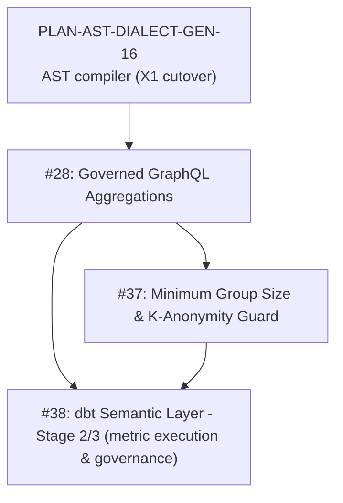

# Plan & PRD: GitHub Issues Master Roadmap & Architectural Execution Plan

**Document ID:** `PLAN-GH-ISSUES-ROADMAP-2026-10-12`  
**Date:** 2026-10-12 (open items only, pruned 2026-10-14)  
**Status:** IN PROGRESS 🚀  
**Author:** Enterprise Product Manager & Solution Architect  
**Parent Plan:** [00-master-plan-overview.md](00-master-plan-overview.md)  
**Scope:** Remaining open GitHub issues of the 19-issue roadmap (#26 through #44).  

---

## 1. Summary

Waves 1-3 (#26, #27, #29, #30, #31, #32, #33, #34, #35, #40, #41, #42, #43, #44) and the non-AST part of Wave 4 (#36, #39, #38 Stage 1) are delivered and documented in `docs/features/` (`f-sec-05`, `f-gov-15`, `f-gov-16`, `f-gov-17`). The completed issue plans were removed from this document; they remain available in git history.

Open: the AST-dependent Wave 4 items below. They build on the AST compiler cutover (`PLAN-AST-DIALECT-GEN-16`).

---

## 2. Open Issue Qualification & Architecture Plans

#### 1. Issue #28: Governed Aggregation in GraphQL (`count`, `sum`, `avg`, `min`, `max`)
* **Problem:** Clients needing key performance figures must retrieve all raw rows and calculate in-browser, causing bandwidth and cost exhaustion.
* **Architecture Solution:**
  - Add native aggregation field to GraphQL schema: `aggregate(groupBy: [...]) { count sum { column } avg { column } min { column } max { column } }`.
  - Rewrite into SQL AST pushdown (`GROUP BY`, `SUM(...)`) within existing AST compiler (`F-PERF-09`).
  - Security enforcement: Aggregations over masked columns are strictly rejected; row filters apply to base rows prior to aggregation.
* **Component Touchpoints:** `Autheris.Application.Ast.Compilers.SingleQueryAstCompiler`, `HotChocolateSchemaBuilder`.
* **Acceptance Criteria:**
  - Grouped sums apply caller's row filters before aggregating.
  - Queries attempting to aggregate over masked fields are rejected with `AGGREGATION_ON_MASKED_COLUMN`.

#### 2. Issue #37: Minimum Group Size & K-Anonymity Guard
* **Problem:** Aggregated numbers over small groups (e.g. turnover or medical status in a 2-person department) can deanonymize individuals.
* **Architecture Solution:**
  - Support setting `MinimumGroupSize` per table or measure (e.g. `threshold = 5`).
  - Aggregation engine injects `HAVING COUNT(*) >= :threshold` or merges small buckets into an `Other` group.
  - Protect against differencing attacks (e.g. Total minus known large groups).
* **Component Touchpoints:** `AstAggregationRewriter`, `PrivacyBudgetService`.
* **Acceptance Criteria:**
  - Groups with fewer rows than threshold are suppressed or grouped into `Other`.
  - Response includes `suppressedGroupsCount` indicator.

#### 3. Issue #38: dbt Semantic Layer Integration & Headless BI (MetricFlow Queries)
* **Problem:** Organizations defining business metrics in dbt Semantic Layer want a single governed gateway serving metrics to applications, AI agents, and BI tools (via Trino/Arrow).
* **Architecture Solution (Staged):**
  - **Spike:** Verify MetricFlow-compiled SQL passes through Autheris governed SQL rewriter with row filters and masking.
  - **Stage 2 (Execution):** Implement `query_metrics` GraphQL/MCP endpoint compiling metric queries with row filters applied to base rows, masked column rejections, and minimum group sizes (#37).
  - **Stage 3 (Governance):** Metric-level consents and KMS audit log entries.
* **Component Touchpoints:** `Autheris.Application.Dbt.SemanticLayer`, `MetricFlowQueryEngine`.
* **Acceptance Criteria:**
  - Two callers with different row filters query the same metric and each receive accurate figures for their permitted rows.
  - Metrics depending on masked columns are blocked.

---

## 3. Implementation Matrix

| Issue | Title | Complexity | Target Component | Status |
| :---: | :--- | :---: | :--- | :---: |
| #28 | Governed GraphQL aggregations (`count`, `sum`, `avg`) | High | `SingleQueryAstCompiler`, AST Rewriter | READY 🎯 |
| #37 | Minimum group size & k-anonymity guard | Medium | `AstAggregationRewriter`, `PrivacyBudgetService` | READY 🎯 |
| #38 | dbt Semantic Layer - Stage 2/3 (`query_metrics`, metric-level consents) | High | `DbtSemanticLayerService`, `MetricFlowEngine` | READY 🎯 |
