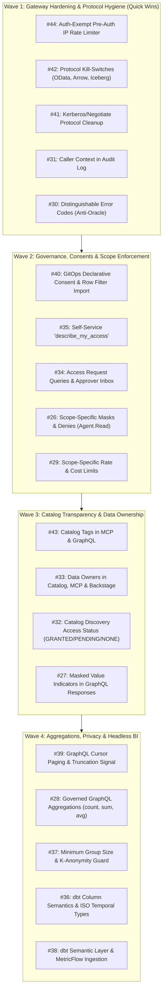

# Plan & PRD: GitHub Issues Master Roadmap & Architectural Execution Plan

**Document ID:** `PLAN-GH-ISSUES-ROADMAP-2026-10-12`  
**Date:** 2026-10-12  
**Status:** APPROVED / IN PROGRESS 🚀  
**Author:** Enterprise Product Manager & Solution Architect  
**Parent Plan:** [00-master-plan-overview.md](00-master-plan-overview.md)  
**Scope:** Triage, qualification, architectural design, and execution plan for all 19 active GitHub repository issues (#26 through #44).  

---

## 1. Executive Summary & Qualification Overview

An exhaustive review of all 19 open issues in the Autheris repository was performed. All issues represent genuine enterprise customer requirements and directly strengthen Autheris's core differentiators: **Layer 7 Zero-Trust Security, Data-Owner Governance, Fine-Grained Auditing, and High-Performance .NET 10 API Execution**.

The 19 issues have been qualified, de-duplicated against existing features, and structured into **4 cohesive delivery waves**:

---

## 2. Detailed Issue Qualification & Architecture Plans

### Wave 1: Gateway Hardening, Protocol Hygiene & Developer Experience (Immediate Quick Wins)

#### 1. Issue #44: Exempt Authenticated Requests from Pre-Auth IP Rate Limit
* **Problem:** `PreAuthIpRateLimit` counts all requests per client IP before authentication (default: 100 req/60s). When microservices or backend portals forward calls on behalf of multiple users using their individual bearer tokens, they share one source IP and rapidly exhaust the quota. The 429 response also returns a static `Retry-After: 59`.
* **Architecture Solution:**
  - Update `PreAuthIpRateLimitingMiddleware`: Inspect `Authorization` header. If a valid, signed Bearer JWT is present, bypass the pre-auth IP bucket and delegate entirely to the per-identity token bucket.
  - Support `X-Forwarded-For` from configured `TrustedProxies`.
  - Calculate dynamic `Retry-After` reflecting remaining window seconds.
* **Component Touchpoints:** `Autheris.Api.Middleware.PreAuthIpRateLimitingMiddleware`, `RateLimiterOptions`.
* **Acceptance Criteria:**
  - Multiple authenticated users behind a single NAT/gateway IP are restricted only by their per-user token quotas.
  - Unauthenticated requests from that IP remain strictly rate-limited.
  - 429 responses return dynamic `Retry-After` matching remaining window duration.

#### 2. Issue #42: Protocol Kill-Switches (OData, Arrow Export, Arrow Flight SQL, Iceberg REST Catalog)
* **Problem:** OData, Arrow Export, Arrow Flight SQL, and Iceberg REST Catalog are currently mapped unconditionally in `GatewayApplicationBuilderExtensions`. Operators wishing to run a hardened minimal surface (e.g. GraphQL + MCP only) cannot disable unused protocols.
* **Architecture Solution:**
  - Add configuration switches under `Gateway:Protocols`: `OData:Enabled`, `ArrowExport:Enabled`, `ArrowFlightSql:Enabled`, `IcebergRestCatalog:Enabled`.
  - Conditionally map endpoint routes in `GatewayApplicationBuilderExtensions`.
  - Disabled protocols return HTTP 404 and are removed from OpenAPI schemas and MCP `endpoints` discovery.
* **Component Touchpoints:** `GatewayOptions`, `GatewayApplicationBuilderExtensions`, `OpenApiDocumentGenerator`.
* **Acceptance Criteria:**
  - Setting `Enabled: false` results in HTTP 404 for all corresponding routes.
  - Disabled protocols disappear from Swagger/OpenAPI 3.1 and MCP endpoints.

#### 3. Issue #41: Advertise and Accept Negotiate Only When Kerberos Is Configured
* **Problem:** Every 401 response currently advertises `WWW-Authenticate: Negotiate`, even when no Kerberos/AD provider is configured. Malformed `Authorization: Negotiate ...` headers cause an unhandled 500 internal error.
* **Architecture Solution:**
  - In authentication pipeline registration, register `Negotiate` scheme only if `Gateway:Auth:Kerberos:Enabled == true`.
  - Add exception handling in `KerberosAuthenticationHandler` so invalid tokens cleanly produce HTTP 401 instead of 500.
* **Component Touchpoints:** `Autheris.Api.Auth.KerberosAuthenticationHandler`, `AuthenticationServiceCollectionExtensions`.
* **Acceptance Criteria:**
  - With Kerberos disabled, 401 responses emit only `WWW-Authenticate: Bearer`.
  - Malformed Negotiate headers return 401 Unauthorized.

#### 4. Issue #31: Caller Context in Audit Log
* **Problem:** Upstream microservices forwarding queries need to trace which application and query initiated the request in the WORM audit log.
* **Architecture Solution:**
  - Parse optional headers: `X-Caller-Application`, `X-Caller-Version`, `X-Caller-Query-Name`.
  - Store these as caller-supplied metadata fields in `AuditEntryModel.CallerContext`.
  - Ensure headers are marked as untrusted/caller-supplied and do not alter authorization state.
* **Component Touchpoints:** `Autheris.Application.Audit.Models.AuditEntry`, `AuditMiddleware`.
* **Acceptance Criteria:**
  - WORM audit log contains caller context when headers are present.
  - Unauthenticated/tampered headers cannot bypass security policies.

#### 5. Issue #30: Distinguishable Error Codes Without an Existence Oracle
* **Problem:** Clients receive generic 400 or 403 errors and cannot explain to users why a query failed (e.g. *Column not released* vs *Filter on masked column*). However, errors must not act as an existence oracle revealing secret tables to unauthorized callers.
* **Architecture Solution:**
  - If target table is visible in the caller's catalog projection, return specific machine-readable error codes in GraphQL extensions / REST JSON: `COLUMN_NOT_RELEASED`, `FILTER_ON_MASKED_COLUMN`, `COST_LIMIT`, `ROW_LIMIT`, `TIMEOUT`, `RATE_LIMIT`.
  - If the target table is not discoverable by the caller, return the standard generic 403/404 response.
* **Component Touchpoints:** `Autheris.Api.Filters.GatewayExceptionFilter`, `HotChocolateErrorFilter`.
* **Acceptance Criteria:**
  - Visible but unauthorized columns return specific error code.
  - Hidden/unknown tables return generic responses identical to non-existent objects.

---

### Wave 2: Governance, Consents & Scope-Specific Enforcement

#### 6. Issue #40: GitOps / Declarative Consent & Row Filter Import API
* **Problem:** Consents and row filters are currently configured via interactive mutations or UI, but cannot be synchronized idempotently from version-controlled GitOps repositories.
* **Architecture Solution:**
  - Add declarative import endpoint `POST /api/v1/governance/consents/apply` and CLI tool support.
  - Schema: YAML/JSON declaring desired state of Consents, Row Filters, and Column Rules.
  - Idempotent execution: Reconciles desired state with database, adding missing entries, removing obsolete ones, and writing KMS-anchored audit logs for every delta.
* **Component Touchpoints:** `Autheris.Application.Governance.Services.ConsentImportService`, `GovernanceController`.
* **Acceptance Criteria:**
  - Applying the same definition twice produces zero changes.
  - Every modification is recorded in the immutable WORM audit log.

#### 7. Issue #35: Self-Service `describe_my_access` / Explain Effective Rules
* **Problem:** Users with different regional row filters or masks cannot understand why their query results differ from colleagues.
* **Architecture Solution:**
  - Implement GraphQL query `myAccess(table: String!)` and MCP tool `describe_my_access(table: string)`.
  - Returns structured, plain-language breakdown:
    - Active row filters (e.g. `Region = 'EMEA' (based on your department attribute)`).
    - Masked or denied columns for the caller.
    - Plain-text description authored by data owners on consents.
  - Strict isolation: Callers cannot inspect policies of other identities.
* **Component Touchpoints:** `Autheris.Application.Governance.Services.EffectivePolicyExplanationService`, `GovernanceQueries`.
* **Acceptance Criteria:**
  - Returns caller-specific filter conditions without SQL exposure.
  - Never leaks rules or filters belonging to other users.

#### 8. Issue #34: Access Request Queries & Approver Inbox
* **Problem:** `requestTableAccess`, `approveConsentRequest`, and `rejectConsentRequest` exist, but callers cannot list their pending requests, and data owners cannot query their approval inboxes via GraphQL.
* **Architecture Solution:**
  - Expose GraphQL queries:
    - `myAccessRequests`: Lists user's own requests (table, status, justification, created/decided dates, ITSM reference).
    - `pendingApprovalsForMe`: Lists requests pending approval where caller is the data owner or designated delegate.
    - `myActiveConsents`: Lists active consents with expiration timestamps for renewal reminders.
* **Component Touchpoints:** `Autheris.Application.Governance.Services.ConsentRequestQueryService`, `GovernanceSchema`.
* **Acceptance Criteria:**
  - Requesters see only their own requests.
  - Data owners see only requests for tables they own/delegate.
  - Third-party callers see an empty list.

#### 9. Issue #26: Scope-Specific Masks and Denies (e.g. `Agent.Read`)
* **Problem:** When an AI agent calls Autheris on behalf of a user using a delegated token with scope `Agent.Read`, data owners want stricter rules than when the user queries directly in a browser (e.g. salary column should be masked for the AI agent even if the human has clear-text access).
* **Architecture Solution:**
  - Allow attaching scope conditions to column masking rules and deny policies (e.g. `MaskRule: REDACT`, `ApplicableScopes: ["Agent.Read"]`).
  - Monotonic hardening principle: A token scope can only make policies **stricter**, never loosen permissions granted to the identity.
  - Enforced across all query paths (GraphQL, SQL, MCP, Procedures).
* **Component Touchpoints:** `Autheris.Domain.Model.ColumnRule`, `DynamicMaskingEngine`, `HotChocolateFieldMiddleware`.
* **Acceptance Criteria:**
  - A query with `Agent.Read` returns masked data for agent-restricted fields.
  - The same query executed by the human without `Agent.Read` returns clear-text data.

#### 10. Issue #29: Separate Application Scope & Scope-Specific Cost Limits
* **Problem:** Different client types (e.g. Mobile Apps vs. BI Tools vs. Autonomous Agents) need distinct cost budgets and rate limits under the same user identity.
* **Architecture Solution:**
  - Introduce `App.Read` alongside `Agent.Read` in `ReadOnlyScopes`.
  - Extend `CostAndQuotaMiddleware` to resolve rate limits and query cost ceilings based on the primary token scope in addition to user tier.
* **Component Touchpoints:** `Autheris.Api.Middleware.CostAndQuotaMiddleware`, `GatewayOptions`.
* **Acceptance Criteria:**
  - Two tokens for the same user with different scopes (`App.Read` vs `Agent.Read`) enforce independent cost limits.

---

### Wave 3: Catalog Transparency, Data Ownership & Response Enhancements

#### 11. Issue #43: Return Catalog Tags in `list_datasets` and `describe_dataset`
* **Problem:** Tables carry `Tags` in the catalog (e.g. `[product, tier-1]`), but MCP tools `list_datasets` and `describe_dataset` do not return them.
* **Architecture Solution:**
  - Include `IReadOnlyList<string> Tags` in `McpDatasetSummary` and `McpDatasetDescription`.
  - Add optional `tag` filter argument to `list_datasets(tag: "product")`.
  - Expose `tags` on GraphQL `catalog` query.
* **Component Touchpoints:** `Autheris.Api.Mcp.McpDatasetTools`, `Autheris.Application.Catalog.Models`.
* **Acceptance Criteria:**
  - Datasets with tags return tags in MCP and GraphQL.
  - Filtering by tag returns only matching datasets.

#### 12. Issue #33: Data Owners in Catalog, `describe_dataset`, and Backstage
* **Problem:** Data owners are stored in the database but not exposed in catalog queries, and Spotify Backstage exports currently fall back to `DefaultOwner`.
* **Architecture Solution:**
  - Return `DataOwner` (display name, email/UPN) and optional `Delegates` in GraphQL `catalog` and MCP `describe_dataset`.
  - Update Backstage entity provider (`BackstageCatalogService`) to export the resolved table owner instead of `DefaultOwner`.
* **Component Touchpoints:** `Autheris.Application.Catalog.Services`, `BackstageCatalogClient`.
* **Acceptance Criteria:**
  - Catalog entries and Backstage entities reflect the actual table owner.
  - Unowned tables return null owner without errors.

#### 13. Issue #32: Catalog Discovery with Access Status (`GRANTED | PENDING | NONE`)
* **Problem:** Self-service portals need to show users all discoverable datasets along with their individual access status (`GRANTED`, `PENDING`, `NONE`), while respecting strict confidentiality (`HIDDEN` tables must never leak).
* **Architecture Solution:**
  - Add `accessStatus: GRANTED | PENDING | NONE` to catalog results.
  - Add dataset visibility setting: `FULL` (all metadata visible), `SUMMARY` (name & description only), `HIDDEN` (invisible without explicit consent).
  - Default visibility is fail-closed: `HIDDEN`.
* **Component Touchpoints:** `CatalogService`, `McpDatasetTools`, `GraphQLCatalogType`.
* **Acceptance Criteria:**
  - Discoverable tables return current access state for caller.
  - `HIDDEN` tables cannot be discovered, searched, or probed via oracle errors.

#### 14. Issue #27: Mark Masked Values in GraphQL Responses
* **Problem:** Masked non-text columns (numbers, dates) are returned as `null`, making it impossible for frontends to distinguish a genuine database `null` from an applied mask.
* **Architecture Solution:**
  - Add GraphQL response extension `extensions.maskedFields`: list of field paths (e.g. `["customer.salary", "customer.creditScore"]`) that were replaced by masks.
  - Provide consistent type-aware mask representation across SQL and GraphQL.
* **Component Touchpoints:** `HotChocolateFieldMaskMiddleware`, `MaskingResultExtensions`.
* **Acceptance Criteria:**
  - Masked columns are listed in `extensions.maskedFields`; genuine `null` database values are not.

---

### Wave 4: Advanced Analytics, Aggregations & Headless BI

#### 15. Issue #39: GraphQL Cursor Paging, Cost Model & Truncation Signal
* **Problem:** Large GraphQL result sets exhaust standard tier cost limits. Clients cannot safely paginate through thousands of rows with stable ordering.
* **Architecture Solution:**
  - Implement Relay-style cursor-based pagination (`after`, `first`, `pageInfo { hasNextPage, endCursor }`).
  - Add truncation signal `truncated: true` when a query hits hard row limits.
  - Update cost model to price paginated sub-queries efficiently.
* **Component Touchpoints:** `Autheris.Application.GraphQL.Paging`, `CostAndQuotaMiddleware`.
* **Acceptance Criteria:**
  - Paging with cursor returns every row exactly once, even during concurrent row inserts.
  - Truncated queries explicitly flag `hasNextPage: true`.

#### 16. Issue #28: Governed Aggregation in GraphQL (`count`, `sum`, `avg`, `min`, `max`)
* **Problem:** Clients needing key performance figures must retrieve all raw rows and calculate in-browser, causing bandwidth and cost exhaustion.
* **Architecture Solution:**
  - Add native aggregation field to GraphQL schema: `aggregate(groupBy: [...]) { count sum { column } avg { column } min { column } max { column } }`.
  - Rewrite into SQL AST pushdown (`GROUP BY`, `SUM(...)`) within existing AST compiler (`F-PERF-09`).
  - Security enforcement: Aggregations over masked columns are strictly rejected; row filters apply to base rows prior to aggregation.
* **Component Touchpoints:** `Autheris.Application.Ast.Compilers.SingleQueryAstCompiler`, `HotChocolateSchemaBuilder`.
* **Acceptance Criteria:**
  - Grouped sums apply caller's row filters before aggregating.
  - Queries attempting to aggregate over masked fields are rejected with `AGGREGATION_ON_MASKED_COLUMN`.

#### 17. Issue #37: Minimum Group Size & K-Anonymity Guard
* **Problem:** Aggregated numbers over small groups (e.g. turnover or medical status in a 2-person department) can deanonymize individuals.
* **Architecture Solution:**
  - Support setting `MinimumGroupSize` per table or measure (e.g. `threshold = 5`).
  - Aggregation engine injects `HAVING COUNT(*) >= :threshold` or merges small buckets into an `Other` group.
  - Protect against differencing attacks (e.g. Total minus known large groups).
* **Component Touchpoints:** `AstAggregationRewriter`, `PrivacyBudgetService`.
* **Acceptance Criteria:**
  - Groups with fewer rows than threshold are suppressed or grouped into `Other`.
  - Response includes `suppressedGroupsCount` indicator.

#### 18. Issue #36: dbt Column Semantics & ISO Temporal Types
* **Problem:** Dates from SQL sources map to generic `String`, causing timezone shifts when UTC timestamps are parsed by international clients. dbt column `meta` (units, roles) is not exposed to machine consumers.
* **Architecture Solution:**
  - Introduce explicit scalar types: `Date` (`YYYY-MM-DD`), `DateTime` (ISO 8601 with offset), `Time` (`HH:mm:ss`).
  - Expose structured dbt column meta (`role: measure|dimension|time`, `unit: EUR`) in `describe_dataset` and GraphQL schema metadata.
* **Component Touchpoints:** `HotChocolateScalarTypes`, `DbtMetadataImporter`, `CatalogModels`.
* **Acceptance Criteria:**
  - SQL `DATE` returns strict `YYYY-MM-DD` without timezone distortion.
  - dbt `meta: { role: measure, unit: EUR }` is readable in `describe_dataset`.

#### 19. Issue #38: dbt Semantic Layer Integration & Headless BI (MetricFlow Queries)
* **Problem:** Organizations defining business metrics in dbt Semantic Layer want a single governed gateway serving metrics to applications, AI agents, and BI tools (via Trino/Arrow).
* **Architecture Solution (Staged):**
  - **Spike:** Verify MetricFlow-compiled SQL passes through Autheris governed SQL rewriter with row filters and masking.
  - **Stage 1 (Catalog):** Ingest `semantic_manifest.json` and expose metrics, dimensions, and time grains in the catalog and MCP tools.
  - **Stage 2 (Execution):** Implement `query_metrics` GraphQL/MCP endpoint compiling metric queries with row filters applied to base rows, masked column rejections, and minimum group sizes (#37).
  - **Stage 3 (Governance):** Metric-level consents and KMS audit log entries.
* **Component Touchpoints:** `Autheris.Application.Dbt.SemanticLayer`, `MetricFlowQueryEngine`.
* **Acceptance Criteria:**
  - Two callers with different row filters query the same metric and each receive accurate figures for their permitted rows.
  - Metrics depending on masked columns are blocked.

---

## 3. Implementation Matrix & Delivery Waves

| Wave | Issue | Title | Complexity | Target Component | Status |
| :---: | :---: | :--- | :---: | :--- | :---: |
| **1** | #44 | Exempt authenticated requests from pre-auth IP limit | Low | `PreAuthIpRateLimitingMiddleware` | READY 🎯 |
| **1** | #42 | Protocol Kill-Switches (OData, Arrow, Iceberg) | Low | `GatewayOptions`, `GatewayApplicationBuilder` | READY 🎯 |
| **1** | #41 | Negotiate scheme cleanup (Kerberos-only) | Low | `KerberosAuthenticationHandler` | READY 🎯 |
| **1** | #31 | Caller context in audit log | Low | `AuditEntry`, `AuditMiddleware` | READY 🎯 |
| **1** | #30 | Machine-readable error codes (Anti-Oracle) | Medium | `GatewayExceptionFilter`, `HotChocolateErrorFilter` | READY 🎯 |
| **2** | #40 | GitOps Declarative Consent & Row Filter Import | Medium | `ConsentImportService`, `GovernanceController` | READY 🎯 |
| **2** | #35 | Explain effective rules (`describe_my_access`) | Medium | `EffectivePolicyExplanationService` | READY 🎯 |
| **2** | #34 | Access request queries & approver inbox | Medium | `ConsentRequestQueryService`, `GovernanceQueries` | READY 🎯 |
| **2** | #26 | Scope-specific masks & denies (`Agent.Read`) | Medium | `DynamicMaskingEngine`, `HotChocolateFieldMiddleware`| READY 🎯 |
| **2** | #29 | Scope-specific rate and cost limits | Low | `CostAndQuotaMiddleware` | READY 🎯 |
| **3** | #43 | Catalog tags in `list_datasets` and `describe_dataset` | Low | `McpDatasetTools`, `CatalogService` | READY 🎯 |
| **3** | #33 | Data owners in catalog, MCP and Backstage | Low | `CatalogService`, `BackstageCatalogClient` | READY 🎯 |
| **3** | #32 | Catalog discovery access status (`GRANTED/PENDING/NONE`)| Medium | `CatalogService`, `McpDatasetTools` | READY 🎯 |
| **3** | #27 | Masked value indicators in GraphQL responses | Medium | `HotChocolateFieldMaskMiddleware` | READY 🎯 |
| **4** | #39 | GraphQL cursor paging & truncation signal | High | `SingleQueryAstCompiler`, `HotChocolateSchema` | READY 🎯 |
| **4** | #28 | Governed GraphQL aggregations (`count`, `sum`, `avg`) | High | `SingleQueryAstCompiler`, AST Rewriter | READY 🎯 |
| **4** | #37 | Minimum group size & k-anonymity guard | Medium | `AstAggregationRewriter`, `PrivacyBudgetService` | READY 🎯 |
| **4** | #36 | dbt column semantics & ISO temporal types | Medium | `DbtMetadataImporter`, `HotChocolateScalarTypes` | READY 🎯 |
| **4** | #38 | dbt Semantic Layer & MetricFlow queries | High | `DbtSemanticLayerService`, `MetricFlowEngine` | READY 🎯 |
