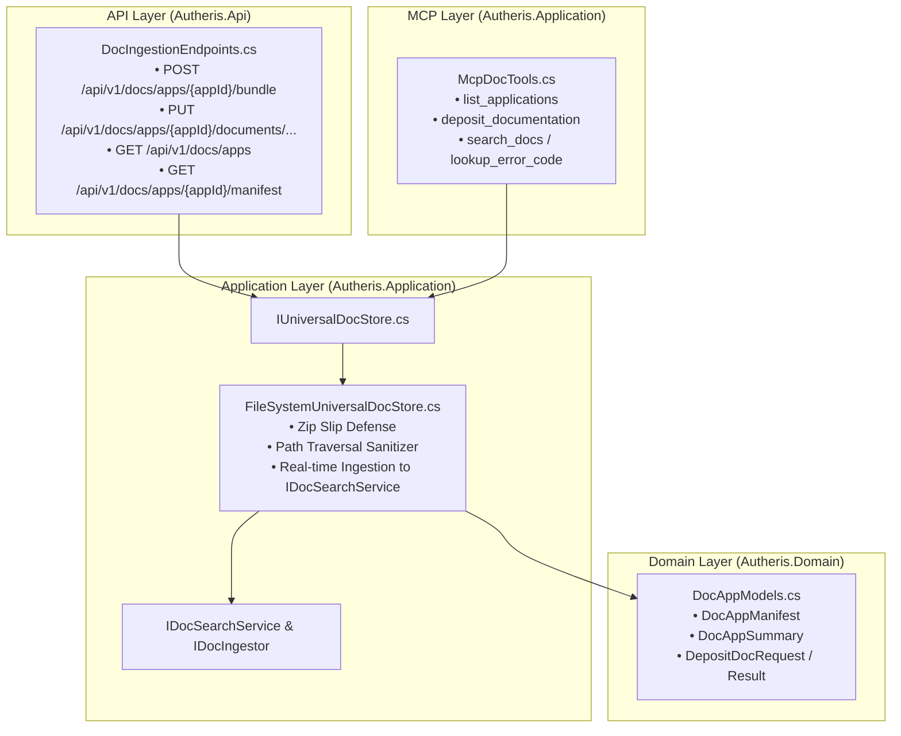

# Architectural Implementation Plan: Universal Multi-App Document Store & Headless Ingestion Gateway

**Document ID:** `PLAN-UNIVERSAL-DOC-STORE-14`  
**Date:** October 12, 2026  
**Status:** READY FOR IMPLEMENTATION 🚀  
**Architect:** Principal .NET & AI Infrastructure Architect  
**PRD Link:** [`2026-10-12-req-universal-doc-store-mcp.md`](2026-10-12-req-universal-doc-store-mcp.md)  
**Origin Plan Link:** [`00-master-plan-overview.md`](00-master-plan-overview.md)  

---

## 1. Architecture Overview & Clean Layering

---

## 2. Security & Threat Modeling (AppSec Gate)

1. **Zip Slip Prevention (`System.IO.Compression.ZipArchive`):**
   - For every entry in an uploaded bundle:
     `var fullDestPath = Path.GetFullPath(Path.Combine(targetDir, entry.FullName));`
     `if (!fullDestPath.StartsWith(targetDirWithSeparator, StringComparison.OrdinalIgnoreCase)) throw SecurityException;`
2. **Identifier Validation:**
   - `appId`, `category`, and `docId` validated against `^[a-zA-Z0-9_\-\.]+$`. Any directory traversal elements (`..`, `/`, `\`) trigger immediate 400 Bad Request.
3. **Payload Limits:**
   - Bundles capped at 50 MB; individual documents capped at 5 MB to prevent disk exhaustion.
4. **WORM / Audit Logging:**
   - Document deposits and bundle imports logged with `AuditEventTypes.DocIngestionBundleApplied` and `AuditEventTypes.DocIngestionDocumentApplied`.

---

## 3. Concrete Implementation Steps

1. **Step 1: Domain Models in `src/Autheris.Domain/Model/DocAppModels.cs`**
   - `DocAppManifest`, `DocAppSummary`, `DepositDocRequest`, `DepositDocResult`.
2. **Step 2: Interfaces & Service in `src/Autheris.Application/Docs/`**
   - `IUniversalDocStore.cs` interface.
   - `FileSystemUniversalDocStore.cs` implementing storage, validation, Zip Slip prevention, and indexing into `IDocSearchService`.
3. **Step 3: MCP Tools Extension in `McpDocTools.cs`**
   - Register `list_applications` and `deposit_documentation`.
4. **Step 4: REST Endpoints in `src/Autheris.Api/Endpoints/DocIngestionEndpoints.cs`**
   - Map `/api/v1/docs/apps/...` routes with authorization and audit attributes.
5. **Step 5: DI Wiring & Gateway Options**
   - Wire `IUniversalDocStore` in `GatewayMcpServiceExtensions.cs` and endpoint registration in `GatewayApplicationBuilderExtensions.cs`.
6. **Step 6: Unit & Integration Tests in `tests/Autheris.Tests.Unit/Docs/`**
   - Test Zip Slip rejection, path sanitization, bundle extraction, MCP tool deposit, and search verification.
7. **Step 7: Documentation in `docs/features/f-ai-16-universal-doc-store-mcp.md`**
   - Pure system reference documentation registered in `docs/features/README.md`.
