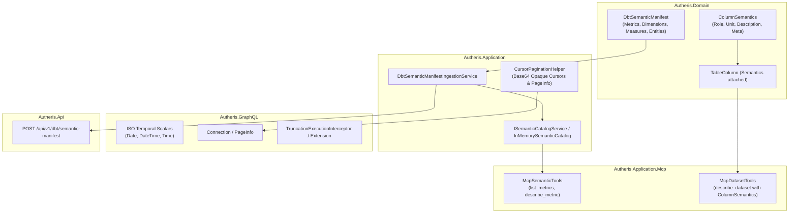

# Implementation Plan: Wave 4 GraphQL Cursor Paging, dbt Semantics & ISO Temporal Types

**Document ID:** `PLAN-WAVE4-GRAPHQL-DBT-SEMANTICS-2026-10-12`  
**Date:** 2026-10-12  
**Status:** APPROVED / IN EXECUTION 🚀  
**Author:** Solution Architect (`csharp-architect`)  
**Parent PRD:** [2026-10-12-req-wave4-graphql-dbt-semantics.md](2026-10-12-req-wave4-graphql-dbt-semantics.md)  
**Parent Roadmap:** [2026-10-12-plan-github-issues-roadmap.md](2026-10-12-plan-github-issues-roadmap.md)  
**Covers GitHub Issues:** #36, #39, #38 (Stage 1)

---

## 1. Architecture Design & Component Wiring



---

## 2. Step-by-Step Execution Plan

### Step 1: Domain Models (Stream A)
1. Add `ColumnSemantics` record to `Autheris.Domain.Model`:
   ```csharp
   public sealed record ColumnSemantics(
       string? Role = null,        // "measure", "dimension", "time_dimension", "entity"
       string? Unit = null,        // "EUR", "USD", "ms", "count"
       string? BusinessName = null,
       IReadOnlyDictionary<string, string>? RawMeta = null
   );
   ```
2. Attach `ColumnSemantics? Semantics` to `TableColumn`.
3. Create `DbtSemanticModels.cs` in `Autheris.Domain.Model`:
   - `DbtSemanticManifest`
   - `DbtMetric` (Name, Type, Description, Label, Filter, TypeParams, Dimensions)
   - `DbtMeasure` (Name, Aggregation, Expr, Description)
   - `DbtDimension` (Name, Type, Description, IsPartition)
   - `DbtEntity` (Name, Type, Role)

### Step 2: Application Services & Cursor Pagination (Stream B)
1. `CursorPaginationHelper`:
   - `EncodeCursor(int index)` -> opaque base64 string `cursor:offset:<index>`.
   - `DecodeCursor(string? cursor)` -> index integer or default 0.
   - `ApplyPagination<T>(IReadOnlyList<T> items, int? first, string? after, int maxLimit)` -> `(IReadOnlyList<T> Page, PageInfo PageInfo, bool IsTruncated)`.
2. `ISemanticCatalogService` & `InMemorySemanticCatalog`:
   - Store and query metrics, models, and dimensions.
   - Fail-closed filtering: checks caller access to underlying dataset before returning metrics.
3. `IDbtSemanticManifestIngestionService`:
   - Parses `semantic_manifest.json` and updates `ISemanticCatalogService`.

### Step 3: HotChocolate GraphQL Enhancements (Stream C)
1. Register ISO temporal scalars:
   - Ensure `Date` maps to `DateType` (`YYYY-MM-DD`).
   - Ensure `DateTime` maps to `DateTimeType` (ISO 8601 with offset).
   - Ensure `Time` maps to `TimeSpanType` / `LocalTimeType` (`HH:mm:ss`).
2. Implement `TruncationExecutionInterceptor`:
   - Adds `extensions.pagination { isTruncated: true, maxRowsReached: true }` when query results hit limit boundaries.

### Step 4: MCP Semantic Discovery Tools (Stream D)
1. Extend `McpDatasetTools.DescribeDatasetAsync` to include `ColumnSemantics` in returned column metadata.
2. Implement MCP tools in `McpSemanticTools`:
   - `list_metrics(dataset?: string)`
   - `describe_metric(name: string)`

### Step 5: REST API Ingestion Endpoint (Stream E)
1. In `DbtEndpoints.cs`:
   - Map `POST /api/v1/dbt/semantic-manifest` with audit logging, validating JSON payload, and invoking `IDbtSemanticManifestIngestionService`.

---

## 3. Security & Anti-Oracle Invariants (Phase 3 Audit)
- **Zero Existence Leakage:** `list_metrics` and `describe_metric` check dataset visibility via `ISecurityPrincipalContext`. If the caller does not have read access to the dataset underlying the metric, it is omitted.
- **Fail-Closed Paging:** Negative or out-of-range `first` or corrupted `after` cursors fail with clean validation errors, never throwing unhandled 500s.
- **Audit Traceability:** Ingestion of `semantic_manifest.json` is logged in the WORM audit trail under event `DBT_SEMANTIC_MANIFEST_INGESTED`.
