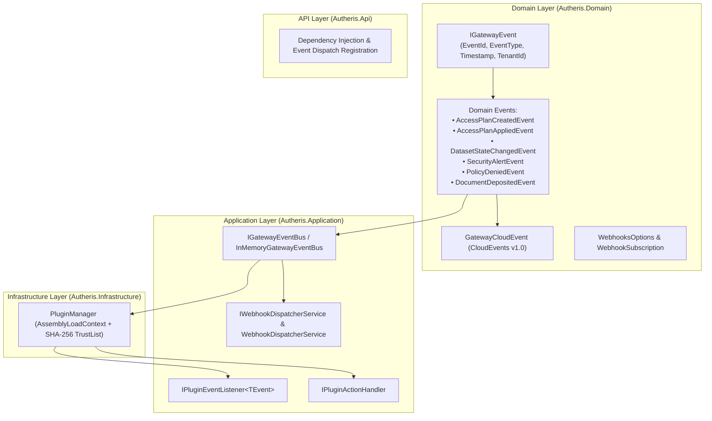

# Implementation Plan: Generic C# DLL Plugin & Event/Webhook Callback Subsystem

**Document ID:** `PLAN-GENERIC-PLUGIN-EVENTS-2026-10-13`  
**Parent PRD:** [`2026-10-13-req-generic-plugin-events-and-webhooks.md`](file:///root/autheris/doc/plan/2026-10-13-req-generic-plugin-events-and-webhooks.md)  
**Status:** COMPLETED & VERIFIED ✅  
**Date:** 2026-10-13  

---

## 1. Technical Architecture & Component Structure

---

## 2. Step-by-Step Implementation Steps

### Step 1: Domain Event Models & Options (`Autheris.Domain`)
- Create `src/Autheris.Domain/Events/GatewayEventModels.cs`:
  - `IGatewayEvent` interface
  - `GatewayCloudEvent` record (CloudEvents v1.0 compliant)
  - Concrete domain events: `AccessPlanCreatedEvent`, `AccessPlanAppliedEvent`, `DatasetStateChangedEvent`, `SecurityAlertEvent`, `PolicyDeniedEvent`, `DocumentDepositedEvent`.
- Create `src/Autheris.Domain/Options/WebhooksOptions.cs`:
  - `WebhooksOptions` and `WebhookSubscription` records.
  - Wire into `GatewayOptions.cs`.

### Step 2: Application Event Bus & Plugin Contracts (`Autheris.Application`)
- Create `src/Autheris.Application/Events/IGatewayEventBus.cs` and `InMemoryGatewayEventBus.cs`:
  - Thread-safe pub/sub with async execution and subscriber error isolation.
- Create `src/Autheris.Application/Plugins/IPluginEventListener.cs` and `IPluginActionHandler.cs`.
- Create `src/Autheris.Application/Webhooks/IWebhookDispatcherService.cs` and `WebhookDispatcherService.cs`:
  - CloudEvents serialization.
  - HMAC-SHA256 signature generation and HTTP POST dispatch with retry/timeout protection.

### Step 3: Infrastructure Plugin Manager Extension (`Autheris.Infrastructure`)
- Update `src/Autheris.Infrastructure/Plugins/PluginManager.cs`:
  - In addition to `IHttpDataSourcePlugin`, scan for `IPluginEventListener` implementations and `IPluginActionHandler`.
  - Wire plugin event listeners into `IGatewayEventBus`.
  - Add dispatch method for plugin action execution.

### Step 4: Event Publishing in Core Gateway Services (`Autheris.Application` / `Autheris.Api`)
- In `AccessPlanningService`: Publish `AccessPlanCreatedEvent`, `AccessPlanAppliedEvent`, and `DatasetStateChangedEvent`.
- In `AiDataGuardrailService`: Publish `SecurityAlertEvent` (prompt injection) and `PolicyDeniedEvent` (Casbin denial).
- In `DocIngestionEndpoints`: Publish `DocumentDepositedEvent`.

### Step 5: Unit & Integration Tests (`tests/`)
- Unit tests for `InMemoryGatewayEventBus`: concurrency, subscriber isolation, event filtering.
- Unit tests for `PluginManager`: loading and invoking event listener plugins and action handlers.
- Unit tests for `WebhookDispatcherService`: HMAC-SHA256 signature generation, replay protection headers.
- Integration tests verifying end-to-end event publication from gateway services to plugin listeners and webhook dispatches.
