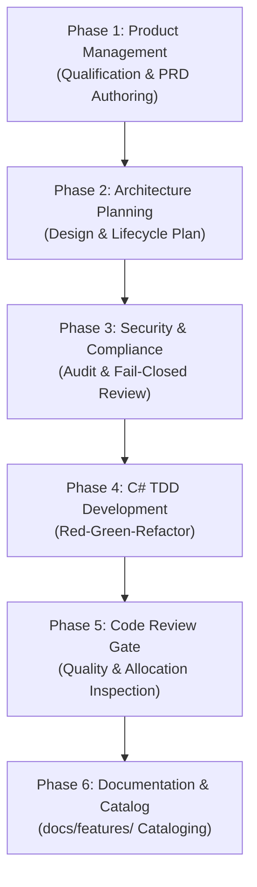

# Implementation Plan: OData Excel Metadata Compatibility & Complete OpenAPI Query Options Specification

**Document ID:** `PLAN-ODATA-EXCEL-OPENAPI-2026-10-13`  
**Date:** 2026-10-13  
**Status:** COMPLETED & VERIFIED ✅  
**Author:** Lead Delivery Project Manager & Solution Architect  
**Parent PRD:** [2026-10-13-req-odata-excel-and-openapi-fixes.md](2026-10-13-req-odata-excel-and-openapi-fixes.md)  
**Parent Origin Plan:** [00-master-plan-overview.md](00-master-plan-overview.md)  
**Branch:** `fix/odata-excel-and-openapi-gh66-67`  
**Tracked Issues:** [GitHub #66](https://github.com/themulle/autheris/issues/66), [GitHub #67](https://github.com/themulle/autheris/issues/67)

---

## 1. 6-Phase Standard Implementation Lifecycle Overview

---

## 2. Phase-by-Phase Execution Details

### Phase 1: Product Management Gate (`product-manager`)
- Qualified GitHub issues #66 and #67 against existing catalog in `docs/features/f-api-03-odata-openapi.md`.
- Validated compatibility with OASIS OData v4 and Microsoft Excel PowerQuery XML parsing engine.
- Authored PRD: [`doc/plan/2026-10-13-req-odata-excel-and-openapi-fixes.md`](2026-10-13-req-odata-excel-and-openapi-fixes.md).

### Phase 2: Architecture Planning Gate (`csharp-architect`)
- **CSDL Attribute Escaping Architecture:**
  - Added public static method `ODataCsdlGenerator.EscapeAttribute(string? value)`.
  - Encodes `<`, `>`, `&`, `"`, `'`, as well as line breaks and tabs: `\r\n` → `&#10;`, `\r` → `&#13;`, `\n` → `&#10;`, `\t` → `&#9;`.
  - Replaced all raw attribute interpolation across schema namespaces, entity names, property names, keys, and descriptions.
- **Dynamic OpenAPI Generation Architecture:**
  - Expanded parameter array in `DynamicOpenApiGenerator.cs` to include `$filter`, `$orderby`, `$count`, and `$format`.
  - Documented supported operator sets, regex bounds, and parameter limits.
  - Aligned endpoint path summary and descriptions with the active query options whitelist in `ODataEndpoints.cs`.

### Phase 3: Security & Compliance Gate (`csharp-security-expert`)
- Verified that entity-escaping attribute values introduces no XSS, XML injection, or entity expansion vectors (only numeric/named XML character references `&#10;`, `&#13;`, `&#9;` are emitted).
- Verified that advertising `$filter` in OpenAPI does not alter or weaken the Zero-Trust AST validator or RLS pushdown; columns referenced in `$filter` remain checked against user table access and column permissions.
- Verified that unknown query options starting with `$` remain strictly rejected with HTTP 400 (fail-closed behavior).

### Phase 4: C# TDD Development Gate (`csharp-tdd-developer`)
- Applied Red-Green-Refactor cycle:
  - 🔴 **Red:** Authored unit tests asserting newline entity escaping (`&#10;`, `&#9;`), absence of raw literal newlines in XML attributes, and advertising of all 7 parameters in OpenAPI specification.
  - 🟢 **Green:** Implemented `EscapeAttribute` in `ODataCsdlGenerator.cs` and added `$filter`, `$orderby`, `$count`, `$format` parameters in `DynamicOpenApiGenerator.cs`.
  - 🔵 **Refactor:** Cleaned up test assertions and verified OASIS XSD schema compliance.
- Ran tests:
  - `Autheris.Extensions.Tests`: 239 passed, 0 failed.
  - `Autheris.Tests.Unit` (DynamicOpenApiGeneratorTests): 9 passed, 0 failed.
  - `Autheris.Tests.Unit` (OmnichannelDocumentationTests): 4 passed, 0 failed.
- Solution build: `dotnet build Autheris.sln` succeeded with **0 warnings and 0 errors**.

### Phase 5: Code Review Gate (`csharp-code-reviewer`)
- Verified clean C# 13 / .NET 10 idioms.
- No memory leaks or unmanaged resource allocations.
- String transformations utilize efficient chaining.
- Stack traces and error classifications preserved.

### Phase 6: Documentation & Cataloging Gate (`documentation-expert`)
- Updated `docs/features/f-api-03-odata-openapi.md`:
  - Removed forbidden development status tags per `AGENTS.md`.
  - Updated components list to include `ODataCsdlGenerator.cs` and `DynamicOpenApiGenerator.cs`.
  - Added architectural capabilities describing Excel CSDL entity-escaping and the full suite of advertised OpenAPI 3.1 query options.
- Registered track in `doc/plan/00-master-plan-overview.md`.

---

## 3. Verification & Acceptance Checklist

- [x] `ODataCsdlGenerator` encodes `\r\n`, `\r`, `\n`, `\t` as `&#10;`, `&#13;`, `&#9;`.
- [x] CSDL `$metadata` XML contains zero raw unescaped newlines in attributes.
- [x] Generated XML parses cleanly via standard XML parsers.
- [x] `DynamicOpenApiGenerator` advertises `$select`, `$top`, `$skip`, `$filter`, `$orderby`, `$count`, `$format`.
- [x] Swagger UI and OpenAPI JSON document supported filter operators and bounds.
- [x] Full test suites green across `Autheris.Extensions.Tests` and `Autheris.Tests.Unit`.
- [x] Solution builds with 0 errors and 0 warnings.
- [x] GitHub issues #66 and #67 commented with technical resolution details.
