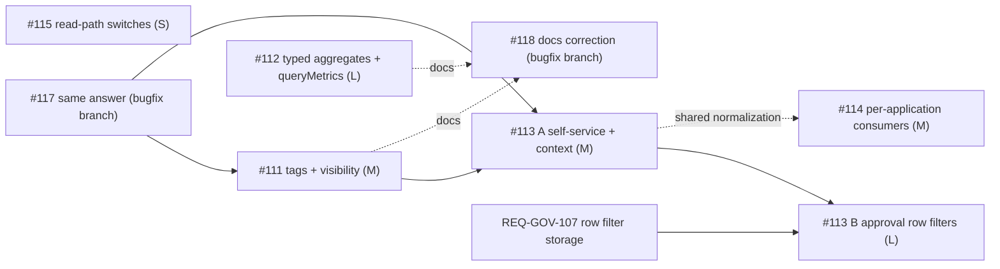

# PRD: Issues #111-#115 - Catalog Discovery, Read-Only Analytics, Self-Service Access, Caller Reporting, Read-Path Switches

**Document ID:** `REQ-GOV-111` / `REQ-DATA-112` / `REQ-GOV-113` / `REQ-OBS-114` / `REQ-SEC-115` (bundle `REQ-BUNDLE-111-115`)
**Date:** 2026-10-16
**Status:** PRD READY (Phase 1 complete); next: Phase 2 architecture plan (`csharp-architect`)
**Author:** Enterprise Product Manager (Phase 1)
**Source:** GitHub issues #111, #112, #113, #114, #115 (written by the owner against release v1.1.14); this PRD is the English, binding restatement.
**Branch:** `docs/scim-push-and-issue-intake` (base `main`)
**Parent Plan:** [00-master-plan-overview.md](00-master-plan-overview.md)
**Related feature docs (read-only references):** [F-GOV-16 catalog transparency](../features/f-gov-16-catalog-ownership-transparency.md), [F-GOV-13 classification](../features/f-gov-13-data-classification-and-pii-governance.md), [F-GOV-15 declarative consents & scopes](../features/f-gov-15-declarative-consents-scopes.md), [F-GOV-12 multi-engine storage](../features/f-gov-12-multi-engine-governance-storage.md), [F-DATA-06 governed REST data API](../features/f-data-06-governed-rest-data-api.md), [F-DATA-08 governed aggregations and k-anonymity](../features/f-data-08-governed-aggregations-and-k-anonymity.md), [F-API-03 OData](../features/f-api-03-odata-openapi.md), [F-DATA-04 Arrow Flight SQL](../features/f-data-04-arrow-flight-sql.md), [F-DATA-03 DuckDB OLAP](../features/f-data-03-duckdb-olap.md)

**Binding project constraints:** no upgrade or repair migrations (governance schema changes go into the `0001` baseline DDL of SQLite, PostgreSQL and SQL Server in place, plus the schema-shape snapshots under `src/Autheris.Infrastructure/Persistence/Migrations/Shape/`); Autheris is not in production, breaking changes are allowed; fail closed; least privilege on sources (SELECT only); no query text, row values or person identifiers in logs or metrics labels.

**Related, handled elsewhere (not planned here):** #116, #117, #118 are bugs/security issues fixed on branch `fix/issues-116-117-118`. This PRD only records the dependencies on them (section 8).

---

## 0. Executive Summary

| Issue | REQ id | Verdict | Size | One-line outcome |
|---|---|---|---|---|
| #111 | `REQ-GOV-111` | **Approved with changes** | M | Persist tags and visibility per dataset; fix the `Summary` tier so it never leaks columns; admin API + dbt import. |
| #112 | `REQ-DATA-112` | **Approved with changes** | L | Typed `<table>_aggregate` (all six functions, typed `where`) and typed `queryMetrics` for read-only tokens; persist the semantic manifest. |
| #113 | `REQ-GOV-113` | **Approved with changes (split in two increments)** | M + L | Allowlisted self-service mutations for read-only tokens (increment A); approver-chosen row filter and column levels on approval (increment B). |
| #114 | `REQ-OBS-114` | **Approved with changes; request 2 already implemented** | M | Per-application and per-day consumer report with rejection counters; per-person view stays owner/delegate/admin only (already enforced). |
| #115 | `REQ-SEC-115` | **Approved with changes** | S | One switch per remaining read path (REST data endpoint, MCP tool groups); default unchanged; 404 / not listed / not callable when off. |

**Suggested order:** #115 (S, independent) -> #111 -> #112 (parallel with #111) -> #113 increment A -> #114 -> #113 increment B. Rationale in section 7.

---

## 1. Cross-Cutting Principles (apply to all five issues)

1. **Fail closed.** Every new switch, option or tier defaults to the current (restrictive) behaviour; an unparsable value, a missing store row or an unavailable dependency denies, never widens.
2. **Same answer for what a caller cannot see.** Any new discovery or reporting path answers "not found" identically for unknown and not-visible objects (aligns with #117). No path may become an existence oracle.
3. **Client headers are untrusted.** `X-Caller-Application`, `X-Caller-Version`, `X-Caller-Query-Name` (`SecurityContextFactory.cs:21`, `CallerContext.cs`) are client-supplied labels, never an identity and never an input to an authorization decision, a rate limit or a switch. They are used for attribution only, after normalization (see REQ-OBS-114, FR-114-3).
4. **No widening of write paths.** Self-service for read-only tokens is a closed allowlist; every other mutation stays rejected with `READ_ONLY_TOKEN` (`ReadOnlyOperationMiddleware.cs:25-58`).
5. **Audit and telemetry without payload.** Counters and audit fields carry names, codes and counts only. No row values, filter literals, query text, e-mail addresses.
6. **One schema path.** Persistence changes go into the `0001` baseline of all three engines (SQLite `SqliteBaselineSchema.cs`, PostgreSQL, SQL Server) and the shape snapshots, and are covered by the F-GOV-12 schema-shape verification.

---

## 2. REQ-GOV-111 - Persist Dataset Tags and Catalog Visibility

### 2.1 Verified current behaviour (on this branch)

| Claim in the issue | Verified state |
|---|---|
| `Tags` and `Visibility` exist in the model but are not persisted | **Confirmed.** `Table.Tags` and `Table.Visibility` (default `Hidden`) are declared in `src/Autheris.Domain/Model/TableModels.cs:53-54`, the enum `DatasetVisibility` at `:17`. The `TABLES` baseline DDL has no column for either (`SqliteBaselineSchema.cs:25-41`); the catalog reader builds `Table` without setting them (`SqliteGovernanceRepository.Catalog.cs:258-275`; the PostgreSQL reader at `PostgreSqlGovernanceRepository.Catalog.cs:52` has the same shape). |
| Tag filter finds nothing | **Confirmed.** `McpDatasetCatalog.cs:140` filters on `Table.Tags`, `:166` and `:293` return them; with an empty list the filter never matches. |
| dbt model tags not carried over | **Confirmed.** `DbtMetadataModels.cs:11,31` carry `Tags` in the dbt model, but nothing writes them to the catalog; the only literal is the synthetic `["dbt", "semantic-model"]` in `DbtSemanticManifestIngestionService.cs:333`. |
| Every table stays hidden without consent | **Confirmed**, since `Visibility` always reads `Hidden`. |
| `Summary` shows only name, description, owner, sensitivity | **Differs on `main`.** The visibility logic already exists: `CatalogVisibility.FilterForSubject` (`CatalogVisibility.cs:80-106`) lists `Summary` tables for people without access, but returns the table **with its columns** when `ReleaseProfileToCatalogViewers` is set (`:94-98`). That contradicts the issue ("never columns or values") and is a column leak the moment `Summary` becomes persistable (see decision D-111-2). |
| `accessStatus` works for `Summary` | **Largely present.** `CatalogVisibility.ComputeAccessStatus` (`:21-54`) returns `GRANTED` / `PENDING` / `NONE` independent of the tier; `McpDatasetCatalog.cs:157,193,529` call it with the caller's pending requests. Needs test coverage for `Summary` tables, no new logic. |
| "all providers" | SQLite, PostgreSQL and SQL Server governance stores (F-GOV-12). |

### 2.2 Deduplication

- Extends **F-GOV-16** (catalog discovery transparency and ownership), which documents tags and the visibility tiers as model concepts; nothing duplicated, it activates them. Issue #118 point 2 records that the documentation currently states more than the release does; this feature makes the documentation true.
- Tags are **not** the same as classification/PII tags of **F-GOV-13** (sensitivity, `is_sensitive`); they are free-form discovery labels and must not influence masking or policy. Keep the two namespaces apart.
- Similar existing storage pattern to reuse: **F-GOV-21** (declared table keys live in a separate table so that catalog ingestion upserts cannot overwrite owner-maintained data).

### 2.3 Benchmark and gatekeeper position

- Unity Catalog ("BROWSE" privilege), Collibra, DataHub and Immuta all separate **discoverability** (metadata visible) from **access** (data readable) and expose a "request access" path from the discovery view. The tiered model fits.
- **Veto 1 (anti-pattern):** a `Summary` tier that exposes columns or sample values. Rejected. The tier shows exactly: name, description, data owner, sensitivity, tags, `accessStatus`. Nothing derived from columns (no column count, no column names, no key definitions, no row counts, no freshness that reveals volume).
- **Veto 2:** tags and visibility in the same upsert path as catalog ingestion. Rejected: re-ingestion (dbt, OpenAPI, source scan) would overwrite owner decisions. Store separately (D-111-1) or make ingestion upserts explicitly never touch these columns.
- **Adjustment:** visibility changes are governance decisions and are audited (who, old, new). A default of `Hidden` stays (secure default); the import may set a default per source only as an explicit option.

### 2.4 Decisions

| ID | Decision |
|---|---|
| **D-111-1 Storage** | Tags: new table `TABLE_TAGS` (`table_id`, `tag`, composite PK, `created_by`, `created_at`); visibility: new table `TABLE_CATALOG_SETTINGS` (`table_id` PK, `visibility`, `updated_by`, `updated_at`). Both separate from `TABLES` (F-GOV-21 reasoning: ingestion upserts never overwrite them). Missing visibility row = `Hidden`. Exact names and types fixed in Phase 2. All three engines, baseline `0001` in place. |
| **D-111-2 `Summary` never exposes columns** | `ReleaseProfileToCatalogViewers` no longer applies to the `Summary` tier for callers without access: columns are always removed. If the flag has a legitimate use for `Full`, Phase 2 documents it; for `Summary` it is ignored. Security audit (Phase 3) must verify that GraphQL schema introspection, `describe_dataset`, OData `$metadata`, the Trino metadata handler (`TrinoMetadataQueryHandler.cs`), Iceberg REST catalog federation, Arrow Flight SQL metadata (`ArrowFlightSqlServer.cs`) and `DynamicOpenApiGenerator.cs` all go through the same filtered catalog view or hide `Summary` tables. |
| **D-111-3 Tag syntax** | Tag = 1-64 characters, `[A-Za-z0-9._:-]`, stored lower-case, at most 32 tags per dataset (configurable cap). Tag filter matching is case-insensitive exact (as today, `McpDatasetCatalog.cs:140`). |
| **D-111-4 Who may change** | Tags and visibility: data owner (as defined by `IDataOwnershipRepository`), delegates, governance admins. Raising visibility to `Full` for callers without access is restricted to governance admins (`Full` exposes columns); owners may set `Hidden` / `Summary`. See open question Q-111-1. |

### 2.5 Functional requirements

| ID | Requirement |
|---|---|
| **FR-111-1** | Persist tags per dataset in the governance database on all three engines; load them into `TableMetadata.Table.Tags` in every catalog reader; they survive restarts. |
| **FR-111-2** | Persist `Visibility` per dataset on all three engines; load it into `Table.Visibility`. Missing row = `Hidden`. |
| **FR-111-3** | Admin API (REST, same authorization model as the other catalog admin endpoints) and an MCP admin tool (F-AI-13 two-phase HITL pattern) to read, add, remove and replace tags, and to read and set visibility. Replace semantics are idempotent. |
| **FR-111-4** | dbt import (manifest model tags) fills tags. Merge rule: dbt-sourced tags are marked with source `dbt` and replaced on re-import; tags added through the admin API (source `admin`) are never removed by an import. |
| **FR-111-5** | Declarative import (the manifest mechanism used for catalog metadata, F-GOV-15 style) may carry tags and visibility; absent field = unchanged, never a reset. |
| **FR-111-6** | `list_datasets`, `describe_dataset`, `search_catalog` and GraphQL `catalog(tag:)` return the persisted tags; tag filter works after a restart. |
| **FR-111-7** | `Summary` datasets are listed for every authenticated person **of the same tenant** with name, description, data owner, sensitivity, tags and `accessStatus` (`NONE` / `PENDING` / `GRANTED`), and no columns, keys, row counts or sample rows. `describe_dataset` on a `Summary` table without access returns the same restricted view. `Hidden` stays invisible and answers like an unknown table. |
| **FR-111-8** | Tenant isolation: `Summary` and tags never cross tenants (the visible set is filtered by tenant before the tier is applied). |
| **FR-111-9** | Data access itself is unchanged: `Summary` or `Full` visibility never grants a row read; reads still require a consent. |

### 2.6 Security invariants

- SI-111-1: A caller without consent never receives columns, column names, types, key columns, masking metadata or row-level information from a `Summary` or `Hidden` table through any protocol.
- SI-111-2: Visibility and tag lookups that fail (store error) result in `Hidden` / empty tags for the caller, never in `Full`.
- SI-111-3: `Summary` and `Hidden` tables answer identically for non-existence probes via `describe_dataset` direct lookup, except that a `Summary` table returns its summary (this is the intended tier); `Hidden` returns the same answer as an unknown table (consistent with #117).
- SI-111-4: Tags are free text from admins/dbt; they are escaped on output and never interpolated into SQL or policy decisions.

### 2.7 Telemetry, audit, errors, configuration

- Audit event `CATALOG_VISIBILITY_CHANGED` and `CATALOG_TAGS_CHANGED` (actor, table id, old and new value, source `admin|import|dbt`) through the existing audit writer (no audit, no change).
- Metric: `autheris_catalog_visibility_total{tier}` gauge-style count per tier (no table names as labels).
- Error codes: `INVALID_TAG` (400), `TAG_LIMIT_EXCEEDED` (400), `INVALID_VISIBILITY` (400), `FORBIDDEN` (403, caller may not change visibility), `NOT_FOUND` (404, identical for unknown and not-manageable table).
- Configuration: `Catalog:MaxTagsPerDataset` (default 32); `Catalog:DefaultVisibility` (default `Hidden`; the only allowed values for a default are `Hidden` and `Summary`).

### 2.8 Acceptance criteria (testable)

1. A dataset tagged `product` through the admin API shows tag `product` in `list_datasets`, `describe_dataset` and `catalog(tag: "product")`, also after a gateway restart, on SQLite, PostgreSQL and SQL Server.
2. A dataset set to `Summary` is listed for a person without consent with `accessStatus: NONE` and `columns` empty (or absent); the same person with a pending request sees `PENDING`; after approval `GRANTED` with columns per consent.
3. A `Hidden` dataset is absent from every listing and `describe_dataset` returns the same response as for a non-existent dataset.
4. `ReleaseProfileToCatalogViewers = true` on a `Summary` table does not release columns (regression test).
5. A re-import of dbt metadata replaces `dbt` tags and keeps `admin` tags; re-ingestion of a source does not reset visibility or tags.
6. A person of another tenant does not see the `Summary` table.
7. Schema-shape verification (F-GOV-12) passes with the new tables on all three engines.
8. GraphQL introspection, OData `$metadata`, Trino metadata, Flight SQL metadata and Iceberg catalog listings expose no column of a `Summary`/`Hidden` table to a caller without consent.

### 2.9 Open questions for the owner

- **Q-111-1:** May a data owner raise a dataset to `Full` (columns visible to every tenant member without consent), or is that governance-admin-only (proposal: admin-only)?
- **Q-111-2:** Should `Summary` be visible to the whole tenant, or optionally restricted to a group list per dataset (proposal: tenant-wide as in the issue; group scoping as a later extension)?
- **Q-111-3:** Is `Catalog:DefaultVisibility = Summary` desired for a data source on first ingestion (data product marketplace), or stay `Hidden` until an owner decides (proposal: `Hidden`)?

### 2.10 Dependencies and size

Depends on nothing; precondition for REQ-GOV-113 (discovery flow) and depends on #117 for the "same answer" rule. **Size M** (three engines, readers, admin API/MCP tool, dbt import, protocol-leak audit).

---

## 3. REQ-DATA-112 - Aggregations in GraphQL for Read-Only Tokens

### 3.1 Verified current behaviour

| Claim in the issue | Verified state |
|---|---|
| REST aggregation is rejected for read-only tokens | **Confirmed.** `POST /api/v1/analytics/aggregate` (`AnalyticsEndpoints.cs:51`) is a POST outside the query paths. Read-only classification: `EntraTokenPolicy.cs:82-86`, option `ReadOnlyScopes` (`JwtOptions.cs:190-195`, default `Agent.Read`, `App.Read`). |
| GraphQL `<table>_aggregate` counts only, `where` is text, groups as JSON strings | **Confirmed.** `CatalogGraphQlTypeModule.cs:272-278` defines `groupBy: [String!]`, `where: String`, `limit: Int` and returns `AutherisAggregationResult`; the resolver (`:413-436`) hard-codes `Aggregates: [new AggregateSelection(AggregateFunction.Count)]` and parses `where` through `TableFilterClause.FromTrinoText`. |
| Same typed filter input as the list field exists | **Confirmed.** The list field uses `table.FilterTypeName` (`:261-266`), built from `AutherisStringFilter` / `AutherisIntFilter` / ... (`:288-310`). |
| Service already supports six functions and privacy metadata | **Confirmed.** `AggregateFunction` has `Count, Sum, Avg, Min, Max, CountDistinct` (`AggregationModels.cs:12-20`); `AggregationMetadata` carries `MinimumGroupSize`, `SuppressedGroupsCount`, `Truncated`, noise/epsilon fields (`:72-84`); masked columns raise `AGGREGATION_ON_MASKED_COLUMN` (`:109`, `GovernedAggregationService.cs:33`). The gap is the GraphQL surface, not the engine. |
| `queryMetrics` exists on `main`, `where` as text | **Confirmed.** `QueryTypes.cs:689-707` (`string? where`, `string? timeGranularity`, `orderBy: [String!]`). |
| Semantic manifest is not persisted | **Confirmed.** The store is `InMemorySemanticCatalog` (`InMemorySemanticCatalog.cs:13-20`, `ConcurrentDictionary` per tenant). After a restart no metric exists, so `queryMetrics` fails closed with unknown metric. |
| Read-only tokens may send queries | **Confirmed.** `ReadOnlyOperationMiddleware` rejects only documents containing a `mutation` operation (`:47`); a GraphQL query field is allowed. No change to the middleware is needed for item 4 of the issue (the aggregate is a query field); a regression test pins this. |

### 3.2 Deduplication

- Extends **F-DATA-08** (governed aggregations and k-anonymity); same service (`GovernedAggregationService`), new transport surface. Issue #28 / #37 deliver the engine, #112 delivers the typed GraphQL contract. No second aggregation engine may be created.
- `queryMetrics` belongs to the semantic layer already documented in `PLAN-FEATURES-ROADMAP` (`features.md`); this PRD only changes its filter input and storage.
- Issue **#118** point 3 asks the documentation to state which release brings GraphQL aggregation: the correction is made in the #118 branch and must reference this feature (section 8).

### 3.3 Benchmark and gatekeeper position

- Hasura (`<table>_aggregate { aggregate { count sum { col } } }` with the same `where` boolean expression as the list field), Apollo/GraphQL Mesh and Postgraphile aggregates, and Cube.js measures/dimensions all reuse the typed filter input of the list field and return typed rows. Typed `where` with variables is the OWASP GraphQL/API recommendation against injection (no query text in client-controlled strings).
- **Veto 1:** keeping `where: String` (SQL text) on the new field. Rejected: the issue's own goal is "values travel as variables". The text argument is removed from the aggregate field (breaking change allowed) and from `queryMetrics`; a deprecation window is not required because Autheris is not in production. If the owner wants a transition, the text variant stays behind `GraphQL:Aggregation:AllowLegacyWhereText` (default `false`) and stays rejected for read-only tokens (see Q-112-2).
- **Veto 2:** typed result rows must not become a differencing channel. The existing k-anonymity, suppression and privacy-budget behaviour (F-DATA-08) applies unchanged; `orderBy` on an aggregate and `limit` must be applied **after** suppression so ordering cannot reveal suppressed groups, and `countDistinct` / `min` / `max` over a column of a group below the minimum size are suppressed with the group.
- **Veto 3:** schema explosion and untyped rows. Result rows must not fall back to JSON strings. Aggregate aliases are free text, so a static schema cannot have one field per alias; the gatekeeper requirement is: aliases match `[A-Za-z_][A-Za-z0-9_]{0,63}`, are unique per call and may not collide with a group column; group columns are typed fields; every aggregate value is returned with its declared type. The exact GraphQL shape is an architecture decision (Q-112-1).

### 3.4 Functional requirements

| ID | Requirement |
|---|---|
| **FR-112-1** | `<table>_aggregate(groupBy: [<Table>Column!], aggregates: [AggregateInput!]!, where: <Table>Filter, orderBy: [AggregateOrderInput!], limit: Int)`; `groupBy` uses a per-table column enum, so unknown columns are rejected by the schema. |
| **FR-112-2** | `AggregateInput { fn: AggregateFn!, column: <Table>Column, alias: String! }` with `AggregateFn = COUNT, COUNT_DISTINCT, SUM, AVG, MIN, MAX`. `COUNT` may omit `column`; all others require it. `SUM` and `AVG` accept numeric columns only; `MIN` / `MAX` numeric, date/time and string columns. |
| **FR-112-3** | `where` reuses the typed filter input of the list field (`<Table>Filter`), with values supplied as GraphQL variables; no SQL text anywhere in the aggregate or `queryMetrics` contract. |
| **FR-112-4** | Typed result rows: group columns as typed fields, aggregate values keyed by alias with their SQL type mapped to GraphQL scalars (`Decimal`, `Long`, `Float`, `DateTime`, `String`). Result also has `truncated: Boolean!`, `minimumGroupSize: Int!`, `suppressedGroupsCount: Int!`, and (already produced by the engine) `suppressedRowsCount`, `mergedIntoOther`, `noiseApplied`. |
| **FR-112-5** | `orderBy` on group columns and aggregate aliases, ascending/descending; `limit` default 100, capped by `Analytics:Aggregation:MaxGroups`. Ordering is applied after small-group suppression. |
| **FR-112-6** | Governance identical to the REST aggregation: row filters and tenant predicate before aggregation; masked columns not groupable and not aggregable (`AGGREGATION_ON_MASKED_COLUMN`, surfaced as GraphQL error code with `extensions.code`); k-anonymity per dataset; GraphQL query cost per query (the aggregate field gets a cost proportional to group columns x aggregates, registered with `QueryCostAnalyzerRule`); privacy budget where configured. |
| **FR-112-7** | Allowed for read-only tokens: it is a GraphQL `query` field (no change to `ReadOnlyOperationMiddleware`). A regression test pins that read-only tokens can run it and still cannot run any mutation. |
| **FR-112-8** | `queryMetrics` takes the same typed filter input instead of `where: String` (a filter type over the dimensions of the metric's semantic model, or a per-metric generated input; Phase 2 decides), returns typed rows (`dimensions` as typed values, `metrics` by name with type), and works for read-only tokens. |
| **FR-112-9** | The imported semantic manifest (metrics, semantic models, manifest version) is persisted per tenant in the governance database (all three engines) and reloaded at startup, replacing the in-memory-only state. The in-memory catalog stays as the read cache. |
| **FR-112-10** | Transport label `graphql` is set in audit and metrics (existing `Transport` field of `AggregationQuery`). |

### 3.5 Security invariants

- SI-112-1: No raw-text predicate, expression or column list reaches the SQL compiler from a GraphQL aggregate; every column is validated against the catalog and the caller's column permissions (deny wins), every literal is a bound parameter.
- SI-112-2: A column the caller cannot read (no column right) is rejected in `groupBy`, `aggregates`, `where` and `orderBy` with the same error as an unknown column (no existence oracle).
- SI-112-3: Aggregates can never be computed on masked columns, including via `COUNT_DISTINCT`, `MIN`, `MAX` (these leak masked values) and via `where` equality on a masked column (the typed filter path must apply the same rule as the list field).
- SI-112-4: Suppressed groups are neither returned nor orderable-by; `limit` and `orderBy` cannot reveal their number beyond `suppressedGroupsCount`.
- SI-112-5: A semantic-manifest import that fails validation changes nothing (atomic); persisted metrics are tenant-scoped and an unknown/foreign metric is reported identically.
- SI-112-6: Persisted manifest content is data, not configuration: it cannot grant access to a table; every metric query still resolves its base table through the governed path.

### 3.6 Telemetry, audit, errors, configuration

- Audit through the existing aggregation audit (transport `graphql`, table, group columns, aggregate functions and aliases, group count, suppressed count; never filter values).
- Metrics: `autheris_aggregation_requests_total{transport,outcome}`, `autheris_aggregation_groups_returned`, `autheris_aggregation_suppressed_groups_total` (no table or column labels, or only table-hash labels).
- Error codes (GraphQL `extensions.code`): `AGGREGATION_ON_MASKED_COLUMN`, `AGGREGATION_INVALID_FUNCTION_FOR_TYPE`, `AGGREGATION_ALIAS_INVALID`, `AGGREGATION_LIMIT_EXCEEDED`, `QUERY_COST_EXCEEDED`, `PRIVACY_BUDGET_EXHAUSTED`, `UNKNOWN_METRIC`, `FORBIDDEN`.
- Configuration: `Analytics:Aggregation:MaxGroups`, `MaxAggregatesPerQuery` (default 10), `MaxGroupByColumns` (default 5); `GraphQL:Aggregation:Enabled` (default `true`; operators who do not want the field can drop it from the schema); `Semantic:PersistManifest` (default `true`).

### 3.7 Acceptance criteria (testable)

1. With a read-only token, `orders_aggregate(groupBy: [REGION], aggregates: [{fn: SUM, column: AMOUNT, alias: "total"}], where: {year: {eq: $year}})` returns one typed row per region the caller may see; `total` is a typed decimal.
2. Rows excluded by the caller's row filter are not counted (compare with an admin token over the same table).
3. A masked column in `groupBy`, in an aggregate, and in `where` is rejected (`AGGREGATION_ON_MASKED_COLUMN` or the unknown-column error per SI-112-2).
4. Groups smaller than the dataset minimum are suppressed; `suppressedGroupsCount` and `minimumGroupSize` are correct; `orderBy` does not change which groups are suppressed.
5. `fn: AVG` on a string column is rejected; `fn: COUNT` without column works.
6. A mutation with the same read-only token is still rejected with `READ_ONLY_TOKEN`.
7. `queryMetrics` with a metric from the imported manifest and a filter passed as variable returns typed rows with a read-only token, also after a gateway restart.
8. Schema introspection shows no `where: String` on the aggregate field and on `queryMetrics`.
9. Query cost analysis rejects an aggregate query exceeding the cost limit.

### 3.8 Open questions for the owner

- **Q-112-1:** Typed rows: is a per-table generated result type with alias-driven value fields acceptable (alias validated, fields registered per request is not possible in a static schema), or is a list of `{alias, value}` with a typed scalar sufficient? (Proposal: group columns as typed fields; aggregates as a typed list `{ alias, decimalValue, intValue, stringValue, dateTimeValue }` or one `AggregateValue` union.) Architect to propose, owner to confirm the client impact.
- **Q-112-2:** Remove the `where: String` argument immediately (proposal, breaking) or keep it for one release behind an option?
- **Q-112-3:** Should the persisted semantic manifest be importable by tenant admins only (proposal: current `DbtEndpoints` authorization) and versioned with a history (proposal: latest version only)?

### 3.9 Dependencies and size

Depends on F-DATA-08 (engine) only; documentation correction coordinated with #118. Independent of #111. **Size L** (typed schema generation per table, cost model, semantic catalog persistence on three engines, privacy review).

---

## 4. REQ-GOV-113 - Access Requests with Read-Only Tokens and Row Filters on Approval

The issue bundles two different changes with different risk profiles. This PRD **splits** it: **Increment A** (self-service mutations for read-only tokens, `context`) and **Increment B** (approver-chosen row filters and column levels). A can ship without B.

### 4.1 Verified current behaviour

| Claim in the issue | Verified state |
|---|---|
| `requestTableAccess` is rejected for read-only tokens | **Confirmed.** It is a mutation (`MutationTypes.cs:156`); `ReadOnlyOperationMiddleware.cs:41-58` rejects every document with a `mutation` operation for a read-only principal (`READ_ONLY_TOKEN`); without an operation name every mutation in the document counts (fail closed, `:60-64`). |
| Read-only classification | `EntraTokenPolicy.cs:74-86` (app-only tokens via `AppOnlyTokenAccess.ReadOnly`, and delegated tokens whose scopes are in `ReadOnlyScopes`). A token with only listed scopes becomes read-only; the same configuration pattern is the model for `SelfServiceScopes`. |
| `myAccessRequests`, `pendingApprovalsForMe` exist | **Confirmed**, `QueryTypes.cs:100` and `:153` (queries, so already usable with read-only tokens). |
| Submission goes through one service | `ConsentRequestService.SubmitAsync` (`ConsentRequestService.cs:56`), with idempotency keys and a justification; the mutation resolver passes `userSid`, `principal`, tenant. |
| Approval snapshot masks sensitive columns, clears others, no row filter | **Confirmed in effect.** The approval path is `ApproveConsentRequestStepAsync` (`IGovernanceRepository.cs:182-191`, implemented per engine, e.g. `PostgreSqlGovernanceRepository.Consent.cs:1147`), which activates the consent created at submission; the request carries no row filter or column choice. `CONSENT_ROW_FILTERS` rows are written only by `CreateConsentAsync` and are immutable per consent (see REQ-GOV-107 section 1.2). Bundled/analysis-driven requests (`BundledConsentRequestService.cs`) share the same limitation. |
| Withdrawing own pending request | Not present as a GraphQL mutation (no `withdraw`/`cancel` consent request mutation found in `src/`). It is new work, not just an allowlist entry. |

### 4.2 Deduplication

- Extends the consent request flow (issue #34; see also **F-GOV-15** scopes and declarative consents for consent shapes) and the four-eyes flow; no new approval mechanism is created.
- Row filter authoring on approval overlaps **REQ-GOV-107** (row filter strategy storage on `CONSENT_ROW_FILTERS`) and the typed row filter builder (`TypedRowFilterBuilder`); Increment B must reuse the typed filter model and must not invent a new filter dialect.
- Templates "per dataset or per requester group" overlap with **F-GOV-11** access profiles (masking exemptions, no row filters) and with the PLAN-SCALE-5000 group-based consent work. Increment B must not duplicate group-to-access mapping; templates are a convenience for the approver, not a second policy store.

### 4.3 Benchmark and gatekeeper position

- Immuta, Privacera, Collibra and Unity Catalog access requests: the requester asks, the owner approves **with conditions** (scope, duration, row/column policy); the decision is enforced in the platform. Conditional approval matches the industry pattern.
- **Veto 1 (critical):** a general "allow mutations for read-only tokens" switch. Rejected. Only a closed allowlist of two named operations (`requestTableAccess`, `withdrawMyAccessRequest`) for tokens whose scope is in `SelfServiceScopes`, **and** only when the document contains nothing but allowlisted mutation fields. A document that mixes an allowlisted mutation with any other mutation field is rejected as a whole.
- **Veto 2:** self-service must not widen *data* write paths: no change to data mutations, no change to REST POST/PUT/DELETE handling, no change to WebSql DML, MCP write tools or ITSM approval endpoints. `SelfServiceScopes` does not remove the read-only flag; it adds a narrow exception evaluated by the middleware.
- **Veto 3:** approve-with-filter must not let the approver grant more than the approver may grant. The approver chooses a filter **from approved templates or confirms the requester-group template**; a free-form typed filter is allowed only for governance admins (Q-113-3). The filter and column levels are validated by the same compiler that enforces them (fail closed on an invalid filter: the approval is rejected, not activated).
- **Adjustment:** self-service requests from a read-only token are attributed to the person (token subject), never to the application. `context` is untrusted free text from the client: length-capped, stored and displayed escaped, never used for routing, authorization or approver selection.
- **Anti-spam adjustment:** a person with only a read-only token can create requests; rate-limit and cap pending requests per person to avoid approver flooding (also applies to existing flow, see FR-113-5).

### 4.4 Functional requirements

**Increment A: self-service for read-only tokens**

| ID | Requirement |
|---|---|
| **FR-113-1** | New option `Authentication:EntraId:SelfServiceScopes` (list of scope names, default empty = feature off, same configuration style as `ReadOnlyScopes`, validated at startup; listed in the empty-list configuration validator pattern of `GatewayEmptyListConfigurationValidator.cs`). A read-only token whose scopes include a listed scope may run the self-service mutations; read-only tokens with other scopes keep being rejected. The decision is derived from validated token claims only. |
| **FR-113-2** | The allowlist is code, not configuration: `requestTableAccess` and `withdrawMyAccessRequest(requestId)`. All other mutations stay rejected with `READ_ONLY_TOKEN`; a document containing any non-allowlisted mutation field is rejected as a whole; subscriptions are unaffected. Adding an operation to the allowlist is a code change with a security review. |
| **FR-113-3** | New mutation `withdrawMyAccessRequest(requestId: ID!)`: only the request's own requester can withdraw, only while status is pending (`PENDING*`, `SUBMITTED`, `ESCALATED`); the request ends in a terminal `WITHDRAWN` state (no consent was activated); an unknown or foreign id answers `NOT_FOUND` identically. Available to all authenticated persons (also non-read-only) and to self-service read-only tokens. |
| **FR-113-4** | Optional `context: String` (max 200 characters, plain text) on `requestTableAccess`, stored with the request, returned in `myAccessRequests` and `pendingApprovalsForMe`, and shown to the approver. Included in the idempotency fingerprint. |
| **FR-113-5** | Limits for self-service: maximum pending requests per person (`ConsentRequests:MaxPendingPerPerson`, default 25) and rate limit per person for submissions; exceeding returns `ACCESS_REQUEST_LIMIT_EXCEEDED`. |
| **FR-113-6** | The request is only creatable for datasets the caller can see in the catalog (Hidden tables answer `NOT_FOUND`, same as unknown, consistent with #111 and #117). |
| **FR-113-7** | Audit: `ACCESS_REQUEST_SUBMITTED` / `ACCESS_REQUEST_WITHDRAWN` with the token class (`read-only+self-service` vs. full), requester, table, context length (not text), caller application header value normalized per REQ-OBS-114. |

**Increment B: row filters and column levels on approval**

| ID | Requirement |
|---|---|
| **FR-113-8** | The approver approves with an explicit **access configuration**: column levels per column (`Deny`, `Masked`, `Full`, as the consent column rules support) and zero or more typed row filters. Without explicit input, the approver sees the proposed configuration (defaults below) and must confirm it; there is no silent default activation for four-eyes datasets. |
| **FR-113-9** | Proposed defaults, in order: (1) a **template** maintained for the dataset (stored per table: column levels + typed row filter + optional group binding); (2) a template of the requester's group when one matches; (3) the current behaviour (sensitive columns masked, others cleared) with **no** row filter. |
| **FR-113-10** | Row filters are typed (`RowFilterType` model of `TypedRowFilterBuilder`, including REQ-GOV-107 strategy settings where applicable); parameter values are bound, never concatenated. Invalid or unsupported filters reject the approval (nothing is activated). |
| **FR-113-11** | The activated consent carries the chosen filter and column rules; the person's next query respects them (policy epoch of the table is bumped as for any consent create). Row filters of a consent stay immutable; changing them means revoke and re-grant. |
| **FR-113-12** | Auto-approve configuration (`IsAutoApproveEnabled`, `ConsentRequestService.cs:140`) must apply only the dataset template (no free-form filter) and never activates a consent for a dataset that has no template and is classified above a configurable sensitivity (fail closed). |
| **FR-113-13** | Four-eyes and separation of duties remain as today (`ApproveConsentRequestStepAsync`): the approver may not be the requester; each approval step records the configuration it approved; a later step cannot change what an earlier step approved without restarting the steps. |
| **FR-113-14** | Approver UI/API shows requester, `context` (escaped), justification, requested duration and the proposed configuration, with an effective-access preview ("what this person will see") using the existing effective access explanation service. |

### 4.5 Security invariants

- SI-113-1: A read-only token without a self-service scope cannot run any mutation (unchanged); a read-only token with a self-service scope can run only the two allowlisted fields; every data mutation fails with `READ_ONLY_TOKEN` for both.
- SI-113-2: Self-service requests carry the token subject as requester; a service principal / app-only token (no person) cannot be self-service requester unless Q-113-1 is answered otherwise.
- SI-113-3: A request never grants access by itself; only an approval by an authorized approver (not the requester) activates a consent.
- SI-113-4: Approval activation is atomic with the consent snapshot (filters and column rules); a failure leaves no partially activated consent.
- SI-113-5: Approver-supplied filters are subject to the same validation, tenant predicate and dependent-table governance as any consent filter (see REQ-GOV-107 section 1.2: dependent tables are governed).
- SI-113-6: `context` and justification are untrusted text: escaped on every output, never logged in full, never evaluated.

### 4.6 Telemetry, audit, errors, configuration

- Metrics: `autheris_access_requests_total{outcome,token_class}`, `autheris_access_request_approval_duration_seconds`.
- Error codes: `READ_ONLY_TOKEN` (existing), `ACCESS_REQUEST_LIMIT_EXCEEDED`, `ACCESS_REQUEST_NOT_PENDING`, `INVALID_ROW_FILTER`, `INVALID_COLUMN_LEVEL`, `TEMPLATE_NOT_FOUND`, `NOT_FOUND`, `FORBIDDEN`.
- Configuration: `Authentication:EntraId:SelfServiceScopes` (default `[]`), `ConsentRequests:MaxContextLength` (200), `ConsentRequests:MaxPendingPerPerson` (25), `ConsentRequests:AutoApproveMaxSensitivity`.
- Storage (Increment B): `TABLE_ACCESS_TEMPLATES` (table id, optional group sid, column rules JSON, row filter JSON, updated_by/at) and `context` plus `withdrawn_at` columns on the consent-request table; `0001` baseline in place, three engines.

### 4.7 Acceptance criteria (testable)

Increment A:
1. With a read-only token of a scope listed in `SelfServiceScopes`, a person creates a request (with `context`), sees it in `myAccessRequests`, and the data owner sees it with the context in `pendingApprovalsForMe`.
2. With a read-only token of a scope not listed, `requestTableAccess` is rejected with `READ_ONLY_TOKEN`.
3. A data mutation with either token is rejected with `READ_ONLY_TOKEN`; a document mixing `requestTableAccess` and another mutation is rejected as a whole.
4. `withdrawMyAccessRequest` works for the own pending request, fails for another person's request with `NOT_FOUND`, and fails for an approved request with `ACCESS_REQUEST_NOT_PENDING`.
5. The 26th pending request of a person is rejected with `ACCESS_REQUEST_LIMIT_EXCEEDED`.
6. A request for a `Hidden` dataset answers like an unknown dataset.

Increment B:
7. An approval can carry a row filter; the person's next query returns only rows allowed by that filter (integration test with two different filters).
8. An approval with an invalid filter is rejected and no consent exists afterwards.
9. With a dataset template, the approver sees the template as proposal; confirming activates exactly that configuration; auto-approve applies only templates.
10. The approver cannot approve their own request (existing separation of duties still holds).

### 4.8 Open questions for the owner

- **Q-113-1:** Should app-only tokens (service principals) be allowed to file self-service requests on behalf of a person (no: proposed), or only delegated tokens with a person subject?
- **Q-113-2:** Which scope name(s) will the consuming tool use for `SelfServiceScopes` (default empty)?
- **Q-113-3:** May a non-admin data owner enter a free-form typed row filter, or only choose among templates (proposal: templates only; free-form for governance admins)?
- **Q-113-4:** Where are templates maintained (admin API per dataset, plus declarative manifest as in F-GOV-15)? Proposal: both, manifest wins on conflict.
- **Q-113-5:** Is the "requester's group" template derived from the Entra group claims at request time (snapshot) or at approval time? Proposal: at approval time, and recorded in the approval audit.

### 4.9 Dependencies and size

Increment A depends on REQ-GOV-111 (discovery of `Summary` datasets) for the intended flow, and on #117 (same answer for tables the caller cannot see). Increment B depends on REQ-GOV-107 (typed row filter storage) and benefits from PLAN-SCALE-5000 group-based access work. **Size: A = M, B = L.**

---

## 5. REQ-OBS-114 - Consumers per Calling Application

### 5.1 Verified current behaviour

| Claim in the issue | Verified state |
|---|---|
| Caller headers are written to the audit | **Confirmed.** Header names in `SecurityContextFactory.cs:21`, value object `CallerContext.cs` (`Application`, `Version`, `QueryName`), attached to audit entries in `AuditWriter.cs:46-48` and the repositories (e.g. `PostgreSqlGovernanceRepository.Audit.cs:24-26`); stored as `details_json.caller`. |
| No report uses them; `getTableConsumers` groups by person | **Confirmed.** `LineageImpactAnalyzerService.GetTableConsumersAsync` (`:176-340`) reads up to 5000 audit entries of the window (`limit: 5000`, `:244-252`), keeps `ALLOW` decisions only (`:254-256`) and groups by `ActorSid` (`:262-264`) into `RuntimeConsumerSummary(ActorSid, QueryCount, FirstSeenAt, LastSeenAt, ClientType)` (`GovernanceV2Models.cs:136-142`). `ClientType` is guessed from substrings of the SID (`svc`, `SP-`, `bi`, `dash`), not from any authoritative source. |
| "readable by every person with an active consent on the table" | **Partly outdated.** The GraphQL field (`QueryTypes.cs:539-595`) lets owners/approvers, governance and cluster admins in, and every person with an active `Allow` consent and no unconditional deny. **But** the per-person list is already restricted since SEC M-15: `visibleRuntimeConsumers` is empty unless `IsAuthorizedForAccessAnalysisAsync` (`LineageImpactAnalyzerService.cs:367-383`: governance/privacy admin or authorized approver for the table, i.e. owner or delegate) is true (`:299-301`). Other callers receive aggregated figures only (`ActiveReadersCount`, `LastAccessedAt`). So **request 2 is already implemented on `main`**; it needs a regression test and must carry over to the new view. |
| Report cannot count rejections | The report counts `ALLOW` entries only. Rejections (rate limit, cost, access) are not in the consumer report; whether denied entries carry the caller and a rejection reason must be checked in Phase 2 (open item T-114-1). |
| Scale | A 5000-row cap on audit entries makes any per-day report wrong for busy tables (silent truncation). A real per-application report needs pre-aggregation (T-114-2). |

### 5.2 Deduplication

- Extends the lineage/impact report (issue #31; `ILineageImpactAnalyzerService`); same GraphQL field family. No new audit pipeline.
- Overlaps with FinOps attribution that already uses `CallerContext` ("audit logs and FinOps attribution", `CallerContext.cs`): reuse the same normalization and do not create a second aggregation of caller labels. The FinOps cost accounting service (`FocusCostAccountingService.cs`) is the reference for per-application attribution; Phase 2 checks whether per-application, per-day counters can be shared.
- The per-person view must remain a single code path (`IsAuthorizedForAccessAnalysisAsync`); do not introduce a second authorization check.

### 5.3 Benchmark and gatekeeper position

- Snowflake `ACCESS_HISTORY`/`QUERY_TAG`, BigQuery `INFORMATION_SCHEMA.JOBS` labels, Unity Catalog audit tables with `client_application`: application-level attribution is common and is a label, not an identity. Apollo Studio "clients" (name + version headers) is the closest GraphQL analogue and likewise treats them as self-declared.
- **Veto 1:** treating `X-Caller-Application` as trustworthy. Rejected. The header is client-supplied: any holder of a token can claim any application name, so the report can be polluted, and an attacker could blend into a legitimate application's traffic. Treatment: (a) the report labels the dimension `declaredApplication` and the documentation states it is self-declared; (b) the value is normalized (trim, max 64 characters, allowed `[A-Za-z0-9._ -]`, case-folded for grouping; anything else becomes `invalid`, missing becomes `unknown`); (c) cardinality-capped per table and window (top N applications by calls plus an `other` bucket; default N = 50) so a client rotating names cannot explode the report or metrics; (d) never used for authorization, rate limiting, cost budgets, or switches; (e) optional binding to the authenticated client (`azp`/`appid` of the validated token) is shown next to the declared name when available, so owners can spot a mismatch (see Q-114-1).
- **Veto 2 (privacy):** the per-application view must not allow re-identification of a person. An application with a single user is effectively that person. Rules: the per-application view never contains actor identifiers, never per-person counts, and a **minimum-actor rule**: for callers without owner rights, applications with fewer than `Reporting:MinActorsPerApplication` (default 3) distinct actors in the bucket are folded into `other`. Owners, delegates and admins see the exact per-application rows (they may also see the per-person view anyway). Day buckets use UTC and are not narrower than one day.
- **Veto 3:** query names (`X-Caller-Query-Name`) can contain business or personal data (client-chosen text). They are normalized like the application name (max 64 characters, same character set), capped to the top 20 per application and day, and shown to owners/delegates/admins only, never to the per-application view of other consent holders.
- **Adjustment:** per-application data must be computed from audit data scoped by tenant (existing `tenantId` filter) and the caller's authorization on the table.

### 5.4 Functional requirements

| ID | Requirement |
|---|---|
| **FR-114-1** | New GraphQL field `getTableConsumersByApplication(domain, schema, tableName, timeWindowDays = 30)` (alternatively a new member on `TableConsumersReport`; Phase 2 decides, the contract is the same) returning, per `declaredApplication` and UTC day: `calls`, `rowsReturned`, `rejections { rateLimit, cost, access, other }`, `versions` (declared versions with counts), `queryNames` (top names with counts; owner/delegate/admin only). |
| **FR-114-2** | Authorization: the same gate as `getTableConsumers` (owner/delegate, governance/cluster admin, or active allow consent without unconditional deny) may call it. The per-application rows are visible to all of those; `queryNames` and the exact (un-folded) small-population rows only to owners, delegates and admins (FR-114-5). |
| **FR-114-3** | Normalization and cardinality cap of caller labels as in 5.3 Veto 1 and 3, applied at aggregation time (and, in Phase 2, optionally at write time so audit rows stay clean). Original raw header values remain in the audit record unchanged for forensics. |
| **FR-114-4** | Rejections are counted from denied/failed audit entries that carry the caller and a rejection category. Where today's denied entries do not carry a category or the caller, Phase 2 specifies how to add it (audit schema field in `0001` baseline); a rejection without an attributable application is counted under `unknown`. |
| **FR-114-5** | Per-person consumers (`runtimeConsumers` with actor SIDs, counts, first/last seen) are returned only to data owners, delegates, governance admins and privacy admins; for every other caller the list is empty and at most the per-application view is returned. (Already enforced; keep the single authorization function and add tests; extend to any new field that could carry per-person data.) |
| **FR-114-6** | Efficient computation: no truncation by a fixed 5000-entry cap. Either a pre-aggregated store (`CONSUMER_APP_DAILY`: table id, tenant, day, application, version hash, calls, rows, rejection counters) updated from the audit stream, or a bounded aggregate query per engine; decision in Phase 2 with a performance budget (report p95 under 500 ms for 30 days on a table with 10^6 audit entries). A truncated result is flagged (`truncated: true`), never silent. |
| **FR-114-7** | `ClientType` classification by SID substring guess is not extended to the per-application view; if retained for per-person output it is labelled as heuristic (documentation) and may be replaced by token-derived client kind in Phase 2. |
| **FR-114-8** | Result window is bounded (`Reporting:MaxWindowDays`, default 90 for per-application daily rows; the existing `Math.Clamp(timeWindowDays, 1, 3650)` stays for the existing field). |

### 5.5 Security invariants

- SI-114-1: No actor SID, e-mail address, token subject or IP address appears in the per-application view for non-owner callers; the minimum-actor rule applies.
- SI-114-2: The caller headers never influence authorization, rate limits or cost decisions (adding such a use later requires a new PRD).
- SI-114-3: Tenant isolation: audit queries are always tenant-filtered; a cross-tenant application name never appears.
- SI-114-4: Unauthorized callers get the same `FORBIDDEN` as today (no table-existence oracle beyond the existing behaviour; aligned with #117).
- SI-114-5: Metrics derived from caller labels use the capped, normalized value or a hash, never the raw header, to prevent metric-label cardinality attacks.

### 5.6 Telemetry, audit, errors, configuration

- Audit: reading the report is itself audited as an access-analysis event (reader, table, view type `per-application` vs `per-person`), no values.
- Metrics: `autheris_caller_application_requests_total{application_bucket,outcome}` (top-N plus `other`; `unknown` and `invalid`), reuse the FinOps attribution labels if they already exist.
- Error codes: `FORBIDDEN`, `UNAUTHORIZED`, `INVALID_WINDOW`.
- Configuration: `Reporting:MinActorsPerApplication` (3), `Reporting:MaxApplicationsPerReport` (50), `Reporting:MaxQueryNamesPerApplicationDay` (20), `Reporting:MaxWindowDays` (90), `Reporting:ConsumerPreAggregation:Enabled`.

### 5.7 Acceptance criteria (testable)

1. After calls with two different `X-Caller-Application` values (each from at least the minimum number of actors, or by the owner), the data owner sees two applications with their daily calls and rows returned.
2. A person with an active consent but no owner rights calls the report: no `actorSid` and no per-person entry appears anywhere in the response; an application with fewer than three distinct actors is folded into `other`.
3. A rate-limited, a cost-rejected and an access-denied call are counted in the matching `rejections` field of the right application and day.
4. A header value with control characters or more than 64 characters is reported as `invalid`; a missing header as `unknown`; a client rotating 1000 distinct names yields at most 50 applications plus `other`.
5. Query names are visible only to the owner, delegate and admins.
6. A table with more than 5000 audit entries in the window returns correct totals (no silent truncation) or `truncated: true`.
7. The existing `getTableConsumers` per-person gating (M-15) test still passes unchanged.

### 5.8 Open questions for the owner

- **Q-114-1:** Should the report also show the authenticated client id (`azp`/`appid`) of the token next to the declared name, so that a spoofed header is visible to owners? (Proposal: yes, owners/admins only.)
- **Q-114-2:** Is `MinActorsPerApplication = 3` acceptable for non-owner consent holders, or should non-owners get no per-application view at all (stricter)? (Proposal: view with folding.)
- **Q-114-3:** Retention of the pre-aggregated daily rows (proposal: same as the audit retention class, no longer than audit).
- **Q-114-4:** Should rows returned be taken from the audit (if recorded) or from a new counter at the governed read pipeline? Depends on T-114-1.

### 5.9 Dependencies and size

Independent of #111/#112; related to FinOps attribution and audit schema (baseline `0001` additions on three engines if rejection category/rows need new audit fields). Benefits from #113 (`context` text and caller label share the normalization helper). **Size M** (L if a pre-aggregation store is required; Phase 2 decides).

---

## 6. REQ-SEC-115 - Switches for the Remaining Read Paths

### 6.1 Verified current behaviour

| Claim in the issue | Verified state |
|---|---|
| REST data endpoint is always registered | **Confirmed.** `MapDatasetDataEndpoints` maps `GET /api/v1/data/{domain}/{schema}/{table}`, `/{id}` and `/api/v1/data/{datasetId}` unconditionally (`DatasetDataEndpoints.cs:34-46`). A fourth route under the same prefix, `GET /api/v1/data/{domain}/{schema}/{table}/change-token`, lives in `ChangeDetectionEndpoints.cs:33` and is a separate read path the issue does not name (see D-115-1). |
| MCP tools always registered | **Confirmed.** `McpToolRegistry` registers its default tools in the constructor (`McpToolRegistry.cs:18-57`); `GatewayMcpServer.ListToolsAsync` lists everything the registry returns, except admin tools for non-admins (`GatewayMcpServer.cs:61-80`). The tool names (`McpDatasetTools.cs:14-28`): `list_datasets`, `describe_dataset`, `query_dataset`, `invoke_api`, `search_catalog`, `get_my_permissions`, `describe_my_access`. |
| The only global switch is the whole MCP endpoint | **Confirmed.** `McpOptions.Enabled` default `false` (`McpOptions.cs:7`); `McpOptions.AllowedOperations` is an operation allowlist for specific tools, not per tool switches. |
| #42 added switches for OData, Arrow, Flight SQL and DuckDB | **Confirmed in the code that gates mapping:** `if (gatewayOptions.OData.Enabled)` (`GatewayApplicationBuilderExtensions.cs:200`), `Arrow.Enabled && Arrow.EnableFlightSql` (`:220`), `DuckDbOlap.Enabled` (`:224`); documented in `docs/configuration-guide.md` (`DuckDbOlap:Enabled` at `:837`, `ArrowExport:Enabled` at `:843`). The existing switch style: a bool `Enabled` on the protocol options object, route not mapped when off. |
| `McpToolRegistry` ignores switches | Mostly true: only demo tools use a switch (`IDemoDataSwitch`) and `McpOptions.AllowedOperations`. |

### 6.2 Deduplication

- Extends the switch family from #42 (`OData.Enabled`, `Arrow.Enabled`/`EnableFlightSql`, `DuckDbOlap.Enabled`); the new switches follow the same naming and 404-when-off behaviour. Existing `Mcp.Enabled` stays the master switch; per-tool switches only narrow.
- Existing `Mcp.AllowedOperations` is **not** a duplicate: it limits operations within a tool; do not merge the two concepts (Phase 2 decides whether it can be expressed through the new tool switches, but must not break it).
- `RestApi` options (`RestApiOptions.cs`) already exist for the REST protocol family; Phase 2 places the REST data endpoint switch there (an own `RestApi:DataEndpoint:Enabled`), not on a new options class, if the layout fits.

### 6.3 Benchmark and gatekeeper position

- Reducing the attack surface by disabling unused protocols/endpoints is an OWASP API Top 10 (API9 Improper Inventory Management, API8 Security Misconfiguration) measure and a CIS-style hardening requirement; "a leaked token cannot use an unmonitored path" is the zero-trust rationale.
- **Veto 1:** a switch that only hides a tool from the list but leaves it callable. Rejected: "off" means not listed **and** not callable (`tools/call` for a disabled tool returns the same "unknown tool" error as for a tool that never existed, no oracle).
- **Veto 2:** a default of `false` for existing paths. Rejected: defaults stay as today (on) so that no deployment loses a path on upgrade; hardening is an explicit operator choice. The documentation recommends turning unused paths off.
- **Veto 3:** switches evaluated per request from untrusted input. Rejected: switches are read from configuration at startup (and via the options reload mechanism only if the existing switches already support it); they are never influenced by request headers or tokens.
- **Adjustment:** group switches are allowed to avoid 7 separate flags (see D-115-2), but each tool is individually switchable by a list override.

### 6.4 Decisions

| ID | Decision |
|---|---|
| **D-115-1 REST scope** | One switch covers the whole GET family under `/api/v1/data` that returns governed rows: the three routes in `DatasetDataEndpoints.cs` **and** `/api/v1/data/{domain}/{schema}/{table}/change-token` (`ChangeDetectionEndpoints.cs:33`) which discloses change state of a table and is a read path of the same family. Phase 2 confirms whether the change-token route should have its own switch (Q-115-1). The system virtual tables (`governance.system.*`, F-DATA-06) are served by the same endpoint and are switched off with it. |
| **D-115-2 MCP granularity** | Tool groups with a per-tool override: `Mcp:Tools:Catalog` (`list_datasets`, `describe_dataset`, `search_catalog`), `Mcp:Tools:Query` (`query_dataset`), `Mcp:Tools:Api` (`invoke_api` plus `describe_api` which belongs to it), `Mcp:Tools:Access` (`get_my_permissions`, `describe_my_access`); each defaults to `true`; additionally `Mcp:DisabledTools: []` (explicit tool names) for a single tool. Disabled wins over enabled. |
| **D-115-3 Single enforcement point** | The tool registry is the single source: a disabled tool is never registered (so it is neither listed nor found by `FindTool` nor callable via `McpProtocolHandler` `GetAvailableTools()` at `McpProtocolHandler.cs:164`). No second check in the handlers is needed, but the call path must be verified to resolve tools only through the registry. |
| **D-115-4 Disabled REST route** | The route is not mapped (404 from the routing layer, same as an unknown path), consistent with OData (`GatewayApplicationBuilderExtensions.cs:200`). The OpenAPI document and the endpoint inventory do not list it. |

### 6.5 Functional requirements

| ID | Requirement |
|---|---|
| **FR-115-1** | Switch for the REST data endpoint family (D-115-1), default `true`; when `false` the routes are not mapped, requests return 404 without body detail, and the routes are absent from the OpenAPI/endpoint documents and from the `ProtocolInventory` (if present). |
| **FR-115-2** | Switches for the MCP tool groups and the explicit disabled-tool list (D-115-2), default as today. A disabled tool is not returned by `tools/list`, `tools/call` answers like an unknown tool, resources and prompts that reference only disabled tools are not advertised (Phase 2 inventories). |
| **FR-115-3** | The switch values are validated at startup; an unknown tool name in `Mcp:DisabledTools` is a startup configuration error (fail early, avoids silent typos that leave a path open). |
| **FR-115-4** | Interaction with `Mcp.Enabled = false` (default): nothing changes; the new switches only matter when the MCP endpoint is enabled. |
| **FR-115-5** | Documentation: the switches are listed next to the switches from #42 in the configuration guide, in a "Reducing the attack surface: protocol and tool switches" table that also lists the existing ones and the recommended hardened profile for GraphQL-only operators. The documentation lives in the feature doc (`docs/features/`) and `docs/configuration-guide.md` in Phase 6 (no progress notes there). |
| **FR-115-6** | A startup log line (Information) lists the active read paths (protocols and tool groups), no secrets; a hardened profile can be asserted by an operator check. |

### 6.6 Security invariants

- SI-115-1: Off means off on every route to the function: not mapped, not listed, not callable, not documented; includes composition paths (see SI-115-2).
- SI-115-2: **No bypass through composition.** `invoke_api` dispatches REST calls to `/api/v1/data` internally (`McpDataTargetResolver.cs:65`). If the REST data endpoint switch is off, `invoke_api` must also refuse to dispatch to that family (the dispatcher honours the same switch); otherwise a disabled path stays reachable through MCP. The Phase 2 plan must verify this explicitly and test it.
- SI-115-3: Default values never turn a path on that is off today; a missing or malformed value yields the documented default.
- SI-115-4: The switches are not request-controlled.

### 6.7 Telemetry, audit, errors, configuration

- Counter `autheris_disabled_path_requests_total{path}` for requests that hit a switched-off REST route or MCP tool (low cardinality: path family or tool group), so operators see attempts with leaked tokens; the audit records an `ACCESS_PATH_DISABLED` security event (token subject, path family; rate-limited to avoid log flooding).
- Error responses: REST 404 (no body detail); MCP unknown-tool error (same as an unregistered tool).
- Configuration (names indicative, final in Phase 2): `RestApi:DataEndpoint:Enabled` (true), `Mcp:Tools:Catalog|Query|Api|Access` (true), `Mcp:DisabledTools` (empty list).

### 6.8 Acceptance criteria (testable)

1. With the REST data endpoint switch off: `GET /api/v1/data/d/s/t`, `/{id}`, `/api/v1/data/{datasetId}` and the change-token route return 404; they are not in the OpenAPI document.
2. With each MCP tool group (or tool) switched off: the tool is not in `tools/list`, `tools/call` for it returns the unknown-tool error, indistinguishable from a never-existing tool name.
3. With `RestApi` data endpoint off, `invoke_api` against `/api/v1/data/...` is refused.
4. With all switches on (default), the endpoint and tool behaviour and listing are byte-identical to today (regression tests).
5. An unknown name in `Mcp:DisabledTools` makes the gateway fail to start with a clear configuration error.
6. The configuration guide lists the new switches next to the #42 switches.

### 6.9 Open questions for the owner

- **Q-115-1:** Should the change-token route (`/change-token`) and the system virtual tables have their own switch, or follow the REST data endpoint switch (proposal: follow it)?
- **Q-115-2:** Is group granularity (catalog / query / api / access) sufficient, or does the owner want seven independent flags?
- **Q-115-3:** Should `describe_api` (documentation tool for `invoke_api`) follow the `Api` group (proposal) or be separately switchable?

### 6.10 Dependencies and size

Independent; no schema change. Can ship first. **Size S** (options, conditional mapping, registry filter, dispatcher check, tests, docs).

---

## 7. Dependencies and Suggested Order

| Step | Item | Why here |
|---|---|---|
| 1 | **#115** | Smallest, independent, hardening value immediately; unblocks operators who want a GraphQL-only profile before #112 and #113 expand GraphQL. |
| 2 | **#111** | Foundation for discovery; closes the `Summary` column leak before anything depends on it. Needs #117's "same answer" rule (coordinate, same wave). |
| 2 (parallel) | **#112** | Independent of #111; largest effort, start early. Includes manifest persistence. |
| 3 | **#113 increment A** | Needs #111 for the discovery-to-request flow. Small and high user value. |
| 4 | **#114** | Independent; place after A so the caller-label normalization helper is shared with `context` handling. |
| 5 | **#113 increment B** | Largest security surface (approver-authored filters); needs REQ-GOV-107 typed filter storage and benefits from the group-based access work in PLAN-SCALE-5000. |

### 7.1 Cross-issue notes

- **#111 -> #113 (discovery flow):** the intended flow is `list_datasets` (shows `Summary` with `accessStatus: NONE`) -> `requestTableAccess(context)` -> `PENDING` in the same listing -> approval -> `GRANTED`. Acceptance test across #111 and #113 A: a person with a read-only token of a self-service scope completes this flow end to end.
- **#111 vs. #117:** a `Hidden` table and an unknown table must answer identically in `describe_dataset`, `describe_my_access`, `myAccess`, `requestTableAccess`, `getTableConsumers*`. A `Summary` table is the only tier that returns more than "not found", and then only the summary fields.
- **#112 <-> #118:** the #118 documentation correction (F-DATA-08 shows "AnalyticsEndpoints / GraphQL") must state that GraphQL aggregation counts only until this feature ships and links REQ-DATA-112; when #112 ships, the feature doc F-DATA-08 is updated in Phase 6 (not before). The same applies to the tags/visibility statement in F-GOV-16 (#111).
- **#115 and #113/#112:** a GraphQL-only operator profile (`RestApi` data endpoint off, MCP off, OData/Arrow/DuckDB off) is the target posture; #112 gives such consumers aggregation, #113 A gives them access requests, without any other path.
- **#114 and #113:** both introduce client-supplied free text/labels (`context`, caller headers); share one normalization and escaping helper so the rules (length, character set, escaping, never logged in full) are identical.

---

## 8. Consolidated Open Questions (for the owner)

| ID | Question | Proposed default |
|---|---|---|
| Q-111-1 | May an owner raise a dataset to `Full`, or admin only? | Admin only |
| Q-111-2 | `Summary` tenant-wide or per group list? | Tenant-wide now |
| Q-111-3 | Default visibility of newly ingested sources? | `Hidden` |
| Q-112-1 | Typed result shape for free-alias aggregates? | Typed group fields + typed aggregate value list; architect proposes |
| Q-112-2 | Remove `where: String` immediately? | Yes |
| Q-112-3 | Manifest import rights / history? | Current `DbtEndpoints` rights, latest version only |
| Q-113-1 | App-only tokens as self-service requesters? | No |
| Q-113-2 | Scope name(s) for `SelfServiceScopes`? | Owner to name; default empty |
| Q-113-3 | Free-form row filters by non-admin owners? | Templates only; free-form for admins |
| Q-113-4 | Where are templates maintained? | Admin API and manifest; manifest wins |
| Q-113-5 | Group template evaluated when? | At approval time, recorded in audit |
| Q-114-1 | Show authenticated client id next to declared name? | Yes, owners/admins only |
| Q-114-2 | Per-application view for non-owners at all? | Yes, with minimum-actor folding |
| Q-114-3 | Retention of daily rows? | Same as audit |
| Q-114-4 | Rows returned: from audit or new counter? | Decided in Phase 2 after T-114-1 |
| Q-115-1 | Own switch for `/change-token` and system tables? | Follow the REST data switch |
| Q-115-2 | Group or per-tool granularity? | Groups plus `DisabledTools` list |
| Q-115-3 | `describe_api` with `Api` group? | Yes |

Technical verification items for Phase 2: **T-114-1** (do denied/failed audit entries carry the caller header and a rejection category, and are rows returned recorded?); **T-114-2** (per-day aggregation strategy and performance budget); **T-111-1** (inventory of every protocol surface that lists tables or columns, to prove `Summary`/`Hidden` do not leak); **T-115-1** (confirm that `McpProtocolHandler` and `GatewayMcpServer` resolve tools only via the registry and that `invoke_api` honours the REST switch).

---

## 9. Gatekeeper Summary

**Rejected as specified (replaced by a safe alternative):**
1. `Summary` tier honouring `ReleaseProfileToCatalogViewers` (column leak): columns are never released in `Summary` (D-111-2).
2. `where: String` on the new aggregate and on `queryMetrics`: replaced by the typed filter input (FR-112-3).
3. Generic read-only mutation exception: replaced by a closed two-operation allowlist guarded by `SelfServiceScopes` (FR-113-1/2).
4. Silent default approval snapshot without row filters for governed datasets: replaced by approver-confirmed configuration with templates (FR-113-8/9, Increment B).
5. Trusting `X-Caller-Application` for anything beyond attribution, and exposing raw caller labels or per-person counts to non-owners: replaced by normalized, capped, folded labels (REQ-OBS-114).
6. Switches that only hide MCP tools without making them uncallable, and defaults that disable existing paths: replaced by registry-level removal and unchanged defaults (REQ-SEC-115).

**Out of scope for this PRD:** bugs #116, #117, #118 (separate branch); persistence of `extensions.maskedFields` (#118 point 1); changes to data write paths; new authentication mechanisms; client UIs.
