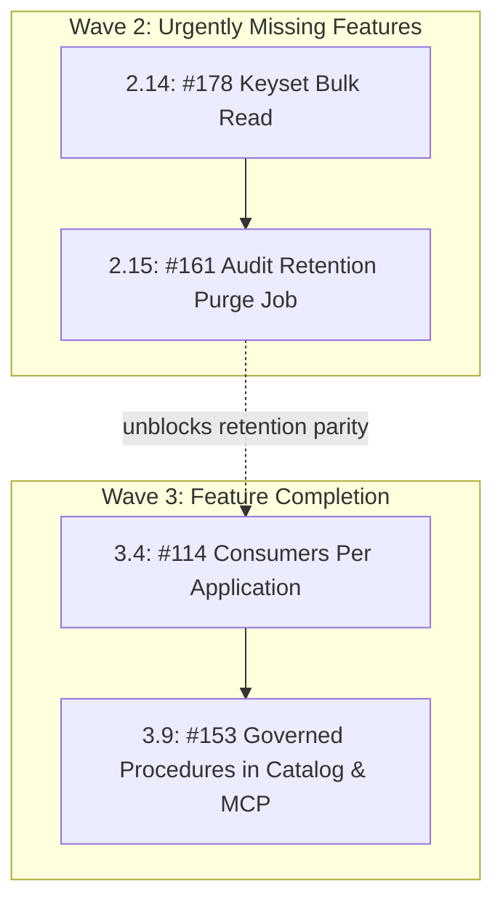

# Issue Intake Assessment: #161 and #153

**Document ID:** `INTAKE-2026-10-18-AUD-PROC`  
**Date:** 2026-10-18  
**Phase:** 1 (Product Qualification & Strategic Gatekeeping)  
**Author:** Enterprise Product Manager & Strategic Gatekeeper  
**Code base verified:** `main` / `feat/issue-143-restricted-scope-columns` at `a87f9b06`  
**Parent Plan:** [00-master-plan-overview.md](00-master-plan-overview.md)  
**Child Requirements:** `REQ-AUD-161`, `REQ-GOV-153`  

---

## 1. Summary & Qualification Verdicts

Both issues represent valid, strategically critical enterprise requirements. Neither is a duplicate, and neither is an anti-pattern when properly bounded. Each is qualified as **sensible with changes** (incorporating cryptographic verification continuity, fail-closed anti-enumeration, and zero-allocation streaming).

| Issue | Verdict | Recommended Solution (One Line) | Size | Proposed Wave / Rank |
|---|---|---|:---:|---|
| **#161** Audit retention: purge job for old audit entries | Sensible with changes | Fenced background purge job deleting expired audit entries in bounded batches, preserving HMAC hash-chain verification via cryptographically signed purge checkpoint anchors, emitting an unredacted-summary self-audit event (`AUDIT_RETENTION_PURGE`) with zero payload. | M | Wave 2, rank 2.15 (unblocks #114 retention parity) |
| **#153** Stored procedures in catalog and MCP | Sensible with changes | Expose procedures in `list_datasets`, `describe_dataset`, and `search_catalog` (`procedure:<name>`) with caller-specific masked columns; enforce fail-closed 404 anti-enumeration parity matching result-table consent; provide governed `call_procedure` MCP tool for read-only tokens under the `Query` tool group. | M-L | Wave 3, rank 3.9 (consolidates INC-3/4 and INC-5) |

---

## 2. Cross-Cutting Architectural Alignment & Non-Negotiables

1. **Zero-Trust & Fail-Closed Anti-Enumeration (OWASP API3:2023 & API8:2023):**
   - **#153 Procedure Catalog & MCP:** Callers lacking active consent or role entitlement on a procedure's `ResultTable` (or referenced tables) must not observe existence, summary, parameters, or schema metadata. Across REST endpoints (`/api/v1/procedures/{name}`), OpenAPI definitions, and MCP tools (`list_datasets`, `describe_dataset`, `search_catalog`, `call_procedure`), unauthorized callers receive identical HTTP 404 / `DATASET_NOT_FOUND` responses with indistinguishable timing and byte-exact error payloads.
   - **#161 Retention Minimums:** Retention periods must enforce mandatory hard floors (e.g. minimum 30 days for DataAccess, 365 days for Security) to prevent malicious or accidental wiping of forensic audit trails.

2. **Cryptographic HMAC Audit Chain Integrity (NIST SP 800-207 & SEC Rule 17a-4):**
   - The current hash-chain verifier (`VerifyAuditHashChainAsync`) walks sequentially from `AuditGenesisHash` (sequence 1). Simply deleting rows breaks the chain and flags a catastrophic `AUDIT HASH CHAIN VIOLATION`.
   - **Purge Checkpoint Anchor:** Before deleting any contiguous range `[1..K]`, the system must seal a signed purge checkpoint anchor (`AuditPurgeCheckpoint`) capturing: `FirstSurvivingSequence` ($K+1$), `SurvivingPrevHash`, `PurgedCount`, `PurgedThroughUtc`, and an HMAC-SHA256 signature. `VerifyAuditHashChainAsync` starts verification from the active purge checkpoint anchor forward to the tail anchor (`IAuditChainAnchorStore`).

3. **Append-Only Trigger Coexistence:**
   - Governance baselines in PostgreSQL (`trg_audit_append_only_row`, `trg_audit_append_only_trunc`) and SQL Server (`trg_audit_append_only`) currently abort any `DELETE` statement with code `42501` / `50042`.
   - The purge job must operate under a secure, transaction-scoped administrative session context (e.g., PostgreSQL `SET LOCAL autheris.audit_purge_authorized = 'true'`; SQL Server session context `SESSION_CONTEXT('audit_purge_authorized')`) checked by the trigger, preventing untrusted callers from issuing ad-hoc deletions.

4. **High-Performance .NET 10 (Zero-Allocation on Hot Paths):**
   - Column masking calculations in `describe_dataset` must project statically from `PlanColumns` and cached `TableAccessDecision` without executing procedure SQL or allocating AST trees.
   - MCP procedure invocation (`call_procedure`) must enforce bounded streaming, JSON serialization directly to output buffers, and strict row limits (default 100 rows, max 1,000) to protect LLM context windows.

---

## 3. REQ-AUD-161: Bounded Audit Retention Purge Job

### 3.1 Problem Statement & Background
- **Problem:** `AUDIT_LOG_ENTRIES` is strictly append-only. While `AuditRetentionOptions` specifies retention horizons (`SecurityDays = 3650`, `DataAccessDays = 400`, `AggregatedDays = 90`, `OperationsDays = 30`), no purge background job exists. As identified in Issue #114 (O-4 / O-9, SEC-114-12), audit entries and raw caller SIDs accumulate indefinitely, violating GDPR Art. 5(1)(e) (Storage Limitation) and leading to governance database bloat.
- **Decision D-5 Context:** Decision D-5 in `00-master-plan-overview.md` decoupled #114 from audit purge, creating GitHub Issue #161.

### 3.2 User Stories
- **US-161-1 (Compliance Officer):** As an enterprise compliance officer, I need expired data-access audit logs purged after their configured retention period (e.g. 400 days) so that personal data is not retained beyond regulatory mandates.
- **US-161-2 (Site Reliability Engineer):** As an SRE, I need audit purging to execute in small, bounded batches during maintenance windows without causing table lock escalation, transaction log exhaustion, or breaking hash-chain verification.

### 3.3 Architectural Specification
1. **Configurable Retention Policy:**
   - Per-tenant retention settings overriding defaults, with hard-coded minimum validation bounds:
     - `Security`: Default 3,650 days (min 365 days).
     - `DataAccess`: Default 400 days (min 30 days).
     - `Operations`: Default 30 days (min 7 days).
2. **Purge Checkpoint Anchor Protocol:**
   - Purge creates a signed checkpoint record persisted to `AUDIT_PURGE_CHECKPOINTS` and mirrored to external storage:
     $$\text{PurgeAnchor} = \left\langle \text{Sequence}_{K+1}, \text{PrevHash}_{K+1}, \text{PurgedCount}, \text{Timestamp}, \text{HMAC-SHA256}(\dots) \right\rangle$$
   - `VerifyAuditHashChainAsync` verifies the chain from `PurgeAnchor.Sequence` to the tail anchor. If no purge anchor exists, it verifies from `AuditGenesisHash` as before.
3. **Bounded Dialect-Specific Batching:**
   - Executes as a singleton background worker (`AuditRetentionPurgeService : BackgroundService`) guarded by a distributed database lock (`sp_getapplock` / `pg_advisory_xact_lock`).
   - Purges in bounded chunks ($\le 5,000$ rows per transaction):
     - **PostgreSQL:** `DELETE FROM AUDIT_LOG_ENTRIES WHERE id IN (SELECT id FROM AUDIT_LOG_ENTRIES WHERE occurred_at < @threshold ORDER BY seq ASC LIMIT @batchSize);`
     - **SQLite:** `DELETE FROM AUDIT_LOG_ENTRIES WHERE rowid IN (SELECT rowid FROM AUDIT_LOG_ENTRIES WHERE occurred_at < @threshold ORDER BY seq ASC LIMIT @batchSize);`
     - **SQL Server:** `DELETE TOP (@batchSize) FROM AUDIT_LOG_ENTRIES WHERE occurred_at < @threshold;`
4. **Trigger Security Bypass:**
   - Schema triggers modified to allow `DELETE` only when administrative session context is verified:
     - PostgreSQL: `IF current_setting('autheris.audit_purge_authorized', true) = 'true' THEN RETURN OLD;`
     - SQL Server: `IF CAST(SESSION_CONTEXT(N'audit_purge_authorized') AS bit) = 1 BEGIN DELETE ... RETURN; END`
5. **Self-Audit Logging:**
   - On completion of a purge run, the worker logs `AuditEventTypes.AuditRetentionPurge` (`AUDIT_RETENTION_PURGE`, Tier A, fail-closed).
   - Details JSON contains only operational metrics: `{ "purgedCount": 15000, "oldestPurgedSeq": 1, "newestPurgedSeq": 15000, "thresholdUtc": "2025-08-15T00:00:00Z", "durationMs": 420 }`.
   - **Zero-Payload Rule:** No statement text, actor IDs, or payloads are logged.

### 3.4 Acceptance Criteria
- **AC-161-01:** Background service runs on schedule (default daily at off-peak hours) and respects cancellation tokens.
- **AC-161-02:** Purges only entries whose retention category has elapsed based on `occurred_at`.
- **AC-161-03:** Batch size is bounded (max 5,000 rows per transaction) with throttling delays between batches to prevent database replication or log lag.
- **AC-161-04:** Purge checkpoint anchor is generated, signed, and persisted prior to row deletion.
- **AC-161-05:** `VerifyAuditHashChainAsync` passes cleanly after purging, verifying from the purge checkpoint anchor to the tail anchor.
- **AC-161-06:** An unauthorized manual `DELETE` statement without the session context continues to be rejected by the append-only trigger.
- **AC-161-07:** Emits an `AUDIT_RETENTION_PURGE` audit entry for each completed purge run.
- **AC-161-08:** Purge details JSON contains zero user payloads, actor SIDs, or query text.

### 3.5 Out-of-Scope Boundaries
- Retroactive mutation or selective deletion of individual user records (GDPR Art. 17 right-to-erasure is satisfied via pseudonymous pseudonymization and retention horizons).
- Altering external WORM object archives (S3 Object Lock / Compliance retention governs external storage independently).

---

## 4. REQ-GOV-153: Governed Stored Procedures in Catalog & MCP

### 4.1 Problem Statement & Background
- **Problem:** Stored procedures and Table-Valued Functions (TVFs) registered in Autheris can be executed via `/api/v1/procedures/{name}`, but are invisible in MCP discovery tools (`list_datasets`, `describe_dataset`, `search_catalog`). AI agents and data consumers cannot discover available procedures, inspect their parameters, or see which output columns will be masked. Furthermore, no MCP tool exists to invoke procedures safely using read-only tokens.

### 4.2 User Stories
- **US-153-1 (AI Agent / Data Consumer):** As an AI agent or data analyst interacting via MCP, I want to discover available stored procedures in `list_datasets` and `search_catalog` so that I know what governed business logic is available.
- **US-153-2 (Data Consumer):** As a data consumer, I want `describe_dataset("procedure:<name>")` to explain the required parameters and the exact columns I will receive (including masked indicators) before I invoke it.
- **US-153-3 (Security Officer):** As an AppSec officer, I want procedure existence and metadata completely hidden from callers who lack consent on the underlying result table, guaranteeing anti-enumeration parity.
- **US-153-4 (Agent Developer):** As an agent developer, I want a governed MCP tool (`call_procedure`) that allows read-only tokens to invoke read-mode procedures within strict safety limits.

### 4.3 Architectural Specification
1. **Catalog Representation & ID Namespacing:**
   - Exposed alongside tables with prefix `procedure:<name>` (e.g. `procedure:GetMonthlyRevenue`).
   - `kind` attribute set to `"procedure"` in `list_datasets` and `search_catalog`.
2. **Unified Visibility & Anti-Enumeration (Fail-Closed):**
   - Visibility is governed by `ICatalogVisibilityService` evaluating `ResultTable` consent:
     $$\text{IsVisible} \iff \text{RoleGatePassed}(\text{caller}) \land \text{HasConsent}(\text{caller}, \text{ResultTable})$$
   - If the caller lacks consent or role:
     - `list_datasets`: omitted from results.
     - `search_catalog`: omitted from hits (ranking and total limit apply only to visible hits).
     - `describe_dataset`: returns standard `404 DATASET_NOT_FOUND` identical to an unknown dataset.
3. **Caller-Aware Masking Projection in `describe_dataset`:**
   - Returns:
     - Summary & Description.
     - Declared Parameters: Name, SQL type, CLR type, `isRequired`, description.
     - Caller-Specific Output Columns: `name`, `type`, and access status (`clear` or `mask`). Masked columns are identified via `IConsentResolutionService.ResolveAccess(..., callerScopes)` on `ResultTable`. Columns stripped by column policy are completely omitted.
4. **Governed MCP Invocation Tool (`call_procedure`):**
   - Registered under the `Query` tool group (governed by `#115` tool switches).
   - Compatible with `ReadOnlyScopes` (permitted in `ReadOnlyTokenMiddleware` for `ProcedureMode.Read`).
   - Invocation parameters:
     - `name`: Procedure identifier (with or without `procedure:` prefix).
     - `parameters`: Key-value map of parameter arguments.
     - `limit`: Optional row limit clamped to `Gateway:Procedures:MaxRows` (default 100, max 1,000).
   - Delegates execution directly to `IProcedureExecutionService`, inheriting:
     - Anti-enumeration 404 on unconsented/unknown procedures.
     - Concurrency leasing (`ITableReadConcurrencyGate`).
     - Session-context and database-side RLS injection.
     - Output column masking and row filtering.
     - Concurrency and execution timeout enforcement.
     - Full audit logging (`TABLE_QUERY` / `PROCEDURE_EXECUTE`).
5. **LLM Context Protection:**
   - Truncation indicator: Returns `{ "rows": [...], "rowCount": 100, "truncated": true }` when results exceed the requested or configured limit.

### 4.4 Acceptance Criteria
- **AC-153-01:** `list_datasets` returns `kind: "procedure"` with ID `procedure:<name>` for all visible procedures.
- **AC-153-02:** Callers without consent on `ResultTable` never see the procedure in `list_datasets` or `search_catalog`.
- **AC-153-03:** `describe_dataset("procedure:<name>")` returns parameter specifications and caller-specific column masking.
- **AC-153-04:** `describe_dataset` on an unconsented procedure returns identical error bytes and status to an unknown dataset.
- **AC-153-05:** `search_catalog` matches procedure name, summary, and parameters, but only returns visible procedures without leaking total counts.
- **AC-153-06:** Governed MCP tool `call_procedure` executes `ProcedureMode.Read` procedures with a read-only token.
- **AC-153-07:** `call_procedure` rejects `ProcedureMode.Write` procedures when invoked with a read-only token (403 Forbidden).
- **AC-153-08:** `call_procedure` on an unconsented procedure returns `404 Procedure not found` (no existence revelation).
- **AC-153-09:** Output rows in `call_procedure` have column masking applied matching the caller's active consent decision.
- **AC-153-10:** Output rows are clamped to `limit` with an explicit `truncated: true` flag when capped.

### 4.5 Out-of-Scope Boundaries
- Write-mode procedure invocation via read-only tokens or GET verbs.
- Dynamic ad-hoc procedure compilation (procedures must be pre-registered in YAML / catalog definitions).
- Execution without declared `ResultTable` mapping when column masking is required.

---

## 5. Prioritized Placement & Recommended Waves

| Wave | Rank | Item | Size | Dependencies & Gate |
|---|---|---|:---:|---|
| **Wave 2** | **2.15** | **#161** Audit retention: purge job for old audit entries (`REQ-AUD-161`) | M | DDL trigger update / session context bypass, `AuditChainEngine` purge anchor |
| **Wave 3** | **3.9** | **#153** Governed stored procedures in catalog and MCP (`REQ-GOV-153`) | M-L | #152-#154 INC-1 (rank 1.6), INC-2 (rank 2.9), #138 INC-1 (rank 1.7), #115 (rank 2.2) |

---

## 6. Owner Questions for Intake Confirmation

| ID | Issue | Question | Recommended Default |
|---|---|---|---|
| **OQ-31** | #161 | Should audit purge run automatically as an internal `IHostedService` cron job or require an external operational trigger/endpoint? | **Internal `IHostedService`** running daily off-peak with distributed lock fencing + optional admin POST trigger. |
| **OQ-32** | #161 | How should database append-only triggers accommodate the purge job? | **Session context token** set by purge repository (`autheris.audit_purge_authorized = 'true'`) within an active transaction. |
| **OQ-33** | #161 | What is the minimum retention floor for data-access entries? | **30 days** hard floor (options validator rejects configurations $< 30$ days). |
| **OQ-34** | #153 | Should the MCP procedure tool be a single generic tool (`call_procedure`) or dynamically registered per-procedure tools? | **Single generic tool (`call_procedure`)** with dynamic parameter validation, avoiding tool catalog bloat for LLMs. |
| **OQ-35** | #153 | Should procedures without a declared `ResultTable` be exposed in the catalog? | **No** (fail-closed: procedures without a result table cannot evaluate consent or masking, so they remain hidden from the dataset catalog). |
| **OQ-36** | #153 | Default row limit for `call_procedure`? | **Default 100 rows**, hard maximum 1,000 rows. |
