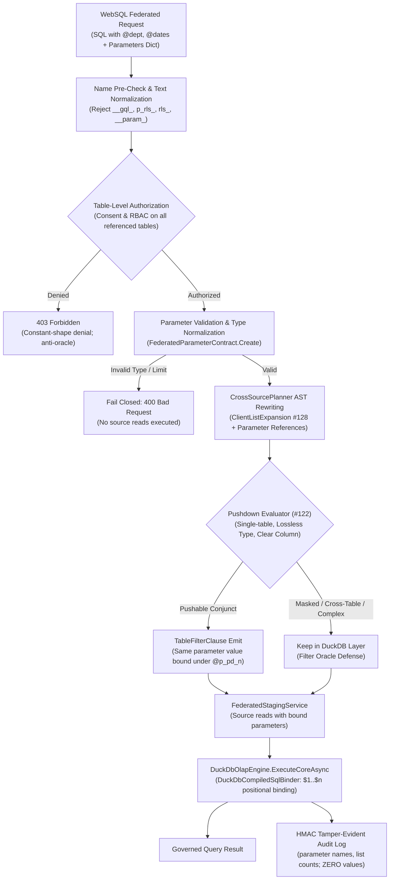

# Issue Intake Assessment & PRD: #131 Bound Parameters in Federated (Cross-Source) WebSQL Queries

**Document ID:** `REQ-DATA-131` / `INTAKE-2026-10-18-FED-BOUND-PARAMS`  
**Date:** 2026-10-18  
**Phase:** 1 (Product Qualification & Strategic Gatekeeping)  
**Author:** Enterprise Product Manager & Strategic Gatekeeper  
**Code base verified:** `main` (Wave 1 merged at `d4517660`)  
**Parent Plan:** [00-master-plan-overview.md](00-master-plan-overview.md)  
**Related Plans & Requirements:** [REQ-FED-01](2026-10-16-req-cross-source-all-consumers.md) section 7.2 (`FR-35..FR-38`, `AC-23..AC-26`), [PLAN-FED-131](2026-10-16-plan-issue-131-federated-bound-parameters.md) (`WP-FED-15`), [REQ-DATA-122](2026-10-18-issue-intake-websql-filter-pushdown.md) (predicate pushdown), [REQ-SQL-128](2026-10-16-plan-issue-128-list-parameters.md) (list parameters)

---

## 1. Executive Summary & Qualification Verdict

**Verdict:** **Approved / Sensible with changes**.

In enterprise reporting, business intelligence, and analytical data pipelines, cross-source queries are predominantly declared, parameterized queries (filtering by tenant ID, department code, date range, plant ID, or product lists). Today, client-named parameters (`ParameterOrigin.ClientNamed`) are strictly rejected on the federated WebSQL path. Specifically, `docs/features/f-dialect-02-ast-sql-compiler.md` section 9 documents: *"Client-named parameters are not supported in federated (cross-source) queries; such a statement fails closed."*

Code verification reveals that `FederatedDuckDbExecutionService` never extracts `request.Parameters` and submits the raw SQL text (retaining `@name` parameter tokens) directly to `TrinoSqlEngine` parsing and planning. Because `SqlBase.g4` treats `@` as an invalid expression token in this position, queries immediately fail with syntax errors before query planning. Furthermore, if client parameter slots were emitted by the planner, DuckDB's execution would default to binding `NULL` (`Value ?? DBNull.Value`), creating a latent silent-`NULL` defect (`x = NULL` yielding false without an error). Crucially, predicate pushdown ([#122 / `REQ-DATA-122`](2026-10-18-issue-intake-websql-filter-pushdown.md)) cannot reach parameterized filters, forcing full table staging up to row limits and crippling federated analytical queries.

Issue #131 is qualified as **sensible with changes**: client-named parameters must be supported in cross-source WebSQL via a hardened, zero-trust parameterized pipeline. Parameters must be bound at the AST level into DuckDB ($n positional slots) and into pushed source statements without string concatenation, validated fail-closed prior to any source I/O, protected against parameter side-channel oracles, and audited under strict data minimization rules (names and counts only, never values).

| Issue | Verdict | Recommended Solution (One Line) | Size | Proposed Wave / Rank |
|---|---|---|:---:|---|
| **#131** Bound parameters in federated (cross-source) WebSQL queries | Approved / Sensible with changes | Ingest client parameters via unified `FederatedParameterContract`; normalize before analysis; authorize all tables before parameter validation (anti-oracle); bind in DuckDB via `DuckDbCompiledSqlBinder` ($n slots); bind identical values in pushed source statements (#122); expand list parameters (#128); audit names and counts only with zero values and scrubbed error messages. | S-M | Wave 3, rank 3.6 (`WP-FED-15`, step I-26) |

---

## 2. Cross-Cutting Architectural Alignment & Zero-Trust Non-Negotiables



### 2.1 Zero-Trust & Fail-Closed Enforcement (NIST SP 800-207)
1. **Anti-Oracle Authorization Precedence (`D-8` / `SEC-FED-37`):** To prevent malicious callers from probing table existence or column types via parameter error side-channels, authorization of all tables must strictly precede parameter value validation. An unauthorized caller receives an identical `403 Forbidden` response regardless of whether parameter values are valid, malformed, or missing.
2. **Single Fail-Closed Pre-Read Validation:** Once all tables are authorized, parameter types, bounds, and list sizes are validated in memory before any data source read, staging operation, or HTTP virtual filter call is dispatched. Any type mismatch, unparseable literal, or limit breach aborts the execution immediately with zero source I/O.
3. **Reserved Name Hardening:** Parameter names matching internal reserved prefixes (`__gql_`, `p_rls_`, `rls_`, `__param_`) are rejected fail-closed with `WebSqlPolicyException` during the pre-analysis check (`SEC-ADG-02`).
4. **Missing Parameter Parity:** If a query references `@param` in SQL but no corresponding parameter is supplied in the request dictionary, the statement fails closed at parse/analysis time with standard syntax/missing-parameter error parity, exactly matching the single-source execution pipeline.

### 2.2 AST Parameterized Binding (OWASP API3:2023 / SQL Injection Elimination)
1. **Zero String Splicing:** Under no circumstances may client parameter values be formatted, spliced, or concatenated into SQL text. In DuckDB, client-named parameters are emitted as `$n` positional slots and bound via `DuckDbCompiledSqlBinder`. In pushed source predicates, parameters are bound using native ADO.NET / driver parameter objects (`@p_pd_<c>_n`).
2. **Injection Vector Neutralization:** Parameter values containing single/double quotes, semicolons, comment sequences (`--`, `/* ... */`), unicode control characters, or embedded NUL (`\0`) bytes are safely encapsulated by database driver parameter layers and never interpreted as SQL grammar. Embedded NUL bytes in string parameters are rejected fail-closed by the binder.
3. **Identical Bound Value Contract (`FR-37` / `SEC-FED-36`):** When a predicate is pushed to a remote data source ([#122](2026-10-18-issue-intake-websql-filter-pushdown.md)), the exact same normalized value object bound in DuckDB is passed to the remote data source's `TableFilterClause.Parameters`. No second transformation or divergent parsing occurs.

### 2.3 Strict Pushdown Integration & Type Matrix (#122 / #128)
1. **Lossless Type Enforcement:** Pushing a parameterized filter to a remote SQL source requires exact, lossless type compatibility between the normalized CLR parameter value and the target column type class:
   - **Integer (`sbyte`, `byte`, `short`, `ushort`, `int`, `uint`, `long`):** Pushable to integer columns.
   - **Decimal (`decimal` and integer types):** Pushable to decimal/numeric columns.
   - **Boolean (`bool`):** Pushable to boolean columns.
   - **String (`string`):** Pushable to text/varchar columns.
   - **Temporal, GUID, Float/Double, JSON, Spatial:** *Not pushed* (evaluated in DuckDB memory to guarantee identical casting semantics without dialect-specific divergence).
2. **Filter Oracle Guardrail on Masked Columns:** Pushed filters on columns with masking rules (`Mask`, `MaskWithHmac`, `Deny`) remain strictly forbidden per [#122](2026-10-18-issue-intake-websql-filter-pushdown.md). Only predicates on clear columns are pushable.
3. **List Parameter Expansion (#128):** When list parameters are provided (`IN (@plantList)`), they are expanded into scalar binds (`@p_pd_0, @p_pd_1, ...`) bounded by the destination dialect's parameter capacity (e.g. 2,000 for SQL Server, 1,000 for Oracle, minus 100 system reserve).

### 2.4 Cryptographic HMAC Audit Chain Integrity & Privacy Minimization (GDPR Art. 5(1)(c) / SEC Rule 17a-4)
1. **Zero-Payload Audit Rule:** Neither query audit events (`WebSqlCrossSourceQuery`) nor per-source staging events (`WebSqlCrossSourceSourceRead`) may ever record parameter values, list elements, or literal filter arguments.
2. **Structural Parameter Lineage:** Audit records must record structural metadata: parameter names, parameter kind (`scalar` or `list`), and list element counts. Parameter names must conform to `^[A-Za-z_][A-Za-z0-9_]{0,127}$` to prevent log injection.
3. **Failure Error Sanitization:** When a federated query fails, exception messages must be sanitized. Database drivers (notably DuckDB and SQL Server) frequently echo parameter values into conversion exception strings (e.g., `Conversion Error: Could not convert string 'SECRET_VALUE' to INT32`). On queries carrying parameters, failure audit records and API error responses must suppress `ex.Message` and record only the safe exception type name.

### 2.5 High-Performance .NET 10 (Zero-Allocation Architecture)
- Parameter extraction, name verification, and dictionary passing must avoid string allocations on the hot path.
- The `FederatedParameterContract` is instantiated once per request. DuckDB parameter binding reuses `DuckDbCompiledSqlBinder` and pre-allocated parameter arrays.

---

## 3. Product Requirements Specification (REQ-DATA-131)

### 3.1 Problem Statement & Background
Autheris provides enterprise data federation over heterogenous data sources (PostgreSQL, SQL Server, SQLite, DuckDB, HTTP). However, while single-source WebSQL queries fully support client-named parameters (`@param`), federated queries fail closed with syntax errors whenever a parameter marker is encountered.

This limitation forces enterprise clients to abandon parameterized templates or resort to client-side data stitching. Furthermore, with the introduction of predicate pushdown ([#122](2026-10-18-issue-intake-websql-filter-pushdown.md)), filtering on parameterized conditions (e.g., `WHERE c.department = @dept AND o.created_at >= @startDate`) cannot be pushed down to underlying databases, causing unnecessary staging row limit breaches (`ROW_LIMIT_EXCEEDED`).

### 3.2 User Stories
- **US-131-1 (Enterprise Data Developer):** As an application developer, I want to execute cross-source WebSQL queries using declared client parameters (`@department`, `@dateRange`), so that my applications can run reusable, parameterized queries across disparate databases without manual query stitching.
- **US-131-2 (Chief Information Security Officer & Auditor):** As a CISO, I want parameter values to be bound strictly via driver AST parameters and excluded from audit logs and error messages, ensuring zero risk of SQL injection, log leakage of sensitive PII, or filter oracle attacks.
- **US-131-3 (Database Administrator & SRE):** As a DBA, I want pushed federated filters to pass typed parameterized statements to backend databases, avoiding statement plan cache pollution and execution plan instability.
- **US-131-4 (Compliance Officer):** As a compliance officer, I want audit logs to record parameter names and list counts to verify query intent without recording sensitive parameter values, maintaining compliance with GDPR Art. 5(1)(c) data minimization.

### 3.3 Functional Requirements

#### FR-131-01: Client-Named Parameter Acceptance
- The federated execution entry points (`WebSqlEndpoints`, `TrinoSql`, and declared SQL endpoints) must accept client-named parameters (`ParameterOrigin.ClientNamed`) in cross-source queries via `GovernedSqlQueryRequest.Parameters`.
- Parameter name syntax must follow standard identifier rules (`@identifier` or `identifier`), normalized to uniform case-insensitive keys.

#### FR-131-02: DuckDB AST Parameterized Binding
- In the generated DuckDB statement, client-named parameters must be compiled into positional parameter placeholders (`$1, $2, ...`) by `CrossSourcePlanner`.
- Parameter values must be bound to `DuckDBCommand` via `DuckDbCompiledSqlBinder` using typed parameter objects (`DuckDBParameter`).
- Values must never be formatted, escaped, or spliced into DuckDB SQL text.

#### FR-131-03: Pushed Parameter Value Parity (#122)
- Where a filter predicate referencing a parameter is pushed down to a SQL source table per [#122](2026-10-18-issue-intake-websql-filter-pushdown.md), the source `TableFilterClause` must bind the exact same normalized value instance bound in DuckDB.
- Pushed parameters must use planner-generated unique identifiers (`@p_pd_<c>_n`) in the source statement text, ensuring zero collision with caller names or RLS policy parameters (`@p_rls_*`).

#### FR-131-04: Fail-Closed Pre-Read Validation
- Parameter values must undergo a single comprehensive validation pass before any source table read or virtual filter probe is initiated.
- Validation checks must include:
  1. Mandatory scalar types match allowed primitive types (int, long, decimal, double, bool, string, date/time, Guid).
  2. Unrecognized complex objects (nested objects, unmapped arrays) are rejected with `400 Bad Request`.
  3. String parameters containing embedded NUL (`\0`) bytes are rejected immediately.
  4. Validation occurs strictly *after* all referenced tables pass authorization checks (anti-oracle defense).

#### FR-131-05: List Parameter Support (#128)
- Federated queries must accept list parameters (arrays of scalar values) for `IN` / `NOT IN` predicates once [#128](2026-10-16-plan-issue-128-list-parameters.md) is active.
- In DuckDB, list parameters must be expanded via `ClientListExpansion` into discrete positional placeholders (`$n, $(n+1), ...`) or boolean constants (`1 = 0` / `1 = 1` for empty lists).
- In pushed source statements, lists must be expanded to discrete scalar parameters (`@p_pd_<c>_0, ...`) bounded by the target dialect's bind limit (`EffectiveMax`).

#### FR-131-06: Strict Audit Minimization & Error Sanitization
- `WebSqlCrossSourceQuery` audit records must contain:
  ```json
  "parameters": [
    { "name": "dept_id", "kind": "scalar" },
    { "name": "plant_ids", "kind": "list", "count": 5 }
  ],
  "bindCount": 6
  ```
- `WebSqlCrossSourceSourceRead` audit records for staged tables must list pushed parameter names and list element counts.
- Neither audit record may include parameter values.
- On query execution failure, if the query carries parameters, `error` must record the exception type name only, completely omitting `ex.Message` to prevent driver conversion strings from leaking secret parameter values.

#### FR-131-07: Parameter Name Reservation & Injection Defense
- Client parameter names prefixed with `__gql_`, `p_rls_`, `rls_`, or `__param_` must be rejected with `WebSqlPolicyException` before query analysis.
- Statements containing literal `__param_` substrings in the incoming SQL text must be rejected fail-closed to prevent synthetic parameter collision.

---

## 4. Acceptance Criteria

- **AC-131-01 (Scalar Parameter Execution):** A declared cross-source WebSQL query joining two distinct database sources with scalar parameters (e.g. string department code and integer minimum age) executes successfully and returns the exact matching rows.
- **AC-131-02 (List Parameter Execution):** With [#128](2026-10-16-plan-issue-128-list-parameters.md) present, a cross-source query using an `IN (@plantList)` filter returns the correct matching rows across all sources, correctly handling single-item, multi-item, and empty list edge cases.
- **AC-131-03 (Pushdown Equivalence with #122):** When predicate pushdown ([#122](2026-10-18-issue-intake-websql-filter-pushdown.md)) is active, a parameterized predicate pushed down to a SQL source binds the identical parameter value and produces row results byte-for-byte identical to execution without pushdown.
- **AC-131-04 (SQL Injection Neutralization):** Parameter values containing SQL injection payloads (e.g. `' OR '1'='1`, `'; DROP TABLE users; --`, `/* comment */`, unicode quotes) are treated strictly as literal data. Generated SQL text for DuckDB and remote sources never contains the raw payload characters.
- **AC-131-05 (Fail-Closed Type & Shape Rejection):** A parameter with an incompatible type (e.g. complex JSON object or array in scalar position) is rejected with `400 Bad Request` before any remote database connection or staging read is performed.
- **AC-131-06 (Anti-Oracle Authorization Precedence):** A query with invalid or malformed parameters targeting an unauthorized table returns `403 Forbidden`, identical to an unauthorized request with valid parameters.
- **AC-131-07 (Data Minimization in Audit):** Inspection of the WORM audit log entries for successful and failed parameterized federated queries verifies that parameter names and counts are recorded, but zero parameter values appear in audit payloads or failure error messages.

---

## 5. Out-of-Scope Boundaries

1. **Co-Located Source Statement Fusion (#132 / `WP-FED-16`):** Consolidating multiple tables residing on the same physical data source into a single SQL statement is deferred to Issue #132.
2. **Parameter Values in Audit Trails:** Logging parameter values under any debug or audit configuration is strictly rejected by architecture policy.
3. **Lossy Pushdown Coercion:** Coercing string parameter values into remote temporal, numeric, or GUID columns during pushdown is prohibited; such predicates must remain in DuckDB for evaluation.
4. **Non-SQL Key Source Pushdown:** Pushing client parameters to arbitrary third-party REST key sources remains governed by declarative virtual filter URL templates, not by the SQL AST parameter binder.

---

## 6. RICE-C Prioritization & Backlog Recommendation

$$\text{Score} = \frac{\text{Reach (7)} \times \text{Impact (2.5)} \times \text{Confidence (95\%)} \times \text{ComplianceWeight (1.5)}}{\text{Effort (1.0 person-weeks)}} = \frac{7 \times 2.5 \times 0.95 \times 1.5}{1.0} = 24.9$$

- **Reach (7/10):** Unlocks parameterized enterprise reporting and declared BI dashboards across cross-source federated datasets.
- **Impact (2.5/3.0):** Closes a critical usability and functionality gap where declared queries with parameters currently fail closed with syntax errors.
- **Confidence (95%):** AST parameterization and binding patterns are thoroughly established in `TrinoSqlEngine` and `DuckDbCompiledSqlBinder`.
- **Compliance Weight (1.5):** Rigorous anti-injection parameterized binding, anti-oracle authorization precedence, and GDPR Art. 5(1)(c) audit data minimization.
- **Effort (1.0 person-weeks / Size S-M):** Well-bounded scope in `FederatedParameterContract`, `CrossSourcePlanner`, and `FederatedDuckDbExecutionService`.

### Recommended Backlog Placement:
- **Priority Wave:** **Wave 3 (Feature Completion)**
- **Rank:** **3.6** (`WP-FED-15`, step I-26)
- **Dependencies:**
  - Upstream prerequisites: #122 (Predicate Pushdown, Wave 2 rank 2.16), #128 (List Parameters, Wave 2 rank 2.3).
  - Downstream dependents: Completes federated query capability for #132 (Co-located data sources).
